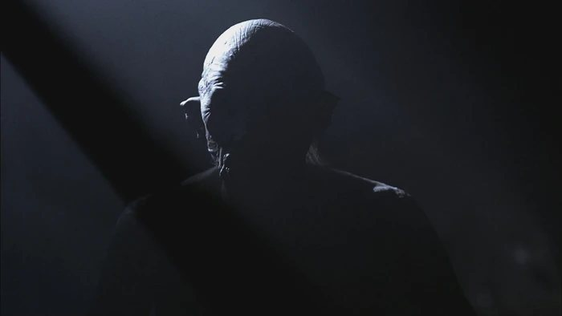
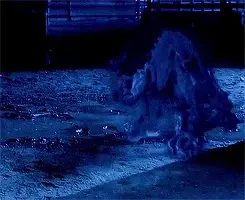
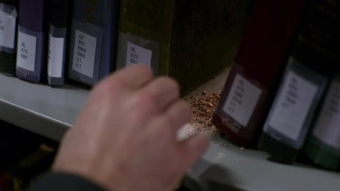
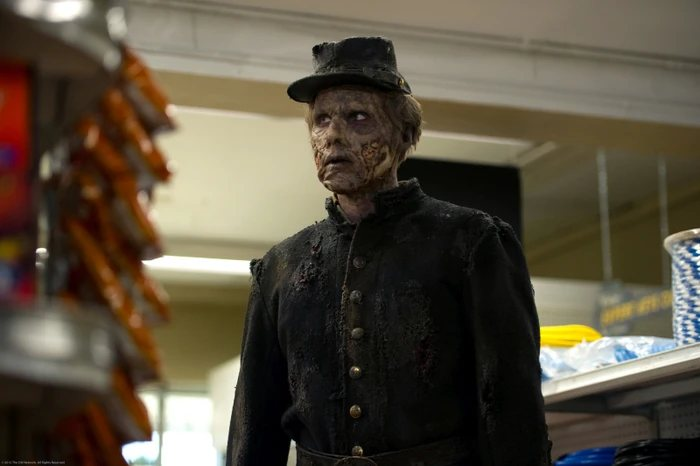

# «Хозяин Леса»

*Современное **хоррор-расследование** на 1–2 сессии по 3,5–4,5 часа. 3–5 охотников. Тон — «Сверхъестественное» без шуток: глухой городок, лес, родня, которая не верит ни одному слову. Правила — **«Охотники»** (GUMSHOE).*

**Место.** Национальный лес **Блэкпайн**, Монтана. Городок **Ольховка / Alder Creek** — 604 человека, лесопилка, закусочная «Последняя верста», участок шерифа и съезд на **Forest Road 44**.

**Время.** Наши дни, конец октября. Рассвет в 7:40. У героев **одна ночь** — от заката до рассвета.

**Обещание игрокам.** «Вы не будете искать улики. Вы будете решать, что с ними делать».

> **Важно.** Это не данж. Лес не охраняет сокровище — он **просит**. Каждый бой здесь — провал переговоров, а не этап.

## Что нужно для игры

| Что | Где | Зачем |
|-----|-----|-------|
| Правила | «Охотники — полные правила», главы 1, 3, 5, 6, 9, 11 | ядро, способности, бой, Стабильность, обряды, правило твари |
| Лист охотника | там же, приложение А | пулы, Источники стабильности, шрамы |
| Карточки существ | раздел 8 этого дела | бестиарий дела |
| Драйвы и архетипы | глава 2 | за что цеплять героев |

Других книг не нужно. Всё, что раньше приходилось искать по разным изданиям, уже есть в «Охотниках».

## Как читать эту редакцию

Дело переписано с ванильных правил на «Охотников». Термины русские, механика — из глав 1, 5, 6 и 11.

- **Здоровье** — пул общей способности, а не отдельный счётчик.
- **Порог попадания** — сложность попасть по цели. Обычно 4; у быстрых и укрывшихся 5; у почти неуязвимых 6.
- **Стабильность** — проверка **1к6 + очки против Сл**: 4 — призрак и монстр недели, 5 — демон, одержимый, ритуальный труп, 6 — ангел и первичная сущность.
- **Урон не бросается.** Урон = (итог атаки − Порог попадания) + модификатор оружия. Кубик только один — тот, которым вы попали.
- **Сложности** короче, чем в старых книгах: **4** — обычное дело под давлением, **5** — трудно, **6** — почти невозможно.
- **Расследовательские способности не бросают.** Есть способность — есть улика. Трата даёт больше, а не «лучше бросок».
- **Правило твари.** Пока слабость не установлена, любая атака наносит ровно **1 урона**. Оружие по установленному правилу — **+2**, и тварь смертна.

## Четыре правила, на которых держится дело

1. **Улики не проваливаются.** Есть расследовательская способность — есть ключевая улика. Без броска.
2. **Пулы — бюджет внимания.** Трата значит «я хочу больше». Нет траты — нет бонуса, но сцена не рушится.
3. **Стабильность — валюта, а не наказание.** Герои платят ужасом за то, что хотят узнать и спасти.
4. **Правило твари — не запрет хранителя, а факт мира.** Лесной хозяин не убивается, пока цел якорь. Это узнаётся, а не объявляется.

> **Важно.** Пул нельзя тратить ниже 0. Трата 0 — бесплатно, но без бонуса. Все проверки записываются так: **1к6 + очки против Сл 4 / 5 / 6**.

## Что изменено, а что нет

| Канон | Здесь |
|-------|-------|
| Чёрный Бор, деревня углежогов | парк Блэкпайн, городок Ольховка |
| княжеские писцы | лесная служба и «Блэкпайн Тимбер» |
| трактир «Последняя верста» | закусочная с той же вывеской |
| сатир, баргесты | Пелл (мелкий дух), две адские гончие |
| 400 лет | 400 лет — стратиграфия это подтвердит |
| пять пропавших за месяц | по одному в поколение: 1961, 1988, 2004, 2024 — и Даг вне очереди |

> **Почему изменён ритм.** В фэнтези-версии лес берёт всех сразу: он голоден. В современной — он **осторожен**: сорок лет тишины, потом снова. Это делает расследование возможным: у полиции есть старые дела, а у городка — привычка молчать. В этом году он взял двоих, и это уже тревога.

**Не тронуто:** имена; нож в нише и «тень ножа» в груди голема; три способа забрать нож; две фазы босса; сад; обход стражи; финал.

---

## 1. Дело

Всё начинается одинаково: **тело Дага**. Его нашли двое техников-геодезистов на кромке старой гари, в двух милях от Forest Road 44. Окружной патологоанатом подписал «животные и переохлаждение». Шериф закрыл дело за один день.

Дальше группы расходятся.

### Крючок А. Родственница (обыватели)

**Нора Морроу**, 41 год, тётя Теи, сестра Билла. Работает на почте, копит племяннице на колледж. Девять дней назад Тея не вернулась с прогулки. Шериф сказал: «подростки уходят». Нора собрала 4 000 долларов, коробку из-под обуви и **не верит** ни одному слову.

> «Мне не нужен детектив. Мне нужно, чтобы кто-то **поверил**. Вот её рисунки. Вот её ботинок. Один. Второй нашли у дороги, за восемь миль. Она бы **никогда** не бросила ботинок».

**Даёт:** доступ в дом Теи, доверие Марты, легальный повод задавать вопросы.
**Требует:** обещание вернуть девочку живой. Нора поедет с группой, если её не отговорить, — и это отдельная проблема (**Здоровье** 6, **Стабильность** 6, ни одного боевого пула выше 4).

### Крючок Б. Ячейка (агенты)

**Ordo Veritatis**, куратор **Вэйл** — только голос в телефоне, ни разу не в кадре.

> «Блэкпайн, участок 14. Четыре исчезновения за шестьдесят лет, все в радиусе трёх миль. Мембрана тонкая, но **держится**. Задача: найти фетиш, нейтрализовать, уйти тихо. Местным — ничего. Если фетиш оружие, он нужен нам. Если фетиш человек — тем более».

**Даёт:** снаряжение (соль, термит, спутниковый телефон), полномочия, архивы.
**Требует:** тишину. Вэйл **знает** про нож и хочет его **уничтожить** — это прямой конфликт с финалом.

> **Важно.** Вэйл не лжёт и не злодей. Он считает, что освобождённый бог вернётся через сто лет с новым голодом. У него есть цифры. Пусть игроки с ними спорят.

### Крючок В. Верующий (оккультисты, фольклористы)

**Отец Каллен**, 74 года, миссия Св. Ольги на выезде из городка. Служит в пустом храме, разговаривает с лесом и знает больше, чем говорит.

> «Я крестил её мать. Я не буду крестить её саму, если вы принесёте мне тело. Ищите **нож**, а не кости. Кости он соберёт снова. Нож — нет».

**Даёт:** ольховый словарь (40 слов), чин отпевания, отпущение — то есть **Теологию** (что сказать) и **Веру** (чем сказать) в финале. **Требует:** обещание **не убивать**, если можно освободить.

### Что известно на старте

- Пропали: **1961** — турист; **1988** — Кэл Доус, брат шерифа; **2004** — биолог из Мизулы; **2024** — Тея Морроу.
- **Даг** — единственный, кого нашли. Мёртв три дня.
- **Forest Road 44** закрыта «по погодным условиям» с 12 октября.
- Марта видела ночью **зелёный свет** над лесом — «как будто кто-то дышит». Городок молчит: не из злобы, из привычки.

### Почему нельзя просто вызвать полицию или ФБР

1. **Юрисдикция-лабиринт.** Федеральная земля — Лесная служба, округ — шериф, штат — DCI, ФБР — только при федеральном преступлении. Пропавший подросток на федеральной земле — это три ведомства и ноль тел.
2. **Тел нет.** Четыре исчезновения — четыре пустых дела. Единственное тело подписано как «животные». Нет состава — нет розыска.
3. **Свидетели отказываются.** Марта дала показания и забрала их. Техник, нашедший тело, уволился и уехал. Фразу «он говорил моим голосом» вычёркивают из протокола.
4. **Лес закрывает дороги.** Выехать — значит пройти **погоню** (раздел 4). Позвонить — только с пятачка у въезда; в глубине звонок соединяется, но отвечает **не тот**, кому звонили.
5. **Мембрана.** Если привести федералов, дело станет **громким**, а мембрана — **тонкой**. Вэйл: «Тогда он выйдет не в лес, а в город».

**Итог:** помощь не приедет вовремя. Герои — единственные, кто знает и успевает.

### Как звучит дело

- **Вопрос:** убить чудовище или **освободить** человека, которым оно было?
- **Часы:** девять дней Теи. Без ингалятора — ещё двое-трое суток (**Медицина**, дом Теи).
- **Ночь:** Крон **спит перед рассветом** (от Теи или от Пелла). Один час тишины — единственное окно для ритуала без боя.

### Драйвы (к6)

| к6 | Драйв | Что движет | Как звучит | Триггер |
|----|-------|------------|-----------|---------|
| 1 | Долг | «Я обещал» | «Я не уйду без неё» | герой остаётся, когда может уйти |
| 2 | Месть | «Кто-то за это ответит» | «Я шёл сюда сорок лет» | герой бьёт, когда можно говорить |
| 3 | Искупление | старый долг | «В прошлый раз я не успел» | герой берёт чужую вину на себя |
| 4 | Знание | знать | «Мне нужно увидеть» | герой суёт голову в щель |
| 5 | Защита | свой человек | «Я знаю, как пахнет её куртка» | риск ради конкретного имени |
| 6 | Азарт | охота | «Наконец-то стоящая дичь» | герой ставит на кон больше, чем нужно |

> **Правило Драйва (домашнее).** Один раз за сессию, когда охотник поступает по Драйву **против собственной выгоды и безопасности**, игрок возвращает **2 очка Стабильности** или **1 очко любого общего пула**. Это не награда за отыгрыш, а топливо: без него персонаж выгорает к финалу.

### Источники стабильности

Три **человека** на героя, у каждого рейтинг **3**. Сцена с Источником возвращает **2 очка Стабильности**; угроза Источнику отнимает **2** и требует проверки **Стабильности против Сл 5**.

| Архетип | Источник 1 | Источник 2 | Источник 3 |
|---------|-----------|-----------|-----------|
| Обыватель | Тея, племянница | Нора, сестра с почты | Шелли, мать Теи |
| Агент Ordo | куратор Вэйл, голос в трубке | напарник по ячейке | сестра в Мизуле, которая думает, что он работает в страховой |
| Оккультист | отец Каллен, духовник | профессор, который не смеётся над его статьями | брат, который так и не простил |
| Рейнджер, охотник | Ким Ортис, напарница по участку | старик, у которого он учился ставить капканы | жена, которая ждёт дома и не спрашивает |
| Журналист | редактор, который ещё берёт его тексты | героиня прошлого материала | брат, который не читает его статей |

> **Важно.** Источник — **человек**, а не место и не идея. В лесу он **не работает**: поговорить не с кем, а телефон отвечает не тем голосом. Именно поэтому Стабильность в этом деле тает быстрее обычного: герой отрезан от всего, что его держит.

---

## 2. Способности

**Расследовательские способности не бросаются.** Есть способность — есть информация. Трата 1 очка (реже 2) даёт **больше**, чем минимум: подробность, имя, направление, второй смысл.

### Расследовательские

- **Антропология.** Читает людей как обряд. В саду позы **погребальные**, а не пыточные: он **хоронит**, а не пытает. Рисунки Теи — не детские, а композиция петроглифа. Насечки на коре — **просьба**, не угроза.
- **Археология.** Слои и фундаменты. Под часовней — **очаг** сгоревшего дома. Ниша в стволе вырезана **изнутри** четыреста лет назад. В слое гари — обугленный частокол и керамика. Два пожара: 1910 и 1620±40.
- **Архивы.** Подшивки «Alder Creek Courier», краеведческая комната, микрофиши, карты 1910 и 1930, старые дела. И бумага как таковая: почерк, копирка, чернила. Сопоставляет даты, имена и карты: кто такой Крон, сколько раз он возвращался, что общего у пропавших.
- **Баллистика.** Оружие и след. Стрела вошла **снизу вверх** — стреляли из земли. Древко ольха, оперение не птичье, наконечник не современный. Арбалет из чехла Дага **не натягивается**: из него не стреляли.
- **Демонология.** Имена и сделки. Он **привязан**, а не живёт здесь; у него есть имя, которого он не хочет слышать; якорь держит его, как договор держит должника. Гончие — не звери, а **сторона сделки**, и они это знают.
- **История.** Что здесь было раньше. В отчёте 1910 — егерь **Crowne**. На карте 1930 — дорога, которой нет. В описи участка — строка «описанию не подлежит». Руны 1620-х.
- **Криптозоология.** Следы, повадки, циклы. Миграция **петлями** — GPS-ошейники рисуют круги. Наросты-лица старше сорока лет. Звери не злые — они **больны** симбионтом. «Доверяй мху, не компасу».
- **Медицина.** Тело Дага: жил четыре-шесть часов после раны и полз. В желудке — мох и грибы не по сезону. Тея: вросла по грудь, пульс, обезвоживание, астма; что можно вырезать, а что уже срослось. Как отличить живое тело от живого человека.
- **Оккультизм.** Природа бога. Нож — якорь, тень в груди — копия. Зелёное оперение — «долговая метка»: лес помечает то, что заберёт. Часовня — контейнер, а не храм. Обряды: изгнание, отпевание, сожжение.
- **Теология.** Причастие, а не жертва. Отпевание, а не изгнание. Формула освобождения — слова, а не сила. Что значит «прости» для того, кто не может умереть.
- **Химия.** Зелёная пыль — **малахит и кровь**, не краситель. Смола и скипидар горючи. Нож — **метеоритное железо** с оливином; чтобы его сжечь, нужен термит или бензин с кислородом.
- **Языки.** **Ольховый язык**, 40 слов в словаре Каллена. Руны в часовне читаются. Шёпот леса звучит на нём. Имитация голоса Хозяина: без словаря вы повторите только рёв, с ним — проверка **Подготовки**.
- **Допрос.** Доус, Шелли, Рик, техник, который нашёл тело. Работает долго, но надёжно: человек уходит из комнаты пустым и говорит правду.
- **Запугивание.** Быстро и грязно. Шериф отдаёт копии, лесоруб вспоминает, что видел, Пелл перестаёт играть. После — двери закрыты, и чинить их придётся **Лестью**.
- **Лесть.** Марта садится за стол. Ким Ортис показывает «странную карту». Шелли пускает в комнату Теи и оставляет наедине.
- **Проницательность.** Кто врёт. Марта — нет. Доус — да, но не про лес. Шелли врёт себе. Пелл врёт всегда и очень плохо.
- **Репутация.** Юрисдикция, ордера, Forest Order, давление. Почему ФБР не приедет и что можно сделать **легально**. Доус отдаёт копии, если услышит «иск» и «пресса».
- **Уличное чутьё.** Городок. Кто молчит, кто врёт, кто не пойдёт в лес ни за какие деньги. Где взять бензин, соль, лом и молчание.
- **Осмотр места.** Вещдоки и цепочки. Пыль, мох, стрела, отпечаток, обломок ольхи. Сопоставляет сцены: **тот же мох**, **та же пыль**. В плане часовни нет алтаря, зато есть крышка.
- **Эксплуатация.** Термит, бензин с кислородом, генератор, ловушка из подручного. Чем поджечь нож и чем сбить пламя, если оно пошло не туда.

> **Важно.** Список **закрыт**: это двадцать способностей из главы 3 «Охотников», и ни одну из них не надо выдумывать заново. **Восприятие бесплатно**: что видно — видно всем. Лесную тропу читает **Криптозоология**, а не Слежка: Слежка — это хвост, а не след. Социальные сцены идут через **Допрос**, **Лесть**, **Запугивание**, **Проницательность**, **Репутацию** и **Уличное чутьё**.

### Общие

- **Атлетика.** Лазать по стволам, бежать, вырываться из корней. Трата 1 = **+1 к вашему Порогу попадания** против одной атаки.
- **Бдительность.** Заметить засаду, шёпот за спиной, что-то не так. Определяет **порядок хода**.
- **Бой.** Ближний бой, нож, топор, кулаки. Вырваться из хвата.
- **Вера.** Экзорцизм, отпевание, освящённая вода, отгон. В финале — единственное, чем **заканчивают**, а не убивают.
- **Вождение.** Дорога 44, разворот на гравии, погоня на машине. Лес закрывает дорогу — это соревнование, не проверка.
- **Воля.** Не пойти на голос, не назвать имя, удержать чужие руки. Воля против Хозяина, когда он говорит **твоим** голосом.
- **Здоровье.** Запас тела. Урон идёт **сразу сюда**, без брони. 0 — тяжёлое ранение; −5 — смерть.
- **Первая помощь.** Спасти Тею, стабилизировать раненого, обработать ожог, вскрыть ствол без топора.
- **Подготовка.** «У меня в багажнике»: соль, бензин, термит, фонарь, вторая рация, бинты, лопата.
- **Скрытность.** Коридоры мха, сад, часовня, тень между стволами.
- **Стабильность.** Пул ужаса. Главный ресурс дела.
- **Стрельба.** Пистолет, дробовик, арбалет. Атака — **1к6 + очки против Порога попадания**.

> **Сборка под это дело.** 10–12 расследовательских, по 1–2 очка, одна на трёх. Общие: Здоровье 8–10, Стабильность 10–12, Бой или Стрельба 8, Скрытность 6, Бдительность 6, Подготовка 6, Первая помощь 4, Воля 4, остальное по вкусу. Стабильность берите **на 2 выше** обычного: вы потратите её много.

### Какая способность → какая улика

| Способность | Сцена или улика | Что именно |
|-------------|---------------|-----------|
| Антропология | C6, C7 | насечки-просьба; погребальные позы сада |
| Археология | C4, C8 | частокол в гари; ниша, вырезанная изнутри |
| Архивы | C1, C2, C3, C5 | подшивки 1961–2024; другая рука; карта на обороте |
| Баллистика | C1 | стрела снизу вверх; арбалет не натягивается |
| Демонология | C6b, C7, C8 | якорь и копия; природа бога; гончие как сторона сделки |
| История | C2, C4, C8 | пожар 1910; егерь Crowne; руны 1620-х |
| Криптозоология | C1, C4, C6, C7 | петли GPS; больные звери; след петлёй; коридоры мха |
| Медицина | C1, C5, C7 | жил 4–6 часов и полз; ингалятор; Тея |
| Оккультизм | C1, C6b, C7, C8 | долговая метка; тень ножа; узел и контейнер |
| Теология | C7, C8 | причастие; отпевание |
| Химия | C1, C8 | пыль — малахит и кровь; чем сжечь нож |
| Языки | C4, C6, C8 | 40 слов; шёпот; надпись в нише |
| Допрос | C3, C5 | дело Теи; что видела Шелли |
| Запугивание | C3 | Доус отдаёт копии, лесоруб вспоминает |
| Лесть | C2, C4 | Марта за столом; карта Ортис |
| Проницательность | C2, C3, C5 | кто врёт; чего боится Доус |
| Репутация | C1, C2, C3 | юрисдикция; Forest Order; копии дел |
| Уличное чутьё | C2, C3 | кто молчит; брат шерифа |
| Осмотр места | C1, C3, C5 | тот же мох; пыль 1988; ботинки |
| Эксплуатация | C8 | термит; бензин с кислородом |
| — | C6, C7 | восприятие бесплатно: лица, Тея, ниша |

---

## 3. Цепочка улик

> **Правило второго ключа.** У каждой ключевой улики **две** способности. Если в группе нет ни одной — улика приходит **сама**: её приносит NPC, она лежит на видном месте, её показывает сцена. Улику нельзя **потерять** — можно только **не понять**. Если третьего пути нет, это вина хранителя, а не игроков.
>
> **Как читать пометки.** Пометка «трата 1» значит: базовую улику вы получаете даром, за факт наличия способности, а за очко — подробность, имя или второй смысл.

### Цепочка

| # | Сцена | Ключевая улика | Способность (основная / дублёр) | Куда ведёт |
|---|-------|-----------|--------------------------------|-----------|
| C1 | Морг округа Пайн | Страница 1 дневника и арбалет | Осмотр места / Медицина | к Тее и к Дагу |
| C2 | Закусочная «Последняя верста» | Четверо пропавших; зелёный свет | Уличное чутьё / Архивы | к участку 14 |
| C3 | Участок шерифа | Вычеркнутый вопрос свидетеля | Архивы / Репутация | к лесничеству |
| C4 | Лесничество, участок 4 | Участок 14; два слоя гари; деревня | История / Археология | к дому Теи |
| C5 | Дом Теи | Мох на ботинках; карта на обороте | Осмотр места / Архивы | к тропе 7 |
| C6 | Лес, тропа 7 | Страница 2; лица; метки | Криптозоология / Антропология | к поляне |
| C6b | После боя со зверями | Страница 3 | всем / Архивы | к нише |
| C7 | Поляна и сад | Тея жива; коридоры моха | Медицина / Криптозоология | к часовне |
| C8 | Часовня | Ниша и нож; тень в груди | Археология / Оккультизм | к боссу |

```
морг → закусочная → участок → лесничество → дом → лес → поляна → часовня
 C1        C2          C3         C4         C5    C6      C7        C8
```

Порядок **свободный**. Важно, чтобы к поляне группа знала три вещи: **кто такой Крон**, **где ниша**, **что Тея ещё жива**.

### C1. Морг округа Пайн

**Видят все.** Тело Дага, 41 год. Одежда разрезана, пакет с вещами, чехол с арбалетом. Пахнет железом и мокрой землёй.

**Ключевая улика.** В нагрудном кармане — **страница 1**, сложенная вчетверо. В чехле — арбалет, который **не натягивается**.

- **Медицина:** он жил 4–6 часов после раны и **полз**. Трата 1: в желудке мох и грибы не по сезону.
- **Баллистика:** стрела вошла снизу вверх — стреляли из земли. Трата 1: древко ольха, оперение не птичье, наконечник старше самого леса.
- **Химия (трата 1):** зелёная пыль на ладони — **малахит и кровь**. Не краска, не медь.
- **Архивы (трата 1):** последние три строки — **другой рукой**, другими чернилами.
- **Оккультизм (трата 2):** зелёное оперение — «долговая метка». Лес помечает то, что заберёт.

**Если пропустили:** патологоанатом отдаёт пакет за 50 долларов и говорит: «Мне это не нужно. Мне за это не платят».

### C2. Закусочная «Последняя верста»

**Видят все.** Марта Гурт, 60, стеклянный глаз, руки в старых ожогах. Стена с фотографиями, пирог под плёнкой, радио, дробовик под кассой.

**Ключевая улика.** За шестьдесят лет — **четверо**; Даг — пятый. Ночью над лесом **зелёный свет**. «Лес **смотрел** на меня».

- **Уличное чутьё (трата 1):** лесорубы не ходят в Блэкпайн. У них «соглашение» с лесной службой. Один видел свет — и пил три дня.
- **Архивы (трата 1):** под кассой подшивки: **1961, 1988, 2004, 2024**. Все — в радиусе трёх миль от старой гари. Все — в первые две недели октября.
- **Репутация (трата 2):** копия Forest Order: участок 14 закрыт «на неопределённый срок» без объяснения.
- **История (трата 1):** «после пожара лес стал другой». Про 1910-й она знает по семейным рассказам.

**Если пропустили:** Марта сама подходит к столу: «Вы про Дага? Сядьте. Я налью».

### C3. Участок шерифа

**Видят все.** Шериф Доус, 55, усталые глаза. Два заместителя, доска с делами, коробки, кофе.

**Ключевая улика.** Дело Теи закрыто как «уход из дома», но в нём **вычеркнутый вопрос** свидетеля: «а он говорил **моим** голосом?»

- **Репутация (трата 1):** Доус отдаёт копии, если услышит «иск» и «пресса». Он не хочет скандала больше, чем боится леса. Запрос в Лесную службу возвращается номером участка **14**.
- **Уличное чутьё (трата 1):** его брат Кэл пропал в 1988-м; в деле лежит письмо шерифа — он слышал, как брат зовёт его голосом, и **не пошёл**. Поэтому он не пойдёт и не пустит.
- **Архивы (трата 1):** в деле 1961 написано «унесло водой» — в лесу без реки. Формулировка скопирована.
- **Осмотр места (трата 2):** в коробке 1988 — зелёная пыль и обломок ольхи. Тот же спектр.

**Если пропустили:** заместитель **Рик** оставляет коробку на столе и уходит за кофе. «Я в это не лезу».

### C4. Лесничество, участок 4

**Видят все.** Рейнджер **Ким Ортис**, 34, карты на стене, радио, шкаф с замком, приказ в рамке.

**Ключевая улика.** **Участок 14** и **два слоя гари**. Деревня здесь **была**.

- **История (трата 1):** в отчёте 1910 — егерь **Crowne**. В описи — «описанию не подлежит».
- **Археология (трата 1):** второй слой — **1620±40**. Древний пожар начался **с расчисток**, а не с молнии. В слое — обугленный частокол, керамика, очаг.
- **Репутация (трата 2):** журнал радиосвязи: ни одного выхода из 14 после 16:00 за тридцать лет.
- **Языки (трата 1):** старый указатель на тропе — не на английском. Сорок слов.
- **Криптозоология (трата 1):** GPS-ошейники на оленях рисуют **петли**.

**Если пропустили:** Ортис показывает «странную карту», если спросить про закрытую дорогу. «Это не моя карта. Она лежала в деле».

### C5. Дом Теи

**Видят все.** Трейлер на Колхаун-роуд. Мать, **Шелли**, 38, третий день пьёт. Комната Теи, рисунки на стене, пустая упаковка ингалятора.

**Ключевая улика.** **Серебристый мох** на ботинках. **Карта** на обороте рисунка — рукой Дага.

- **Осмотр места (трата 1):** мох тот же, что на теле Дага.
- **Архивы (трата 1):** на обороте — часовня, ниша и слова «здесь спит».
- **Антропология (трата 1):** рисунки не детские: треугольник, рога, круг. Она срисовывала **с натуры**.
- **Медицина (трата 1):** без ингалятора в лесу — двое-трое суток. Таймер пошёл.
- **Оккультизм (трата 1):** на одном рисунке — человек с камнем в груди и **тенью** рядом.

**Если пропустили:** Шелли отдаёт коробку: «Заберите. Я не могу на это смотреть».

### C6. Лес, тропа 7

**Видят все.** Сломанные ветки на высоте трёх метров. Клочья шерсти на коре. Отпечатки **босых человеческих ног** там, где не ступал человек. Тишина.

**Ключевая улика.** **Страница 2** в дупле. **Метки на коре**.

- **Криптозоология:** след ведёт **петлёй**. Лес замыкает пространство. Трата 1: звери не злые — они **больны** симбионтом.
- **Медицина (трата 1):** наросты-лица — не резьба. Это живая ткань, сросшаяся с корой, и ей больше сорока лет.
- **Антропология (трата 1):** насечки — просьба, а не угроза: рога, круг, нож.
- **Языки (трата 1):** шёпот звучит на ольховом. Ответить на нём — он **замолкает**.

**Если пропустили:** ворон снимается с ветки и роняет страницу 2 к ногам.

### C6b. После боя: страница 3

**Видят все.** Стрела с зелёным оперением, приколотая к стволу на уровне глаз. К ней — **страница 3**.

**Ключевая улика.** Страница 3.

- **Архивы (трата 1):** та же «другая рука», что на странице 1.
- **Оккультизм (трата 1):** «тень ножа» — рабочая копия. Настоящий якорь — в дереве.

**Если пропустили:** невозможно. Она приколота на уровне глаз.

### C7. Поляна и сад

**Видят все.** Часовня из живых стволов и костей. Сад: тела в мучительных позах, мох, грибы. Кто-то шевелит пальцами. У ствола — **Тея**, вросшая по грудь. Пелл на камне. Две гончие. Два дерева по краям.

**Ключевая улика.** **Тея жива**. **Коридоры серебристого моха**. Стража обходит **три дупла**.

- **Медицина (трата 1):** она в сознании, обезвожена, астма. Что срослось, а что ещё можно вырезать; корни срослись с нервом, и вырезать их — операция, а не спасение.
- **Криптозоология (трата 1):** коридоры моха. Три дупла, которые стража обходит.
- **Оккультизм (трата 1):** поляна — узел. Часовня — контейнер, а не храм.
- **Теология (трата 1):** это **причастие**. Обряд можно **завершить** иначе.
- **Антропология (трата 1):** позы погребальные. Он их **хоронит**.

**Если пропустили:** Тея сама зовёт по имени. **Проверка Стабильности против Сл 4**, потеря 1.

### C8. Часовня

**Видят все.** Тепло, сырость, грибы и железо. Голем в центре: земля, корни, кости, плоть — **рассыпается и собирается**. В груди зелёное сияние. За алтарём — древнейший ствол, в нём **ниша**, завешенная корнями. В нише **нож** на подушке из мха.

**Ключевая улика.** **Ниша и нож**. **Тень в груди голема**.

- **Археология (трата 1):** ниша вырезана **изнутри**. Четыреста лет роста.
- **История (трата 1):** руны 1620-х. Читается «Ильга».
- **Языки (трата 1):** «Кто вынет — освободит. Кто сожжёт — забудет».
- **Оккультизм (трата 2):** тень — копия. Голем **не знает**, что якорь не в нём.
- **Химия (трата 1):** метеоритное железо с оливином. Чтобы сжечь — термит или бензин с кислородом.

**Если пропустили:** Крон сам говорит про нож, если назвать Ильгу. «Ты знаешь её имя?.. Откуда ты знаешь её имя?»

**Три страницы:** 1 — морг, карман Дага; 2 — дупло у тропы 7; 3 — приколота стрелой после боя. Полные тексты — в разделе 11.

---

## 4. Этап 1: лес

**Вход.** Forest Road 44, шлагбаум, табличка «УЧАСТОК 14 — ПРОХОД ЗАКРЫТ». Машина остаётся. Связь умирает на втором повороте.

- **Радио и телефон.** Работают только у шлагбаума. В глубине звонок **соединяется**, но отвечает не тот, кому звонили.
- **GPS.** Ведёт по кругу. Через два часа вы снова у шлагбаума, но **с другой стороны**.
- **Время.** Темнеет раньше, чем должно. Часы расходятся на 40 минут.

### Сцена 1. Следы (C6)

Сломанные ветки на трёх метрах, шерсть на коре, босые ноги. **Криптозоология** даёт чтение следа: Даг шёл **сам**, а обратно его **несли**. **Медицина** — шерсть не от зверя, а от того, что было зверем.

**Найти вторую половину следа.** Криптозоология подсказывает, где смотреть. Потратить **1 очко** — и вы находите её сразу, экономя час. Без траты — час поисков и проверка **Стабильности против Сл 4** (в лесу темнеет раньше, чем должно).

### Сцена 2. Лица и шёпот

На коре проступают искажённые лица. Не вырезанные — **выросшие**. Глаза закрыты, рты приоткрыты. Если прислушаться: «нас носят», «он собирает», «не дайте ему собрать себя».

**Все:** проверка **Стабильности против Сл 4**. Провал — **1 очко** и одна фраза, которую герой не забудет.

**Шёпот** знает имена. Он не угрожает — он **зовёт**: «Иди сюда. Здесь тепло. Здесь тебя не обидят».

> **Важно.** Никакого «устоял или не устоял». Игрок **сам решает**, отвечать или идти. Механика включается только если он **пошёл**: сцена на пять минут, голос его мёртвого, **2 очка Стабильности** и **час** из ночи. Вернувшись, он расскажет то, чего знать не мог.

### Сцена 3. Проводники

Олень выходит на тропу и **стоит**, пока за ним не пойдут. Кабан бросается **не в героев**, а в сторону — гонит. Вороны перелетают впереди, всегда в одну сторону.

**Криптозоология (трата 1):** животные **не служат** лесу — они **бегут от часовни**, а лес **использует** этот бег, чтобы толкать группу туда же. Они заражены тем же симбионтом, что и звери из следующей сцены. Они не злые — они **больны**.

### Сцена 4. Порченые звери

Из подлеска выходят **три-четыре** твари. Они **не хотят убивать**. Они **гонят**: бьют замыкающего, отходят, снова бьют, теснят вглубь.

**Как вести бой.** См. врезку ниже. Звери атакуют **парами**, отступают на урон, **не добивают** упавшего. Через два-три раунда отходят и воют.

| Исход | Что происходит |
|-------|----------------|
| Стоят насмерть | Звери отступают через 2–3 раунда и воют. Вой слышит гончая. |
| Бегут | Звери гонят до поляны и там отстают. Это не милость — это ошейник. |
| Огонь или святость | Скулят и уходят. На мху — зелёный пар. |
| Убивают | Из ран выходит зелёный туман. В глазах на миг — человеческое выражение. |

После боя — **страница 3** (C6b).

> **Как вести бой в «Охотниках».**
> 1. **Порядок хода.** В первом раунде первым действует тот, кто начал. Дальше — по Бдительности, от большего рейтинга к меньшему. Кубик не бросается.
> 2. **Атака:** 1к6 + очки из Боя или Стрельбы, **до** броска. Итог не ниже Порога попадания цели.
> 3. **Урон:** (итог атаки − Порог попадания) + модификатор оружия. Трата на бросок **увеличивает** и урон: она и есть вложенная сила удара.
> 4. **Урон сразу в Здоровье.** Брони у людей нет. Укрытие даёт **+1–2 к Порогу попадания** — это ваше домашнее правило, объявите его до игры.
> 5. **Уклонение.** Трата 1 Атлетики = +1 к вашему Порогу попадания против одной атаки. Не больше 3 за раунд.
> 6. **Здоровье 0** — тяжёлое ранение, выведен из строя. Здоровье −5 — смерть. В часовне выведенный **врастает** — это таймер, а не смерть (раздел 7).
> 7. **Монстр, который не хочет убивать, не добивает.** Это правило важнее любого статблока.

### Погоня: «лес не пускает»

Если группа пытается **выйти** — или если бежит от зверей, — Лес становится **противником** с пулом.

| Лес | Значение |
|-----|----------|
| Пул | 12 |
| Бросок | 1к6 + очки из пула (не больше 3 за раунд) |
| Цель | не дать группе пройти |

Каждый раунд тот, кто ведёт группу, бросает **1к6 + очки Атлетики**. Лес бросает **1к6 + очки из пула**. Кто выше — тот выиграл раунд.

- **3 победы** — вышли (или дошли до поляны).
- **3 поражения** — Лес **разворачивает**: **3 Здоровья** (ветки, корни), **1 очко Стабильности**, и вы выходите туда, откуда не хотели.
- Лес не тратит больше **3 за раунд**. Он не злой. Он просто **не пускает**.

> **Важно.** Побег из леса — это **не провал**. Это выбор: уйти живыми и оставить Тею. Если группа выходит, дело закрывается, Тея становится частью сада, а через год в Ольховке снова кто-то пропадёт. Скажите это игрокам **прямо**, когда они будут решать.

---

## 5. Этап 2: поляна и стража

Лес расступается внезапно. Часовня сплетена из живых стволов и костей: стены — стволы, свод — ветви, вместо витражей — просветы, вместо колокола — пустота, в которой гудит зелёный свет. Внутри, за алтарём, **пульсирует** что-то большое и тёплое.

Вокруг — сад. Тела людей и зверей, застывшие в мучительных позах, покрытые мхом и грибами. Они **не мертвы**.

### Стража

| Кто | Что делает | Чего хочет | Как обойти |
|-----|-----------|-----------|-----------|
| Пелл | сидит на камне, играет на костяной дудке | чтобы его не убили | разговор, обещание, нож |
| Две адские гончие | лежат у сада, не спят | плату: душу или артефакт | сделка, соль, огонь |
| Два одержимых дерева | стоят по краям, не двигаются | ничего, они пленники | не подходить; огонь; нож |

**Особенность места.** Стража **не подходит** к деревьям, покрытым **серебристым мохом**. Между ними — естественные коридоры. Заметить это (**Криптозоология**) — пройти без боя.

### Пять путей

| Путь | Кто нужен | Проверка | Цена | Если получилось |
|------|-----------|----------|------|-----------------|
| 1. Тихий | Скрытность, Криптозоология | 1к6 + очки Скрытности против Сл 5; 3 провала = бой | время, 2–3 очка пулов | внутри, стража не знает |
| 2. Голос | Языки (обязательно), Подготовка | 1к6 + очки Подготовки против Сл 6 | 1 очко Подготовки | стража отходит на 2 раунда |
| 3. Пелл | Теология или Оккультизм, речь | без броска, если предложение верное | обещание | ниша, сон, цена гончих |
| 4. Сделка | гончие или лес | без броска; трата Оккультизма 1 | душа, артефакт или плоть | проход; гончие ударят в спину |
| 5. Огонь и соль | Химия, Подготовка | 1к6 + очки Подготовки против Сл 5 | огонь будит Хозяина | стража бежит, часовня в дыму |

**1. Тихий.** Коридоры моха — **1к6 + очки Скрытности против Сл 5**. Провал — гончая поднимает голову; три провала — бой. Один провал можно «выкупить» тратой 1 очка Криптозоологии: найти другой коридор.

**2. Голос.** Шёпот в лесу дал образец голоса. Воспроизвести его — **1к6 + очки Подготовки против Сл 6**; для этого нужны **Языки**, иначе вы повторите только рёв. Успех: стража отходит на два раунда. Провал: они слышат **живого**, и все проверки Скрытности дальше — Сл 6.

**3. Пелл.** Если пообещать, что его не убьют, и объяснить, что Хозяин **исказил** лес, — он не станет драться. Расскажет про **нишу**, про **сон перед рассветом** и про то, что гончие **продажны**. Если давить — играет на дудке: проверка **Стабильности против Сл 4**, потеря 1, и зовёт гончих.

**4. Сделка.** Гончие возьмут **арбалет** (они чувствуют, что он не простой), **память** (герой теряет один Источник стабильности) или **душу** (договор с последствиями на всю кампанию). Они пропустят — и **нападут сзади** в часовне. Это не обман: это их природа. Герои могут это предвидеть (**Проницательность** или **Оккультизм**). Сделка с **лесом** — другая: он пропустит и отзовёт стражу за «качественную плоть» (животное, путник или спутник). Сделка **не** спасает от финального боя, но даёт полные силы перед ним.

**5. Огонь и соль.** Огонь отгоняет стражу, но **будит Хозяина**: голем действует **каждый раунд**, а не через один, и Сл всех проверок в дыму растёт на 1. Соль (**Подготовка**) наносит гончим **2 урона** и заставляет отступить на два раунда.

### Шестой путь: жертва

Лес принимает **добровольную** жертву. Никаких бросков. Герой отдаёт часть себя:

| Жертва | Цена | Что получает группа |
|--------|------|---------------------|
| Кровь | 3 Здоровья, шрам | проход, лес не трогает до часовни |
| Память | потерян Источник стабильности | то же, и Хозяин не может назвать его по имени |
| Палец | −1 к пулу Боя или Стрельбы навсегда | то же |
| Имя | все забывают, кто он; социальные проверки против Сл 6 | то же, и дух теряет к нему интерес |

Хозяин **запоминает вкус**. Это не проходит.

### Что даёт каждая способность в этой сцене

| Способность | Что даёт на поляне |
|-------------|--------------------|
| Антропология | позы сада — погребальные; он хоронит |
| Археология | часовня стоит на очаге сгоревшего дома |
| Архивы | в деле 1910 — та же планировка |
| Баллистика | стрела на стволе выпущена снизу и с той стороны, где нет тропы |
| Демонология | он привязан к вещи, а не к месту; значит, его можно унести |
| История | форма часовни — не церковь, а амбар на столбах |
| Криптозоология | сад жив; животные обходят поляну; коридоры моха |
| Медицина | Тея жива; что срослось, что нет |
| Оккультизм | природа бога: он привязан, а не живёт здесь |
| Теология | это причастие; обряд можно завершить иначе |
| Химия | смола и скипидар; чем поджечь и чем сбить пламя |
| Языки | руны на стволе; «Ильга» читается |
| Допрос | Пелл знает больше, чем говорит, — если спросить правильно |
| Запугивание | Пелл боится; гончие считают угрозу |
| Лесть | Пелл тщеславен; гончие любят, когда их уважают |
| Проницательность | Пелл врёт о цене; гончие не собираются держать слово |
| Репутация | официально это закрытая территория; значит, никто не придёт |
| Уличное чутьё | гончие берут плату; деревья — пленники |
| Осмотр места | на телах — вещи пропавших; кольцо, часы, ботинок |
| Эксплуатация | чем поджечь смолу и как не сжечь себя |
| — | восприятие бесплатно: Тея, ниша, тень в груди |

### Сад

- **Спасти Тею** — ниже.
- **Услышать призраков.** Разговор с мёртвыми — **Оккультизм** или **Теология**, без броска. Каждый контакт: **1 очко Стабильности**. Каждый призрак даёт **один** факт: как он умер, что видел, что его держит. Один из них — **Кэл Доус**: он просит передать брату, что не ушёл сам.
- **Найти улики.** **Осмотр места**: кольцо Ильги, часы, детская игрушка, вторая половина карты.
- **Разрушить сад.** Огонь, топор, лом. Освобождает одних и убивает других. Хозяин замечает **немедленно**: голем действует каждый раунд.

### Спасение Теи

**Медицина** (расследовательская) даёт диагноз **без броска** и **+1 к проверке**. **Первая помощь** (общая) — это руки.

**1к6 + очки Первой помощи против Сл 5.** Можно тратить больше одного очка.

| Исход | Что значит |
|-------|------------|
| Успех, трата 2 и больше | Тея вырезана, жива, будет ходить. Все получают +1 Стабильности. |
| Успех, трата 0–1 | Жива, без сознания, но −1 Здоровья навсегда (нога). Все получают +1 Стабильности. |
| Провал | Она вросла глубже. Вторая попытка — против Сл 6. Провал второй — она часть сада. |
| Без Первой помощи, «просто вырезать» | Она умирает за 2 раунда. Сад реагирует: все деревья бьют. |

**Что она знает** (отдавайте по одному факту за вопрос, без бросков):

1. В стволе за алтарём есть **ниша**, и там «что-то тёплое».
2. **Пелл** боится Хозяина и знает, где ниша.
3. Хозяин **спит перед рассветом** — «он становится тихий, и тогда слышно, как он дышит».
4. Он зовёт её **папиным голосом**, а папа ушёл пять лет назад.
5. «У него в груди камень. Но настоящий — **не там**». Это она слышала от самого Хозяина, когда он думал, что она уже не понимает.

### Часовня

Внутрь ведут три пути: через дверь (стража), через дыру в своде (**1к6 + очки Атлетики против Сл 5**) и через сад, между стволами (**1к6 + очки Скрытности против Сл 5**). Внутри — голем, алтарь и древнейший ствол. Всё остальное — раздел 7.

---

## 6. Стабильность и ужас

**Стабильность** — обычный общий пул. Восстанавливается между делами и через Источники. В этом деле сцен покоя **почти нет**.

### Проверки

**1к6 + очки Стабильности против Сл.** Провал — потеря из таблицы. Успех — **вдвое меньше** (округляя вниз, но не меньше 1). Трата **до** броска добавляет +1 за очко.

| Сцена | Сл | Потеря |
|-------|-----------|--------|
| Первое лицо на коре | 4 | 1 |
| Шёпот называет имя | 4 | 1 |
| Пошёл на голос | 5 | 2 |
| Звери с человеческими глазами | 4 | 1 |
| Вой гончих | 4 | 1 |
| Одержимое дерево двигается | 4 | 1 |
| Поляна и сад впервые | 5 | 2 |
| Тея зовёт по имени | 4 | 1 |
| Голем рассыпается и собирается | 5 | 2 |
| Голос Крона называет твою потерю | 5 | 2 |
| Прикоснуться к ножу | 4 | 1 |
| Прочесть надпись в нише | 4 | 1 |
| Фаза 2: из голема выходит охотник | 6 | 3 |
| «Стрела тоски» попала | 5 | 2 |
| Сжечь нож | 5 | 3 |
| Увидеть себя в саду | 5 | 2 |

### Срыв

Когда Стабильность падает до **0**, охотник не сходит с ума навсегда. Он получает **Срыв** — сцену, которую играют прямо сейчас.

- он не может добровольно приблизиться к тому, что его сломало;
- он получает **−2** на всё, кроме бегства и защиты;
- он говорит и делает то, что скажет игрок, но хранитель вправе добавить одну деталь — и игрок обязан её принять.

После сцены Стабильность возвращается до **1**, и охотник получает **шрам**. **Смерти от Стабильности нет.** Смерть приходит из Здоровья. Стабильность отнимает **контроль**, а не жизнь.

### Шрамы

| к6 | Шрам |
|----|------|
| 1 | Проверяешь соль на каждом пороге. Даже в гостях. Особенно в гостях |
| 2 | Не спишь в доме, где есть детская кровать |
| 3 | Не можешь произносить слово «папа» |
| 4 | Держишь в машине заряженное оружие и не помнишь, когда зарядил |
| 5 | Врёшь о мелочах, даже когда не нужно |
| 6 | Не остаёшься один после заката |

**Шрам** — постоянная черта до конца кампании. Три шрама — охотник уходит из дела. Выбирает игрок, утверждает хранитель.

### Восстановление

| Способ | Сколько | Ограничение |
|--------|---------|-------------|
| Разговор с Источником стабильности | 2 | один раз на Источник за сессию; в лесу — только звонок со шлагбаума |
| Сон в безопасном месте | 2 | в лесу такого места нет |
| Поддержка другого героя, отыгранная сценой | 1 | один раз на сцену, не себе |
| Поступок по Драйву вопреки выгоде | 2 | один раз за сессию |
| Конец сессии | до исходного пула | — |

### Стабильность как ресурс

Скажите игрокам **прямо**: «Стабильность можно тратить, чтобы **узнать**». Четыре легальных способа:

1. **Посмотреть на бога без фильтра.** Потратить 2 очка Стабильности — увидеть, чем он был, и получить **одну** ключевую улику из C8 без способности.
2. **Спросить мёртвого.** 1 очко за контакт — факт, которого нет ни в одном документе.
3. **Держать обряд.** Изгнание требует тратить Стабильность как топливо (раздел 7).
4. **Не отступить.** Потратить 1 очко, чтобы **остаться** в сцене, когда тело требует бежать. Иногда это единственный способ спасти Тею.

### Убеждённость

У охотника есть второй счётчик — **Убеждённость**, 10 у всех на старте. Она падает не от когтей, а от смысла. Здесь её тратят редко и больно.

| Событие | Потеря |
|---------|--------|
| В саду узнают человека, которого знали живым | 1 |
| Понимают, что Хозяин не только убийца, но и жертва | 1 |
| Слышат, как Тея зовёт папиным голосом | 1 |
| Сжигают нож, то есть убивают того, кто просил только освобождения | 2 |
| Отдают духа лесу в сделку | 2 |

Вернуть можно только поступком: спасли Тею — +1; освободили духа без боя — +1; отказались от сделки, которая стоила бы человека — +1; назвали Ильгу вслух и не соврали — +1. **Выше 10 Убеждённость не растёт и отдыхом не восстанавливается.** На нуле охотник уходит из дела — в этом приключении это и есть настоящий плохой финал, а не смерть.

> **Важно.** Никогда не отнимайте Стабильность «за атмосферу». Только за конкретную сцену из таблицы. Иначе игроки начнут экономить ужас — а это скучно.

---

## 7. Босс



Часовня. Тепло, сырость, грибы и железо. Голем в центре **рассыпается и собирается**, и в этом движении на миг проступают чужие лица.

### Правило твари

> **Лешего нельзя убить, пока цел якорь.** Пока группа его не нашла, любая атака наносит ровно **1 урона**, каким бы ни был бросок: голем осыпается и собирается, охотник встаёт. Якорь — **нож в нише за алтарём** и его копия, «тень», в груди голема. Как только правило установлено (страница 3, ниша, дневник, имя Ильги), нож становится **оружием по правилу: +2 к урону, и дух смертен**.
>
> **Ядро в груди — ложное правило.** Оно роняет тело и не трогает духа. Группа, которая выбьет ядро и уйдёт, получит победу на неделю — и вернувшегося врага через год.

### Диалог

Он **не нападает сразу**. Он говорит — и это самое опасное.

Он знает имена и потери. Предлагает каждому своё:

- **Потерявшему** — встречу с умершим. Настоящую. На одну ночь.
- **Властолюбивому** — «часть леса». Участок, где его слово — закон.
- **Уставшему** — право **не возвращаться**. Никогда.

Он **не лжёт**. Он действительно может это дать. Цена — плоть и душа, а «часть леса» означает «часть его тела».

> **Важно.** Дайте ему **три реплики** до боя. Если игроки называют **Ильгу** или показывают **дневник** — он **замолкает** на миг. Это шанс: разговор вместо боя (см. «Три способа забрать нож»).

### Фаза 1. Голем

**Леший, фаза 1 — голем.** Порог попадания 4. Здоровье 22 (14, если нож забрали заранее). Урон: кулак из корней и костей +3. Броня —. Стабильность: проверка 5 · при виде 3.

- **Пул:** Атлетика 4, Бой 8, Здоровье 22, Бдительность 4, Скрытность 1.
- **Особое:** каждый второй раунд рассыпается — тратит ход, чтобы собраться, и в этот раунд его можно обойти или ударить в ядро; раз за бой корни — все в радиусе проходят проверку Атлетики против Сл 5, иначе обездвижены на раунд.
- **Слабость:** огонь — +1 к урону и он теряет ход, сбивая пламя; ядро в груди (Порог попадания 6, +1 к урону) — ложное правило, тело рассыпается, но дух остаётся.
- **Улики:** Оккультизм — якорь не в нём; Археология — ниша вырезана изнутри; Теология — это причастие, а не тварь.

**Тактика.**

- Бьёт **одного** за раунд. Медленно. Перед ударом **поднимает плечи** — Бдительность против Сл 4, чтобы предупредить группу.
- Каждый второй раунд **рассыпается** — тратит действие, чтобы собраться. В этот раунд его можно обойти или ударить в ядро.
- Раз за бой **корни**: все в радиусе — **1к6 + очки Атлетики против Сл 5**, иначе обездвижен на раунд.
- Упавшего **не добивает**. Упавший начинает **врастать**: 3 раунда до того, как его вытащат (Атлетика, Сл 5) или он станет частью пола.
- Если нож у героев — он **тянется к ножу**, а не к людям. Это можно использовать.

### Переход

Когда Здоровье 0, голем **рассыпается**. На один удар сердца — тишина. Потом из обломков выходит **призрачная фигура старого охотника**: измождённая, с пустыми глазницами, опутанная цепями зелёной энергии. **Проверка Стабильности против Сл 6**, потеря 3.

### Фаза 2. Призрачный охотник

**Леший, фаза 2 — призрачный охотник.** Порог попадания 5. Здоровье 15. Урон: призрачный арбалет +2 и 2 очка Стабильности. Броня — обычное оружие его не берёт. Стабильность: проверка 6 · при виде 3.

- **Пул:** Атлетика 8, Бой 8, Здоровье 15, Бдительность 7, Скрытность 8.
- **Особое:** «Стрела тоски» — атака против Порога попадания: при попадании сразу 2 очка Стабильности, затем проверка Стабильности против Сл 5, провал — ещё 2 очка и потеря следующего действия; при Здоровье 0 рассыпается и собирается через 2 раунда, если якорь цел.
- **Слабость:** нож, дневник, имя Ильги, отпевание. Убить физически нельзя — можно только закончить.
- **Улики:** Оккультизм — он привязан к ножу, а не к часовне; Теология — его можно отпустить, а не только изгнать; Языки — имя Ильги читается на стволе.

**«Стрела тоски».** Атака против вашего Порога попадания. При попадании — сразу **2 очка Стабильности**, а затем проверка **Стабильности против Сл 5**. Провал: **2 очка** и герой видит своего мёртвого, теряя следующее действие. Если Стабильность у героя уже 0 — вместо неё проверяется **Здоровье против Сл 5**: тоска бьёт по телу.

**Тактика.**

- Он **не хочет** драться. Он хочет, чтобы его **поняли**. Каждый раунд, если с ним **говорят**, он отвечает, а не стреляет.
- Цепи: **1к6 + очки Атлетики против Сл 5**, иначе −1 к следующей атаке.
- Зовёт зверей — **один раз**, на 3-м раунде, приходят 2 порченых зверя.
- **Здоровье 0** — он рассыпается, но **собирается через 2 раунда**, если якорь не тронут. Убить его физически **нельзя**. Можно только **закончить**.

### Как это кончается

| Путь | Что нужно | Механика | Итог |
|------|-----------|----------|------|
| Сжечь фетиш | нож и огонь | 3 раунда у огня; проверка Стабильности против Сл 5 каждый раунд; термит или бензин с кислородом | дух уничтожен. Лес осиротел и зол |
| Разбить | нож и тяжёлое | 3 удара: 1к6 + очки Боя против Сл 5 | якорь треснул, но не освобождён. Для последствий — как «нож оставили» |
| Отдать духу | нож и разговор | назвать Ильгу, показать дневник, отдать нож | лучший финал. Дух уходит |
| Изгнать | Оккультизм и Вера | 3 успеха: 1 очко Веры и 1к6 + очки Веры против Сл 5 | дух изгнан, но не освобождён. Для последствий — как «нож оставили» |

**Изгнание подробнее.** Обряд идёт **только по фазе 2**. Один охотник ведёт его, остальные **держат** духа (атаки, цепи, разговор). Три успеха до трёх провалов. Провал: **2 очка Стабильности** и дух переключается на ведущего. Успех на третьем шаге — дух уходит, нож **материализуется** в руках ведущего.

### Три способа забрать нож

1. **Из груди голема** — после победы над телом. Тень **затвердевает** в нож. Очевидный путь, но дух **уже привязан**: нож надо ещё **освободить** (обряд или разговор). Прикоснуться — проверка **Стабильности против Сл 5**: провал 2, успех 1.
2. **Из ниши за алтарём** — до боя. Нужна **Скрытность, Сл 5** (пробраться) или отвлечение стражи. Взять: проверка **Стабильности против Сл 5**, провал 2, успех 1 — ствол **кричит**. Голем слабее (Здоровье 14, ядро — пепел), но **злее**: действует каждый раунд.
3. **Из рук духа** — если уговорили или изгнали. Нож **материализуется** в руках того, кто установил связь, как знак освобождения.

### Бой за 3–5 раундов

| Раунд | Что происходит |
|-------|----------------|
| 1 | Голем говорит. Одна атака. Герои занимают позиции, ищут ядро. |
| 2 | Корни. Голем рассыпается — окно для удара в ядро или к нише. |
| 3 | Голем зовёт зверей. Кто-то падает и начинает врастать. |
| 4 | Здоровье 0 — фаза 2. Появление охотника. Разговор или стрела. |
| 5 | Обряд, нож, последняя реплика. Финал. |

> **Важно.** Если бой идёт **шестой раунд** — ускоряйте. Часовня начинает **оседать**, сад тянется к ногам, и каждый раунд сверх пятого стоит всем **1 очка Стабильности**. «Охотники» провисают в длинных боях: лучше оборвать и перейти к выбору.

---

## 8. Бестиарий

**Как читать карточки.** Сначала боевые числа, потом пулы, потом особенность, слабость и улики. Пока слабость не установлена, любая атака наносит ровно **1 урона** — кроме тех, у кого в слабости прямо сказано, что обычное оружие их берёт. Улики — это способности, которыми группа узнаёт правило, а не бросок.


**Порченый зверь.** Порог попадания 4. Здоровье 6. Урон: когти и укус +0. Броня —. Стабильность: проверка 4 · при виде 1.

- **Пул:** Атлетика 6, Бой 5, Здоровье 6, Бдительность 5, Скрытность 5.
- **Особое:** гонят стаей — бьют замыкающего, отступают на урон, не добивают; упавшего не трогают вовсе.
- **Слабость:** огонь и громкий звук — бегут; сострадание и спокойный голос — уходят совсем. Обычное оружие их берёт, но группа узнаёт об этом только из Криптозоологии.
- **Улики:** Криптозоология — «больны симбионтом, гонят, а не охотятся»; Медицина — «в ранах зелёная пыль, а в глазах на миг человеческое»; Оккультизм — «они помечены, как и Даг».



**Адская гончая.** Порог попадания 5. Здоровье 7. Урон: клыки +1. Броня —. Стабильность: проверка 5 · при виде 1.

- **Пул:** Атлетика 7, Бой 6, Здоровье 7, Бдительность 7, Скрытность 6.
- **Особое:** чуют страх — герой, потерявший в этой сцене очки Стабильности, получает −1 к Порогу попадания против них; работают парой: одна отвлекает, вторая бьёт в спину.
- **Слабость:** соль — 2 урона и отступление на два раунда; плата — если заплатить, уходят по-настоящему.
- **Улики:** Демонология — «они сторона сделки, а не звери»; Проницательность — «они уже решили, что вы заплатите»; Оккультизм — «соль их держит, но не убивает».

**Лесной дух (Пелл).** Порог попадания 5. Здоровье 6. Урон: когти −1, дудка — особое. Броня —. Стабильность: проверка 4 · при виде 1.

- **Пул:** Атлетика 5, Бой 3, Здоровье 6, Бдительность 6, Скрытность 7.
- **Особое:** дудка — все в зоне проходят проверку Стабильности против Сл 4, провал 1; знает всё про часовню, нишу и сон перед рассветом — и продаёт это за обещание.
- **Слабость:** обещание безопасности, имя Хозяина, нож. **Не сражается насмерть**: при Здоровье 2 сдаётся или бежит.
- **Улики:** Допрос — «он видел, как Хозяин спит перед рассветом»; Запугивание — «гончие продажны, и он это знает»; Антропология — «дудка — не оружие, а обряд, он играет, чтобы не слышать лес».



**Одержимое дерево.** Порог попадания 3. Здоровье 12. Урон: ветви +2. Броня —. Стабильность: проверка 5 · при виде 1.

- **Пул:** Атлетика 1, Бой 6, Здоровье 12, Бдительность 4, Скрытность 1.
- **Особое:** корни — проверка Атлетики против Сл 5, иначе обездвижен; медленное — атакует через раунд.
- **Слабость:** огонь — +2 к урону и она теряет раунд; нож сковывает; соль. Внутри — человек, которого ещё можно услышать (**Оккультизм** или **Теология**, без броска).
- **Улики:** Криптозоология — «корни срослись с нервом»; Медицина — «внутри ещё живёт тело, но уже не человек»; Осмотр места — «лица в коре — не резьба, это лица».



**Призрак жертвы.** Порог попадания —. Здоровье —. Урон —. Броня —. Стабильность: проверка 4 · при виде 1 (2, если показывает свою смерть).

- **Пул:** Атлетика —, Бой —, Здоровье —, Бдительность 4, Скрытность 3.
- **Особое:** отвечает на вопросы, показывает последние минуты, ведёт к телу. Каждый контакт стоит 1 очка Стабильности и даёт один факт.
- **Слабость:** имя, отпевание, нож. **Убить нельзя.** Можно только отпустить.
- **Улики:** Оккультизм — «он держится за то, что не сказал»; Теология — «его отпускают, а не изгоняют»; Проницательность — «он врёт не вам, а себе: он уже не помнит, кем был».


**Леший, фаза 1 — голем.** Порог попадания 4. Здоровье 22 (14, если нож забрали заранее). Урон: кулак из корней и костей +3. Броня —. Стабильность: проверка 5 · при виде 3.

- **Пул:** Атлетика 4, Бой 8, Здоровье 22, Бдительность 4, Скрытность 1.
- **Особое:** каждый второй раунд рассыпается — тратит ход, чтобы собраться, и в этот раунд его можно обойти или ударить в ядро; раз за бой корни — все в радиусе проходят проверку Атлетики против Сл 5, иначе обездвижены на раунд.
- **Слабость:** огонь — +1 к урону и он теряет ход, сбивая пламя; ядро в груди (Порог попадания 6, +1 к урону) — ложное правило, тело рассыпается, но дух остаётся; настоящее правило — нож.
- **Улики:** Оккультизм — «якорь не в нём»; Археология — «ниша вырезана изнутри, четыреста лет назад»; Теология — «это причастие, а не тварь».


**Леший, фаза 2 — призрачный охотник.** Порог попадания 5. Здоровье 15. Урон: призрачный арбалет +2 и 2 очка Стабильности. Броня — обычное оружие его не берёт. Стабильность: проверка 6 · при виде 3.

- **Пул:** Атлетика 8, Бой 8, Здоровье 15, Бдительность 7, Скрытность 8.
- **Особое:** «Стрела тоски» — атака против Порога попадания: при попадании сразу 2 очка Стабильности, затем проверка Стабильности против Сл 5, провал — ещё 2 очка и потеря следующего действия; при Здоровье 0 рассыпается и собирается через 2 раунда, если якорь цел.
- **Слабость:** нож, дневник, имя Ильги, отпевание. Убить физически нельзя — можно только закончить.
- **Улики:** Оккультизм — «он привязан к ножу, а не к часовне»; Теология — «его можно отпустить, а не только изгнать»; Языки — «имя Ильги читается на стволе».

> **Правило твари в этом деле.** Якорь — нож в нише за алтарём и его копия, «тень», в груди голема. Пока группа его не нашла, Леший не смертен: любая атака наносит ровно 1 урона, и он собирается снова. Нож в руках охотника — оружие по правилу: **+2 к урону**, и духа можно закончить. Ядро в груди голема — **ложное правило**: оно роняет тело, но не освобождает и не убивает.

> **Важно.** В «Охотниках» монстр не «бьёт по броне». Атака идёт против **Порога попадания** — обычно 4, у быстрых 5. Урон сразу в Здоровье и не бросается. Никаких очков действия: только пулы, которые кончаются, и правило твари, которое либо найдено, либо нет.

---

## 9. Предметы

*«Страж Крон» и «Коготь Зелёного Духа».*

### «Страж Крон» — арбалет

Тот самый арбалет с тела Дага. Тяжёлый, старый, с оленьей костью на ложе.

**Пока дух не освобождён — инертен.** Тетива как камень, болты уходят в землю. Стрелять нельзя. Можно бить как дубиной: **1к6 + очки Боя против Порога попадания**, урон **−1**.

**После финала — пробуждается.**

- Атака: **1к6 + очки Стрельбы** против Порога попадания. **+1 к броску** бесплатно.
- Урон **+1**.
- **Три заряда до рассвета.** Заряд — это **автопопадание** (если цель видна и не в полном укрытии) и **+2 к урону**. Или потратить заряд на бросок с **+3**.
- Против **фазы 2**: если выстрелить в духа, он **узнаёт** арбалет и **замирает на раунд**. Это шанс на разговор, а не урон.
- Рассвет восстанавливает заряды.

### «Коготь Зелёного Духа» — нож

Клинок из зелёного железа, рукоять из чёрной ольхи. Пока дух привязан — **тёплый**.

- Оружие: **1к6 + очки Боя против Порога попадания**, урон **+0**. Против растений и зверей — **+1 к броску**.
- **Сковывание.** **Один раз до рассвета.** Атака **1к6 + очки Боя против Сл 5** — это сопротивление цели. Успех: растение или зверь **скован** — не двигается и не атакует, пока не потратит раунд на рывок (снова Сл 5) или пока не получит урон. На голема и духа **не действует**.
- Пока дух привязан, носитель каждую ночь слышит Ильгу: проверка **Стабильности против Сл 5**, провал 2, успех 1.
- После освобождения — прохладный. **+1 к броску** атаки; раз за сцену можно **успокоить** животное: оно не нападает.
- **Отдать духу** — финал. **Сжечь** — 3 раунда, термит или бензин с кислородом, проверка **Стабильности против Сл 5** каждый раунд.
- **Оружие по правилу твари:** против Лешего нож даёт **+2 к урону** и делает его смертным.

### Прочее

- **Зелёный камень** из ядра голема. Если нож забрали заранее — пепел. Если нет — осколок. Химически активен; стоит дорого; ключ к следующему делу.
- **Кольцо Ильги** — серебро с зелёным камнем, на одном из тел в саду. Если отдать духу — он **плачет** и уходит окончательно.
- **Дневник Крона** — три страницы. Улика, трофей и **ключ** к освобождению.
- **Соль и термит** (**Подготовка**): соль — 2 урона гончим и отступление на два раунда; термит — единственный надёжный способ сжечь нож.
- **Спутниковый телефон** (агенты): работает только у шлагбаума и только до первого раза.

---

## 10. Награды и последствия

### «Тихая тропа»

Если дух **освобождён**, а не просто убит, он даёт благословение. Выберите **одно**:

- **+1 к пулу Скрытности** навсегда, или
- **одна бесплатная трата 1 очка Скрытности за сцену** в лесу.

Это **не** награда за убийство. За убийство даётся только арбалет.

### Последствия

| Что сделали | Немедленно | Потом | Механика |
|-------------|-----------|-------|----------|
| Освободили духа | лес затихает; сад умирает или засыпает; Тея, если спасли, идёт домой; гончие уходят | Ольховка забывает; Марта ставит на полку ещё одну фотографию | +3 Стабильности всем; арбалет и нож пробуждаются |
| Убили голема, нож оставили | тишина на неделю | дух вернётся через год, десять или сто | арбалет остаётся инертным; нож тёплый |
| Забрали нож и ушли | дух привязан к ножу | каждую ночь голос Ильги; крючок на следующее дело | проверка Стабильности против Сл 4, потеря 1 каждую ночь |
| Сожгли нож | дух уничтожен | лес осиротел и зол; те, кто умеет слушать, запомнят | −2 максимума Стабильности у всех |
| Сделка с лесом | лес сыт | Хозяин сильнее, чем был | −1 максимума Стабильности у всех; Тея не спасена |

### Опыт

- **2 ОО** за закрытое дело. **+1**, если дело закрыто правильно: пострадавшие спасены, тварь получила то, что заслужила.
- **+1** за установленное правило твари (а не угаданное).
- **+1** за одно из: спасли Тею; освободили без боя; никто не погиб.
- **Обычный итог — 3–5 ОО.** Больше не выдавайте: «Охотники» любят медленный рост.

---

## 11. Раздатки

### Страница 1 (морг)

> «Он не человек. Лес говорит его голосом. Он ищет свою плоть.
> Я видел, как он собирается. Рука была чужая — не моя, не звериная.
> Не дайте ему собрать себя.
> Если я не дойду — скажите Марте, что я дошёл.
> — Даг, 12 октября»

### Страница 2 (дупло)

> «Ильга, прости.
> Я не знал, что зов сожжёт и тебя. Я просил, чтобы они вспомнили, что лес — не поле. Они вспомнили.
> Я спрятал тебя в древнейшем стволе. Там тебя никто не тронет.
> Я не могу умереть. Я пробовал. Я не умею.
> — К., год не помню»

### Страница 3 (приколота стрелой)

> «Голем держится на камне в груди. Вынь камень — рассыплется.
> Но настоящий нож НЕ ТАМ. Он в дереве, за алтарём.
> Не трогай его, пока не будешь готов: без ножа он слабее, но злее.
> И не называй её имя, если не готов остаться.
> — Даг, 13 октября»

### Легенда (Марта, у стойки)

> «Говорят, в чаще живёт дух старого егеря. Потерял тело в огне и бродит, собирая себя из частей, что отнимает у живых. Он предлагает власть над лесом. Цена — плоть и душа.
> Я в это не верю. Но за шестьдесят лет здесь **четверо** пропали без следа. А Даг пошёл по следу и не дошёл.
> А в среду я видела свет. Зелёный. Над гарью. Как будто кто-то **дышит**».

### Речь Лешего

> «Вы принесли мне новые дары? Новую плоть для моего тела?
> Не сопротивляйтесь. Станьте частью вечного леса. Здесь нет ни муки, ни скуки… есть только тихий шёпот корней и вечная охота.
> Я знаю, кого вы потеряли. Я знаю имя.
> Хотите услышать **этот голос** сегодня? На одну ночь. Я не обманываю. Я никогда не обманываю.
> …Ильга?
> Откуда ты знаешь это имя?»

### Финальная речь

> «Спасибо…
> Четыреста лет я был пленником своей тоски и жажды власти. Я думал, что строю вечный лес. Я строил себе тело.
> Теперь я свободен…
> Возьмите мои инструменты. Пусть они служат защите жизни, а не вечной пытке.
> И скажите ей… скажите, что я дошёл».

---

## 12. Ведение

### Темп

| Этап | Время | Что должно случиться |
|------|-------|---------------------|
| Дело и брифинг | 20–30 мин | группа знает, куда идёт и зачем |
| Расследование | 45–60 мин | C1–C5; страницу 2 можно отдать уже в лесу |
| Лес | 40–50 мин | C6, шёпот, звери, погоня |
| Поляна | 40–50 мин | стража, Тея, выбор пути |
| Часовня | 40–50 мин | диалог, две фазы, нож |
| Финал | 15–20 мин | речь, награда, последствия |

Если одна сессия — режьте C4 и C5, начинайте с морга и закусочной, лес давайте одной сценой.

### Семь советов

1. **Тишина страшнее рёва.** Дайте лесу паузы: птицы смолкли, ветер стих, кто-то **дышит** за спиной.
2. **Звери гонят, а не убивают.** Покажите это телом: бьют, но не добивают; отходят, но не уходят.
3. **Сад — совесть, а не декорация.** Один живой человек в саду стоит десяти описаний.
4. **Хозяин говорит.** Три реплики до боя. Он должен быть **убедителен** — иначе финал станет мешком Здоровья.
5. **Нож — выбор, а не макгаффин.** Забрать легко. **Освободить** — трудно. В этом всё приключение.
6. **Не объявляйте правило твари.** Его находят: страница 3, ниша, имя. Пока не нашли — атаки наносят 1 урона, и это не «мастер не даёт», а мир так устроен.
7. **Спрашивайте про пулы вслух.** «Ты тратишь два очка?» — это лучший способ держать напряжение.

### Типичные ошибки

- **Заставлять бросать на улики.** Улика не проваливается. Бросок — только за **дополнительное**.
- **Превращать в позиционный бой.** Порядок хода — по Бдительности, урон не бросается, очков действия нет. Быстро, больно, по нарративу.
- **Убивать группу одним монстром.** Голем бьёт одного за раунд и не добивает. Упавший **врастает**, а не умирает.
- **Экономить Стабильность.** Если за сессию никто не потратил ни очка — вы ведёте не хоррор, а экскурсию.
- **Забывать про Драйвы.** Без них герой к финалу пустой и злой на вас, а не на лес.
- **Делать Пелла злодеем.** Он запуганный раб. Если группа его убивает — это **их** выбор, и лес это запомнит.

### Если игроки пропустили улику

1. **Правило второго ключа.** У каждой улики две способности — проверьте вторую.
2. **NPC приносит.** Марта, Рик, Ортис, Каллен — у всех есть причина искать группу.
3. **Сцена показывает.** Тея зовёт, ворон роняет страницу, призрак говорит сам.
4. **Стабильность-сцена.** Потратить 1 очко и **увидеть** — легальный способ в этом деле.
5. **Никогда не говорите «вы не нашли».** Говорите «вы нашли, но не поняли» — и дайте шанс понять позже.

### Если персонаж умирает

- **Здоровье 0** в бою — он **врастает**. Это не смерть, это таймер: 3 раунда на спасение.
- Смерть возможна только по выбору игрока (сжечь себя вместе с ножом) или после провала таймера.
- Новый герой входит **в следующей сцене**: рейнджер, техник, второй заместитель. Дайте ему одну расследовательскую способность, которой нет у группы.

### Безопасность за столом

Лесной хоррор трогает тело, беспомощность и мёртвых близких. **Объявите линии и вуали до игры.** Договоритесь о знаке «стоп». Сад, врастание и «Стрела тоски» — главные кандидаты на вуаль.

> **Важно.** Худший исход этого дела — не смерть группы. Худший исход — уйти из леса живыми и оставить Тею. Дайте игрокам почувствовать этот выбор в полный вес.

---

*Канон сюжета — [`00-syuzhet.md`](00-syuzhet.md). Остальные системы — [D&D 5e](hozyain-lesa-dnd5.md), [Supernatural](hozyain-lesa-supernatural.md), [«The Edge!»](hozyain-lesa-edge.md).*
