# Бестиарий «Сверхъестественного» — Dungeons & Dragons 5e

Полный бестиарий существ сериала *Supernatural* (The CW, 2005–2020) с адаптацией каждого существа под правила D&D 5e.

Сборка: 2026-10-12 · записей: 354 (существ и высших сущностей: 295, локаций/артефактов/понятий: 59)

---

## Содержание

- 🐾 **Монстр** (105)
  - [Акрида](#akrida) — CR 12
  - [Альфа-вампир](#alpha-vampire) — CR 16
  - [Альфа-вендиго](#alpha-wendigo) — CR 13
  - [Альфа-гуль](#alpha-ghoul) — CR 8
  - [Альфа-джинн](#alpha-djinn) — CR 10
  - [Альфа-дракон](#alpha-dragon) — CR 17
  - [Альфа-кицунэ](#alpha-kitsune) — CR 8
  - [Альфа-оборотень](#alpha-werewolf) — CR 13
  - [Альфа-перевёртыш](#alpha-shapeshifter) — CR 15
  - [Альфа-ругару](#alpha-rugaru) — CR 8
  - [Альфа-скинвокер](#alpha-skinwalker) — CR 14
  - [Альфа-феникс](#alpha-phoenix) — CR 15
  - [Альфы (первейшие монстры)](#ghoul-alpha-note) — CR 18
  - [Амазонки](#amazons) — CR 3
  - [Асванг](#aswang) — CR 8
  - [Бенни Лафит](#benny-lafitte) — CR 8
  - [Бешеные](#rabid) — CR 2
  - [Бигфут (снежный человек)](#bigfoot) — CR 6
  - [Бисаан](#bisaan) — CR 5
  - [Борис](#boris) — CR 7
  - [Вампираты](#vampirates) — CR 13
  - [Вампиры](#vampires) — CR 5
  - [Вендиго](#wendigo) — CR 5
  - [Ветала](#vetala) — CR 5
  - [Вид Брэйдона Олбрайта](#braydon-albright-species) — CR 7
  - [Вид Эдварда Трентона](#edward-trenton-species) — CR 3
  - [Вид Элеонор Висяк](#eleanor-visyak-species) — CR 12
  - [Гарпия](#harpy) — CR 6
  - [Гарт Фицджеральд IV](#garth-fitzgerald) — CR 7
  - [Гигант из Плохого места](#giant-bad-place) — CR 6
  - [Гигантский аллигатор](#giant-alligator) — CR 4
  - [Гном](#gnomes) — CR 1
  - [Гог и Магог](#gog-and-magog) — CR 17
  - [Горгоны](#gorgons) — CR 11
  - [Горилло-волки](#gorilla-wolves) — CR 5
  - [Грифон](#griffin) — CR 7
  - [Гули](#ghouls) — CR 3
  - [Джаккал](#jakkal) — CR 5
  - [Джинн](#djinn) — CR 5
  - [Дракон](#dragons) — CR 9
  - [Дракула](#dracula) — CR 10
  - [Зубные феи](#tooth-fairies) — CR 1/2
  - [Иль Соарта (Ковен)](#grand-coven-note) — CR 8
  - [Каппа](#kappa) — CR 4
  - [Карин](#qareen) — CR 6
  - [Кейт (оборотень)](#kate-werewolf) — CR 6
  - [Кицунэ](#kitsune) — CR 4
  - [Клоны из веток и бечёвки](#twigs-and-twine) — CR 5
  - [Кракен](#kraken) — CR 13
  - [Крокотта](#crocotta) — CR 4
  - [Ла Тунда](#la-tunda) — CR 6
  - [Ламия](#lamia) — CR 5
  - [Лепрекон](#leprechauns) — CR 7
  - [Лесная нимфа](#wood-nymphs) — CR 12
  - [Летающие обезьяны](#flying-monkeys) — CR 3
  - [Лидия Кроуфорд](#lydia-crawford) — CR 5
  - [Линор](#lenore) — CR 5
  - [Лорные ракшасы](#lore-rakshasas) — CR 4
  - [Лох-несское чудовище](#loch-ness-monster) — CR 9
  - [Лу-гару](#loup-garou) — CR 6
  - [Люди-ящеры](#lizard-people) — CR 1/2
  - [Мандрагора](#mandragora) — CR 2
  - [Марид](#marid) — CR 6
  - [Медуза](#medusa) — CR 10
  - [Мотра](#mothra) — CR 12
  - [Муски](#muscas) — CR 5
  - [Нахцерер](#nachzehrer) — CR 6
  - [Нетеру](#neteru) — CR 4
  - [Обакэ](#obake) — CR 2
  - [Оборотни (вервольфы)](#werewolf) — CR 4
  - [Они](#oni) — CR 10
  - [Ооками](#okami) — CR 5
  - [Первый вампир](#first-vampire) — CR 10
  - [Первый перевёртыш](#first-shapeshifter) — CR 5
  - [Перевёртыши](#shapeshifters) — CR 4
  - [Пиштако](#pishtaco) — CR 3
  - [Подменыш](#changelings) — CR 2
  - [Ракшаса](#rakshasa) — CR 7
  - [Ревенант](#revenant) — CR 3
  - [Редкап](#redcaps) — CR 5
  - [Роухед](#rawhead) — CR 5
  - [Ругару](#rugaru) — CR 5
  - [Румпельштильцхен](#rumplestiltskin) — CR 4
  - [Рэйт](#wraith) — CR 4
  - [Сатир](#satyrs) — CR 2
  - [Селки](#selkies) — CR 2
  - [Сирена](#siren) — CR 5
  - [Скинвокеры](#skinwalkers) — CR 3
  - [Сторожевой пёс Людей Письма](#men-of-letters-watchdog) — CR 6
  - [Таша](#tasha-werewolf) — CR 5
  - [Тинкс](#tinks) — CR 2
  - [Троги](#trogs) — CR 3
  - [Ундина](#ondines) — CR 3
  - [Фейри](#fairies) — CR 6
  - [Феникс](#phoenix) — CR 11
  - [Фея-крёстная](#fairy-godmother) — CR 5
  - [Фигуры в плащах](#cloaked-figures) — CR 3
  - [Хан-червь](#khan-worm) — CR 2
  - [Хилеры](#heelers) — CR 3
  - [Химера](#chimera) — CR 9
  - [Цицимиме](#tzitzimimeh) — CR 11
  - [Чешуйчатая тварь](#scaly-thing) — CR 1
  - [Чупакабра](#chupacabra) — CR 3
  - [Шёпоты](#cloaked-figures-note) — CR 6
  - [Эльф](#elves) — CR 1/4
- 😈 **Демон** (42)
  - [Абаддон](#abaddon) — CR 17
  - [Абраксас](#abraxas) — CR 13
  - [Аграт бат Махлат](#agrat-bat-mahlat) — CR 15
  - [Адские гончие](#hellhounds) — CR 8
  - [Азазель](#azazel) — CR 16
  - [Аластер](#alastair) — CR 17
  - [Асмодей](#asmodeus) — CR 15
  - [Ачери](#acherei) — CR 5
  - [Бартамус](#barthamus) — CR 11
  - [Белиал](#belial) — CR 18
  - [Белоглазые демоны](#white-eyed-demons) — CR 17
  - [Бельфегор](#belphegor) — CR 5
  - [Вавилонская блудница](#whore-of-babylon) — CR 11
  - [Владыка перекрёстков](#ruler-of-the-crossroads) — CR 13
  - [Гибриды](#hybrid) — CR 9
  - [Гэвин Маклауд](#gavin-macleod) — CR 4
  - [Дагон](#dagon) — CR 16
  - [Даэва](#daeva) — CR 6
  - [Демон катастроф](#disaster-demon) — CR 5
  - [Демон перекрёстков](#crossroad-demon) — CR 7
  - [Демоны](#demons) — CR 5
  - [Демоны-искусители](#tempter-demons) — CR 3
  - [Джесси Тёрнер](#jesse-turner) — CR 18
  - [Дрексель](#drexel) — CR 5
  - [Зеленоглазые демоны](#green-eyed-demons) — CR 3
  - [Иуда Искариот](#judas-iscariot) — CR 13
  - [Каин](#cain) — CR 21
  - [Коллекционеры](#collectors) — CR 7
  - [Кроули](#crowley) — CR 12
  - [Лилит](#lilith) — CR 23
  - [Моа'ах](#moaah) — CR 9
  - [Моракс](#morax) — CR 9
  - [Оранжевоглазые демоны](#orange-eyed-demons) — CR 3
  - [Палачи Ада](#hells-torturers) — CR 11
  - [Принцы Ада](#princes-of-hell) — CR 17
  - [Рамиэль](#ramiel) — CR 17
  - [Руби](#ruby) — CR 6
  - [Рыцари Ада](#knights-of-hell) — CR 11
  - [Самайн](#samhain) — CR 16
  - [Семь смертных грехов](#seven-deadly-sins) — CR 10
  - [Суккубы](#succubi) — CR 4
  - [Шедим](#shedim) — CR 19
- 😇 **Ангел** (36)
  - [Акобель](#akobel) — CR 9
  - [Амвриил](#ambriel) — CR 9
  - [Ангелы](#angels) — CR 12
  - [Ангелы-интеллектуалы](#intelligence-angels) — CR 13
  - [Анна Милтон](#anna-milton) — CR 15
  - [Архангелы](#archangels) — CR 26
  - [Бенджамин](#benjamin) — CR 8
  - [Валтасар](#balthazar) — CR 10
  - [Варфоломей](#bartholomew) — CR 9
  - [Гавриил](#gabriel) — CR 26
  - [Гадриил](#gadreel) — CR 16
  - [Григори](#grigori) — CR 14
  - [Джек Клайн](#jack-kline) — CR 26
  - [Дума](#dumah) — CR 11
  - [Ефраим](#ephraim) — CR 9
  - [Жнецы](#reapers) — CR 12
  - [Захария](#zachariah) — CR 18
  - [Изменённые ангелы](#transformed-angels) — CR 8
  - [Ишим](#ishim) — CR 11
  - [Кастиэль](#castiel) — CR 18
  - [Купидоны](#cupids) — CR 7
  - [Люцифер](#lucifer) — CR 29
  - [Малахия](#malachi) — CR 10
  - [Метатрон](#metatron) — CR 16
  - [Михаил](#michael) — CR 30
  - [Муриэль](#muriel) — CR 7
  - [Наоми](#naomi) — CR 14
  - [Нефилим](#nephilim) — CR 17
  - [Рафаил](#raphael) — CR 27
  - [Рит Зиен](#rit-zien) — CR 12
  - [Самандриил](#samandriel) — CR 6
  - [Серафимы](#seraphim) — CR 17
  - [Уриил](#uriel) — CR 12
  - [Ханна](#hannah) — CR 6
  - [Хаэль](#hael) — CR 7
  - [Херувимы](#cherubim) — CR 7
- ⚡ **Божество** (63)
  - [Ёрмунганд](#jormungandr) — CR 27
  - [Ананси](#anansi) — CR 8
  - [Ану](#anu) — CR 18
  - [Анубис](#anubis) — CR 11
  - [Арес](#ares) — CR 15
  - [Артемида](#artemis) — CR 17
  - [Атропос](#atropos) — CR 14
  - [Ахиллес](#achilles) — CR 12
  - [Бальдр](#baldur) — CR 10
  - [Барон Самди](#baron-samedi) — CR 16
  - [Билли](#billie) — CR 27
  - [Бог (Чак Ширли)](#god) — CR 30
  - [Божества](#deities) — CR 13
  - [Ваны](#vanir) — CR 8
  - [Веритас](#veritas) — CR 12
  - [Веста](#vesta) — CR 14
  - [Война](#war) — CR 21
  - [Ганеша](#ganesh) — CR 8
  - [Гармония](#harmonia) — CR 10
  - [Гера](#hera) — CR 10
  - [Геракл](#hercules) — CR 14
  - [Гильгамеш](#gilgamesh) — CR 10
  - [Глитур](#glythur) — CR 23
  - [Голод](#famine) — CR 20
  - [Забвение](#nox-note) — CR 11
  - [Зевс](#zeus) — CR 20
  - [Имир](#ymir) — CR 12
  - [Исида](#isis) — CR 6
  - [Йокот](#yokoth) — CR 23
  - [Какао](#cacao) — CR 18
  - [Кали](#kali) — CR 20
  - [Каллиопа](#calliope) — CR 13
  - [Каррион](#karrion) — CR 11
  - [Кухулин](#cu-chulainn) — CR 10
  - [Леший](#leshi) — CR 11
  - [Локи](#loki) — CR 12
  - [Меркурий](#mercury) — CR 16
  - [Мировая черепаха](#world-turtle) — CR 30
  - [Мишкоатль](#mixcoatl) — CR 15
  - [Мойры (Судьбы)](#fates) — CR 18
  - [Молох](#moloch) — CR 12
  - [Мор](#pestilence) — CR 20
  - [Нарфи](#narfi) — CR 6
  - [Один](#odinn) — CR 16
  - [Осирис](#osiris) — CR 15
  - [Пакс](#pax) — CR 4
  - [Плутос](#plutus) — CR 12
  - [Порча](#blight) — CR 14
  - [Прометей](#apollo-note) — CR 19
  - [Ра](#ra) — CR 17
  - [Слейпнир](#sleipnir) — CR 5
  - [Смерть](#death) — CR 29
  - [Тень](#the-shadow) — CR 30
  - [Тор](#thor) — CR 15
  - [Трикстер](#tricksters) — CR 21
  - [Тьма (Амара)](#the-darkness) — CR 30
  - [Уайлд](#wyld) — CR 15
  - [Уэуэкойотль](#huehuecoyotl) — CR 11
  - [Фенрир](#fenrir) — CR 9
  - [Фортуна](#fortuna) — CR 21
  - [Хель](#hel) — CR 11
  - [Хронос](#chronos) — CR 17
  - [Эреб](#erebus) — CR 11
- 👻 **Дух** (29)
  - [Адские призраки](#hell-ghosts) — CR 10
  - [Альфа-пограничник](#alpha-borderwalker) — CR 12
  - [Банши](#banshee) — CR 7
  - [Банши-призрак](#ghost-banshee) — CR 4
  - [Бурубуру](#buruburu) — CR 7
  - [Женщина в белом](#woman-in-white) — CR 5
  - [Жестокие духи](#violent-spirits) — CR 8
  - [Заблудшая душа](#lost-soul) — CR 1/2
  - [Зомби](#zombies) — CR 2
  - [Мег Мастерс](#meg) — CR 4
  - [Мстительный дух](#vengeful-spirit) — CR 5
  - [Мюлинг](#myling) — CR 3
  - [Небесный призрак](#heaven-ghost) — CR 8
  - [Ночная ведьма](#night-hag) — CR 7
  - [Пограничник](#borderwalker) — CR 10
  - [Пожиратель душ](#soul-eater) — CR 8
  - [Полтергейсты](#poltergeists) — CR 6
  - [Понтианак](#pontianak) — CR 8
  - [Предвестник смерти](#death-omen) — CR 2
  - [Призраки](#ghosts) — CR 3
  - [Спектр](#specter) — CR 4
  - [Сёдзё](#shojo) — CR 6
  - [Теневой дух](#shadow-spirit) — CR 5
  - [Теневой дух Мэгги](#maggies-shadow-spirit) — CR 3
  - [Теневые люди](#shadow-people) — CR 7
  - [Тулпа](#tulpa) — CR 6
  - [Человек с крюком](#hookman) — CR 4
  - [Чёрные псы](#black-dogs) — CR 2
  - [Эхо смерти](#death-echo) — CR 1
- 🕯️ **Ведьма** (6)
  - [Ведьмы](#witch) — CR 6
  - [Женщина-заклинательница](#conjure-woman) — CR 2
  - [Ровена Маклауд](#rowena) — CR 17
  - [Сноходцы](#dreamwalkers) — CR 2
  - [Сукуйянт](#soucouyant) — CR 5
  - [Штрига](#shtriga) — CR 7
- 🐍 **Левиафан** (4)
  - [Дик Роман](#dick-roman) — CR 21
  - [Ева (Мать всех монстров)](#eve) — CR 22
  - [Левиафаны](#leviathans) — CR 16
  - [Эдгар](#edgar) — CR 14
- 🌀 **Иное** (10)
  - [Баку](#baku) — CR 2
  - [Голем](#golem) — CR 10
  - [Донателло Редфилд](#donatello) — CR 5
  - [Занна](#zanna) — CR 5
  - [Змей Эдема](#garden-snake) — CR 1
  - [Кевин Тран](#kevin-tran) — CR 2
  - [Кохонта](#kohonta) — CR 4
  - [Ктулху](#cthulhu) — CR 25
  - [Оберон](#oberon) — CR 21
  - [Фамильяр](#brownies) — CR 1
- 📦 **Приложение: мир, артефакты и понятия** (59)

---

## 🐾 Монстр

### 1. Акрида

**Akrida** · Монстр · CR 12 · опасность в сериале 5/5

*Также известно как:* Акриды; пришельцы-завоеватели

*Первое появление:* The Winchesters, сезон 1, эпизод «Pilot»

*Сезоны:* 1

Внеземной вид насекомоподобных монстров-завоевателей, созданный Богом как страховка на случай гибели творения. Порабощает людей через жало, собирает сущности и жизненную силу монстров для своей Королевы и угрожает всему существованию.

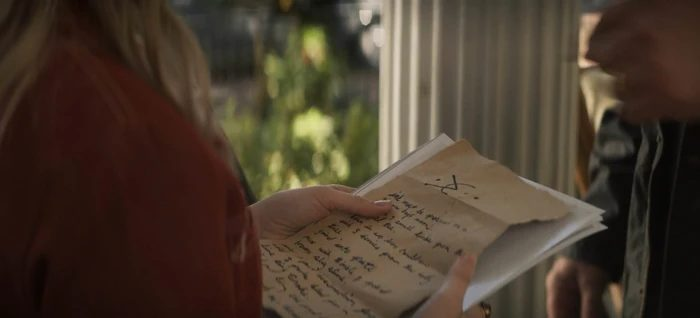

**Описание**

Акриды — вид монстров не с Земли, который не раз пытался вторгнуться в наш мир. Они появились во время Войны за Творение: Бог создал их как страховку на случай, если Сэм и Дин Винчестеры всё-таки сумеют его одолеть, чтобы Акриды довершили начатое им уничтожение. По словам Дина Винчестера, они — угроза всему существованию, и в конце концов Акриды были уничтожены, так что последняя попытка Бога стереть творение провалилась.

Когда Чак лишился сил благодаря Джеку Клайну, Акриды вырвались на свободу, чтобы завершить его дело. Изгнанная из вселенной Клуба монстров во вселенную Акрид, Джоан Хопкинс встретила Акрид, чья цель уничтожить всё совпала с её собственной ненавистью к человечеству, и стала их Королевой, поведя их против Творения. Веками Акриды пытались вторгнуться на Землю и захватить её.

В истинной форме Акриды — огромные насекомоподобные существа с тремя парами сочленённых ног и парой коротких конечностей-пинцетов, серыми глазами и множеством игольчатых зубов. Они живут общественными колониями с кастами во главе с Королевой, ведут паразитический образ жизни и перемещаются роем, хотя для скрытных операций действуют малыми группами. Все Акриды подчинены Королеве, и это их главная уязвимость.

Акриды порабощают людей, вонзая в них жало и управляя телами удалённо, как демоны, только на расстоянии; само их присутствие постепенно выжигает сосуд, но это занимает месяцы — Рокин Рокси пережила месяцы одержимости вожаком Акриды. Из останков убитых монстров Акриды извлекают их сущность и жизненную силу и отдают Королеве, делая её сильнее. Против них Люди Письма создали Остиум — ящик из тёмной магии, изгоняющий Акрид обратно в их собственный мир.

**Силы и способности**

- Угроза всему существованию — Акриды созданы, чтобы уничтожить творение, и считаются угрозой для всего сущего.
- Порабощение через жало — вонзив жало в человека, Акрида удалённо управляет его телом, как демон, но на расстоянии.
- Выжигание сосуда — присутствие Акриды постепенно выжигает тело носителя, хотя на это уходят месяцы.
- Извлечение сущности — из останков убитого монстра Акрида вытягивает его сущность и передаёт её Королеве.
- Извлечение жизненной силы — Акриды умеют вытягивать жизненную силу монстра и обращать её в могущество Королевы.
- Роевая тактика — обычно Акриды действуют роем, но для скрытных операций разделяются на малые группы.
- Не с этой Земли — Акриды родом из другого мира, поэтому обычные охотничьи средства против них почти не работают.

**Слабости**

- Остиум — ящик, созданный Людьми Письма с помощью тёмной магии, изгоняет Акрид обратно в их собственный мир.
- Связь с Королевой — если Остиум применить на Королеве, связь с остальными Акридами рвётся, и без неё они не выживают.
- Смерть Королевы — когда Джоан убивают, все остальные Акриды гибнут через мгновения после неё.
- Магия на основе души — Ровена Маклауд дала Аде Монро магию, питаемую частью её собственной души, и этой силы хватило, чтобы убить Королеву Акрид.
- Магия ковена — ведьма Линн считала, что начавшееся вторжение Акрид уже не остановить, но ведьма Наоми придерживается иного мнения.

**Как его убить.** Убивать Акрид поодиночке бессмысленно: рой держится на Королеве, и убрать нужно именно её. Главный предмет — Остиум, ящик Людей Письма из тёмной магии: его доставляют к Королеве и применяют на ней, после чего связь роя обрывается и все Акриды гибнут. Остиум изгоняет и рядовых Акрид в их мир. Второй путь — магия на основе души: Ровена Маклауд дала Аде Монро колдовство, питаемое частью её души, и этой силы хватило, чтобы убить Королеву. Сначала вычислите, кто служит Королеве сосудом.

**Известные особи:** Джоан Хопкинс — Королева Акриды; Рокин Рокси — человек, месяцами служивший сосудом вожаку Акриды

#### Акрида
*Большой, Монстр, нейтрально-злое*

---
- **Класс доспеха** 17 (природная броня)
- **Хиты** 168 (16d10 + 80)
- **Скорость** 40 фт., лазание 30 фт.

| СИЛ | ЛОВ | ТЕЛ | ИНТ | МДР | ХАР |
|---|---|---|---|---|---|
| 20 | 18 | 20 | 12 | 16 | 14 |

- **Спасброски** Лов +8, Тел +9, Мдр +7
- **Навыки** Восприятие +7, Скрытность +8
- **Уязвимость к урону** урон от магии, оплаченной частью собственной души носителя
- **Сопротивление урону** немагический дробящий, колющий и рубящий урон
- **Иммунитет к урону** яд
- **Иммунитет к состояниям** очарование, испуг
- **Чувства** тёмное зрение 120 фт., слепое зрение 30 фт., пассивное Восприятие 17
- **Языки** понимает языки своих сосудов, но не говорит
- **Бонус мастерства** +4
- **Уровень опасности** 12 (8 400 опыта)

***Особенности***
- ***Роевой разум.*** Пока Королева Акрид жива, Акрида не может быть очарована или испугана, а все Акриды в пределах 1 мили действуют согласованно, обмениваясь мыслями. Если Королева погибает, все Акриды в мире умирают через 1 минуту.
- ***Удалённое порабощение.*** Гуманоид, отмеченный жалом Акриды, становится её сосудом: Акрида может действием управлять им на любом расстоянии и видеть его глазами. Присутствие Акриды выжигает сосуд лишь со временем, через 1к6 месяцев.
- ***Пожирание сущности.*** Убив монстра, Акрида может бонусным действием вытянуть из останков его сущность и жизненную силу. Если затем она коснётся Королевы, та восстанавливает 20 хитов и получает преимущество на броски атаки до конца своего следующего хода.
- ***Живучесть пришельца.*** Акрида обладает сопротивлением к немагическому дробящему, колющему и рубящему урону, иммунитетом к яду, а также к состояниям очарования и испуга.
- ***Не с этой Земли.*** Акрида считается исчадием для эффектов, изгоняющих существ не с Материального плана. Заклинания и умения, действующие только на демонов или нежить, на Акриду не влияют.
- ***Легендарная устойчивость (3/день).*** Если Акрида проваливает спасбросок, она может вместо этого выбрать успех.

***Действия***
- ***Мультиатака.*** Акрида совершает три атаки: одну жалом и две когтями-пинцетами.
- ***Жало.*** Рукопашная атака оружием: +9 к попаданию, досягаемость 10 фт., одна цель. Попадание: 14 (2к8 + 5) колющего урона, и цель должна преуспеть в спасброске Телосложения Сл 17, иначе становится отмеченным сосудом.
- ***Когти-пинцеты.*** Рукопашная атака оружием: +9 к попаданию, досягаемость 5 фт., одна цель. Попадание: 12 (2к6 + 5) рубящего урона, и цель схвачена (Сл высвобождения 17), если она не больше Акриды.
- ***Извлечение жизненной силы.*** Акрида нацеливается на схваченное или недееспособное существо в пределах 5 фт. Цель совершает спасбросок Телосложения Сл 17, получая 27 (6к8) некротического урона при провале или половину этого урона при успехе, а максимум её хитов уменьшается на полученный урон.
- ***Пронзающий рывок (перезарядка 5-6).*** Акрида перемещается на расстояние до своей скорости по прямой линии и совершает одну атаку жалом; при попадании цель дополнительно получает 9 (2к8) колющего урона.

***Бонусные действия***
- ***Управление сосудом.*** Акрида отдаёт мысленный приказ одному порабощённому ею гуманоиду в пределах 1 мили: тот перемещается на свою скорость и совершает одну атаку оружием.

***Реакции***
- ***Уход в рой.*** Когда по Акриде попадает атака, она может переместиться на 15 фт. к ближайшей союзной Акриде, не провоцируя атак, если путь свободен.

***Легендарные действия***
- ***Приказ роя.*** Королева отдаёт приказ: до двух Акрид в пределах 60 фт. могут реакцией переместиться на свою скорость и совершить одну атаку.
- ***Царское жало (стоит 2 действия).*** Королева совершает одну атаку жалом с преимуществом.
- ***Поглощение (стоит 3 действия).*** Королева поглощает сущность раненого монстра или Акриды в пределах 30 фт., восстанавливая 30 хитов и снимая с себя одно состояние.

**Тактика.** Акрида навязывает бой на своих условиях: держит дистанцию, бьёт жалом по одиночкам, превращая их в удалённо управляемые сосуды, и натравливает на врагов порабощённых людей, которых охотнику приходится щадить. Против группы она действует роем: одна связывает боем, другие заходят с флангов. Смертельно раненая Акрида отступает к Королеве, чтобы передать собранные сущности. Если Королева мертва или связь с роем потеряна, Акрида паникует и пытается бежать, но через мгновения умирает. Остиума она боится сильнее любого оружия и стремится уничтожить ящик или его носителя.

**Экология.** Акриды не с Земли: их дом — вселенная Акрид, откуда они веками пытались вторгнуться на Землю и захватить её. В истинной форме они живут общественной колонией с кастами во главе с Королевой, а на чужой территории действуют скрытно, малыми группами, собираясь в огромные рои лишь для полномасштабного вторжения. Порабощённые люди служат им сосудами и прикрытием в человеческом обществе. После смерти Королевы Джоан Хопкинс вид считается вымершим.

> **Заметки мастеру.** Акрида заменяет в кампании демона-одержимого, только одержимость здесь дистанционная: удобно для сюжетов, где охотники не могут просто убить носителя. На низких уровнях используйте одиночную Акриду как угрозу CR 5-7, убрав легендарные действия и сократив Мультиатаку до двух атак, а рой из трёх таких тварей станет смертельной встречей для партии 8-10 уровня. Королева с легендарными действиями подходит на роль финального босса арки, а её смерть обрушивает весь рой. Остиум и магия на основе души — сюжетные ключи: пусть партия добывает ящик Людей Письма или платит частью души за заклинание.

[↑ к содержанию](#содержание)

---

### 2. Альфа-вампир

**Alpha Vampire** · Монстр · CR 16 · опасность в сериале 4/5

*Также известно как:* Большой Папа; Отец; Первый вампир; Прародитель вампиров

*Первое появление:* S06 «Live Free or Twihard»

*Сезоны:* 6, 7, 12

Самый первый вампир и прародитель всего вида, один из древнейших и сильнейших монстров. Ему подчиняются дети, он слышит их на расстоянии, а убить его можно только обезглавливанием, Колтом или вампитонитом.

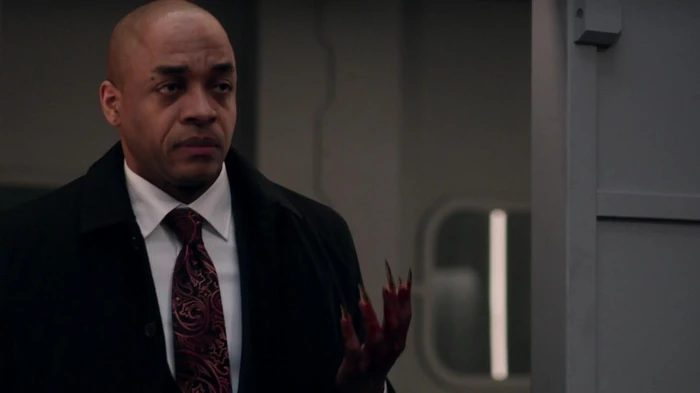

**Описание**

Альфа-вампир был самым первым вампиром и прародителем всех остальных вампиров. Он — один из Альф, монстров, созданных Евой, и подразумевается, что именно он стал самым первым монстром, которого она сотворила. Он рассказывал, что был «тем, кто в темноте», когда люди впервые добыли огонь, и пережил «века огня, льда, дождя и континентального разлома», то есть ему сотни тысяч или миллионы лет. Создав целую расу вампиров по всему миру, он зорко следил за своими «детьми» и продолжал населять мир вампирами много лет.

Он обладал всеми свойствами обычных вампиров, но многократно усиленными за счёт возраста и статуса Альфы. Будучи Альфой, он был одним из древнейших и могущественнейших монстров, какие вообще существовали: он неизмеримо сильнее старейших из своих детей, практически всех прочих монстров и любых рядовых черноглазых демонов. Его превосходили лишь его создательница Ева и Левиафаны.

Кроули и Кастиэль поймали его как одного из Альф и допрашивали, пытаясь найти Чистилище. Альфа сбежал из тюрьмы Кроули и сколотил новое гнездо в Северной Дакоте, а затем в Монтане. Позже его выследили ради крови — она была нужна для оружия против Левиафанов. Признав общего врага, Альфа отдал Винчестерам то, о чём они просили, без боя. Во время нападения на британских Людей Письма Альфа-вампир был убит Сэмом Винчестером из Колта.

**Силы и способности**

- Абсолютное бессмертие — он живёт вечно при постоянном притоке крови и не боится старости, болезней, инфекций, ядов, токсинов и естественной смерти; обезглавливание — единственное исключение.
- Неизмеримая сила — как Альфа и первый монстр Евы он неизмеримо сильнее старейших вампиров, почти всех прочих монстров и любых рядовых черноглазых демонов.
- Все свойства вампира — ему доступны все способности обычных вампиров, включая сверхскорость, обострённые чувства, клыки и регенерацию, но многократно усиленные.
- Психический зов — Альфа способен подавать «психический сигнал» и созывать на помощь всех вампиров поблизости.
- Власть над детьми — он держит под контролем созданную им расу вампиров и следит за своими «детьми» по всему миру.

**Слабости**

- Обезглавливание — единственная гарантированная смерть: бессмертие Альфы сохраняется лишь пока он не лишён головы.
- Мёртвая кровь — она действует и на него, но требует неизмеримо больших доз и почти не ослабляет: сотни галлонов лишь блокируют психический зов, тогда как он быстро восстанавливается.
- Вампитонит — смертелен для всех существ, питающихся людьми, включая Альфа-вампира.
- Левиафаны — Эдгар одолел Альфу и едва не убил его; даже с бурой Альфа не смог одержать верх, хотя дважды оттолкнул противника.
- Колт — из этого оружия Сэм Винчестер убил Альфа-вампира во время нападения на британских Людей Письма.
- Демоны числом — несколько демонов, пока Альфа был ослаблен передозировкой мёртвой крови, сумели его удержать; один черноглазый демон ему не соперник.

**Как его убить.** Готовиться к Альфе нужно как к осаде, а не как к охоте. Основа — обезглавливание: тяжёлый клинок и группа, потому что в одиночку Альфа сломает охотника играючи. Мёртвая кровь работает лишь в промышленных объёмах и почти не ослабляет его, зато блокирует психический зов — её используют, чтобы отрезать его от подмоги. Рабочие варианты из выжимки: Колт, из которого его и убили, и вампитонит, смертельный для всех, кто питается людьми.

**Известные особи:** Альфа-вампир (Рик Уорти); Ева (создательница); Эдгар (Левиафан); Кроули; Кастиэль; Сэм Винчестер

#### Альфа-вампир
*Средний, Монстр, нейтрально-злое*

---
- **Класс доспеха** 19 (природная броня)
- **Хиты** 210 (20d8 + 120)
- **Скорость** 50 фт., лазание 30 фт.

| СИЛ | ЛОВ | ТЕЛ | ИНТ | МДР | ХАР |
|---|---|---|---|---|---|
| 24 | 20 | 22 | 16 | 16 | 18 |

- **Спасброски** Сил +12, Лов +10, Тел +11, Мдр +8
- **Навыки** Восприятие +13, Скрытность +10, Запугивание +9
- **Сопротивление урону** некротический; дробящий, колющий и рубящий от немагического оружия
- **Иммунитет к урону** яд
- **Иммунитет к состояниям** очарование, испуг, отравление, истощение
- **Чувства** тёмное зрение 120 фт., пассивное Восприятие 23
- **Языки** общий (английский)
- **Бонус мастерства** +5
- **Уровень опасности** 16 (15 000 опыта)

***Особенности***
- ***Регенерация 20.*** Альфа восстанавливает 20 хитов в начале своего хода, если у него есть хотя бы 1 хит и он не получал урона от мёртвой крови, вампитонита или Колта с конца своего предыдущего хода.
- ***Бессмертие.*** Альфа не стареет и не может умереть от болезней, ядов, истощения или естественных причин. Опустившись до 0 хитов, он падает ничком и остаётся в сознании; окончательно он погибает только тогда, когда его голова полностью отделена от тела.
- ***Смерть от обезглавливания.*** Если Альфа опущен до 0 хитов, он не умирает. Каждый следующий удар по нему — критическое попадание; он окончательно умирает, только если атака наносит не менее 20 рубящего урона обезглавливающим оружием. Иначе через 1 час он восстанавливается до 1 хита.
- ***Психический зов.*** Альфа может бонусным действием подать зов. Все вампиры в пределах 1 мили чувствуют его и в течение 10 минут прибывают к нему, зная его точное местоположение. Пока в крови Альфы действует мёртвая кровь, зов не работает.
- ***Мёртвая кровь.*** Если Альфа получает урон или иной эффект от мёртвой крови, он должен преуспеть в спасброске Телосложения Сл 20, иначе до конца своего следующего хода может совершать только одно действие или бонусное действие, а его зов и легендарные действия недоступны. Он повторяет спасбросок в начале каждого своего хода.
- ***Легендарная устойчивость (3/день).*** Если Альфа проваливает спасбросок, он может вместо этого выбрать успех.
- ***Обострённые чувства.*** Альфа имеет преимущество на проверки Мудрости (Восприятие), основанные на слухе и обонянии, слышит сердцебиение человека на расстоянии до 300 фт. и видит в темноте.

***Действия***
- ***Мультиатака.*** Альфа совершает три атаки: одну укусом и две когтями, либо три атаки когтями. Он может заменить одну атаку попыткой захвата.
- ***Когти.*** Рукопашная атака оружием: +12 к попаданию, досягаемость 5 фт., одна цель. Попадание: 14 (2d6 + 7) рубящего урона.
- ***Укус.*** Рукопашная атака оружием: +12 к попаданию, досягаемость 5 фт., одна цель — гуманоид или зверь. Попадание: 16 (2d8 + 7) колющего урона плюс 14 (4d6) некротического урона. Максимум хитов цели уменьшается на величину некротического урона, пока она не завершит продолжительный отдых.
- ***Захват.*** Альфа совершает одну атаку когтями. При попадании цель размера Средний или меньше схвачена (Сл высвобождения 20), и Альфа больше не может использовать эту атаку по другой цели.

***Бонусные действия***
- ***Рывок хищника.*** Альфа совершает действие Рывок или Отход.
- ***Зов детей.*** Альфа подаёт психический зов, созывая вампиров в пределах мили (см. черту «Психический зов»).

***Реакции***
- ***Отвести удар.*** Когда по Альфе попадает атака немагическим оружием, не являющимся обезглавливающим, он может реакцией уменьшить полученный урон вдвое.

***Легендарные действия***
- ***Перемещение.*** Альфа перемещается на половину своей скорости, не провоцируя атак.
- ***Удар когтями.*** Альфа совершает одну атаку когтями.
- ***Подавляющий рык (стоит 2 действия).*** Каждое существо по выбору Альфы в пределах 30 фт. должно преуспеть в спасброске Мудрости Сл 16, иначе становится испуганным до конца своего следующего хода.
- ***Затягивание ран (стоит 2 действия).*** Альфа восстанавливает 25 хитов, если в этом раунде не получал урона от мёртвой крови, вампитонита или Колта.

***Действия в логове***
- ***Гнездо вампиров.*** В своём логове Альфа в начале каждого раунда (по инициативе 20) может призвать 1d4 вампиров, которые появляются из укрытий в пределах 30 фт. и действуют на следующем ходу.
- ***Кровь на полу.*** Логово залито кровью: существо, не являющееся вампиром, входя в логово, должно преуспеть в спасброске Телосложения Сл 15, иначе получает помеху на проверки Мудрости (Восприятие) от тошноты до конца сцены.

**Тактика.** Альфа дерётся как древний охотник, а не как зверь: он не бросается первым, а говорит, оценивает противников и заставляет их раскрыться. Первым он выводит из строя владельца Колта или того, кто несёт вампитонит, используя рывок и легендарные действия, а затем разрывает остальных по одному. Если его ранят всерьёз, он подаёт психический зов и отступает за спины прибывших детей, залечивая раны. Против Левиафана или превосходящих сил он предпочтёт договориться: в шестом сезоне он отдал Винчестерам свою кровь без боя, признав общего врага. Драться до смерти он станет только за собственное гнездо.

**Экология.** Альфа-вампир живёт в гнёздах, которые сам и создаёт: после побега из тюрьмы Кроули он обосновался в Северной Дакоте, а затем в Монтане. Его окружают дети-вампиры, которых он рекрутирует и превращает; часть вампиров по его приказу увеличивает численность вида. Вне гнезда он появляется редко и держится в тени, поэтому город, где он обосновался, быстро начинает замечать рост числа вампиров.

> **Заметки мастеру.** Альфа-вампир — босс для партии 13–17 уровня: CR 16, легендарная устойчивость и три легендарных действия делают его одиночной угрозой, но у него есть три чёткие дыры — обезглавливание, Колт и вампитонит, — и это превращает подготовку в главный элемент боя. Мёртвую кровь используйте как способ отрезать его от подмоги, а не как урон. Для кампании пониже уровнем уберите легендарные действия и снизьте CR до 12, заменив регенерацию на 10 хитов. Для высокой дайте ему гнездо из шести-восьми вампиров и логово с засадами.

[↑ к содержанию](#содержание)

---

### 3. Альфа-вендиго

**Alpha Wendigo** · Монстр · CR 13 · опасность в сериале 4/5

*Также известно как:* Мастер-вендиго; Первый вендиго

*Первое появление:* S06 «The Man Who Would Be King»; «Bobby Singer's Guide to Hunting»

*Сезоны:* 6

Первый и сильнейший вендиго: тридцатифутовый белый исполин с рогами, клыками и огромными когтями, повелевающий метелями и способный обратить человека в вендиго без людоедства. Существование альфы подтверждал Бобби Сингер.

**Описание**

Альфа-вендиго, которого в преданиях называют Мастером-вендиго, — первый и сильнейший вендиго в истории. На экране он не появляется: сведения о нём собраны в «Bobby Singer's Guide to Hunting», а Бобби Сингер подтверждал, что такое существо действительно существует. Описание альфы опирается на мифологию индейцев кри: это исполин ростом около тридцати футов, покрытый белым мехом, с ветвистыми рогами, пастью, полной клыков, и гигантскими когтями.

Живёт он на севере Канады, в глухих снежных краях, и умеет управлять погодой, насылая снежные и ледяные бураны. Буря для него не фон, а инструмент охоты: в белой мгле альфа неотличим от сугроба, а метель заметает следы и глушит крики жертвы.

Главная его власть — над сородичами. Альфа подчиняет рядовых вендиго своей волей, и те охотятся для него, как свора. Кроме того, он заражает людей голодом вендиго напрямую, без людоедства: обычному вендиго нужно, чтобы человек попробовал человечину, а альфе достаточно прикосновения. Он страшен не только силой, но и способностью растить вокруг себя стаю.

Охотники относятся к альфа-вендиго как к легенде из книг: подтверждение Бобби есть, но никто из Винчестеров с ним не сталкивался. Для кампании это идеальный спящий босс — древняя тварь, о которой достоверно известно лишь то, что она где-то на севере и однажды может выйти к людям.

**Силы и способности**

- Исполинская мощь — тридцатифутовый гигант с огромными когтями легко разрывает человека и опрокидывает машину.
- Власть над погодой — альфа насылает снежные и ледяные бури, скрывающие его и замораживающие жертв.
- Подчинение вендиго — силой воли обращает рядовых вендиго в свою свору, охотящуюся по его приказу.
- Заражение без каннибализма — способен превратить любого человека в вендиго, не заставляя его есть человечину.
- Первенство вида — самый первый и сильнейший вендиго, многократно превосходящий любого сородича.

**Слабости**

- Огонь — единственное оружие, которое надёжно убивает вендиго; альфа не исключение.
- Обычное оружие — пули и клинки почти бесполезны против белого меха и требуют огня для добивания.
- Уязвимость к теплу и замкнутым пространствам — вне бури посреди камня или железа альфа теряет преимущество манёвра.
- Легендарный статус — о нём известно только из записей Бобби, поэтому охотники плохо знают его повадки.

**Как его убить.** План охоты строится на одном: лишить альфу метели. Его заманивают в замкнутое каменное или железное помещение — шахту, бункер, старый склад, — где нет места бурану. Огонь обязателен: бензин, коктейли Молотова, огнемёты и горящие стрелы. Держать его нужно серебряными цепями и железными капканами, потому что даже раненый альфа сильнее человека. Убивают огнём, как обычного вендиго, только дольше. Если пурга уже началась, охоту отменяют: в снежной мгле он всегда бьёт первым.

#### Альфа-вендиго
*Огромный, Исчадие, нейтрально-злое*

---
- **Класс доспеха** 17 (природная броня)
- **Хиты** 230 (20d12 + 100)
- **Скорость** 50 фт., лазание 40 фт.

| СИЛ | ЛОВ | ТЕЛ | ИНТ | МДР | ХАР |
|---|---|---|---|---|---|
| 24 | 16 | 20 | 10 | 16 | 14 |

- **Спасброски** Сил +12, Тел +10, Мдр +8
- **Навыки** Восприятие +8, Скрытность +13, Выживание +8
- **Уязвимость к урону** огонь
- **Сопротивление урону** дробящий, колющий и рубящий от немагического оружия
- **Иммунитет к урону** холод
- **Иммунитет к состояниям** очарование, испуг
- **Чувства** тёмное зрение 120 фт., чутьё на кровь 60 фт., пассивное Восприятие 18
- **Языки** понимает английский, но не говорит
- **Бонус мастерства** +5
- **Уровень опасности** 13 (10 000 опыта)

***Особенности***
- ***Владыка стужи.*** Альфа может действием логова вызвать снежную или ледяную бурю в радиусе 1 мили. В буре он совершает проверки Скрытности с преимуществом, а существа без защиты от холода получают помеху на проверки Восприятия.
- ***Порабощение вендиго.*** Вендиго, входящий в область бури альфы, должен преуспеть в спасброске Мдр (Сл 17), иначе очарован альфой на 24 часа и выполняет его приказы, пока не получит от него урон.
- ***Заражение касанием.*** Альфа касается гуманоида: цель совершает спасбросок Тел (Сл 18). При провале она заражена голодом вендиго и через 24 часа начинает превращаться, даже не отведав человечины.
- ***Ход превращения.*** Заражённый проходит спасбросок Тел (Сл 18) каждые 8 часов; после трёх провалов он становится вендиго под властью альфы. «Снятие проклятия» и подобная магия останавливают процесс, пока не пройден последний спасбросок.
- ***Легендарная сопротивляемость (3/день).*** Если альфа проваливает спасбросок, он может вместо этого преуспеть в нём.
- ***Чутьё на кровь.*** Альфа чует свежую кровь и страх на расстоянии до 1 мили, если существо не защищено от прорицания.

***Действия***
- ***Мультиатака.*** Альфа совершает три атаки: одну укусом и две когтями.
- ***Укус.*** Рукопашная атака оружием: +12 к попаданию, досягаемость 10 фт., одна цель. Попадание: 19 (2d12 + 6) колющего урона плюс 7 (2d6) урона холодом.
- ***Когти.*** Рукопашная атака оружием: +12 к попаданию, досягаемость 10 фт., одна цель. Попадание: 16 (2d10 + 6) рубящего урона, и цель должна преуспеть в спасброске Сил (Сл 20), иначе падает ничком.
- ***Ледяной буран (перезарядка 5–6).*** Альфа выдыхает буран конусом 60 фт. Каждое существо в конусе совершает спасбросок Тел (Сл 18), получая 45 (10d8) урона холодом при провале или половину при успехе. Область считается труднопроходимой местностью 1 минуту.
- ***Рёв голода (1/день).*** Каждое существо в пределах 120 фт. совершает спасбросок Мдр (Сл 18), получая 10 (3d6) психического урона и становясь испуганным на 1 минуту при провале.

***Бонусные действия***
- ***Снежный шаг.*** Альфа совершает Рывок или Отход.

***Реакции***
- ***Ледяная хватка.*** Когда существо в пределах 10 фт. промахивается по альфе рукопашной атакой, альфа наносит ему 11 (2d10) урона холодом.

***Легендарные действия***
- ***Надвигающаяся буря.*** Одно существо в пределах 60 фт. совершает спасбросок Сил (Сл 18), иначе отброшено на 15 фт. и сбито с ног.
- ***Рывок сквозь пургу.*** Альфа перемещается до половины своей скорости, не провоцируя атак.
- ***Хватка рогов (стоит 2 действия).*** Альфа совершает одну атаку когтями.

***Действия в логове***
- ***Белая мгла.*** Альфа наполняет округу метелью: до конца следующего раунда все существа, кроме вендиго, совершают проверки Восприятия с помехой.
- ***Наст и трещины.*** Лёд под ногами ломается: одно существо на выбор мастера должно преуспеть в спасброске Лов (Сл 18), иначе падает ничком.
- ***Зов стаи.*** Альфа призывает 1d4 вендиго, если поблизости есть его свора; они появляются из метели в пределах 60 фт.

**Тактика.** Альфа никогда не бьётся на открытом месте при ясной погоде: он первым делом поднимает буран и бьёт из мглы, целясь в одиночек. Свору он держит между собой и охотниками, а сам атакует того, кто несёт огонь. Получив больше половины урона, он отступает в метель и возвращается, когда противник потеряет строй. Он помнит боль от огня и не подходит к открытому пламени, предпочитая ломать лёд и обрушивать на врагов снег. В замкнутом пространстве без бури он становится осторожным и ищет выход, а не бой.

**Экология.** Альфа-вендиго живёт на севере Канады, в глухих снежных лесах и пустошах, подальше от людей. Вокруг него собирается свора обычных вендиго, для которых он одновременно вожак и источник бури; они делят с ним добычу, но не охотятся на него. Зимой он подходит ближе к трассам и промысловым лагерям, и тогда пропажи людей списывают на волков и непогоду. Летом о нём не слышно вовсе.

> **Заметки мастеру.** Готовый босс для партии 9–11 уровня: альфа-вендиго заменяет в приключении ледяного великана или криомансера и держит вокруг себя 2–4 обычных вендиго как свиту. Ключ к бою — арена: закрытая пещера или бункер лишают его бури и легендарных действий логова, поэтому мастеру стоит заранее решить, где произойдёт встреча. Для низкого уровня сократите хиты вдвое, снимите легендарные действия и уберите заражение касанием, оставив только власть над погодой; для высокого — добавьте второй буран и стаю, обновляемую на 10-м раунде.

[↑ к содержанию](#содержание)

---

### 4. Альфа-гуль

**Alpha Ghoul** · Монстр · CR 8 · опасность в сериале 3/5

*Также известно как:* Первый гуль; Прародитель гулей

*Первое появление:* Bobby Singer's Guide to Hunting

Первый гуль и прародитель всего вида: именно он создал остальных гулей. В сериале он ни разу не появлялся, и само его существование подтверждается только записями Бобби Сингера.

**Описание**

Альфа-гуль — первый гуль и прародитель вида: именно он создал всех остальных гулей, от которых происходят встреченные охотниками особи. Его существование подтверждается записями Бобби Сингера; в «Путеводителе Бобби Сингера по охоте» он упомянут как основатель вида, подобно прочим Альфам, созданным Евой.

Как и другие Альфы, он был когда-то человеком, а затем превращён Евой в первое существо своего вида. Он входит в семью Евы вместе с Левиафанами и остальными монстрами, а его дети-гули считаются его потомством. В отличие от рядовых гулей, он не просто выживает, а порождает новых монстров своего вида.

Прямых сведений о его облике, привычках и местонахождении в источниках нет: в сериале он ни разу не появлялся, а его статус остаётся неизвестным. Ни один охотник не оставил описания встречи с ним, поэтому Альфа-гуль известен только по справочнику, а не по реальным делам.

О том, что он представляет собой в бою, приходится судить по его детям. Обычные гули — падальщики, живущие на кладбищах и питающиеся плотью и кровью мёртвых; они не боятся дня и едят при любой возможности, а на живых людей переходят, когда мертвечины не хватает. Гуль способен принять облик любого человека, чью плоть он ел, — живого или мёртвого, — и вместе с обликом получает память и манеры оригинала, включая отпечатки пальцев. Убивает гуля только голова.

Альфа как прародитель вида должен обладать теми же способностями в многократно усиленном виде и, что важнее, уметь создавать новых гулей. Пока он не найден, охотники относятся к нему как к теоретической угрозе: записи Бобби — единственное подтверждение того, что он вообще существует.

**Силы и способности**

- Прародитель вида — все гули происходят от Альфа-гуля, и его существование подтверждено записями Бобби Сингера, а не наблюдениями охотников.
- Создание гулей — как первый гуль, он способен порождать новых гулей и тем самым распространять свой вид.
- Наследие Альф — он был когда-то человеком и превращён Евой, а значит должен разделять базовые способности гулей: силу, скорость, смену облика и чужие воспоминания.
- Детская связь — как и прочие Альфы, он связан со своими детьми-гулями и способен отдавать им приказы на расстоянии.

**Слабости**

- Обезглавливание — единственный известный способ убить гуля; Альфа-гуль, по аналогии со своими детьми, должен погибать от полного отделения головы.
- Разрушение мозга — сильный урон по голове убивает гуля не хуже отрубания, и на Альфу это, вероятнее всего, распространяется.
- Вампинит — левиафанская присадка, по словам Эдгара, убивает гулей; она же остаётся лучшим известным средством против прародителя вида.
- Полная неизвестность — о его слабостях, облике и укрытии достоверно ничего не известно, поэтому охотникам приходится действовать наугад и по аналогии с рядовыми гулями.

**Как его убить.** Описания охоты на Альфа-гуля нет, поэтому план строится от его детей. Возьмите мачете, топор или тяжёлый дробовик: работать нужно по голове, отделяя её или разрушая мозг. Перед выходом раздобудьте вампинит — левиафанская присадка, по словам Эдгара, убивает гулей, и это единственное известное средство против вида. Начинайте с поиска следов вида: вскрытые могилы, пропавшие тела, человек, изменившийся после похорон. Каждый гуль — ступенька к прародителю, но за Альфой идите только группой.

#### Альфа-гуль
*Средний, Монстр, нейтрально-злое*

---
- **Класс доспеха** 14 (природная броня)
- **Хиты** 105 (14d8 + 42)
- **Скорость** 40 фт.

| СИЛ | ЛОВ | ТЕЛ | ИНТ | МДР | ХАР |
|---|---|---|---|---|---|
| 19 | 17 | 16 | 11 | 12 | 13 |

- **Спасброски** Сил +7, Тел +6
- **Навыки** Скрытность +9, Восприятие +4, Обман +4
- **Сопротивление урону** некротический; дробящий, колющий и рубящий от немагического оружия
- **Иммунитет к состояниям** отравление, испуг
- **Чувства** тёмное зрение 60 фт., пассивное Восприятие 14
- **Языки** общий (английский), а также язык и манера речи оригинала в принятом облике
- **Бонус мастерства** +3
- **Уровень опасности** 8 (3 900 опыта)

***Особенности***
- ***Прародитель гулей.*** Альфа-гуль связан со всеми гулями своего вида и может отдавать им приказы и получать образы происходящего на любом расстоянии в пределах одного мира.
- ***Создание потомства.*** Ритуалом, требующим 1 минуты и трупа гуманоида, Альфа-гуль превращает труп в нового гуля, подчинённого ему. Новый гуль действует в течение 24 часов, после чего становится самостоятельным.
- ***Смена облика.*** Действием Альфа-гуль принимает облик любого гуманоида, чью плоть он ел, получая его внешность, голос, отпечатки пальцев, языки и воспоминания. Облик держится, пока он не сменит его или не потеряет сознание.
- ***Смерть от головы.*** Опустившись до 0 хитов, Альфа-гуль не погибает, а падает и остаётся в сознании. Он умирает только от полного отделения головы или разрушения мозга; иначе через 1 минуту он встаёт с 1 хитом.
- ***Чутьё на мертвечину.*** Альфа-гуль имеет преимущество на проверки Мудрости (Восприятие), когда ищет свежие трупы, вскрытые могилы и следы недавних смертей.

***Действия***
- ***Мультиатака.*** Альфа-гуль совершает три атаки: одну укусом и две когтями.
- ***Укус.*** Рукопашная атака оружием: +7 к попаданию, досягаемость 5 фт., одна цель. Попадание: 8 (1d8 + 4) колющего урона плюс 7 (2d6) некротического урона. Максимум хитов цели уменьшается на величину некротического урона, пока она не завершит продолжительный отдых.
- ***Когти.*** Рукопашная атака оружием: +7 к попаданию, досягаемость 5 фт., одна цель. Попадание: 11 (2d6 + 4) рубящего урона, и цель схвачена (Сл высвобождения 15).
- ***Волна гулей (1/день).*** Альфа-гуль телепатически зовёт своих детей. Все гули в пределах 1 мили немедленно направляются к нему и прибывают в течение 10 минут; их число не может превышать четырёх.

***Бонусные действия***
- ***Пожирание.*** Альфа-гуль пожирает недееспособную цель или труп в пределах 5 фт. и восстанавливает 15 хитов.

**Тактика.** Альфа-гуль никогда не появлялся в источниках, поэтому логично, что он не выходит на прямой бой: он действует через своих детей, подменяет людей и нападает лишь тогда, когда противник уверен, что имеет дело с обычным гулем. В открытом столкновении он использует силу, скорость и смену облика, стараясь выйти из боя и заставить партию гоняться за чужим лицом. Против вампинита или настойчивых ударов по голове он отступает и жертвует потомством как прикрытием. Если бой идёт плохо, он меняет облик на кого-то из союзников партии и уходит в толпу.

**Экология.** Прямых сведений о его убежище нет: он ни разу не появлялся, а статус остаётся неизвестным. Наиболее правдоподобное логово — крупный город с большим кладбищем, моргом и оживлённым криминальным дном, где его дети кормятся мертвечиной, а сам он подолгу скрывается под чужим обликом. Соперников он не терпит, но демонов, которые заметно сильнее гулей, избегает.

> **Заметки мастеру.** Альфа-гуль — редкий случай монстра, о котором канон почти ничего не говорит, поэтому статблок собран из способностей его детей и усилен вдвое; мастеру стоит подавать его как закулисную фигуру, а не как рядового босса. Для партии 6–8 уровня подойдёт одиночный Альфа-гуль с двумя-тремя гулями и парой подменённых горожан в качестве щита. Полезный приём — держать его неуязвимым, пока партия не найдёт вампинит: это превращает бой в расследование. Если нужен более высокий CR, дайте ему легендарные действия и логово-морг с ловушками.

[↑ к содержанию](#содержание)

---

### 5. Альфа-джинн

**Alpha Djinn** · Монстр · CR 10 · опасность в сериале 4/5

*Также известно как:* Первый джинн; The First Djinn; Прародитель джиннов

*Первое появление:* S06 «Caged Heat»; «Bobby Singer's Guide to Hunting»

*Сезоны:* 6

Первый и прародитель всех джиннов, из которого произошёл весь их род. Кроули искал его, чтобы выйти на Чистилище, но так и не нашёл: судьба альфы остаётся неизвестной.

**Описание**

Альфа-джинн — первый джинн, от которого происходят все остальные джинны мира. Его называют Первым джинном и прародителем рода; он входит в семью Евы, Матери всех монстров, вместе с рядовыми джиннами и остальными тварями. Как и прочие альфы, он был человеком, пока Ева не изменила его, деформировав душу, — так он стал первым из своего вида.

В шестом сезоне Кроули попытался найти Чистилище и для этого отправил Кэмпбеллов и Сэма Винчестера на охоту за альфами. План был прост: ловить рядовых монстров и использовать их как приманку, чтобы альфа пришёл за своим. Сэмюэл сумел захватить джинна по имени Бригитта и привёз её в тюрьму Кроули, где её долго пытали, добиваясь, где её «папочка», то есть альфа.

Ответа Кроули так и не получил: его отвлекли братья Винчестеры, а Бригитту позже убили. Альфа-джинн не появился ни тогда, ни позже — его судьба в источниках помечена как неизвестная.

Для охотника альфа-джинн — фигура из записей Бобби и отчётов Кэмпбеллов, а не из боёв. Известно только, что он существует, что он первый из джиннов и что джинны боятся и слушаются его как источника рода. Кроули считал его настолько ценным, что готов был пытать ради одного имени, — а это лучшая характеристика его значимости: альфа-джинн знает то, чего не знает никто из его сородичей, и именно поэтому его прячут.

**Силы и способности**

- Прародитель рода — все джинны происходят от него, что делает его ключом к их силе и к их страхам.
- Галлюцинации — как первый джинн он владеет внушением и грёзами в самой сильной форме, известной виду.
- Психическая мощь — по сравнению с рядовыми джиннами его разум многократно сильнее и опаснее.
- Питание кровью — он кормится кровью спящих жертв и способен держать их в коме неограниченно долго.
- Неуловимость — ни Кэмпбеллы, ни Кроули, ни Винчестеры не смогли его найти, хотя искали целенаправленно.

**Слабости**

- Серебро и баранья кровь — серебряный клинок, смоченный бараньей кровью, убивает джиннов; на альфу это должно действовать так же.
- Разрушение мозга — грубое повреждение головы доказанно убивает джиннов, включая усиленных особей.
- Серафимы — для серафимов джинны не соперники, и альфа вряд ли исключение.
- Высшие демоны — джинны боятся высокопоставленных демонов; Кроули охотился на альфу без страха перед ним.
- Тайна происхождения — альфа был человеком до изменения Евой, и его прошлое может стать приманкой.

**Как его убить.** Готового способа убить альфа-джинна нет: его не нашли даже с ресурсами Кроули. Охоту строят по правилам вида. Нужен серебряный клинок, смоченный бараньей кровью, и запас на грубое разрушение мозга, если клинок не сработает. Искать альфу следует там, где джинны держат жертв: в огромных руинах, пещерах и катакомбах. Приманкой может стать его потомок или предмет его прошлой человеческой жизни. Брать его нужно втроём и с защитой разума: один взгляд альфы укладывает охотника в грёзу.

#### Альфа-джинн
*Средний, Монстр, нейтрально-злое*

---
- **Класс доспеха** 17 (природная броня)
- **Хиты** 150 (20d8 + 60)
- **Скорость** 30 фт.

| СИЛ | ЛОВ | ТЕЛ | ИНТ | МДР | ХАР |
|---|---|---|---|---|---|
| 18 | 18 | 18 | 17 | 18 | 20 |

- **Спасброски** Мдр +8, Хар +9
- **Навыки** Восприятие +8, Обман +9, Проницательность +8, Скрытность +8
- **Уязвимость к урону** урон от серебряного оружия, смоченного бараньей кровью
- **Сопротивление урону** психический урон; дробящий, колющий и рубящий от немагического оружия
- **Иммунитет к состояниям** очарование, испуг
- **Чувства** тёмное зрение 120 фт., пассивное Восприятие 18
- **Языки** английский; телепатия 120 фт.
- **Бонус мастерства** +4
- **Уровень опасности** 10 (5 900 опыта)

***Особенности***
- ***Прародитель джиннов.*** Джинн в пределах 1 мили знает о присутствии альфы и не может по своей воле атаковать его. Альфа совершает с преимуществом проверки Хар (Запугивание) против джиннов.
- ***Владыка грёз.*** Альфа может одновременно удерживать в грёзе до пяти существ и знает, что каждое из них видит. Существо в грёзе бессознательно и может повторять спасбросок Мдр (Сл 17) в конце каждого часа или получив урон; очнувшись, оно получает один уровень истощения. Сл спасбросков от психических способностей альфы равна 17 (8 + 4 + 5 Хар).
- ***Питание кровью.*** Пока хотя бы одно существо находится в грёзе, а альфа — в пределах 30 фт. от него, он восстанавливает 15 хитов в начале каждого своего хода.
- ***Сокрытый истинный облик.*** Истинная форма джинна неизвестна. Альфа совершает с преимуществом спасброски против эффектов, раскрывающих его истинный облик или местоположение.
- ***Легендарная сопротивляемость (3/день).*** Если альфа проваливает спасбросок, он может вместо этого преуспеть в нём.

***Действия***
- ***Мультиатака.*** Альфа совершает три атаки когтями либо две атаки когтями и использует Кошмарное касание.
- ***Когти.*** Рукопашная атака оружием: +8 к попаданию, досягаемость 5 фт., одна цель. Попадание: 11 (2d6 + 4) рубящего урона.
- ***Кошмарное касание.*** Рукопашная атака заклинанием: +9 к попаданию, досягаемость 5 фт., одна цель. Попадание: 14 (3d6 + 4) урона ядом, и цель совершает спасбросок Мдр (Сл 17), иначе попадает в грёзу на 1 час.
- ***Похищение крови.*** Альфа пьёт кровь бессознательного или схваченного существа: 22 (4d10) урона некротической энергией, и альфа восстанавливает столько же хитов.
- ***Психический шторм (перезарядка 5–6).*** Каждое существо в пределах 60 фт. совершает спасбросок Мдр (Сл 17), получая 45 (10d8) психического урона при провале или половину при успехе. Существа с тяжёлым прошлым получают помеху на спасбросок, но при их провале альфа получает 10 (3d6) психического урона.

***Бонусные действия***
- ***Шаг в грёзу.*** Альфа телепортируется на 30 фт. в видимое пространство, оставляя на месте мерцающий образ себя до конца своего следующего хода.

***Реакции***
- ***Отражение боли.*** Когда существо в пределах 60 фт. наносит альфе урон, оно совершает спасбросок Мдр (Сл 17), получая 10 (3d6) психического урона при провале.

***Легендарные действия***
- ***Шёпот желаний.*** Одно существо в пределах 60 фт. совершает спасбросок Мдр (Сл 17), иначе до конца своего следующего хода получает помеху на атаки и не может совершать реакции.
- ***Выпить страх.*** Если в пределах 60 фт. есть испуганное или бессознательное существо, альфа восстанавливает 10 хитов.
- ***Шаг сквозь иллюзию.*** Альфа перемещается до половины своей скорости, не провоцируя атак.

***Действия в логове***
- ***Ложные стены.*** Логово альфы искажается: до конца следующего раунда все существа, кроме джиннов, совершают проверки Восприятия с помехой.
- ***Хор грёз.*** Одно существо в логове должно преуспеть в спасброске Мдр (Сл 17), иначе получает 11 (2d10) психического урона и не может отличить союзника от врага до конца своего следующего хода.

**Тактика.** Альфа-джинн не подпускает к себе группу: он разбивает противников грёзами, укладывая по одному за раунд, и кормится тем, кто уже спит. Он держит дистанцию, уходит телепортом из окружения и всегда оставляет ложный образ на месте, куда бьют охотники. Против того, кто несёт серебро с бараньей кровью, он играет осторожно: старается обезоружить, обмануть или заставить подойти вплотную к ловушке. Если бой складывается плохо, он забирает спящую жертву и уходит в глубину руин.

**Экология.** Альфа живёт в самых больших и запутанных руинах, куда не доходят люди: подземные города, катакомбы, заброшенные крепости. Вокруг него держатся его потомки, для которых он одновременно прародитель и хозяин; они приносят ему жертв и не смеют перечить. Кроули и Кэмпбеллы искали альфу через рядовых джиннов, но он не откликнулся даже на пытки своего потомка, — что говорит о его осторожности или о том, что он давно не в этом мире.

> **Заметки мастеру.** Альфа-джинн — босс на 9–11 уровень, построенный на контроле, а не на уроне: партия проигрывает не от хитов, а от того, что её по одному выключают грёзами. В 5e он заменяет иллитида-заклинателя или ультитарида, но без полёта и с уязвимостью к серебру с бараньей кровью. Для низкого уровня снизьте КС до 14, сократите хиты вдвое и оставьте только две грёзы; для высокого — добавьте стаю из 3–4 джиннов и продлите грёзу до 8 часов, превратив бой в спасение похищенных. Держите в резерве тайну: альфа знает дорогу в Чистилище, и это может стать ценой сделки.

[↑ к содержанию](#содержание)

---

### 6. Альфа-дракон

**Alpha Dragon** · Монстр · CR 17 · опасность в сериале 4/5

*Также известно как:* Первый дракон; Прародитель драконов

*Первое появление:* Сезон 6, «Like A Virgin»

*Сезоны:* 6

Первый дракон, от которого происходят все драконы. Рождён Евой вместе с остальными драконами, и его порода была признана настолько опасной, что Ева сама выковала Драконобойные мечи и повела рыцарей на охоту.

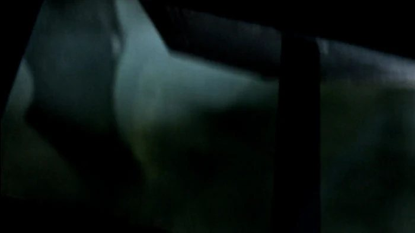

**Описание**

Альфа-дракон — первый дракон, от которого происходят все остальные драконы. По преданию, в древности он был рождён Евой, Матерью всех монстров, вместе с прочими драконами. Драконья порода оказалась настолько сильной, что Ева сочла её чрезмерной угрозой: она собственноручно убила одного из драконов — Гиполия — и создала Драконобойные мечи, единственное известное оружие против драконов. После этого Ева вместе с рыцарями начала охоту на драконов и на их Альфу.

Дальнейшая судьба Альфа-дракона в источниках не прояснена. Неизвестно, пережил ли он гнев Евы или охоту рыцарей. Неизвестно и то, дожил ли он до времён, когда Кроули начал отлавливать Альф: если Альфа-дракон и уцелел, он мог попасть в число первейших монстров, за которыми король Ада охотился ради ключа к Чистилищу.

Упоминается Альфа-дракон в связи с шестым сезоном и эпизодом «Like A Virgin», а также в справочнике Бобби Сингера по охоте. Как и все Альфы, он является прародителем собственного вида: все драконы, с которыми охотники сталкивались в сериале, считаются его потомством.

Прямых сцен с его участием в выжимке не описано, поэтому его облик, повадки и место обитания остаются неизвестными. Для охотников Альфа-дракон — фигура скорее из древних преданий, чем из практики: это не «монстр недели», а прародитель целого вида, против которого применяли оружие, выкованное самой Евой.

**Силы и способности**

- Прародитель вида — все драконы считаются потомством Альфа-дракона, что делает его древнейшим и самым значимым представителем своей породы.
- Древнее происхождение — рождён Евой, Матерью всех монстров, в незапамятные времена вместе с остальными драконами.
- Признанная сила породы — драконы были сочтены Евой настолько сильными, что против них потребовалось создать особое оружие и вести организованную облаву.

**Слабости**

- Драконобойные мечи — оружие, созданное Евой специально против драконьей породы; именно им Ева и рыцари истребляли драконов.
- Ева — Мать всех монстров лично убила дракона Гиполия, так что её воля выше воли её перворождённых чудовищ.
- Рыцарская облава — Ева и рыцари охотились на драконов и на их Альфу; неизвестно, пережил ли он эту охоту.
- Отлов Альф Кроули — король Ада охотился на первейших монстров ради ключа к Чистилищу; уцелел ли тогда Альфа-дракон, не сообщается.

**Как его убить.** Надёжного способа в выжимке не описано: единственное известное средство — Драконобойные мечи, созданные Евой и её рыцарями. Снаряжение охотника: уцелевший клинок из этого набора, тяжёлые копья и цепи, чтобы удержать тварь на месте, ловчие сети и достаточное число загонщиков. Охота строится как облава: сначала загон и фиксация, затем удар клинком в сердце. Если Драконобойного меча нет, надёжного способа убить Альфа-дракона у охотников нет — остаётся лишь изгнание или подчинение чужой воле.

#### Альфа-дракон
*Огромный, Монстр, нейтральное*

---
- **Класс доспеха** 19 (природная броня)
- **Хиты** 256 (19d12 + 133)
- **Скорость** 40 фт., полёт 80 фт.

| СИЛ | ЛОВ | ТЕЛ | ИНТ | МДР | ХАР |
|---|---|---|---|---|---|
| 26 | 14 | 25 | 16 | 16 | 20 |

- **Спасброски** Тел +13, Мдр +9, Хар +11
- **Навыки** Восприятие +9, Запугивание +11
- **Сопротивление урону** дробящий, колющий и рубящий от немагического оружия
- **Иммунитет к урону** огонь, яд
- **Иммунитет к состояниям** очарование, испуг, отравление
- **Чувства** слепое зрение 30 фт., тёмное зрение 120 фт., пассивное Восприятие 19
- **Языки** понимает английский и языки монстров, но не говорит
- **Бонус мастерства** +6
- **Уровень опасности** 17 (18 000 опыта)

***Особенности***
- ***Драконобойная уязвимость.*** Атаки Драконобойным мечом игнорируют его сопротивление немагическому оружию и наносят двойной урон. Урон от любого другого оружия не может опустить его хиты ниже 1: по преданию, драконью породу надёжно брало лишь оружие, выкованное Евой.
- ***Владыка логова.*** Находясь в своём логове, Альфа-дракон получает преимущество на все спасброски и восстанавливает 20 хитов в начале каждого своего хода, если у него есть хотя бы 1 хит.
- ***Легендарное сопротивление (3/день).*** Если Альфа-дракон проваливает спасбросок, он может вместо этого выбрать успех.
- ***Ужасающее присутствие.*** Каждое существо, впервые за ход начинающее ход в пределах 120 фт. от Альфа-дракона и способное его видеть, проходит спасбросок Мдр Сл 19, иначе становится испуганным на 1 минуту. Испуганное существо может повторять спасбросок в конце каждого своего хода.

***Действия***
- ***Мультиатака.*** Альфа-дракон совершает одну атаку укусом и две атаки когтями.
- ***Укус.*** Рукопашная атака оружием: +14 к попаданию, досягаемость 15 фт., одна цель. Попадание: 19 (2d10 + 8) колющего урона плюс 9 (2d8) урона огнём.
- ***Коготь.*** Рукопашная атака оружием: +14 к попаданию, досягаемость 10 фт., одна цель. Попадание: 15 (2d6 + 8) рубящего урона.
- ***Дыхание пламени (перезарядка 5–6).*** Альфа-дракон выдыхает пламя конусом 60 фт. Каждое существо в области проходит спасбросок Ловкости Сл 21, получая 63 (18d6) урона огнём при провале или половину этого урона при успехе.

***Легендарные действия***
- ***Обнаружение.*** Альфа-дракон совершает проверку Мудрости (Восприятие).
- ***Взмах крыльев.*** Альфа-дракон взмахивает крыльями. Каждое существо в пределах 15 фт. от него проходит спасбросок Силы Сл 22, иначе падает ничком и отлетает на 20 фт. Затем Альфа-дракон может пролететь до половины своей скорости полёта.
- ***Атака когтями.*** Альфа-дракон совершает одну атаку когтями.

***Действия в логове***
- ***Обвал.*** На инициативе 20 в логове обрушивается камнепад в одной 20-футовой области: спасбросок Ловкости Сл 15, 11 (2d10) дробящего урона при провале, половина при успехе.
- ***Жар.*** На инициативе 20 логово наполняется жаром: все существа, кроме Альфа-дракона, до конца раунда получают 5 (1d10) урона огнём в начале своего хода.

**Тактика.** Альфа-дракон не гоняется за охотниками по лесу — он встречает их в логове, где его размер и огонь дают максимум преимущества. Бой он открывает «Ужасающим присутствием», затем расходует дыхание на самую плотную группу и переходит к Мультиатаке против раненых. Завидев Драконобойный клинок, он сосредотачивает удары на владельце оружия, а легендарным «Взмахом крыльев» рассыпает строй. Если бой идёт плохо, Альфа-дракон уходит в воздух и отступает, чтобы вернуться позже: он веками пережидал облавы и не считает бегство позором.

**Экология.** Место обитания Альфа-дракона в выжимке не указано. Известно лишь, что в древности охота на него велась Евой и рыцарями как на серьёзную цель, а не как на рядовую тварь, и что все драконы считаются его потомством, то есть целый вид разошёлся от одной особи. Сосуществование с людьми здесь не предполагается: он существует на уровне предания, а не «монстра недели», и живёт вне человеческих поселений.

> **Заметки мастеру.** Для кампании Альфа-дракон — финальный босс «драконьей» ветки: при желании уберите полёт, чтобы получилась наземная осада логова. Ключевая механика — Драконобойный меч: сделайте его квестовым предметом, иначе бой превратится в избиение партии. На низких уровнях замените его молодым драконом (CR 8–10) или обычным драконом с уязвимостью к освящённому оружию; на высоких добавьте двух драконов-потомков и огненные ловушки. Отлично работает как финал арки о драконах: партия ищет древний клинок Евы и применяет его в логове.

[↑ к содержанию](#содержание)

---

### 7. Альфа-кицунэ

**Alpha Kitsune** · Монстр · CR 8 · опасность в сериале 4/5

*Также известно как:* Прародитель кицунэ; Первая кицунэ

*Первое появление:* В сериале не появлялась; упомянута только как прародитель кицунэ

Прародитель всех кицунэ, о котором не известно почти ничего: даже то, кем он был, остаётся загадкой. Предполагают лишь, что он произошёл от Евы, Матери всех монстров, как и прочие альфы.

**Описание**

Альфа-кицунэ — существо неизвестное. Источники прямо называют его неопознанной тварью и лишь предполагают, что он произошёл от Евы, Матери всех монстров, — так же, как остальные альфы появились из первых людей, изменённых Евой. Он числится в семье Евы вместе с рядовыми кицунэ и другими монстрами и носит титул прародителя вида: все кицунэ происходят от него.

Никаких подробностей о нём нет. Неизвестно, как альфа-кицунэ выглядит, какими силами обладает сверх видовых, где живёт и что с ним стало, — он не появляется на экране и не упоминается ни в одном эпизоде. Всё, что о нём известно, укладывается в одну фразу о его существовании как источника рода.

Именно эта пустота делает его опасным. Другие альфы хотя бы попадали в поле зрения охотников: Кроули разыскивал их, чтобы выйти на Чистилище, и Кэмпбеллы ловили рядовых монстров как приманку для перворождённых. Альфа-кицунэ в такие истории не попал ни разу, а значит, либо он куда осторожнее сородичей, либо давно мёртв, либо его просто не существует в том виде, как его представляют.

Для охотника это фигура умолчания: запись в бестиарии, против которой нет ни рецепта, ни оружия, ни свидетеля. Всё, что можно делать с альфа-кицунэ в игре, — строить вокруг него тайну: слухи о лисе, которая старше самого вида, ритуальные следы, ведущие к Еве, и охотники, которые исчезали, едва начав искать.

**Силы и способности**

- Прародитель вида — все кицунэ происходят от него, и в этом смысле он источник их лисьей природы.
- Происхождение от Евы — источники предполагают, что альфа-кицунэ вышел из Евы, как и другие перворождённые монстры.
- Усиленные способности — по аналогии с прочими альфами его сила, скорость и когти должны многократно превосходить обычных кицунэ, хотя подтверждений этому нет.
- Неуязвимость вида — если альфа разделяет природу кицунэ, его можно убить только ударом в сердце или голодом.
- Полная безызвестность — о нём нет ни описаний, ни встреч, ни записей, что делает его невидимым для охотников.

**Слабости**

- Сердце — если альфа-кицунэ устроен как его потомки, единственный смертельный удар — точно в сердце.
- Голод — кицунэ гибнут без человеческих гипофизов, и альфа, вероятно, не исключение, только требует больше пищи.
- Колт — револьвер, убивающий почти любую тварь, остаётся крайним доводом против перворождённого.
- Отсутствие сведений — об альфе нет ни данных, ни свидетелей, поэтому охотники не могут подготовиться, но и он лишён страха, который нагоняют известные монстры.

**Как его убить.** Рецепта против альфа-кицунэ не существует: его никто не видел и не убивал. Охоту строят по видовым правилам кицунэ. Нужен нож или кинжал для точного удара в сердце — все прочие раны такую тварь не берут. Запасной вариант — Колт или осада голодом: без гипофизов кицунэ гибнет. Искать альфу стоит по следам его потомков — там, где годами живут тихие семьи кицунэ, может обнаружиться и первый из них. Брать его следует втроём и быть готовыми отступить: данных о его силах нет.

#### Альфа-кицунэ
*Средний, Монстр, нейтральное*

---
- **Класс доспеха** 17 (природная броня)
- **Хиты** 127 (15d8 + 60)
- **Скорость** 45 фт., лазание 30 фт.

| СИЛ | ЛОВ | ТЕЛ | ИНТ | МДР | ХАР |
|---|---|---|---|---|---|
| 18 | 20 | 18 | 14 | 16 | 16 |

- **Спасброски** Лов +8, Тел +7
- **Навыки** Акробатика +8, Скрытность +8, Восприятие +6, Обман +6
- **Сопротивление урону** дробящий, колющий и рубящий от немагического оружия (кроме атак в сердце)
- **Иммунитет к состояниям** очарование
- **Чувства** тёмное зрение 120 фт., пассивное Восприятие 16
- **Языки** английский
- **Бонус мастерства** +3
- **Уровень опасности** 8 (3 900 опыта)

***Особенности***
- ***Сердце — единственная уязвимость.*** Альфа-кицунэ убивает только удар в сердце. Атака, намеренно нацеленная в сердце, совершается с помехой. Опущенная до 0 хитов любой другой раной, она падает без сознания и через 1 час приходит в себя с 1 хитом; удар в сердце или добивание без сознания убивают её навсегда.
- ***Первый из кицунэ.*** Альфа совершает с преимуществом спасброски против эффектов, подчиняющих её волю, и не может быть испугана.
- ***Неуловимость.*** Альфа может прятаться, даже если её видят лишь частично, и оставляет вдвое меньше следов. Магия, отслеживающая существо, требует проверки Инт (Магия) Сл 16, чтобы различить альфу на фоне её потомков.
- ***Вечный голод.*** Альфа должна съедать человеческий гипофиз не реже раза в неделю; за каждые сутки без пищи она получает помеху на проверки и атаки, а через месяц гибнет от истощения.
- ***Легендарная сопротивляемость (2/день).*** Если альфа проваливает спасбросок, она может вместо этого преуспеть в нём.

***Действия***
- ***Мультиатака.*** Альфа совершает три атаки когтями.
- ***Когти.*** Рукопашная атака оружием: +8 к попаданию, досягаемость 5 фт., одна цель. Попадание: 9 (1d8 + 5) рубящего урона.
- ***Бросок сквозь тень (перезарядка 5–6).*** Альфа перемещается по прямой до своей скорости, не провоцируя атак, и совершает одну атаку когтями. Если цель не видела альфу в начале этого хода, атака наносит дополнительно 13 (3d8) рубящего урона, а цель должна преуспеть в спасброске Сил (Сл 16), иначе падает ничком.

***Бонусные действия***
- ***Лисья скорость.*** Альфа совершает Рывок или Отход.

***Реакции***
- ***Ускользание.*** Когда рукопашная атака промахивается по альфе, она может переместиться на 15 фт., не провоцируя атак.

**Тактика.** Альфа-кицунэ не даёт себя окружить: она бьёт из засады, выбирает одного противника, валит его и уходит в тень, возвращаясь за следующей жертвой. Оружие в руках охотников она оценивает мгновенно и не подпускает к себе того, кто держит нож удобно для удара в грудь, разворачиваясь боком и используя мебель и стены. Если партия несёт Колт, альфа предпочтёт отступить и вернуться позже, чем проверять свою удачу. Из боя она выходит не паникой, а расчётом: забирает раненого и исчезает в жилых кварталах, где её не отличить от человека.

**Экология.** О альфа-кицунэ не известно ничего, кроме самого факта его существования как прародителя вида. Вероятнее всего, он живёт так же, как его потомки: среди людей, годами не выдавая себя, либо скрывается там, куда не доходят охотники. Вокруг него могут собираться семьи кицунэ, для которых он предок и покровитель. Охотники не знают ни его логова, ни привычек, ни слабостей сверх видовых, поэтому встреча с ним должна быть событием, а не рядовым боем.

> **Заметки мастеру.** Альфа-кицунэ — босс на 7–9 уровень, собранный на честной неизвестности: о нём нет канонических данных, поэтому мастер вправе достроить его под свою историю, сохранив лисьи черты и уязвимость к сердцу. В 5e он заменяет вервольфа-вожака или ракшаса, но без магии иллюзий и с обязательной уязвимостью к удару в сердце. Для низкого уровня уберите Легендарную сопротивляемость и сопротивление к немагическому оружию, снизив КС до 13; для высокого — дайте ему свиту из 2–3 кицунэ и способность прятать их в человеческой толпе. Главное — не раскрывать его природу раньше времени.

[↑ к содержанию](#содержание)

---

### 8. Альфа-оборотень

**Alpha Werewolf** · Монстр · CR 13 · опасность в сериале 4/5

*Также известно как:* Первый оборотень; Прародитель оборотней

*Первое появление:* S06 «All Dogs Go To Heaven»

*Сезоны:* 6, 8

Самый первый и самый сильный оборотень, прародитель всего вида. Он обращается когда пожелает, не подчиняется луне, заражает укусом и не боится обычного оружия, поэтому охота на него требует подготовки и серебра.

**Описание**

Альфа-оборотень — самый первый оборотень и прародитель всех остальных представителей вида. Как и другие Альфы монстров, он был создан Евой и входит в её семью вместе с Левиафанами и прочими монстрами. Он был самым могущественным и опасным оборотнем из всех, кто когда-либо существовал.

Главное отличие Альфы от рядовых оборотней — свобода обращения. Он меняет форму в любой момент, независимо от лунного цикла, и полностью сохраняет сознание во время превращения. Отдельно он умеет обращать только когти, не переходя в полную звериную форму, что позволяет ему наносить удары, оставаясь в человеческом облике.

Его когти прорубают сплошные стены, а клыки рвут человеческую плоть и вырывают сердце прямо из грудной клетки. Укус Альфы обращает человека в оборотня. Он быстрее, выносливее и сильнее любого рядового оборотня, а его чувства — зрение в темноте, слух и нюх — усилены настолько же, насколько у обычного волка по сравнению с человеком. Обычным оружием его убить нельзя, и он быстро залечивает раны.

Кроули отправлял Сэма и Дина на охоту за Альфа-оборотнем в шестом сезоне, но след вывел их на скинвокеров — вид, очень похожий на оборотней. В восьмом сезоне братья изучали журнал с описанием особенностей первых четырёх поколений чистокровных оборотней: эти записи позволяют вычислять чистокровных, включая самого Альфу. Охотники относятся к Альфе как к трофею, за которым стоит идти только с серебром и планом.

**Силы и способности**

- Обращение по желанию — Альфа меняет форму в любой момент, вне зависимости от лунного цикла, и сохраняет сознание во время превращения.
- Частичное обращение — он может превратить только когти, не переходя в звериную форму, и наносить удары, оставаясь в человеческом облике.
- Заражающий укус — укус Альфы превращает человека в оборотня.
- Когти и клыки — когти Альфы режут сплошные стены, а клыки вырывают человеческое сердце из грудной клетки.
- Сверхъестественная сила — его сила превышает силу людей и всех прочих оборотней.
- Сверхскорость и выносливость — Альфа двигается с нечеловеческой быстротой и почти не устаёт.
- Обострённые чувства — он видит в темноте лучше человека, а его нюх и слух усилены, как у настоящего волка.
- Живучесть и регенерация — обычные оружие и способы убийства Альфу не берут, а раны быстро затягиваются.

**Слабости**

- Серебро — единственное, что надёжно проходит сквозь неуязвимость Альфы: серебряный клинок или пуля в сердце нарушают его защиту; без серебра охота бессмысленна.
- Чистокровность выдаёт себя — записи о первых четырёх поколениях чистокровных оборотней позволяют вычислить Альфу по особенностям поведения и следам.
- Отсутствие данных — о его слабостях, истинном облике и местонахождении источники почти ничего не сообщают, и охотники вынуждены строить план по аналогии с рядовыми оборотнями.

**Как его убить.** Прямого описания охоты источники не дают, поэтому план строится вокруг серебра и по аналогии с рядовыми оборотнями. Возьмите серебряные пули, серебряный клинок и оружие с серебряной кромкой: без серебра Альфа неуязвим. Изучите журналы о первых четырёх поколениях чистокровных — они дают признаки, по которым Альфу отличают от обычного оборотня. Ловушку готовьте днём, на открытом месте и без свидетелей, а в резерве держите второй серебряный клинок: Альфа регенерирует и переживёт первый удар.

**Известные особи:** Альфа-оборотень

#### Альфа-оборотень
*Средний, Монстр, нейтрально-злое*

---
- **Класс доспеха** 17 (природная броня)
- **Хиты** 171 (18d8 + 90)
- **Скорость** 50 фт.

| СИЛ | ЛОВ | ТЕЛ | ИНТ | МДР | ХАР |
|---|---|---|---|---|---|
| 22 | 18 | 20 | 12 | 14 | 14 |

- **Спасброски** Сил +11, Тел +10, Мдр +7
- **Навыки** Восприятие +7, Скрытность +9, Выживание +7
- **Иммунитет к урону** дробящий, колющий и рубящий от немагического оружия, кроме серебряного
- **Иммунитет к состояниям** очарование, испуг
- **Чувства** тёмное зрение 120 фт., пассивное Восприятие 17
- **Языки** общий (английский)
- **Бонус мастерства** +5
- **Уровень опасности** 13 (10 000 опыта)

***Особенности***
- ***Обращение по желанию.*** Альфа меняет облик бонусным действием в любой момент, независимо от времени суток и лунного цикла, и сохраняет сознание в звериной форме.
- ***Частичное обращение.*** Бонусным действием Альфа отращивает когти, не меняя облик: до конца своего следующего хода его атаки когтями получают досягаемость 10 фт. и считаются магическими.
- ***Неуязвимость к обычному оружию.*** Альфа не получает урона от немагического оружия, кроме серебряного: серебро проходит защиту и наносит полный урон.
- ***Регенерация 15.*** Альфа восстанавливает 15 хитов в начале своего хода, если у него есть хотя бы 1 хит и он не получал урона серебром с конца своего предыдущего хода.
- ***Легендарная устойчивость (2/день).*** Если Альфа проваливает спасбросок, он может вместо этого выбрать успех.
- ***Обострённые чувства.*** Альфа имеет преимущество на проверки Мудрости (Восприятие), основанные на слухе и обонянии, и выслеживает существо по запаху на расстоянии до 5 миль.

***Действия***
- ***Мультиатака.*** Альфа совершает три атаки: одну укусом и две когтями, или три атаки когтями.
- ***Укус.*** Рукопашная атака оружием: +11 к попаданию, досягаемость 5 фт., одна цель. Попадание: 15 (2d10 + 6) колющего урона, и цель должна преуспеть в спасброске Телосложения Сл 18, иначе заражается ликантропией.
- ***Когти.*** Рукопашная атака оружием: +11 к попаданию, досягаемость 5 фт., одна цель. Попадание: 13 (2d6 + 6) рубящего урона; при частичном обращении досягаемость увеличивается до 10 фт.
- ***Вырвать сердце.*** Альфа совершает атаку когтями по схваченной или недееспособной цели. При попадании цель получает 26 (4d8 + 8) рубящего урона, и её максимум хитов уменьшается на эту величину.

***Бонусные действия***
- ***Рывок хищника.*** Альфа совершает действие Рывок или Захват (Сл высвобождения 19).

***Реакции***
- ***Отвести удар.*** Когда по Альфе попадает атака немагическим оружием, не являющимся серебряным, он может реакцией уменьшить полученный урон до 0.

***Легендарные действия***
- ***Бросок.*** Альфа перемещается на половину скорости, не провоцируя атак, и совершает одну атаку когтями.
- ***Свирепый рык (стоит 2 действия).*** Каждое существо по выбору Альфы в пределах 30 фт. должно преуспеть в спасброске Мудрости Сл 15, иначе становится испуганным до конца своего следующего хода.
- ***Затягивание ран (стоит 2 действия).*** Альфа восстанавливает 20 хитов, если в этом раунде не получал урона серебром.

**Тактика.** Альфа начинает бой в человеческом облике, чтобы его недооценили, и обращается в тот момент, когда противники подошли слишком близко. Первым он выводит из строя владельца серебряного оружия, используя рывок и легендарные действия, а затем разрывает остальных по одному. Против превосходящих сил он отступает, залечивает раны и возвращается ночью; драться до смерти он не станет, если рядом нет его выводка. От вида серебра он не паникует, но старается не подпускать к себе вооружённых серебром противников на расстояние удара.

**Экология.** Альфа-оборотень действует скрытно: он не держит открытого логова и появляется там, где охотятся его дети, — в лесах, на окраинах городов и среди чистокровных оборотней первых поколений. Его выводок считает его прародителем и подчиняется ему, а сам Альфа может жить веками, не выдавая своей природы.

> **Заметки мастеру.** Альфа-оборотень — босс для партии 10–13 уровня: он собран как одиночная угроза с сопротивлением всему немагическому, но с чёткой дырой под серебро, и это делает подготовку важнее статблока. Если у партии нет серебра, замените иммунитет на сопротивление и снизьте CR до 10, иначе бой превратится в избиение. Для высокоуровневой кампании добавьте ему телепатическую связь с чистокровным выводком и подкрепление из двух-трёх оборотней на втором раунде. Серебряное оружие в мире стоит дорого и достаётся по квесту — это естественный способ держать игроков в напряжении.

[↑ к содержанию](#содержание)

---

### 9. Альфа-перевёртыш

**Alpha Shapeshifter** · Монстр · CR 15 · опасность в сериале 4/5

*Также известно как:* Король перевёртышей; Первый перевёртыш; Отец всех перевёртышей

*Первое появление:* S06 «Two and a Half Men»

*Сезоны:* 6

Самый первый перевёртыш и прародитель всего вида, один из древнейших монстров Евы. Он меняет облик мгновенно, без шелушения, копирует одежду и вещи и получает доступ к памяти и навыкам того, кем притворяется.

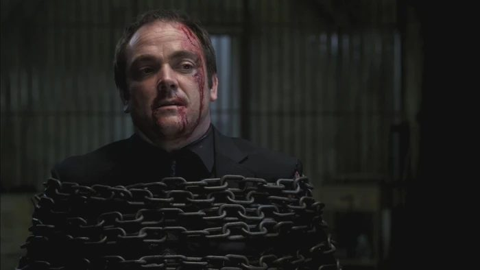

**Описание**

Альфа-перевёртыш был самым первым перевёртышем и тем, кто породил всех остальных. Как и прочие Альфы, он был создан Евой и считается одним из её первых и могущественнейших творений, а также одним из древнейших и сильнейших монстров вообще. Точный возраст неизвестен, но предания гласят, что Ева создала его в начале каменного века, — если так, ему около 2,6 миллиона лет. Он ходил по земле и создавал всё новых детей по мере того, как человечество росло и превращалось в цивилизацию; к моменту, когда его поймал и убил Кроули, искавший Чистилище, активных перевёртышей в мире были тысячи.

Главное его отличие от почти всех детей — отсутствие шелушения: меняя облик, он не сбрасывает и не сползает кожей. Он мгновенно становится кем угодно и копирует не только внешность, но и одежду и предметы — украшения, оружие, ножи, очки, шляпы, перчатки. Вдобавок он получает полный доступ к памяти, мыслям и навыкам того человека, чей облик принял.

Он учил своих детей сливаться с человечеством: по мере развития технологий они развивались вместе с ним и в какой-то момент смогли спокойно уйти в подполье. Со временем мир счёл их мифом, и о существовании Альфы до того, как Кроули начал выслеживать Альф, знали лишь его дети, его братья и сёстры по Еве и существа не моложе его самого.

Кроули поймал и убил Альфа-перевёртыша во время поисков Чистилища — обезглавливанием. Его появления в сериале относятся к шестому сезону: «Two and a Half Men», «Caged Heat» и «Bobby Singer's Guide to Hunting».

**Силы и способности**

- Совершенная смена облика — он мгновенно принимает облик любого человека и, в отличие от почти всех своих детей, не сбрасывает и не сползает кожей при превращении.
- Копирование предметов — вместе с внешностью он воспроизводит одежду и вещи: украшения, оружие, ножи, очки, шляпы и перчатки.
- Доступ к памяти и навыкам — приняв чей-то облик, он получает полный доступ к воспоминаниям, мыслям и умениям этого человека.
- Древняя мощь — как один из первых и сильнейших монстров Евы он неизмеримо превосходит рядовых перевёртышей и почти неуязвим к их обычным слабостям.
- Скрытность вида — он учил детей сливаться с человечеством, и со временем мир счёл перевёртышей мифом.

**Слабости**

- Иридий — один из немногого, что ему вредит: удар иридиевым ножом был для него очень болезненным, примерно как серебро для обычного перевёртыша.
- Обезглавливание — именно так Кроули убил Альфа-перевёртыша; отделение головы остаётся рабочим способом.
- Колт — оружие, способное убить всё, кроме пяти сущностей в мироздании; Альфы уязвимы к Колту, как показала гибель Альфа-вампира от руки Сэма Винчестера.
- Обычные слабости перевёртышей — он неуязвим ко многим из них, поэтому серебро и стандартные приёмы охоты на перевёртышей против него почти бесполезны.

**Как его убить.** Альфа-перевёртыш не оставляет следов в привычном смысле: он не шелушится, мгновенно меняет облик и копирует чужие вещи, поэтому опознать его по коже или внешности невозможно. Рабочих способов в выжимке три: иридиевый нож, которым его можно мучительно ранить, обезглавливание, которым его убил Кроули, и Колт, к которому Альфы уязвимы. Серебро и обычные приёмы охоты на перевёртышей бесполезны, поэтому подготовка начинается с иридиевого оружия и группы, способной удержать противника.

**Известные особи:** Альфа-перевёртыш; Кроули (убил его обезглавливанием); Ева (создательница)

#### Альфа-перевёртыш
*Средний, Монстр, нейтрально-злое*

---
- **Класс доспеха** 18 (природная броня)
- **Хиты** 190 (20d8 + 100)
- **Скорость** 40 фт.

| СИЛ | ЛОВ | ТЕЛ | ИНТ | МДР | ХАР |
|---|---|---|---|---|---|
| 20 | 22 | 20 | 17 | 15 | 18 |

- **Спасброски** Лов +11, Тел +10, Мдр +7
- **Навыки** Обман +14, Скрытность +11, Восприятие +7, Проницательность +7
- **Иммунитет к урону** дробящий, колющий и рубящий от немагического оружия, кроме иридиевого
- **Иммунитет к состояниям** очарование, испуг
- **Чувства** тёмное зрение 60 фт., пассивное Восприятие 17
- **Языки** общий (английский), а также языки всех, чей облик он принимал
- **Бонус мастерства** +5
- **Уровень опасности** 15 (13 000 опыта)

***Особенности***
- ***Совершенная смена облика.*** Альфа действием принимает облик любого гуманоида, которого видел, включая одежду и предметы: украшения, ножи, очки, перчатки. В отличие от обычных перевёртышей, он не оставляет следов кожи и слизи, а превращение нельзя распознать проверкой Восприятия — только магией («Обнаружение магии», «Истинное зрение»).
- ***Копирование памяти и навыков.*** Приняв чей-то облик, Альфа получает доступ к воспоминаниям и навыкам этого существа: он владеет всеми его языками, знает владения навыками и может выдавать себя за него без проверки Обмана, пока рядом нет тех, кто знает жертву слишком хорошо.
- ***Неуязвимость к обычному оружию.*** Альфа не получает урона от немагического оружия, кроме иридиевого: иридий проходит защиту и наносит полный урон, а также не даёт Альфе восстанавливать хиты в этом раунде.
- ***Регенерация 15.*** Альфа восстанавливает 15 хитов в начале своего хода, если у него есть хотя бы 1 хит и он не получал урона иридием с конца своего предыдущего хода.
- ***Легендарная устойчивость (3/день).*** Если Альфа проваливает спасбросок, он может вместо этого выбрать успех.
- ***Смерть от обезглавливания.*** Опустившись до 0 хитов, Альфа не умирает, если не потерял голову. Каждая атака по нему в этом состоянии — критическое попадание, а окончательная смерть наступает только от полного отделения головы.

***Действия***
- ***Мультиатака.*** Альфа совершает три атаки: две атаки когтями и одну атаку скопированным оружием, либо три атаки когтями.
- ***Когти.*** Рукопашная атака оружием: +10 к попаданию, досягаемость 5 фт., одна цель. Попадание: 12 (2d6 + 5) рубящего урона.
- ***Скопированное оружие.*** Рукопашная или дальнобойная атака скопированным оружием: +10 к попаданию, досягаемость 5 фт. или дистанция 30/120 фт., одна цель. Попадание: 14 (2d8 + 5) колющего или рубящего урона в зависимости от оружия.
- ***Чужое лицо.*** Альфа выбирает гуманоида, которого видит в пределах 60 фт. Цель должна преуспеть в спасброске Мудрости Сл 17, иначе до конца своего следующего хода считает Альфу союзником и не может атаковать его, а Альфа получает преимущество на первую атаку по этой цели.

***Бонусные действия***
- ***Мгновенная смена облика.*** Альфа меняет облик и получает преимущество на проверки Ловкости (Скрытность) до конца своего следующего хода.
- ***Рывок хищника.*** Альфа совершает действие Рывок или Отход.

***Реакции***
- ***Отвести удар.*** Когда по Альфе попадает атака немагическим оружием, не являющимся иридиевым, он может реакцией уменьшить полученный урон до 0.

***Легендарные действия***
- ***Смена личины.*** Альфа меняет облик и перемещается на половину своей скорости, не провоцируя атак.
- ***Удар из тени.*** Альфа совершает одну атаку когтями или скопированным оружием.
- ***Чужой облик (стоит 2 действия).*** Альфа принимает облик существа, которое видит, и до конца своего следующего хода имеет преимущество на все проверки Обмана и Скрытности.

***Действия в логове***
- ***Подполье перевёртышей.*** Альфа обитает в подземных укрытиях и тайных квартирах. В своём логове он в начале каждого раунда (по инициативе 20) может создать один ложный образ себя в пределах 30 фт., который существует до конца раунда и отвлекает атаки.
- ***Сеть детей.*** Если Альфа находится в городе, где живут его дети-перевёртыши, он может раз в час призвать 1d4 перевёртышей, которые выдадут себя за случайных прохожих и вмешаются в бой на его стороне.

**Тактика.** Альфа-перевёртыш не идёт в бой в своём истинном виде: он подходит под чужой личиной, втирается в доверие и бьёт в тот момент, когда партия расслабилась. Первой он выводит из строя владельца иридиевого оружия или того, кто может распознать его магией, а затем меняет облик и сбивает противников с толку, заставляя их бить по своим. Против превосходящих сил он не сражается до конца: уходит в подполье, залечивает раны и возвращается в новом облике, поэтому победить его можно только обезглавливанием или Колтом. Если рядом есть его дети, он использует их как заслон и прикрытие для отхода.

**Экология.** Альфа-перевёртыш — существо подполья: он и его дети ушли в укрытия, как только технологии позволили им сливаться с человечеством, и к моменту охоты Кроули в мире были тысячи активных перевёртышей. Он живёт среди людей в городах, меняя личины, поэтому заметить его можно только по делам, а не по внешности. Внешний мир считает перевёртышей мифом; о его существовании знают лишь его дети, другие Альфы и существа не моложе него самого.

> **Заметки мастеру.** Альфа-перевёртыш — босс-обманщик для партии 12–16 уровня: CR 15, иммунитет к обычному оружию и регенерация делают прямой бой невыгодным, а ключ к победе — иридий, Колт или обезглавливание. Его сила не в уроне, а в социальной механике: он копирует память и навыки жертвы, поэтому лучший сценарий для него — подмена союзника, и игрокам стоит дать шанс раскрыть обман через Проницательность и магию. Для низкого уровня уберите иммунитет к оружию и легендарные действия, оставив CR 10. Для высокого добавьте ему сеть детей-перевёртышей.

[↑ к содержанию](#содержание)

---

### 10. Альфа-ругару

**Alpha Rugaru** · Монстр · CR 8 · опасность в сериале 4/5

*Также известно как:* Первый ругару; The First Rugaru

*Первое появление:* S06 «Two And A Half Men»; «Caged Heat»; «Mommy Dearest»

*Сезоны:* 6

Первый ругару в истории и прародитель всего вида: он обратил одного из первых людей в людоеда, породив линию ругару. О его силах почти ничего не известно, а судьба остаётся неизвестной.

**Описание**

Альфа-ругару — первый ругару, когда-либо существовавший, и прародитель всего вида; его титул так и звучит: Первый ругару. Он принадлежит к семье Евы, Матери всех монстров, вместе с рядовыми ругару, которых считают его братьями по крови. Именно альфа обратил одного из первых людей в ругару, и с этого обращения началась вся линия людоедов, передающих свой ген по наследству.

Больше о нём не сообщается почти ничего. Неизвестно, как он выглядит, какими силами обладает сверх видовых и что с ним стало: статус альфы в источниках помечен как неизвестный. Его упоминают в шестом сезоне и в путеводителе «Season Six The Official Companion Guide», но на экране он так и не появляется.

Охотники долгое время вообще сомневались, есть ли у ругару альфа. Сомнения развеялись после того, как Винчестеры добыли рядового ругару для Кроули: сам факт заказа намекал, что перворождённый существует. Найти его пытались и Кэмпбеллы, и Кроули, разыскивавший альф ради Чистилища, но альфа-ругару так и не попал никому в руки.

Для охотника он опасен прежде всего тем, что о нём ничего не известно. Обычный ругару — понятная добыча с известными слабостями, а его перворождённый предок — слепое пятно: он может быть где угодно и выглядеть как кто угодно, а его способность создавать новых ругару означает, что каждая встреча с ним — начало новой линии людоедов.

**Силы и способности**

- Создание ругару — альфа обратил одного из первых людей в ругару, положив начало всему виду людоедов.
- Перворождённый — как первый и древнейший ругару он во много раз старше и, по логике вида, сильнее любого сородича.
- Наследие вида — все ругару происходят от него, что делает альфу ключом к природе их голода и генетической передачи.
- Скрытность — за всё время охоты на альф его не смогли найти ни Кэмпбеллы, ни Кроули, ни Винчестеры.
- Связь с Евой — он принадлежит к семье Матери всех монстров, что даёт ему место в иерархии древних тварей.

**Слабости**

- Огонь — рядовые ругару гибнут только от огня, и против альфы охотники готовят то же оружие.
- Клинок в мозг — демонский клинок, пробивший мозг рядовому ругару, остаётся рабочим аргументом и против альфы.
- Ружьё Людей Письма — оружие Британских Людей Письма создавалось под вид ругару в целом.
- Полная неизвестность — о силах и облике альфы нет данных, и он не может использовать против охотников свой страх и репутацию.
- Судьба неизвестна — возможно, альфа давно мёртв или заперт, и его возвращение требует отдельного повода.

**Как его убить.** Готового рецепта против альфа-ругару у охотников нет: его никто не убивал. Работать приходится по видовым правилам. Нужен огонь: без сожжения ругару не умирает надёжно. Держать его следует серебряными цепями и железными капканами, а добивать — демонским клинком снизу в подбородок, пробивая мозг, либо из ружья Людей Письма. Перед охотой стоит найти его линию: если альфа создаёт новых ругару, у него есть логово и «выводок», и брать его лучше вместе с ними.

#### Альфа-ругару
*Средний, Монстр, нейтрально-злое*

---
- **Класс доспеха** 16 (природная броня)
- **Хиты** 123 (13d8 + 65)
- **Скорость** 45 фт., лазание 30 фт.

| СИЛ | ЛОВ | ТЕЛ | ИНТ | МДР | ХАР |
|---|---|---|---|---|---|
| 22 | 16 | 20 | 12 | 14 | 12 |

- **Спасброски** Сил +10, Тел +9
- **Навыки** Атлетика +10, Восприятие +6, Запугивание +5, Выживание +6
- **Уязвимость к урону** огонь
- **Сопротивление урону** дробящий, колющий и рубящий от немагического оружия
- **Иммунитет к состояниям** очарование, испуг
- **Чувства** тёмное зрение 60 фт., чутьё на человеческую плоть 1 миля, пассивное Восприятие 16
- **Языки** английский
- **Бонус мастерства** +3
- **Уровень опасности** 8 (3 900 опыта)

***Особенности***
- ***Перворождённый.*** Альфа-ругару совершает с преимуществом спасброски против эффектов, которые пытаются подчинить его волю или обратить его против своих, и не может быть испуган.
- ***Создание ругару.*** Проведя час рядом с бессознательным или согласным гуманоидом и скормив ему человеческую плоть, альфа запускает в нём необратимое превращение: через 24 часа цель становится ругару с обычным статблоком ругару.
- ***Нечеловеческая мощь.*** Альфа совершает с преимуществом проверки и спасброски Силы; его безоружные удары считаются оружием и наносят рубящий урон.
- ***Вечный голод.*** Альфа должен съесть человеческую плоть раз в 3 дня, иначе получает один уровень истощения за каждые сутки без пищи; истощение снимается только свежей человечиной.
- ***Быстрый хищник.*** Альфа игнорирует немагическую труднопроходимую местность и может двигаться на четвереньках, не теряя способности атаковать когтями.

***Действия***
- ***Мультиатака.*** Альфа совершает три атаки: одну укусом и две когтями.
- ***Укус.*** Рукопашная атака оружием: +10 к попаданию, досягаемость 5 фт., одна цель. Попадание: 15 (2d8 + 6) колющего урона, и цель должна преуспеть в спасброске Сил (Сл 18), иначе схвачена.
- ***Когти.*** Рукопашная атака оружием: +10 к попаданию, досягаемость 5 фт., одна цель. Попадание: 13 (2d6 + 6) рубящего урона.
- ***Разрывание (только по схваченной цели).*** Альфа терзает схваченное существо: 28 (8d6) рубящего урона, и цель получает один уровень истощения.
- ***Призыв линии (1/день).*** Альфа воет, и на зов приходят 1d4 ругару, появившиеся в пределах 120 фт. в конце следующего раунда.

***Бонусные действия***
- ***Прыжок хищника.*** Альфа совершает Рывок или Отход.

***Реакции***
- ***Смертельный рывок.*** Когда существо в пределах 10 фт. наносит альфе урон, он может реакцией переместиться к нему и совершить одну атаку когтями.

**Тактика.** Альфа-ругару дерётся как более умный и опытный сородич: он не бросается вперёд, а выманивает группу в узкое место — подвал, туннель, коридор, — где нельзя использовать огонь широко. Сначала он снимает самого слабого, чтобы посеять панику и заставить остальных тратить ресурсы, затем отходит и заходит с другой стороны. Открытого пламени он боится и обходит его, ломая препятствия. Если бой идёт плохо, он зовёт свою линию и уходит вместе с ней, чтобы начать заново в другом городе.

**Экология.** Первый ругару живёт скрытно, вероятнее всего, вдали от больших городов — в лесах, горах или заброшенных поселениях, где можно держать логово и создавать новых ругару. Рядом с ним всегда несколько обращённых им людей, которых он использует как охотников и приманку. Охотники не знают ни его внешности, ни привычек: единственные сведения о нём — книги Кэмпбеллов и записи Людей Письма. Он остаётся фигурой из легенд, пока сам не решит показаться.

> **Заметки мастеру.** Альфа-ругару — босс на 7–9 уровень и естественный источник ругару в кампании: убив его, партия обрывает целую линию людоедов. Он заменяет в 5e огров-боссов и вервольфов-вожаков, но с обязательной уязвимостью к огню и без регенерации. Масштабирование простое: для низкого уровня уберите Призыв линии и Разрывание, снизив КС до 14; для высокого — дайте сопротивление огню до конца раунда после спасброска и свиту из 2–3 ругару. Держите в уме тайну: партия может так и не узнать, действительно ли это перворождённый.

[↑ к содержанию](#содержание)

---

### 11. Альфа-скинвокер

**Alpha Skinwalker** · Монстр · CR 14 · опасность в сериале 4/5

*Также известно как:* Первый скинвокер; Прародитель скинвокеров

*Первое появление:* S06 «All Dogs Go To Heaven» (упоминание)

*Сезоны:* 6

Первый и старейший скинвокер, прародитель вида, которому больше десяти тысяч лет. Он ни разу не появлялся, но готовил из своих детей спящую армию, способную за одну ночь вырасти в пять раз.

**Описание**

Альфа-скинвокер — самый первый скинвокер, от которого происходят все остальные представители вида. Он бессмертен, в отличие от обычных скинвокеров, и ему было больше десяти тысяч лет, когда Ева, Мать Всех Монстров, в последний раз ходила по земле. В сериале он ни разу не появлялся: о нём известно из эпизода «All Dogs Go To Heaven» и из «Путеводителя Бобби Сингера по охоте».

Как и прочие Альфы, он связан со своими детьми телепатически и способен находить их где угодно. Именно этой связью объясняется план, раскрытый Лаки: скинвокеров расставили спящими агентами в собачьем облике по семьям, и по сигналу Альфы их число должно было за одну ночь вырасти с тридцати до ста пятидесяти — за счёт обращения целых семей. После смерти Евы эти планы, по всей видимости, были заброшены, а пережил ли сам Альфа встречу с Кроули, неизвестно.

Как первый из своего вида, он обладает силой скинвокера, но на несравнимо более высоком уровне: он гораздо сильнее людей и всех прочих скинвокеров, а его чувства обострены до предела. Способности он, вероятно, делит с обычными скинвокерами — полное обращение в собаку, ускоренное заживление и заразный укус, — но, в отличие от них, его не ограничивает ни возраст, ни серебро в привычном смысле, и о его слабостях достоверно ничего не известно.

Для охотников Альфа-скинвокер — фигура умолчания: его никогда не видели, у него нет известного логова, и единственный способ добраться до него — уничтожать его сеть и ждать, когда он сам проявит себя.

**Силы и способности**

- Бессмертие — Альфа-скинвокер не умирает от старости и прожил более десяти тысяч лет, пережив эпохи, когда Ева ходила по земле.
- Телепатическая связь — как и все Альфы, он связан со своими детьми и способен находить их независимо от расстояния.
- Зов стаи — по его сигналу спящие скинвокеры пробуждаются и обращают семьи, увеличивая численность вида с тридцати до ста пятидесяти за одну ночь.
- Усиленная сила — как первый и самый старший скинвокер, он многократно сильнее людей и всех обычных представителей своего вида.
- Обострённые чувства — его слух, нюх и зрение усилены до предела, что делает его идеальным следопытом.

**Слабости**

- Серебро — единственное известное оружие против скинвокеров; серебряный клинок или пуля в сердце либо голову остаются лучшей ставкой и против Альфы.
- Отсутствие данных — о его слабостях и уязвимостях источники не сообщают ничего, поэтому охотникам приходится действовать по аналогии с его детьми.
- Человеческий облик — как и все скинвокеры, вне собачьей формы он лишён части своей мощи и предпочитает не подставляться.
- Сеть вместо тела — его сила держится на расставленных скинвокерах: уничтожив спящих агентов, охотники лишают Альфу армии и вынуждают его действовать самому.

**Как его убить.** Прямого способа убить Альфа-скинвокера источники не описывают. Исходите из того, что работает против его детей: серебряные пули, серебряный клинок в сердце или голову, серебряные цепи для захвата. Сначала бейте по сети: найдите спящих скинвокеров в собачьем облике при семьях и уничтожьте их до сигнала Альфы, иначе за одну ночь тридцать врагов станут ста пятьюдесятью. Допрос пленного в серебряных цепях даёт сведения о вожаке. На самого Альфу идите полной группой.

**Известные особи:** Альфа-скинвокер; Лаки

#### Альфа-скинвокер
*Средний, Монстр, нейтрально-злое*

---
- **Класс доспеха** 17 (природная броня)
- **Хиты** 190 (20d8 + 100)
- **Скорость** 40 фт. (50 фт. в собачьем облике)

| СИЛ | ЛОВ | ТЕЛ | ИНТ | МДР | ХАР |
|---|---|---|---|---|---|
| 22 | 18 | 20 | 14 | 16 | 14 |

- **Спасброски** Сил +11, Тел +10, Мдр +8
- **Навыки** Восприятие +8, Скрытность +9, Выживание +8
- **Иммунитет к урону** дробящий, колющий и рубящий от немагического оружия, кроме серебряного
- **Иммунитет к состояниям** очарование, испуг, отравление
- **Чувства** тёмное зрение 120 фт., пассивное Восприятие 18
- **Языки** общий (английский), телепатическая связь со скинвокерами
- **Бонус мастерства** +5
- **Уровень опасности** 14 (11 500 опыта)

***Особенности***
- ***Бессмертие.*** Альфа-скинвокер не старится и не умирает от естественных причин. Он не может быть убит иначе как серебром: урон серебряным оружием проходит его защиту и наносит полный урон.
- ***Обращение по желанию.*** Альфа-скинвокер бонусным действием принимает облик собаки или возвращается в человеческий облик, независимо от времени суток и лунного цикла.
- ***Телепатическая связь.*** Он связан со всеми скинвокерами своего вида: знает их местоположение, может отдавать приказы и получать образы происходящего на любом расстоянии в пределах одного мира.
- ***Зов стаи (1/день).*** Действием Альфа-скинвокер подаёт сигнал. Все спящие скинвокеры в пределах 10 миль пробуждаются, принимают боевой облик и за 1 час обращают в скинвокеров до 100 гуманоидов, которые подчиняются ему до конца сцены.
- ***Регенерация 15.*** Альфа-скинвокер восстанавливает 15 хитов в начале своего хода, если у него есть хотя бы 1 хит и он не получал урона серебром с конца своего предыдущего хода.
- ***Легендарная устойчивость (3/день).*** Если Альфа-скинвокер проваливает спасбросок, он может вместо этого выбрать успех.
- ***Обострённые чувства.*** Он имеет преимущество на проверки Мудрости (Восприятие), основанные на слухе и обонянии, и выслеживает существо по запаху на расстоянии до 5 миль.

***Действия***
- ***Мультиатака.*** Альфа-скинвокер совершает три атаки: одну укусом и две когтями.
- ***Укус.*** Рукопашная атака оружием: +11 к попаданию, досягаемость 5 фт., одна цель. Попадание: 15 (2d10 + 6) колющего урона, и цель должна преуспеть в спасброске Телосложения Сл 18, иначе заражается и становится скинвокером.
- ***Когти.*** Рукопашная атака оружием: +11 к попаданию, досягаемость 5 фт., одна цель. Попадание: 13 (2d6 + 6) рубящего урона, и цель схвачена (Сл высвобождения 19).
- ***Вырвать сердце.*** Альфа-скинвокер совершает атаку когтями по схваченной или недееспособной цели. При попадании цель получает 24 (4d6 + 6) рубящего урона, и её максимум хитов уменьшается на эту величину.

***Бонусные действия***
- ***Обращение.*** Альфа-скинвокер превращается в собаку или возвращается в человеческий облик.

***Реакции***
- ***Отвести удар.*** Когда по Альфа-скинвокеру попадает атака немагическим оружием, не являющимся серебряным, он может реакцией уменьшить полученный урон до 0.

***Легендарные действия***
- ***Рывок хищника.*** Альфа-скинвокер перемещается на половину скорости, не провоцируя атак, и совершает одну атаку когтями.
- ***Приказ стае.*** Один союзный скинвокер в пределах 60 фт. немедленно совершает одну атаку или перемещается на свою скорость, не провоцируя атак.
- ***Звериное чутьё (стоит 2 действия).*** Альфа-скинвокер определяет точное местоположение всех враждебных существ в пределах 120 фт., включая невидимых и скрытых.

***Действия в логове***
- ***Пробуждение спящих.*** На инициативе 20 один спящий скинвокер в пределах 1 мили пробуждается и присоединяется к бою в начале следующего раунда.
- ***Хор псов.*** Вой стаи наполняет округу: каждое враждебное существо в пределах 60 фт. должно преуспеть в спасброске Мудрости Сл 16, иначе становится испуганным до конца своего следующего хода.
- ***Ложный след.*** Альфа-скинвокер и все его союзники-скинвокеры до конца раунда получают преимущество на проверки Ловкости (Скрытность) и не могут быть выслежены немагическими средствами.

**Тактика.** Альфа-скинвокер не появлялся в сериале, поэтому логично, что он не выходит на бой лично: он действует через сеть спящих скинвокеров и подставляет охотникам вожаков, а сам наблюдает со стороны в чужом облике. Если его всё же вынудили драться, он подаёт зов стаи, натравливает на партию новообращённых и бьёт по тому, кто держит серебро. Против явного превосходства он уходит в собачьем облике и растворяется в городе, а затем годами не даёт о себе знать. Серебро — единственное, чего он по-настоящему опасается, и он старается не подпускать к себе вооружённых им врагов.

**Экология.** Он живёт более десяти тысяч лет и ни разу не попадался на глаза охотникам: вероятнее всего, он действует из крупного города, где держит под контролем несколько ячеек спящих скинвокеров в семьях. После смерти Евы его замысел создать армию считается заброшенным, а сам Альфа мог погибнуть от рук Кроули; в любом случае его нынешнее местонахождение неизвестно.

> **Заметки мастеру.** Альфа-скинвокер — скрытый антагонист, а не боевой босс: его сила в сети спящих агентов и способности вырастить армию за одну ночь. Для партии 11–14 уровня он хорош как финальная угроза арки, но бой с ним должен быть кульминацией после уничтожения сети, иначе легендарное действие «Приказ стае» превратит энкаунтер в бесконечную волну врагов. Серебро обязательно: без него он неуязвим, поэтому дайте партии шанс добыть серебряное оружие заранее. Если нужен CR ниже, уберите легендарные действия и снизьте запас хитов вдвое — он останется узнаваемым, но станет по силам партии 8–9 уровня.

[↑ к содержанию](#содержание)

---

### 12. Альфа-феникс

**Alpha Phoenix** · Монстр · CR 15 · опасность в сериале 4/5

*Также известно как:* Первый феникс; The First Phoenix

*Первое появление:* Упомянут только в «Season Six The Official Companion Guide»; на экране не появлялся

Первый феникс, порождённый Евой как токсичный для неё сгусток и ею же изгнанный. Он обратил одного из первых людей в феникса, дав начало всему виду, и владеет испепеляющим плоть и кости пламенем.

**Описание**

Альфа-феникс — первый феникс в истории и прародитель всего вида. Его происхождение отличается от всех остальных альф: он не был человеком, изменённым Евой, а возник как злокачественный и токсичный агент, развившийся из самой Матери всех монстров. Ева изгнала его из себя, и он стал изгоем среди монстров — единственным вместе с хан-червём, кто не произошёл от человека.

Его силы называют прямо: альфа-феникс был неуязвим для естественной смерти и болезней, а его пирокинезис был настолько силён, что выжигал кровь и кости человека. Кроме того, он обратил одного из первых людей в феникса, и с этого обращения началось существование вида.

Несмотря на могущество, у альфа-феникса есть слабость, известная охотникам, — Кольт, о котором говорят, что он способен убить что угодно во всём творении. Это единственное, что может его остановить. Упоминается он лишь в путеводителе по шестому сезону и на экране не появляется ни разу, поэтому о его облике, привычках и судьбе ничего не известно.

Для охотника альфа-феникс — крайний случай: тварь, которая старше самого вида, ядовита для своей создательницы и ненавидима всеми монстрами, но при этом никак себя не проявляет. Обычная охота здесь невозможна: сначала нужно понять, что перед вами не рядовой феникс, а его перворождённый предок, а потом найти Кольт — иначе бой заканчивается раньше, чем начнётся.

**Силы и способности**

- Бессмертие — альфа-феникс неуязвим для естественной смерти, болезней и старения.
- Пирокинезис — он генерирует настолько мощное пламя, что выжигает у человека кровь и кости.
- Создание фениксов — альфа обратил одного из первых людей в феникса, положив начало всему виду.
- Токсичность для Евы — он развился как ядовитый для Матери всех монстров агент, и она изгнала его из себя.
- Изгой среди монстров — его ненавидят все твари как отраву для их создательницы, что делает его одиночкой без союзников.

**Слабости**

- Кольт — единственное известное оружие, способное убить альфа-феникса: он убивает всё в творении.
- Изгой — альфа отвергнут Евой и ненавидим всеми монстрами, поэтому у него нет ни союзников, ни убежища.
- Железо — если альфа разделяет природу вида, холодное железо обжигает его и удерживает на месте.
- Безызвестность — о нём нет ни описаний, ни встреч: он не появлялся на экране, и о его повадках ничего не известно.

**Как его убить.** Рецепт против альфа-феникса один — Кольт. Всё прочее оружие бессмысленно: он неуязвим для земной стали, а его пламя выжигает человека дотла за одно касание. Поэтому охота начинается не с поиска твари, а с поиска револьвера: без него идти на альфу нельзя. Если Кольта нет, остаётся железо — кандалы, цепи, решётки, которые обжигают феникса и держат его на месте, но не убивают. Ловушку надо ставить наверняка и бить первым: второго шанса альфа не даёт, а подойти к нему — значит сгореть.

#### Альфа-феникс
*Средний, Элементаль, нейтральное*

---
- **Класс доспеха** 19 (природная броня)
- **Хиты** 207 (18d8 + 126)
- **Скорость** 40 фт.

| СИЛ | ЛОВ | ТЕЛ | ИНТ | МДР | ХАР |
|---|---|---|---|---|---|
| 18 | 20 | 24 | 17 | 17 | 20 |

- **Спасброски** Тел +12, Мдр +8, Хар +10
- **Навыки** Восприятие +8, Запугивание +10, Магия +8
- **Уязвимость к урону** холодное железо
- **Сопротивление урону** дробящий, колющий и рубящий от немагического оружия
- **Иммунитет к урону** огонь, яд, некротический урон
- **Иммунитет к состояниям** очарование, испуг, отравление, истощение
- **Чувства** тёмное зрение 120 фт., пассивное Восприятие 18
- **Языки** английский
- **Бонус мастерства** +5
- **Уровень опасности** 15 (13 000 опыта)

***Особенности***
- ***Абсолютное бессмертие.*** Альфа-феникс не стареет и не умирает от естественных причин или болезней. Эффекты, убивающие мгновенно, на него не действуют, а его хиты невозможно опустить ниже 1 никаким немагическим уроном — только артефактное оружие вроде Кольта способно его уничтожить.
- ***Изначальное пламя.*** В начале каждого своего хода альфа восстанавливает 20 хитов, если в прошлом раунде не получал урона от холодного железа.
- ***Отрава для Евы.*** Альфа токсичен для своей создательницы. Существо, происходящее от Евы, при виде альфы совершает спасбросок Мдр (Сл 18), иначе испугано на 1 минуту и не может добровольно приблизиться к нему.
- ***Создание феникса.*** Часовым ритуалом альфа обращает согласного или бессознательного гуманоида в феникса с обычным статблоком феникса, дав начало новой линии вида.
- ***Железо жжёт.*** При контакте с холодным железом альфа получает 11 (2d10) урона огнём и должен преуспеть в спасброске Мдр (Сл 16), иначе отступает. В железных кандалах он получает помеху на проверки Силы и Ловкости.
- ***Легендарная сопротивляемость (3/день).*** Если альфа проваливает спасбросок, он может вместо этого преуспеть в нём.

***Действия***
- ***Мультиатака.*** Альфа совершает три атаки: одну Испепелением крови и костей и две Огненными дланями.
- ***Огненная длань.*** Рукопашная атака заклинанием: +10 к попаданию, досягаемость 5 фт., одна цель. Попадание: 14 (2d8 + 5) урона огнём.
- ***Испепеление крови и костей.*** Рукопашная атака заклинанием: +10 к попаданию, досягаемость 5 фт., одна цель. Попадание: 27 (5d10) урона огнём, и цель совершает спасбросок Тел (Сл 19). При провале она получает ещё 27 (5d10) урона огнём; если от этого урона она опускается до 0 хитов, её тело и кости обращаются в пепел.
- ***Взрыв пламени (перезарядка 5–6).*** Каждое существо в пределах 40 фт. совершает спасбросок Лов (Сл 19), получая 55 (10d10) урона огнём при провале или половину при успехе. Горючие предметы в области сгорают.

***Реакции***
- ***Опаляющий отпор.*** Когда существо в пределах 5 фт. попадает по альфе рукопашной атакой, оно получает 11 (2d10) урона огнём.

***Легендарные действия***
- ***Пепельный шаг.*** Альфа перемещается до половины своей скорости, и одно существо в пределах 10 фт. от его нового положения получает 11 (2d10) урона огнём.
- ***Тлеющий взгляд.*** Одно существо в пределах 60 фт. совершает спасбросок Тел (Сл 19), иначе получает 14 (4d6) урона огнём и не может восстанавливать хиты до конца своего следующего хода.
- ***Догорание (стоит 2 действия).*** Альфа совершает одну атаку Огненной дланью.

**Тактика.** Альфа-феникс не воюет, а выжигает: он идёт напрямую, не считаясь с обычным оружием, и первым делом уничтожает того, кто держит Кольт или холодное железо. Всё, что подходит ближе, сгорает за один раунд, поэтому альфа не отступает и не ищет укрытий — он просто идёт сквозь строй. Единственное, чего он избегает, — железные ловушки и кандалы: их он обходит, выжигая помещение снаружи. Если его действительно ранят, он усиливает натиск, зная, что раны затянутся сами; отступает он лишь тогда, когда видит в руках противника артефакт вроде Кольта.

**Экология.** Об альфа-фениксе почти ничего не известно: он упоминается лишь в путеводителе по шестому сезону и не появляется на экране. Как и рядовые фениксы, он изгой: Ева отвергла его, и все монстры ненавидят его как отраву для создательницы. Вероятнее всего, он ведёт существование одиночки, скрываясь там, где нет ни охотников, ни других тварей, и не стремится к власти или стае. Любая встреча с ним в игре должна быть событием, а не рядовым энкаунтером.

> **Заметки мастеру.** Альфа-феникс — верхняя планка монстров этого вида и босс на 13–16 уровень, который убивается только артефактным оружием: без Кольта партия не может победить честно и должна искать другой путь — железную ловушку, изгнание или сделку. В 5e он заменяет элементального майора огня или феникса-босса из хоумбрю, но без полёта и с уязвимостью к холодному железу. Для низкого уровня сократите хиты вдвое, уберите Изначальное пламя и легендарные действия; для высокого — добавьте свиту из двух рядовых фениксов и способность поджигать всё поле боя.

[↑ к содержанию](#содержание)

---

### 13. Альфы (первейшие монстры)

**Alphas** · Монстр · CR 18 · опасность в сериале 4/5

*Также известно как:* Первейшие монстры; Перводети Евы; Отец падших тварей

*Первое появление:* Сезон 6, «Two and a Half Men»

*Сезоны:* 6, 7, 8, 10, 12, 15

Самые первые монстры каждого вида, созданные Евой. Первейшие и самые сильные представители своей породы, связанные телепатией со всеми своими детьми и почти не имеющие слабостей.

**Описание**

Альфы — самые первые монстры каждого вида, созданные Евой. Поскольку каждый из них буквально является первым в своём роде, все они гораздо могущественнее обычных представителей своей породы. Согласно lore о происхождении Евы, Альфы — это первородные монстры, рождённые в Чистилище вскоре после создания вселенной, как и Левиафаны.

Как создатели своих видов Альфы связаны с потомством телепатически: они способны отслеживать и слышать своих детей где угодно на Земле и получать все знания, которыми те обладают. По силе Альфы многократно превосходят людей, животных, низших демонов, адских гончих, всех прочих монстров и вообще всех членов собственного вида. Из-за древности и мощи у них очень мало слабостей, и они часто невосприимчивы к тому, что губит их обычных сородичей.

Благодаря близости к Еве Альфы знают о существовании Чистилища, о расположении его врат и о Левиафанах — своих предках. Согласно Сэмюэлю Кэмпбеллу, об Альфах существует масса lore, но до их появления, когда Кроули начал охоту на них ради Чистилища, их считали мифом.

Известные поимённо Альфы — Альфа-вампир, которого убил Кольт, и Альфа-оборотень, которого обезглавил Кроули; последний был заметно ослаблен, и группа из трёх черноглазых демонов сумела его пленить, хотя один обычный демон Альфе не соперник. Уязвимость Альф немногочисленна: Кольт, иридиевый клинок, Левиафаны, воля Евы, обезглавливание и, в случае ослабленного Альфы, толпа демонов.

**Силы и способности**

- Телепатическая связь — Альфа связан со всеми монстрами своего вида на Земле, может общаться с ними на любом расстоянии и получать все их знания.
- Сверхсила — как древнейший и чистейший представитель породы Альфа значительно сильнее любого своего сородича, а также людей, зверей, низших демонов и адских гончих.
- Стойкость к слабостям вида — Альфы часто невосприимчивы или куда менее чувствительны к тому, что убивает обычных монстров их вида.
- Знание Чистилища — Альфа знает о Чистилище, его вратах и о Левиафанах, своих предках.

**Слабости**

- Кольт — револьвер, способный убить всё в Творении, кроме пяти сущностей; из него был убит Альфа-вампир.
- Иридиевый клинок — иридий, один из редчайших металлов на Земле, годится против любого Альфы.
- Левиафаны — они способны убить любого монстра, включая Альф.
- Ева — как мать Альф она телепатически влияет на своих детей, даже на перворождённых.
- Обезглавливание — так Кроули убил Альфу-оборотня; Альфа-вампир тоже был уязвим к отсечению головы.
- Толпа демонов — три черноглазых демона сумели пленить сильно ослабленного Альфу-вампира; один обычный демон ему не соперник.

**Как его убить.** Готовиться нужно заранее: обычное оружие Альфу не берёт. Варианты по выжимке — Кольт (он убивает всё, кроме пяти сущностей Творения), иридиевый клинок и обезглавливание; ослабленного Альфу может взять даже толпа демонов. Снаряжение: Кольт с патронами или иридиевый клинок, тяжёлые цепи и ловчая клетка, серебро и соль против свиты, союзники, готовые держать монстров вида, которые сбегутся на телепатический зов. Если Альфу ослабить и лишить прикрытия, охота становится реальной.

**Известные особи:** Альфа-вампир — убит из Кольта; Альфа-оборотень — обезглавлен Кроули

#### Альфы (первейшие монстры)
*Средний, Монстр, любое злое*

---
- **Класс доспеха** 18 (природная броня)
- **Хиты** 243 (18d10 + 144)
- **Скорость** 40 фт.

| СИЛ | ЛОВ | ТЕЛ | ИНТ | МДР | ХАР |
|---|---|---|---|---|---|
| 26 | 18 | 26 | 18 | 18 | 20 |

- **Спасброски** Сил +14, Тел +14, Мдр +10, Хар +11
- **Навыки** Восприятие +10, Запугивание +11, Проницательность +10
- **Сопротивление урону** дробящий, колющий и рубящий от немагического оружия; холод, огонь, некротический
- **Иммунитет к урону** яд
- **Иммунитет к состояниям** очарование, испуг, отравление
- **Чувства** тёмное зрение 120 фт., пассивное Восприятие 20
- **Языки** все языки, которые знают его дети; телепатия на любое расстояние в пределах Земли
- **Бонус мастерства** +6
- **Уровень опасности** 18 (20 000 опыта)

***Особенности***
- ***Телепатическая связь с видом.*** Альфа может общаться со всеми монстрами своего вида на Земле, отдавать им приказы и мгновенно узнавать всё, что знает любой из его детей. Пока в мире жив хотя бы один монстр его вида, Альфа не может быть застигнут врасплох.
- ***Пренебрежение слабостями вида.*** Альфа игнорирует уязвимости, сопротивления и условия поражения, присущие обычным монстрам его вида. Против него действуют только Кольт, иридиевый клинок, Левиафаны, воля Евы и обезглавливание.
- ***Древняя мощь.*** Альфа получает преимущество на проверки Силы (Атлетика) и на броски атаки против любого монстра собственного вида, а также на спасброски против эффектов, нацеленных на монстров его породы.
- ***Чутьё Чистилища.*** Альфа знает о существовании Чистилища, о расположении его врат и о Левиафанах. Он получает преимущество на проверки Мудрости (Выживание), связанные с поиском врат Чистилища и следов Левиафанов.
- ***Легендарное сопротивление (3/день).*** Если Альфа проваливает спасбросок, он может вместо этого выбрать успех.
- ***Регенерация.*** Альфа восстанавливает 20 хитов в начале своего хода, если у него есть хотя бы 1 хит и он не получал урона от иридиевого оружия или Кольта с прошлого хода.

***Действия***
- ***Мультиатака.*** Альфа совершает три атаки: укус, коготь и удар оружием, либо три атаки когтями.
- ***Укус.*** Рукопашная атака оружием: +14 к попаданию, досягаемость 5 фт., одна цель (для Альфы-вампира — существо; для прочих Альф — по описанию вида). Попадание: 15 (2d8 + 6) колющего урона, и максимум хитов цели снижается на эту величину до продолжительного отдыха.
- ***Коготь.*** Рукопашная атака оружием: +14 к попаданию, досягаемость 5 фт., одна цель. Попадание: 17 (2d10 + 6) рубящего урона.
- ***Захват.*** Альфа пытается схватить одно существо размера Средний или меньше (Сл 22). Пока цель схвачена, Альфа может бонусным действием нанести ей 15 (2d8 + 6) колющего урона укусом.

***Легендарные действия***
- ***Обнаружение.*** Альфа совершает проверку Мудрости (Восприятие).
- ***Атака.*** Альфа совершает одну атаку когтями или укусом.
- ***Зов вида.*** Альфа телепатически призывает одного монстра своего вида в пределах 1 мили; тот перемещается к нему на максимальной скорости.

**Тактика.** Альфа не воюет в одиночку, если может этого избежать: он держит при себе сородичей, рассылает их телепатическим зовом и заставляет партию тратить силы на мелких монстров, пока сам выбирает момент. В бою он давит силой, хватает самого слабого и использует легендарные действия, чтобы не дать себя окружить. Увидев иридиевый клинок или Кольт, Альфа меняет поведение: он старается обезоружить владельца, а не убить его, и может отступить, если противников слишком много, — но обезглавливания он боится по-настоящему и прикрывает шею.

**Экология.** Каждый Альфа — единственный в своём виде и глава всей своей породы, поэтому встречается он там, где собираются его дети: в логовах, гнёздах, тайных поселениях монстров. После того как Кроули начал охоту ради ключа к Чистилищу, Альфы перестали быть мифом и стали целью номер один для всех, кто знает о Чистилище. Живут они скрытно, десятилетиями не показываясь охотникам, и сосуществуют только с монстрами собственного вида.

> **Заметки мастеру.** Это карточка-архетип: подставьте под неё конкретный вид (вампир, оборотень, сирена, рэйт, дракон) и замените укус на подходящую атаку. Механически Альфа — легендарный монстр уровня архидьявола (CR 18): для низких уровней используйте его ослабленную версию (уберите легендарные действия, регенерацию и сопротивление немагическому оружию) или сделайте Альфу сюжетной угрозой за кадром. Ключ к энкаунтеру — добыть иридиевый клинок или патроны Кольта: встройте это как отдельный квест. Обезглавливание оставьте как «хрупкую» альтернативу, доступную только против обездвиженного или ослабленного Альфы.

[↑ к содержанию](#содержание)

---

### 14. Амазонки

**Amazons** · Монстр · CR 3 · опасность в сериале 2/5

*Также известно как:* Племя воительниц; Полулюди-воительницы

*Первое появление:* Сезон 7, «The Slice Girls»

*Сезоны:* 7

Раса полулюдей, состоящая только из женщин: они сверхчеловечески сильны, виртуозно владеют оружием, а их дети взрослеют за считанные дни. При этом амазонки смертны и убиваются обычной пулей — что и погубило их в сериале.

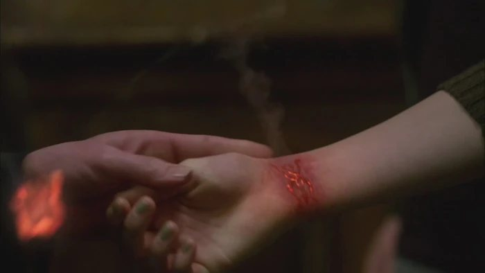

**Описание**

Амазонки — раса получеловеческих существ, состоящая только из женщин. Их создали на встрече языческих божеств, Ареса и Гармонии: получилось племя воительниц, которым мужчины не были нужны ни для чего, кроме продолжения рода.

В какой-то момент прошлого война истощила их число почти до исчезновения. Тогда амазонки заключили с Гармонией сделку, чтобы спастись от вымирания, и она сделала их больше, чем людьми, — по сути, превратила их в монстров. От большинства других монстров они отличаются тем, что не происходят от Евы и потому не имеют Альфы.

Их сила сверхчеловеческая: амазонка способна швырнуть взрослого мужчину сквозь стену, а также без всякого напряжения одолеть и разорвать на части полностью выросшего человека. Оружие они знают досконально — от огнестрельного до клинков и ножей, — что делает их одинаково опасными в перестрелке и в ближнем бою.

Самый необычный их признак — стремительное взросление. Амазонки беременеют через несколько часов после близости и рожают вскоре после этого, а дети продолжают расти так же быстро: через два дня после рождения они выглядят как подростки. Лишь к шестнадцати годам их взросление становится обычным. Именно поэтому племя способно восстановить численность за считанные дни.

Несмотря на всё это, амазонки остаются смертными: у них нет ни сопротивлений, ни регенерации, и убить их можно так же легко, как обычного человека. Сэм застрелил Шарлин Пенн и Эмму из обычного пистолета. В сериале амазонки появляются в седьмом сезоне («The Slice Girls», «Plucky Pennywhistle's Magical Menagerie»); в выжимке упомянуты Шарлин Пенн и Эмма, а также Арес и Гармония, создавшие племя.

**Силы и способности**

- Сверхчеловеческая сила — амазонка швыряет взрослого мужчину сквозь стену и без усилий одолевает и разрывает полностью выросшего человека.
- Владение оружием — амазонки превосходно обращаются с огнестрельным оружием и клинками: мечами, ножами и всем, что попадает в руки.
- Стремительная беременность — амазонка беременеет через несколько часов после близости и рожает вскоре после этого.
- Быстрое взросление — дети амазонок растут так быстро, что через два дня после рождения выглядят как подростки, а с шестнадцати лет стареют нормально.
- Сделка с богиней — по договору с Гармонией амазонки стали больше, чем людьми; именно это превратило их в монстров.
- Жизнь без мужчин — мужчины нужны племени только для продолжения рода, во всём остальном амазонки обходятся без них.

**Слабости**

- Смертность — несмотря на все сверхъестественные черты, амазонки смертны и убиваются так же легко, как обычный человек.
- Обычное оружие — Сэм застрелил Шарлин Пенн и Эмму из обычного пистолета, без серебра, магии и ритуалов.
- Отсутствие регенерации — в выжимке не описано ни одного случая, когда амазонка залечила бы рану или восстала после смерти.
- Нет Альфы — амазонки не происходят от Евы и не имеют Альфы, поэтому у них нет ни вожака-прародителя, ни общего гнезда.
- Племя на грани — их число когда-то истощила война, и только сделка с Гармонией спасла племя от вымирания.

**Как его убить.** Охота на амазонку не требует ничего сверхъестественного: подойдут обычные пистолет или клинок, потому что она смертна, как человек. Сложность — найти её и не попасть в засаду. Амазонки живут среди людей: соблазняют мужчину, рожают ребёнка и убивают отца, а новое поколение взрослеет за два дня, поэтому дело растёт быстрее, чем идёт следствие. Охотнику нужны сводки о пропавших мужчинах и сведения о необычно быстро повзрослевших девочках. Инвентарь: пистолет, дробовик, наручники и диктофон.

**Известные особи:** Шарлин Пенн — амазонка, застреленная Сэмом из обычного пистолета; Эмма — застрелена Сэмом из обычного пистолета; Арес и Гармония — божества, создавшие племя амазонок

#### Амазонки
*Средний, Гуманоид, нейтральное*

---
- **Класс доспеха** 15 (кожаный доспех, щит)
- **Хиты** 52 (8d8 + 16)
- **Скорость** 35 фт.

| СИЛ | ЛОВ | ТЕЛ | ИНТ | МДР | ХАР |
|---|---|---|---|---|---|
| 18 | 16 | 15 | 11 | 12 | 14 |

- **Спасброски** Сил +6, Лов +5
- **Навыки** Атлетика +6, Восприятие +3, Запугивание +4
- **Чувства** пассивное Восприятие 13
- **Языки** английский
- **Бонус мастерства** +2
- **Уровень опасности** 3 (700 опыта)

***Особенности***
- ***Сверхчеловеческая сила.*** Амазонка считается существом на один размер больше при захвате, толкании и переносе тяжестей. Её рукопашные атаки оружием наносят дополнительно 3 (1d6) урона.
- ***Мастер оружия.*** Амазонка добавляет бонус мастерства к броскам атаки любым оружием, включая незнакомое, и не получает помеху за стрельбу в упор по цели в пределах 5 фт.
- ***Стремительное потомство.*** Новое поколение амазонок взрослеет за дни: девочка становится бойцом с уровнем опасности 3 уже через двое суток после рождения. Для кампании это значит, что уничтоженное гнездо восстанавливается за неделю, если жива хотя бы одна взрослая амазонка.
- ***Смертность.*** У амазонки нет ни сопротивлений, ни регенерации: она умирает от обычного оружия, как человек, и не восстаёт после смерти.
- ***Боевая сестра.*** Амазонка получает преимущество на броски атаки по существу, если в пределах 5 фт. от него находится другая амазонка.

***Действия***
- ***Мультиатака.*** Амазонка совершает две атаки: клинком и пистолетом или двумя атаками клинком.
- ***Клинок.*** Рукопашная атака оружием: +6 к попаданию, досягаемость 5 фт., одна цель. Попадание: 8 (1d8 + 4) рубящего урона.
- ***Пистолет.*** Дальнобойная атака оружием: +5 к попаданию, дистанция 30/90 фт., одна цель. Попадание: 8 (1d10 + 3) колющего урона.
- ***Бросок.*** Амазонка хватает существо размера Средний или меньше в пределах 5 фт. Цель должна преуспеть в спасброске Силы (Сл 14). При провале амазонка швыряет её на 10 фт.: цель получает 7 (1d6 + 4) дробящего урона и падает ничком; если она ударяется в стену, она получает дополнительно 5 (2d4) дробящего урона.

**Тактика.** Амазонки не устраивают честных поединков: они бьют из засады, с двух сторон. В бою одна держит цель разговором и обаянием, вторая заходит со спины; вдвоём они валят самого сильного и добивают его, а потом переключаются на остальных. Огнестрельное оружие они используют на средней дистанции, клинки — в упор, и охотно швыряют людей в стены, чтобы вывести из строя свидетелей. Против подготовленной группы они слабы: поняв, что враг знает, кто они, амазонки отступают в человеческом облике, меняют город и начинают заново. Умирают они как обычные люди — ни серебра, ни ритуалов не требуется.

**Экология.** Амазонки живут среди людей: снимают жильё, ходят в бары, знакомятся с мужчинами и рожают дочерей, которые взрослеют за двое суток. Их можно встретить в любом городе: глухих лесов и уединения они не любят. Численность племени выжимка не называет, но история у них общая — создание Аресом и Гармонией, война, почти уничтожившая племя, и сделка с богиней, сделавшая их монстрами. От отца-человека они избавляются сразу после рождения дочери.

> **Заметки мастеру.** Амазонка — «человеческий» монстр: уровень опасности 3, никакой магии, обычные пули, — и именно это делает её удобной для кампаний, где мистика должна удивлять, а не заменять собой бой. Используйте её как убийцу-одиночку или пару, добавьте социальный слой: амазонка входит в доверие к жертве за пару дней. В 5e она заменяет бандита-капитана или асассина, но не задирайте её защиту: смертность — её главная фишка, а стремительное потомство — сюжетный счётчик для мастера. Для низкого уровня оставьте одну амазонку и уберите Бросок; для высокого дайте племя из шести воительниц и жрицу Гармонии.

[↑ к содержанию](#содержание)

---

### 15. Асванг

**Aswang** · Монстр · CR 8 · опасность в сериале 4/5

*Также известно как:* Филиппинский оборотень; Мананангал

*Первое появление:* Novel «Supernatural: Fresh Meat»

*Сезоны:* 11

Филиппинский монстр-оборотень: днём носит облик человека, ночью отделяет верхнюю половину тела и охотится как птицеподобный вампир. Убить его можно только специальным хлыстом, смоченным отваром редких специй.

**Описание**

Асванги — раса филиппинских монстров из книги «Supernatural: Fresh Meat». Это оборотни и обманщики: днём они чаще всего принимают облик красивой молодой женщины, но могут менять и возраст, и даже вид. Асванг способен жить в деревне среди людей и вести себя как обычный человек, хотя обычно этого не делает и предпочитает леса и другие тёмные укрытия.

Ночью верхняя половина тела асванга отделяется от нижней и принимает облик птицеподобного вампира. Существо выходит на охоту, и его добыча — в основном люди. Приближение асванга можно распознать по его крику; в филиппинском фольклоре крик у разных видов асвангов отличается, потому что единого типа асвангов не существует — есть, например, «мананангал».

На Филиппинах асванги терроризировали деревни, и жители придумали способ убивать их: специально сделанный хлыст, который валит асванга на землю и убивает его. Испанский миссионер записал истории об асвангах в дневник, который позже попал в руки охотнице по имени Марта.

В 1863 году асванг добрался до Америки на испанском миссионерском корабле — вероятно, в поисках угодий, где ему меньше угрожали. Высадившись, он медленно двинулся на восток по континенту, выбираясь на кормёжку после долгих периодов спячки. В 2011 году асванг начал откладывать яйца и потому стал убивать больше: его жертв находили и съедали другие твари, в том числе вендиго, обосновавшийся неподалёку. Хлыст асванга — единственное оружие, способное уничтожить и его яйца; для хлыста нужно две части конопли и одна часть морских водорослей.

Слабости у асванга три: отвар из разных редких специй обжигает кожу, запачканный этим отваром хлыст с наконечником из шипа ската и наложенным заклятием убивает, а холод, по словам охотника-вампира Джимми, действует на асванга плохо — но убить его холодом недостаточно.

**Силы и способности**

- Сверхчеловеческая сила — асванг поднимает Сэма на 15 футов в воздух и без труда отрывает голову вампиру.
- Смена облика — асванг по желанию принимает человеческий вид, чаще всего облик красивой молодой женщины, меняя возраст и даже вид.
- Неуязвимость — асванга можно убить только хлыстом асванга: серьёзные раны он получает, но они его не убивают.
- Регенерация — поглощая органы, асванг восстанавливает силы и залечивает даже почти смертельные раны.
- Паралич — слюна асванга парализует человека и вырубает его на несколько часов.
- Отделение верхней половины тела — ночью верхняя часть тела отделяется и превращается в птицеподобного вампира, который летит на охоту.

**Слабости**

- Хлыст асванга — единственное оружие, способное убить асванга и уничтожить его яйца: две части конопли, одна часть морских водорослей, наконечник из шипа ската и наложенное заклятие.
- Отвар редких специй — смесь различных редких специй обжигает кожу асванга; этим составом пропитывают хлыст.
- Холод — по словам охотника-вампира Джимми, холод действует на асванга плохо, но убить его холодом нельзя.
- Крик — приближение асванга слышно по крику, что лишает его внезапности.
- Долгая спячка и медленное перемещение — асванг подолгу не кормится и движется по континенту медленно, что позволяет вычислить его маршрут.

**Как его убить.** Охота на асванга требует подготовки. Нужен хлыст асванга: две части конопли и одна часть морских водорослей, на конце шип ската, заклятие и пропитка отваром редких специй, обжигающим кожу твари. Дальше собирают дневник миссионера и записи Марты, идут по крику и пропажам, ищут место, где асванг днюет под видом человека, и бьют по нему хлыстом, стараясь повалить на землю: только так его можно добить. После этого находят и сжигают яйца — без хлыста их не уничтожить.

**Известные особи:** Марта; Джимми

#### Асванг
*Средний, Монстр, нейтрально-злое*

---
- **Класс доспеха** 15 (природная броня)
- **Хиты** 119 (14d8 + 56)
- **Скорость** 30 фт., полёт 40 фт. (паря, только отделившаяся верхняя половина)

| СИЛ | ЛОВ | ТЕЛ | ИНТ | МДР | ХАР |
|---|---|---|---|---|---|
| 18 | 16 | 18 | 12 | 13 | 16 |

- **Спасброски** Сил +7, Тел +7, Хар +6
- **Навыки** Обман +6, Восприятие +4, Скрытность +6
- **Уязвимость к урону** холод (только помеха и остановка регенерации)
- **Сопротивление урону** дробящий, колющий и рубящий от немагического оружия
- **Иммунитет к урону** яд
- **Иммунитет к состояниям** очарование, отравление
- **Чувства** тёмное зрение 60 фт., пассивное Восприятие 14
- **Языки** английский, филиппинский
- **Бонус мастерства** +3
- **Уровень опасности** 8 (3 900 опыта)

***Особенности***
- ***Неуязвимость к обычному оружию.*** Асванг не может быть убит, пока его хиты не снижены до 0 уроном от хлыста асванга или от магического оружия. Любой другой источник урона может довести его только до 1 хита.
- ***Регенерация.*** В начале своего хода асванг восстанавливает 10 хитов, если в пределах 5 фт. есть труп или орган недавно убитого существа, и не получал урона от хлыста асванга с прошлого хода.
- ***Отделение верхней половины.*** Действием ночью асванг отделяет верхнюю половину тела. Отделившаяся часть получает скорость полёта 40 фт. и может драться независимо, но нижняя половина остаётся беспомощной и беззащитной.
- ***Парализующая слюна.*** Существо, укушенное асвангом, должно преуспеть в спасброске Тел (Сл 15), иначе парализовано на 1 час. Спасбросок повторяется в конце каждого своего хода.
- ***Боязнь холода.*** Асванг получает помеху на атаки и проверки, находясь в области сильного холода, и не может использовать регенерацию, пока не проведёт ход в тепле.
- ***Человеческий облик.*** Асванг может неограниченно принимать облик конкретного гуманоида; распознать его можно только проверкой Мдр (Проницательность) Сл 17 или по крику.

***Действия***
- ***Мультиатака.*** Асванг совершает три атаки: одну укусом и две когтями, либо две атаки хлыстом, если владеет им.
- ***Укус.*** Рукопашная атака оружием: +7 к попаданию, досягаемость 5 фт., одна цель. Попадание: 11 (2d6 + 4) колющего урона, и цель должна преуспеть в спасброске Тел (Сл 15), иначе парализована на 1 час.
- ***Когти.*** Рукопашная атака оружием: +7 к попаданию, досягаемость 5 фт., одна цель. Попадание: 9 (1d10 + 4) рубящего урона.
- ***Отрыв головы.*** Асванг атакует схваченное или парализованное существо. Попадание: 22 (4d8 + 4) рубящего урона, и если цель — гуманоид с хитами не выше 20, она обезглавлена и погибает.

***Бонусные действия***
- ***Поглощение органов.*** Асванг съедает орган трупа в пределах 5 фт. и восстанавливает 15 (3d8 + 2) хитов; если он при этом снижен до 0 хитов, он вместо смерти остаётся с 1 хитом.

***Реакции***
- ***Взвизг.*** Когда асванга впервые ранят в этом бою, он кричит. Каждое существо в пределах 60 фт., знающее, что это за крик, должно преуспеть в спасброске Мдр (Сл 15), иначе испугано до конца своего следующего хода.

**Тактика.** Асванг не тратит силы на честную драку: он атакует ночью, из темноты, стараясь парализовать одного противника слюной и утащить его. Против группы он отступает в человеческом облике, меняет лицо и возвращается, чтобы ударить в спину. Костяк его боя — регенерация: он отходит к трупам, восстанавливается и снова идёт в бой, поэтому группа должна лишить его тел или держать рядом источник холода. Хлыста асванга он боится по-настоящему: получив урон от него, он старается разорвать дистанцию и затаиться. Логово с яйцами он защищает до конца.

**Экология.** Асванги родом с Филиппин, где жили среди деревень и в лесах, а в Северную Америку попали на испанском корабле в 1863 году. Они одиночки, подолгу не кормятся, затем выходят на охоту серией, а перед кладкой яиц убивают чаще. Асванг подолгу живёт рядом с людьми в человеческом облике, поэтому выдаёт его не внешность, а крик и участившиеся пропажи. В лесах он теряет добычу более сильным хищникам.

> **Заметки мастеру.** Асванг — идеальный «босс одного дела» на 6–8 уровень: он силён, но побеждается подготовкой, а не заклинаниями. Обязательно дайте игрокам способ добыть хлыст асванга заранее — охота за ингредиентами и заклинателем и есть сюжет. В 5e его заменяют вампиром или марилитом, но обязательно добавьте условие неуязвимости и регенерацию от трупов. Для низкого уровня снизьте хиты до 60, уберите Отрыв головы и сделайте хлыст не обязательным, а удобным; для высокого дайте ему гнездо яиц, рой недобитых жертв и пару асвангов-сородичей.

[↑ к содержанию](#содержание)

---

### 16. Бенни Лафит

**Benny Lafitte** · Монстр · CR 8 · опасность в сериале 3/5

*Также известно как:* Рой; Вампир-пират; Тот, кто выбрался и вернулся

*Первое появление:* S07 «Meet the New Boss»

*Сезоны:* 7, 8, 10, 12, 15

Вампир-пират, обращённый древним создателем по прозвищу Старик и убитый им же за любовь к смертной. Пятьдесят лет он выживал в Чистилище, откуда помог выбраться Дину, а затем вернулся туда, чтобы прикрыть друзей.

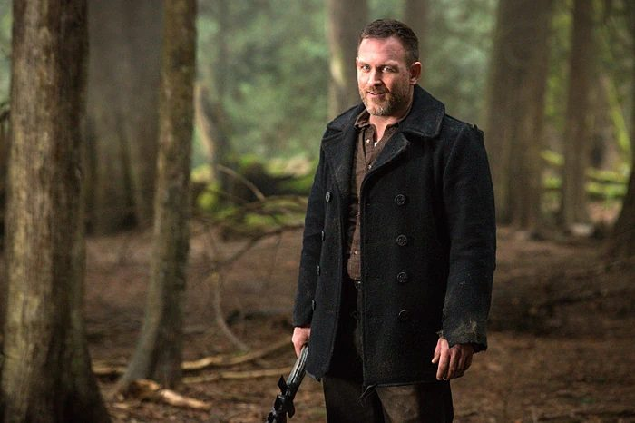

**Описание**

Бенджамин «Бенни» Лафит был вампиром, которого обратил древний и жестокий сородич, известный как Старик. Бенни служил в его уединённом гнезде, где вампиры промышляли пиратством, и много лет поклонялся своему создателю как богу, став в итоге его вторым помощником. Однажды он познакомился с вампиром-отступником Десмондом.

Пятьдесят лет назад Бенни влюбился в гречанку по имени Андреа Кормос и попытался бежать с ней. Их обнаружили: товарищи по гнезду держали Бенни, пока Старик отрезал ему голову, и его душа отправилась в Чистилище — туда уходят все монстры после смерти. Его останки были похоронены на собственной земле в Луизиане, предположительно там, где его и убили. Ещё до обращения в вампира он успел стать отцом как минимум одного ребёнка.

В Чистилище Бенни провёл следующие пятьдесят лет, сражаясь с душами других погибших монстров, и в какой-то момент узнал о портале, ведущем обратно на Землю. Через пятьдесят лет он помог Дину Винчестеру выбраться из Чистилища в обмен на возвращение к жизни и за это время крепко с ним сдружился. Вернувшись на Землю, Бенни решил разобраться со своим создателем и в конце концов убил его с помощью Дина.

Адаптироваться к жизни на Земле у него не получилось. В итоге Бенни позволил Дину убить себя, чтобы вернуться в Чистилище и спасти Сэма; оставшись там, он сдерживал группу вампиров, чтобы Сэм Винчестер и Бобби Сингер успели уйти.

**Силы и способности**

- Все способности вампира — Бенни обладал полным набором вампирских сил, но отточил их годами постоянных боёв не на жизнь, а на смерть в Чистилище.
- Сверхсила — он легко одолевал взрослых людей, дрался на равных с другими монстрами и без труда справлялся с вампирами; в одиночку он убил шесть вампиров, пусть и с трудом.
- Рукопашный бой — он был отлично натренирован в рукопашной, а после лет в Чистилище его навыки стали заметно выше.
- Убийца создателя — он уничтожил половину своего прежнего гнезда, включая собственного создателя, несмотря на его превосходство в возрасте и силе.

**Слабости**

- Другие вампиры — его удерживали вампиры-пираты, пока Старик отрезал ему голову, а в Чистилище его разорвали собственные сородичи.
- Обезглавливание — отрубленная голова убивает вампира: Бенни погиб, когда Дин отсёк ему голову мачете.
- Привязанность — именно любовь к Андреа Кормос стала причиной его первой гибели, а дружба с Дином привела к тому, что он сам позволил себя убить.

**Как его убить.** Бенни — не тот противник, против которого нужно готовить арсенал: вампира убивает обезглавливание, и именно так с ним и покончили — Дин отсёк ему голову мачете, а до того Бенни удерживали свои же сородичи. Тяжёлый клинок и группа, способная зажать его, — этого достаточно. Куда важнее другое: Бенни сражается как ветеран, прошедший пятьдесят лет непрерывных боёв в Чистилище, поэтому в честной рукопашной он опаснее обычного вампира.

**Известные особи:** Бенни Лафит (Тай Олсон); Старик (создатель); Андреа Кормос; Десмонд; Дин Винчестер; Сэм Винчестер; Бобби Сингер; Элизабет

#### Бенни Лафит
*Средний, Монстр, нейтральное*

---
- **Класс доспеха** 15 (природная броня)
- **Хиты** 97 (13d8 + 39)
- **Скорость** 40 фт.

| СИЛ | ЛОВ | ТЕЛ | ИНТ | МДР | ХАР |
|---|---|---|---|---|---|
| 18 | 17 | 16 | 12 | 14 | 13 |

- **Спасброски** Сил +7, Лов +6, Тел +6
- **Навыки** Атлетика +7, Восприятие +5, Скрытность +6, Запугивание +4
- **Сопротивление урону** некротический; дробящий, колющий и рубящий от немагического оружия
- **Иммунитет к состояниям** очарование, испуг
- **Чувства** тёмное зрение 60 фт., пассивное Восприятие 15
- **Языки** общий (английский)
- **Бонус мастерства** +3
- **Уровень опасности** 8 (3 900 опыта)

***Особенности***
- ***Регенерация 10.*** Бенни восстанавливает 10 хитов в начале своего хода, если у него есть хотя бы 1 хит и он не получал урона излучением с конца своего предыдущего хода.
- ***Смерть от обезглавливания.*** Опустившись до 0 хитов, Бенни не умирает, а падает ничком. Он окончательно погибает, только когда его голова полностью отделена от тела; иначе через 1 час восстанавливается до 1 хита.
- ***Ветеран Чистилища.*** Пятьдесят лет боёв дали Бенни преимущество на броски инициативы и на спасброски против испуга, а также преимущество на броски атаки по существам, которые атаковали его в этом бою.
- ***Обострённые чувства.*** Бенни имеет преимущество на проверки Мудрости (Восприятие), основанные на слухе и обонянии, и видит в темноте на 60 фт.
- ***Боевые рефлексы.*** Пока Бенни не носит тяжёлой брони, он может добавить модификатор Ловкости к КД и получает +2 к КД против атак, которые он видит.
- ***Жажда крови.*** Если Бенни не пил кровь более 24 часов, он в начале каждого часа совершает спасбросок Мудрости Сл 13, иначе до конца часа атакует ближайшего гуманоида.

***Действия***
- ***Мультиатака.*** Бенни совершает три атаки: одну укусом и две атаки когтями либо тяжёлым клинком, либо три атаки когтями или клинком.
- ***Когти.*** Рукопашная атака оружием: +7 к попаданию, досягаемость 5 фт., одна цель. Попадание: 11 (2d6 + 4) рубящего урона.
- ***Тяжёлый клинок.*** Рукопашная атака оружием: +7 к попаданию, досягаемость 5 фт., одна цель. Попадание: 13 (2d8 + 4) рубящего урона, и цель должна преуспеть в спасброске Телосложения Сл 15, иначе до конца своего следующего хода не может восстанавливать хиты.
- ***Укус.*** Рукопашная атака оружием: +7 к попаданию, досягаемость 5 фт., одна цель — гуманоид или зверь. Попадание: 8 (1d8 + 4) колющего урона плюс 10 (3d6) некротического урона. Максимум хитов цели уменьшается на величину некротического урона, пока она не завершит продолжительный отдых.
- ***Захват.*** Бенни совершает одну атаку когтями. При попадании цель размера Средний или меньше схвачена (Сл высвобождения 15), и Бенни больше не может использовать эту атаку по другой цели.

***Бонусные действия***
- ***Рывок ветерана.*** Бенни совершает действие Рывок или Отход.

***Реакции***
- ***Парирование.*** Когда по Бенни попадает рукопашная атака, которую он видит, он может реакцией добавить 3 к своему КД против этой атаки.

***Действия в логове***
- ***Убежище в Луизиане.*** Бенни прячется на своей земле в Луизиане или в подсобке придорожного кафе. В своём убежище он в начале раунда (по инициативе 20) может скрыться из виду, если находится в укрытии, и получить преимущество на следующую атаку.
- ***Долг перед Дином.*** Если рядом с Бенни находится союзник, которому он обязан жизнью, он может в начале своего хода дать этому союзнику преимущество на один бросок атаки или спасбросок, пожертвовав своим бонусным действием.

**Тактика.** Бенни дерётся как человек, который пятьдесят лет не выходил из боя: он не тратит время на переговоры в сцене, где уже началась драка, и работает по слабейшему противнику. Первым он выводит из строя того, кто может отрубить ему голову, — владельца мачете или тяжёлого клинка, — а затем разбирается с остальными, используя захваты и укусы, чтобы лишить врагов подвижности. Если бой идёт плохо, он отступает, залечивает раны и возвращается ночью. До смерти он бьётся редко: в восьмом сезоне он сам позволил Дину убить себя, чтобы спасти Сэма, и охотнее жертвует собой ради друга, чем ради победы.

**Экология.** Бенни — одиночка: после смерти создателя и распада гнезда он живёт среди людей, работает в придорожном кафе и прячется в убежище в Луизиане, где похоронены его останки. Он не охотится на людей и старается сойти за обычного человека, поэтому в городе его скорее примут за ветерана с тяжёлым прошлым. Его душа дважды уходила в Чистилище: сначала после казни Старика, затем после того, как Дин отсёк ему голову.

> **Заметки мастеру.** Бенни Лафит — идеальный союзник-монстр для кампании 6–10 уровня: CR 8 делает его опасным противником, но его настоящая роль — NPC, который вытаскивает партию из Чистилища и потом просит о помощи. В бою он держит линию и снимает по одному врагу в раунд, поэтому его удобно использовать как союзный отряд, а не как угрозу. Обезглавливание оставьте рабочей слабостью: если игроки решат его убить, они должны знать, что именно нужно сделать, и что он сам этого не боится. Для высокой кампании дайте ему связь с Чистилищем — возможность провести партию туда и обратно, — это ценнее любых хитов.

[↑ к содержанию](#содержание)

---

### 17. Бешеные

**Rabid** · Монстр · CR 2 · опасность в сериале 3/5

*Также известно как:* Рабиды; Заражённые Тьмой

*Первое появление:* S11E01 «Out of the Darkness, Into the Fire»

*Сезоны:* 11

Люди, искалеченные Тьмой: чёрные вены по шее и голове, звериная агрессия и зараза, которая передаётся через кровь. Даже свежее заражение убивает носителя за считанные часы, а спасает только близость святого огня.

**Описание**

Бешеных (Rabids) назвал Сэм Винчестер. Это не отдельная раса, а новый вид существ, созданный Тьмой: она испортила обычных людей, вызвав мутацию. Заражённые становятся агрессивными, но не теряют некоторой доли разума. Вылечить бешеного можно, подвергнув его воздействию святого огня.

Когда Тьма вырвалась на свободу, она прошла над городом Сьюпириор в штате Небраска, где заразила дорожную бригаду. Часть рабочих напала и убила семью, ехавшую в город, — их прикончила помощница шерифа Дженна Никерсон. Другие рабочие добрались до города, устроили резню в больнице и начали распространять заразу дальше. Через несколько часов после начала заражения на месте гибели семьи появились Сэм и Дин Винчестеры и наткнулись на ещё живого заражённого рабочего. Выяснив, что происходит, братья отправились в больницу, увидели следы бойни и узнали, что бешеные живут недолго.

Внешность заражённых узнаваема: по шее и голове у них идут чёрные вены — похоже на то, как выглядел Кастиэль, когда им управлял Левиафан. Несмотря на агрессию, бешеные не бездумны: они способны управлять машинами, а один сохранил достаточно человеческого, чтобы назвать дочь по имени и отпустить её за мгновения до смерти. Сэм, поймав одного, спрашивал, может ли тот говорить, — значит, под заразой они какое-то время сохраняют разум. Когда Сэма окружили трое, двое держали его, а третий проверял, не заражён ли он уже.

Заражение передаётся через контакт с кровью бешеного: достаточно, чтобы брызги попали человеку в лицо. Сами бешеные чуют друг друга и только что заражённых людей. Тварь, появившаяся в эпизоде «Don't Call Me Shurley», имела телепатическую связь с Тьмой. Убить бешеного просто — выстрел в сердце или перерезанное горло, — но у заражения есть срок: в течение нескольких часов после обращения бешеный умирает сам.

**Силы и способности**

- Инфекция — бешеные передают заразу через контакт с кровью: достаточно, чтобы кровь бешеного брызнула человеку в лицо.
- Сверхчутьё — бешеные чуют друг друга и обычных людей, которые только что заразились.
- Агрессия — они крайне агрессивны и приходят в возбуждение, если рядом находятся люди.
- Остатки разума — бешеные не бездумны: они способны вести машину, а один сохранил достаточно человеческого, чтобы назвать дочь и отпустить её.
- Стайное поведение — трое бешеных действуют согласованно: двое держат жертву, третий проверяет, не заражена ли она.
- Телепатическая связь с Тьмой — бешеный из эпизода «Don't Call Me Shurley» был связан с Тьмой телепатически.

**Слабости**

- Сердце — выстрел в сердце убивает бешеного.
- Горло — перерезанное горло убивает бешеного.
- Срок жизни — в течение нескольких часов после обращения бешеный умирает сам; точное время у каждого своё.
- Святой огонь — близость святого огня лечит бешеного и снимает заражение.
- Электрошок — бешеный уязвим к электричеству: слабый разряд самодельного электрошокера вырубает его без сознания.
- Тьма и Бог — Тьма создала бешеных, а Бог без усилий вылечил целый город и подавил заразный туман, из которого они появлялись.

**Как его убить.** Охота начинается с карантина: заражение передаётся через кровь, поэтому к телам и раненым не подходят без перчаток и маски. Сначала выясняют масштаб и изолируют обращённых, потому что бешеные живут всего несколько часов: если заражённого удержать, он умрёт сам. Убивают просто — выстрелом в сердце или ударом по горлу. Для поимки берут электрошокер: слабый разряд вырубает бешеного. Лучший исход — поднести заражённого к святому огню: заражение сходит.

**Известные особи:** Дженна Никерсон (помощница шерифа, убивала заражённых)

#### Бешеные
*Средний, Гуманоид, нейтрально-злое*

---
- **Класс доспеха** 12
- **Хиты** 39 (6d8 + 12)
- **Скорость** 35 фт.

| СИЛ | ЛОВ | ТЕЛ | ИНТ | МДР | ХАР |
|---|---|---|---|---|---|
| 15 | 14 | 14 | 8 | 11 | 7 |

- **Спасброски** Тел +4
- **Навыки** Восприятие +2, Выживание +2
- **Уязвимость к урону** электричество
- **Иммунитет к урону** болезни (в том числе магические)
- **Иммунитет к состояниям** очарование, испуг
- **Чувства** пассивное Восприятие 12
- **Языки** понимает язык, на котором говорил при жизни, но говорит только обрывками фраз
- **Бонус мастерства** +2
- **Уровень опасности** 2 (450 опыта)

***Особенности***
- ***Кровавая зараза.*** Существо, раненное бешеным в рукопашной или обрызганное его кровью, должно преуспеть в спасброске Тел (Сл 12), иначе заражается. Заражённый получает помеху на проверки Инт, Мдр и Хар и должен повторить спасбросок через 1 час: при провале он превращается в бешеного под управлением мастера, при успехе излечивается.
- ***Срок жизни.*** Бешеный живёт не больше 8 часов с момента обращения. По истечении этого времени он умирает. Святой огонь в пределах 10 фт. немедленно снимает заражение и возвращает существу его прежний облик.
- ***Стайное чутьё.*** Бешеный знает точное местоположение других бешеных и заражённых гуманоидов в пределах 1 мили.
- ***Остатки разума.*** Бешеный понимает простые приказы и способен управлять транспортом и механизмами. Он не может читать, писать и пользоваться сложным оружием.
- ***Телепатическая связь.*** Если бешеный связан с Тьмой, она видит и слышит всё, что воспринимает бешеный, и может передавать ему приказы на любом расстоянии.

***Действия***
- ***Мультиатака.*** Бешеный совершает две атаки: одну укусом и одну когтями.
- ***Укус.*** Рукопашная атака оружием: +4 к попаданию, досягаемость 5 фт., одна цель. Попадание: 6 (1d8 + 2) колющего урона, и цель должна преуспеть в спасброске Тел (Сл 12), иначе заражается Кровавой заразой.
- ***Когти.*** Рукопашная атака оружием: +4 к попаданию, досягаемость 5 фт., одна цель. Попадание: 5 (1d6 + 2) рубящего урона.
- ***Навал стаи.*** Бешеный перемещается на расстояние до своей скорости к гуманоиду и совершает атаку укусом. Если рядом с целью есть хотя бы один другой бешеный, атака совершается с преимуществом, а цель должна преуспеть в спасброске Сил (Сл 12), иначе схвачена.

**Тактика.** Бешеные не строят планов, но и не бросаются в бой поодиночке: они наваливаются стаей, двое держат жертву, третий проверяет, заражена ли она. Их оружие — укус: каждая рана несёт заразу, поэтому даже выигранный бой может стоить партии заражённого союзника. Слабый разряд электричества вырубает бешеного, святой огонь лечит, поэтому умная тварь отступает от огня. Понимая, что жить осталось часы, бешеные не осторожничают и не отступают, пока в стае есть хоть один живой.

**Экология.** Бешеных создала Тьма, прошедшая над городом Сьюпириор в Небраске и заразившая дорожную бригаду; оттуда зараза расползлась по городу через больницу. Это не устойчивый вид, а разовая вспышка: каждый бешеный живёт считанные часы, поэтому встречаются они только там, где недавно прошла Тьма или её заразный туман. Держатся стаями по три и больше, чуют друг друга и заражают всех, до кого дотянутся. После того как Бог подавил туман, вид исчез.

> **Заметки мастеру.** Бешеные — расходный, но страшный противник для партии 1–3 уровня: сами по себе они слабы, однако каждый укус несёт заражение, и это превращает стычку в гонку со временем. Их легко заменить в 5e заражённым культистом или гулем, добавив Кровавую заразу и Срок жизни. Ведите заражение открыто, давая игрокам шанс найти святой огонь до истечения 8 часов: это и есть сюжет, а не бой. Для низкого уровня уберите Мультиатаку и Навал стаи и сократите срок до 1 часа; для высокого соберите стаю из шести-восьми бешеных и добавьте телепатическую связь с Тьмой, через которую та даёт приказы.

[↑ к содержанию](#содержание)

---

### 18. Бигфут (снежный человек)

**Bigfoot** · Монстр · CR 6 · опасность в сериале 2/5

*Также известно как:* Сасквоч; Sasquatch

*Первое появление:* S02E07 «Playthings»

*Сезоны:* 2, 3, 4, 5, 9, 12, 15

Бигфут, он же сасквоч, — мифологическое существо, о существовании которого в мире сериала только ходят слухи; сами охотники относятся к этим слухам с сомнением. Подтверждённой встречи с ним у Винчестеров нет.

**Описание**

Бигфут, он же сасквоч, — мифологическое существо, о котором в мире сериала говорят, но в существование которого сомневаются. Видовую принадлежность выжимка не определяет: в инфобоксе species указан как «Unknown», статус — «Unconfirmed Existence». Актора, игравшего существо, тоже нет: за все появления на экране Бигфут не показан.

В «Playthings» Дин в шутку называет Сэма сасквочем — из-за его роста, — когда зовёт брата спать. Это первое и самое показательное упоминание: Бигфут здесь не монстр недели, а семейная шутка.

Дальше имя всплывает по эпизодам как элемент культурного фона. В «Jus In Bello», «Wishful Thinking», «Swap Meat», «Thinman», «Ladies Drink Free» и «Last Call» речь так или иначе идёт о легендах, слухах, мистификациях и местных страшилках — Бигфут в этом ряду остаётся существом, которое обсуждают, но не встречают. В «Thinman» и «Ladies Drink Free» такие истории прямо оказываются либо выдумкой, либо чужой подменой.

Ключевое для охотника: за все свои появления Бигфут никого не убил, не был пойман и не был подтверждён. Это не добыча, а непроверенная запись в бестиарии, которую Винчестеры держат в уме наравне с прочими байками для туристов. Ни повадок, ни слабостей, ни способа убийства в выжимке нет.

Если расследование всё же выводит на «снежного человека», по канону сериала это обычно оказывается либо человеческая мистификация, либо иной монстр, которого местные так назвали.

**Силы и способности**

- Невероятный рост — Дин сравнивает с сасквочем очень высокого Сэма, что для розыгрыша и слухов задаёт облик огромного человекоподобного существа.
- Скрытность в дикой местности — легенда приписывает ему жизнь в глухих лесах и умение не попадаться людям на глаза, хотя в выжимке это не подтверждено.
- Физическое превосходство — предполагается, что крупное существо сильнее человека; конкретных примеров силы в тексте нет.
- Сила слуха как приманки — именно непроверенные рассказы о Бигфуте годами держат к нему интерес охотников и туристов.

**Слабости**

- Существование не подтверждено — статус «Unconfirmed Existence»: нет ни одного доказанного случая встречи с Бигфутом.
- Ни одного появления на экране — актёр не указан, существо в сериале не показано ни разу, только упоминания.
- Обычная физическая природа — раз это, по легенде, живое существо из плоти, а не дух, оно уязвимо к обычному и специальному оружию охотников.
- Путаница с мистификацией — громкие случаи с «снежным человеком» в сериале оборачиваются выдумкой или другим монстром.

**Как его убить.** В выжимке нет ни одного описания охоты на Бигфута, ни его слабостей, ни оружия против него, поэтому точного рецепта не существует. Работает общий порядок для крупного живого существа: собрать сведения у местных, отследить следы и туши, поставить приманку и капканы, выйти на тропу и бить с дистанции из крупного калибра, а вблизи держать сеть и огонь. Мастеру стоит помнить: если по канону сериала дело о Бигфуте закрывается, то закрывается оно мистификацией человека, а не убитой тварью.

#### Бигфут (снежный человек)
*Большой, Великан, нейтральное*

---
- **Класс доспеха** 14 (природная броня)
- **Хиты** 105 (10d10 + 50)
- **Скорость** 40 фт., лазание 30 фт.

| СИЛ | ЛОВ | ТЕЛ | ИНТ | МДР | ХАР |
|---|---|---|---|---|---|
| 21 | 14 | 20 | 7 | 15 | 9 |

- **Спасброски** Сил +8, Тел +8
- **Навыки** Атлетика +8, Восприятие +5, Скрытность +5, Выживание +5
- **Уязвимость к урону** огонь
- **Сопротивление урону** дробящий, колющий и рубящий от немагического оружия
- **Чувства** тёмное зрение 60 фт., пассивное Восприятие 15
- **Языки** понимает язык леса и зверей, но не говорит
- **Бонус мастерства** +3
- **Уровень опасности** 6 (2 300 опыта)

***Особенности***
- ***Лесной скиталец.*** Бигфут не оставляет очевидных следов на камне и в воде и совершает с преимуществом проверки Лов (Скрытность) в лесистой и горной местности.
- ***Чутьё на засады.*** Бигфут не может быть застигнут врасплох, пока не ослеплён, не оглушён или не выведен из строя.
- ***Нечеловеческая хватка.*** Бигфут может поднимать и тащить вдвое больше обычного для существа Большого размера.
- ***Слух легенды.*** Существа, впервые видящие Бигфута вблизи, должны преуспеть в спасброске Мдр (Сл 13), иначе испуганы им до конца своего следующего хода.

***Действия***
- ***Мультиатака.*** Бигфут совершает две атаки кулаками или одну атаку кулаками и одну атаку броском камня.
- ***Кулак.*** Рукопашная атака оружием: +8 к попаданию, досягаемость 10 фт., одна цель. Попадание: 14 (2d8 + 5) дробящего урона.
- ***Бросок камня.*** Дальнобойная атака оружием: +8 к попаданию, дистанция 30/120 фт., одна цель. Попадание: 12 (2d6 + 5) дробящего урона.
- ***Захват.*** Рукопашная атака оружием: +8 к попаданию, досягаемость 5 фт., одна цель не более Большого размера. Попадание: цель схвачена (высвобождение Сл 16).

***Бонусные действия***
- ***Рёв из чащи.*** Бигфут издаёт рёв. Каждое существо в пределах 60 фт., которое его слышит и не является его союзником, получает помеху на проверки Мдр (Восприятие) до конца своего следующего хода.

**Тактика.** Бигфут избегает боя: если его заметили, он уходит в чащу и старается оторваться, а не драться. Загнанный, он бьёт из укрытия камнями, валит деревья и нападает на отставшего; врукопашную берёт одного противника, сжимает и ломает его, прикрываясь им от остальных, а затем отступает вверх по склону. Огня он боится и обходит костры, но не паникует. Пленных он не берёт: сбив преследователя с ног, он скрывается в темноте.

**Экология.** Бигфут привязан к глухим лесам, горам и заповедникам Северной Америки, где о нём ходят местные байки. Он держится в одиночку на большой территории, избегает людей и дорог и почти не оставляет следов. Подтверждённых особей в мире сериала нет, поэтому для игры он остаётся существом из легенды, которое с равным успехом может оказаться мистификацией, другим монстром или настоящим зверем.

> **Заметки мастеру.** Бигфут хорошо работает как монстр-загадка на 5–7 уровень: партия ищет тварь, а находит либо её, либо человеческую мистификацию, и оба финала допустимы. В 5e его удобно собирать из хиллинга-гиганта или огра, добавив Скрытность и бросок камня. Для низкого уровня уберите Мультиатаку, снизьте хиты до 60 и КС до 13; для высокого сделайте его ледяным йети с сопротивлением к холоду и второй особью в паре. Не давайте игрокам железных доказательств его существования — в этом весь смысл.

[↑ к содержанию](#содержание)

---

### 19. Бисаан

**Bisaan** · Монстр · CR 5 · опасность в сериале 3/5

*Также известно как:* Бисан; The Chitters

*Первое появление:* S11E19 «The Chitters»

*Сезоны:* 11

Малайзийское существо-цикада: выбирается из-под земли раз в 27 лет, заползает людям в рот и использует тела как оболочку для спаривания. Живёт около двух дней, но за это время успевает похитить десятки людей.

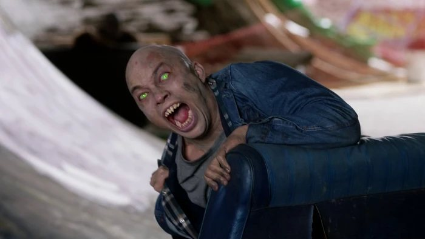

**Описание**

Бисаан, или бисан, — раса малайзийских существ-цикад. Это умеренно сильная тварь: в истинном облике у бисаана нет половых органов, поэтому раз в 27 лет он выбирается из-под земли и вселяется в людей через рот, чтобы спариться и продолжить род. Тело-оболочка служит ему домом: пока человек одержим, он бледнеет, у него появляются заострённые шиповидные зубы, зелёные светящиеся глаза и постепенно исчезают половые органы. Как настоящие цикады, бисааны стрекочут — этот звук служит призывом к спариванию.

Родиной бисаанов считаются леса Малайзии, и в Америке они очень редки. После спаривания беременных самок уносят назад в нору, где они в конце концов умирают; следующее поколение остаётся под землёй до нового цикла. Цикл задаёт и всю охоту: тварь живёт около двух дней от вылупления до смерти и должна успеть спариться, поэтому действует быстро, шумно и массово.

Стая бисаанов обосновалась в лесах вокруг Ганнисона, штат Колорадо, и стала местным мифом: жители прозвали их «стрекочущими» из-за звуков, которые те издавали. Впервые они вышли из леса и размножились в 1962 году, а в 1989 году похитили дюжину человек. Одним из похищенных был Мэтти Куэвас, гулявший по лесу с братом Джесси; Джесси никто не поверил, он озлобился, уехал из города и возненавидел его за отношение к себе как к гею.

По лору «бисан» — дух цикады из мифологии джакун (старых малайцев), считавшийся защитником камфорных деревьев. У слова «бисан» множество значений: «дух камфоры», «женщина», «птица», «кошка», «брак», «род человеческий», «птица домашняя», «мать», «вдова», «ребёнок», «мушкетная пуля», — поэтому единого смысла у него нет. Сам дух чаще всего изображали прекрасной женщиной, но он мог принимать и облик цикады. Как стражи камфорных деревьев бисаны сопровождали каждого, кто входил в лес за камфорой.

**Силы и способности**

- Сверхчеловеческая сила — бисааны сильнее обычных людей и без труда одолевают большинство из них врукопашную.
- Одержимость — бисаан вселяется в человека, входя через рот, и использует тело как оболочку.
- Размножение через людей — не имея половых органов, бисааны используют человеческие тела, чтобы продолжить род.
- Клыки — у бисаана есть заострённые зубы для защиты; у одержимого хозяина они тоже прорезаются.
- Стрекотание — бисааны издают стрекот, служащий призывом к спариванию; по нему их и находят местные.

**Слабости**

- Обезглавливание — отрубленная голова убивает бисаана.
- Огонь — сжигание яиц бисаана уничтожает их; огонь вообще служит надёжным средством против кладки.
- Шалфей — подожжённый шалфей даёт запах, который отпугивает бисаанов.
- Короткая жизнь — бисаан живёт около двух дней от вылупления до смерти и должен успеть спариться.
- Цикл в 27 лет — бисааны выходят из-под земли строго циклами, что делает их появление предсказуемым.
- Стрекот выдаёт логово — по стрекотанию тварь обнаруживают даже местные жители.

**Как его убить.** Охота строится на цикле: бисааны выходят раз в 27 лет и живут считанные дни, поэтому у охотника узкое окно. Сначала собирают старые дела и слухи — похищения и стрекот в лесу, — затем ищут нору и ходы в земле. Против одержимых работает только обезглавливание: тело хозяина не спасти, бисаана в нём можно убить лишь так. Логово выжигают целиком: яйца уничтожаются только огнём, поэтому берут бензин, а подходят с зажжённым шалфеем — его запах отпугивает тварей.

**Известные особи:** Мэтти Куэвас; Джесси

#### Бисаан
*Средний, Монстр, нейтральное*

---
- **Класс доспеха** 14 (природная броня)
- **Хиты** 85 (13d8 + 26)
- **Скорость** 30 фт., полёт 30 фт. (в истинном облике)

| СИЛ | ЛОВ | ТЕЛ | ИНТ | МДР | ХАР |
|---|---|---|---|---|---|
| 17 | 15 | 15 | 10 | 12 | 10 |

- **Спасброски** Сил +6
- **Навыки** Восприятие +4, Скрытность +5, Запугивание +3
- **Уязвимость к урону** огонь
- **Сопротивление урону** дробящий, колющий и рубящий от немагического оружия
- **Иммунитет к урону** яд
- **Иммунитет к состояниям** очарование, отравление
- **Чувства** тёмное зрение 60 фт., пассивное Восприятие 14
- **Языки** понимает малайзийский и английский, говорит только стрекотом
- **Бонус мастерства** +3
- **Уровень опасности** 5 (1 800 опыта)

***Особенности***
- ***Одержимость через рот.*** Бисаан может действием вселиться в гуманоида, находящегося в пределах 5 фт. и неспособного действовать. Цель совершает спасбросок Хар (Сл 14); при провале бисаан исчезает внутри цели, а цель становится одержимой, пока бисаан не будет изгнан или убит.
- ***Облик хозяина.*** Пока бисаан внутри хозяина, тот выглядит бледным, у него заострённые шиповидные зубы и зелёные светящиеся глаза. Проверка Мдр (Проницательность) Сл 15 раскрывает одержимость.
- ***Короткая жизнь.*** Бисаан умирает через 2 дня после вылупления, если не спарится. В последние 4 часа жизни он совершает атаки с преимуществом, но получает помеху на спасброски.
- ***Стрекот.*** Бисаан не может быть застигнут врасплох существами, которые могут его слышать: его стрекот слышен в пределах 120 фт. и выдаёт его позицию.
- ***Отвращение к шалфею.*** Бисаан не может приблизиться более чем на 10 фт. к горящему шалфею и совершает с помехой атаки по существам в его дыму.

***Действия***
- ***Мультиатака.*** Бисаан совершает две атаки: одну укусом и одну когтями.
- ***Укус.*** Рукопашная атака оружием: +6 к попаданию, досягаемость 5 фт., одна цель. Попадание: 10 (2d6 + 3) колющего урона.
- ***Когти.*** Рукопашная атака оружием: +6 к попаданию, досягаемость 5 фт., одна цель. Попадание: 7 (1d8 + 3) рубящего урона, и цель должна преуспеть в спасброске Сил (Сл 14), иначе схвачена.
- ***Стрекот-призыв (1/день).*** Бисаан стрекочет. Все бисааны в пределах 1 мили знают его точное местоположение и получают преимущество на атаки по цели, которую он назвал, до конца своего следующего хода.
- ***Вселение (перезарядка 5–6).*** Бисаан действием пытается вселиться в гуманоида в пределах 5 фт., который схвачен, обездвижен или беспомощен. Цель совершает спасбросок Хар (Сл 14); при провале бисаан вселяется в неё, а его собственное тело рассыпается в труху.

**Тактика.** Бисаан действует быстро и массово: он хватает одиночек, тащит их в нору и там вселяется, чтобы использовать тело для размножения. В бою он бьёт когтями, валит цель и тут же пытается в неё войти, не тратя времени на добивание. Одержимый хозяин дерётся до последнего, пока его не обезглавят, — спасение тела невозможно, и это главный ужас бисаана. Огня он боится и обходит очаги, а к горящему шалфею не подходит вовсе. Если бисаан ранен и близок к смерти, он всё равно лезет к ближайшему человеку, чтобы успеть вселиться.

**Экология.** Бисааны родом из лесов Малайзии, в Северной Америке они редкость и держатся одним гнездом. Они живут в подземных норах и выбираются на поверхность раз в 27 лет, действуя стаей: похищают людей десятками, используют тела и умирают, оставив кладку. Местные обычно превращают их в миф — так и появилось прозвище «стрекочущие» в лесах вокруг Ганнисона, Колорадо. Между циклами бисаанов в лесу нет.

> **Заметки мастеру.** Бисаан — монстр для дела-тайны на 4–6 уровень: двадцать семь лет молчания, старые похищения, брат, которому никто не поверил. Играйте на телесном ужасе и на невозможности спасти одержимого. В 5e его удобно собирать из гнолла или гарпии с добавленной одержимостью; за основу берите слабого монстра и усильте тактикой стаи. Для низкого уровня снизьте хиты до 45, уберите Вселение и оставьте одного бисаана; для высокого дайте гнездо с яйцами, нескольких одержимых хозяев и всех тварей, вышедших из норы одновременно.

[↑ к содержанию](#содержание)

---

### 20. Борис

**Boris** · Монстр · CR 7 · опасность в сериале 3/5

*Также известно как:* Вампир-вербовщик; Глава гнезда Бориса

*Первое появление:* S06 «Live Free or Twihard»

*Сезоны:* 6, 9, 12

Вампир старше шестисот лет и глава гнезда, который по приказу Альфа-вампира вербовал и обращал людей. Он сильнее любого вампира своего гнезда: одним ударом наотмашь отбрасывал Дина на тридцать футов.

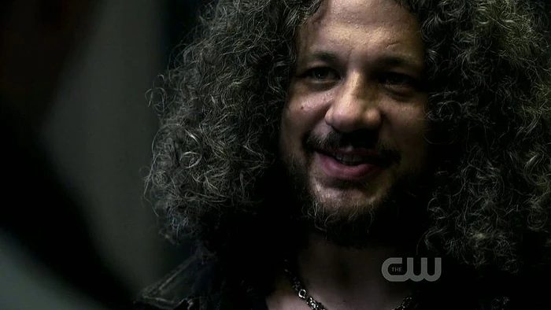

**Описание**

Борис был вампиром старше шестисот лет и возглавлял вампирское гнездо. По приказу Альфа-вампира он вербовал и обращал большое число людей. Из-за преклонного по вампирским меркам возраста его сверхъестественные способности находились на заметно более высоком уровне, чем у рядовых сородичей: он был сильнейшим вампиром в своём гнезде.

Его сила была такова, что он без усилий одолевал жертв и самого Дина: ударом наотмашь он отправил его в полёт более чем на тридцать футов, а затем без труда удерживал и избивал до кровавого месива. Скорость Бориса тоже была сверхчеловеческой: он мгновенно исчезал и появлялся, а Дина обезоружил и одолел через считаные мгновения после того, как услышал, как из шприца в его руке упала капля крови.

Борис заметил Дина в переулке, когда тот на кого-то нападал. Решив, что Дин «слишком мил», Борис счёл его идеальным вербовщиком для своего гнезда и обратил его в вампира. Позже он вёл себя с Дином как с другом и сообщил, что теперь они оба вербовщики. Он показывал Дину, как заманивать людей с помощью поэзии, чтобы привлекать фанатов вампиров: приведённых фанатов обращали и использовали для вербовки новых. Тогда же Борис признался, что ему шестьсот лет. Он сказал, что это была не его идея, а «отца», и обещал позже устроить Дину персональную экскурсию. Во время прогулки Борис услышал каплю крови, вытекшую из шприца, который достал Дин, и остановил его прежде, чем тот успел прикоснуться; пока Борис удерживал Дина, раздался высокий звук, и Борис рухнул. Позже Дин убил его, отсёкши ему голову.

**Силы и способности**

- Сверхсила — Борис с лёгкостью одолевал жертв и Дина: ударом наотмашь он отбросил его более чем на тридцать футов, а затем без усилий удерживал и избивал.
- Превосходство над сородичами — он был сильнее любого вампира в своём гнезде и заметно мощнее молодых вампиров.
- Сверхскорость — он двигался много быстрее любого человека, мгновенно исчезал и появлялся и обезоружил Дина сразу после того, как уследил за каплей крови.
- Обострённые чувства — он услышал, как из шприца в руке Дина упала капля крови, и успел остановить его до удара.
- Вербовка и обращение — по приказу Альфа-вампира он вербовал и обращал большое число людей, используя поэзию как приманку для будущих жертв.

**Слабости**

- Обезглавливание — именно так его убил Дин: вампира убивает отделение головы.
- Мёртвая кровь — если ввести её Борису, он будет обездвижен; именно поэтому Дин нёс шприц с мёртвой кровью.
- Громкий звук — пока Борис удерживал Дина, раздался высокий звук, и вампир рухнул, потеряв контроль над ситуацией.

**Как его убить.** Готовясь к Борису, рассчитывайте на быстрый и короткий бой: он сильнее и быстрее обычного вампира, поэтому тянуть нельзя. Основа — обезглавливание: Дин убил его, отсёкши голову, и это единственный надёжный способ. Второй инструмент — мёртвая кровь в шприце или ампуле: она обездвиживает вампира, но применять её нужно внезапно, потому что Борис слышит каплю крови и успевает среагировать. Громкий высокий звук тоже на короткое время выводит его из строя.

**Известные особи:** Борис (Джозеф Д. Рейтман); Альфа-вампир (повелевал им); Дин Винчестер

#### Борис
*Средний, Монстр, нейтрально-злое*

---
- **Класс доспеха** 15 (природная броня)
- **Хиты** 90 (12d8 + 36)
- **Скорость** 40 фт.

| СИЛ | ЛОВ | ТЕЛ | ИНТ | МДР | ХАР |
|---|---|---|---|---|---|
| 18 | 17 | 16 | 11 | 13 | 14 |

- **Спасброски** Сил +7, Лов +6, Тел +6
- **Навыки** Восприятие +4, Скрытность +6, Запугивание +5, Обман +5, Выступление +5
- **Сопротивление урону** некротический; дробящий, колющий и рубящий от немагического оружия
- **Иммунитет к состояниям** очарование, испуг
- **Чувства** тёмное зрение 60 фт., пассивное Восприятие 14
- **Языки** общий (английский)
- **Бонус мастерства** +3
- **Уровень опасности** 7 (2 900 опыта)

***Особенности***
- ***Регенерация 10.*** Борис восстанавливает 10 хитов в начале своего хода, если у него есть хотя бы 1 хит и он не получал урона излучением с конца своего предыдущего хода.
- ***Смерть от обезглавливания.*** Опустившись до 0 хитов, Борис не умирает, а падает ничком. Он окончательно погибает, только когда его голова полностью отделена от тела; иначе через 1 час восстанавливается до 1 хита.
- ***Обострённые чувства.*** Борис имеет преимущество на проверки Мудрости (Восприятие), основанные на слухе и обонянии, и слышит даже падение капли крови с расстояния до 30 фт. Он не может быть застигнут врасплох существом, у которого течёт кровь, в пределах 30 фт.
- ***Мастер вербовки.*** Борис имеет преимущество на проверки Харизмы (Убеждение, Обман, Выступление), когда заманивает гуманоида в своё гнездо, и может потратить 1 минуту разговора, чтобы цель стала очарованной им до конца следующего часа, если провалит спасбросок Мудрости Сл 14.
- ***Чувствительность к громкому звуку.*** Если в пределах 30 фт. от Бориса раздаётся очень громкий высокий звук, он должен преуспеть в спасброске Телосложения Сл 15, иначе становится ошеломлённым до конца своего следующего хода.
- ***Мёртвая кровь.*** Если Борис получает урон или иной эффект от мёртвой крови, он должен преуспеть в спасброске Телосложения Сл 15, иначе становится парализованным на 1 минуту и повторяет спасбросок в конце каждого своего хода.
- ***Жажда крови.*** Если Борис не пил кровь более 24 часов, он в начале каждого часа совершает спасбросок Мудрости Сл 13, иначе до конца часа атакует ближайшего гуманоида.

***Действия***
- ***Мультиатака.*** Борис совершает три атаки: одну укусом и две атаки когтями либо две атаки когтями и одну попытку захвата.
- ***Когти.*** Рукопашная атака оружием: +7 к попаданию, досягаемость 5 фт., одна цель. Попадание: 11 (2d6 + 4) рубящего урона.
- ***Удар наотмашь.*** Рукопашная атака оружием: +7 к попаданию, досягаемость 5 фт., одна цель размера Большой или меньше. Попадание: 11 (2d6 + 4) дробящего урона, и цель должна преуспеть в спасброске Силы Сл 15, иначе отбрасывается на 30 фт. и падает ничком.
- ***Укус.*** Рукопашная атака оружием: +7 к попаданию, досягаемость 5 фт., одна цель — гуманоид или зверь. Попадание: 8 (1d8 + 4) колющего урона плюс 7 (2d6) некротического урона. Максимум хитов цели уменьшается на величину некротического урона, пока она не завершит продолжительный отдых.
- ***Захват.*** Борис совершает одну атаку когтями. При попадании цель размера Средний или меньше схвачена (Сл высвобождения 15), и Борис больше не может использовать эту атаку по другой цели.

***Бонусные действия***
- ***Рывок хищника.*** Борис совершает действие Рывок или Отход.

***Реакции***
- ***Молниеносный перехват.*** Когда существо в пределах 5 фт. от Бориса совершает бросок атаки оружием, он может реакцией выбить оружие: цель должна преуспеть в спасброске Силы Сл 15, иначе роняет оружие.

***Действия в логове***
- ***Поэтическая приманка.*** В своём гнезде Борис в начале раунда (по инициативе 20) может прочитать стихи или спеть: каждое существо по его выбору в пределах 30 фт. должно преуспеть в спасбросе Мудрости Сл 14, иначе до конца раунда не может атаковать Бориса.
- ***Свора вербовщиков.*** Если партия вошла в гнездо Бориса, он может призвать 1d4 обращённых им вампиров, которые появляются из соседних помещений и действуют со следующего раунда.

**Тактика.** Борис не нападает просто так: он сначала оценивает жертву и решает, кого из неё сделать. В бою он действует быстро и грубо — сближается рывком, ударом наотмашь отбрасывает самого опасного противника, а затем добивает остальных, не давая им подняться. Его главная защита — чувства: он слышит каплю крови, поэтому скрытные атаки и шприцы с мёртвой кровью работают только при отвлечении. Уязвим он к обезглавливанию и к высокому громкому звуку, который на короткое время выводит его из строя. В одиночку он не отступает — за шестьсот лет он привык быть сильнейшим в помещении.

**Экология.** Борис держит гнездо в городской черте и действует как вербовщик Альфа-вампира: он заманивает людей через поэзию и вампирскую субкультуру, обращает их и пополняет ими ряды. Его гнездо живёт среди людей и старается не привлекать внимания охотников, а сам Борис поддерживает связь с «отцом» — Альфа-вампиром. В городе, где он обосновался, начинает расти число вампиров и исчезновений, и по этому следу гнездо и вычисляют.

> **Заметки мастеру.** Борис — крепкий «лейтенант» для партии 5–8 уровня: CR 7, три атаки и отбрасывание делают его опасным в тесном помещении, а чувствительность к мёртвой крови и громкому звуку дают игрокам два честных способа победить без чистого урона. Держите его в гнезде, среди своих: в одиночку он слишком уязвим для группы, а с 1d4 вампирами становится полноценным энкаунтером. Если партия ниже уровнем, снизьте CR до 5 и уберите мультиатаку, оставив два удара. Его вербовка — хороший социальный крючок: игроки могут встретить Бориса до боя, и тогда сцена начнётся с разговора, а не с инициативы.

[↑ к содержанию](#содержание)

---

### 21. Вампираты

**Vampirates** · Монстр · CR 13 · опасность в сериале 3/5

*Также известно как:* Вампиры-пираты; Гнездо «Старого»

Гнездо вампиров, которое промышляло в открытом море: они находили частные яхты, идущие в дальние порты, кормились их владельцами и топили судно, чтобы замести следы. Правил гнездом древний и могущественный вампир по прозвищу «Старик».

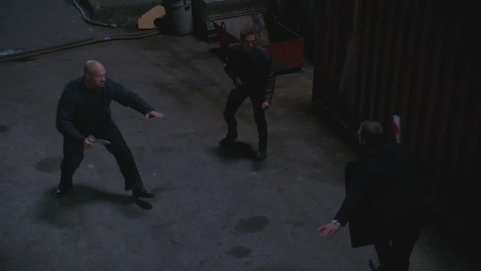

**Описание**

Вампираты, или вампиры-пираты, — гнездо вампиров, которым правил древний и могущественный вампир, известный как «Старик». Промысел был простым и выгодным: гнездо находило частные яхты, отправлявшиеся в дальние порты, кормилось их владельцами, а затем топило судно, чтобы замести следы преступления. Бенни Лафитт изначально был частью этого гнезда.

Эта компания пиратствовала, судя по всему, очень долго. «Старик» убил Бенни Лафитта за то, что тот влюбился в Андреа Кормос; но саму Андреа он не убил, а в отместку обратил, и она стала его заместителем. Промысел продолжался до 2013 года, пока воскресший Бенни и Дин Винчестер не выступили против вампиратов вместе: Бенни хотел отомстить за то, что считал смертью Андреа, и защитить себя от новых покушений на свою жизнь.

В бою Бенни убил Квентина и ещё двоих, но при проникновении в гнездо его схватили. Благодаря Андреа он освободился и убил «Старика» — тот не сопротивлялся — и Соренто, а Дин убил по меньшей мере ещё четырёх вампиров, то есть всех остальных, кроме Андреа. Бенни хотел вырезать гнездо полностью, Андреа хотела возглавить его и вести дело вместе с Бенни; выбора не осталось, и Дин убил её, чтобы спасти Бенни. На этом промысел был полностью прекращён.

Сколько судов утопило гнездо и как именно оно выбирало яхты, выжимка не сообщает. Не перечисляет она и слабостей вампиров: известно лишь, что гнездо погибло в ближнем бою от клинков Бенни и Дина. Действовали вампираты на воде и свидетелей не оставляли: потопление судна и было способом скрыть следы.

Для бестиария вампираты — не раса, а банда морских хищников: гнездо из десятка вампиров с главарём-старейшиной, которое охотится там, где жертву не найдут. Их сила в дисциплине, численности и отсутствии тел на берегу.

**Силы и способности**

- Морская охота — гнездо находило частные яхты, идущие в дальние порты, и работало с ними в открытом море, где свидетелей не остаётся.
- Скрытие следов — после кормёжки вампираты топили судно, поэтому пропажи выглядели как катастрофы на воде, а не как убийства.
- Старейшина во главе — «Старик» описан как древний и могущественный вампир, державший в подчинении всё гнездо и превративший Андреа в своего заместителя.
- Обращение вместо убийства — «Старик» обратил Андреа Кормос в наказание, и она стала вампиром и вторым человеком в гнезде.
- Боевая сила гнезда — вампираты сражались клинками и числом: Бенни и Дин перебили почти всё гнездо в ближнем бою, но Бенни при этом попал в плен.

**Слабости**

- Слабости вампиров в выжимке не перечислены — ни серебра, ни солнца, ни особых ритуалов против них в тексте нет.
- Гибнут в ближнем бою — Дин и Бенни убили главаря, Соренто и по меньшей мере пятерых вампиров обычным оружием и в честной схватке.
- Привязаны к воде — промысел держался на яхтах и на море; на берегу вампираты оставляли слишком мало следов и потому не действовали в городах.
- Подчинение главарю — гнездо развалилось, как только погибли «Старик» и Андреа: без вожака организация не выжила.
- Раскол внутри — Андреа хотела возглавить дело сама, Бенни хотел его уничтожить; внутренние интересы и погубили гнездо.

**Как его убить.** Охота начинается на берегу: охотник ищет яхты, которые ушли в дальний порт и не пришли, и сопоставляет их со стоянками, где пропадали экипажи. Затем нужно попасть на судно — лучше под видом пассажира или матроса: в открытом море у гнезда численный перевес. Внутри нужен союзник или предатель из своих: именно Андреа освободила Бенни и открыла ему путь к «Старику». Инвентарь: холодное оружие для ближнего боя, гаррота для тихих часовых, рация и план палуб, а также лодка с запасом топлива.

**Известные особи:** «Старик» — древний вампир, глава гнезда, убит Бенни, не сопротивлялся; Андреа Кормос — обращена «Стариком», стала его заместителем, убита Дином; Бенни Лафитт — вампир, начинавший в этом гнезде, позже вырезавший его; Квентин — вампир гнезда, убит Бенни; Соренто — вампир гнезда, убит Бенни

#### Вампираты
*Средний, Нежить, нейтрально-злое*

---
- **Класс доспеха** 16 (природная броня)
- **Хиты** 152 (16d8 + 80)
- **Скорость** 30 фт.

| СИЛ | ЛОВ | ТЕЛ | ИНТ | МДР | ХАР |
|---|---|---|---|---|---|
| 20 | 18 | 20 | 15 | 14 | 16 |

- **Спасброски** Лов +9, Мдр +7, Хар +8
- **Навыки** Восприятие +7, Скрытность +9, Обман +8
- **Сопротивление урону** некротическая энергия; дробящий, колющий и рубящий от немагического оружия
- **Иммунитет к состояниям** испуг, отравление
- **Чувства** тёмное зрение 120 фт., пассивное Восприятие 17
- **Языки** английский
- **Бонус мастерства** +5
- **Уровень опасности** 13 (10 000 опыта)

***Особенности***
- ***Регенерация.*** В начале своего хода вампир восстанавливает 15 хитов, если с прошлого хода не получал урона от освящённого оружия, серебра или магии.
- ***Морской хищник.*** Вампир получает преимущество на проверки Ловкости (Скрытность) и на броски атаки по существам, находящимся на борту судна, в воде или на скользкой палубе.
- ***Гнездо.*** Пока в пределах 60 фт. от вампира находятся хотя бы двое других вампиров гнезда, он получает преимущество на спасброски от испуга и не может быть обращён.
- ***Старейшина.*** Вампир не стареет и веками выдаёт себя за живого человека: проверки Мудрости (Проницательность) для распознавания его природы совершаются с помехой.
- ***Только обезглавливание.*** Если хиты вампира опускаются до 0 уроном, не связанным с отсечением головы, он вместо смерти падает ничком и обездвижен, а в конце своего следующего хода восстанавливает 1 хит. Уничтожить его окончательно можно только отсечением головы.

***Действия***
- ***Мультиатака.*** Вампир совершает две атаки: клинком и укусом или двумя атаками клинком.
- ***Клинок.*** Рукопашная атака оружием: +10 к попаданию, досягаемость 5 фт., одна цель. Попадание: 12 (2d6 + 5) рубящего урона.
- ***Укус.*** Рукопашная атака оружием: +10 к попаданию, досягаемость 5 фт., одна цель, которая схвачена, обездвижена или согласна. Попадание: 8 (1d6 + 5) колющего урона плюс 10 (3d6) некротического урона, и максимум хитов цели уменьшается на величину некротического урона.
- ***Захват.*** Вампир хватает существо размера Средний или меньше в пределах 5 фт. Цель должна преуспеть в спасброске Силы (Сл 18) или Ловкости (Сл 18), иначе схвачена (Сл освобождения 18).

***Бонусные действия***
- ***Рывок хищника.*** Вампир перемещается на свою скорость, не провоцируя атак по возможности, и может пройти по воде или канату, не требуя проверок.

***Реакции***
- ***Приказ гнезду.*** Когда по вампиру попадает атака, он реакцией приказывает одному союзному вампиру в пределах 30 фт. совершить одну атаку оружием по цели этой атаки.

***Легендарные действия***
- ***Хват (1 действие).*** Вампир совершает одну атаку захватом.
- ***Скольжение в тень (1 действие).*** Вампир совершает проверку Ловкости (Скрытность) и, если рядом есть тень или трюм, скрывается.
- ***Жажда (2 действия).*** Вампир совершает одну атаку укусом по схваченной цели и восстанавливает 15 хитов.

***Действия в логове***
- ***Затопление.*** Судно начинает набирать воду: в конце раунда каждое существо в трюме проходит спасбросок Ловкости (Сл 15), иначе падает ничком, а местность в трюме считается труднопроходимой.
- ***Темнота в трюме.*** Свет гаснет: до конца раунда существа, не имеющие тёмного зрения, получают помеху на атаки, а вампиры гнезда — преимущество.
- ***Крик жертвы.*** Один вампир гнезда кричит: существа в пределах 60 фт., не являющиеся вампирами, совершают спасбросок Мудрости (Сл 15) или испуганы до конца своего следующего хода.

**Тактика.** Вампираты не бьются в открытую: они берут числом, знанием палуб и темнотой. Гнездо загоняет жертв в трюм, отрезает выходы и убивает по одному; главарь держится чуть позади и приказывает, вмешиваясь лично, когда кто-то из его вампиров падает. Увидев освящённое оружие или серебро, «Старик» отступает к воде и уходит на другую часть судна, чтобы выиграть время для регенерации. Если главарь гибнет, гнездо теряет слаженность и начинает драться каждый за себя, а затем пытается утопить корабль вместе со свидетелями.

**Экология.** Гнездо живёт на воде: яхты, стоянки, дальние переходы. Вампираты не селятся в городах и не держат постоянного логова — сожжённая и затопленная яхта и есть их дом, который меняют после каждой охоты. Численность выжимка не называет, но в бою упомянуты «Старик», Андреа, Квентин, Соренто и ещё не менее четырёх вампиров, то есть речь о десятке особей. Держатся они вместе, подчиняясь старейшине, и не соседствуют с другими монстрами.

> **Заметки мастеру.** Статблок описывает главаря гнезда, «Старого» (уровень опасности 13): остальных вампиратов ведите как вампирское отродье (уровень опасности 5), а Андреа — как вампира с чертами из «Приказа гнезду». Энкаунтер рассчитан на партию 10-13 уровня и должен идти на корабле: теснота, темнота, трюмы и затопление здесь важнее самих вампиров. Обязательно дайте игрокам союзника внутри гнезда — по канону именно предатель открыл Бенни путь к главарю. Для низкого уровня уберите легендарные действия и снизьте хиты до 90; для высокого добавьте гнезду вторую волну и колдуна-вампира.

[↑ к содержанию](#содержание)

---

### 22. Вампиры

**Vampires** · Монстр · CR 5 · опасность в сериале 3/5

*Также известно как:* Пьющие кровь существа, некогда бывшие людьми

*Первое появление:* S01 «Dead Man's Blood»

*Сезоны:* 1, 2, 3, 5, 6, 7, 8, 9, 10, 11, 12, 13, 14, 15

Раса пьющих кровь существ, некогда бывших людьми. Вампиры живут вечно, предпочитают человеческую кровь и размножаются переливанием, поэтому одного уцелевшего гнезда достаточно, чтобы возродить вид, почти истреблённый охотниками.

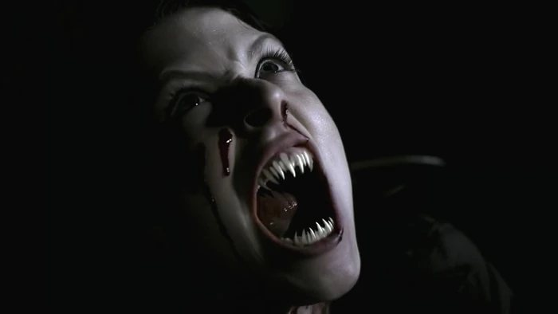

**Описание**

Все вампиры происходят от Альфа-вампира — невероятно древнего существа, созданного Евой; подразумевается, что он был самым первым монстром, которого она сотворила. Кровь Альфы течёт в жилах каждого вампира и дарует им сверхъестественные способности, а сам Альфа, судя по всему, связан с остальными вампирами телепатически.

Когда-то вампиры были людьми. Они не старятся и живут вечно — многим из них сотни лет; они образуют пары на всю жизнь, а их рацион состоит исключительно из крови. Вампиры предпочитают человеческую кровь, но могут пить и кровь животных, хотя Ленор называет коровью кровь отвратительной. Кормиться нужно так, чтобы жертва осталась жива: кровь мёртвой жертвы становится для вампира токсичной. Часть вампиров обходится донорскими пакетами крови, не желая убивать людей. Размножаются вампиры переливанием крови, поэтому для восстановления вида достаточно одной уцелевшей особи.

К 2006 году вампиры были истреблены настолько, что Джон Винчестер считал их вымершими, и встреча с вампиром считается среди охотников редкостью. Однако вид начал возрождаться: в 2011 году Альфа-вампир по приказу Евы велел существующим гнёздам увеличить численность. Вампиры держатся гнёздами, охотятся по ночам и нередко ведут почти человеческий образ жизни, что делает их опасными и трудными для опознания.

Охотники — Винчестеры, Гордон Уокер и другие — знают, что вампира можно убить только обезглавливанием. Работа против гнезда требует тяжёлого клинка, хладнокровия и умения отличить убийцу от того, кто живёт на донорской крови.

**Силы и способности**

- Сверхъестественная сила — даже молодой вампир легко поднимает и отбрасывает взрослого человека, а старые вампиры одолевают собственных создателей и других монстров.
- Бессмертие — вампиры не старятся и живут столетиями: Борис, 600-летний вампир, без труда справился с Дином.
- Кровь Альфы — в жилах каждого вампира течёт кровь Альфа-вампира, источник их способностей и связи с прародителем.
- Размножение переливанием крови — виду достаточно одной особи, чтобы восстановить численность, поэтому полное истребление почти невозможно.

**Слабости**

- Обезглавливание — единственный надёжный способ убить вампира: без головы он гибнет, тогда как пули и клинки в корпус его почти не замедляют.
- Токсичная кровь — если жертва умирает во время кормления, её кровь становится для вампира ядовитой, поэтому хищник вынужден держать добычу живой.
- Почти полное истребление — охотники за столетия загнали вампиров на грань вымирания, и встреча с одним из них считается редкостью.

**Как его убить.** Гнездо вычисляют по цепочке исчезновений и обескровленных тел, затем работают группой в замкнутом помещении, где вампир не уйдёт. Основной инструмент — тяжёлый клинок, мачете или топор: вампира убивает только полное отделение головы, стрелять в корпус бессмысленно. Если вампир питается от жертвы, нельзя давать ему осушить её до смерти: пакеты донорской крови работают как приманка. Часть вампиров живёт на донорской крови и не убивает людей, поэтому убедитесь, что перед вами хищник.

**Известные особи:** Альфа-вампир; Первый вампир; Бенни Лафит; Борис; Ленор; Алекс Джонс; Андреа Кормос

#### Вампиры
*Средний, Монстр, нейтрально-злое*

---
- **Класс доспеха** 15 (природная броня)
- **Хиты** 82 (11d8 + 33)
- **Скорость** 40 фт.

| СИЛ | ЛОВ | ТЕЛ | ИНТ | МДР | ХАР |
|---|---|---|---|---|---|
| 18 | 16 | 16 | 11 | 12 | 13 |

- **Спасброски** Сил +7, Тел +6
- **Навыки** Восприятие +4, Скрытность +6, Запугивание +4
- **Сопротивление урону** некротический; дробящий, колющий и рубящий от немагического оружия
- **Иммунитет к состояниям** очарование, испуг
- **Чувства** тёмное зрение 60 фт., пассивное Восприятие 14
- **Языки** общий (английский)
- **Бонус мастерства** +3
- **Уровень опасности** 5 (1 800 опыта)

***Особенности***
- ***Регенерация.*** Вампир восстанавливает 10 хитов в начале своего хода, если у него есть хотя бы 1 хит и он не получал урона излучением с конца своего предыдущего хода.
- ***Смерть от обезглавливания.*** Опустившись до 0 хитов, вампир не умирает, а падает ничком и остаётся в сознании. Он окончательно погибает только тогда, когда его голова полностью отделена от тела; иначе через 1 час он восстанавливается до 1 хита.
- ***Жажда крови.*** Если вампир не пил кровь более 24 часов, он в начале каждого часа совершает спасбросок Мудрости Сл 13, иначе до конца часа атакует ближайшего гуманоида.
- ***Связь с Альфой.*** Вампир связан с Альфа-вампиром: Альфа может передавать ему приказы и получать образы происходящего на любом расстоянии в пределах одного мира.

***Действия***
- ***Мультиатака.*** Вампир совершает две атаки: одну когтями и одну укусом или две атаки когтями.
- ***Когти.*** Рукопашная атака оружием: +7 к попаданию, досягаемость 5 фт., одна цель. Попадание: 11 (2d6 + 4) рубящего урона.
- ***Укус.*** Рукопашная атака оружием: +7 к попаданию, досягаемость 5 фт., одна цель — гуманоид или зверь. Попадание: 8 (1d8 + 4) колющего урона плюс 10 (3d6) некротического урона. Максимум хитов цели уменьшается на величину некротического урона, пока она не завершит продолжительный отдых.
- ***Захват.*** Вампир совершает одну атаку когтями. При попадании цель размера Средний или меньше схвачена (Сл высвобождения 14), и вампир больше не может использовать эту атаку по другой цели.

**Тактика.** Вампиры атакуют из засады, парами и в темноте, стараясь утащить одну жертву в укрытие, а не драться со всей группой сразу. Они отступают, если теряют численное преимущество или если на их глазах сородичу отрубили голову. Старый вампир дерётся расчётливо: сначала выводит из строя самого опасного противника, затем добивает остальных. Шею вампир защищает любой ценой и от прямого клинка с мачете уходит в сторону.

**Экология.** Гнёзда вампиров скрываются в заброшенных домах, подвалах, мотелях и на окраинах городов; численность вида после истребления крайне мала. Часть вампиров живёт на донорской крови и не охотится на людей, поэтому в одном городе могут сосуществовать хищники и мирные особи, скрывающиеся от охотников.

> **Заметки мастеру.** Вампиры из «Сверхъестественного» — живые существа, а не нежить, поэтому в 5e их удобно собирать на базе ветерана или вампирского воина, убрав солнечную уязвимость и заменив её механикой обезглавливания. Гнездо из трёх-пяти вампиров — хороший энкаунтер для партии 4–5 уровня, а 600-летний старейшина легко тянет на CR 8–10 за счёт живучести и силы. Для кампании стоит заранее решить, есть ли в городе охотники и как быстро власти заметят цепочку обескровленных тел. Если партия низкого уровня, дайте игрокам мачете и преимущество от подготовки — иначе один удачный укус выключит персонажа из боя.

[↑ к содержанию](#содержание)

---

### 23. Вендиго

**Wendigo** · Монстр · CR 5 · опасность в сериале 3/5

*Также известно как:* Злой дух, пожирающий людей; Виндиго, Витико и другие варианты имени

*Первое появление:* S01E02 «Wendigo»

*Сезоны:* 1, 7

Каннибал-охотник, которым становится человек, вынужденный есть человеческую плоть. Вендиго умён, невероятно живуч и охотится по ночам, а убить его можно только огнём; днём его сдерживают символы анасази.

**Описание**

Вендиго — каннибалистическое существо, чьё имя означает «зло, которое пожирает». Когда-то вендиго были людьми: после того как человек был вынужден есть человеческую плоть, чтобы выжить, он превращался в монстра, сохранившего лишь немногие человеческие черты. После обращения вендиго начинает жаждать человечины и питается исключительно ею.

Хотя имя вендиго описывают как «злой дух», технически это телесное существо, то есть телесное существо, а не бесплотный дух. Вендиго — воплощение обжорства, жадности и излишеств: убив и съев одного человека, он никогда не насыщается и сразу ищет следующую жертву. Часто вендиго не убивает сразу, а утаскивает людей и держит их живыми в своём логове как запас еды.

Это один из сильнейших и самых опасных монстров: вендиго — превосходный охотник и днём, и ночью, но ночью его практически невозможно одолеть, потому что это его любимое время охоты. Несмотря на звериную, дикую повадку, вендиго сохраняет человеческий интеллект, и именно это делает его по-настоящему опасным. Убить его крайне трудно, и лишь немногие способы вообще работают.

В первом сезоне Сэм и Дин, разыскивая отца, помогают семье, чей брат пропал в походе: его взял вендиго, и охотники находят его ещё живым в заброшенной шахте, где монстр хранил своих жертв как живой запас еды. Дин убивает вендиго, выстрелив в него из сигнальной ракетницы. Запись о вендиго из журнала Джона Винчестера мелькает в эпизоде «Asylum», а сам монстр ещё не раз упоминается в записях охотников.

**Силы и способности**

- Почти идеальный охотник — вендиго одинаково опасен днём и ночью, но ночью его практически невозможно одолеть: это его любимое время охоты.
- Человеческий разум — несмотря на звериные повадки, вендиго сохраняет человеческий интеллект, что делает его хитрее и опаснее обычного хищника.
- Невероятная живучесть — вендиго крайне трудно ранить, а убить можно лишь одним способом; большинство оружия против него бесполезно.
- Запас живых жертв — вендиго не всегда убивает сразу: он утаскивает людей в логово и держит их живыми как источник еды.
- Воплощение обжорства — вендиго никогда не насыщается: расправившись с одной жертвой, он немедленно начинает искать следующую.
- Сверхъестественная сила — вендиго способен одолеть и утащить взрослого человека, а его логово обычно недостижимо для раненого пленника.

**Слабости**

- Огонь — единственный известный способ убить вендиго: его необходимо сжечь. Вендиго настолько чувствителен к жару, что избегает даже потенциальной жертвы, сидящей у открытого огня.
- Символы анасази — защитные круги с символами анасази не подпускают вендиго, действуя подобно соли против духов, и дают охотнику безопасное место для отдыха.
- День — днём шансы есть: вендиго охотится в основном по ночам, поэтому светлое время суток остаётся единственным окном для охоты на него.
- Жадность — вендиго возвращается к своему запасу еды, поэтому логово можно вычислить по похищенным людям и устроить там засаду.

**Как его убить.** Известен ровно один способ убить вендиго — сжечь его, поэтому главным инструментом становится огонь: сигнальная ракетница, зажигательная смесь, факелы и костёр на выходе из логова. Днём вендиго слабее и предсказуемее: найдите заброшенную шахту, где он держит живых пленников, и работайте до заката. Круги с символами анасази дают безопасный ночлег и отрезают хищнику путь. Открытый огонь сам отпугивает вендиго: жертва у костра ему неинтересна, поэтому костёр — и оружие, и щит.

#### Вендиго
*Средний, Исчадие, нейтрально-злое*

---
- **Класс доспеха** 15 (природная броня)
- **Хиты** 82 (11d8 + 33)
- **Скорость** 40 фт.

| СИЛ | ЛОВ | ТЕЛ | ИНТ | МДР | ХАР |
|---|---|---|---|---|---|
| 18 | 16 | 16 | 9 | 14 | 11 |

- **Спасброски** Сил +7, Тел +6
- **Навыки** Восприятие +5, Скрытность +9
- **Уязвимость к урону** огонь
- **Сопротивление урону** холод; дробящий, колющий и рубящий от немагического оружия
- **Иммунитет к состояниям** очарование, испуг
- **Чувства** тёмное зрение 60 фт., пассивное Восприятие 15
- **Языки** понимает английский, но не говорит
- **Бонус мастерства** +3
- **Уровень опасности** 5 (1 800 опыта)

***Особенности***
- ***Погибель от огня.*** Вендиго уязвим к огню: урон огнём удваивается. Вендиго, опущенный до 0 хитов уроном огня, рассыпается пеплом и умирает окончательно.
- ***Регенерация 10.*** Вендиго восстанавливает 10 хитов в начале своего хода, если у него есть хотя бы 1 хит и он не получал урона огнём с конца своего предыдущего хода.
- ***Оберег анасази.*** Круг с символами анасази, начерченный за 10 минут, не позволяет вендиго приблизиться ближе 10 футов; он не может пересечь границу и не может атаковать существ внутри круга, пока тот не повреждён.
- ***Ночной охотник.*** В темноте вендиго имеет преимущество на проверки Мудрости (Восприятие) и на атаки по существам, которые его не видят. При ярком свете он теряет это преимущество.
- ***Хозяин логова.*** В своей пещере или шахте вендиго имеет преимущество на проверки Ловкости (Скрытность) и точно знает расположение всех ходов и тупиков.
- ***Боязнь открытого огня.*** Вендиго не приближается по своей воле к существу, рядом с которым горит открытый огонь (костёр, факел), если только не атакует его из укрытия.

***Действия***
- ***Мультиатака.*** Вендиго совершает одну атаку укусом и одну атаку когтями.
- ***Укус.*** Рукопашная атака оружием: +7 к попаданию, досягаемость 5 фт., одна цель. Попадание: 13 (2d8 + 4) колющего урона, и цель схвачена (Сл высвобождения 14).
- ***Когти.*** Рукопашная атака оружием: +7 к попаданию, досягаемость 5 фт., одна цель. Попадание: 11 (2d6 + 4) рубящего урона.
- ***Похищение.*** Вендиго действием перемещается на свою скорость, утаскивая схваченное существо, и не считается перегруженным. Если в конце перемещения цель всё ещё схвачена, она получает 7 (2d6) рубящего урона от камня и острых краёв прохода.

***Бонусные действия***
- ***Звериный бросок.*** Вендиго перемещается на половину своей скорости к схваченной или раненой цели, не провоцируя атак по пути.

***Действия в логове***
- ***Тьма выработки.*** На инициативе 20 заброшенная шахта погружается в непроглядную тьму в радиусе 30 фт. от вендиго; тёмное зрение здесь не помогает, и все существа, кроме вендиго, получают помеху на атаки до конца раунда, если у них нет иного источника света.
- ***Обвал.*** Вендиго обрушивает участок породы: каждое существо в пределах 10 фт. от прохода должно преуспеть в спасброске Ловкости Сл 14, иначе получает 10 (3d6) дробящего урона и оказывается схваченным обломками (Сл высвобождения 14).
- ***Шёпот жертв.*** Из темноты доносятся стоны удерживаемых пленников. Каждое существо по выбору вендиго в пределах 60 фт. должно преуспеть в спасброске Мудрости Сл 13, иначе до конца своего следующего хода может двигаться только в сторону источника шума.

**Тактика.** Вендиго никогда не нападает на группу в открытую: он выслеживает отставших, нападает из темноты, хватает одну жертву и уходит в лабиринт шахты. Если противник зажёг огонь, вендиго отступает вглубь и ждёт, пока костёр погаснет, а затем возвращается. Против сильной группы он использует обвалы и тьму, раз за разом разделяя партию, и никогда не дерётся до смерти, если рядом есть открытое пламя. Обездвиженный или загнанный в тупик, он бьётся отчаянно — это его последний шанс.

**Экология.** Вендиго обитает в глухих лесах, горах, пещерах и заброшенных шахтах, где устроено его логово с запасом живых пленников. Он охотится в одиночку на обширной территории, поэтому в одном районе обычно действует только один вендиго; его появление выдаёт цепочка пропавших без вести туристов и охотников.

> **Заметки мастеру.** Вендиго — отличный монстр для первого расследования в кампании: он не требует сложной политики, но наказывает партию за ночёвку без огня и за разделение. Каноничного вендиго в 5e нет, поэтому за основу берите йети или горного великана и добавьте уязвимость к огню, регенерацию и оберег анасази. Для партии 4–5 уровня он опасен почти смертельно в своей шахте: дайте игрокам шанс найти круг анасази и ракетницу заранее. Для более высокого уровня поднимите CR до 8–9, добавив легендарные действия и пару пленников, которых нужно спасти до обвала.

[↑ к содержанию](#содержание)

---

### 24. Ветала

**Vetala** · Монстр · CR 5 · опасность в сериале 3/5

*Также известно как:* Змееподобный парный хищник; Индийский вампир-висельник

*Первое появление:* S07E06 «Adventures in Babysitting»

*Сезоны:* 7, 9, 14

Почти змееподобный монстр из индийской мифологии, который охотится парами: один отвлекает, второй бьёт. Парализует жертву ядовитым укусом и гибнет только от серебряного ножа, провернутого в сердце.

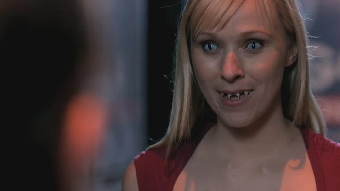

**Описание**

Веталы — монстры, почти змееподобные по природе, которые охотятся парами, чтобы захватывать добычу; в одиночку они обычно не охотятся. Они преданы своему виду: у них выраженное стайное сознание, действующее как семейное.

У веталов чрезвычайно крепкие и острые клыки, способные разорвать человеческое горло. В дневнике Джона Винчестера сказано, что следы укусов веталов на жертвах напоминают следы нападения вампира. Веталы парализуют жертву ядовитым укусом: он вырубает человека, вызывает звон в ушах и ослабляет силы. У веталов есть и усиленная сила, позволяющая одолеть даже крепких людей вроде Сэма и Дина, и обострённый слух — один из них услышал, как кто-то подкрадывается сзади. Убить ветала можно только ударом серебряного ножа в сердце, после чего нож нужно провернуть; умирая, ветел рассыпается.

Джон охотился на одинокого ветала давно и убил его, записав это в дневник, откуда спустя годы сведения получил Сэм. Пока Сэм учился в Стэнфорде, Дин выяснил, что веталы охотятся парами, и сумел убить двоих. В эпизоде «Adventures in Babysitting» охотник Ли Чемберс пошёл за одним веталом, не зная, что его партнёр рядом, и был схвачен; несколько дней спустя Сэм отправился искать Ли и тоже попал в плен. Тела были разбросаны по всему логову, так что пленники были не единственной добычей. Крисси убила Салли, а Марлен почти укусила Дина, но Сэм успел убить её.

Веталы происходят из индийской мифологии. В преданиях они обитают в лесах и спят, подвешиваясь вверх ногами на деревьях, как летучие мыши. В индуистской мифологии есть много историй о том, как божества и благочестивые цари одолевали веталов. Одолев и поработив ветала, можно получить очень преданного слугу: мифы рассказывают о веталах, которые охотно отдавали жизнь за хозяев, считая большинство из них ближайшими друзьями.

**Силы и способности**

- Клыки — у веталов чрезвычайно крепкие и острые клыки, способные разорвать человеческое горло; следы укуса похожи на вампирские.
- Парализующий яд — укус ветала вырубает жертву, вызывает звон в ушах и ослабляет её силы.
- Сверхсила — веталы одолевают даже крепких людей вроде Сэма и Дина.
- Обострённый слух — ветел способен услышать, как кто-то подкрадывается к нему сзади.
- Парная охота — веталы действуют вдвоём, один отвлекает добычу, второй атакует, что делает их смертоноснее одиночек.
- Неуязвимость — убить ветала можно только серебряным ножом в сердце, провернутым один раз.

**Слабости**

- Серебряный нож — ветала убивает удар серебряного ножа в сердце, после чего нож нужно провернуть один раз; тело твари рассыпается.
- Партнёр — охотник, знающий о парной охоте, может обратить её против веталов и не попасть в засаду.
- Преданность виду — веталов можно выманить, взяв в заложники или ранив их партнёра.
- Яд не спасает от группы — парализованный укусом охотник всё равно опасен для твари, если рядом есть союзник.

**Как его убить.** Инвентарь: серебряный нож, оружие для добивания, антидоты и жгуты против парализующего яда, а также дневник Джона Винчестера, где отмечено, что веталы охотятся парами. Порядок действий: сначала убедиться, что рядом второй ветел, — иначе охота закончится пленом. Затем выманить одного, поймать момент и всадить серебро точно в сердце, провернув нож один раз. Обычные пули и ножи не работают.

**Известные особи:** Салли — ветала, убитая Крисси; Марлен — ветала, убитая Сэмом; Ли Чемберс — охотник, схваченный веталами

#### Ветала
*Средний, Монстр, нейтрально-злое*

---
- **Класс доспеха** 15 (природная броня)
- **Хиты** 75 (10d8 + 30)
- **Скорость** 40 фт.

| СИЛ | ЛОВ | ТЕЛ | ИНТ | МДР | ХАР |
|---|---|---|---|---|---|
| 18 | 17 | 16 | 11 | 14 | 12 |

- **Спасброски** Лов +6, Тел +6
- **Навыки** Восприятие +5, Скрытность +6, Выживание +5
- **Уязвимость к урону** серебро
- **Сопротивление урону** дробящий, колющий и рубящий от немагического оружия
- **Иммунитет к урону** яд
- **Иммунитет к состояниям** отравление
- **Чувства** тёмное зрение 60 фт., пассивное Восприятие 15
- **Языки** английский
- **Бонус мастерства** +3
- **Уровень опасности** 5 (1 800 опыта)

***Особенности***
- ***Только серебро в сердце.*** Ветала не может быть опущен до 0 хитов ничем, кроме серебряного оружия. Когда он опускается до 0 хитов от серебряного оружия, он должен получить ещё один успешный удар серебряным оружием по обездвиженной цели — только тогда он погибает и рассыпается.
- ***Парная тактика.*** Ветала совершает с преимуществом проверки атаки по существу, которое уже атаковано другим веталом в этом раунде. Если его партнёр погиб, ветала получает помеху на спасброски Мудрости и проверки Мдр (Восприятие).
- ***Обострённый слух.*** Ветала совершает с преимуществом проверки Мдр (Восприятие), основанные на слухе, и не может быть застигнут врасплох существом, которое двигается по твёрдой поверхности в пределах 60 фт.
- ***Преданность виду.*** Ветала защищает своих сородичей: он совершает с преимуществом спасброски против эффектов, которые заставляют его бросить партнёра, и с помехой — проверки, если это может привести к его гибели.

***Действия***
- ***Мультиатака.*** Ветала совершает две атаки: укусом и когтями.
- ***Укус.*** Рукопашная атака оружием: +7 к попаданию, досягаемость 5 фт., одна цель. Попадание: 11 (2d6 + 4) колющего урона, и цель должна преуспеть в спасброске Телосложения Сл 14, иначе становится парализованной на 1 минуту. Спасбросок повторяется в конце каждого хода цели.
- ***Когти.*** Рукопашная атака оружием: +7 к попаданию, досягаемость 5 фт., одна цель. Попадание: 9 (1d10 + 4) рубящего урона.
- ***Парализующий плевок (1/день).*** Ветала плюёт ядом в одну цель в пределах 15 фт. Цель проходит спасбросок Ловкости Сл 14, иначе получает 5 (2d4) урона ядом и становится отравленной на 1 час; отравленная цель совершает с помехой проверки и спасброски Силы.

***Бонусные действия***
- ***Скрытный шаг.*** Ветала совершает Отход или проверку Ловкости (Скрытность).

***Реакции***
- ***Защита партнёра.*** Когда существо в пределах 30 фт. атакует второго ветала, ветала может реакцией переместиться на 15 фт. и совершить по атакующему одну атаку когтями, если тот в досягаемости.

**Тактика.** Веталы всегда работают вдвоём: один выманивает противника и уводит его от группы, второй бьёт со спины и парализует ядом. Они не бьются до смерти, если партнёр ранен, — стараются утащить добычу и отступить в логово с телами. Против группы ветелы разрывают строй и парализуют по одному, чтобы лишить охотников численного перевеса. Серебряный нож они узнают и стараются обойти его владельца, напав на него вдвоём. Если партнёр убит, ветала теряет осторожность и бьётся до конца, но почти всегда пытается унести тело.

**Экология.** Веталы живут парами и селятся в уединённых местах — заброшенных домах, подвалах, лесных хижинах, где складывают тела жертв. Они охотятся по ночам, часто на людей, отбившихся от группы, и держат добычу живой несколько дней. Происходят из индийской мифологии, где, как считается, обитают в лесах и спят вверх ногами на деревьях, как летучие мыши. С другими монстрами не связаны и в стаи крупнее пары не собираются.

> **Заметки мастеру.** Веталы — образцовый парный монстр для группы 4–6 уровня: их главная механика не статблок, а тактика, поэтому ведите их двумя инициативами и подчёркивайте, что одиночка означает засаду. Замена в 5e — вампирский отпрыск с ядовитым укусом и без регенерации. Механику «серебро плюс проворот» удобно свести к требованию добивающего удара по обездвиженной цели. На низком уровне оставьте одного ветала с 40 хитами; на высоком добавьте третьего, логово с пленниками и алхимический антидот как награду за расследование.

[↑ к содержанию](#содержание)

---

### 25. Вид Брэйдона Олбрайта

**Braydon Albright** · Монстр · CR 7 · опасность в сериале 3/5

*Также известно как:* Шипсквач; Белая тварь

*Первое появление:* Novel «Supernatural: Mythmaker»

Человек по имени Брэйдон Олбрайт, неизвестным способом получивший способность превращаться в чудовище — Шипсквача, или Белую тварь. Гигант с чёрными когтями неуязвим для винтовок и дробовиков, и убить его можно только колом из белого ясеня в сердце.

**Описание**

Брэйдон Олбрайт — человек, который неизвестным способом получил силу превращаться в существо, известное как Шипсквач, или Белая тварь. Как именно он приобрёл эту способность, выжимка не сообщает: возможно, его прокляли, а возможно, он заключил сделку с демоном.

Сначала Брэйдон мог возвращаться в человеческий облик, но со временем либо утратил эту способность, либо потерял желание ею пользоваться. В форме Шипсквача он неуязвим для большинства способов убийства: несколько выстрелов из винтовки и дробовика причиняли ему боль, но не убивали и не делали ничего, кроме ярости и страданий. Когти у него чёрные и острые, как лезвия, а силы столько, что одним ударом руки он отбросил Стюарта Андервуда в дерево с такой силой, что тот сломал спину.

Охотился Шипсквач в лесах Западной Виргинии, где жил Брэйдон. Тварь прославилась убийствами собак, свиней и скота. Около 1998 года на Шипсквача пошёл патриарх семьи охотников Андервудов — и погиб от его руки. Семья поклялась отомстить, но поймать тварь не смогла: дважды подбиралась близко и дважды терпела неудачу.

Через две недели после смерти мистера Андервуда семья нашла в лесу бога, которого назвала Владыкой Охоты. Поняв по найденным записям, на что тот способен, Андервуды заключили с богом сделку: он дал им силу, необходимую, чтобы убить Шипсквача.

Единственная известная слабость Белой твари — кол из белого ясеня, вбитый в сердце. Обычное оружие её только злит. Всё, что известно об этом виде, выжимка черпает из романа «Supernatural: Mythmaker», где фигурируют Брэйдон Олбрайт, Стюарт Андервуд, семья Андервудов и бог, названный Владыкой Охоты.

**Силы и способности**

- Смена облика — Брэйдон умел превращаться в гигантское существо, Шипсквача; со временем он либо утратил способность возвращаться, либо потерял желание.
- Смертоносные когти — в облике Шипсквача у него чёрные, устрашающе острые когти, которыми он разрывает добычу.
- Сверхчеловеческая сила — одним ударом руки и когтей он отбросил Стюарта Андервуда в дерево с силой, сломавшей ему спину.
- Неуязвимость — Шипсквач неуязвим для большинства способов убийства: выстрелы из винтовки и дробовика не могли его убить.
- Охотничьи повадки — тварь охотилась в лесах Западной Виргинии и была известна убийствами собак, свиней и скота.

**Слабости**

- Кол из белого ясеня — вбитый в сердце кол из белого ясеня способен убить Брэйдона в облике Шипсквача.
- Огнестрел не работает — несколько выстрелов из винтовки и дробовика причиняли ему боль, но не убивали и не мешали драться.
- Ярость вместо разума — боль только злила тварь; осмысленной тактики в бою она не показывает.
- Потеря человеческого облика — Брэйдон не может вернуться в человеческий вид, а значит его нельзя ни уговорить, ни пристыдить.
- Привязка к лесу — тварь охотилась в лесах, где жила, и не уходила далеко от своего участка.

**Как его убить.** Единственное оружие против Шипсквача — кол из белого ясеня в сердце: всё остальное, включая винтовки и дробовики, лишь злит тварь. Поэтому охота начинается с поиска белого ясеня и изготовления кола, а не с покупки патронов. Дальше выслеживают участок: Шипсквач выдаёт себя убитым скотом и разорванными тушами. Бить нужно в упор и точно в сердце, поэтому нужны силки или капкан, чтобы удержать тварь на пару секунд, и напарник с ружьём. Инвентарь: кол из белого ясеня, тяжёлый молот, капканы, цепи.

**Известные особи:** Брэйдон Олбрайт — человек, ставший Шипсквачом; Стюарт Андервуд — отброшен Шипсквачом в дерево со сломанной спиной; Семья Андервудов — охотники, заключившие сделку с Владыкой Охоты ради мести; Владыка Охоты — бог, давший Андервудам силу против Шипсквача

#### Вид Брэйдона Олбрайта
*Большой, Монстр, хаотично-злое*

---
- **Класс доспеха** 15 (природная броня)
- **Хиты** 105 (10d10 + 50)
- **Скорость** 40 фт., лазание 30 фт.

| СИЛ | ЛОВ | ТЕЛ | ИНТ | МДР | ХАР |
|---|---|---|---|---|---|
| 20 | 14 | 20 | 8 | 12 | 10 |

- **Спасброски** Сил +8, Тел +8
- **Навыки** Восприятие +4, Скрытность +5, Выживание +4
- **Сопротивление урону** дробящий, колющий и рубящий от немагического оружия, кроме белого ясеня
- **Иммунитет к состояниям** очарование, испуг
- **Чувства** тёмное зрение 60 фт., пассивное Восприятие 14
- **Языки** понимает английский, но не говорит (утратил человеческую речь)
- **Бонус мастерства** +3
- **Уровень опасности** 7 (2 900 опыта)

***Особенности***
- ***Живучесть.*** Если Шипсквач опускается до 0 хитов от урона, не нанесённого колом из белого ясеня в сердце, он вместо смерти остаётся с 1 хитом и продолжает бой. Убить его окончательно можно только ударом кола из белого ясеня в сердце (атака по обездвиженной, схваченной или бессознательной цели).
- ***Огнестрел только злит.*** Урон от немагического огнестрельного оружия не может опустить Шипсквача ниже 1 хита. Каждое попадание такого оружия даёт ему преимущество на следующую атаку и лишает его возможности отступить до конца следующего хода.
- ***Прыжок хищника.*** Если Шипсквач переместился по прямой на 20 фт. к цели и затем попал по ней атакой когтями, цель должна преуспеть в спасброске Силы (Сл 16), иначе падает ничком.
- ***Утраченный человеческий облик.*** Шипсквач больше не может вернуть человеческий вид. Его нельзя переубедить, разжалобить или заставить вспомнить себя; страх и очарование на него не действуют.
- ***Хозяин леса.*** Шипсквач получает преимущество на проверки Мудрости (Выживание) и Мудрости (Восприятие) в лесу и не оставляет читаемых следов на твёрдой земле: проверки для его выслеживания совершаются с помехой.

***Действия***
- ***Мультиатака.*** Шипсквач совершает три атаки: одну укусом и две когтями.
- ***Когти.*** Рукопашная атака оружием: +8 к попаданию, досягаемость 10 фт., одна цель. Попадание: 12 (2d6 + 5) рубящего урона.
- ***Укус.*** Рукопашная атака оружием: +8 к попаданию, досягаемость 5 фт., одна цель. Попадание: 10 (1d10 + 5) колющего урона.
- ***Метание.*** Шипсквач швыряет схваченное существо размера Средний или меньше: цель пролетает 15 фт., получает 14 (2d8 + 5) дробящего урона и падает ничком. Если она врезается в дерево или стену, она получает дополнительно 7 (2d6) дробящего урона, а её скорость становится 0 до конца её следующего хода.

***Бонусные действия***
- ***Захват добычи.*** Шипсквач хватает существо размера Средний или меньше в пределах 5 фт. Цель должна преуспеть в спасброске Силы (Сл 16) или Ловкости (Сл 16), иначе схвачена (Сл освобождения 16).

***Реакции***
- ***Рёв ярости.*** Когда Шипсквач получает урон от огнестрельного оружия, он реакцией ревёт. Каждое существо в пределах 30 фт. совершает спасбросок Мудрости (Сл 14), иначе испугано до конца своего следующего хода.

***Действия в логове***
- ***Логово в чаще.*** Пока бой идёт на участке Шипсквача, мастер может в начале раунда описать треск в кустах: существа, не являющиеся союзниками твари, совершают проверки Мудрости (Восприятие) с помехой до конца раунда — они не понимают, откуда придёт удар.
- ***Запах крови.*** Если в этом бою кто-то уже потерял хиты, Шипсквач знает точное положение всех раненых существ в пределах 120 фт. и получает преимущество на первую атаку по одному из них.

**Тактика.** Шипсквач не хитрит: он выходит из чащи на того, кто отстал или шумит, сбивает его с ног прыжком и разрывает когтями. Огнестрельный огонь его только злит — он разворачивается на стрелка, швыряет в него всё, что попалось под руку, и бьёт с удвоенной яростью, поэтому группе выгодно стрелять ровно столько, чтобы увести его от раненого. Убегать он не умеет и не хочет: отступает только в чащу, где знает каждый овраг. Настоящая опасность боя — в его живучести: без кола из белого ясеня тварь просто встаёт снова.

**Экология.** Шипсквач держится в лесах Западной Виргинии, где жил Брэйдон Олбрайт: глухие участки с водой, оврагами и пастбищами рядом. Он охотится на собак, свиней и скот, поэтому о нём узнают по разорённым дворам и тушам, а не по людским смертям. Это одиночка: других Шипсквачей в выжимке нет, и о численности вида она не сообщает. Из врагов известны охотники: семья Андервудов дважды подбиралась к нему близко и оба раза терпела неудачу.

> **Заметки мастеру.** Шипсквач — «неубиваемый» монстр для партии 5-7 уровня: он должен напугать группу тем, что пули не работают, и заставить их искать белый ясень. Ведите его как одиночку-хищника в лесу, чередуя бой с погоней, и держите наготове правило живучести — без кола он встаёт с 1 хитом, и это должно стать открытием, а не обманом. В 5e его заменяет тролль или йети, но обязательно уберите регенерацию и добавьте неуязвимость к огнестрелу. Для низкого уровня снизьте хиты до 60 и уберите Метание; для высокого дайте ему стаю лесных тварей и охотника-Андервуда, который идёт по следу вместе с группой.

[↑ к содержанию](#содержание)

---

### 26. Вид Эдварда Трентона

**Edward Trenton's Species** · Монстр · CR 3 · опасность в сериале 2/5

*Также известно как:* Неопознанный вид монстров-пожирателей печени

*Первое появление:* Сезон 10, «Reichenbach»

*Сезоны:* 10

Неопознанный и, судя по всему, крайне редкий вид монстров с почти человеческой внешностью: они вырывают печень прямо из тела жертвы. Убить их можно только клинком из стали с серебряным покрытием — обычное оружие не берёт.

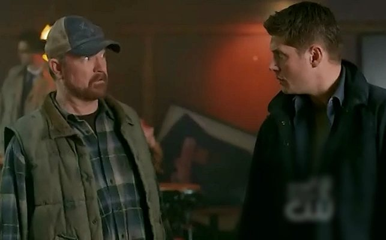

**Описание**

Вид Эдварда Трентона — неопознанный и, по всей видимости, очень редкий тип монстров, в которого превратился Эдвард Трентон. Выжимка не указывает ни даты возникновения вида, ни его происхождения: неизвестно, когда он появился и откуда взялся.

Представители вида питаются печенью, вырывая её прямо из тела жертвы. Сверхъестественная сила позволяет им делать это голыми руками. Свои гены они, вероятно, передают через укус. Как они выглядят, достоверно неизвестно: сказано лишь, что черты у них в основном человеческие, поэтому в толпе такого монстра трудно опознать.

Единственный известный представитель вида — Эдвард Трентон. В 2003 году его выследил и убил Дин Винчестер, применив нож из стали с серебряным покрытием. После этого Дин отмечал, что монстров именно этого типа больше не встречал.

Остаётся неизвестным, означала ли смерть Эдварда Трентона исчезновение всего вида: выжимка прямо говорит, что нельзя сказать, существует вид до сих пор или уже вымер.

В сериале вид фигурирует в десятом сезоне — в эпизодах «Reichenbach», «Girls, Girls, Girls» и «The Things They Carried». Никаких других сведений о его повадках, местах обитания или происхождении файл не даёт.

**Силы и способности**

- Сверхъестественная сила — монстр способен голыми руками вырвать печень из тела жертвы.
- Неуязвимость к обычному оружию — убить его можно только клинком из стали с серебряным покрытием.
- Передача генов — вид, вероятно, распространяется через укус, но точный механизм неизвестен.

**Слабости**

- Сталь с серебряным покрытием — единственное известное средство: именно таким ножом Дин Винчестер убил Эдварда Трентона.
- Обычное оружие и огнестрел бесполезны — других уязвимостей выжимка не называет.

**Как его убить.** Охота описана по единственному известному случаю. Охотнику нужен клинок из стали с серебряным покрытием: обычное оружие, включая огнестрельное, монстра не берёт. Искать цель следует по трупам с вырванной печенью — существо выглядит почти как человек, поэтому подозреваемого проверяют на устойчивость к обычному урону. Убийство совершается ударом серебряного клинка: так Дин Винчестер покончил с Эдвардом Трентоном в 2003 году. Других способов выжимка не называет.

**Известные особи:** Эдвард Трентон — единственный известный представитель вида, убит Дином Винчестером в 2003 году.

#### Вид Эдварда Трентона
*Средний, Монстр, нейтрально-злое*

---
- **Класс доспеха** 14 (природная броня)
- **Хиты** 65 (10d8 + 20)
- **Скорость** 30 фт.

| СИЛ | ЛОВ | ТЕЛ | ИНТ | МДР | ХАР |
|---|---|---|---|---|---|
| 18 | 14 | 15 | 8 | 11 | 9 |

- **Спасброски** Сил +6, Тел +4
- **Навыки** Восприятие +2, Скрытность +4
- **Уязвимость к урону** колющий и рубящий урон от стали с серебряным покрытием
- **Сопротивление урону** дробящий, колющий и рубящий от немагического оружия, кроме стали с серебряным покрытием
- **Иммунитет к состояниям** испуг
- **Чувства** тёмное зрение 60 фт., пассивное Восприятие 12
- **Языки** понимает английский, но не говорит
- **Бонус мастерства** +2
- **Уровень опасности** 3 (700 опыта)

***Особенности***
- ***Серебряный клинок.*** Немагическое оружие наносит существу только половину урона; оружие из стали с серебряным покрытием игнорирует это сопротивление, а если опускает хиты до 0, монстр умирает и не может быть возвращён к жизни немагическими средствами.
- ***Пожиратель печени.*** Существо питается человеческой печенью и предпочитает нападать на одиночек из засады, а не в открытом бою.

***Действия***
- ***Мультиатака.*** Существо совершает две атаки: одну кулаком и одну захват.
- ***Кулак.*** Рукопашная атака оружием: +6 к попаданию, досягаемость 5 фт., одна цель. Попадание: 9 (2d4 + 4) дробящего урона.
- ***Вырывание печени.*** Рукопашная атака оружием: +6 к попаданию, досягаемость 5 фт., одна цель, которая должна быть схвачена, обездвижена или застигнута врасплох. Попадание: 22 (4d8 + 4) рубящего урона, и цель получает состояние «отравлена» до конца своего следующего хода.
- ***Захват.*** Рукопашная атака оружием: +6 к попаданию, досягаемость 5 фт., одна цель. Попадание: цель схвачена (Сл высвобождения 14).

**Тактика.** Монстр действует как хищник-одиночка: выслеживает жертву, бьёт из засады и пытается схватить её, чтобы применить «Вырывание печени». Обычный урон он игнорирует и потому не отступает, пока бой идёт на его условиях. Заслышав про серебро или увидев серебряный клинок, существо старается обезоружить противника или сбежать: выжимка описывает вид как редкий, а значит, осторожный. Против группы охотников оно предпочитает нападать на самого слабого и уходить с добычей.

**Экология.** Обитает там же, где люди: вид маскируется под человека, поэтому может жить в городе или в глухой местности, не привлекая внимания. Плотность популяции неизвестна — известен ровно один представитель. Вид, вероятно, передаётся через укус, но подтверждений в выжимке нет.

> **Заметки мастеру.** Готовый «монстр недели» для партии 3–4 уровня: замените им оборотня или гуля, сохранив ключевую загадку — обычное оружие не работает, нужен серебряный клинок. Чтобы усилить интригу, дайте игрокам улики (трупы с вырванной печенью, слухи об укусах), прежде чем они поймут, чем бить. На низком уровне ослабьте существо до CR 2; на высоком добавьте регенерацию 10 в начале хода, если оно не получало урон от серебра, и пару слабых особей-«детёнышей».

[↑ к содержанию](#содержание)

---

### 27. Вид Элеонор Висяк

**Eleanor Visyak's Species** · Монстр · CR 12 · опасность в сериале 4/5

*Также известно как:* Раса доктора Висяк; Беглец из Чистилища

*Первое появление:* Сезон 6, «Like A Virgin»

*Сезоны:* 6

Неопознанная и не получившая названия раса существ, к которой принадлежала доктор Элеонор Висяк. Её единственная известная представительница прожила более 900 лет, вселялась в людей, обладала чудовищной силой и невидимостью, но не устояла против серафима Кастиэля.

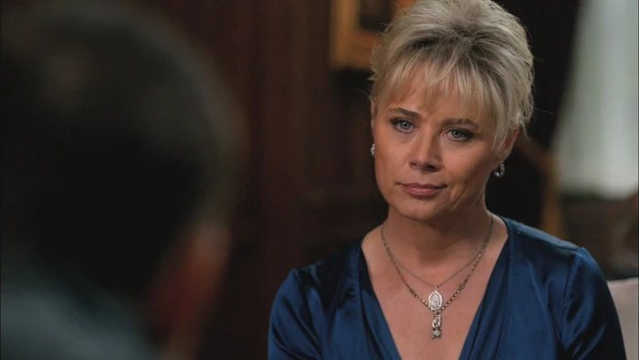

**Описание**

Вид Элеонор Висяк — неопознанная и не названная раса существ, представительницей которой была доктор Элеонор Висяк. Поскольку в сериале появилась только она одна, о расе известно очень мало; дата её возникновения нигде не указана.

Единственная известная особь утверждала, что ей больше 900 лет. Она проникла в мир через проход из Чистилища, который открыли Г. Ф. Лавкрафт и его друзья, и заняла тело служанки Лавкрафта. Затем она принялась убивать участников того ритуала одного за другим, чтобы дверь больше никогда не открылась.

Со временем существо взяло имя доктора Висяк и зажило жизнью обычного человека; у неё были отношения с Бобби Сингером. Кастиэль похитил её и вместе с Кроули подверг пыткам, требуя сведений о Чистилище. Висяк выдала, что для заклинания нужна кровь уроженца Чистилища, — после чего её убили, чтобы эту кровь получить.

До сих пор она остаётся единственным известным представителем своей расы. Неизвестно, добры ли эти существа по природе или же доктор Висяк, будучи безобидной и желавшей сохранить Землю, была исключением из правила.

В сериале раса представлена в шестом сезоне — в эпизодах «Like A Virgin», «Let It Bleed» и «The Man Who Knew Too Much», а также в книге «Bobby Singer's Guide to Hunting».

**Силы и способности**

- Одержимость — Висяк была способна захватывать человеческое тело и действовать через него.
- Бессмертие — на момент смерти ей было более 900 лет, а её сосуд не старел, пока она им владела.
- Сверхчеловеческая сила — она легко разорвала взрослого мужчину, забрызгав кровью стену, и была уверена, что справится с Королём Ада в одиночку.
- Невидимость — после побега она могла передвигаться незамеченной.
- Сверхъестественная выдержка — она стойко переносила попытки Кроули вытянуть из неё сведения о Чистилище.

**Слабости**

- Высшие ангелы — серафим Кастиэль одолел и пленил её, а под пытками сумел сломать; Кроули, Король Ада, этого не смог.
- Способ убийства вида неизвестен: единственную особь убили Кастиэль и Кроули, чтобы взять её кровь как уроженца Чистилища.

**Как его убить.** Выжимка не даёт рецепта охоты: известно лишь, что существо такого типа одолел серафим Кастиэль, тогда как Кроули и пытки её не сломали. Рядовому охотнику такая цель не по силам. Практический вывод — действовать через ангельское оружие и поддержку ангела, а не ловушками и экзорцизмом. Убивать найденную особь сразу нельзя: её кровь нужна как кровь уроженца Чистилища, поэтому трофей важнее трупа.

**Известные особи:** Доктор Элеонор Висяк — единственная известная представительница расы, прожила более 900 лет, убита в шестом сезоне ради крови уроженца Чистилища.

#### Вид Элеонор Висяк
*Средний, Аберрация, нейтральное*

---
- **Класс доспеха** 16 (природная броня)
- **Хиты** 136 (16d8 + 64)
- **Скорость** 30 фт.

| СИЛ | ЛОВ | ТЕЛ | ИНТ | МДР | ХАР |
|---|---|---|---|---|---|
| 20 | 16 | 18 | 15 | 14 | 16 |

- **Спасброски** Тел +8, Мдр +6
- **Навыки** Запугивание +7, Обман +7, Проницательность +6
- **Сопротивление урону** дробящий, колющий и рубящий от немагического оружия
- **Иммунитет к урону** яд
- **Иммунитет к состояниям** очарование, испуг, отравление, истощение
- **Чувства** тёмное зрение 120 фт., пассивное Восприятие 16
- **Языки** английский и языки Чистилища; точный перечень неизвестен
- **Бонус мастерства** +4
- **Уровень опасности** 12 (8 400 опыта)

***Особенности***
- ***Бессмертие.*** Существо не стареет и умирает только от насильственной смерти. Его сосуд также не стареет, пока существо им владеет; существо не нуждается в пище, воде и сне.
- ***Одержимость.*** Действием существо вселяется в гуманоида в пределах 5 фт., который не защищён «Защитой от зла и добра». Цель совершает спасбросок Хар (Сл 16); при провале существо подчиняет её тело, а её сознание подавляется. Изгнание из сосуда требует успешного спасброска Хар (Сл 16) или магии вроде «Изгнания».
- ***Прирождённая невидимость.*** Существо может действием стать невидимым, пока сохраняет концентрацию (как на заклинании), и остаётся невидимым, даже когда атакует.
- ***Выдержка Чистилища.*** Существо совершает спасброски Тел с преимуществом против эффектов, наносящих урон или истощающих его, и не может быть сломано допросом: проверки Обмана и Запугивания против него совершаются с помехой.
- ***Уязвимость перед ангелами.*** Атаки небожителей и ангельское оружие игнорируют сопротивление существа немагическому урону, а спасброски против эффектов небожителей оно совершает с помехой.

***Действия***
- ***Мультиатака.*** Существо совершает две атаки: одну разрывающую и одну захват.
- ***Разрывающий удар.*** Рукопашная атака оружием: +9 к попаданию, досягаемость 5 фт., одна цель. Попадание: 14 (2d8 + 5) дробящего урона, и цель схвачена (Сл высвобождения 15).
- ***Захват.*** Рукопашная атака оружием: +9 к попаданию, досягаемость 5 фт., одна цель. Попадание: цель схвачена (Сл высвобождения 15) и получает 7 (1d4 + 5) дробящего урона в начале каждого своего хода.
- ***Разрыв плоти (1/день).*** Существо разрывает схваченного гуманоида. Цель совершает спасбросок Тел (Сл 17), получая 45 (10d8) рубящего урона при провале или половину при успехе; при провале цель также получает одну степень истощения.

***Бонусные действия***
- ***Ускользание.*** Существо совершает действие «Рывок» или «Отход».
- ***Смена сосуда.*** Существо покидает текущий сосуд и вселяется в находящегося в 30 фт. гуманоида, который не защищён от одержимости, — по правилам черты «Одержимость».

***Реакции***
- ***Живучесть.*** Когда существо получает урон, оно может уменьшить его на 10, если не находится в состоянии «недееспособен».

**Тактика.** Существо дерётся расчётливо: сначала ищет слабейшую цель, хватает её и рвёт на части, чтобы деморализовать остальных. Против превосходящих сил становится невидимым и уходит, а затем возвращается за охотниками по одному. Кроули и пыток оно не боится, но ангела или небожителя в отряде воспринимает как прямую угрозу и старается вывести его из боя первым либо сбежать от него. Сосуд для него — расходный материал: при угрозе гибели существо бросает тело и переселяется в подвернувшегося человека.

**Экология.** Вид пришёл из Чистилища: его представители попадают на Землю только через открытые проходы между мирами, как это сделала доктор Висяк после ритуала Лавкрафта. Известна единственная особь, которая столетиями жила среди людей под человеческим именем. Численность расы, места обитания и то, добры ли эти существа по природе, неизвестны.

> **Заметки мастеру.** Идеальный одиночный злодей для партии 10–13 уровня или «босс» арки о Чистилище: замените им суккуба или вампира-лорда, но сделайте ставку не на бой, а на расследование — существо живёт под чужим именем и полезно тем, что знает дорогу в Чистилище. Кровь такого существа — отличный сюжетный предмет для ритуала. На низком уровне используйте не саму Висяк, а её культистов и слухи о ней; на высоком добавьте легендарные действия и сопротивления, если хотите сделать её полноценным финальным противником.

[↑ к содержанию](#содержание)

---

### 28. Гарпия

**Harpy** · Монстр · CR 6 · опасность в сериале 3/5

*Также известно как:* Сестры Йеракидис; Крылатые похитительницы

*Первое появление:* Роман «Supernatural: Rite of Passage»

Крылатые монстры из романа «Rite of Passage»: три сестры-гарпии похищали и поедали жителей городка в горах Адирондак. Убить гарпию можно только огнём — любые другие раны она залечивает.

**Описание**

Гарпия — монстр, появившийся в романе «Supernatural: Rite of Passage». По меркам охотничьих дел способности у неё довольно слабые, но компенсируются живучестью: гарпию можно ранить, однако убить её можно только огнём.

Она летает на крыльях, а на руках и ногах у неё смертоносные когти. Гарпия сильнее человека: она швырнула взрослого мужчину через поляну и, пусть и с трудом, подняла в воздух двоих. Если тело гарпии не сожжено, она залечивает любые повреждения, включая пулевые ранения в сердце; чтобы рана в сердце не затянулась, в неё нужно всадить нож.

История сестёр Йеракидис относится к 2011 году: три гарпии — Те, Аэлло и Подраж — обосновались в маленьком городке в горах Адирондак на севере штата Нью-Йорк. Они заняли заброшенный викторианский особняк, завели зелёный грузовик Chevrolet Suburban и устроили бойню в лесу рядом с отчуждённым домом: там они ели похищенных людей, закапывали тела в неглубокие могилы и сжигали их вещи. Свою внешность сёстры скрывали плащами в любую погоду, а жертв хватали по случаю.

Их деятельность привлекла Бобби Сингера, а также Сэма и Дина Винчестеров. Сначала охотники решили, что снова имеют дело с драконами, но нашли перья гарпий; сопоставив время первого исчезновения с приездом сестёр Йеракидис в город, они вышли на их дом.

Как и у любой гарпии, у сестёр не было ни серебряной уязвимости, ни страха перед обычным оружием: единственным надёжным способом покончить с ними оставалось сожжение тел.

**Силы и способности**

- Полёт — с помощью крыльев гарпии летают и способны поднимать в воздух людей, пусть и с трудом.
- Когти на руках и ногах — смертоносные когти, которыми гарпия разрывает добычу и удерживает жертву.
- Сверхчеловеческая сила — гарпия сильнее человека: швырнула взрослого мужчину через поляну и подняла в воздух двоих.
- Регенерация — если тело не сожжено, гарпия залечивает любые раны, включая пулевые попадания в сердце, если в него не всажен нож.
- Неуязвимость к обычному оружию — убить гарпию можно только сожжением тела, хотя ранить её можно обычным оружием.

**Слабости**

- Огонь — единственный способ по-настоящему убить гарпию: тело необходимо сжечь, иначе она восстановится.
- Сердце — массивный урон сердцу временно выводит гарпию из строя, а всаженный в сердце нож обездвиживает её, пока оружие не вынут или тело не сожгут.
- Пуля в сердце — обычное ранение сердца надолго гарпию не выводит: она приходит в себя, как только рана затянется.
- Крылья и вес — поднять в воздух двоих взрослых мужчин гарпии удаётся с трудом, значит, живая ноша ограничивает её манёвр.

**Как его убить.** Стандартный набор: канистра бензина или керосина, зажигалка, дробовик и нож. Гарпию сначала обездвиживают — стреляют ей в сердце или всаживают в сердце нож, чтобы она перестала двигаться, — затем поливают тело горючим и сжигают: без огня она поднимется снова. Работать лучше днём и в помещении, потому что на открытом месте гарпия уходит в воздух. Сёстры Йеракидис скрывали лица плащами, поэтому охотники искали их по перьям и сопоставляли даты исчезновений с их приездом в город.

**Известные особи:** Те Йеракидис; Аэлло Йеракидис; Подраж Йеракидис

#### Гарпия
*Средний, Монстр, хаотично-злое*

---
- **Класс доспеха** 14 (природная броня)
- **Хиты** 105 (14d8 + 42)
- **Скорость** 20 фт., полёт 60 фт.

| СИЛ | ЛОВ | ТЕЛ | ИНТ | МДР | ХАР |
|---|---|---|---|---|---|
| 18 | 16 | 16 | 8 | 12 | 10 |

- **Спасброски** Сил +7, Тел +6
- **Навыки** Восприятие +4, Скрытность +6
- **Уязвимость к урону** огонь (см. «Смерть только от огня»)
- **Сопротивление урону** дробящий, колющий и рубящий от немагического оружия
- **Чувства** тёмное зрение 60 фт., пассивное Восприятие 14
- **Языки** —
- **Бонус мастерства** +3
- **Уровень опасности** 6 (2 300 опыта)

***Особенности***
- ***Регенерация.*** Гарпия восстанавливает 10 хитов в начале своего хода, если с её предыдущего хода она не получала урон огнём. Если гарпия получает урон огнём, регенерация не действует до начала её следующего хода.
- ***Смерть только от огня.*** Когда гарпия опускается до 0 хитов от неогневого урона, она не умирает, а падает без сознания и через 1d4 часа приходит в себя с 1 хитом. Чтобы убить её окончательно, тело нужно сжечь не менее чем 10 уроном огнём.
- ***Сердце под замком.*** Пока в сердце гарпии находится клинок, она парализована, пока оружие не извлекут. Пулевое ранение в сердце лишь выводит её из строя, пока рана не затянется.
- ***Крылатая ноша.*** Гарпия может нести одно существо размера Средний или меньше, но при этом её скорость полёта уменьшается вдвое.

***Действия***
- ***Мультиатака.*** Гарпия совершает две атаки когтями.
- ***Когти.*** Рукопашная атака оружием: +7 к попаданию, досягаемость 5 фт., одна цель. Попадание: 11 (2d6 + 4) рубящего урона.
- ***Наскок.*** Если гарпия переместилась не менее чем на 20 фт. по прямой к цели и затем попала по ней атакой когтями, цель должна преуспеть в спасброске Силы Сл 15, иначе схвачена (Сл освобождения 15) и поднята в воздух.

***Бонусные действия***
- ***Сброс с высоты.*** Летящая гарпия, удерживающая схваченное существо, отпускает его: существо падает и получает урон от падения, а гарпия остаётся в воздухе.

**Тактика.** Гарпия атакует с воздуха: кружит, выбирает отставшего или раненого, пикирует и уносит его в лес — там жертву никто не найдёт. На земле она предпочитает хватать и бросать, а не драться в стойке, и всегда старается остаться в воздухе, где её не достанут. Огня она боится по-настоящему: увидев факел или канистру, гарпия отступает к крыше и уходит прочь. Если её сердце пробито ножом, она обездвижена и беспомощна — именно в этот момент её и нужно сжигать.

**Экология.** Гарпии живут поодиночке или небольшими группами из сестёр, селятся в заброшенных домах и охотятся на людей, похищая их по случаю и пряча тела в неглубоких могилах в лесу. Они скрывают свою внешность плащами и не поддерживают отношений с другими монстрами. Три сестры Йеракидис обосновались в горах Адирондак на севере штата Нью-Йорк, откуда и ходили на охоту в ближний городок.

> **Заметки мастеру.** Гарпия с регенерацией и уязвимостью к огню — хороший «монстр недели» для 4-6 уровня: игроки должны догадаться, что обычные раны бесполезны, и сжечь тело. Механически она близка к гарпии из бестиария 5e, но втрое живучее; для низких уровней уберите «Наскок» и сопротивление немагическому оружию, для высоких добавьте ещё двух сестёр и колдовство. Отлично заменяет суккуба или оборотня, если нужен хищник, который уносит жертв в небо.

[↑ к содержанию](#содержание)

---

### 29. Гарт Фицджеральд IV

**Garth Fitzgerald IV** · Монстр · CR 7 · опасность в сериале 3/5

*Также известно как:* Гарт; Новый Бобби; Дантист-охотник

*Первое появление:* S06 «Weekend at Bobby's»

*Сезоны:* 6, 7, 8, 9, 12, 14, 15

Охотник, ставший оборотнем, а затем получивший благодать архангела Михаила: после этого серебро перестало его убивать, и покончить с ним можно только отсечением головы. Гарт добродушен, дружит с Винчестерами и занимает место «нового Бобби», но под контролем Михаила нападал на собственных друзей.

**Описание**

Гарт Фицджеральд IV родился в 1983 году. По базе данных британских Людей Письма он родом из Уорсо, штат Миссури. Какое-то время он учился на дантиста, но бросил учёбу и пошёл в охотники; иронично, что первой его охотой стала зубная фея.

Как охотник Гарт был средней руки: ему хватало умения разбираться с призраками и монстрами, он умел готовить ловушку дьявола, но в передрягах часто получал травмы. Благодаря занятиям йогой и «Второму Бытию» Гарт научился контролировать свою жажду мести, поэтому одержимость призраками ему не страшна.

Со временем Гарт сам стал оборотнем, а как именно это произошло, выжимка не уточняет. Как оборотень он был уязвим для серебра — оно могло и ранить, и убить его. Всё изменилось после вторжения Михаила: Гарта вызвали из отставки, чтобы добыть информацию о монстровой армии архангела, и он получил благодать Михаила. Благодать сделала его сильнее, но заодно подчинила архангелу: Михаил управлял Гартом и заставлял его нападать на друзей.

После усиления благодатью Гарт перестал бояться серебра, но получил новую, куда более страшную уязвимость: как и всех усиленных благодатью оборотней, его можно убить только отсечением головы. Альтернативный Михаил при этом способен был прикончить его без малейших усилий.

В выжимке перечислены только человеческие навыки Гарта; отдельных способностей оборотня для него не приводится, поэтому судить о них приходится по общей природе ликантропов и по его слабостям. Известна и его семья: мать, чьё имя не указано, Бесс, Герти, Сэм и Кастиэль Фицджеральды, Джим Майерс и погибшие Джой Майерс, Брэндон и Фрэнк; кем именно они приходятся Гарту, выжимка не уточняет. Двоюродный брат Брэндон после кремации остался на земле призраком, а с двоюродным братом Фрэнком Гарт что-то строил — что именно, не сказано.

**Силы и способности**

- Охотничьи навыки — Гарт умел справляться с призраками и монстрами, верно готовил ловушку дьявола и в итоге занял место «нового Бобби».
- Невосприимчивость к призракам — благодаря йоге и «Второму Бытию» он контролирует жажду мести, поэтому призраки не могут им одержать.
- Усиление благодатью — после того как Гарт получил благодать архангела Михаила, серебро перестало быть для него смертельным, а сам он стал сильнее.
- Живучесть — как усиленный благодатью оборотень Гарт не погибает от обычных ран: убить его можно только отсечением головы.
- Связи в мире охотников — Бобби Сингер, семья Винчестеров, Кевин Тран, стая Джима Майерса и даже Михаил входят в его окружение.
- Профессия дантиста — после ухода с охоты Гарт выучился на дантиста и открыл собственную практику.

**Слабости**

- Смертность — как человек Гарт был уязвим для ран и смерти, как любой обычный охотник.
- Серебро — как оборотень он мог быть ранен и убит серебром, но потерял эту слабость после усиления благодатью Михаила.
- Архангелы — альтернативный Михаил мог убить Гарта без усилий, а проглоченная благодать дала архангелу власть над ним.
- Отсечение головы — единственный способ убить усиленного благодатью оборотня: без головы Гарт погибает окончательно.
- Слабость к чужим манипуляциям — получив благодать, Гарт против своей воли нападал на друзей под контролем Михаила.

**Как его убить.** Охотиться на Гарта партии придётся только в мрачном сценарии: он союзник охотников. В усиленной благодатью версии серебро, яд и обычные раны бесполезны — работает только отсечение головы, то есть тяжёлый клинок или мачете. Если мастер берёт Гарта до благодати, он обычный оборотень: хватит серебряной пули или клинка. Обездвижить его помогут серебряные наручники и ловушка дьявола, но он сам охотник и читает засады. Инвентарь: мачете, серебро, сигилы, крепкая верёвка.

**Известные особи:** Гарт Фицджеральд IV; Бесс Фицджеральд; Бобби Сингер; Кевин Тран; Брэндон (двоюродный брат, призрак); Фрэнк (двоюродный брат, погиб); Джим Майерс

#### Гарт Фицджеральд IV
*Средний, Монстр, нейтрально-доброе*

---
- **Класс доспеха** 15 (природная броня)
- **Хиты** 105 (14d8 + 42)
- **Скорость** 40 фт.

| СИЛ | ЛОВ | ТЕЛ | ИНТ | МДР | ХАР |
|---|---|---|---|---|---|
| 18 | 16 | 17 | 13 | 13 | 14 |

- **Спасброски** Сил +7, Тел +6, Мдр +4
- **Навыки** Атлетика +7, Восприятие +4, Выживание +4, Запугивание +5, Медицина +4
- **Сопротивление урону** дробящий, колющий и рубящий от немагического оружия
- **Иммунитет к состояниям** очарование, испуг
- **Чувства** тёмное зрение 60 фт., пассивное Восприятие 14
- **Языки** общий (английский)
- **Бонус мастерства** +3
- **Уровень опасности** 7 (2 900 опыта)

***Особенности***
- ***Смерть от обезглавливания.*** Опустившись до 0 хитов, Гарт не умирает, а падает ничком: как усиленный благодатью оборотень он окончательно погибает только тогда, когда его голова полностью отделена от тела. Иначе через 1 час он восстанавливается до 1 хита.
- ***Усиление благодатью.*** Благодать архангела сделала Гарта невосприимчивым к серебру: он не получает уязвимости к серебряным атакам и не теряет сопротивления немагическому оружию. Если мастер использует версию Гарта до получения благодати, замените эту черту на уязвимость к серебру.
- ***Контроль архангела.*** Существо с чертой архангела может действием подчинить Гарта, если он находится в пределах 60 фт. и проваливает спасбросок Харизмы Сл 20. Пока контроль действует, Гарт атакует союзников и не может добровольно прекратить это.
- ***Невосприимчивость к призракам.*** Гарт не может быть одержим призраками и духами: он контролирует свою жажду мести и автоматически преуспевает в спасбросках против таких попыток.
- ***Охотник со стажем.*** Гарт имеет преимущество на проверки Мудрости (Выживание) для выслеживания монстров, узнаёт ловушку дьявола и сигилы с первого взгляда и знает слабости большинства существ, встречавшихся охотникам.
- ***Обострённые чувства.*** Гарт имеет преимущество на проверки Мудрости (Восприятие), основанные на слухе и обонянии.

***Действия***
- ***Мультиатака.*** Гарт совершает три атаки: одну укусом и две атаки когтями либо тяжёлым клинком, либо три атаки когтями или клинком.
- ***Когти.*** Рукопашная атака оружием: +7 к попаданию, досягаемость 5 фт., одна цель. Попадание: 11 (2d6 + 4) рубящего урона.
- ***Тяжёлый клинок.*** Рукопашная атака оружием: +7 к попаданию, досягаемость 5 фт., одна цель. Попадание: 13 (2d8 + 4) рубящего урона.
- ***Укус.*** Рукопашная атака оружием: +7 к попаданию, досягаемость 5 фт., одна цель. Попадание: 8 (1d8 + 4) колющего урона, и цель должна преуспеть в спасброске Телосложения Сл 14, иначе заражается ликантропией.

***Бонусные действия***
- ***Дантистский захват.*** Гарт совершает проверку Силы (Атлетика) против Силы (Атлетика) или Ловкости (Акробатика) одного гуманоида в пределах 5 фт. При успехе цель схвачена.

***Реакции***
- ***Охотничья реакция.*** Когда существо входит в досягаемость Гарта, он может реакцией провести одну атаку тяжёлым клинком по нему.

**Тактика.** Гарт дерётся как опытный охотник, а не как зверь: он использует укрытия, ловушки дьявола и сигилы, старается развести противников и вывести из строя самого опасного. Первым он атакует того, кто держит серебро или мачете, потому что знает, чем это грозит. Под контролем архангела он теряет осторожность и идёт напролом, нападая даже на друзей, — это лучший момент, чтобы его обезоружить, а не убивать. Если бой складывается плохо, Гарт отступает и прячется в своей стоматологической практике или у союзников-охотников. Добивать его он не станет: с людьми Гарт предпочитает говорить.

**Экология.** Гарт живёт двойной жизнью: он практикующий дантист с собственной клиникой и одновременно охотник. Встретить его можно в маленьком городке вроде Уорсо, штат Миссури, в стоматологическом кабинете или в дороге между охотничьими делами. Он не нападает на людей и не промышляет охотой ради добычи, поэтому в городе его считают обычным добродушным врачом. В его окружении — семья Винчестеров, Бобби Сингер, Кевин Тран и стая Джима Майерса.

> **Заметки мастеру.** Гарт — редкий случай союзного монстра: CR 7 позволяет ставить его рядом с партией 5–9 уровня как проводника в мир охотников и «запасного Бобби». Его механическая изюминка — смерть только от обезглавливания: игроки могут бить его сколько угодно, пока не поймут, что нужно рубить голову. Черту «Контроль архангела» удобно использовать как сюжетный переключатель: Гарт становится врагом без изменения статблока. Для низкого уровня дайте версию до благодати — оборотня с уязвимостью к серебру и CR 5.

[↑ к содержанию](#содержание)

---

### 30. Гигант из Плохого места

**The Giant (The Bad Place)** · Монстр · CR 6 · опасность в сериале 2/5

*Также известно как:* Безымянный гигант

*Первое появление:* S13E09 «The Bad Place»

*Сезоны:* 13

Безымянное существо из Плохого места, известное только по скелетным останкам неестественно крупных размеров. Похоже, относится к тому же типу, что и Гигант, либо родственно ему, но ничего другого о нём неизвестно.

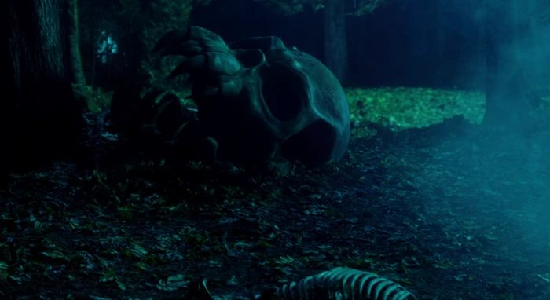

**Описание**

Безымянный гигант — неопознанное существо из Плохого места (The Bad Place), мира, в который случайно открыли портал Кая Нивес и Джек. Ни имени, ни категории у него нет: в инфобоксе и то и другое помечено как неизвестное, а статус указан как deceased — тварь мертва.

Всё, что о нём известно, — это размеры его скелетных останков: они были крупнее, чем у естественных, природных существ. Судя по ним, гигант относится к тому же типу, что и Гигант, либо состоит с ним в родстве, но подтверждения этому нет.

Никаких других сведений о существе выжимка не даёт. Неизвестно, как оно выглядело при жизни, как двигалось, нападало ли на людей, обладало ли какими-либо силами помимо исполинского размера. Неизвестны и его слабости, и то, как именно оно погибло, и был ли это единственный экземпляр.

Для охотника и для мастера это значит, что гигант из Плохого места — скорее находка, чем противник: о нём можно судить только по костям. Всё остальное — от описания повадок до способа убийства — придётся домысливать, и в карточке D&D ниже именно так и сделано: предложена трактовка древнего исполина-падальщика, чьи останки служат и уликой, и ловушкой.

**Силы и способности**

- Исполинский размер — скелетные останки существа были крупнее, чем у естественных природных созданий.
- Родство с Гигантом — по останкам тварь отнесена к тому же типу, что и Гигант, либо признана родственной ему.

**Слабости**

- Смертность — гигант мёртв: в инфобоксе его статус указан как deceased.
- Неизвестность — ни слабостей, ни сопротивлений гиганта выжимка не называет; всё это остаётся неизвестным.

**Как его убить.** Охотиться на гиганта из Плохого места по канону нельзя: он мёртв, и в выжимке нет ни его слабостей, ни поведения, ни способа убить его. Всё, что может сделать охотник, — работать на месте находки: обследовать скелет, по костям оценить размеры и понять, что перед ним не природное существо, а обитатель Плохого места. Дальше след ведёт к порталу: он объясняет, откуда в мире взялись и гигант, и другие твари. Живого гиганта берут ловушками и обвалом, но это трактовка.

#### Гигант из Плохого места
*Огромный, Монстр, без мировоззрения*

---
- **Класс доспеха** 15 (природная броня)
- **Хиты** 115 (10d12 + 50)
- **Скорость** 40 фт.

| СИЛ | ЛОВ | ТЕЛ | ИНТ | МДР | ХАР |
|---|---|---|---|---|---|
| 22 | 9 | 20 | 4 | 12 | 8 |

- **Спасброски** Сил +9, Тел +8
- **Навыки** Восприятие +4
- **Сопротивление урону** дробящий, колющий и рубящий от немагического оружия
- **Иммунитет к состояниям** испуг
- **Чувства** тёмное зрение 60 фт., пассивное Восприятие 14
- **Языки** —
- **Бонус мастерства** +3
- **Уровень опасности** 6 (2 300 опыта)

***Особенности***
- ***Исполинский размер.*** Гигант занимает пространство 15 на 15 фт., и его шаг перешагивает препятствия высотой до 10 фт. Существа размера Средний или меньше могут проходить сквозь его пространство.
- ***Инерция громады.*** Гигант не может совершать Проворство и не может двигаться меньше чем на 20 фт. за ход, если начал движение. Если он врезается в препятствие, он получает 10 дробящего урона.
- ***Кости-улика.*** Останки гиганта рассказывают о нём больше, чем он сам: проверка Инт (Природа) или Мдр (Выживание) Сл 15 по скелету позволяет понять, что тварь родом не из этого мира.
- ***Ходячая ловушка.*** При падении или обрушении гигант наносит двойной урон по площади. Если он умирает, его туша обрушивается: каждое существо в пределах 15 фт. должно преуспеть в спасброске Лов (Сл 15), иначе получает 21 (6d6) дробящего урона и сбито с ног.

***Действия***
- ***Мультиатака.*** Гигант совершает две атаки: одну кулаком и одну топотом.
- ***Кулак.*** Рукопашная атака оружием: +9 к попаданию, досягаемость 10 фт., одна цель. Попадание: 19 (3d8 + 6) дробящего урона.
- ***Топот.*** Рукопашная атака оружием: +9 к попаданию, досягаемость 5 фт., одна цель. Попадание: 15 (2d8 + 6) дробящего урона, и цель должна преуспеть в спасброске Сил (Сл 17), иначе сбита с ног.
- ***Обвал.*** Гигант бьёт по скале, стене или дереву в пределах 10 фт. Каждое существо в 20-футовом конусе от точки удара должно преуспеть в спасброске Лов (Сл 15), иначе получает 21 (6d6) дробящего урона и оказывается погребено под обломками (схвачено, Сл высвобождения 15).

***Реакции***
- ***Заваливание.*** Когда существо оказывается в пределах 5 фт. от гиганта, он может попытаться придавить его: спасбросок Сил (Сл 17), иначе цель сбита с ног и схвачена.

***Действия в логове***
- ***Костяное поле.*** На месте гибели гиганта в начале каждого раунда боя кости под ногами приходят в движение: область 30 фт. считается труднопроходимой местностью, а существо, начинающее там ход, получает 3 (1d6) колющего урона.

**Тактика.** Живой гигант из Плохого места — не хищник, а туша, которая идёт напролом: он не ищет тактики, бьёт по всему, что движется, и полагается на размеры. Опасен он не атаками, а обвалом: бой в узком ущелье он превращает в камнепад, и партия гибнет не от кулаков, а от обломков. Остановить его можно измором: он медленно разворачивается, не может двигаться меньше чем на 20 фт. и врезается в препятствия. Разумнее заманить его под скалу и обрушить свод.

**Экология.** Гигант обитал в Плохом месте — мире, куда случайно открыли портал Кая Нивес и Джек. Там же живут стайные фигуры в плащах, так что гигант делил этот мир с другими тварями. Единственное, что от него осталось в каноне, — скелетные останки крупнее, чем у любого естественного существа; сколько таких гигантов было и как они жили, источники не сообщают. После уничтожения Мультивселенной этот мир был стёрт.

> **Заметки мастеру.** Гигант из Плохого места — почти пустая карточка канона, поэтому используйте его как атмосферный энкаунтер, а не как босса: партия находит скелет, понимает, что тварь чужеродна, и след ведёт к порталу. Если гигант нужен живым, ведите его как «стихийное бедствие»: мало атак, много обвалов, ловушек и разрушений, и победа через среду, а не через урон. В 5e его заменяет гигант холмов или циклоп, увеличенный до Огромного размера. Для низкого уровня оставьте только скелет и ловушки в костяном поле; для высокого сделайте гиганта Огромным с 200 хитами и легендарными действиями на обвал.

[↑ к содержанию](#содержание)

---

### 31. Гигантский аллигатор

**Giant Alligator** · Монстр · CR 4 · опасность в сериале 3/5

*Также известно как:* Гигантские аллигаторы

*Первое появление:* S02E15 «Tall Tales»

*Сезоны:* 2, 15

Усиленные рептилии, которых считали только городской легендой: аллигаторы неестественно крупных размеров, способные давить и ломать сильнее любого обычного сородича.

**Описание**

Гигантские аллигаторы (Giant Alligators) — усиленные рептилии, которых долгое время считали всего лишь городской легендой. По научным меркам они неестественно крупны, а их сила — прямое следствие этих размеров: гигантский аллигатор может давить и прикладывать к объектам больше усилия, чем обычный аллигатор.

В сериале гигантские аллигаторы появляются дважды: в эпизоде второго сезона «Tall Tales» и в эпизоде пятнадцатого сезона «The Trap». Их статус в инфобоксе обозначен как неизвестный — не сказано ни того, что они истреблены, ни того, что они процветают.

Практически ничего, кроме размеров, о них не сообщается. Неизвестно, где именно они обитают, как охотятся, нападают ли на людей и сколько их. Также в выжимке не названо ни одной слабости и ни одного способа убить гигантского аллигатора.

Для охотника это означает, что гигантский аллигатор — угроза понятная, но плохо изученная: перед ним рептилия исполинских размеров, от которой можно ждать всего, что умеет обычный аллигатор, только в большем масштабе. Всё остальное — домысел, и в карточке D&D ниже он предложен как крупный водный хищник-засадник; канон же ограничивается его размером, силой и статусом городской легенды.

**Силы и способности**

- Гигантский размер — по научным меркам гигантские аллигаторы неестественно крупны.
- Сверхсила — они способны прикладывать к объектам больше давления и силы, чем обычные аллигаторы, и это прямое следствие их размеров.
- Статус легенды — они считались только городской легендой, что позволяет им незаметно жить рядом с людьми.

**Слабости**

- Неизвестность — ни слабостей, ни сопротивлений, ни уязвимостей гигантского аллигатора выжимка не называет.
- Природа рептилии — гигантский аллигатор остаётся аллигатором, просто неестественно крупным; подтверждённых магических защит у него нет.
- Ограничения размера — неестественно крупная рептилия не может быть незаметной: её выдают следы, разорённые берега и пропажи скота.

**Как его убить.** По канону надёжного способа убить гигантского аллигатора не описано: в выжимке нет ни его слабостей, ни того, как с ним справлялись охотники. Работать приходится как с крупным зверем: сначала подтвердить, что на болоте завелась не легенда, а настоящая тварь, — по следам на берегу и пропавшему скоту. Дальше берут тяжёлое оружие и приманку, охотятся с лодки или с берега, стараясь не оказаться в воде. Надёжнее всего — сеть, трос или обвал берега.

#### Гигантский аллигатор
*Огромный, Зверь, без мировоззрения*

---
- **Класс доспеха** 15 (природная броня)
- **Хиты** 85 (9d12 + 27)
- **Скорость** 30 фт., плавание 50 фт.

| СИЛ | ЛОВ | ТЕЛ | ИНТ | МДР | ХАР |
|---|---|---|---|---|---|
| 21 | 12 | 17 | 2 | 12 | 6 |

- **Спасброски** Сил +7
- **Навыки** Восприятие +3, Скрытность +5
- **Чувства** тёмное зрение 30 фт., пассивное Восприятие 13
- **Языки** —
- **Бонус мастерства** +2
- **Уровень опасности** 4 (1 100 опыта)

***Особенности***
- ***Затаивание в воде.*** Находясь в воде, гигантский аллигатор получает преимущество на проверки Скрытности. Существа, которые его не заметили, получают по нему помеху на первый бросок инициативы.
- ***Дыхание под водой.*** Аллигатор может задерживать дыхание на 1 час и не получает помех на атаки и передвижение под водой.
- ***Смертельная хватка.*** Схваченное аллигатором существо получает 10 (3d6) дробящего урона в начале каждого своего хода и не может произносить заклинания с вербальным компонентом, пока не высвободится.
- ***Городская легенда.*** Пока гигантский аллигатор не показал себя, сведения о нём считаются слухами: проверка Мдр (Выживание) Сл 15 требуется, чтобы заподозрить в рассказах местных настоящую тварь.

***Действия***
- ***Мультиатака.*** Аллигатор совершает две атаки: одну укусом и одну хвостом.
- ***Укус.*** Рукопашная атака оружием: +7 к попаданию, досягаемость 5 фт., одна цель. Попадание: 16 (2d10 + 5) колющего урона, и если цель размера Большой или меньше, она схвачена (Сл высвобождения 15). До конца захвата аллигатор не может кусать другую цель.
- ***Хвост.*** Рукопашная атака оружием: +7 к попаданию, досягаемость 10 фт., одна цель. Попадание: 12 (2d6 + 5) дробящего урона, и цель должна преуспеть в спасброске Сил (Сл 15), иначе сбита с ног.
- ***Смертельное вращение.*** Аллигатор, схвативший цель, вращается. Цель должна совершить спасбросок Тел (Сл 15), получая при провале 21 (6d6) дробящего урона и оставаясь схваченной, а при успехе — половину урона и высвобождаясь.

***Реакции***
- ***Рывок из воды.*** Когда существо проходит в пределах 10 фт. от воды, в которой скрывается аллигатор, он может переместиться к нему на 20 фт. и совершить атаку укусом.

***Действия в логове***
- ***Внезапная глубина.*** В болоте гигантского аллигатора вода мутная: в начале боя все существа на воде должны преуспеть в спасброске Мдр (Восприятие) Сл 14, иначе начинают бой с помехой на первый бросок атаки.

**Тактика.** Гигантский аллигатор — засадник: он поджидает у берега, у брода или под мутной водой и бьёт реакцией «Рывок из воды», как только добыча подходит близко. Первая цель — тот, кто оказался в воде или ближе всех к ней; аллигатор хватает его, утаскивает на глубину и добивает вращением, а остальных держит на дистанции ударами хвоста. На суше он теряет скорость и быстро отступает, поэтому партия выигрывает, если выманит тварь на берег или в ловушку. Получив половину хитов урона, аллигатор уходит под воду и в этом бою больше не появляется — он не защищает территорию насмерть.

**Экология.** Гигантские аллигаторы — усиленные рептилии, которых в каноне считали лишь городской легендой, поэтому об их экологии известно только то, что они существуют и появлялись в двух эпизодах, в 2006 и 2020 годах. Судя по природе твари, они держатся поодиночке в болотах, реках и заводях, где крупные размеры дают им преимущество в охоте. Их статус в инфобоксе — неизвестный: источники не сообщают ни численности, ни того, как они взаимодействуют с людьми.

> **Заметки мастеру.** Гигантский аллигатор — крепкий «зверь-энкаунтер» для партии 3–5 уровня на болоте или у реки: он опасен не столько уроном, сколько утаскиванием под воду, поэтому партия должна бороться за позицию, а не просто бить по хитам. В 5e его заменяет гигантский крокодил, увеличенный до Огромного размера и с удвоенными хитами. Дайте игрокам сцену расследования легенды до боя: слухи, разорённые берега, пропавший скот. Для низкого уровня снизьте хиты до 45 и уберите Смертельное вращение; для высокого добавьте второго аллигатора, затопленный лагерь с жертвами и легендарные действия на рывок из-под воды.

[↑ к содержанию](#содержание)

---

### 32. Гном

**Gnomes** · Монстр · CR 1 · опасность в сериале 1/5

*Также известно как:* Садовый гном; Garden gnome

*Первое появление:* S02E20 «What Is And What Should Never Be»

*Сезоны:* 2, 6

Вид фейри, связанный с Авалоном и двором Оберона. Известен прежде всего садовой разновидностью — именно гномами украшают лужайки, не подозревая, что это фейри.

**Описание**

Гномы — один из видов фейри, подчиняющихся Авалону и Оберону. В выжимке о них известно немного: прямо указано лишь то, что это разновидность фейри и что существует отдельный садовый вариант гнома — тот самый, чьи фигурки ставят на лужайках и клумбах. Именно эта деталь делает гномов заметными в мире сериала: садовый гном перестаёт быть безобидным украшением и оказывается настоящим фейри, замаскированным под декор.

Гномы появляются в двух сезонах. Второй сезон даёт эпизод «What Is And What Should Never Be» — историю о мире джинна, где привычные вещи вывернуты наизусть; шестой сезон возвращает гномов в «Clap Your Hands If You Believe», эпизод, целиком посвящённый фейри Авалона и их вторжению в жизнь людей. В обоих случаях гномы остаются частью общей картины фейрического мира, а не самостоятельными злодеями.

Как и все фейри, гномы невидимы для людей и открываются только по своей воле либо перед теми, кто побывал в Авалоне. Это объясняет, почему садовые гномы так долго остаются незамеченными: люди видят фигурку, а не существо. Точный облик гномов, их нрав и место в иерархии Авалона в выжимке не раскрыты, поэтому судить о них можно только по общим свойствам фейрического народа — железо, соль, крупы и изгнание в Авалон.

Для охотников гномы опасны не силой, а именно скрытностью: под видом садового украшения фейри может годами наблюдать за домом и его обитателями. Винчестеры встречали их как часть фейрической среды, а не как противника, которого нужно выслеживать отдельно.

**Силы и способности**

- Невидимость фейри — как и все фейри, гном невидим для людей и открывается только по собственному желанию либо перед теми, кто побывал в Авалоне.
- Маскировка под садовое украшение — садовый вариант гнома позволяет фейри подолгу оставаться на виду у людей, не вызывая ни малейших подозрений.
- Принадлежность к Авалону — гномы связаны с двором Оберона и действуют в общем русле интересов фейрического народа.

**Слабости**

- Железо — железо очень вредно для всех фейри, поэтому гном, как представитель Авалона, плохо переносит железное оружие и прикосновение холодного железа.
- Соль и сыпучие вещества — фейри отвлекаются на рассыпанную соль и обязаны пересчитывать крупинки, что даёт охотнику время на заклинание.
- Заклинание изгнания фейри — возвращает фейри в Авалон; в эпизоде «Clap Your Hands If You Believe» именно так были изгнаны лепрекон и остальные фейри, включая эльфов.

**Как его убить.** Инвентарь: железное оружие, мешочек соли или крупы и записанный текст заклинания изгнания фейри. Гнома нужно сначала обнаружить: он невидим и часто маскируется под садовую фигурку. Рассыпьте соль или крупу, чтобы вынудить его пересчитывать крупинки, отгоните железом и читайте заклинание изгнания фейри. Надёжных сведений о том, как гнома убить, в выжимке нет.

#### Гном
*Малый, Фея, нейтральное*

---
- **Класс доспеха** 13
- **Хиты** 22 (5d6 + 5)
- **Скорость** 25 фт.

| СИЛ | ЛОВ | ТЕЛ | ИНТ | МДР | ХАР |
|---|---|---|---|---|---|
| 9 | 14 | 13 | 12 | 15 | 14 |

- **Навыки** Восприятие +4, Обман +4, Скрытность +6
- **Уязвимость к урону** железо
- **Сопротивление урону** дробящий, колющий и рубящий от немагического оружия, не железного и не посеребрённого
- **Иммунитет к состояниям** очарование
- **Чувства** тёмное зрение 60 фт., пассивное Восприятие 14
- **Языки** Сильван, Общий
- **Бонус мастерства** +2
- **Уровень опасности** 1 (200 опыта)

***Особенности***
- ***Врождённое колдовство.*** Заклинательная способность гнома — Харизма (Сл спасброска от заклинаний 12). Он может без материальных компонентов творить следующие заклинания: по желанию — «Дружба с животными», «Малая иллюзия»; 1/день — «Опутывание» (Сл 12) и «Невидимость» (только на себя).
- ***Невидимость фейри.*** Гном невидим для гуманоидов, не побывавших в Авалоне, если только сам не решит открыться.
- ***Маскировка под украшение.*** Если гном не двигается и не действует, он неотличим от садовой статуэтки: проверки Восприятия, чтобы заметить его, совершаются с помехой, а существа, не знающие о его природе, автоматически считают его безобидным предметом.
- ***Железная немощь.*** Когда гном начинает ход в контакте с холодным железом или получает урон железным оружием, он совершает спасбросок Телосложения Сл 11. При провале он отравлен до конца своего следующего хода.
- ***Обязательный пересчёт.*** Если в пределах 10 фт. от гнома рассыпано сыпучее вещество, он обязан преуспеть в спасброске Мудрости Сл 12, иначе теряет действие, пересчитывая крупинки.

***Действия***
- ***Кирка.*** Рукопашная атака оружием: +4 к попаданию, досягаемость 5 фт., одна цель. Попадание: 4 (1d6 + 1) колющего урона.
- ***Каменная шутка.*** Гном швыряет горсть земли или камешков: дальнобойная атака оружием, +4 к попаданию, дистанция 20/60 фт., одна цель. Попадание: 4 (1d4 + 2) дробящего урона, и цель должна преуспеть в спасброске Телосложения Сл 12, иначе ослеплена до конца своего следующего хода.

***Бонусные действия***
- ***Юркнуть.*** Гном совершает действие Отход или Скрытность.

**Тактика.** Гном избегает боя и пользуется маскировкой: он застывает в виде садовой фигурки, пропускает противника мимо и бьёт в спину или опутывает его корнями. Если его раскрыли, он создаёт иллюзии и отступает, полагаясь на невидимость и малый размер. Железа он боится и не станет драться с вооружённым железом противником.

**Экология.** Гномы обитают в Авалоне, но в человеческом мире держатся садов, дворов, клумб и захламлённых подсобок, где их легко принять за украшение. Встречаются поодиночке или парами, иногда прислуживают высшим фейри. С местными домовыми и пикси уживаются без конфликтов, к людям равнодушны, но пакостливы.

> **Заметки мастеру.** Гном — монстр-загадка для партии 1–3 уровня и хороший способ показать, что мир фейри вторгся в обычный двор. Ведите его как скрытного наблюдателя и мелкого пакостника, а не как бойца: раскрытие его природы — уже половина приключения. Заменяет садового гнома из бестиария 5e, но с каноничной невидимостью фейри. Для низких уровней уберите «Опутывание», для высоких — сколотите из восьми гномов рабочую артель под началом лепрекона.

[↑ к содержанию](#содержание)

---

### 33. Гог и Магог

**Gog and Magog** · Монстр · CR 17 · опасность в сериале 5/5

*Также известно как:* Древние воины из камня и песка; Братья-завоеватели

*Первое появление:* Сезон 13, «Good Intentions»

*Сезоны:* 13

Двое примитивных человекоподобных существ из камня и песка, древние воины из авраамического предания, покорившие половину Плодородного полумесяца. Убить их можно только оружием, которого коснулся Бог, или выкованным богами — например, их собственными мечами или ангельскими клинками.

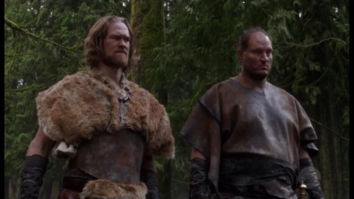

**Описание**

Гог и Магог — примитивные человекоподобные существа из камня и песка, ставшие древними воинами, известными в авраамическом предании. Их создали из камня и песка в незапамятные времена; они были частью расы, которую, как считалось, уничтожил Великий потоп. Оба получили мечи от неизвестного божества.

В древности Гог и Магог прославились как воины, покорившие и обратившие в рабство половину Плодородного полумесяца. В конце концов жрецы связали их и заточили в «месте без места и времени без времени». За тысячелетия изгнания они превратились в легенду: их упоминают и Библия, и Скрижаль Демонов, а в преданиях называли то братьями, то землями. Серафим Кастиэль слышал о них слухи, но не верил, что они люди.

В конце 2017 года, читая Скрижаль Демонов, пророк Донателло Редфилд — здесь выжимка обрывается, но именно тогда древние воины вернулись. Кастиэль полагал, что их вид вымер во время Потопа, однако оба дожили до наших дней и погибли: их убили мечом Магога, а меч Гога, выкованный тем же богом, тоже способен их убить.

В сериале они появляются в тринадцатом сезоне, в эпизоде «Good Intentions». Выжимка отдельно отмечает, что в еврейской Библии Гог и Магог могут быть людьми, народами или землями, а в авраамической эсхатологии их описывают как «нецивилизованную, варварскую и воинственную расу», оставляющую за собой только разрушение.

**Силы и способности**

- Сверхъестественная сила — Гог был не слабее падшего серафима, а Магог одним ударом ноги заставлял землю дрожать.
- Неуязвимость — они невосприимчивы к большинству форм урона; убить их можно лишь оружием, которого коснулся Бог, или выкованным богами.
- Бессмертие — оба существовали тысячи лет до своей гибели.

**Слабости**

- Оружие, которого коснулся Бог, — только такое оружие способно их убить; сюда относятся и ангельские клинки.
- Их собственные мечи — выкованы богом, поэтому годятся против них: оба погибли от меча Магога, а меч Гога тоже способен их убить.
- Магия — тысячи лет назад жрецы сумели изгнать их в «место без места и время без времени».
- Утопление — Кастиэль считал, что их вид вымер во время Потопа, то есть вода для них губительна.

**Как его убить.** Прямой бой почти безнадёжен: любой урон, кроме божественного оружия, они игнорируют. Охотнику нужен ангельский клинок или иной предмет, которого коснулся Бог, — только им наносится настоящий урон. Альтернатива — их собственные мечи: оба брата были убиты мечом Магога. Если оружия нет, остаётся древний ритуал изгнания, которым жрецы когда-то заточили их в «месте без места и времени без времени». Действуют они парой, поэтому их выгодно разводить и убивать по одному.

**Известные особи:** Гог — воин из камня и песка, получал меч от неизвестного божества, погиб вместе с братом.; Магог — второй из пары; его мечом были убиты оба, он же одним ударом ноги заставлял землю дрожать.

#### Гог и Магог
*Большой, Элементаль, нейтрально-злое*

---
- **Класс доспеха** 19 (природная броня)
- **Хиты** 230 (20d10 + 120)
- **Скорость** 30 фт.

| СИЛ | ЛОВ | ТЕЛ | ИНТ | МДР | ХАР |
|---|---|---|---|---|---|
| 26 | 10 | 22 | 8 | 12 | 10 |

- **Спасброски** Сил +14, Тел +12
- **Навыки** Атлетика +14, Восприятие +7, Запугивание +6
- **Уязвимость к урону** урон от оружия, которого коснулся Бог, и от оружия, выкованного богами (ангельские клинки, их собственные мечи)
- **Сопротивление урону** огонь, холод, электричество
- **Иммунитет к урону** яд; дробящий, колющий и рубящий от немагического оружия
- **Иммунитет к состояниям** очарование, испуг, отравление, истощение, паралич, окаменение, сбивание с ног
- **Чувства** тёмное зрение 120 фт., пассивное Восприятие 17
- **Языки** речь в выжимке не описана; понимают древние языки и английский
- **Бонус мастерства** +6
- **Уровень опасности** 17 (18 000 опыта)

***Особенности***
- ***Божественная неуязвимость.*** Существо невосприимчиво к урону от немагического оружия и большинства магии. Урон от оружия, которого коснулся Бог или которое выковано богами, игнорирует эту невосприимчивость; если такой урон опускает хиты существа до 0, оно рассыпается в камень и песок и гибнет окончательно.
- ***Дрожь земли.*** Когда существо топает ногой, все прочие существа в пределах 20 фт. должны преуспеть в спасброске Ловкости (Сл 19), иначе падают ничком.
- ***Пара воинов.*** Пока Гог и Магог находятся в пределах 60 фт. друг от друга, они совершают спасброски с преимуществом и не могут быть очарованы или испуганы.
- ***Осадное орудие.*** Урон существа удваивается против объектов и построек.
- ***Порождение камня и песка.*** Существо не нуждается в воздухе, еде, воде и сне, а его шаги поднимают облако пыли: существа в пределах 10 фт. совершают проверки Восприятия с помехой.
- ***Легендарное сопротивление (3/день).*** Если существо проваливает спасбросок, оно может вместо этого выбрать успех.

***Действия***
- ***Мультиатака.*** Существо совершает три атаки мечом.
- ***Меч бога.*** Рукопашная атака оружием: +14 к попаданию, досягаемость 10 фт., одна цель. Попадание: 23 (4d6 + 9) рубящего урона, и цель должна преуспеть в спасброске Силы (Сл 22), иначе падает ничком. Атака считается божественным оружием.
- ***Топот (перезарядка 5–6).*** Существо бьёт ногой в землю. Каждое существо в пределах 30 фт. совершает спасбросок Ловкости (Сл 19), получая 21 (6d6) дробящего урона и падая ничком при провале или половину урона и не падая при успехе. Постройки в области получают удвоенный урон.
- ***Метание камня.*** Дальнобойная атака оружием: +14 к попаданию, дистанция 60/240 фт., одна цель. Попадание: 20 (3d6 + 9) дробящего урона.

***Бонусные действия***
- ***Разрушительный натиск.*** Существо перемещается на расстояние до своей скорости к враждебному существу, не провоцируя атак.
- ***Топот.*** Существо использует «Топот», если он не на перезарядке.

***Реакции***
- ***Перехват.*** Когда существо в пределах досягаемости атакует союзника, существо может совершить по нему одну атаку мечом.
- ***Каменная стойкость.*** Когда существо получает урон, не являющийся божественным, оно может уменьшить его на 15.

***Легендарные действия***
- ***Удар.*** Существо совершает одну атаку мечом.
- ***Сотрясение (стоит 2 действия).*** Существо использует «Топот», если он не на перезарядке.
- ***Взгляд войны (стоит 2 действия).*** Одно существо в пределах 60 фт., способное видеть Гога или Магога, совершает спасбросок Мдр (Сл 19); при провале оно испугано до конца своего следующего хода.

**Тактика.** Гог и Магог бьются как осадные машины: идут вперёд по прямой, ломают укрытия и стены, топчут землю, чтобы сбить противников с ног, и добивают упавших. Их невозможно ранить обычным оружием, поэтому они не боятся толпы и не отступают. Единственное, чего они избегают, — божественное оружие: увидев ангельский клинок или свой собственный меч в чужих руках, они переключаются на владельца и пытаются отобрать или выбить оружие. Потеряв брата, оставшийся впадает в ярость, но начинает действовать грубее и подставляется под удары.

**Экология.** Древние воины из камня и песка, пережившие собственный вид: считается, что их раса погибла во время Великого потопа. Тысячелетиями они были заточены в «месте без места и времени без времени», а после освобождения действуют на Земле как завоеватели. Встречаются только парой — Гог и Магог всегда выступают вместе, и в легендах их путают то с братьями, то с целыми землями.

> **Заметки мастеру.** Это энкаунтер-«босс» для партии 15–17 уровня: замените ими пару каменных големов или элементалей земли, но обязательно дайте игрокам зацепку про божественное оружие до боя, иначе встреча превратится в избиение. Отличный сюжетный крючок — Скрижаль Демонов или пророк, случайно выпустивший братьев. Бой выигрывает тот, кто первым раздобудет ангельский клинок или их собственный меч; можно развести братьев по разным локациям, чтобы партия справилась с ними по одному. На низком уровне оставьте одного воина и понизьте CR до 12, убрав легендарные действия.

[↑ к содержанию](#содержание)

---

### 34. Горгоны

**Gorgons** · Монстр · CR 11 · опасность в сериале 4/5

*Также известно как:* Змеиные полубоги; Прообраз мифа об обращении в камень

*Первое появление:* Сезон 14, «Ouroboros» (живое появление); упоминаются с сезона 8, «Remember the Titans»

*Сезоны:* 8, 9, 13, 14

Полубоги греческой мифологии со змеиными чертами. Их парализующий яд породил миф об обращении в камень и действует даже на серафимов, а убить горгону можно только серебряным клинком, отрубив ей голову.

**Описание**

Горгоны — разновидность полубогов из греческой мифологии. Живое появление у них в сериале только одно, зато отсылок за сезоны накопилось немало, и они говорят о том, что горгоны бывают очень разными.

Главное оружие горгоны — парализующий яд. Именно он стал источником мифа о том, что горгоны обращают людей в камень, и он настолько силён, что подействовал даже на серафима Кастиэля. Кроме яда горгоны обладают чудовищной силой: одна из них без видимых усилий отбивалась сразу от Сэма, Дина, Кастиэля и Джека. К этому добавляется телепатия — горгона читала мысли жертвы и подначивала человека его же мыслями, пока тот отрицал происходящее, — и способность понимать змей и говорить с ними.

Убить горгону почти невозможно: единственный известный способ — отсечь голову серебряным клинком. Как раса полубогов они потенциально бессмертны. Роуна сумела изготовить антидот, нейтрализующий яд, из противоядия от змеиного яда, однако на ангелах и серафимах он не работает — предположительно из-за небесного метаболизма.

Облик горгон различается. Окаменелый клык горгоны, фигурировавший в «The Scorpion and The Frog», был огромным, а живая горгона в «Ouroboros» оказалась существом человеческого роста с обычными зубами; это позволяет предположить, что горгоны умеют маскироваться под людей. Клык Сэм опознал мгновенно, а саму горгону не распознали ни он, ни остальные. Настоящий облик Медузы неизвестен, но её изображают женщиной со змеями вместо волос.

Сэм вспоминает, что к Артемиде, греческой богине охоты, молились о храбрости, когда шли на горгону или Минотавра, хотя сейчас она, по его словам, уже не та, что прежде.

**Силы и способности**

- Парализующий яд — яд горгоны парализует жертву; он породил миф об обращении в камень и настолько силён, что подействовал даже на серафима Кастиэля.
- Чудовищная сила — одна горгона без видимых усилий отбивалась сразу от Сэма, Дина, Кастиэля и Джека.
- Телепатия — горгона читала мысли жертвы и подначивала человека его же мыслями, пока тот отрицал происходящее.
- Общение со змеями — горгоны понимают змей и говорят с ними; у Медузы такими собеседницами были змеи вместо волос.
- Бессмертие — как раса полубогов горгоны потенциально могут жить вечно.
- Неуязвимость — горгону нельзя убить обычным оружием: единственный известный способ — отсечь голову серебряным клинком.

**Слабости**

- Серебряный клинок — единственный известный способ убить горгону: отсечение головы серебряным лезвием.
- Антидот от яда — Роуна изготовила антидот из противоядия от змеиного яда, который нейтрализует парализующий яд горгоны, но на ангелах и серафимах он не работает.
- Ангелы и нефилимы — предвидение горгон на них не действует: Ной не смог предвидеть прибытие Кастиэля-серафима и Джека-нефилима.
- Нефилимы — Джек применил свои силы и нейтрализовал горгону; кроме того, антидот не спасает серафимов из-за их небесного метаболизма.
- Облик выдаёт не всегда — горгона в «Ouroboros» выглядела человеком с обычными зубами, и её никто не опознал, зато окаменелый клык горгоны Сэм узнал мгновенно.

**Как его убить.** Понадобятся серебряный клинок или мачете, наручники и, если удалось достать, антидот Роуны от яда в шприце. Работают группой и не подходят вплотную: телепатия и чудовищная сила делают захват бессмысленным, поэтому горгону сначала отвлекают и сбивают с толку, а потом одним ударом отсекают голову серебром. Ангел или нефилим в группе — лучшее прикрытие: их горгона не видит своим предвидением. Если яд всё же попал в кровь, используют антидот или срочно ищут ведьму вроде Роуны.

#### Горгоны
*Средний, Монстр, нейтрально-злое*

---
- **Класс доспеха** 17 (природная броня)
- **Хиты** 150 (20d8 + 60)
- **Скорость** 40 фт.

| СИЛ | ЛОВ | ТЕЛ | ИНТ | МДР | ХАР |
|---|---|---|---|---|---|
| 24 | 18 | 20 | 16 | 16 | 16 |

- **Спасброски** Тел +9, Мдр +7
- **Навыки** Восприятие +7, Проницательность +7, Запугивание +7
- **Уязвимость к урону** серебро (см. «Смерть от серебра»)
- **Сопротивление урону** яд
- **Иммунитет к урону** дробящий, колющий и рубящий от немагического оружия
- **Иммунитет к состояниям** очарование, испуг, отравлено
- **Чувства** тёмное зрение 120 фт., пассивное Восприятие 17
- **Языки** общий, греческий; телепатия 60 фт.; понимает змей
- **Бонус мастерства** +4
- **Уровень опасности** 11 (7 200 опыта)

***Особенности***
- ***Смерть от серебра.*** Пока горгону не обезглавят серебряным оружием, она не умирает: при снижении хитов до 0 она падает без сознания и через 1d4 часа приходит в себя с 1 хитом. Атака серебряным оружием с преимуществом по потерявшей сознание или обездвиженной горгоне отсекает голову и убивает её окончательно.
- ***Парализующий яд.*** При попадании атаки клыками или плевка цель проходит спасбросок Телосложения Сл 17. При провале она парализована на 1 минуту; спасбросок можно повторять в конце каждого своего хода. Яд действует даже на небожителей и исчадий.
- ***Телепатия.*** Горгона читает поверхностные мысли существа в пределах 60 фт. и может телепатически говорить с ним. Она получает преимущество на проверки Мудрости (Проницательность) против этой цели.
- ***Власть над змеями.*** Горгона понимает змей и говорит с ними. Змеи в пределах 60 фт. не атакуют её и подчиняются её указаниям.
- ***Бессмертная природа.*** Горгона не стареет и не может быть умерщвлена эффектами, убивающими от старости.
- ***Невидима для предвидения.*** Ангелы, серафимы и нефилимы не обнаруживаются предвидением горгоны: любые её проверки и эффекты, основанные на предвидении, автоматически проваливаются против таких существ.

***Действия***
- ***Мультиатака.*** Горгона совершает три атаки: одну атаку клыками или хвостом и две атаки клинком.
- ***Клинок.*** Рукопашная атака оружием: +10 к попаданию, досягаемость 5 фт., одна цель. Попадание: 13 (2d8 + 4) рубящего урона.
- ***Клыки.*** Рукопашная атака оружием: +10 к попаданию, досягаемость 5 фт., одна цель. Попадание: 9 (1d10 + 4) колющего урона плюс 10 (3d6) урона ядом, и цель проходит спасбросок Телосложения Сл 17 против паралича.
- ***Плевок ядом (1/3 хода).*** Дальнобойная атака оружием: +7 к попаданию, дистанция 30 фт., одна цель. Попадание: 14 (4d6) урона ядом, и цель должна преуспеть в спасброске Телосложения Сл 17, иначе парализована до конца своего следующего хода.
- ***Телепатическая насмешка.*** Горгона выбирает существо в пределах 60 фт., мысли которого читает. Цель проходит спасбросок Мудрости Сл 15, иначе получает 11 (2d10) психического урона и помеху на следующий спасбросок против яда до конца своего следующего хода.

**Тактика.** Горгона начинает бой с телепатии: она выбирает самого слабого и давит ему на страхи, чтобы расколоть группу. Затем идёт в ближний бой, полагаясь на чудовищную силу и парализующий яд, — парализованного противника она добивает, а клинок держит для тех, кто подходит с серебром. Серебряное оружие и нефилим в группе заставляют её отступить: она отходит, плюёт ядом и ищет путь к бегству, потому что отсечение головы для неё — единственная настоящая смерть.

**Экология.** Горгоны — редкие полубоги, встречающиеся поодиночке и предпочитающие тёплые края с обилием змей; они живут веками и почти не меняются. С людьми и монстрами они не сосуществуют, а охотятся на людей как на добычу, скрываясь под человеческим обликом. Конкретные места обитания выжимка не называет.

> **Заметки мастеру.** Горгона — босс на средний и высокий уровень: она бьёт сильно, но убивается только серебром, поэтому группа должна готовиться заранее. Для 5-6 уровня уберите плевок ядом и снизьте хиты вдвое; для 12+ добавьте двух обращённых культистов и логово со змеями. Она хорошо заменяет классическую медузу или юань-ти, но в отличие от них не полагается на окаменение — её фирменный приём паралич, который не отменяется защитой от петрификации.

[↑ к содержанию](#содержание)

---

### 35. Горилло-волки

**Gorilla-wolves** · Монстр · CR 5 · опасность в сериале 3/5

*Также известно как:* Gorilla-wolf

*Первое появление:* Сезон 7, «Survival of the Fittest»

*Сезоны:* 7, 8

Крупные четвероногие твари, обитающие в Чистилище. Быстры в зарослях, видят добычу в темноте, а глаза их светятся красным. О их силах и слабостях известно немного.

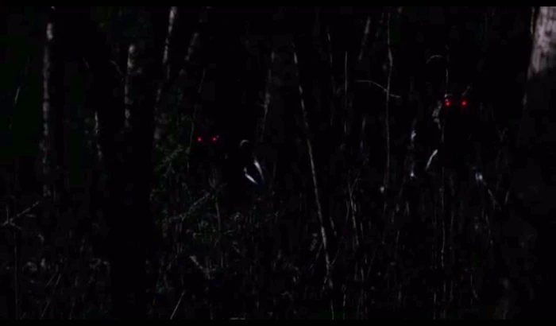

**Описание**

Горилло-волки — чудовищные существа, встречающиеся в Чистилище. Дин Винчестер и Кастиэль столкнулись с ними, когда Дик Роман затащил их туда. На воле, за пределами Чистилища, они в выжимке не описаны.

Внешне это крупные четвероногие твари: передние лапы работают как у гориллы, когда она идёт на всех четырёх, но движение в целом напоминает волчье. Хвост не похож ни на обезьяний, ни на волчий — он тонкий и гибкий, скорее кошачий. Тело почти полностью покрыто мехом, а глаза посажены очень высоко на голове, не так, как у гориллы или волка. Глаза светятся красным; происходит ли это только в темноте или при любом освещении — неизвестно.

О силах известно немного: они способны двигаться быстрыми рывками и не вязнут в густых зарослях Чистилища, а звериное зрение позволяет им видеть добычу в темноте. Предполагается, что им могут быть свойственны и общие черты других монстров, но подтверждений этому нет.

Слабости почти не изучены. Единственное, что известно точно: опытный охотник вроде Дина Винчестера сумел уйти от них, пользуясь только обычным оружием. Это означает как минимум то, что они не неуязвимы и их можно ранить или отпугнуть обычными средствами.

В выжимке упоминается, что они относятся к числу… — фраза обрывается, поэтому более точной классификации среди обитателей Чистилища у нас нет. Охотники знают о горилло-волках ровно столько, сколько успели увидеть выжившие: это быстрые стайные хищники, встреча с которыми в Чистилище почти всегда означает бегство, а не бой.

**Силы и способности**

- Скорость — горилло-волки перемещаются быстрыми рывками, не сбавляя хода в густых зарослях Чистилища.
- Звериные чувства — глаза животного типа позволяют им видеть добычу в темноте.
- Стайная охота — они преследуют добычу группой, окружая и загоняя её.
- Предположительно общие свойства монстров — выжимка допускает, что им присущи и другие типичные черты чудовищ, но не уточняет какие.

**Слабости**

- Обычное оружие — Дин Винчестер ушёл от них, используя только обычное снаряжение охотника.
- Неизвестны детально — выжимка прямо говорит, что слабости горилло-волков мало изучены.
- Чужая среда — это обитатели Чистилища; вне его они в сериале не встречались, и как они ведут себя в реальном мире, неизвестно.

**Как его убить.** Проверенного способа убить горилло-волка в выжимке нет. Единственная надёжная тактика — та, что сработала у Дина: не принимать бой, а уходить, отсекая преследователей обычным оружием и используя густые заросли как укрытие. Работайте в группе, держите спину к скале или стволу, бейте по передним лапам, чтобы сбить рывок, и не давайте окружить себя. Инвентарь: крупнокалиберное оружие, дробовик с картечью, факелы и дым для отпугивания, верёвка, нож, крепкая обувь для пересечённой местности.

#### Горилло-волки
*Большой, Монстр, нейтральное*

---
- **Класс доспеха** 14 (природная броня)
- **Хиты** 68 (8d10 + 24)
- **Скорость** 50 фт., лазание 40 фт.

| СИЛ | ЛОВ | ТЕЛ | ИНТ | МДР | ХАР |
|---|---|---|---|---|---|
| 18 | 16 | 16 | 4 | 14 | 6 |

- **Спасброски** Сил +7, Тел +6
- **Навыки** Восприятие +5, Скрытность +6, Выживание +5
- **Сопротивление урону** дробящий, колющий и рубящий от немагического оружия
- **Иммунитет к состояниям** испуг
- **Чувства** тёмное зрение 120 фт., пассивное Восприятие 15
- **Языки** понимает язык Чистилища, но не говорит
- **Бонус мастерства** +3
- **Уровень опасности** 5 (1 800 опыта)

***Особенности***
- ***Рывок сквозь чащу.*** Горилло-волк игнорирует труднопроходимую местность, созданную растительностью, кустами и буреломом.
- ***Тактика стаи.*** Горилло-волк получает преимущество на бросок атаки по существу, если в пределах 5 фт. от цели находится его союзник, не имеющий состояния недееспособности.
- ***Красные глаза.*** Глаза горилло-волка светятся красным и выдают его в темноте: существо имеет помеху на проверки Ловкости (Скрытность) в полной темноте, если наблюдатель находится в пределах 60 фт.
- ***Кошмар Чистилища.*** Вне Чистилища горилло-волк теряет сопротивление немагическому оружию и не может восстанавливать силы: мастер может ослабить его на 1–2 пункта CR для сцен в реальном мире.

***Действия***
- ***Мультиатака.*** Горилло-волк совершает две атаки: укус и удар когтями.
- ***Укус.*** Рукопашная атака оружием: +7 к попаданию, досягаемость 5 фт., одна цель. Попадание: 9 (1d10 + 4) колющего урона.
- ***Когти.*** Рукопашная атака оружием: +7 к попаданию, досягаемость 5 фт., одна цель. Попадание: 8 (1d8 + 4) рубящего урона, и цель проходит спасбросок Силы Сл 15, иначе падает ничком.

***Бонусные действия***
- ***Прыжок из зарослей.*** Горилло-волк совершает Рывок или Засаду.

***Реакции***
- ***Стайный вой.*** Когда горилло-волк видит союзника, получившего урон, он издаёт вой: все горилло-волки в пределах 120 фт. получают преимущество на проверки Мудрости (Восприятие) до конца своего следующего хода.

**Тактика.** Горилло-волки охотятся стаей: двое загоняют добычу рывками, остальные обходят с флангов и сбивают её с ног, после чего рвут упавшего. Они не боятся обычного оружия, но не лезут на открытое пространство без укрытий и отступают в чащу, если теряют половину стаи. Огонь и дым для них неприятны, но сверхъестественного ужаса не вызывают; если добыча уходит слишком быстро, они прекращают преследование, а не гонятся за ней через весь мир.

**Экология.** Обитают в Чистилище, в густых зарослях, где их рывки не вязнут в растительности. Держатся стаями, охотятся на всё живое, что забредёт на их территорию, включая монстров. В реальном мире в сериале не встречаются: единственные известные столкновения произошли с Дином и Кастиэлем внутри Чистилища.

> **Заметки мастеру.** Горилло-волки — отличная замена воргам и зимним волкам для сцен в Чистилище, где партия на 5–7 уровень должна почувствовать, что это не охота, а бегство. Дайте их стаей из трёх-четырёх особей и используйте местность: бурелом, туман, узкие тропы. В реальном мире уберите сопротивление немагическому оружию и снизьте CR, иначе обычные охотники не справятся; в Чистилище, наоборот, добавьте им одного вожака с 100 хитами.

[↑ к содержанию](#содержание)

---

### 36. Грифон

**Griffin** · Монстр · CR 7 · опасность в сериале 2/5

*Также известно как:* Гриффон; Орлиный лев

*Первое появление:* Сезон 9, «Meta Fiction» (упоминание)

*Сезоны:* 9

Легендарный зверь с телом льва и головой и крыльями орла. Сэм и Дин никогда с ним не встречались: в сериале известны лишь его перья — редкий ингредиент сигила Рога Гавриила.

**Описание**

Грифон (в других написаниях — гриффон или грипхон) — по бестиарию сериала легендарное существо с телом, хвостом и задними лапами льва, головой и крыльями орла, а передние лапы у него орлиные, с когтями. Поскольку лев традиционно считался царём зверей, а орёл — царём птиц, грифона представляли особенно могущественным и величественным созданием.

О самом грифоне известно немного. Сэм и Дин ни разу не встречали живого грифона, но есть косвенные указания на то, что он существует. Гадриил сообщил, что перья грифона вместе с костями феи входят в число ингредиентов, необходимых для сигила Рога Гавриила — знака, который приманивает любого ангела. Охотник Иан тоже добывал перья грифона и тайком продавал их в своей лавке травяных средств.

Остаётся неизвестным, близок ли грифон к небесным существам вроде ангелов. В сериале он упоминается только в девятом сезоне, в эпизоде «Meta Fiction», и никаких описаний его повадок, охоты или боя выжимка не даёт.

Для охотников грифон — скорее редкий ресурс, чем противник: его перья ценятся как компонент, и именно поэтому их ищут и тайком перепродают. Пока никто из братьев не встретил живого зверя, любые сведения о его нраве остаются догадками.

**Силы и способности**

- Полёт — по описанию у грифона орлиные крылья, поэтому он способен летать; в сериале его в воздухе никто не видел.
- Орлиные когти — передние лапы грифона являются орлиными лапами с когтями и служат ему основным оружием.
- Львиная мощь — задние лапы, хвост и корпус льва дают ему силу и устойчивость крупного хищника.
- Дар для ритуалов — перья грифона вместе с костями феи входят в число ингредиентов сигила Рога Гавриила, который приманивает любого ангела.
- Способности неизвестны — выжимка не описывает ни одной боевой способности грифона, так как Сэм и Дин с ним не встречались.

**Слабости**

- Слабости неизвестны — в выжимке не названо ни одного способа убить или отпугнуть грифона.
- Живых особей не встречали — Сэм и Дин ни разу не сталкивались с грифоном, поэтому охотничьего опыта против него нет.
- Редкость — перья грифона настолько редки, что охотник Иан продавал их тайком в своей лавке травяных средств.
- Возможная связь с ангелами — выжимка отмечает, что родство грифона с небесными существами не установлено; если она есть, это меняет и набор его слабостей.

**Как его убить.** Охоты как таковой нет: в выжимке не описано ни одного случая, когда грифона убивали, а Сэм и Дин его не встречали. Известно только, что перья грифона — ходовой ингредиент, и добыть их можно через охотников вроде Иана, торгующего травами, или найти того, кто уже держит перо. Мастеру, который вводит грифона в игру, придётся опираться на аналогии: серебро, огонь, сети и ловушка. Перья стоит держать при себе — они нужны для сигила Рога Гавриила.

#### Грифон
*Большой, Монстр, нейтральное*

---
- **Класс доспеха** 15 (природная броня)
- **Хиты** 114 (12d10 + 48)
- **Скорость** 30 фт., полёт 80 фт.

| СИЛ | ЛОВ | ТЕЛ | ИНТ | МДР | ХАР |
|---|---|---|---|---|---|
| 20 | 15 | 18 | 5 | 14 | 12 |

- **Спасброски** Сил +8, Тел +7
- **Навыки** Восприятие +5, Акробатика +5
- **Чувства** тёмное зрение 60 фт., пассивное Восприятие 15
- **Языки** —
- **Бонус мастерства** +3
- **Уровень опасности** 7 (2 900 опыта)

***Особенности***
- ***Орлиный глаз.*** Грифон получает преимущество на проверки Мудрости (Восприятие), основанные на зрении.
- ***Ключевой ингредиент.*** Перья грифона вместе с костями феи — обязательные компоненты сигила Рога Гавриила. Добыть хотя бы одно перо — самостоятельная задача для персонажей; перья можно купить у торговцев вроде охотника Иана.
- ***Небесное родство.*** Родство грифона с ангелами не установлено и остаётся зацепкой для мастера: если оно подтвердится, грифон получает сопротивление урону от немагического оружия и понимает Энохианский.
- ***Ограничение полёта.*** Грифон не может использовать полёт, если несёт более 300 фунтов.

***Действия***
- ***Мультиатака.*** Грифон совершает две атаки: клювом и когтями.
- ***Клюв.*** Рукопашная атака оружием: +8 к попаданию, досягаемость 5 фт., одна цель. Попадание: 12 (2d6 + 5) колющего урона.
- ***Когти.*** Рукопашная атака оружием: +8 к попаданию, досягаемость 5 фт., одна цель. Попадание: 14 (2d8 + 5) рубящего урона.
- ***Вихрь когтей (перезарядка 5-6).*** Грифон атакует когтями всех существ в пределах 5 фт. Каждое существо проходит спасбросок Ловкости Сл 15, получая 21 (6d6) рубящего урона при провале или половину при успехе.

**Тактика.** Грифон — гордый хищник и предпочитает бой с воздуха: он кружит над целью, оценивает группу, затем пикирует на самого слабого или отставшего и уносит его. На земле он держится на расстоянии, разворачивается и бьёт клювом и когтями, а если бой идёт плохо, уходит в небо, где догнать его почти невозможно. Пока он защищает гнездо, он не отступает; вне гнезда предпочитает сохранить жизнь и вернуться позже.

**Экология.** Грифоны живут в горах и на неприступных скалах, охотятся поодиночке или парами и держат большую территорию, поэтому рядом с ними обычно нет других крупных хищников. Их перья — редкий товар, и грифонов ищут не ради трофея, а ради ингредиента для сигила Рога Гавриила. В выжимке не указано ни одного места, где грифона видели живьём, поэтому любые детали среды обитания остаются домыслом мастера.

> **Заметки мастеру.** Грифон (CR 7) — хороший «зверь-загадка» для кампании: его не обязательно убивать, куда интереснее добыть перо, не разрушив гнездо. Механически он близок к гигантскому орлу и льву одновременно; для 3-4 уровня уберите «Вихрь когтей» и снизьте хиты вдвое, для 10+ добавьте пару грифонов и наездника-охотника вроде Иана. Отличная замена гриффону из бестиария 5e, если нужен монстр, связанный с ангельскими ритуалами.

[↑ к содержанию](#содержание)

---

### 37. Гули

**Ghouls** · Монстр · CR 3 · опасность в сериале 2/5

*Также известно как:* Некрофаги; Твари, что едят трупы; Падальщики кладбищ

*Первое появление:* S04 «It's the Great Pumpkin, Sam Winchester»

*Сезоны:* 4, 6, 13

Монстры-падальщики, живущие на кладбищах и питающиеся плотью и кровью мертвецов. Съев человека, гуль принимает его облик и память, а при нехватке мертвечины переходит на живых людей.

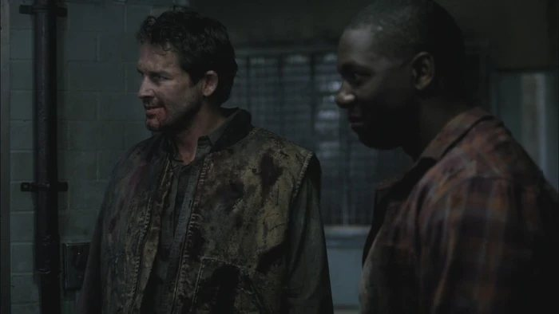

**Описание**

Гули — раса монстров, которые питаются в основном плотью мёртвых и принимают облик своих жертв. В отличие от популярного представления о нежити, в «Сверхъестественном» гули не являются мертвецами: это отдельный вид монстров, созданный Евой и происходящий от Альфа-гуля.

Гули — падальщики, обитающие на кладбищах и в моргах. Они не боятся дневного света и едят при любой возможности, поэтому их нельзя вычислить по ночному расписанию. Иногда они меняют рацион и начинают охотиться на живых людей вместо мертвецов, что и выдаёт их охотникам.

Главная способность гуля — смена облика. Он может превратиться в любого человека, чью плоть ел, независимо от того, жив тот или уже мёртв, и вместе с внешностью получает память и манеры оригинала. Пока гуль носит один облик, он оставляет отпечатки пальцев, совпадающие с отпечатками человека, которого он изображает, — по ним его и ловят.

Убить гуля можно только обезглавливанием или полным разрушением головы: удар по мозгам работает так же надёжно, как отрубленная голова. Демоны Кроули значительно сильнее гулей и без труда берут их в плен, а левиафанская присадка вампинит, по словам Эдгара, убивает гулей наравне с вампирами. Охотники вроде Эйсы Фокса и Джоди Миллс выслеживали гулей в районе Су-Фоллз, и такие дела обычно раскрываются через вскрытые могилы и подмену личности.

**Силы и способности**

- Смена облика — гуль превращается в любого человека, чью плоть он ел, живого или мёртвого, и вместе с внешностью получает память и манеры оригинала.
- Чужие отпечатки — в принятом облике гуль оставляет отпечатки пальцев, совпадающие с отпечатками оригинала, что делает подмену почти безупречной.
- Сверхъестественная скорость — гули двигаются гораздо быстрее людей и способны исчезнуть с места нападения незамеченными.
- Повышенная сила — гуль сильнее большинства людей и легко справляется с одинокой жертвой.
- Всеядность падальщика — гули едят и мёртвых, и живых, не зависят от времени суток и не имеют сезонных ограничений.

**Слабости**

- Обезглавливание — полное отделение или уничтожение головы убивает гуля мгновенно.
- Разрушение мозга — достаточно сильный урон по голове, даже без отделения головы, убивает гуля так же надёжно, как отрубание.
- Вампинит — левиафанская присадка, по словам Эдгара, убивает гулей так же, как вампиров, и годится как оружие против целого гнезда.
- Демоны — демоны значительно сильнее гулей: пара гулей была схвачена демонами Кроули без особого труда.

**Как его убить.** Забудьте про выстрелы в корпус и нож в сердце: гуля убивает только голова. Возьмите мачете, топор или тяжёлый дробовик с крупной дробью и работайте так, чтобы голова была отделена или разрушена. Ищите гуля по следам вскрытых могил, пропавшим телам в моргах и по человеку, чьё поведение резко изменилось. На месте нападения снимите отпечатки: пока гуль держит облик, они совпадут с отпечатками того, кем он притворяется. Сменил облик — вернитесь к кладбищу или моргу, там его следующая трапеза.

#### Гули
*Средний, Монстр, нейтрально-злое*

---
- **Класс доспеха** 13 (природная броня)
- **Хиты** 52 (8d8 + 16)
- **Скорость** 35 фт.

| СИЛ | ЛОВ | ТЕЛ | ИНТ | МДР | ХАР |
|---|---|---|---|---|---|
| 16 | 15 | 15 | 9 | 11 | 10 |

- **Спасброски** Сил +5, Тел +4
- **Навыки** Скрытность +4, Восприятие +2, Обман +2
- **Сопротивление урону** некротический
- **Иммунитет к состояниям** отравление
- **Чувства** тёмное зрение 60 фт., пассивное Восприятие 12
- **Языки** общий (английский), а также язык и манера речи оригинала в принятом облике
- **Бонус мастерства** +2
- **Уровень опасности** 3 (700 опыта)

***Особенности***
- ***Смена облика.*** Действием гуль принимает облик любого гуманоида, чью плоть он ел. Он получает внешность, голос, отпечатки пальцев и воспоминания оригинала, а также его владение языками и знание мест. Облик держится, пока гуль не сменит его или не потеряет сознание.
- ***Пожиратель мёртвых.*** Гуль не зависит от времени суток. Если он не ел 24 часа, то в начале каждого часа совершает спасбросок Мудрости Сл 12, иначе атакует ближайшего гуманоида, чтобы накормиться.
- ***Смерть от головы.*** Опустившись до 0 хитов, гуль не погибает, а падает и продолжает слабо шевелиться. Он окончательно умирает только от полного отделения головы или разрушения мозга (например, от добивающего удара по недееспособной цели); иначе через 1 минуту он встаёт с 1 хитом.
- ***Чутьё на мертвечину.*** Гуль имеет преимущество на проверки Мудрости (Восприятие), когда ищет свежие трупы, вскрытые могилы и следы недавних смертей.

***Действия***
- ***Мультиатака.*** Гуль совершает две атаки: одну укусом и одну когтями.
- ***Укус.*** Рукопашная атака оружием: +5 к попаданию, досягаемость 5 фт., одна цель. Попадание: 7 (1d8 + 3) колющего урона; если цель — недееспособный гуманоид или труп, гуль бонусным действием может начать пожирать её.
- ***Когти.*** Рукопашная атака оружием: +5 к попаданию, досягаемость 5 фт., одна цель. Попадание: 6 (1d6 + 3) рубящего урона.

***Бонусные действия***
- ***Пожирание.*** Гуль пожирает недееспособную цель или труп в пределах 5 фт. и восстанавливает 10 хитов. Существо, съеденное до конца, больше не может быть возвращено к жизни обычными средствами.

**Тактика.** Гули избегают открытых боёв и предпочитают нападать на одиночек, стариков и раненых — тех, кого легко утащить. В человеческом облике гуль сначала втирается в доверие, изображая знакомого или родственника жертвы, и нападает только когда рядом никого нет. Загнанный в угол, он бьётся отчаянно и целится в горло, но при первой возможности убегает, чтобы сменить облик и вернуться под другим лицом. Урон по голове пугает его больше всего: гуль понимает, что это единственный способ его убить.

**Экология.** Гули держатся кладбищ, моргов, заброшенных больниц и районов, где легко найти свежие тела. Обычно они живут поодиночке или парами и не собираются в крупные группы; в городе с хорошей криминогенной обстановкой гуль может годами питаться мертвецами, оставаясь незамеченным, пока не переключится на живых.

> **Заметки мастеру.** Гуль из «Сверхъестественного» — не нежить, а монстр-оборотень, поэтому каноничный гуло 5e здесь не подходит: берите за основу шпиона или бандита с добычей и накладывайте на него смену облика. Механика смерти от головы делает бой напряжённым: партия должна добивать, а не просто сбивать хиты, что отлично работает против групп, привыкших к «оглушению». Пара гулей — энкаунтер на партию 2–3 уровня, гнездо из четырёх — уже на 5–6 уровень. Как сюжетный элемент гуль хорош в детективе: подмена личности, вскрытые могилы и отпечатки, ведущие к живому человеку.

[↑ к содержанию](#содержание)

---

### 38. Джаккал

**Jakkal** · Монстр · CR 5 · опасность в сериале 3/5

*Также известно как:* Джаккалы; Слуги Анубиса; Падальщики

*Первое появление:* Novel «Supernatural: Children of Anubis»

Раса падальщиков, похожих на гулей, но владеющих древнеегипетской магией: они строят гробницы с ловушками и проклятиями, умеют передавать жизненную силу мёртвым и веками враждуют с оборотнями. Убить джаккала можно только золотым клинком в сердце.

**Описание**

Джаккалы — раса падальщиков, питающихся мертвечиной; выжимка сравнивает их с гулями. Известны они и своей лютой ненавистью к оборотням, с которыми когда-то столкнулись и с тех пор ведут давнюю вражду.

Выглядят джаккалы гуманоидно, с коричневатой кожей. Как и оборотни, они обладают клыками и когтями, но, в отличие от них, у джаккалов появляются заострённые уши и короткая золотая шерсть, когда они обращаются, — почти как у собаки. В спокойном состоянии их глаза ярко-янтарные, и этот признак сохраняется даже в человеческом облике; в превращённом виде глаза становятся ярко-алыми.

Сила у них немалая, несмотря на то что некоторые джаккалы выглядят истощёнными. Они физически сильны, вооружены клыками, которыми могут драться, и владеют магией — прежде всего древнеегипетской. Благодаря связи с Анубисом джаккалы способны управлять жизненной силой и создавать нетеру, передавая её в труп. Кроме того, они умеют ставить смертельные ловушки, а в выжимке упомянуто и их умение лечить, хотя описание этой способности обрывается.

В древности джаккалов нанимали богатые египтяне: они строили гробницы со смертельными ловушками и очень сильными проклятиями, а люди знали и уважали их как слуг великого Анубиса. В самых отчаянных случаях джаккалы вызывали Анубиса на землю, чтобы тот решил их проблему и помог одолеть врагов; но сила Анубиса слишком велика, и это чаще приносило разрушение, чем пользу. Неизвестным способом они запечатали Анубиса в его мумифицированной форме и решили не звать его слишком часто. Со временем люди забыли о джаккалах.

Слабость у них одна: золото. Оружие и инструменты из золота ранят джаккала, а удар золотым ножом в сердце убивает его. Выжимка упоминает также семью джаккалов — «Монсур…», — но на этом месте описание обрывается.

**Силы и способности**

- Сверхчеловеческая сила — джаккалы физически сильны, несмотря на то что некоторые из них выглядят истощёнными.
- Клыки и когти — как у оборотней, у джаккалов есть клыки, которыми они могут драться, и когти; в обращённом виде появляются заострённые уши и золотая шерсть.
- Передача жизненной силы — благодаря связи с Анубисом джаккал управляет жизненной силой и способен создать нетеру, передав её в труп.
- Древнеегипетская магия — джаккалы — умелые практики магии, особенно древнеегипетской: проклятия, обряды и обряд Обновления, способный поднять Анубиса.
- Мастера ловушек — они умны и очень искусны в устройстве смертельных ловушек, чем и зарабатывали на жизнь при гробницах.
- Исцеление — в выжимке упомянута способность джаккалов к лечению, но описание этой силы обрывается на середине.

**Слабости**

- Золото — джаккала можно ранить инструментами и оружием из золота; золотые предметы для него опасны.
- Золотой нож в сердце — удар золотым ножом прямо в сердце убивает джаккала.
- Память людей — со временем люди забыли джаккалов, и теперь их почти никто не узнаёт, что даёт охотнику преимущество.
- Запечатанный Анубис — джаккалы сами запечатали своего бога в мумии, потому что его сила приносила больше разрушения, чем пользы.
- Вражда с оборотнями — давний конфликт с оборотнями отвлекает джаккалов и делает их врагами обеих сторон.

**Как его убить.** Джаккала можно убить только золотом: нужен золотой нож или заточенный золотой инструмент, и удар должен прийтись в сердце. Сталь и свинец его ранят, но не убивают, поэтому начинают с поиска золота, а не патронов. Дальше охотник ищет следы падальщика: разрытые могилы, трупы, ловушки в подземельях, кражи из музеев. Опаснее всего его магия и смертельные ловушки, поэтому в склеп идут с проверкой на ловушки и с напарником. Инвентарь: золотой нож, фонарь, инструменты для обезвреживания ловушек.

**Известные особи:** Семья Монсур — джаккалы, упомянутые в выжимке (описание обрывается); Анубис — бог, которому служат джаккалы и которого они запечатали в мумии

#### Джаккал
*Средний, Монстр, нейтральное*

---
- **Класс доспеха** 14 (природная броня)
- **Хиты** 75 (10d8 + 30)
- **Скорость** 30 фт.

| СИЛ | ЛОВ | ТЕЛ | ИНТ | МДР | ХАР |
|---|---|---|---|---|---|
| 18 | 15 | 16 | 14 | 14 | 12 |

- **Спасброски** Сил +7, Тел +6
- **Навыки** Магия +5, Восприятие +5, Скрытность +5
- **Уязвимость к урону** урон золотым оружием
- **Сопротивление урону** некротическая энергия; дробящий, колющий и рубящий от немагического оружия, кроме золотого
- **Чувства** тёмное зрение 60 фт., пассивное Восприятие 15
- **Языки** английский, древнеегипетский
- **Бонус мастерства** +3
- **Уровень опасности** 5 (1 800 опыта)

***Особенности***
- ***Золото — единственная смерть.*** Если хиты джаккала опускаются до 0 уроном, не нанесённым золотым оружием, он вместо смерти падает ничком и обездвижен, а в конце своего следующего хода восстанавливает 1 хит. Убить его окончательно можно только ударом золотого оружия, нанесённым в сердце (атака по обездвиженной или схваченной цели).
- ***Оборотень по крови.*** Джаккал может действием принять звериный облик: появляются заострённые уши, клыки, когти и короткая золотая шерсть, а глаза становятся ярко-алыми. В человеческом облике его выдаёт янтарный цвет глаз, который он не может скрыть.
- ***Ненависть к оборотням.*** Джаккал получает преимущество на броски атаки по вервольфам, оборотням и другим псевдоволкам, а также на спасброски против их способностей.
- ***Служитель Анубиса.*** Джаккал знает древнеегипетскую магию. Он может потратить час на проведение обряда Обновления, чтобы попытаться пробудить Анубиса; обряд требует жертвы и подготовленного места, а его последствия мастер определяет сам.
- ***Нетеру.*** Джаккал может бонусным действием перелить жизненную силу в труп в пределах 5 фт., создав нетеру — слугу в облике мумии. Нетеру использует статблок зомби (уровень опасности 1/4), получает уязвимость к огню и подчиняется создателю. Одновременно джаккал может поддерживать не более двух нетеру.
- ***Ловушки гробниц.*** Джаккал мастерски ставит смертельные ловушки. Обнаружение ловушки требует проверки Мудрости (Восприятие) Сл 15, обезвреживание — проверки Ловкости (Ловкость рук) Сл 15. Срабатывание наносит 11 (2d10) колющего урона и выпускает ядовитый газ: спасбросок Телосложения (Сл 14), иначе цель отравлена на 1 час.

***Действия***
- ***Мультиатака.*** Джаккал совершает три атаки: одну укусом и две когтями.
- ***Укус.*** Рукопашная атака оружием: +7 к попаданию, досягаемость 5 фт., одна цель. Попадание: 8 (1d8 + 4) колющего урона.
- ***Когти.*** Рукопашная атака оружием: +7 к попаданию, досягаемость 5 фт., одна цель. Попадание: 7 (1d6 + 4) рубящего урона.
- ***Проклятие гробницы (1/день).*** Джаккал проклинает существо, которое видит, в пределах 30 фт. Цель совершает спасбросок Мудрости (Сл 14), получая 14 (4d6) некротического урона при провале и становясь проклятой: до снятия проклятия она совершает с помехой проверки Мудрости и спасброски от испуга. Проклятие снимается заклинанием снятие проклятий или обрядом на месте захоронения.

***Действия в логове***
- ***Гробница-убийца.*** Пока бой идёт в гробнице, построенной джаккалом, мастер может в начале каждого раунда активировать одну ловушку в пределах 60 фт.: падающий камень, шипы из пола или струю газа. Каждое существо в области совершает спасбросок Ловкости (Сл 15), получая 11 (2d10) колющего урона при провале или половину при успехе.
- ***Проклятие стен.*** Иероглифы на стенах гробницы вспыхивают: до конца раунда каждое существо, не являющееся джаккалом или нежитью, совершает спасброски Мудрости с помехой.

**Тактика.** Джаккал не бросается в драку: он сначала заманивает врага в подготовленное место — гробницу, склеп, музейный подвал, — где расставлены ловушки и проклятие уже наложено. В бою он держится на расстоянии, натравливает нетеру и бьёт когтями того, кто отстал, а увидев золотое оружие, старается его выбить или разорвать дистанцию. Оборотней он атакует первым и без предупреждения, потому что вражда с ними для него важнее любой другой цели. Если бой идёт не по его плану, джаккал отступает в зверином облике, уводя преследователей в тёмные тоннели, и возвращается с новыми ловушками.

**Экология.** Джаккалы — древний вид, живший среди людей ещё в Египте: их нанимали строить гробницы, уважали как слуг Анубиса, а позднее забыли. Они падальщики, поэтому селятся там, где есть мёртвые: в подземельях, рядом с музеями и раскопками. Численность выжимка не называет, но упоминает семью джаккалов, то есть они живут кланами. С соседями не складывается: с людьми отношения испорчены забвением, с оборотнями — враждой, а Анубис запечатан их же руками.

> **Заметки мастеру.** Джаккал — монстр-загадка для партии 4-6 уровня: его нельзя забить оружием, поэтому дело превращается в поиск золота, а не в драку. Держите в голове правило «золото — единственная смерть» и дайте игрокам шанс добыть золотой нож заранее: ювелир, музей, старый клад — всё это сюжет. В 5e его заменяет мумия или гнолл с чертами жреца, но добавьте ловушки и нетеру. Для низкого уровня уберите Проклятие гробницы и оставьте одного нетеру; для высокого дайте клан из трёх джаккалов, обряд Обновления и пробуждённого Анубиса как финальную угрозу.

[↑ к содержанию](#содержание)

---

### 39. Джинн

**Djinn** · Монстр · CR 5 · опасность в сериале 3/5

*Также известно как:* Джинны; Гении; Jinns; Jinni

*Первое появление:* S02 «What Is And What Should Never Be»

*Сезоны:* 2, 6, 8, 9, 12, 13, 14, 15

Редкая раса пещерных отшельников с татуированной кожей: касанием джинн вгоняет жертву в бесконечный сон о её заветных желаниях и подолгу пьёт её кровь. Против серафимов и высших демонов он бессилен.

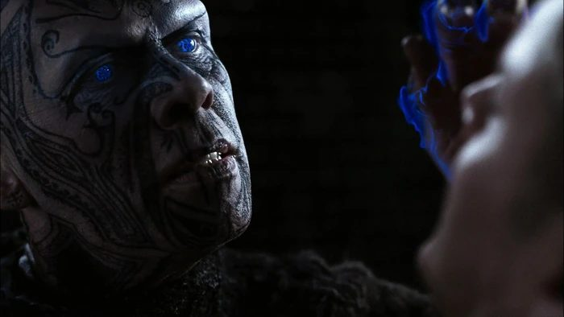

**Описание**

Джинны — редкая раса сверхъестественных существ, живущих в пещерах и руинах как отшельники. Внешне это гуманоиды с татуированной кожей, и их истинный облик никому не известен: они появляются в человеческом виде. По арабской традиции и учению ислама джинны обитают в мире, параллельном человеческому, и созданы из бездымного огня; их делят на добрых гениев, злых джиннов и нейтральных. В сериале джинн и демон, по сути, одно и то же существо, но джинны не исполняют желаний по-настоящему — они лишь внушают человеку то, что тот хочет видеть.

Главная сила джинна — галлюциногенное касание. Прикоснувшись, он вводит жертву в бессознательное состояние, похожее на сон, где человек снова и снова переживает исполнение своих самых глубоких желаний, как бесконечный цикл. Есть и более мягкая форма внушения: жертва остаётся в сознании, но рискует сломаться психически. Своим ядом джинн может убить быстро — или погрузить человека в кому и подолгу пить его кровь.

Именно так джинн охотится: он не убивает сразу, а держит жертву живой. Дин Винчестер столкнулся с этим в деле, где очнулся в мире, где его мать не погибла, а он сам не стал охотником; джинн держал его в этом сне, пока братья не разобрались, что происходит, и Дин не убил тварь.

Джинны сильны в психике, но не в прямой схватке с высшими сущностями. Серафимы для них не соперники: Кастиэль в одиночку перебил почти всю сирийскую стаю джиннов. Высших демонов они боятся до дрожи — одна джинн смертельно страшилась Кроули. Охотники считают джинна опасной, но решаемой добычей: главное знать про серебро с бараньей кровью.

**Силы и способности**

- Галлюциногенное касание — прикосновением джинн погружает человека в сон, где тот заново переживает исполнение своих желаний.
- Яд-неволя — яд джинна либо убивает быстро, либо держит жертву в коме, пока он питается её кровью.
- Психическое превосходство — джинны обладают выдающимися психическими способностями, граничащими с изменением реальности.
- Чтение желаний — джинн вытаскивает из разума жертвы её самые глубокие мечты и использует их как приманку.
- Скрытность отшельника — джинн живёт в больших руинах и пещерах, где много укрытий, и умеет исчезать из виду.

**Слабости**

- Серебро и баранья кровь — серебряный клинок, смоченный бараньей кровью, убивает джинна.
- Разрушение мозга — Сэм убил джинна, размозжив ему голову гольф-клубом; обычного джинна можно добить грубой силой.
- Серафимы — джинны не соперники серафимам: Кастиэль в одиночку перебил почти всю стаю джиннов.
- Высшие демоны — джинн смертельно боится высокопоставленных демонов и их расправы.
- Травмированные жертвы — телепатия по человеку с ужасным прошлым может обрушить иллюзию и ударить по самому джинну.

**Как его убить.** Джинна берут расчётом, а не силой. Нужен серебряный клинок, смоченный бараньей кровью: только такой удар убивает надёжно. Как запасной вариант годится грубое разрушение мозга. Искать джинна надо по спящим жертвам: он держит их в руинах, на заброшенных складах и в пещерах, подальше от людей. Идти следует втроём: одно касание выводит охотника из строя целиком. Если рядом окажется серафим или высший демон, джинн потеряет уверенность и отступит — этим стоит пользоваться.

**Известные особи:** Бригитта — джинн, захваченная Сэмюэлом Кэмпбеллом и убитая в плену у Кроули

#### Джинн
*Средний, Монстр, нейтрально-злое*

---
- **Класс доспеха** 15 (природная броня)
- **Хиты** 82 (11d8 + 33)
- **Скорость** 30 фт.

| СИЛ | ЛОВ | ТЕЛ | ИНТ | МДР | ХАР |
|---|---|---|---|---|---|
| 16 | 16 | 16 | 15 | 16 | 17 |

- **Спасброски** Мдр +6, Хар +6
- **Навыки** Восприятие +6, Обман +6, Проницательность +6, Скрытность +6
- **Уязвимость к урону** урон от серебряного оружия, смоченного бараньей кровью
- **Сопротивление урону** психический урон
- **Чувства** тёмное зрение 60 фт., пассивное Восприятие 16
- **Языки** английский
- **Бонус мастерства** +3
- **Уровень опасности** 5 (1 800 опыта)

***Особенности***
- ***Психическая мощь.*** Сл спасбросков от психических способностей джинна равна 14 (8 + 3 + 3 Хар). Джинн совершает с преимуществом проверки Проницательности и Обмана.
- ***Грёза.*** Существо, провалившее спасбросок против касания джинна, становится бессознательным на 1 час и видит бесконечный цикл исполнения своих желаний. Оно может повторять спасбросок Мдр (Сл 14) в конце каждого часа или получив урон. Очнувшись, оно получает один уровень истощения.
- ***Питание кровью.*** Пока рядом с джинном находится существо в грёзе или коме, он восстанавливает 10 хитов в начале каждого своего хода. Без крови джинн получает один уровень истощения за каждые 7 суток.
- ***Хозяин руин.*** В руинах, подземельях и пещерах джинн совершает проверки Скрытности с преимуществом и может прятаться, даже если его видят лишь частично.
- ***Смертный трепет.*** При виде серафима или демона с показателем опасности выше своего джинн должен преуспеть в спасброске Мдр (Сл 15), иначе становится испуганным на 1 минуту и не может к нему приближаться.
- ***Ломкая психика жертвы.*** Если джинн применяет телепатию к существу, пережившему тяжёлую травму, иллюзия рвётся: цель совершает спасбросок с преимуществом, а при её успехе джинн получает 10 (3d6) психического урона.

***Действия***
- ***Мультиатака.*** Джинн совершает две атаки когтями либо одну атаку когтями и использует Отравляющее касание.
- ***Когти.*** Рукопашная атака оружием: +6 к попаданию, досягаемость 5 фт., одна цель. Попадание: 6 (1d6 + 3) рубящего урона.
- ***Отравляющее касание.*** Рукопашная атака заклинанием: +6 к попаданию, досягаемость 5 фт., одна цель. Попадание: 9 (2d6 + 2) урона ядом, и цель совершает спасбросок Тел (Сл 14), иначе попадает в грёзу.
- ***Психический разлом (перезарядка 6).*** Каждое существо в пределах 30 фт. совершает спасбросок Мдр (Сл 14), получая 21 (6d6) психического урона при провале или половину при успехе.

***Бонусные действия***
- ***Проскользнуть в тень.*** Джинн совершает Отход или проверку Скрытности.

***Действия в логове***
- ***Чужие грёзы.*** Одно существо в логове джинна должно преуспеть в спасброске Мдр (Сл 14), иначе до конца своего следующего хода видит вместо союзников знакомые лица и получает помеху на атаки по ним.

**Тактика.** Джинн не вступает в честный бой. Он бьёт по тому, кто отстал или идёт первым, отравляет касанием и уводит жертву в грёзу, а сам кормится кровью, пока остальные ищут пропавшего. В узких проходах руин он разрывает строй и вырубает охотников по одному, уходя в тень между атаками. Против серафима или высшего демона он не дерётся вовсе: страх пересиливает голод, и джинн отступает. Потеряв больше половины хитов, он бросает жертву и исчезает в руинах.

**Экология.** Джинны селятся в больших руинах, заброшенных складах, катакомбах и пещерах, где много мест, чтобы прятаться. Питаются человеческой кровью и держат жертв подолгу, в коме, стараясь не привлекать внимания: пленники всё равно спят и не нуждаются в пище. Иногда джинны сбиваются в стаи по происхождению, как сирийская стая. Они сильны в психике, но уступают серафимам и высшим демонам и предпочитают не попадаться им на глаза.

> **Заметки мастеру.** Джинн — монстр на 4–6 уровень, который наказывает партию за разрозненность: одно касание выключает персонажа, и остальные вынуждены его спасать, пока тварь кормится. В 5e его удобно собрать из суккуба и гринды, убрав полёт и добавив уязвимость к серебру с бараньей кровью; серебряное оружие партии стоит вознаградить как ключ к бою. Для низкого уровня снизьте КС грёзы до 12 и уберите Психический разлом; для высокого добавьте двух джиннов-сородичей и продлите кому до 8 часов, превратив приключение в гонку со временем.

[↑ к содержанию](#содержание)

---

### 40. Дракон

**Dragons** · Монстр · CR 9 · опасность в сериале 4/5

*Также известно как:* Драконы; Крылатые рептилии в истинном облике

*Первое появление:* S06 «Like A Virgin»

*Сезоны:* 6

Чрезвычайно редкая раса разумных монстров, владеющих магией: чудовищная сила, оборотничество и облик крылатой рептилии в истинной форме. Убить дракона можно только клинком, выкованным в драконьей крови.

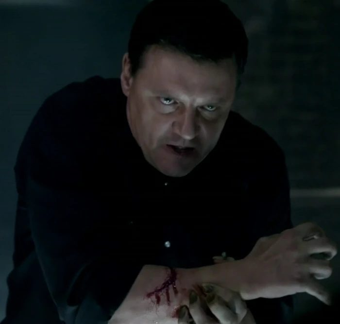

**Описание**

Драконы — очень редкая раса монстров, которых не видели и на которых не охотились больше семисот лет. Они настолько редки, что большинство опытных охотников вроде Бобби Сингера считают их выдумкой, а те немногие, кто знает правду, уверены, что драконы вымерли. Внешне они похожи на драконов из преданий, но в тесном помещении выглядят скорее как гуманоиды, а не как крылатые чудовища; в истинном облике это гигантские рептилии, похожие на летучих мышей.

Драконы — одни из самых сильных монстров в мире, уступающие, пожалуй, только Левиафанам. Они без труда ломают кости, швыряют взрослого человека, как куклу, и способны унести его на себе больше семи миль. Они разумны и владеют магией: именно драконы проводили ритуал, чтобы открыть дверь в Чистилище и освободить Еву, Мать всех монстров. Ради этого они похищали молодых женщин, все из которых были девственницами, и держали их в клетках в городской канализации.

Ева сама боялась своих детей-драконов и повелела выковать клинки, способные их убивать. Гиполиес отдал себя Еве, чтобы из его крови сделали оружие против драконов: так появились мечи, которых осталось всего пять или шесть — Экскалибур, меч Святого Георгия, меч Брунцвика и ещё два-три неизвестных. Именно мечом Брунцвика Дин и Сэм разобрались с драконами в шестом сезоне, найдя в их логове гору золота и древнюю рукопись.

Драконов тянет к золоту: они селятся в пещерах, а если пещер нет — в канализационных коллекторах, и держатся вместе, помогая друг другу. При этом они жестоки и людей не жалеют: доктор Висяк говорила о них, что они совсем не забавны. В списке появлений драконов в вики-выжимке, помимо шестого сезона, перечислены и другие сезоны — от первого до четырнадцатого, включая упоминания.

**Силы и способности**

- Сверхчеловеческая сила — дракон ломает кости, швыряет взрослого человека и уносит его на себе больше семи миль.
- Оборотничество — дракон скрывается под человеческим или гуманоидным обликом, а в истинной форме становится крылатой рептилией.
- Магия — драконы разумны и практикуют магию, включая ритуал открытия двери в Чистилище.
- Когти — драконьи когти рвут плоть и служат инструментом: ими запечатывают клетки и ломают кости пленницам.
- Разум и общительность — драконы действуют сообща, договариваются друг с другом и планируют сложные дела.
- Тяга к золоту — дракон чувствует золото и обустраивает логово среди сокровищ.

**Слабости**

- Драконобойные клинки — меч, выкованный в драконьей крови, единственное оружие, надёжно убивающее дракона.
- Их всего пять или шесть — Экскалибур, меч Святого Георгия, меч Брунцвика и ещё два-три неизвестных клинка.
- Ева — создательница драконов сильнее их и сама приказала выковать оружие против собственных детей.
- Тяга к золоту и пленницам — дракона можно выманить и удержать там, где есть золото или жертва.
- Гуманоидный облик в тесноте — в узких помещениях дракон не может развернуться в полную силу.

**Как его убить.** Охота на дракона начинается с поиска клинка: без меча, выкованного в драконьей крови, убить его почти невозможно, а таких мечей в мире осталось пять или шесть. Практичнее всего меч Брунцвика. Логово ищут по похищениям: драконы уводят молодых женщин и держат их в клетках в пещерах или канализации, рядом с золотом и рукописями. Идти нужно втроём: драконы работают сообща и быстро приходят на помощь. Пленниц освобождают первыми: иначе дракон прикрывается ими и использует их в ритуале.

**Известные особи:** Гиполиес — дракон, отдавший себя Еве, чтобы из его крови выковали клинки против драконов

#### Дракон
*Средний (истинный облик — Большой), Монстр, нейтрально-злое*

---
- **Класс доспеха** 16 (природная броня)
- **Хиты** 133 (14d8 + 70)
- **Скорость** 40 фт., лазание 30 фт.

| СИЛ | ЛОВ | ТЕЛ | ИНТ | МДР | ХАР |
|---|---|---|---|---|---|
| 22 | 15 | 20 | 16 | 14 | 16 |

- **Спасброски** Сил +10, Тел +9, Хар +7
- **Навыки** Магия +7, Запугивание +7, Восприятие +6, Скрытность +6
- **Сопротивление урону** дробящий, колющий и рубящий от немагического оружия
- **Иммунитет к состояниям** очарование
- **Чувства** тёмное зрение 60 фт., пассивное Восприятие 16
- **Языки** английский
- **Бонус мастерства** +4
- **Уровень опасности** 9 (5 000 опыта)

***Особенности***
- ***Оборотень.*** Дракон бонусным действием меняет гуманоидный облик на истинный и обратно. В истинном облике он становится Большим, его скорость увеличивается на 10 фт., урон когтей возрастает до 3d6, но он не может пользоваться тонкими инструментами и речью.
- ***Драконья магия.*** Дракон владеет врождённой магией: он совершает с преимуществом проверки Инт (Магия) и может поддерживать ритуалы. Ритуал открытия врат в Чистилище требует древней рукописи, не менее трёх драконов и 1 часа непрерывной работы.
- ***Драконобойный клинок.*** Оружие, выкованное в драконьей крови (Экскалибур, меч Святого Георгия, меч Брунцвика и ещё два-три), игнорирует сопротивление дракона немагическому оружию и наносит ему дополнительно 22 (4d10) урона.
- ***Тяга к золоту и девам.*** Дракон с преимуществом совершает проверки Мдр (Восприятие), чтобы найти золото или юную пленницу. Когда его выманивают золотом или жертвой, он получает помеху на спасброски Мдр.
- ***Хищная хватка.*** Дракон может тащить схваченное существо со своей скоростью, не замедляясь, и удерживает его, даже взбираясь по стенам.

***Действия***
- ***Мультиатака.*** Дракон совершает три атаки: одну укусом и две когтями.
- ***Укус.*** Рукопашная атака оружием: +10 к попаданию, досягаемость 5 фт. (10 фт. в истинном облике), одна цель. Попадание: 17 (2d10 + 6) колющего урона.
- ***Когти.*** Рукопашная атака оружием: +10 к попаданию, досягаемость 5 фт., одна цель. Попадание: 13 (2d6 + 6) рубящего урона; в истинном облике урон возрастает до 17 (3d6 + 6).
- ***Сокрушающая хватка (перезарядка 5–6).*** Одна цель в пределах 5 фт. совершает спасбросок Сил (Сл 18), получая 20 (3d8 + 6) дробящего урона и становясь схваченной при провале. Схваченную цель дракон может унести со скоростью 40 фт.

***Бонусные действия***
- ***Смена облика.*** Дракон переходит из гуманоидного облика в истинный или обратно.

***Реакции***
- ***Защита выводка.*** Когда союзный дракон в пределах 30 фт. получает урон, дракон может переместиться к нему на расстояние до половины своей скорости.

***Действия в логове***
- ***Обвал золота.*** Дракон опрокидывает груду сокровищ: одно существо в логове совершает спасбросок Лов (Сл 15), получая 11 (2d10) дробящего урона и падая ничком при провале.

**Тактика.** Драконы дерутся сообща и по плану: один отвлекает охотников в гуманоидном облике, другие заходят сбоку в истинной форме. Они стараются не подпускать к себе того, у кого видят необычный клинок, и первым делом уводят или убивают пленниц, чтобы их нельзя было освободить. В узких туннелях дракон действует осторожнее, потому что не может развернуться, и предпочитает отступить к воде или к складу золота. Потеряв половину хитов, он не бежит, а зовёт сородичей и ломает опоры, обрушивая проход.

**Экология.** Драконы живут в пещерах и глухих горных районах, а если пещер поблизости нет — в городской канализации и коллекторах, где их никто не ищет. Они селятся небольшими группами, тянутся к золоту и держат в логове древние рукописи и сокровища. Добычей им служат люди, прежде всего молодые женщины, которых держат в клетках. За семьсот лет их почти не видели, поэтому в бестиариях драконы числятся вымыслом: о них говорит лишь череда похищений.

> **Заметки мастеру.** Дракон — босс на 8–10 уровень с жёстким условием победы: партия должна раздобыть драконобойный клинок, иначе бой почти не выиграть. В 5e он заменяет молодого дракона, но без дыхания и полёта, зато с оборотничеством и магией; для колорита стоит оставить только одну-две особи и сделать ставку на тактику и золото. Для низкого уровня уберите сопротивление к немагическому оружию и снизьте урон Сокрушающей хватки до 2d8; для высокого — объедините трёх драконов в культ, ведущий ритуал врат в Чистилище, и добавьте им жреца-человека. Пленницы в логове дают партии повод рисковать, а не бить издалека.

[↑ к содержанию](#содержание)

---

### 41. Дракула

**Dracula** · Монстр · CR 10 · опасность в сериале 3/5

*Также известно как:* Граф; Архетип вампира

*Первое появление:* Сезон 4, «Monster Movie»

*Сезоны:* 4, 6, 15

Дракула — архетип вампира, которого в сериале постоянно упоминают и на которого ссылаются. Его существование не подтверждено: достоверно показан лишь оборотень, принявший его облик на Октоберфесте 2008 года, поэтому о силах и слабостях Дракулы известно мало.

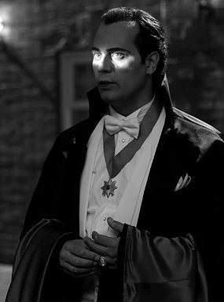

**Описание**

Дракула считается архетипом вампиров. В рамках вселенной «Сверхъестественного» его статус не подтверждён, хотя франшиза часто упоминает его и ссылается на него. Титул, которым его называют, — граф; в качестве актёра в инфобоксе указан Тодд Стэшвик.

Достоверно известно лишь то, что на Октоберфесте 2008 года его облик принял один из оборотней: Дракула был одним из классических монстров, которых выбирали для этой роли. То есть показанное существо было не самим Дракулой, а оборотнем в его форме.

Кроме этого, выжимка не даёт ни описания внешности Дракулы, ни его способностей, ни слабостей. Все упоминания ограничиваются отсылками: он присутствует в четвёртом, шестом и пятнадцатом сезонах — в эпизодах «Monster Movie», «It's A Terrible Life», «Live Free or Twihard», «The French Mistake», «The Man Who Would Be King» и «Last Holiday».

Для охотников это означает, что Дракула — скорее культурный ориентир и легенда, чем проверенная цель: убивать настоящего Дракулу в сериале никому не приходилось, а его существование остаётся открытым вопросом.

**Силы и способности**

- Статус архетипа вампиров — Дракулу считают образцом вампира, на который ориентируются все остальные вампиры сериала.
- Достоверных сил выжимка не даёт: показанный в сериале «Дракула» — оборотень, принявший его облик, поэтому реальные способности неизвестны.
- Репутация и страх — само имя Дракулы работает как оружие: монстры и люди воспринимают его как фигуру легендарного масштаба.

**Слабости**

- Существование Дракулы в сериале не подтверждено: неизвестно, существует ли он как отдельное существо вообще.
- Слабости не описаны — единственный известный случай касается оборотня в его облике, а не самого Дракулы.

**Как его убить.** В сериале охотились не на самого Дракулу, а на оборотня, принявшего его облик, — и того убивали по обычным правилам охоты на оборотней. Убийство настоящего Дракулы ни разу не показано, и выжимка не называет ни одного способа это сделать. Охотнику следует сначала убедиться, что цель — не оборотень и не иная подмена облика: смена формы выдаст самозванца. Дальше придётся действовать по общим правилам охоты на вампиров, но конкретики файл не даёт.

**Известные особи:** Дракула (граф) — упоминается как архетип вампиров; его существование не подтверждено.; Оборотень с Октоберфеста 2008 года — единственный показанный «Дракула», принявший его облик.

#### Дракула
*Средний, Нежить, нейтрально-злое*

---
- **Класс доспеха** 16 (природная броня)
- **Хиты** 144 (17d8 + 68)
- **Скорость** 30 фт., лазание 30 фт.

| СИЛ | ЛОВ | ТЕЛ | ИНТ | МДР | ХАР |
|---|---|---|---|---|---|
| 20 | 18 | 18 | 16 | 14 | 18 |

- **Спасброски** Лов +8, Мдр +6, Хар +8
- **Навыки** Скрытность +8, Обман +8, Восприятие +6
- **Сопротивление урону** некротический; дробящий, колющий и рубящий от немагического оружия
- **Иммунитет к состояниям** очарование, испуг, истощение
- **Чувства** тёмное зрение 120 фт., пассивное Восприятие 16
- **Языки** английский и языки, известные при жизни
- **Бонус мастерства** +4
- **Уровень опасности** 10 (5 900 опыта)

***Особенности***
- ***Регенерация.*** Дракула восстанавливает 15 хитов в начале своего хода, если у него есть хотя бы 1 хит и он не получал урон от солнечного света или освящённого оружия с прошлого хода. Если он погибает, он возвращается к жизни через 24 часа, если его тело не обезглавили и не освятили останки.
- ***Туманная форма.*** Действием Дракула превращается в облако тумана или в летучую мышь и обратно. В туманной форме он не может действовать, но обладает сопротивлением всему немагическому урону и может протискиваться в щели шириной 1 дюйм.
- ***Солнечная уязвимость.*** В ярком солнечном свете Дракула совершает броски атаки и проверки характеристик с помехой и получает 10 урона кислотой в начале каждого своего хода.
- ***Обаяние вампира.*** Дракула совершает проверки Убеждения и Обмана против гуманоидов с преимуществом; существо, укушенное им, не может добровольно действовать против него, пока не вылечится.
- ***Аристократ тьмы.*** Дракула не отражается в зеркалах, не отбрасывает тени и не входит в жилище без приглашения владельца.

***Действия***
- ***Мультиатака.*** Дракула совершает одну атаку укусом и одну атаку когтями или очаровывающим взглядом.
- ***Когти.*** Рукопашная атака оружием: +9 к попаданию, досягаемость 5 фт., одна цель. Попадание: 11 (2d6 + 4) рубящего урона, и цель схвачена (Сл высвобождения 15).
- ***Укус.*** Рукопашная атака оружием: +9 к попаданию, досягаемость 5 фт., одна цель — схваченное, обездвиженное или согласное существо. Попадание: 9 (1d10 + 4) колющего урона плюс 13 (3d8) некротического урона, максимум хитов цели уменьшается на эту сумму, а Дракула восстанавливает столько же хитов.
- ***Очаровывающий взгляд.*** Одно существо в пределах 30 фт., способное видеть Дракулу, совершает спасбросок Мдр (Сл 16); при провале оно очаровано на 1 час и подчиняется устным просьбам Дракулы, пока не получит урон от него.

***Бонусные действия***
- ***Туманный шаг.*** Дракула перемещается до половины своей скорости в туманной форме, после чего принимает прежний облик.
- ***Призыв стаи.*** Дракула призывает стаю летучих мышей: все враждебные существа в пределах 15 фт. совершают спасбросок Тел (Сл 16), иначе получают помеху на броски атаки до конца своего следующего хода.

***Реакции***
- ***Дымка.*** Когда по Дракуле попадает немагическая атака, он может с помехой превратиться в туманную форму и уменьшить урон вдвое.

**Тактика.** Дракула ведёт бой как хищник и хозяин: начинает с «Очаровывающего взгляда», разделяя партию, затем вытягивает жизнь укусом и отходит в туманной форме, чтобы регенерировать. Он не станет сражаться в ярко освещённом месте и постарается погасить свет или увести бой в подвал. Если на него выходят с освящённым оружием или солнечным светом, он отступает, чтобы вернуться ночью. Против превосходящих сил предпочитает договор, а не драку.

**Экология.** Выжимка не описывает ни логова Дракулы, ни его окружения: достоверно показан лишь оборотень в его облике на Октоберфесте 2008 года. Как легенда Дракула существует в культуре мира сериала — на него ссылаются вампиры и охотники. Если он всё же существует как существо, логично помещать его в уединённое поместье или склеп вдали от крупных городов.

> **Заметки мастеру.** Статблок описывает Дракулу как легендарного вампира-лорда — это домысел механики в духе официальных статблоков 5e, а не подтверждённый факт сериала: в выжимке его силы и слабости не раскрыты, а сам он не появлялся. Для каноничной игры используйте его как городскую легенду или как оборотня-самозванца; для альтернативной кампании берите статблок как лорда вампиров и замените им вампира из «Бестиария». На низком уровне ослабьте до CR 5, убрав регенерацию и туманную форму; на высоком добавьте легендарные действия и логово-замок с лаирными действиями.

[↑ к содержанию](#содержание)

---

### 42. Зубные феи

**Tooth Fairies** · Монстр · CR 1/2 · опасность в сериале 1/5

*Также известно как:* Феи, собирающие зубы

*Первое появление:* Сезон 3, «Fresh Blood» (упоминание)

*Сезоны:* 3, 5, 8, 15

Феи, в существование которых не верят даже большинство охотников. Из выжимки известно только то, что они собирают зубы и подчиняются Оберону; в кадре они не появляются и в бою не показаны.

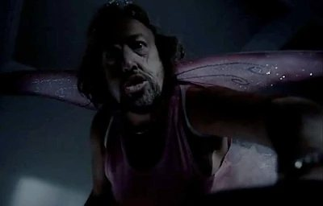

**Описание**

Зубные феи — разновидность фей, упомянутая в сериале устами Гарта Фицджеральда. Как и всех фей в целом, их принято считать выдумкой: в их существование не верят даже большинство охотников и людей, осведомлённых о сверхъестественном мире, включая Белу Талбот.

В инфобоксе выжимки у зубных фей указаны категория «фейри», статус «существуют», род занятий — сбор зубов — и принадлежность Оберону. Это и есть всё, что сообщается о них по существу: феи, которые собирают зубы и подчиняются королю фей.

Самый развёрнутый эпизод с упоминанием — «Fresh Blood» третьего сезона. Гордон Уокер уверяет Белу Талбот, что считает Сэма Винчестера Антихристом; Бела, которая ему не верит, издевается: дескать, она «могла слышать об этом от своего доброго друга Пасхального кролика, а тот — от Зубной феи», и спрашивает Гордона, не забыл ли он принять лекарства.

В списке появлений выжимки также стоят «I Believe the Children Are Our Future» (5 сезон), «Southern Comfort» (8 сезон) и «The Heroes' Journey» (15 сезон). Ни внешности, ни повадок, ни боевых способностей зубных фей в выжимке нет: в кадре они не действуют, а только упоминаются.

Для охотников зубные феи — скорее шутка и проверка на доверчивость, чем цель: найти их или убить по известным рецептам невозможно, потому что таких рецептов в источниках не сохранилось.

**Силы и способности**

- Сбор зубов — в инфобоксе выжимки род занятий фей обозначен как сбор зубов: они собирают зубы, что прямо отсылает к детской сказке о зубной фее.
- Служение Оберону — в инфобоксе указана принадлежность к Оберону, то есть зубные феи входят в число фейри, подчиняющихся королю фей.
- Неуловимость для мира — фей вообще и зубных фей в частности не считают реальными даже большинство охотников и знатоки сверхъестественного вроде Белы Талбот.
- Боевые способности не описаны — выжимка не приводит ни одной способности зубных фей: в сериале они только упоминаются, поэтому их силы остаются неизвестными.

**Слабости**

- Слабости неизвестны — в выжимке не названо ни одного способа убить или остановить зубную фею, так как в сериале с ними никто не сражался.
- Всеобщее неверие — даже охотники и знатоки вроде Белы Талбот считают зубных фей выдумкой, поэтому охоту на них всерьёз никто не ведёт и опыта нет.
- Принадлежность к фейри — зубные феи относятся к феям и связаны с Обероном, поэтому средства против них логично искать среди того, что работает против фейского двора (в выжимке таких средств нет).

**Как его убить.** Рецепта охоты не существует: в выжимке нет ни одной слабости зубной феи, а в сериале охотники с ними не сталкивались. Практический выход один — идти от общего: феи подчиняются Оберону, поэтому в инвентаре держат железо, соль и ловушки для фейри, а зацепки ищут через расспросы детей, родителей и стоматологов. Мастеру, который хочет бой, придётся придумать слабость самому.

#### Зубные феи
*Крошечный, Фея, нейтральное*

---
- **Класс доспеха** 13
- **Хиты** 18 (4d4 + 8)
- **Скорость** 20 фт., полёт 40 фт.

| СИЛ | ЛОВ | ТЕЛ | ИНТ | МДР | ХАР |
|---|---|---|---|---|---|
| 5 | 18 | 14 | 12 | 14 | 16 |

- **Спасброски** Лов +6, Хар +5
- **Навыки** Скрытность +6, Восприятие +4
- **Уязвимость к урону** холодное железо
- **Сопротивление урону** психический
- **Иммунитет к состояниям** очарование
- **Чувства** тёмное зрение 60 фт., пассивное Восприятие 14
- **Языки** понимает английский и язык фейри, но не говорит
- **Бонус мастерства** +2
- **Уровень опасности** 1/2 (100 опыта)

***Особенности***
- ***Сбор зубов.*** Ночью зубная фея проникает в дом, где у ребёнка выпал зуб, и забирает его, оставляя мелкую монету. Проверка Мудрости (Восприятие) Сл 16 позволяет заметить фею до того, как она скроется.
- ***Неуловимость.*** Фея получает преимущество на проверки Ловкости (Скрытность) в темноте и может действием стать невидимой до конца своего следующего хода, если находится в тени.
- ***Родство с Обероном.*** Зубная фея подчиняется Оберону и выполняет его приказы. Эффекты, изгоняющие фей, действуют на неё, но она получает помеху на спасбросок от них.
- ***Стая.*** Зубные феи действуют группами по три-пять особей; пока рядом есть хотя бы одна союзная фея, зубная фея не может быть испугана.

***Действия***
- ***Укус.*** Рукопашная атака оружием: +6 к попаданию, досягаемость 5 фт., одна цель. Попадание: 1 колющего урона.
- ***Щипцы для зубов.*** Рукопашная атака оружием: +6 к попаданию, досягаемость 5 фт., одна цель. Попадание: 6 (1d4 + 4) колющего урона, и цель проходит спасбросок Телосложения Сл 12, иначе теряет один зуб.
- ***Сонный порошок (1/день).*** Фея рассыпает пыльцу в радиусе 10 фт. Каждое существо в области проходит спасбросок Телосложения Сл 13, иначе теряет сознание на 1 минуту или до получения урона.

**Тактика.** Зубные феи не сражаются за территорию: они приходят ночью, работают тихо и исчезают, как только их заметили. Если их застали, они рассыпают сонный порошок и уходят в темноту, а в бою полагаются на численность и мелкие укусы. Холодное железо и изгоняющие фей эффекты пугают их, и стая отступает к окну или щели, через которую пришла. Ставить их против опытной группы как серьёзную угрозу не стоит — это скорее шумная помеха, чем противник.

**Экология.** Зубные феи держатся там, где живут дети: в спальнях, детских садах, приютах и больничных палатах, и появляются по ночам, когда у ребёнка выпадает зуб. Они собираются в небольшие стаи и избегают взрослых, которые в них не верят. Их связь с Обероном указывает на принадлежность к фейскому двору, но других подробностей об их обществе в выжимке нет.

> **Заметки мастеру.** Зубная фея — отличный способ начать кампанию: маленькая странность в детской спальне, которая ведёт к базару фей и двору Оберона. Механически это ослабленный спрайт (CR 1/2): уберите невидимость для группы 1-2 уровня, добавьте вожака с CR 2 и парой заклинаний для группы 5-6 уровня. Как замена каноничной феи она хороша тем, что не убивает персонажей, а ставит перед ними вопрос — верить ли в то, что даже охотники считают сказкой.

[↑ к содержанию](#содержание)

---

### 43. Иль Соарта (Ковен)

**Il Soarta** · Монстр · CR 8 · опасность в сериале 3/5

*Также известно как:* Клан Иль Соарта; Ковен Иль Соарта

*Первое появление:* The Winchesters S01E07 «Cast Your Fate to the Wind»

Иль Соарта — клан вампиров, поклонявшийся Урситоаре, румынскому аналогу трёх Мойр. Клан верил, что обильные кровавые жертвы принесут камень из их собственных рёбер — Камень Урситоаре, дающий знание судеб живых.

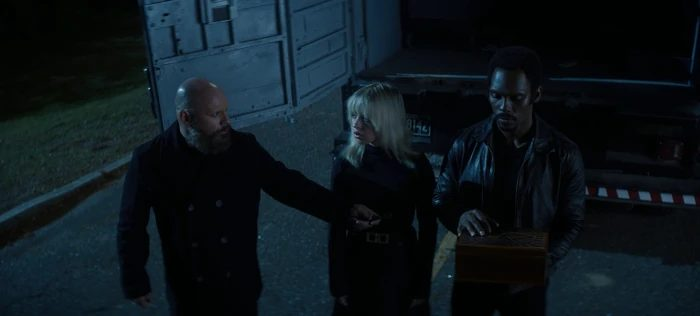

**Описание**

Иль Соарта был кланом вампиров, поклонявшимся Урситоаре — румынскому эквиваленту трёх Мойр греческой мифологии. Клан верил, что если принести Урситоаре достаточно крови, их наградят камнем, вырезанным из их рёбер. Этот камень, известный как Камень Урситоаре, позволял вампирам знать судьбу живых: к каким людям обращаться, кого убивать и кого заменять внутри клана, чтобы обеспечить его успех и долговечность.

Использование Камня Урситоаре стало среди Иль Соарта священной практикой. Но когда их лидер увидел, что ему суждено умереть, он выбрал попытку спасти себя, а не клан. Так он и умер, как было предсказано, а драгоценный камень Урситоаре был кланом потерян.

В 1972 году, всё ещё разыскивая Камень Урситоаре, Иль Соарта напали на конвой, перевозивший карту к клубхаусу Людей Письма — последним владельцам камня. Во главе с вампиром Николасом они напали на Диану, специалистку по истории Камня Урситоаре, а также на Monster Club, пришедший за информацией в библиотеку Дианы. Monster Club был убит, а у Джона было видение будущего, в котором он увидел себя умирающим от рук Николаса. Позже Николас и остальные вампиры совершили рейд на клубхаус. Карлос Сервантес и Мэри Кэмпбелл убили большинство вампиров, включая Николаса, после того как Джон позволил себя укусить, предварительно ударив себя током, из-за чего вампир выпил кровь мёртвого человека — слабость вампиров. Так Иль Соарта был уничтожен.

**Силы и способности**

- Вампиризм — Иль Соарта питаются человеческой кровью, как и любой вампирский клан.
- Камень Урситоаре — камень из рёбер дарует знание судеб живых и позволяет выбирать жертв и пополнение клана.
- Пророческие видения — контакт с Урситоаре даёт членам клана видения будущего, включая собственную смерть.
- Клановая организация — вампиры действуют отрядами во главе с лидером, устраивая засады на конвои и рейды на укреплённые дома.

**Слабости**

- Кровь мёртвого человека — выпив её, вампир слабеет; именно так Джон подставил Николаса.
- Обычные средства против вампиров — клан уничтожали оружием и хитростью обычные охотники, без особых ритуалов.
- Зависимость от лидера и камня — потеря Камня Урситоаре лишает клан его главного преимущества и предсказаний.

**Как его убить.** Против Иль Соарта работают стандартные охотничьи приёмы против вампиров: обезглавливание и отсечение головы или полное уничтожение тела. Подготовьте ловушку с кровью мёртвого человека — если вампир её выпьет, он ослабнет и станет уязвим для добивания. Клан действует по предсказаниям камня, поэтому сначала нужно отнять или спрятать Камень Урситоаре, иначе вампиры будут ждать вас там, где вы появитесь. Действуйте в группе: в 1972 году рейд отбили двое охотников при поддержке Джона в роли приманки.

**Известные особи:** Николас; Диана; Карлос Сервантес; Мэри Кэмпбелл

#### Иль Соарта (Ковен)
*Средний, Нежить, нейтрально-злое*

---
- **Класс доспеха** 15 (природная броня)
- **Хиты** 127 (15d8 + 60)
- **Скорость** 30 фт.

| СИЛ | ЛОВ | ТЕЛ | ИНТ | МДР | ХАР |
|---|---|---|---|---|---|
| 18 | 18 | 18 | 14 | 14 | 16 |

- **Спасброски** Лов +7, Мдр +5
- **Навыки** Восприятие +5, Скрытность +7, Обман +6
- **Сопротивление урону** некротический; дробящий, колющий и рубящий от немагического оружия
- **Иммунитет к состояниям** очарование, испуг
- **Чувства** тёмное зрение 120 фт., пассивное Восприятие 15
- **Языки** общий, румынский
- **Бонус мастерства** +3
- **Уровень опасности** 8 (3 900 опыта)

***Особенности***
- ***Регенерация.*** Вампир восстанавливает 15 хитов в начале своего хода, если не получал урона от святой воды или серебра с прошлого хода и не пил кровь мёртвого человека.
- ***Слабость перед мёртвой кровью.*** Если вампир выпьет кровь мёртвого человека, он получает помеху на все атаки и спасброски на 1 минуту.
- ***Обезглавливание.*** Вампир умирает окончательно только если его хиты опустились до 0 и по нему проведена атака в ближнем бою, нанёсшая рубящий урон.
- ***Знание судьбы (Камень Урситоаре).*** Пока вампир владеет Камнем Урситоаре, он знает, какое существо в пределах 1 мили в следующем часу умрёт или подвергнется смертельной опасности.
- ***Чувствительность к серебру.*** Вампир получает дополнительно 10 урона от серебряного оружия и не может регенерировать в тот ход, когда получил такой урон.

***Действия***
- ***Мультиатака.*** Вампир совершает две атаки: одну «Когтями» и одну «Укусом».
- ***Когти.*** Рукопашная атака оружием: +7 к попаданию, досягаемость 5 фт., одна цель. Попадание: 13 (2d8 + 4) рубящего урона.
- ***Укус.*** Рукопашная атака оружием: +7 к попаданию, досягаемость 5 фт., одна цель, которая должна быть схвачена, обездвижена или недееспособна. Попадание: 11 (1d6 + 4) колющего урона плюс 10 (2d6) некротического урона. Максимум хитов цели уменьшается на этот некротический урон, а вампир восстанавливает столько же хитов.
- ***Внушение (1/день).*** Вампир нашептывает одну фразу существу в пределах 30 фт.: спасбросок Мдр (Сл 14), при провале цель выполняет предложенное действие в течение 1 минуты, если оно не ведёт к явной гибели.

***Бонусные действия***
- ***Захват.*** Вампир пытается схватить существо в пределах 5 фт.: проверка Атлетики против Атлетики или Акробатики цели.

**Тактика.** Иль Соарта нападают отрядом, заранее зная по камню, где окажется добыча, и стараются разделить охотников и выпить кровь по одному. Лидер держится во второй линии и направляет остальных, при первой серьёзной угрозе отступает, чтобы сохранить камень. Против святой воды и серебра вампиры теряют регенерацию и переходят к обороне, а выпив кровь мёртвого человека — паникуют и пытаются уйти.

**Экология.** Клан действует на территории США, устраивая засады на конвои и рейды на дома, где хранятся нужные им артефакты; численность — несколько вампиров плюс лидер. Иль Соарта существовал вокруг культа Урситоаре и хранения Камня Урситоаре, и после гибели Николаса и большинства членов в 1972 году был уничтожен.

> **Заметки мастеру.** Иль Соарта — удобная замена вампиру-одиночке: это отрядный противник с разведданными, который всегда знает, куда придёт партия. Камень Урситоаре работает как сюжетный артефакт: дайте его клану, и любые планы игроков станут предсказуемы, отберите — и вампиры ослепнут. Для низкого уровня сократите отряд до двух вампиров и уберите регенерацию; для высокого — усильте лидера до CR 12 и добавьте кровавых фамильяров.

[↑ к содержанию](#содержание)

---

### 44. Каппа

**Kappa** · Монстр · CR 4 · опасность в сериале 3/5

*Также известно как:* Каватарō (речной мальчик); Суйко (водяной тигр)

*Первое появление:* Supernatural: The Animation, «What Lives in the Lake»

*Сезоны:* 12

Японский спектр-ёкай, который не вредит людям, а защищает их от беды в обмен на еду: он видит будущие несчастья и успевает предотвратить их. Опасен ровно настолько, насколько его считают чудовищем.

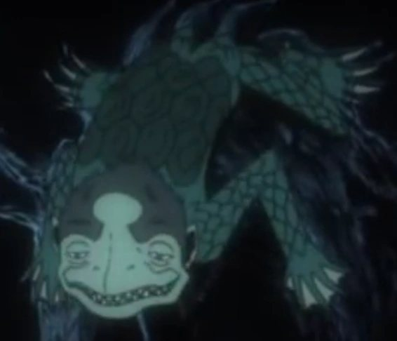

**Описание**

Каппы — полезный вид спектров родом из Японии. Они защищают людей от вреда в обмен на еду. Их главный дар — предвидение: каппа видит будущие события, которые причинят людям вред, — оползень, удар молнии, автомобильную аварию; один из них сумел увидеть даже то, что у человека случится смертельный сердечный приступ. Каппы живут и процветают под водой, но могут выходить на сушу и дышать воздухом. Живут они долго — одному из них было явно больше ста лет. Сила и скорость у них выше человеческих: каппа без усилий протащил взрослого мужчину через лес.

История в маленьком городке, где застряли Сэм и Дин, началась с того, что каппу сочли нападающим на людей. Братья вмешались в расследование и решили, что имеют дело с водным демоном под названием «Ям», но дальнейшее разбирательство показало: существо никому не вредило, а наоборот спасало жизни. Оно уберегло пару от автомобильной аварии, спасло человека от смертельного сердечного приступа и выручило группу охотников и от оползня, и от удара молнии. За спасение каппа брал у людей еду и питал особую слабость к сладкому. Когда Сэм рассказал горожанам, что существо на самом деле им помогает, все согласились прекратить на него охоту и отпустить его.

В японском фольклоре каппа (河童, «речной ребёнок») известен также как каватарō («речной мальчик»), комахики («тянущий лошадей»), каватора («речной тигр») и суйко («водяной тигр»). Это земноводный ёкай-демон или бес из традиционной японской мифологии. Обычно его изображают зелёным человекоподобным существом с перепончатыми руками и ногами и черепахоподобным панцирем на спине.

Для охотника каппа — редкий случай монстра, с которым лучше не воевать, а договориться: он не нападает, а берёт плату едой за спасённые жизни. Ошибка охотника здесь стоит не жертв, а невинно убитого защитника.

**Силы и способности**

- Предвидение — каппа видит будущие события, которые причинят людям вред: оползень, удар молнии, автомобильную аварию и даже смертельный сердечный приступ.
- Подводное дыхание — каппы живут и процветают под водой, но при этом могут ходить по земле и дышать воздухом.
- Долголетие — одному из капп было явно больше ста лет.
- Сверхчеловеческая сила — каппа протащил взрослого мужчину через лес без усилий.
- Сверхчеловеческая скорость — каппа движется быстрее человека и на земле, и под водой.
- Слабость к сладкому — каппа берёт плату едой и особенно любит сладости, что делает его предсказуемым.

**Слабости**

- Не агрессивен — каппа не нападает на людей и не убивает их, поэтому не имеет привычки защищаться насмерть.
- Плата едой — каппу можно удержать и задобрить едой, особенно сладким; это его главная привязанность.
- Привязка к воде — каппа живёт и процветает в воде; вне водоёма он уязвимее и уязвим для пересыхания.
- Ошибка опознания — каппу легко принять за водного демона «Яма», из-за чего охотники убивают защитника, а не угрозу.
- Уязвим как живое существо — выжимка не описывает ни одного случая, когда каппу пытались убить, но специальных защит от оружия у него нет.

**Как его убить.** Каппу не нужно убивать, и выжимка не даёт способа это сделать: охота закончилась тем, что горожане прекратили преследование и отпустили существо. Сначала убеждаются, что смерти и разрушения идут не от каппы, а рядом с ним, и перепроверяют версию с водным демоном «Ям». Для контакта берут еду, лучше сладкую: каппа берёт плату за спасённые жизни, и с ним можно договориться. Если он мешает людям, его достаточно поймать сетью и перенести в другой водоём подальше от города.

#### Каппа
*Средний, Фея, законно-доброе*

---
- **Класс доспеха** 15 (природная броня)
- **Хиты** 68 (8d8 + 32)
- **Скорость** 30 фт., плавание 40 фт.

| СИЛ | ЛОВ | ТЕЛ | ИНТ | МДР | ХАР |
|---|---|---|---|---|---|
| 17 | 16 | 18 | 12 | 18 | 13 |

- **Спасброски** Мдр +6, Тел +6
- **Навыки** Восприятие +6, Проницательность +6, Атлетика +5, Выживание +6
- **Сопротивление урону** холод
- **Иммунитет к состояниям** очарование
- **Чувства** тёмное зрение 60 фт., пассивное Восприятие 16
- **Языки** японский, понимает английский, но говорит редко
- **Бонус мастерства** +2
- **Уровень опасности** 4 (1 100 опыта)

***Особенности***
- ***Дар предвидения.*** Каппа видит ближайшее будущее, грозящее людям вредом. Он получает преимущество на проверки Мдр (Восприятие) и Мдр (Проницательность), а также не может быть застигнут врасплох. Один раз в день он может задать Мастеру один вопрос о событии, которое произойдёт в пределах 1 мили в течение 24 часов, и получить правдивый ответ.
- ***Земноводный.*** Каппа может дышать и под водой, и на воздухе, получает преимущество на проверки Атлетики в воде и не получает урона от давления и холода воды.
- ***Защитник людей.*** Каппа знает о существах в пределах 120 фт., которым грозит непосредственная опасность (обвал, пожар, падение, нападение), и всегда движется к ним кратчайшим путём.
- ***Плата едой.*** Каппа не берёт денег и не крадёт: он ждёт подношения едой, особенно сладкой. Существо, угостившее каппу, получает от него преимущество на один спасбросок до конца следующего дня.
- ***Панцирь.*** Черепахоподобный панцирь даёт каппе сопротивление к дробящему урону от немагического оружия.

***Действия***
- ***Мультиатака.*** Каппа совершает две атаки: одну кулаком и одну захватом.
- ***Кулак.*** Рукопашная атака оружием: +5 к попаданию, досягаемость 5 фт., одна цель. Попадание: 10 (2d6 + 3) дробящего урона.
- ***Захват.*** Рукопашная атака оружием: +5 к попаданию, досягаемость 5 фт., одна цель не более Среднего размера. Попадание: цель схвачена (высвобождение Сл 13). Каппа может двигаться с захваченной целью без штрафа к скорости.
- ***Рывок сквозь лес.*** Каппа перемещается на расстояние до своей скорости, таща одну схваченную цель. Цель и все существа на пути должны преуспеть в спасброске Сил (Сл 13), иначе падают ничком.

***Бонусные действия***
- ***Спасение на грани.*** Каппа бонусным действием перемещается на 30 фт. к существу, которому грозит опасность, если видит эту опасность. Это перемещение не провоцирует атак.

***Реакции***
- ***Предупреждение.*** Когда существо в пределах 30 фт. попадает под атаку или ловушку, каппа предупреждает его. Атакующий совершает бросок атаки с помехой, а цель получает преимущество на спасбросок против ловушки.

**Тактика.** Каппа не ищет боя и почти всегда применяет силу, чтобы вытащить человека из-под обвала, из-под машины или из воды. Если на него нападают, он хватает самого слабого и уходит с ним в водоём, где дерётся на своих условиях, либо просто обходит противников и продолжает спасать людей. В воде он нападает из глубины, топит лодки и утягивает за ноги; на суше предпочитает бежать. Договориться с ним можно всегда: он отпускает схваченного, если ему предложить еду, а увидев сахар или сладости, теряет интерес к драке.

**Экология.** Каппы живут в реках, озёрах и прудах Японии и не выходят далеко от своего водоёма; в истории сериала один такой каппа обитал в озере рядом с небольшим городом. По японскому фольклору его изображают зелёным человекоподобным существом с перепончатыми конечностями и черепашьим панцирем на спине. Капп немного, они долгожители и держатся поодиночке, не соседствуя с другими тварями; люди для них не добыча, а подопечные, и расплачиваются с ними едой.

> **Заметки мастеру.** Каппа — не антагонист, а моральная ловушка для партии 3–5 уровня: горожане требуют убить чудовище, а чудовище спасает им жизни. Дайте игрокам улики, которые указывают на каппу как на виновника, и позвольте им заметить, что жертв нет. В 5e его можно собрать из водяного удильщика или мерроу, но уберите злобу и добавьте предвидение. Для низкого уровня уберите Мультиатаку и снизьте хиты до 45; для высокого сделайте его хранителем целой долины, добавьте легендарные действия на спасение союзников и вторую такую же особь в соседнем озере.

[↑ к содержанию](#содержание)

---

### 45. Карин

**Qareen** · Монстр · CR 6 · опасность в сериале 3/5

*Также известно как:* Караин; Джинн-спутник; Облик сокровенного желания

*Первое появление:* S11 «Love Hurts»

*Сезоны:* 11

Существо, похожее на джинна: оно принимает облик самого сокровенного желания человека, чтобы соблазнить и убить его. Карин живёт, пока цело его сердце, — а если сердце вынуть не повредив, он становится слугой владеющей им ведьмы.

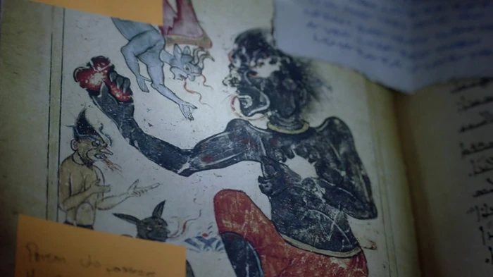

**Описание**

Карин — существо, похожее на джинна, которое можно подчинить воле хозяина, владеющего его сердцем. Карины — оборотни: они принимают облик самого глубокого и тёмного желания человека, чтобы соблазнить и убить жертву. Единственный способ убить карина — пронзить его сердце.

О существовании каринов было известно ещё в древнеарамейскую и арабскую эпоху: сведения о них сохранились в записях в книге заклинаний Сони, а сам сборник преданий был написан на староарамейском.

Карин довольно силён. Он меняет облик, копируя внешность — вплоть до одежды — того, кем жертва тайно одержима, и читает мысли, чтобы узнать это желание, даже если человек сам его не осознаёт или не признаёт. Он читает и сердце: один карин сказал, что видит любовь Дина к Амаре, но и стыд, которым она прикрыта.

Сила карина огромна: он швыряет взрослых людей, пробивает грудную клетку и вырывает сердце без усилий, ломает дерево и толстые стены.

Истинный облик карина неизвестен. По книге заклинаний Сони, он гуманоидный, но темнее и демоничнее; единственная показанная часть тела — сердце, тёмное и примерно похожее по форме на человеческое. Карин может жить без сердца, если его извлекли, не повредив: тогда сердце отделяют, чтобы подчинить существо. Ведьма, владеющая сердцем, с помощью нужного заклинания управляет карином, а если сердце уничтожить — карин умирает. Как и оборотней, карина можно опознать по вспышке в глазах, которая видна на плёнке.

В исламских преданиях карин — разновидность джинна, «постоянный спутник» каждого человека, который толкает его на зло.

**Силы и способности**

- Смена облика — карин принимает форму самого сокровенного и тёмного желания жертвы, копируя внешность вплоть до одежды.
- Телепатия — он читает мысли и узнаёт желание человека, даже если тот сам его не осознаёт.
- Эмпатия — карин читает сердце: он распознал любовь Дина к Амаре и стыд, которым она была прикрыта.
- Сверхчеловеческая сила — карин швыряет взрослых людей, пробивает грудь и вырывает сердце без усилий, ломает дерево и стены.
- Сердце как якорь — пока сердце цело, карин жив; если его изъяли не повредив, существо подчиняется владельцу сердца.

**Слабости**

- Сердце — единственный известный способ убить карина: сердце нужно уничтожить.
- Магия — ведьма Соня подчинила карина с помощью магии, забрав его сердце.
- Вспышка в глазах — как у оборотней, карина выдаёт радужная вспышка, заметная при съёмке.
- Власть хозяина сердца — пока сердце у ведьмы, карин обязан исполнять её волю.

**Как его убить.** Главное в охоте на карина — найти его сердце: пока оно цело, существо живёт, а тот, кто владеет сердцем, управляет им. Охотник либо ищет сердце у ведьмы, подчинившей карина, либо вынуждает существо проявить себя. Второй инструмент — камера: вспышка в глазах на записи выдаёт карина. Найденное сердце нужно уничтожить — это единственный известный способ убить карина. В бою нельзя позволять ему подойти вплотную: он пробивает грудь и вырывает сердце без усилий.

#### Карин
*Средний, Исчадие, нейтрально-злое*

---
- **Класс доспеха** 14 (природная броня)
- **Хиты** 90 (12d8 + 36)
- **Скорость** 30 фт.

| СИЛ | ЛОВ | ТЕЛ | ИНТ | МДР | ХАР |
|---|---|---|---|---|---|
| 20 | 14 | 16 | 13 | 14 | 18 |

- **Спасброски** Сил +8, Хар +7
- **Навыки** Обман +7, Проницательность +5, Восприятие +5
- **Сопротивление урону** холод, огонь, молния; дробящий, колющий и рубящий от немагического оружия
- **Иммунитет к урону** яд
- **Иммунитет к состояниям** очарование, испуг, отравленный
- **Чувства** тёмное зрение 60 фт., пассивное Восприятие 15
- **Языки** английский, арабский, арамейский; телепатия 60 фт.
- **Бонус мастерства** +3
- **Уровень опасности** 6 (2 300 опыта)

***Особенности***
- ***Смена облика.*** Карин может действием принять облик гуманоида, которого желает цель, включая одежду и голос. Облик сохраняется, пока карин не сменит его или не потеряет сознание.
- ***Чтение желаний.*** Карин читает поверхностные мысли существ в пределах 60 фт. и узнаёт их сокровенные желания, даже если те их не осознают. Скрыть от него истинное желание проверками Обмана невозможно.
- ***Сердце-фокус.*** Пока сердце карина цело, снижение его хитов до 0 не убивает его: тело распадается, а через 1d4 дня карин возвращается. Только уничтожение сердца убивает карина навсегда. Если сердце изъято без повреждений и находится у владельца, тот может приказать карину одно действие в свой ход, и карин не может ослушаться.
- ***Вспышка в глазах.*** Карина выдаёт радужная вспышка в глазах: на любой фотографии или видеозаписи его зрачки светятся. Проверка Мдр (Проницательность) Сл 18 нужна, чтобы заметить это вживую.

***Действия***
- ***Мультиатака.*** Карин совершает две атаки: ударом и вырыванием сердца либо двумя ударами.
- ***Удар.*** Рукопашная атака оружием: +8 к попаданию, досягаемость 5 фт., одна цель. Попадание: 12 (2d6 + 5) дробящего урона.
- ***Вырывание сердца.*** Рукопашная атака оружием: +8 к попаданию, досягаемость 5 фт., одна цель, которая схвачена, обездвижена, недееспособна или очарована карином. Попадание: 21 (4d8 + 5) рубящего урона, и максимум хитов цели уменьшается на 10; если максимум хитов падает до 0, цель погибает, а её сердце оказывается в руках карина.

***Бонусные действия***
- ***Наваждение.*** Карин направляет мысль на одно существо в пределах 60 фт.: цель должна преуспеть в спасброске Мдр (Сл 15), иначе очарована карином до конца своего следующего хода.

**Тактика.** Карин не бросается в бой: он изучает жертву телепатией, находит её самое тёмное желание и принимает его облик, чтобы подойти ближе без подозрений. Сблизившись, он наносит один точный удар — пробивает грудь и вырывает сердце, — поэтому его засада смертельна для одиночки. Против группы карин держится на расстоянии, швыряет людей друг в друга и ломает укрытия, стараясь разорвать строй. Он отступает, если теряет преимущество или если его сердце под угрозой: собственная жизнь для него важнее убийства.

**Экология.** Карины известны с древнеарамейских и арабских времён, а знания о них сохранились в старых книгах заклинаний; в исламских преданиях карин — разновидность джинна, «постоянный спутник» человека. В сериале карин действует среди людей, обычно под прикрытием облика чьей-то тайной любви, и охотится на конкретную жертву, а не на всех подряд. Чаще всего его контролирует владелец сердца — ведьма или колдун; свободный карин просто ищет новую жертву.

> **Заметки мастеру.** Карин — сюжетный противник на 6–8 уровень: убить его в бою почти невозможно, зато можно лишить хозяина сердца, и это превращает энкаунтер в поиск артефакта. Идеален для городской кампании с соблазнением и одержимостью. Замена в 5e — суккуб или инкуб с телепатией; для низкого уровня уберите вырывание сердца и снизьте хиты до 60, для высокого добавьте легендарные действия и хозяина-ведьму, чья смерть освобождает карина.

[↑ к содержанию](#содержание)

---

### 46. Кейт (оборотень)

**Kate** · Монстр · CR 6 · опасность в сериале 3/5

*Также известно как:* Кейт; Чистокровный оборотень

*Первое появление:* S08 «Bitten»

*Сезоны:* 8, 10

Оборотень-чистокровка и бывшая студентка, которая обращается по собственному желанию, вне лунного цикла. Она без труда разрывает других оборотней голыми руками, а убить её можно только серебром — серебряный нож она носит с собой на случай потери контроля.

**Описание**

Кейт — оборотень и бывшая студентка колледжа. Подробной предыстории в выжимке нет: раздел истории в вики-странице пуст, поэтому о том, как именно она стала оборотнем, ничего не известно. Зато известно её окружение: у Кейт была сестра Таша, а её парень Майкл Уилер был укушен оборотнем и обратился. И Таша, и Майкл в инфобоксе помечены как погибшие; родители Кейт там не названы. Сама Кейт на момент последнего появления жива.

Кейт — чистокровный оборотень: она перекидывается независимо от луны, по собственному желанию. Это выделяет её среди обычных ликантропов, привязанных к полнолунию, и делает опасной в любое время суток. В звериной форме у неё мощные когти и острые, как бритва, клыки, которыми она убивает, причём когти она умеет выпускать, не превращаясь полностью, — этого хватает, чтобы перерезать верёвку.

Сила Кейт далеко выходит за человеческие пределы. Она без усилий одолела другого оборотня, Брайана Уилкокса, и голыми руками разорвала его на куски за считаные секунды; одним ударом разбивала раковину и легко крошила камень. В скорости она намного превосходит людей.

Единственное, что может её убить, — серебро. Кейт это знает и носит с собой серебряный нож как план Б на случай, если начнёт терять контроль: судя по её поведению, она предпочитает умереть, чем стать неуправляемой. Даже простое касание серебра причиняет ей боль — серебряные наручники обжигали ей кожу. В сериале она появляется в восьмом сезоне («Bitten», «Southern Comfort», «Man's Best Friend With Benefits») и в десятом («Paper Moon»).

**Силы и способности**

- Чистокровное обращение — Кейт меняет облик по собственному желанию, вне зависимости от лунного цикла, и может драться в звериной форме в любое время.
- Сверхсила — она голыми руками разорвала другого оборотня, Брайана Уилкокса, на куски за секунды, одним ударом разбивала раковину и крошила камень.
- Сверхскорость — двигается значительно быстрее любого человека.
- Когти — мощные и острые; Кейт умеет выпускать их, не превращаясь полностью, и перерезала верёвку одним движением.
- Клыки — острые, как бритва; она использует их, чтобы есть, нападать и убивать.
- Неуязвимость — убить её может только серебро, поэтому обычные пули, ножи и прочее оружие ей безразличны.

**Слабости**

- Серебро — единственное, что способно убить Кейт: рана в сердце серебряным оружием смертельна, а серебряные наручники обжигали ей кожу при одном касании.
- Собственный контроль — она сама боится потерять власть над собой и держит серебряный нож именно на этот случай.

**Как его убить.** Серебро — единственный рабочий рецепт: серебряная пуля или клинок в сердце. Вплотную к ней подходить не стоит, она рвёт других оборотней голыми руками, поэтому важнее дистанция и серебряные боеприпасы. Серебряные наручники или цепи помогут удержать её — металл причиняет боль при касании, но убить им нельзя. Помните, что у Кейт есть собственный серебряный нож, и в засаде она может предпочесть смерть плену. Инвентарь: серебряные пули, серебряный клинок, серебряные наручники, ловушка.

**Известные особи:** Кейт; Таша (сестра, погибла); Майкл Уилер (парень, погиб); Брайан Уилкокс (оборотень, убит Кейт)

#### Кейт (оборотень)
*Средний, Монстр, нейтральное*

---
- **Класс доспеха** 15 (природная броня)
- **Хиты** 95 (10d8 + 50)
- **Скорость** 40 фт.

| СИЛ | ЛОВ | ТЕЛ | ИНТ | МДР | ХАР |
|---|---|---|---|---|---|
| 18 | 17 | 20 | 11 | 14 | 12 |

- **Спасброски** Сил +7, Лов +6, Тел +8
- **Навыки** Атлетика +7, Восприятие +5, Скрытность +6, Запугивание +4
- **Уязвимость к урону** серебро
- **Сопротивление урону** дробящий, колющий и рубящий от немагического оружия, кроме серебряного
- **Чувства** тёмное зрение 60 фт., пассивное Восприятие 15
- **Языки** общий (английский)
- **Бонус мастерства** +3
- **Уровень опасности** 6 (2 300 опыта)

***Особенности***
- ***Серебряная слабость.*** Урон серебряным оружием удваивается, а сопротивление немагическому оружию не действует против серебряных атак. Касание серебра причиняет Кейт боль: она получает 3 (1d6) урона в начале своего хода, пока держит или носит серебряный предмет.
- ***Чистокровное обращение.*** Кейт меняет облик бонусным действием по собственному желанию, вне зависимости от фазы луны. В звериной форме она получает когти и клыки, а её скорость возрастает до 40 фт.; в человеческом облике она сохраняет характеристики, но теряет атаки когтями и клыками.
- ***Острый нюх.*** Кейт имеет преимущество на проверки Мудрости (Восприятие), основанные на обонянии и слухе, и может выследить существо по запаху на расстоянии до 1 мили.
- ***План Б.*** Если Кейт проваливает спасбросок против эффекта, который заставляет её атаковать союзников или терять контроль, она может в начале своего следующего хода нанести себе урон серебряным ножом вместо атаки по союзнику.

***Действия***
- ***Мультиатака.*** Кейт совершает одну атаку укусом и одну атаку когтями, либо две атаки когтями.
- ***Когти.*** Рукопашная атака оружием: +7 к попаданию, досягаемость 5 фт., одна цель. Попадание: 11 (2d6 + 4) рубящего урона.
- ***Укус.*** Рукопашная атака оружием: +7 к попаданию, досягаемость 5 фт., одна цель. Попадание: 8 (1d8 + 4) колющего урона, и цель должна преуспеть в спасброске Телосложения Сл 15, иначе заражается ликантропией.
- ***Разрывающий захват.*** Кейт совершает одну атаку когтями. При попадании цель размера Средний или меньше схвачена (Сл высвобождения 15) и получает 7 (2d6) рубящего урона в начале каждого своего хода, пока схвачена.

***Бонусные действия***
- ***Звериный бросок.*** Кейт перемещается на половину своей скорости к цели, которая уже ранена, не провоцируя атак по пути.

***Реакции***
- ***Звериная реакция.*** Когда существо в пределах 5 фт. от Кейт промахивается по ней рукопашной атакой, она может реакцией провести одну атаку когтями по этому существу.

**Тактика.** Кейт не нападает первой: она дерётся, только если её загнали или если под угрозой оказался близкий человек. В бою она обращается сразу и идёт на самого крупного противника, полагаясь на силу и скорость, а не на хитрость. Серебряное оружие меняет её поведение: почувствовав боль, она переключается на владельца серебра и старается выбить его из рук. Если бой проигран, Кейт отступает в человеческом облике и пытается затеряться среди людей. Загнанная в угол, она достаёт свой серебряный нож — и направляет его на себя, а не на охотника.

**Экология.** Кейт живёт среди людей и до обращения была студенткой колледжа, поэтому её проще всего встретить в кампусе, съёмной квартире или придорожном городке. Она не охотится на людей и старается не привлекать внимания, из-за чего о её природе могут не знать даже соседи. В выжимке не сказано, есть ли у неё своя стая: известны только отдельные оборотни и люди из её окружения — сестра Таша, парень Майкл и убитый ею Брайан Уилкокс.

> **Заметки мастеру.** Кейт — «человечный» оборотень для кампании 4–8 уровня: CR 6 делает её серьёзным противником, но сюжетно она скорее жертва, чем чудовище, и партия может решить не убивать её, а помочь. Механически она сильнее базового вервольфа: обращается по желанию, имеет уязвимость к серебру и захват, разрывающий цель. Для низкого уровня (3–4) уберите Разрывающий захват и снизьте хиты до 60; для высокого дайте ей стаю из двух обычных оборотней и легендарное действие на рывок. Отдельная сцена — её серебряный нож: если партия обезоружит Кейт, у неё пропадёт «план Б», и это хороший рычаг для переговоров.

[↑ к содержанию](#содержание)

---

### 47. Кицунэ

**Kitsune** · Монстр · CR 4 · опасность в сериале 3/5

*Также известно как:* Лиса-оборотень; Лисья тварь

*Первое появление:* S07 «The Girl Next Door»

*Сезоны:* 7, 8, 10

Монстр, внешне почти неотличимый от человека: питается гипофизом мозга, при охоте выпускает длинные когти и загорается жёлтыми лисьими глазами. Убить его можно только ударом в сердце — или голодом.

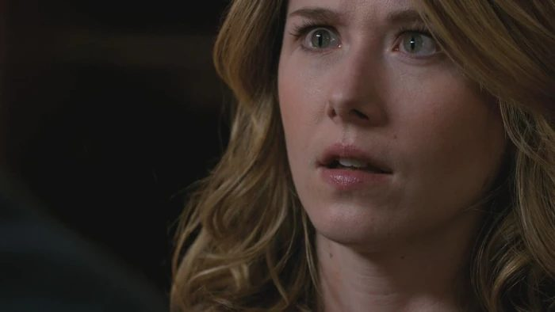

**Описание**

Кицунэ — редкий монстр, который в облике напоминает вервольфа, но с более лисьими, чем волчьими чертами. Внешне это обычные люди, и только в момент кормления или нападения они выдают себя: из пальцев выдвигаются длинные когти, а глазные яблоки становятся жёлтыми и лисьими, зрачки сужаются. Все кицунэ умеют частично оборачиваться в помесь человека и лисы; полностью зверем они не становятся.

Кицунэ — хищники, и их добыча не мясо, а гипофиз, часть мозга. Без регулярного поступления человеческих гипофизов кицунэ слабеют и в конце концов погибают, а молодые особи просто заболевают. Поэтому они охотятся редко, но вынужденно, и умеют годами жить среди людей, не выдавая себя.

Сила и скорость у кицунэ сверхчеловеческие: они без труда валят взрослого мужчину с ног и опережают его в рывке, а главное их оружие — когти. При этом кицунэ почти неуязвимы: убить их можно только ударом в сердце либо голодом. Колт, убивающий почти любую тварь, тоже остаётся аргументом.

В 1998 году Дин и Джон охотились на одну кицунэ, оставив Сэма одного, и там Сэм познакомился с её дочерью — Эми Понд. Годы спустя эта встреча вернулась к нему уже взрослой историей с её сыном Джейкобом. Для охотников кицунэ — неудобная добыча: они живут как люди, любят как люди и убивают лишь столько, сколько нужно для выживания, а убить их можно только точным ударом в сердце. Прародителем вида считается альфа-кицунэ, о котором не известно почти ничего.

**Силы и способности**

- Сверхчеловеческая сила — кицунэ с лёгкостью опрокидывает и одолевает взрослого человека в рукопашной.
- Лисья скорость — она движется быстрее людей, используя стремительность, чтобы застать добычу врасплох.
- Когти — из пальцев выдвигаются длинные когти-лезвия, которыми кицунэ рвёт жертву.
- Оборотничество — кицунэ принимает помесь человеческого и лисьего облика, как вервольф, но по-лисьи.
- Почти полная неуязвимость — погибнуть она может только от удара в сердце или от голода.
- Незаметность среди людей — кицунэ годами живёт человеческой жизнью, и её выдаёт только кормление.

**Слабости**

- Сердце — кицунэ убивает только удар ножом или кинжалом точно в сердце.
- Голод — без регулярных человеческих гипофизов кицунэ слабеет и погибает; молодые особи заболевают.
- Колт — легендарный револьвер способен убить почти любого монстра, включая кицунэ.
- Выдача при кормлении — во время охоты глаза кицунэ желтеют и становятся лисьими, что выдаёт её.
- Человеческие привязанности — кицунэ живут семьями и привязываются к людям, что делает их уязвимыми.

**Как его убить.** Охота на кицунэ — это работа по следу исчезновений и вскрытых тел с повреждённым мозгом. Искать надо тихого человека, который всегда оказывается рядом с пропажами. Убить кицунэ можно только ударом в сердце: годится обычный нож или кинжал, но бить точно — прочие раны для неё не смертельны. Если у охотников есть Колт, задача упрощается. В крайнем случае кицунэ можно взять голодом: без гипофизов она слабеет и гибнет сама. Помните: у кицунэ почти всегда есть семья, и она может прийти мстить.

**Известные особи:** Эми Понд — кицунэ, с которой Сэм познакомился в 1998 году и встретился вновь спустя годы; Джейкоб Понд — сын Эми Понд; мать Эми Понд — кицунэ, за которой в 1998 году охотились Дин и Джон Винчестеры

#### Кицунэ
*Средний, Монстр, нейтральное*

---
- **Класс доспеха** 15 (природная броня)
- **Хиты** 52 (8d8 + 16)
- **Скорость** 40 фт.

| СИЛ | ЛОВ | ТЕЛ | ИНТ | МДР | ХАР |
|---|---|---|---|---|---|
| 16 | 18 | 15 | 13 | 14 | 14 |

- **Спасброски** Лов +6, Тел +4
- **Навыки** Акробатика +6, Скрытность +6, Восприятие +4, Обман +4
- **Сопротивление урону** дробящий, колющий и рубящий от немагического оружия (кроме атак в сердце)
- **Чувства** тёмное зрение 60 фт., пассивное Восприятие 14
- **Языки** английский
- **Бонус мастерства** +2
- **Уровень опасности** 4 (1 100 опыта)

***Особенности***
- ***Сердце — единственная уязвимость.*** Кицунэ можно убить только ударом в сердце. Атака, намеренно нацеленная в сердце, совершается с помехой. Когда кицунэ опускается до 0 хитов от любой другой раны, она не умирает, а падает без сознания и через 1 час приходит в себя с 1 хитом. Если она опущена до 0 хитов атакой в сердце или добита без сознания, она умирает навсегда.
- ***Вечный голод.*** Кицунэ должна съедать человеческий гипофиз не реже раза в неделю. За каждые сутки без пищи она получает помеху на проверки и атаки, а через месяц гибнет от истощения.
- ***Человеческий облик.*** Кицунэ совершает с преимуществом проверки Хар (Обман), выдавая себя за человека. Её жёлтые лисьи глаза видны только при кормлении и в бою, и знакомый с монстрами наблюдатель может распознать её проверкой Мдр (Восприятие) Сл 13.
- ***Лисья прыть.*** Кицунэ игнорирует немагическую труднопроходимую местность и совершает с преимуществом спасброски Лов против эффектов, сбивающих с ног.

***Действия***
- ***Мультиатака.*** Кицунэ совершает две атаки когтями.
- ***Когти.*** Рукопашная атака оружием: +6 к попаданию, досягаемость 5 фт., одна цель. Попадание: 7 (1d6 + 4) рубящего урона.
- ***Смертельный бросок (перезарядка 5–6).*** Кицунэ перемещается по прямой до своей скорости и совершает одну атаку когтями. При попадании цель должна преуспеть в спасброске Сил (Сл 13), иначе падает ничком; если цель не видела кицунэ в начале этого хода, атака наносит дополнительно 7 (2d6) рубящего урона.

***Бонусные действия***
- ***Лисья скорость.*** Кицунэ совершает Рывок или Отход.

***Реакции***
- ***Ускользание.*** Когда рукопашная атака промахивается по кицунэ, она может переместиться на 10 фт., не провоцируя атак.

**Тактика.** Кицунэ не ищет боя: она охотится на одиноких людей, бьёт из засады и старается закончить дело за один раунд, чтобы не оставлять свидетелей. Против группы она использует скорость и узкие места, выманивая охотников по одному, и никогда не даёт окружить себя. Получив серьёзные раны, она не отступает панически, а уходит на четырёх конечностях и прячется в жилом районе, где её не отличить от прохожего. Сердце она бережёт инстинктивно: закрывает грудь и разворачивается так, чтобы удар пришёлся в бок.

**Экология.** Кицунэ живут среди людей: съёмные квартиры, пригороды, маленькие городки. Они держатся семьями, растят детей и охотятся редко, лишь бы выжить, поэтому их трудно вычислить по частоте убийств. Вид редок и, по всей видимости, происходит от альфа-кицунэ, которого связывают с Евой. С другими монстрами кицунэ не сосуществуют и стараются не пересекаться; охотники, знающие их природу, иногда предпочитают договориться, а не убивать.

> **Заметки мастеру.** Кицунэ — не боевой мешок, а задача: партия должна понять, что обычные раны её не берут, и найти способ ударить в сердце или взять её голодом. В 5e её удобно собрать из вервольфа, заменив регенерацию на уязвимость к сердцу. Трудность настраивается одной строкой: уберите сопротивление к немагическому оружию — и монстр станет честным боем на 3 уровень, добавьте Колт в руки охотников — и он умрёт от одного выстрела. Для высокого уровня дайте кицунэ-матери союзников-людей и заложников, превратив бой в моральный выбор.

[↑ к содержанию](#содержание)

---

### 48. Клоны из веток и бечёвки

**Twigs and Twine Clones** · Монстр · CR 5 · опасность в сериале 3/5

*Также известно как:* Куклы из веток и бечёвки; Двойники

*Первое появление:* S12E20 «Twigs & Twine & Tasha Banes»

*Сезоны:* 12

Куклы из веток и бечёвки, заколдованные так, чтобы выглядеть и вести себя как конкретный человек. Обычными средствами их не убить: единственный известный способ — убить ведьму, которая их контролирует.

**Описание**

Клоны из веток и бечёвки — это куклы, сделанные из веток и бечёвки и заколдованные так, чтобы вести себя точно как определённый человек. Их создала ведьма-должница: заключив сделку с демоном, она получила доступ к могущественному заклятию, позволявшему оживлять такие куклы, чтобы те выглядели и действовали как намеченная цель. Кукла, ещё не оживлённая, выглядит как обычная фигурка из веток, перевязанных бечёвкой.

Ведьма делала клона для каждой убитой жертвы, используя её сердце как ключевой ингредиент заклятия. Само заклятие читается при помощи кольца ведьмы, и оно продолжает удерживать куклу под контролем всякий раз, когда ведьма этого требует. Клон при этом получает память человека, с которого его скопировали.

Эти клоны полностью сходят за обычных людей и способны обмануть даже самых опытных охотников — и даже других ведьм. Ни одна другая ведьма прежде не показывала такой способности. Когда ведьма приказывает клону исполнить её волю, глаза куклы становятся полностью белыми, а сама она начинает вести себя более безэмоционально и монотонно.

Убить клона обычными методами нельзя: как искусственные, магически питаемые существа, они не стареют и не могут быть убиты традиционными способами. Если клон получает достаточно серьёзные физические повреждения, он возвращается к своему неповреждённому виду. Единственная известная действенная мера — смерть контролирующей ведьмы. После гибели безымянной ведьмы способность читать заклятие перешла к Максу Бейнсу, который был вынужден продолжить это наследие после смерти матери и сестры: память о сестре он сохранял живой через клона.

**Силы и способности**

- Сверхсила — куклы достаточно сильны, чтобы без труда одолеть опытных охотников.
- Регенерация — получив серьёзные физические повреждения, клон возвращается к своему неповреждённому виду.
- Бессмертие — будучи искусственными магически питаемыми существами, они не стареют и не могут быть убиты обычными методами.
- Идеальная маскировка — клон полностью сходит за обычного человека и обманывает даже опытных охотников и других ведьм.
- Память оригинала — клон обладает памятью человека, с которого был скопирован.
- Полное подчинение — по приказу ведьмы клон исполняет её волю, и тогда его глаза становятся полностью белыми.

**Слабости**

- Смерть контролирующей ведьмы — единственная известная действенная мера против клона.
- Кольцо ведьмы — заклятие читается и удерживает куклу под контролем только через кольцо, без него контроль теряется.
- Сердце жертвы — ключевой ингредиент заклятия: без сердца убитого человека клона не создать.
- Белая пелена на глазах — когда клон действует по прямому приказу, его глаза становятся полностью белыми, что выдаёт подмену.
- Внешние приказы — без указаний ведьмы клон действует как её копия, а не как самостоятельная тварь.

**Как его убить.** Клона бессмысленно убивать: раны и даже смертельные повреждения возвращают его в неповреждённый вид, поэтому единственная цель — контролирующая его ведьма. Сначала нужно доказать подмену: ищите момент, когда у человека глаза становятся полностью белыми и он говорит монотонно, — значит, ведьма отдала прямой приказ. Затем идут по следу заклятия: нужны кольцо ведьмы и хотя бы одна убитая жертва, у которой забрали сердце. Когда ведьма найдена, её убивают, и все куклы рассыпаются.

**Известные особи:** Макс Бейнс (унаследовал заклятие); Тэша Бейнс

#### Клоны из веток и бечёвки
*Средний, Конструкт, без мировоззрения*

---
- **Класс доспеха** 14 (природная броня)
- **Хиты** 90 (12d8 + 36)
- **Скорость** 30 фт.

| СИЛ | ЛОВ | ТЕЛ | ИНТ | МДР | ХАР |
|---|---|---|---|---|---|
| 18 | 12 | 16 | 10 | 11 | 14 |

- **Спасброски** Сил +7, Тел +6
- **Навыки** Обман +8, Проницательность +3, Скрытность +4
- **Сопротивление урону** дробящий, колющий и рубящий от немагического оружия
- **Иммунитет к урону** яд, некротическая энергия
- **Иммунитет к состояниям** очарование, истощение, отравление, паралич, испуг
- **Чувства** пассивное Восприятие 10
- **Языки** все языки, известные скопированному человеку
- **Бонус мастерства** +3
- **Уровень опасности** 5 (1 800 опыта)

***Особенности***
- ***Идеальная подмена.*** Клон неотличим от скопированного человека: проверка Мдр (Проницательность) Сл 18 раскрывает подмену, и то только тогда, когда клон действует по прямому приказу.
- ***Восстановление формы.*** Получив 15 или более урона от одного удара, клон в начале своего следующего хода возвращается к неповреждённому виду и восстанавливает 15 хитов. Магический урон, урон от огня и урон от заклинаний этого не лечит.
- ***Магическая кукла.*** Клон не стареет, не дышит и не нуждается в еде, сне и воздухе. Он не может быть убит обычным оружием: пока жива контролирующая ведьма, снижение хитов до 0 лишь выводит его из строя на 1 минуту, после чего он встаёт с 1 хитом.
- ***Приказ ведьмы.*** Когда клон действует по прямому приказу контролирующей ведьмы, его глаза становятся полностью белыми, речь — монотонной, и он теряет способность обманывать: все проверки Обмана в этот момент совершаются с помехой.
- ***Разрыв при смерти хозяйки.*** Когда контролирующая ведьма умирает или теряет кольцо, заклятие рвётся: клон обездвижен и рассыпается в груду веток и бечёвки.

***Действия***
- ***Мультиатака.*** Клон совершает три атаки: две рукопашные и одну захватом.
- ***Удар.*** Рукопашная атака оружием: +7 к попаданию, досягаемость 5 фт., одна цель. Попадание: 11 (2d6 + 4) дробящего урона.
- ***Захват куклы.*** Рукопашная атака оружием: +7 к попаданию, досягаемость 5 фт., одна цель. Попадание: цель схвачена (Сл высвобождения 15). Клон не может быть схвачен в ответ: его тело из веток выскальзывает из захватов.
- ***Притворная смерть.*** Клон падает и притворяется мёртвым. Проверка Мдр (Проницательность) Сл 18 раскрывает обман; до этого существо считает клона убитым.

***Реакции***
- ***Возврат формы.*** Получив урон, клон может немедленно восстановить 10 хитов, если контролирующая ведьма находится в пределах 1 мили.

**Тактика.** Клон не ищет драки: его задача — занять место убитого человека и не дать раскрыть подмену. В бою он сначала изображает жертву и притворяется мёртвым, а когда обман раскрыт — бьёт сильно и без эмоций, стараясь схватить и удержать самого наблюдательного противника, чтобы тот не добрался до ведьмы. Повреждения клон переносит спокойно: он возвращается в неповреждённый вид и снова идёт вперёд, поэтому партия быстро понимает, что убивать надо не его. Если ведьма получает серьёзную угрозу, клон бросает бой и бежит её защищать; после её смерти он замирает и рассыпается.

**Экология.** Клоны не живут сами по себе: каждая кукла — продолжение конкретной ведьмы, её работа и её алиби. Одна ведьма делала клона для каждой убитой жертвы, используя сердце убитого; такие куклы держатся рядом с местом, где живёт или работает ведьма, и ведут себя как соседи и родные их прототипов. После смерти безымянной ведьмы её заклятие и кольцо перешли к Максу Бейнсу, который продолжил создавать клонов.

> **Заметки мастеру.** Клоны — не боевой, а детективный противник: партия не должна побеждать их уроном, она должна найти ведьму, и это делает сцену расследованием с таймером. В 5e их собирают из глиняного голема или щитового стража, добавив идеальную маскировку и привязку к хозяину. Обязательно подсказывайте игрокам белую пелену на глазах и монотонную речь как зацепку, иначе расследование встанет. Для низкого уровня снизьте хиты до 45 и уберите Мультиатаку; для высокого дайте ведьме трёх клонов сразу и кольцо как отдельный артефакт, за которым партия должна охотиться.

[↑ к содержанию](#содержание)

---

### 49. Кракен

**Kraken** · Монстр · CR 13 · опасность в сериале 3/5

*Также известно как:* Гигантский кальмар из записей Тары

*Первое появление:* Сезон 5, «My Bloody Valentine» (упоминание)

*Сезоны:* 5, 9

Морская тварь, похожая на гигантского кальмара, из записей Тары. Настолько редкая, что за годы поисков она так и не добыла эссенцию кракена — последний ингредиент заклинания поиска Первого Клинка.

**Описание**

Кракен — существо, живущее в море; по записям Тары он похож на гигантского кальмара. Это один из тех видов, которые встречаются в природе крайне редко: Тара годами искала кракена и так и не смогла добыть ни капли его эссенции.

О кракене известно немного. Сэм и Дин Винчестеры ни разу не встречали настоящего кракена, зато Кроули утверждал, что у него в Белизе есть целый склад, полный этих тварей. Именно эссенция кракена оказалась одним из ингредиентов — и последним добытым — для заклинания поиска Первого Клинка.

Предыстория такая: собрав у демонов сведения о Рыцарях Ада и Первом Клинке, Тара попыталась найти само оружие. После многих лет бесплодных поисков ей достались только заклинание слежения и все ингредиенты, кроме эссенции кракена. Когда пришли Дин и Кроули, последний достал недостающий ингредиент со своего склада в Белизе, и заклинание провели. Правда, оно отследило не сам Клинок, а источник его силы — Метку Каина, — потому что Клинок к тому времени бросили в океан (позже выяснилось, что в Марианскую впадину).

В списке появлений выжимки указаны «My Bloody Valentine» (5 сезон) и «First Born» (9 сезон); способности кракена там прямо обозначены как неизвестные.

**Силы и способности**

- Силы неизвестны — раздел способностей выжимки ограничен пометкой «неизвестно»: ни Сэм, ни Дин с кракеном не встречались.
- Обитатель моря — кракен живёт в море, а по записям Тары похож на гигантского кальмара.
- Крайняя редкость — Тара годами искала кракена и не смогла добыть ни капли его эссенции.
- Эссенция для ритуала — эссенция кракена входит в число ингредиентов и стала последним добытым компонентом заклинания поиска Первого Клинка.
- Запасы Кроули — Кроули утверждал, что у него в Белизе есть склад, полный кракенов.

**Слабости**

- Слабости неизвестны — выжимка не называет ни одного способа убить или отпугнуть кракена.
- Опыта охоты нет — ни один из братьев Винчестеров кракена не встречал, поэтому охотничьих рецептов против него не существует.
- Доступность через демонов — достать кракена проще не охотой, а связями: у Кроули в Белизе стоит склад с этими тварями.

**Как его убить.** Охотничьего рецепта нет: выжимка не описывает ни одной слабости кракена и ни одного случая, когда его убивали. Практический путь — не бой, а сделка: эссенцию кракена добывают через демонов и связи Кроули, у которого в Белизе стоит склад с этими тварями. Если мастер всё же выводит кракена в игру, работать придётся с лодки, гарпунами и огнём, но это уже домысел, а не сведения выжимки.

#### Кракен
*Громадный, Монстр, нейтральное*

---
- **Класс доспеха** 17 (природная броня)
- **Хиты** 207 (18d12 + 90)
- **Скорость** 10 фт., плавание 60 фт.

| СИЛ | ЛОВ | ТЕЛ | ИНТ | МДР | ХАР |
|---|---|---|---|---|---|
| 25 | 14 | 21 | 6 | 12 | 10 |

- **Спасброски** Сил +12, Тел +10
- **Навыки** Восприятие +6, Скрытность +7
- **Сопротивление урону** холод
- **Иммунитет к состояниям** испуг
- **Чувства** тёмное зрение 120 фт., пассивное Восприятие 16
- **Языки** —
- **Бонус мастерства** +5
- **Уровень опасности** 13 (10 000 опыта)

***Особенности***
- ***Амфибия.*** Кракен может дышать и воздухом, и под водой.
- ***Чернильная завеса.*** Под водой кракен может бонусным действием выпустить облако чернил радиусом 20 фт. Область сильно заслонена, и кракен получает преимущество на проверки Ловкости (Скрытность) в ней в течение 1 минуты.
- ***Эссенция кракена.*** Из тела кракена можно добыть эссенцию — редкий ингредиент заклинания поиска Первого Клинка. Добыча требует 1 часа работы и успешной проверки Ловкости (инструменты алхимика) Сл 15.
- ***Хватка щупалец.*** Кракен может одновременно удерживать до трёх существ; схваченное существо опутано и не может дышать, пока кракен держит его под водой.

***Действия***
- ***Мультиатака.*** Кракен совершает три атаки щупальцами или две атаки щупальцами и одну атаку клювом.
- ***Щупальце.*** Рукопашная атака оружием: +12 к попаданию, досягаемость 20 фт., одна цель. Попадание: 15 (2d8 + 6) дробящего урона, и цель схвачена (Сл освобождения 18).
- ***Клюв.*** Рукопашная атака оружием: +12 к попаданию, досягаемость 10 фт., одна схваченная, обездвиженная или сбитая с ног цель. Попадание: 22 (3d10 + 6) колющего урона.
- ***Опрокидывание судна (1/минуту).*** Если кракен находится под лодкой или небольшим кораблём, он переворачивает его: существа на борту проходят спасбросок Ловкости Сл 17, иначе падают в воду; судно получает 30 урона и начинает тонуть.

***Бонусные действия***
- ***Чернильная завеса.*** Находясь под водой, кракен выпускает чернила в радиусе 20 фт. Область сильно заслонена до конца его следующего хода.

***Легендарные действия***
- ***Перемещение.*** Кракен плавает на расстояние не больше своей скорости плавания, не провоцируя атак.
- ***Хват щупальца.*** Кракен совершает одну атаку щупальцем.
- ***Рывок из глубины.*** Кракен тянет схваченное существо на 15 фт. под воду; если у существа закончился запас дыхания, оно начинает задыхаться.

**Тактика.** Кракен не выходит на охотников сам: он ждёт на глубине, пока судно или ныряльщик окажется над ним, и атакует снизу. Сначала он хватает щупальцами по одному, чтобы разделить группу, и топит добычу; при сопротивлении опрокидывает лодку и скрывается в чернильном облаке. На мелководье и на суше он неуклюж и уязвим, поэтому старается утащить бой туда, где у людей нет опоры. Отступает он всегда в глубину, где его не достанут ни стрелы, ни клинки.

**Экология.** Кракены живут в море, держатся поодиночке и встречаются настолько редко, что даже охотники за сверхъестественным никогда их не видели. Кроули, судя по его словам, держит целый склад кракенов в Белизе, что говорит о возможности их отлова и хранения. С другими морскими существами они не связаны; выжимка не сообщает ни об их размножении, ни о том, сколько их всего.

> **Заметки мастеру.** Кракен здесь — морской босс на 8-11 уровень и, что важнее, источник редкого ингредиента: группа может охотиться за ним, а может выторговать эссенцию у демонов. Механически это классический кракен из бестиария 5e, урезанный до CR 13; для низких уровней замените его гигантским кальмаром, для высоких верните легендарные действия в полном объёме и добавьте шторм. Хорош как энкаунтер на воде, где игроки ценят лодку не меньше хитов.

[↑ к содержанию](#содержание)

---

### 50. Крокотта

**Crocotta** · Монстр · CR 4 · опасность в сериале 3/5

*Также известно как:* Крокотта-телефонный голос; Clark Adams

*Первое появление:* S03E14 «Long-Distance Call»

*Сезоны:* 3, 9

Крокотта — тварь, которая идеально подражает любому голосу, чтобы выманить жертву, и пожирает её душу. В наше время она звонит по телефону и говорит голосом близкого человека, толкая жертву к самоубийству.

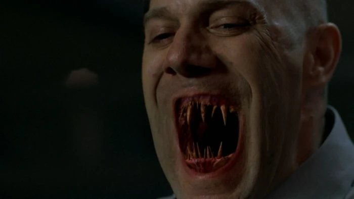

**Описание**

Крокотта — существо, способное подражать голосу любого человека, чтобы выманить жертву и насытиться. Она ловит людей на самое дорогое: голос матери, друга, любимой, — и говорит с ними так точно, что даже самые близкие люди не отличают тварь от настоящего человека. Для этого ей нужно лишь один раз услышать голос.

По легенде крокотта заманивает людей, окликая их по имени, и ведёт всё глубже в лес, пока не сможет сожрать. Одна крокотта сама хвасталась, что обычно вынуждена ждать днями, а люди знают её уловки, и что ей везёт, если за год удаётся добыть две души. В современном мире по меньшей мере одна крокотта приспособилась: она связывается с людьми по телефону и через компьютер, говорит голосом близкого и убеждает жертву покончить с собой или прийти к ней — чтобы убить и проглотить душу.

Крокотты живут в грязи, и о них известно, что они славятся своим пристрастием к ней; в остальном это скрытные одиночки, работающие чужими голосами. Они пожирают душу любого человека, которого убили или собираются убить, но не уничтожают её: это выше даже сил куда более могущественных сущностей вроде Смерти.

В «Long-Distance Call» Сэм и Дин расследуют смерти, связанные со странными звонками: звонящие называют себя духами и притворяются умершими. Один звонок приходит Дину от Джона Винчестера. Кларк Адамс, супервайзер телефонной компании, отводит братьев к технику Стюи Майерсу. Исследование показывает, что звонки идут от крокотты. Сэм подозревает Стюи, идёт в подвал телефонной компании и сталкивается с ним, но Кларк бьёт Сэма по голове. Именно Кларк и есть крокотта: он связывает Сэма и Стюи, убивает техника и съедает его дух, а затем делает новый звонок, чтобы подставить другого.

В «Slumber Party» крокотта тоже фигурирует, а сведения о ней вошли в «Bobby Singer's Guide to Hunting».

**Силы и способности**

- Подражание голосу — крокотта имитирует голос любого человека и перенимает его манеры так точно, что близкие не отличают подмены.
- Пожирание души — крокотта вытягивает душу убитого или обречённого человека, но не уничтожает её полностью.
- Смена облика — как и многие сверхъестественные существа, крокотта способна принимать человеческий вид.
- Технологическая адаптация — крокотты научились звонить по телефону и писать через компьютер, вместо того чтобы ждать путника в лесу.
- Подстрекательство — крокотта убеждает жертву покончить с собой или прийти к ней, используя доверие к голосу близкого.

**Слабости**

- Травма спинного мозга — повреждение спинного мозга, например удар в заднюю часть шеи, убивает крокотту; именно так Сэм убил Кларка.
- Смертность (предположительно) — крокотту легко убил Сэм, ударив её в спину, что говорит о её уязвимости, а не о бессмертии.
- Живой облик — действуя как человек, крокотта доступна обычному оружию и не может быть везде одновременно.
- Нужен услышанный голос — имитировать можно только тот голос, который крокотта слышала хотя бы раз.
- Голод — за год крокотта добывает в лучшем случае две души, что заставляет её рисковать и подставляться.

**Как его убить.** Главное в охоте на крокотту — не отвечать на голос, который зовёт по имени и звучит как родной. Работают так: собирают случаи самоубийств и странных звонков, проверяют записи и исходящие номера, вычисляют место, откуда идут звонки, и выходят на телефонную станцию. Бой короткий и решающий: тварь нужно ударить в затылок или в спину, повредив спинной мозг, — для этого годятся нож, мачете, ломик, дробовик в упор. В одиночку идти нельзя: крокотта вырубает охотника со спины и связывает его.

**Известные особи:** Кларк Адамс

#### Крокотта
*Средний, Аберрация, нейтрально-злое*

---
- **Класс доспеха** 14 (природная броня)
- **Хиты** 65 (10d8 + 20)
- **Скорость** 30 фт.

| СИЛ | ЛОВ | ТЕЛ | ИНТ | МДР | ХАР |
|---|---|---|---|---|---|
| 14 | 16 | 14 | 14 | 12 | 18 |

- **Спасброски** Хар +6, Лов +5
- **Навыки** Обман +8, Проницательность +5, Скрытность +7
- **Сопротивление урону** психическая энергия
- **Иммунитет к состояниям** очарование
- **Чувства** тёмное зрение 60 фт., пассивное Восприятие 11
- **Языки** любые языки, которые она слышала; голосом любого, чей голос запомнила
- **Бонус мастерства** +2
- **Уровень опасности** 4 (1 100 опыта)

***Особенности***
- ***Точное подражание.*** Крокотта может воспроизвести голос, манеру речи и интонации любого гуманоида, чей голос слышала хотя бы минуту. Проверки Мдр (Проницательность), чтобы распознать подмену в разговоре, совершаются с помехой.
- ***Пожиратель душ.*** Когда крокотта убивает гуманоида или тот умирает в пределах 30 фт., она может бонусным действием поглотить его душу: убитый не может быть возвращён к жизни никакой магией ниже истинного воскрешения, и крокотта восстанавливает 10 (3d6) хитов.
- ***Чужой облик.*** Крокотта может действием принять облик убитого или виденного гуманоида, оставаясь в этом облике, пока не сменит его. Атаки крокотты в этом облике не распознать без проверки Проницательности (Сл 16).
- ***Смертная плоть.*** Крокотта не бессмертна. Попадание по ней атакой, нацеленной в спинной мозг (атака с помехой по области затылка), считается критическим попаданием, если оно наносит урон.

***Действия***
- ***Мультиатака.*** Крокотта совершает две атаки: одну когтями и одну укусом.
- ***Когти.*** Рукопашная атака оружием: +5 к попаданию, досягаемость 5 фт., одна цель. Попадание: 8 (2d4 + 3) рубящего урона.
- ***Укус.*** Рукопашная атака оружием: +5 к попаданию, досягаемость 5 фт., одна цель. Попадание: 9 (2d6 + 2) колющего урона, и цель должна преуспеть в спасброске Тел (Сл 14), иначе не может восстанавливать хиты до конца своего следующего хода.
- ***Любимый голос (1/день).*** Крокотта говорит голосом существа, которое цель знает и любит. Цель в пределах 60 фт., слышащая её, должна преуспеть в спасброске Мдр (Сл 16), иначе очарована на 1 минуту и в свой ход должна двигаться к крокотте или выполнить действие, которое та предложит, если оно не приведёт к явной гибели.
- ***Совращение.*** Крокотта произносит заклинание внушение (Сл спасброска 16) от Хар, не нуждаясь в материальных компонентах.

***Бонусные действия***
- ***Поглощение души.*** Если в пределах 30 фт. находится гуманоид с 0 хитов, крокотта поглощает его душу и восстанавливает 10 (3d6) хитов.

**Тактика.** Крокотта избегает прямого боя: она звонит голосом близкого, ведёт жертву в удобное место и нападает со спины. В бою она старается остаться неопознанной, меняет облик и уводит противников по одному, говоря чужими голосами, чтобы расколоть группу. Если её раскрыли и ударили в спину или шею, она умирает быстро, поэтому берёт заложника и торгуется голосом его родных. Превосходства врага она не выдерживает и убегает, рассчитывая вернуться ночью.

**Экология.** Крокотты живут в одиночку и в грязи, обычно там, где есть линии связи: телефонные узлы, подвалы, заброшенные дома с компьютером, лесные дороги. Раньше они поджидали путников в лесах и звали их по имени, теперь часть из них перебралась в города и работает через связь. Стая из них не встречается, и за год одна особь добывает считанные души, поэтому истребление крокотт почти незаметно для местных.

> **Заметки мастеру.** Крокотта — лучший монстр для детективного дела с нуарной паранойей: игроки не могут доверять ни одному голосу, включая записи и телефоны. Ведите её как социальную угрозу, а не как мешок хитов: голос, ложные звонки, подставленные люди. В 5e её заменяют донжунговый оборотень или суккуб, но крокотте нужен именно голос, а не обаяние. Для низкого уровня уберите Совращение и снизьте Сл подражания до 13; для высокого дайте ей союзников-марионеток и нескольких крокотт в деле одновременно.

[↑ к содержанию](#содержание)

---

### 51. Ла Тунда

**La Tunda** · Монстр · CR 6 · опасность в сериале 3/5

*Также известно как:* Колумбийская карга; Женщина-цветник

*Первое появление:* The Winchesters, S01 «Teach Your Children Well»

Тварь, созданная тёмной магией цветов: бывшая женщина из Колумбии, превращённая в растительного монстра с огромной силой и умением уходить под землю вместе с жертвой. Уязвима только в сердце, а её нога рассыпается в щепки от удара.

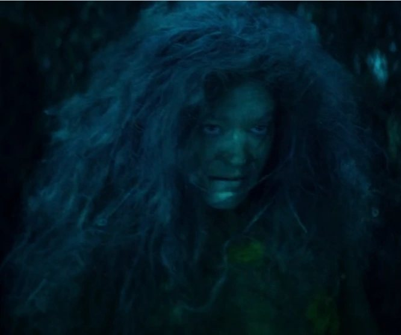

**Описание**

Ла Тунда — злобное существо с растительными чертами, появившееся в «The Winchesters». Когда-то она была жестокой и властной матерью из Колумбии, которая держала своих детей запертыми в доме в глубине леса. Дети попытались сбежать, подпилив ей ногу, и тогда женщина поймала их, разрубила останки на части и скормила своему цветнику. Цветы пропитались тёмной магией и жаждой крови и превратили женщину в монстра, единственная цель которого — кормить этот цветник.

Из-за корней, сросшихся с телом, Ла Тунда использует их как продолжение себя: она поднимает и перемещает большие цели, даже людей крупнее себя. После захвата жертвы она уносит их в своё логово, быстро зарываясь в землю; как именно она это делает — физически прокапываясь или магией — неизвестно, но на месте остаются редкие цветы, связанные с ней в преданиях.

Ла Тунда обладает и некоторой способностью менять облик: она может изменять внешность. Она заметно сильнее людей — в драке отправила Мэри в полёт через всё логово и без труда опрокинула Джона.

Её слабое место связано с телом: когда Джон ударил её по ноге, та рассыпалась в щепки — вероятно, отголосок того, как дети подпилили ей ногу при жизни. Настоящая уязвимая точка Ла Тунды — сердце: говорили, что убить её может только магия, равная ей по силе. Мэри убила Ла Тунду, вонзив в неё щепку от её же сломанной ноги.

В Топике Ла Тунда кормилась молодыми людьми из коммуны, которые пытались освободиться от влияния родителей. На неё обратил внимание Сэмюэл Кэмпбелл и предупредил Мэри Кэмпбелл, Джона Винчестера, Карлоса Сервантеса и Латику Дар; молодые охотники и убили тварь. Вскоре после этого её останки посетила фигура в плаще.

**Силы и способности**

- Сверхчеловеческая сила — Ла Тунда отправила Мэри в полёт через всё логово и легко опрокинула Джона.
- Хлорокинез — корни, сросшиеся с её телом, работают как продолжения рук: ими она поднимает и двигает даже людей крупнее себя.
- Зарывание — захватив жертву, она быстро уходит с ней под землю, оставляя на месте редкие цветы.
- Смена облика — Ла Тунда способна в некоторой степени изменять свою внешность.
- Тёмная магия цветов — именно она превратила женщину в монстра и требует постоянной крови.

**Слабости**

- Нога — удар Джона по ноге переломил её со звуком щепок: конечность уязвима и рассыпается от сильного удара.
- Сердце — истинная уязвимая точка: говорили, что убить Ла Тунду может только магия, равная её силе.
- Собственная нога как оружие — Мэри убила Ла Тунду, вонзив в неё щепку от её же сломанной ноги.
- Кровная зависимость — её цветы требуют крови; именно этим объясняется охота на людей.

**Как его убить.** Ла Тунда почти неуязвима для обычного оружия: убить её может только магия, равная по силе той, что её создала, — либо оружие из её же тела. В «The Winchesters» Мэри Кэмпбелл убила Ла Тунду, вонзив ей в сердце щепку от её собственной ноги: значит, сначала нужно сломать ногу и использовать острую щепу как кол. Перед этим тварь придётся обездвижить — корни и зарывание делают удержание на поверхности трудным. Искать её стоит по редким цветам на месте захвата жертв.

#### Ла Тунда
*Средний, Растение, нейтрально-злое*

---
- **Класс доспеха** 14 (природная броня)
- **Хиты** 93 (11d8 + 44)
- **Скорость** 30 фт., копание 20 фт.

| СИЛ | ЛОВ | ТЕЛ | ИНТ | МДР | ХАР |
|---|---|---|---|---|---|
| 19 | 12 | 18 | 10 | 13 | 15 |

- **Спасброски** Сил +7, Тел +7
- **Навыки** Атлетика +7, Восприятие +4, Запугивание +5
- **Уязвимость к урону** огонь
- **Сопротивление урону** яд
- **Иммунитет к состояниям** очарование, испуг
- **Чувства** тёмное зрение 60 фт., пассивное Восприятие 14
- **Языки** английский, испанский
- **Бонус мастерства** +3
- **Уровень опасности** 6 (2 300 опыта)

***Особенности***
- ***Корни-продолжения.*** Ла Тунда может действием поднять или переместить предмет или существо размером не больше Большого в пределах 30 фт., если оно стоит на земле или на корнях. Существо избегает этого успешным спасброском Силы (Сл 15).
- ***Зарывание.*** Ла Тунда может действием зарыться в землю вместе с одной схваченной целью. Пока она под землёй, её нельзя атаковать, если только атакующий не копает; в начале своего следующего хода она появляется в пределах 30 фт. от места погружения.
- ***Смена облика.*** Ла Тунда может действием изменить свою внешность. Она не меняет размер и тип, но получает преимущество на проверки Хар (Обман), чтобы выдать себя за человека.
- ***Жажда крови.*** Если Ла Тунда не кормилась кровью в течение суток, она получает один уровень истощения и не может восстанавливать хиты. Истощение снимается только свежей кровью.
- ***Слабая нога.*** Удар по ноге Ла Тунды наносит обычный урон, но при критическом попадании нога ломается: до конца боя её скорость уменьшается вдвое, и на земле остаётся щепка, которой можно пронзить её сердце.

***Действия***
- ***Мультиатака.*** Ла Тунда совершает две атаки корнями или одну атаку корнями и одну атаку захватом.
- ***Корни.*** Рукопашная атака оружием: +7 к попаданию, досягаемость 15 фт., одна цель. Попадание: 13 (2d8 + 4) дробящего урона.
- ***Захват.*** Рукопашная атака оружием: +7 к попаданию, досягаемость 10 фт., одна цель. Попадание: 9 (1d10 + 4) дробящего урона, и если цель — существо не больше Большого, она схвачена (Сл высвобождения 15).
- ***Утаскивание.*** Ла Тунда зарывается в землю вместе с одной схваченной целью. Цель получает 14 (4d6) дробящего урона и появляется вместе с Ла Тундой в её логове.

***Бонусные действия***
- ***Скольжение корней.*** Ла Тунда совершает Рывок или Отход.

***Действия в логове***
- ***Цветник пробуждается.*** В начале раунда (инициатива 20) корни в логове хватают существ: каждое существо на полу в пределах 60 фт. должно преуспеть в спасброске Сил (Сл 15), иначе опутано до конца раунда.
- ***Редкие цветы.*** В логове распускаются редкие цветы, связанные с Ла Тундой: до конца раунда она совершает с преимуществом проверки Мдр (Восприятие) и спасброски против магии, нацеленной на её сердце.

**Тактика.** Ла Тунда бьёт грубо и прямо: она врывается в схватку, швыряет противников корнями и опрокидывает их на землю, а затем старается утащить одну жертву в логово, зарывшись вместе с ней. Корни дают ей дальний захват, поэтому она держит бойцов на расстоянии и не подпускает их вплотную. Слабая нога и сердце заставляют её прикрываться: она прячет центр тела за корнями и уходит под землю, потеряв половину хитов, чтобы вернуться с новой жертвой. Огня и магии она боится по-настоящему и от них отступает вглубь логова.

**Экология.** Ла Тунда родом из Колумбии, где и была создана цветами в лесу; позже она перебралась в Топику и кормилась молодыми людьми из коммуны, бросившими родителей. Её логово — густо заросшее корнями место, где она прячет жертв; захватывая добычу, она уходит под землю, оставляя редкие цветы. Существует она, судя по всему, в единственном экземпляре: цветник, её создавший, требует крови, и без жертв тварь слабеет.

> **Заметки мастеру.** Ла Тунда — командирский противник на 5–7 уровень, чья задача не перебить группу, а утащить одного персонажа: это превращает бой в спасательную операцию. Ключ к победе — сломать ей ногу и использовать щепку как кол, поэтому дайте игрокам шанс заметить уязвимость заранее. Замена в 5e — зелёная карга с чертами три-крина; для низкого уровня уберите хлорокинез и снизьте хиты до 60, для высокого добавьте легендарные действия и свиту из цветочных тварей.

[↑ к содержанию](#содержание)

---

### 52. Ламия

**Lamia** · Монстр · CR 5 · опасность в сериале 3/5

*Также известно как:* Греческая соблазнительница-кровопийца; Демон-детоубийца

*Первое появление:* S06E04 «Weekend at Bobby's»

*Сезоны:* 6, 15

Греческая тварь, которая в облике женщины соблазняет мужчин, сжимает им сердце и высасывает кровь. Обычным оружием не берётся; убить её можно освящённым серебряным ножом или огнём после розмарина с солью.

**Описание**

Ламии — сверхъестественные существа, с которыми сталкивались Винчестеры. О них известно мало: это монстры, редко встречающиеся за пределами Греции. Одна ламия ненадолго появляется в эпизоде «Weekend at Bobby's» как одно из дел Дина и Сэма; Бобби показывает её коготь на своём компьютере.

Способности ламий описаны расплывчато: они появились в сериале лишь однажды. Подразумевается, что у них усиленные сила и ловкость, позволяющие без труда одолеть Сэма и швырнуть его через комнату: они могут швырять взрослых мужчин и вскрывать грудные клетки. Ламия не может быть убита обычными средствами и способна принимать человеческий облик, чтобы соблазнять мужчин, а затем убивать их.

Внешне ламии выглядят как обычные женщины, которые соблазняют молодых мужчин. Одна из их повадок — сжимать жертве сердце и высасывать кровь. Кроме того, подразумевается, что ламия умеет превращаться в нечеловеческую форму — по-видимому, истинную: она вооружена крупными когтями, а её рык устрашающ. Именно такой коготь нашли братья, осматривая тело с развороченной грудной клеткой. Ламия, с которой сражались Сэм и Дин, носила одеяние с капюшоном, как у штриги, хотя насколько это распространено — неизвестно.

Ламии известны несколько способов убийства, но показаны только два: удар серебряным ножом, освящённым священником, и огонь. Второй требует подготовки — ламию нужно «приправить» смесью розмарина и соли и лишь потом поджечь: без приправы огонь её не берёт.

В древнегреческой мифологии Ламия — прекрасная царица Ливии, ставшая демоном, пожирающим детей. По Диодору Сицилийскому, у неё был роман с Зевсом, и она родила ему детей; узнав об измене, Гера убила их. Обезумев от горя, Ламия принялась пожирать чужих детей. Поздние традиции говорили уже о множестве ламий — монстрах, похожих на вампиров и суккубов.

**Силы и способности**

- Сверхсила — ламия достаточно сильна, чтобы швырять взрослых мужчин и вскрывать грудные клетки.
- Сверхловкость — ламия проворнее человека, что позволяет ей увернуться и одолеть даже опытного бойца.
- Неуязвимость — обычными средствами ламию убить нельзя.
- Оборотничество — ламия принимает облик женщины, чтобы соблазнить мужчину, а затем убить его.
- Истинная форма с когтями — в нечеловеческом облике ламия вооружена крупными когтями, которыми вскрывает грудную клетку.
- Высасывание крови — ламия сжимает жертве сердце и высасывает кровь.

**Слабости**

- Освящённый серебряный нож — удар серебряным ножом, освящённым священником, убивает ламию.
- Розмарин и соль — смесь розмарина и соли, брошенная в ламию, делает её уязвимой и позволяет одолеть её огнём.
- Огонь — поджог после «приправы» розмарином и солью оказался для ламии смертельным.
- Редкость — ламии почти не встречаются за пределами Греции, поэтому охотники редко знают их слабости.

**Как его убить.** Охотнику нужны три вещи: серебряный нож, освящённый священником, мешочек с розмарином и солью и источник огня. Работают два порядка действий. Первый: подобраться вплотную и всадить освящённый серебряный нож. Второй: бросить в ламию смесь розмарина и соли, а затем сразу поджечь — без приправы пламя её не берёт. Выслеживают ламию по телам мужчин с развороченной грудной клеткой и по когтю, оставленному на месте убийства. Засаду разумнее ставить на жертву, а не на тварь.

**Известные особи:** Ламия Сэма и Дина из «Weekend at Bobby's» — носит капюшон, как у штриги

#### Ламия
*Средний, Монстр, нейтрально-злое*

---
- **Класс доспеха** 15 (природная броня)
- **Хиты** 82 (11d8 + 33)
- **Скорость** 40 фт.

| СИЛ | ЛОВ | ТЕЛ | ИНТ | МДР | ХАР |
|---|---|---|---|---|---|
| 19 | 17 | 16 | 12 | 13 | 16 |

- **Спасброски** Сил +7, Лов +6
- **Навыки** Акробатика +6, Восприятие +4, Обман +6, Скрытность +6
- **Уязвимость к урону** освящённое серебро; огонь (см. «Приправа из розмарина и соли»)
- **Сопротивление урону** дробящий, колющий и рубящий от немагического оружия
- **Иммунитет к состояниям** очарование
- **Чувства** тёмное зрение 60 фт., пассивное Восприятие 14
- **Языки** греческий, английский
- **Бонус мастерства** +3
- **Уровень опасности** 5 (1 800 опыта)

***Особенности***
- ***Только освящённое серебро.*** Ламия не может быть опущена до 0 хитов ничем, кроме серебряного оружия, освящённого священником. После попадания таким оружием ламия теряет это свойство до конца следующего хода.
- ***Приправа из розмарина и соли.*** Если в ламию попадает смесь розмарина и соли (действие, проверка Ловкости Сл 13 или бросок), она до конца своего следующего хода становится уязвима к урону огнём и не может использовать Очаровывающий облик.
- ***Очаровывающий облик.*** Ламия может принять облик привлекательной женщины. Существо, которое она очаровала (спасбросок Мудрости Сл 14), считает её дружелюбной и не подозревает опасности, пока ламия не атакует.
- ***Сжатие сердца.*** Ламия может действием вырвать или сжать сердце схваченного, обездвиженного или недееспособного гуманоида. Цель проходит спасбросок Телосложения Сл 14, получая 22 (4d10) некротического урона при провале или половину при успехе; при провале максимум её хитов снижается на ту же величину. Ламия восстанавливает хиты в размере нанесённого урона.

***Действия***
- ***Мультиатака.*** Ламия совершает две атаки когтями или одну атаку когтями и одно Сжатие сердца.
- ***Коготь.*** Рукопашная атака оружием: +7 к попаданию, досягаемость 5 фт., одна цель. Попадание: 11 (2d6 + 4) рубящего урона, и цель схвачена (высвобождение — Сл 15).
- ***Устрашающий рык (1/день).*** Ламия издаёт рык. Каждое существо в пределах 30 фт., способное её слышать, проходит спасбросок Мудрости Сл 14, иначе становится испуганным на 1 минуту; спасбросок повторяется в конце каждого хода.

***Бонусные действия***
- ***Смена облика.*** Ламия превращается в привлекательную женщину или возвращается в истинную форму с когтями.

**Тактика.** Ламия не начинает бой открыто: она соблазняет жертву в человеческом облике, уводит её в уединённое место, а затем переходит в истинную форму с когтями и бьёт первой. Если её раскрыли, она старается схватить самого слабого и применить Сжатие сердца, пополняя свои хиты, и лишь затем драться с остальными. Против освящённого серебра и огня ламия отступает, Гасит пламя и кричит: рык она бережёт для того, чтобы разогнать союзников. Раненая, она прячется в подвалах, норах и канализации, где её когти дают преимущество.

**Экология.** Ламии — греческие твари, за пределами Греции почти не встречающиеся; в США зафиксирована одна особь. Держатся поодиночке, охотятся в одиночку, живут в человеческом облике среди людей и выбирают жертв среди молодых мужчин. Когти и вскрытые грудные клетки — типичные следы их трапезы. С другими монстрами они не связаны; в одном источнике ламия упомянута среди тварей, которыми повелевает Ева, но прямых подтверждений этому нет.

> **Заметки мастеру.** Ламия — идеальный монстр на 4–6 уровень для сюжета-расследования: тела мужчин с развороченной грудной клеткой ведут партию к ночному клубу или бару, где охотится соблазнительница. Замена в 5e — суккуб или вампирский отпрыск, но с обязательной уязвимостью к освящённому серебру и огню только после «приправы». Механика розмарина и соли превращает бой в подготовку: без смеси партия не может использовать огонь. На низком уровне снизьте хиты до 45 и уберите Сжатие сердца; на высоком добавьте двух ламий и стайку очарованных ими людей.

[↑ к содержанию](#содержание)

---

### 53. Лепрекон

**Leprechauns** · Монстр · CR 7 · опасность в сериале 3/5

*Также известно как:* Фейри-обманщик; Старик в костюме; Wayne Whittaker

*Первое появление:* S06E09 «Clap Your Hands If You Believe»

*Сезоны:* 6

Высший фейри из Авалона в облике пожилого мужчины: чудовищно силён, телепортируется, невидим и насквозь читает души. Заключает сделки с людьми и не считает зазорным убивать тех, кто встанет на пути.

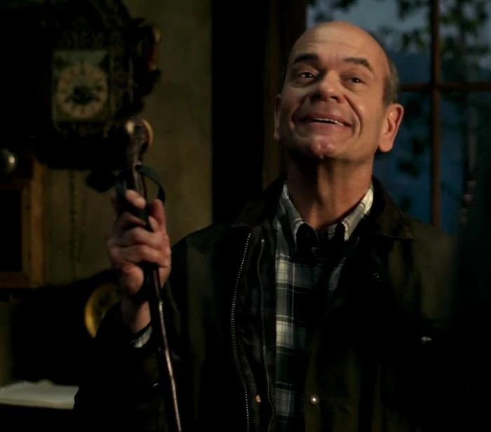

**Описание**

Лепреконы — один из видов фейри, обитающих в Авалоне и подчиняющихся Оберону. Это существа-обманщики, которые легко сходятся с людьми и охотно берутся «помогать»: в шестом сезоне лепрекон Уэйн Уиттакер заключил сделку с мистером Бреннаном и наладил работу в его магазине, приставив к делу эльфов и получая свою долю. Истинный облик лепрекона неизвестен — неизвестно даже, есть ли у него вообще настоящая форма: он просто принимает вид обычного человека. В сериале он выглядит как немолодой мужчина в костюме, безупречно вписанный в человеческое общество.

Хотя лепрекон осторожен и не любит открытых схваток, он чрезвычайно силён: обессмеренный Сэм Винчестер, лишённый души и потому не знавший страха, не смог справиться с ним в рукопашной и был вынужден отступить. Единственным выходом для Сэма оказалась горсть соли, брошенная перед фейри: лепрекон обязан остановиться и пересчитать каждую крупинку — этой задержки хватило, чтобы прочитать заклинание изгнания фейри и отправить его обратно в Авалон.

Лепреконы верны своим сородичам и предпочитают действовать через договор, а не через прямое насилие, но не испытывают ни малейших колебаний, когда нужно убрать человека, вставшего на пути их промысла. Они чувствуют энергию и души: один лепрекон безошибочно определил, что у Сэма нет души, объяснив это тем, что фейри «живут энергией», а человеческая душа имеет свой особый «аромат». Им также приписывают способность искажать реальность вокруг себя.

Для охотников лепрекон — противник, к которому нельзя подходить с одним лишь оружием. Винчестеры разбирались с Уэйном Уиттакером, вооружившись железом, солью, серебряным ножом и текстом заклинания изгнания фейри. 

**Силы и способности**

- Сверхчеловеческая сила — с лёгкостью одолевает взрослого человека в рукопашной; даже лишённый души Сэм не совладал с ним и отступил.
- Телепортация — мгновенно перемещается с места на место, поэтому его практически невозможно загнать в угол или поймать врасплох.
- Невидимость — как и все фейри, невидим для людей и открывается только по собственному желанию либо тем, кто побывал в Авалоне.
- Чтение душ — чувствует энергию и «аромат» души: безошибочно распознал, что у Сэма Винчестера нет души.
- Искажение реальности — лепреконам приписывают способность менять окружающую действительность вокруг себя, что делает их опасными противниками вне прямой схватки.

**Слабости**

- Крупы и зерно — если рассыпать перед ним сыпучее вещество, он обязан остановиться и пересчитать каждую крупинку; именно так Сэм выиграл время для изгнания.
- Соль — горсть соли перед лепреконом вынуждает его считать крупинки; этот приём был применён против Уэйна Уиттакера.
- Железо — железо очень вредно для всех фейри, включая лепреконов, и причиняет им сильную боль.
- Серебро — тёмных фейри можно жечь серебром: Сэм полоснул лепрекона серебряным ножом и обжёг его.
- Сахар и сливки — сахар числится среди известных ему неприятностей, а сливки фейри любят настолько, что ими легко задобрить лепрекона и отвлечь его.
- Заклинание изгнания фейри — возвращает его в Авалон; только оно надёжно выводит лепрекона из игры.

**Как его убить.** Инвентарь: железные гвозди или подковы, мешочек соли, крупа или сахар, серебряный нож и записанный текст заклинания изгнания фейри. Рассыпьте перед ним соль, зерно или сахар — он остановится пересчитывать крупинки. Железо держите наготове: оно не даёт фейри подойти вплотную. Серебром можно обжечь тёмного лепрекона, но это лишь рана. Пока он считает, читайте заклинание изгнания фейри: убийство лепрекона в сериале не показано.

**Известные особи:** Уэйн Уиттакер — лепрекон, заключивший сделку с мистером Бреннаном; изгнан Сэмом Винчестером в эпизоде «Clap Your Hands If You Believe».

#### Лепрекон
*Средний, Фея, нейтрально-злое*

---
- **Класс доспеха** 16 (природная броня)
- **Хиты** 90 (12d8 + 36)
- **Скорость** 30 фт.

| СИЛ | ЛОВ | ТЕЛ | ИНТ | МДР | ХАР |
|---|---|---|---|---|---|
| 22 | 18 | 16 | 15 | 16 | 20 |

- **Спасброски** Тел +6, Мдр +6, Хар +8
- **Навыки** Проницательность +6, Обман +8, Восприятие +6, Убеждение +8
- **Уязвимость к урону** железо; серебро
- **Сопротивление урону** холод, яд; дробящий, колющий и рубящий от немагического оружия, не посеребрённого и не железного
- **Иммунитет к состояниям** очарование, испуг
- **Чувства** истинное зрение 60 фт., пассивное Восприятие 16
- **Языки** все, Общий, Сильван
- **Бонус мастерства** +3
- **Уровень опасности** 7 (2 900 опыта)

***Особенности***
- ***Врождённое колдовство.*** Заклинательная способность лепрекона — Харизма (Сл спасброска от заклинаний 16). Он может без материальных компонентов творить следующие заклинания: по желанию — «Малая иллюзия», «Обнаружение мыслей»; 3/день каждое — «Внушение», «Невидимость» (только на себя), «Туманное облако»; 1/день — «Изменение реальности» (используйте «Изменение памяти» с Сл 16, чтобы создать ложное воспоминание или подменить деталь обстановки).
- ***Железная немощь.*** Когда лепрекон начинает свой ход в контакте с холодным железом или получает урон железным оружием, он совершает спасбросок Телосложения Сл 15. При провале он отравлен до конца своего следующего хода, а его скорость уменьшается вдвое — он не выносит прикосновения железа.
- ***Сопротивление магии.*** Лепрекон совершает спасброски от заклинаний и прочих магических эффектов с преимуществом.
- ***Чтение душ.*** Лепрекон чувствует эмоциональную и духовную природу существ. Он автоматически распознаёт, отсутствует ли у существа душа, находится ли оно под очарованием или одержимо, и знает, испытывает ли оно сильные горе, вину или страх.
- ***Обязательный пересчёт.*** Если в пределах 10 фт. от лепрекона рассыпано сыпучее вещество (соль, зерно, сахар, песок), он должен совершить спасбросок Мудрости Сл 15 в начале своего хода. При провале он теряет действие и вынужден пересчитывать крупинки; он не может покинуть это место, пока не преуспеет в спасброске в начале одного из следующих ходов.

***Действия***
- ***Мультиатака.*** Лепрекон совершает две атаки: одну кулаком и одну серебряным кинжалом.
- ***Кулак.*** Рукопашная атака оружием: +9 к попаданию, досягаемость 5 фт., одна цель. Попадание: 11 (1d8 + 7) дробящего урона.
- ***Серебряный кинжал.*** Рукопашная или дальнобойная атака оружием: +7 к попаданию, досягаемость 5 фт. или дистанция 20/60 фт., одна цель. Попадание: 6 (1d4 + 4) колющего урона, и цель должна преуспеть в спасброске Мудрости Сл 16, иначе до конца своего следующего хода не может произносить заклинания.
- ***Испуг (1/день).*** Лепрекон нацеливается на существо в пределах 30 фт. Цель должна преуспеть в спасброске Мудрости Сл 16, иначе испугана на 1 минуту; она может повторять спасбросок в конце каждого своего хода.

***Бонусные действия***
- ***Мгновенный шаг.*** Лепрекон магически телепортируется на расстояние до 60 фт. в незанятое пространство, которое видит.

***Реакции***
- ***Ответный удар.*** Когда существо промахивается по лепрекону рукопашной атакой, он может немедленно нанести ему одну атаку кулаком.

**Тактика.** Лепрекон не ищет честного боя: он держится в тени, открывается лишь тогда, когда может говорить, и первым делом пытается договориться или запугать. В схватке он бьёт сокрушительно и сразу, стараясь вырубить самого сильного противника, а затем телепортируется в укрытие. Против железа он не идёт — отступает и меняет тактику на уговоры. Если противник читает заклинание изгнания фейри, лепрекон атакует именно заклинателя.

**Экология.** Обитают в Авалоне, ко двору Оберона, но свободно выходят в человеческий мир и подолгу живут среди людей под видом обычных мужчин. Чаще всего они держатся поодиночке, нанимая или подчиняя более слабых фейри — эльфов, редкапов, тинксов — для работы и охраны. В человеческом обществе лепрекон обрастает связями, сделками и должниками; истреблять их целенаправленно никто не берётся, поскольку изгнание в Авалон считается достаточным результатом.

> **Заметки мастеру.** Лепрекон — идеальный «социальный» монстр для кампании 7–9 уровня: он говорит, торгуется и врёт, а бой начинает только тогда, когда его припёрли. Ведите его как криминального посредника, который держит городок в долгах и услугах. Им отлично заменяется Онi или зеленоглазый фейри-обманщик, но с уклоном в переговоры, а не в резню. На низких уровнях уберите «Изменение реальности» и снизьте CR до 5, оставив телепортацию и невидимость. Для высокоуровневой партии добавьте ему свиту эльфов и редкапов и позвольте один раз за бой призвать подкрепление из Авалона.

[↑ к содержанию](#содержание)

---

### 54. Лесная нимфа

**Wood Nymphs** · Монстр · CR 12 · опасность в сериале 4/5

*Также известно как:* Mrs. Butters; Хранительница бункера

*Первое появление:* S15E14 «Last Holiday»

*Сезоны:* 15

Могущественный вид, тесно связанный с лесами. Обычно доброжелательны, но при угрозе дому и семье становятся убийственно враждебными. Способны годами питать магией целое здание.

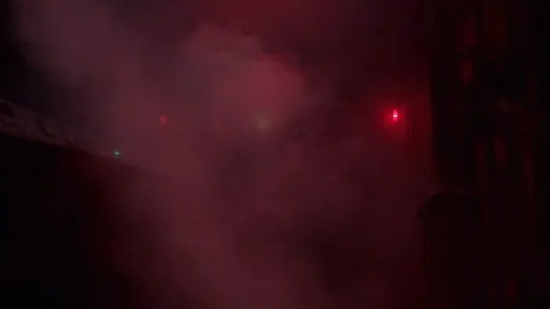

**Описание**

Лесные нимфы — могущественный сверхъестественный вид, тесно связанный с лесами и лесными угодьями. В сериале они представлены через миссис Баттерс, чья магия использовалась Кутбертом Синклером, чтобы дать дополнительную силу бункеру Людей Письма: её чары светятся зелёным, когда она их применяет. Нимфа способна мгновенно создавать букеты цветов, варить зелья — так она сварила зелье слабости для Джека, замаскировав его под смузи, — питать энергией всё оборудование бункера, чинить разбитую технику и вытягивать данные из электронных устройств через прикосновение.

По характеру лесные нимфы в целом дружелюбны и благожелательны. Сама миссис Баттерс рассказывает, что молодые нимфы играют в лесах, как это описывается в мифологии, а для старших это «игра молодых». Но если напасть на их дом и семью, они становятся жестоко враждебными вплоть до убийства. При этом хотя бы одна нимфа была готова «усыновить» группу людей, приняв их за свою семью, после того как ей сказали, что она не может вернуться на родину.

Слабости лесных нимф остались неизученными: из-за событий с миссис Баттерс у Сэма, Дина и Джека просто не было возможности заняться исследованием. Поскольку нимфы тесно связаны с фейри, можно предполагать, что железо действует на них так же, как на прочих фейри, но это не подтверждено. Зато известно, что против архангелов и Нефилимов нимфа опасно слаба: миссис Баттерс не смогла одолеть Джека напрямую и вынуждена была сначала ослабить его зельем, чтобы затем пленить. То, что она не решилась на прямую схватку, само по себе говорит о разнице в силах.

Лесные нимфы появляются в пятнадцатом сезоне. Миссис Баттерс связана с бункером Людей Письма и долгие годы оставалась в нём незамеченной, выполняя свою работу;.

**Силы и способности**

- Магия — нимфа владеет мощной магией, которая светится зелёным; магия миссис Баттерс использовалась для усиления бункера Людей Письма.
- Созидание — нимфа мгновенно создаёт предметы, например букет цветов, и способна творить иллюзии и внушать мысли.
- Зельеварение — она варит зелья слабости, умея маскировать их под обычную еду и напитки, как это было со смузи для Джека.
- Электрокинез — нимфа питала всю энергетическую систему бункера, давая ему «дополнительную мощь».
- Починка электроники — миссис Баттерс починила разбитый телевизор Дина, предположительно при помощи магии.
- Технопатия — нимфа извлекает данные из электронных устройств через прикосновение пальцами.

**Слабости**

- Железо — поскольку лесные нимфы тесно связаны с фейри, можно предположить, что железо им так же вредно, как и прочим фейри, однако это не подтверждено.
- Архангелы — против архангелов нимфа опасно слаба: миссис Баттерс не решилась на прямую схватку с Джеком.
- Нефилимы — Джек оказался значительно сильнее нимфы: ей пришлось ослабить его зельем, чтобы пленить, значит, в честном бою она ему уступала.
- Неизученность — настоящие слабости лесных нимф остались неизвестными: у Сэма, Дина и Джека не было возможности их исследовать.

**Как его убить.** Инвентарь: на случай боя — железное оружие, хотя его действенность против нимфы не подтверждена; для переговоров — то, что она ценит: обещание дома, семьи и признание её заслуг. Убивать лесную нимфу обычно незачем и опасно: её истинные слабости не изучены. Если она напала, отступите и попробуйте договориться: нимфа способна принять людей за свою семью.

**Известные особи:** Миссис Баттерс — лесная нимфа, связанная с бункером Людей Письма; её магию использовал Кутберт Синклер, она ослабила и пленила Джека с помощью зелья слабости и готова была принять Винчестеров как семью.

#### Лесная нимфа
*Средний, Фея, нейтрально-доброе*

---
- **Класс доспеха** 17 (природная броня)
- **Хиты** 150 (20d8 + 60)
- **Скорость** 30 фт.

| СИЛ | ЛОВ | ТЕЛ | ИНТ | МДР | ХАР |
|---|---|---|---|---|---|
| 14 | 15 | 17 | 18 | 20 | 20 |

- **Спасброски** Тел +7, Мдр +9, Хар +9
- **Навыки** Магия +8, Восприятие +9, Проницательность +9, Природа +8
- **Уязвимость к урону** железо
- **Сопротивление урону** холод, яд; дробящий, колющий и рубящий от немагического оружия, не железного и не посеребрённого
- **Иммунитет к состояниям** очарование, испуг
- **Чувства** истинное зрение 60 фт., пассивное Восприятие 19
- **Языки** Общий, Сильван, Друидический
- **Бонус мастерства** +4
- **Уровень опасности** 12 (8 400 опыта)

***Особенности***
- ***Врождённое колдовство.*** Заклинательная способность нимфы — Мудрость (Сл спасброска от заклинаний 17). Она может без материальных компонентов творить следующие заклинания: по желанию — «Дружба с животными», «Малая иллюзия», «Друидизм»; 3/день каждое — «Опутывание», «Обнаружение мыслей», «Изменение формы растений»; 1/день каждое — «Стена шипов», «Внушение», «Охрана души» (только на себя).
- ***Хранительница дома.*** Пока нимфа находится в помещении или на участке, которые считает своим домом, она восстанавливает 10 хитов в начале каждого своего хода и совершает с преимуществом проверки Интеллекта и Мудрости. Она всегда знает, кто вошёл в её дом и где именно находится.
- ***Зелёное свечение.*** Когда нимфа творит заклинание, её магия светится зелёным. Пока она колдует, она не может быть невидимой или скрытой.
- ***Железная немощь.*** Когда нимфа начинает ход в контакте с холодным железом или получает урон железным оружием, она совершает спасбросок Телосложения Сл 15. При провале она отравлена до конца своего следующего хода, а её концентрация на заклинаниях прерывается.
- ***Сопротивление магии.*** Нимфа совершает спасброски от заклинаний и прочих магических эффектов с преимуществом.
- ***Ярость за дом.*** Если существо, которое нимфа считает своей семьёй, получает урон в её присутствии, нимфа до конца своего следующего хода совершает броски атаки с преимуществом и наносит дополнительные 7 (2d6) урона некротической энергией при попадании.

***Действия***
- ***Мультиатака.*** Нимфа совершает две атаки колючей лозой или использует «Зелье слабости» и одну атаку лозой.
- ***Колючая лоза.*** Рукопашная атака заклинанием: +9 к попаданию, досягаемость 15 фт., одна цель. Попадание: 14 (2d8 + 5) колющего урона, и цель схвачена (Сл высвобождения 17).
- ***Зелье слабости (2/день).*** Нимфа вручает или подмешивает зелье, выглядящее и пахнущее как обычная еда или напиток. Существо, которое его выпьет или съест, должно преуспеть в спасброске Телосложения Сл 17, иначе на 1 час получает помеху на все броски атаки и проверки характеристик и не может использовать легендарные действия или заклинания выше 3 уровня.
- ***Удар силой леса (перезарядка 5–6).*** Нимфа выпускает волну зелёной энергии в конусе 30 фт. Каждое существо в этой области должно совершить спасбросок Ловкости Сл 17, получая 42 (12d6) урона силовым полем при провале или половину этого урона при успехе.

***Бонусные действия***
- ***Мгновенное творение.*** Нимфа магически создаёт немагический предмет из растительного материала, светильник, букет цветов или иной безвредный объект, либо чинит один сломанный механизм или электронное устройство, к которому прикасается.
- ***Считывание устройства.*** Нимфа прикасается к электронному устройству и узнаёт его последние данные: журнал событий, последние записи, список подключений или содержимое памяти.

***Реакции***
- ***Живая изгородь.*** Когда существо в пределах 30 фт. от нимфы совершает атаку по её «семье» или по её дому, нимфа может вырастить перед ним стену из лоз: атака совершается с помехой.

***Действия в логове***
- ***Пробуждение дома.*** Нимфа использует одно из следующих свойств своего дома: двери и окна захлопываются и запираются (Сл 17, чтобы открыть силой); вся техника в доме включается и создаёт оглушающий шум — каждое существо, кроме нимфы, должно преуспеть в спасброске Телосложения Сл 15, иначе получает 7 (2d6) урона звуком и оглохло до конца своего следующего хода; либо зелёный свет заливает коридор, и нимфа совершает проверку Скрытности с преимуществом.

**Тактика.** Нимфа не боец по натуре: она сначала пытается договориться, запугать или усыпить бдительность, а в бой вступает только тогда, когда её дом или семья под угрозой. В сражении она использует дом как оружие: запирает двери, глушит техникой, выращивает лозы и бьёт силой леса с дистанции. Если противник сильнее, она отступит, подмешав ему зелье слабости. Железо — единственное, чего она действительно боится.

**Экология.** Лесные нимфы связаны с лесами и рощами, но привязываются к конкретному дому, который считают своим, и живут в нём годами, оставаясь незамеченными. Держатся поодиночке: каждая нимфа охраняет своё место и свою «семью». С людьми уживаются мирно, если те не трогают её дом, и способны заменить им родню. С другими фейри поддерживают родство, но живут обособленно.

> **Заметки мастеру.** Лесная нимфа — не столько монстр, сколько союзник с ценой: для партии 12–14 уровня это хранительница убежища, которая может стать и величайшей проблемой кампании. Ведите её как изначально дружественную силу, чья враждебность — следствие действий игроков, а не злого умысла. Отличная замена архифее, но с домашним уклоном вместо придворной интриги. Для низких уровней уберите «Удар силой леса» и логово, снизив CR до 8. Каноничная слабость к Нефилимам и архангелам удобна как сюжетный рычаг: партия может привлечь такое существо, чтобы справиться с нимфой.

[↑ к содержанию](#содержание)

---

### 55. Летающие обезьяны

**Flying Monkeys** · Монстр · CR 3 · опасность в сериале 3/5

*Также известно как:* Обезьяны-феи; Monkey-Fairies

*Первое появление:* S09E04 «Slumber Party»

*Сезоны:* 9

Крылатые слуги Злой Ведьмы из страны Оз: собираются в стаи, которые издалека принимают за гряду тёмных туч. Их сила в количестве, а о способностях и слабостях почти ничего не известно.

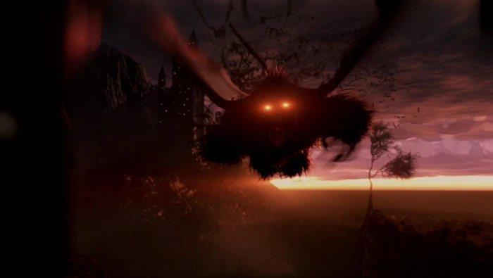

**Описание**

Летающие обезьяны — существа, родные для страны Оз, где они находились под контролем Злой Ведьмы. Они служили ей и, судя по всему, жили в её замке в Оз; в составе армии Ведьмы обезьяны должны были помочь ей править страной. В инфобоксе их категория обозначена как «обезьяны-феи» (Monkey-Fairies), и, поскольку они родом из Оз, их можно определить как разновидность фейри.

Выглядят они так, как и говорит их название: обезьяны с крыльями, когтями (talons) и светящимися красно-жёлтыми глазами. Держатся они вместе, образуя стаи настолько большие, что их принимают за гряду тёмных туч. Всё, что им приписывают достоверно, — это полёт: у каждой летающей обезьяны есть пара крыльев, позволяющая ей летать по воздуху. Их возможности и сила, если таковые вообще есть, в значительной мере неизвестны, как неизвестны и их слабости.

В 2013 году Злая Ведьма воспользовалась Ключом в Оз, чтобы открыть дверь прямо в бункере Людей Письма, и вызвала свою армию летающих обезьян, чтобы завоевать Землю. Армия не успела дойти до двери: Чарли Брэдбери убила Злую Ведьму при помощи Рубиновых Башмачков и закрыла дверь за мгновение до того, как первая из летающих обезьян добралась до неё, — так армия оказалась заперта в Оз.

То, что случилось дальше, лучше всего описывает их природу: летающие обезьяны не пришли в мир и не были истреблены, они просто остались служить своей госпоже в её стране. Ни одна из них не показала ни разума, ни собственной воли — только полёт и подчинение Ведьме.

**Силы и способности**

- Полёт — у каждой летающей обезьяны есть пара крыльев, позволяющая ей летать по воздуху.
- Стайная мощь — они собираются в стаи настолько большие, что издалека их принимают за гряду тёмных туч.
- Оружие тела — у летающих обезьян есть крылья, когти (talons) и светящиеся красно-жёлтые глаза, что делает их опасными даже без оружия.
- Подчинение Злой Ведьме — летающие обезьяны служат госпоже и входят в её армию, действуя по её приказу.

**Слабости**

- Слабости неизвестны — выжимка прямо указывает, что уязвимости летающих обезьян неизвестны.
- Зависимость от госпожи — обезьяны подчиняются Злой Ведьме; когда Чарли убила её при помощи Рубиновых Башмачков, армия осталась заперта в Оз и не смогла пройти.
- Дверь как предел — попасть в чужой мир они могут только через открытую дверь: закрытая дверь в Оз полностью отрезала армию.
- Возможная природа фейри — так как они родом из Оз, их можно определить как форму фейри, а значит, к ним применимы средства против фей.

**Как его убить.** Готового рецепта против летающих обезьян канон не даёт: их слабости неизвестны, и охотники ни разу не истребляли их в бою. Единственный проверенный способ — лишить стаю прохода: закрыть дверь в Оз, как это сделала Чарли, убив Злую Ведьму Рубиновыми Башмачками и захлопнув дверь за миг до того, как первая обезьяна добралась до неё. Если стая прорвалась, работают как с фейри: холодное железо, огонь, сети и оружие по площади. Пока жива Ведьма, бьют по госпоже.

#### Летающие обезьяны
*Малый, Фея, нейтрально-злое*

---
- **Класс доспеха** 14 (природная броня)
- **Хиты** 44 (8d6 + 16)
- **Скорость** 20 фт., полёт 50 фт.

| СИЛ | ЛОВ | ТЕЛ | ИНТ | МДР | ХАР |
|---|---|---|---|---|---|
| 11 | 17 | 14 | 6 | 11 | 12 |

- **Спасброски** Лов +5
- **Навыки** Акробатика +5, Восприятие +2, Скрытность +5
- **Уязвимость к урону** холодное железо
- **Сопротивление урону** дробящий, колющий и рубящий от немагического оружия
- **Иммунитет к состояниям** очарование
- **Чувства** тёмное зрение 60 фт., пассивное Восприятие 12
- **Языки** понимает язык Злой Ведьмы, но не говорит
- **Бонус мастерства** +2
- **Уровень опасности** 3 (700 опыта)

***Особенности***
- ***Рой как туча.*** Летающие обезьяны держатся роем. Рой занимает пространство 15 на 15 фт., может проходить через щели шириной 1 фт. и не может восстанавливать хиты, пока не окажется вне досягаемости врагов.
- ***Крылатая стая.*** Летающая обезьяна, находящаяся в пределах 5 фт. хотя бы от одной союзной обезьяны, совершает атаки с преимуществом и получает преимущество на спасброски против испуга.
- ***Слабые поодиночке.*** Одинокая летающая обезьяна (без союзников в пределах 30 фт.) получает помеху на все броски атаки и не может использовать Стайный налёт.
- ***Слуги своей госпожи.*** Обезьяны подчиняются Злой Ведьме. Пока их госпожа жива или находится в пределах 1 мили, они не отступают и не проходят проверки Мдр против принуждения.

***Действия***
- ***Мультиатака.*** Летающая обезьяна совершает две атаки: одну когтями и одну крыльями.
- ***Когти.*** Рукопашная атака оружием: +5 к попаданию, досягаемость 5 фт., одна цель. Попадание: 6 (1d6 + 3) рубящего урона.
- ***Крылья.*** Рукопашная атака оружием: +5 к попаданию, досягаемость 5 фт., одна цель. Попадание: 5 (1d4 + 3) дробящего урона, и цель должна преуспеть в спасброске Сил (Сл 11), иначе схвачена и поднята на 10 фт. в воздух.
- ***Стайный налёт.*** Летающая обезьяна перемещается на расстояние до своей скорости полёта и совершает одну атаку когтями. Если она при этом пролетела мимо двух других союзных обезьян, цель должна преуспеть в спасброске Лов (Сл 13), иначе получает 9 (2d6 + 2) рубящего урона дополнительно.

***Бонусные действия***
- ***Взмах крыльев.*** Обезьяна взлетает на 20 фт. вверх, не провоцируя атак по возможности.

***Реакции***
- ***Прикрытие сородича.*** Когда союзная летающая обезьяна в пределах 30 фт. становится целью атаки, другая обезьяна может переместиться к ней и принять атаку на себя.

***Действия в логове***
- ***Госпожа армии.*** Пока в логове находится Злая Ведьма, в начале каждого раунда появляются две новые летающие обезьяны, а все обезьяны в логове получают преимущество на спасброски. Когда Ведьма умирает, оставшиеся обезьяны рассыпаются и пытаются покинуть поле боя.

**Тактика.** Летающие обезьяны не воюют поодиночке — они налетают роем, кружат над партией и бьют тех, кто отстал или лезет на высоту: одна хватает и поднимает жертву, остальные её добивают. Их главная защита — то, что их много и они в воздухе, поэтому партия должна загнать их в замкнутое пространство или сбивать по одной: одинокая обезьяна теряет преимущества. Холодного железа и огня они боятся по своей фейской природе, но канон их слабостей не подтверждает. Пока жива Ведьма, рой возвращается.

**Экология.** Летающие обезьяны — родные обитатели страны Оз, где живут в замке Злой Ведьмы и служат в её армии, с помощью которой она должна была править страной. Держатся огромными стаями, которые издалека принимают за гряду тёмных туч, и ведут себя как единый рой, а не как отдельные звери. В мир людей они попадают только через открытую дверь: в 2013 году Ведьма открыла такую дверь Ключом в Оз, но она закрылась прежде, чем армия прошла.

> **Заметки мастеру.** Летающие обезьяны — идеальный «рой» для партии 3–5 уровня: по отдельности они слабы, но в стае из четырёх-шести превращаются в серьёзную проблему, особенно в воздухе. В 5e их собирают из гарпии или вихря-спрайта, объединив в роевые группы; главное — дать игрокам способ разбить строй (узкий коридор, сети, холодное железо). Держите их слугами конкретного злодея: пока он жив, бой повторяется, и партия сама поймёт, что надо бить по хозяину. Для низкого уровня ставьте двух обезьян и уберите Стайный налёт; для высокого — рой из восьми, Злую Ведьму с лаирными действиями и Ключ в Оз как цель сюжета.

[↑ к содержанию](#содержание)

---

### 56. Лидия Кроуфорд

**Lydia Crawford** · Монстр · CR 5 · опасность в сериале 3/5

*Также известно как:* Лидия; Вампир из тихого гнезда

*Первое появление:* S14 «Gods and Monsters»

*Сезоны:* 14

Молодая женщина, обращённая в вампира и жившая в гнезде, которое не трогало людей и питалось только животной кровью. Михаил захватил гнездо для экспериментов над монстрами; Лидия выжила и сбежала, не зная, что архангел отпустил её как приманку.

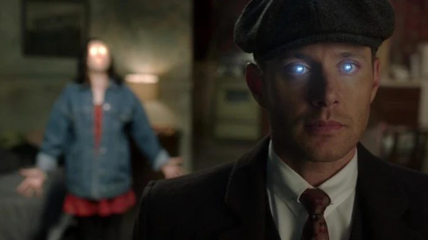

**Описание**

Лидия Кроуфорд была молодой женщиной, которую в какой-то момент обратили в вампира. Человеческие привычки она не бросила: по выжимке, Лидия продолжала водить машину, которая была у неё ещё до обращения. Она примкнула к гнезду вампиров, которое не причиняло вреда людям и питалось кровью животных, вело тихую жизнь и старалось не привлекать внимания охотников.

Во время экспериментов Михаила по созданию усиленных монстров архангел захватил Лидию и всё её гнездо. Она своими глазами видела, как Михаил ставит опыты над её соседями по гнезду. Когда очередь дошла до Лидии, несколько её друзей попытались напасть на архангела и были убиты, а сама она сбежала. Лидия не знала, что Михаил позволил ей уйти намеренно — как приманку для ловушки, которую он готовил.

После того как тела её друзей были найдены, Лидия пришла в морг: она заявила, что услышала об убийствах в утренних новостях, и хотела проверить, не знает ли кого-то из погибших. Осмотрев тела, она сказала коронеру, что не… — на этом месте выжимка обрывается, поэтому закончить её слова нельзя.

Как вампир Лидия обладала полным набором способностей обычного вампира: силой, скоростью, ловкостью, обострёнными чувствами и бессмертием. Она не старела и не болела человеческими болезнями, могла взбираться по стенам и прыгать с высоты без вреда для себя, слышала сердцебиение человека и могла идти по запаху крови на большие расстояния. Вампирские клыки втягиваются и выдвигаются по желанию, а их укус оставляет на шее жертвы огромные рваные следы.

Слабости у неё были те же, что у любого вампира, а сверх того — архангел. Михаил испепелил Лидию одним усилием мысли, даже не взглянув на неё. Обезглавливание также оставалось для неё смертельным. В сериале Лидия появляется в четырнадцатом сезоне, в эпизодах «Gods and Monsters» и «Nihilism».

**Силы и способности**

- Сверхсила — как вампир Лидия была значительно сильнее обычного человека.
- Сверхскорость — её скорость превосходила человеческую.
- Сверхловкость — вампиры взбираются по стенам и прыгают с крыш без травм; Лидия владела этой способностью в полной мере.
- Обострённые чувства — она видела в темноте, слышала сердцебиение человека, обладала усиленным обонянием и могла выследить кровь на большом расстоянии.
- Выдвижные клыки — у вампиров клыки выдвигаются по желанию, а их укус оставляет на шее жертвы огромные рваные следы.
- Бессмертие — вампиры не стареют и не болеют обычными человеческими болезнями, поэтому Лидия могла жить вечно, если бы её не убили.

**Слабости**

- Все слабости вампира — выжимка прямо указывает, что Лидия обладала полным набором вампирских уязвимостей, хотя перечисляет из них не все.
- Обезглавливание — как и любого вампира, Лидию можно было убить, полностью отделив голову от тела.
- Архангелы — Михаил испепелил её одной мыслью, даже не взглянув на неё, и ни сила, ни бессмертие ей не помогли.
- Доверие и жалость — она пришла в морг к телам друзей и попалась в ловушку, которую Михаил устроил именно на её сочувствии.

**Как его убить.** Лидия — обычный вампир, поэтому рецепт стандартный: обезглавливание убивает надёжнее всего, а солнечный свет и освящённые предметы остаются её слабостями. Вплотную она опасна: сильнее, быстрее и ловчее человека, видит в темноте и слышит ваш пульс, так что подкрасться к ней в укрытии почти невозможно. Серебро и пули её не берут — берите мачете и источник солнечного света. Ловить её лучше на приманку: у морга, где лежат тела её близких, она потеряет осторожность. Инвентарь: мачете, цепи, ловушка.

**Известные особи:** Лидия Кроуфорд (испепелена Михаилом); Михаил (архангел); Гнездо Лидии (уничтожено в экспериментах)

#### Лидия Кроуфорд
*Средний, Монстр, нейтральное*

---
- **Класс доспеха** 15 (природная броня)
- **Хиты** 82 (11d8 + 33)
- **Скорость** 40 фт., лазание 30 фт.

| СИЛ | ЛОВ | ТЕЛ | ИНТ | МДР | ХАР |
|---|---|---|---|---|---|
| 17 | 18 | 16 | 12 | 14 | 13 |

- **Спасброски** Лов +7, Тел +6
- **Навыки** Акробатика +7, Восприятие +5, Скрытность +7, Проницательность +5
- **Сопротивление урону** некротический; дробящий, колющий и рубящий от немагического оружия
- **Иммунитет к состояниям** очарование, испуг
- **Чувства** тёмное зрение 120 фт., пассивное Восприятие 15
- **Языки** общий (английский)
- **Бонус мастерства** +3
- **Уровень опасности** 5 (1 800 опыта)

***Особенности***
- ***Регенерация 10.*** Лидия восстанавливает 10 хитов в начале своего хода, если у неё есть хотя бы 1 хит и она не получала урона излучением или от солнечного света с конца своего предыдущего хода.
- ***Смерть от обезглавливания.*** Опустившись до 0 хитов, Лидия не умирает, а падает ничком. Она окончательно погибает, только когда её голова полностью отделена от тела; иначе через 1 час она восстанавливается до 1 хита.
- ***Слабость к солнцу.*** Лидия получает 10 урона излучением в начале каждого своего хода, пока находится под прямым солнечным светом. Она совершает с помехой броски атаки и проверки Восприятия в ярком свете.
- ***Обострённые чувства.*** Лидия имеет преимущество на проверки Мудрости (Восприятие), основанные на слухе и обонянии, и чует кровь на расстоянии до 1 мили.
- ***Тихая кровь.*** Лидия питается только животной кровью. Если она не пила кровь более 3 суток, она совершает спасбросок Мудрости Сл 13 в начале каждого часа, иначе до конца часа атакует ближайшего гуманоида.
- ***Вампирская ловкость.*** Лидия может лазать по вертикальным поверхностям, не совершая проверок, и не получает урона от падения с высоты до 30 фт.

***Действия***
- ***Мультиатака.*** Лидия совершает две атаки: одну укусом и одну когтями либо одну атаку оружием.
- ***Когти.*** Рукопашная атака оружием: +7 к попаданию, досягаемость 5 фт., одна цель. Попадание: 9 (2d4 + 4) рубящего урона.
- ***Укус.*** Рукопашная атака оружием: +7 к попаданию, досягаемость 5 фт., одна цель — гуманоид или зверь. Попадание: 8 (1d8 + 4) колющего урона плюс 7 (2d6) некротического урона, и максимум хитов цели уменьшается на величину некротического урона до завершения продолжительного отдыха.

***Бонусные действия***
- ***Прыжок с высоты.*** Лидия перемещается на половину скорости и совершает проверку Ловкости (Акробатика) Сл 12; при успехе она не провоцирует атак по пути.

**Тактика.** Лидия не ищет драки: её гнездо жило тихо и не трогало людей, поэтому в бою она ведёт себя как загнанный зверь. Она бьёт из темноты, использует высоту и узкие проходы, кусает самого слабого и отступает, как только теряет преимущество. Против архангела она не сопротивляется вовсе — Михаил убил её одной мыслью, и мастеру стоит отыгрывать это как полную беспомощность, а не как провал тактики. Если противник вооружён мачете или освещает помещение солнечным светом, Лидия предпочтёт бежать. Она не станет рисковать собой ради чужой выгоды, но на тела друзей придёт даже против здравого смысла.

**Экология.** Лидия — вампир городского гнезда, которое не охотилось на людей и питалось кровью животных. Такие гнёзда живут тихо, арендуют дома, водят машины и стараются не попадать в поле зрения охотников, поэтому о них часто не знают даже соседи. Лидия сохранила человеческие привычки: у неё была своя машина, и она продолжала на ней ездить. Её гнездо уничтожил Михаил в ходе экспериментов над монстрами, а сама Лидия погибла в четырнадцатом сезоне.

> **Заметки мастеру.** Лидия — базовый вампир для партии 4–7 уровня, но с важной сюжетной ролью: она не злодей, а выжившая жертва эксперимента, и партия может заключить с ней союз. CR 5 ставит её в один ряд с обычным вампиром, только без обаятельных и очаровывающих способностей, зато с ловкостью и чувствами. Её «Тихая кровь» — удобный способ показать, что вампир может быть мирным, и одновременно таймер: без животной крови союзница становится опасной. Если партия сильнее, добавьте ей гнездо из двух-трёх вампиров или сделайте её усиленной Михаилом версией с повышенными хитами и сопротивлением магии.

[↑ к содержанию](#содержание)

---

### 57. Линор

**Lenore** · Монстр · CR 5 · опасность в сериале 2/5

*Также известно как:* Хороший монстр; Вампир на коровьей крови

*Первое появление:* S02 «Bloodlust»

*Сезоны:* 2, 6

Вампир и глава гнезда, которое отказалось от человеческой крови и перешло на кровь коров. Она старалась жить в мире с людьми и избегать охотников, но погибла от руки Кастиэля, а её гнездо не устояло перед зовом Евы.

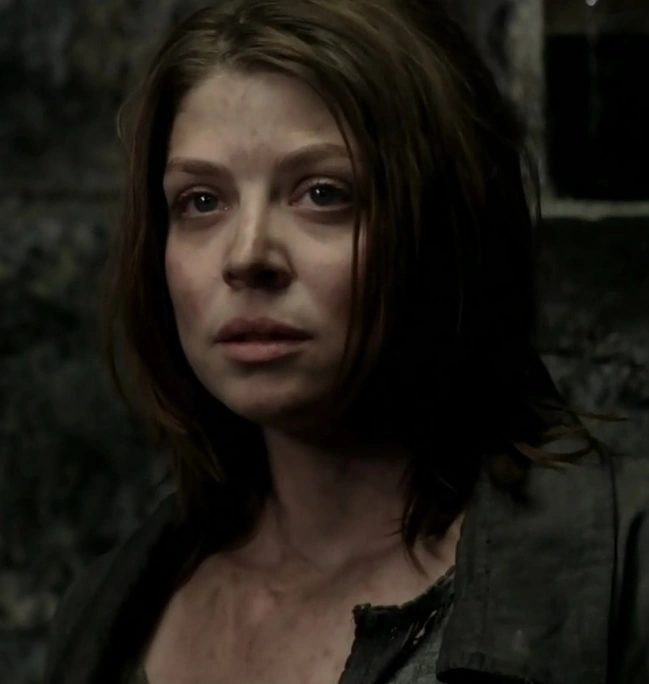

**Описание**

Линор была вампиром и главой гнезда, которое питалось коровьей кровью, а не человеческой. Она возглавила группу вампиров, отказавшихся от человеческой крови, и объясняла Сэму, что коровья кровь кажется ей отвратительной, но она того стоит: так можно жить в покое и не привлекать внимания охотников.

Несмотря на все усилия, на Линор и её гнездо охотился одержимый охотник на вампиров Гордон Уокер, с которым Сэм и Дин только что познакомились, расследуя дело. Вампиры Линор похитили Сэма прямо из мотеля и принесли в гнездо, и там она попросила его помочь вампирам спастись и остановить Уокера. Когда Сэма отпустили, он вернулся в мотель и стал убеждать брата в их невиновности, но Гордон подслушал разговор и отправился к гнезду один; поняв это, Винчестеры бросились следом.

Линор описана как «хороший монстр»: она не нападала на людей и держала своё гнездо в узде. Позже, в шестом сезоне, она рассказывала, что всё ещё пытается сбежать от Евы. По её словам, гнездо больше не могло сопротивляться голосу Евы и снова начало убивать, поэтому Линор была вынуждена прятаться в подвале и признавалась, что борется с жаждой крови и что «все сдаются».

Она погибла: Кастиэль без труда поразил её. Её душа попала в Чистилище — туда уходят все монстры после смерти. В сериале она появляется во втором сезоне («Bloodlust») и в шестом («Mommy Dearest»).

**Силы и способности**

- Сверхсила — как вампир Линор была сильнее людей и могла тягаться с другими монстрами.
- Сверхскорость — она двигалась быстрее, чем может уследить человеческий глаз, внезапно появлялась и исчезала и быстро настигала добычу.
- Обострённые чувства — она слышала сердцебиение человека с большого расстояния, отлично видела в темноте и чуяла запах крови в воздухе, от которого её клыки выдвигались.
- Клыки — у неё были сверхпрочные и острые, как бритва, клыки, которые выдвигались и убирались.
- Бессмертие — она не старилась и была невосприимчива к болезням, гниению, токсинам, инфекциям, вирусам, ядам и естественной смерти.

**Слабости**

- Мёртвая кровь — она причиняет вампиру достаточно боли, чтобы обездвижить, а иногда и лишить сознания; Гордон Уокер пытал Линор, покрыв этим составом свой нож.
- Ева — Линор не могла сопротивляться её голосу: гнездо снова начало убивать, а сама она пряталась в подвале, борясь с жаждой крови и повторяя, что «все сдаются».
- Серафимы — Кастиэль без труда поразил её, то есть против ангела она не значила ничего.
- Совесть — Линор отказывалась от человеческой крови, и это же делало её уязвимой: гнездо привлекало охотников и зависело от чужой воли.

**Как его убить.** Линор — не тот случай, когда нужен тяжёлый арсенал: она намеренно не охотилась на людей, и её гнездо держалось на коровьей крови, поэтому главной задачей охотника было понять, кто перед ним. Прямых способов в выжимке два: мёртвая кровь, которой Гордон Уокер обездвиживал и пытал её, и сила серафима — Кастиэль просто поразил её, без всякой подготовки. Если вы работаете против её гнезда, помните, что вампиры Линор похищают людей, чтобы договориться, а не убить.

**Известные особи:** Линор (Эмбер Бенсон); Гордон Уокер; Ева; Кастиэль; Илай

#### Линор
*Средний, Монстр, нейтральное*

---
- **Класс доспеха** 14 (природная броня)
- **Хиты** 82 (11d8 + 33)
- **Скорость** 40 фт.

| СИЛ | ЛОВ | ТЕЛ | ИНТ | МДР | ХАР |
|---|---|---|---|---|---|
| 16 | 16 | 16 | 12 | 13 | 15 |

- **Спасброски** Лов +6, Тел +6, Хар +5
- **Навыки** Восприятие +4, Скрытность +6, Проницательность +4, Убеждение +5
- **Сопротивление урону** некротический; дробящий, колющий и рубящий от немагического оружия
- **Иммунитет к состояниям** очарование, испуг
- **Чувства** тёмное зрение 60 фт., пассивное Восприятие 14
- **Языки** общий (английский)
- **Бонус мастерства** +3
- **Уровень опасности** 5 (1 800 опыта)

***Особенности***
- ***Регенерация 10.*** Линор восстанавливает 10 хитов в начале своего хода, если у неё есть хотя бы 1 хит и она не получала урона излучением с конца своего предыдущего хода.
- ***Смерть от обезглавливания.*** Опустившись до 0 хитов, Линор не умирает, а падает ничком. Окончательно она погибает, только когда её голова полностью отделена от тела; иначе через 1 час восстанавливается до 1 хита.
- ***Обострённые чувства.*** Линор имеет преимущество на проверки Мудрости (Восприятие), основанные на слухе и обонянии, и слышит сердцебиение гуманоида на расстоянии до 300 фт.
- ***Коровья кровь.*** Линор питается кровью скота, а не людей. Пока она придерживается этого, она не нападает на гуманоидов без крайней нужды и не считается враждебной, пока её не атакуют.
- ***Жажда крови.*** Если Линор не пила кровь более 24 часов, она в начале каждого часа совершает спасбросок Мудрости Сл 13, иначе до конца часа атакует ближайшего гуманоида; любой запах свежей крови даёт ей помеху на этот спасбросок.
- ***Зов Евы.*** Если рядом действует Ева или её посланник, Линор в начале каждого своего хода совершает спасбросок Мудрости Сл 15. При провале она теряет способность выбирать цели и атакует ближайшее существо, пока спасбросок не удастся.

***Действия***
- ***Мультиатака.*** Линор совершает две атаки: одну когтями и одну укусом либо две атаки когтями.
- ***Когти.*** Рукопашная атака оружием: +6 к попаданию, досягаемость 5 фт., одна цель. Попадание: 8 (2d4 + 3) рубящего урона.
- ***Укус.*** Рукопашная атака оружием: +6 к попаданию, досягаемость 5 фт., одна цель — гуманоид или зверь. Попадание: 6 (1d6 + 3) колющего урона плюс 7 (2d6) некротического урона. Максимум хитов цели уменьшается на величину некротического урона, пока она не завершит продолжительный отдых.
- ***Захват.*** Линор совершает одну атаку когтями. При попадании цель размера Средний или меньше схвачена (Сл высвобождения 13), и Линор больше не может использовать эту атаку по другой цели.

***Действия в логове***
- ***Тайное гнездо.*** Гнездо Линор скрыто в заброшенном доме или подвале. Найти его можно проверкой Мудрости (Восприятие) Сл 15; пока гнездо не обнаружено, вампиры внутри имеют преимущество на проверки Ловкости (Скрытность).
- ***Договор вместо боя.*** Если Линор чувствует, что партия готова слушать, она может в начале раунда предложить переговоры: до конца сцены её гнездо не атакует, а она сама даёт правдивый ответ на один вопрос о том, кто в округе пьёт человеческую кровь.

**Тактика.** Линор не начинает бой первой: она либо скрывается, либо пытается договориться, и это её главная тактика. Если её гнездо атакуют, она старается обездвижить нападающих и увести своих, а не убивать, потому что трупы привлекают новых охотников. Против Гордона Уокера и ему подобных она действует из засады и чужими руками, поручая захват своим сородичам. Единственное, что полностью ломает её волю, — голос Евы: под ним она теряет контроль и нападает на всех подряд, включая союзников. Прямой бой с ангелом она не переживёт и знает это.

**Экология.** Гнездо Линор живёт скрытно в заброшенных зданиях и подвалах и держится на крови скота, а не людей, что позволяет вампирам годами не привлекать внимания. Сама она — «хороший монстр»: она избегает охоты на людей, покровительствует своим сородичам и старается держаться в стороне от дел охотников. После появления Евы её гнездо распадается: голос Евы заставляет вампиров снова убивать, и Линор остаётся прятаться в одиночестве.

> **Заметки мастеру.** Линор — редкий для бестиария «мирный монстр»: CR 5 подходит для партии 3–5 уровня, но использовать её как боевого противника почти не стоит. Гораздо интереснее сыграть её как союзника или источник информации: она знает, кто в округе охотится на людей, и готова говорить, пока её гнездо не тронули. Её слабость — мёртвая кровь и зов Евы; второй удобно превратить в таймер: если Ева появляется в арке, гнездо Линор срывается в резню, и партия вынуждена выбирать между спасением вампиров и защитой людей. Для высокого уровня оставьте её как NPC, а не как угрозу, иначе бой закончится за один раунд.

[↑ к содержанию](#содержание)

---

### 58. Лорные ракшасы

**Lore Rakshasas** · Монстр · CR 4 · опасность в сериале 2/5

*Также известно как:* Безымянные ракшасы; Ракшасы-переселенцы

*Первое появление:* S02E02 «Everybody Loves a Clown»

*Сезоны:* 2, 3

Безымянные ракшасы, переселившиеся из индийских стран на Запад: редкие одиночки, которых охотники вычисляли по повадкам и убивали годами. Последний выживший скрывался под личиной слепого метателя ножей.

**Описание**

Безымянные ракшасы — это ракшасы, на которых охотились с течением времени. В сериале они не названы по именам и не имеют отдельной истории, поэтому все сведения о них ограничены общей канвой.

Ракшасы пришли из индийских стран, но в конце концов покинули родину и осели в западном мире, в том числе в США. Хотя они были редки, охотники вычисляли их по характерным признакам и со временем убивали одного за другим.

Один из них выжил и скрывался под личиной слепого метателя ножей, пока его не выследили и не убили. Это тот самый случай, который братья Винчестеры расследовали в эпизоде «Everybody Loves a Clown»: ракшаса выступал на ярмарке, являлся детям в облике шута и, когда ребёнок впускал его в дом, убивал родителей.

Признаки, по которым охотники распознают ракшасу, описаны в общем лоре вида: способность менять облик и становиться невидимым, невероятная сила, исключительный слух и сверхскорость. Убить ракшасу можно только латунью — ножом из чистой латуни или другим латунным предметом, — потому что от любого другого урона он быстро восстанавливается. Войти в дом без приглашения ракшаса не может, и именно поэтому он выманивает приглашение у детей.

Отдельных имён или биографий у безымянных ракшасов нет. Известно лишь, что они появлялись в западном мире редко, охотились с большими промежутками из-за медленного обмена веществ и в итоге были истреблены охотниками почти полностью — выжил только один, и тот погиб в комнате смеха от латунной органной трубы и латунного ножа.

**Силы и способности**

- Оборотничество — как и все ракшасы, безымянные способны носить человеческий облик и скрываться под ним годами.
- Невидимость — ракшаса становится невидимым для глаза; частично его видно только сквозь густой дым.
- Неуязвимость — ракшаса восстанавливается от любого урона, кроме латунного, поэтому обычные охотничьи средства против него бесполезны.
- Сверхсила — ракшаса без труда одолевает и терзает людей, что делает его опасным даже для опытного охотника.
- Сверхслух — ракшаса слышит разговоры на расстоянии, недоступном человеческому слуху, и потому его трудно застать врасплох.

**Слабости**

- Латунь — единственный смертельный материал: латунный нож или другой латунный предмет, вонзённый в тело, убивает ракшасу.
- Приглашение — ракшаса не может войти в дом без приглашения и вынужден выманивать его у детей.
- Редкость — безымянных ракшасов было немного, и охотники истребляли их поодиночке, не встречая организованного сопротивления.
- Густой дым — в дыму невидимость ракшасы перестаёт быть полной, и его можно разглядеть, чтобы нанести удар.

**Как его убить.** Работает тот же порядок, что и против любого ракшасы: латунный клинок, густой дым и засада в помещении. Инвентарь — нож из чистой латуни или латунная труба, дымовая шашка или рычаг, выпускающий пар, и справочник охотника с описанием вида. Вычисляют ракшасу по следу убийств родителей при живых детях, по бродячему образу жизни и работе в балагане или цирке. Бить нужно тогда, когда тварь перестаёт быть невидимой: в дыму или в момент нападения.

#### Лорные ракшасы
*Средний, Исчадие, нейтрально-злое*

---
- **Класс доспеха** 15 (природная броня)
- **Хиты** 75 (10d8 + 30)
- **Скорость** 40 фт.

| СИЛ | ЛОВ | ТЕЛ | ИНТ | МДР | ХАР |
|---|---|---|---|---|---|
| 17 | 17 | 16 | 12 | 13 | 14 |

- **Спасброски** Лов +5
- **Навыки** Восприятие +3, Обман +4, Скрытность +5
- **Уязвимость к урону** латунь
- **Сопротивление урону** дробящий, колющий и рубящий от немагического оружия
- **Иммунитет к состояниям** очарование
- **Чувства** тёмное зрение 60 фт., пассивное Восприятие 13
- **Языки** индийские языки, английский
- **Бонус мастерства** +2
- **Уровень опасности** 4 (1 100 опыта)

***Особенности***
- ***Только латунь.*** Ракшаса не может быть опущен до 0 хитов ничем, кроме латунного оружия. В начале своего хода он восстанавливает 5 хитов, если в прошлом раунде не получал урон латунью.
- ***Невидимость.*** Ракшаса может бонусным действием стать невидимым до конца своего следующего хода. В густом дыму невидимость не даёт ему преимущества на проверки Скрытности.
- ***Не войти без приглашения.*** Ракшаса не может войти в жилище гуманоида без явного приглашения. Попытка войти без него причиняет ему 7 (2d6) урона силовым полем.
- ***Скудный обмен веществ.*** Ракшаса охотится не чаще раза в 2–3 десятилетия и не получает истощения от голода, что позволяет ему десятилетиями жить незаметно.
- ***Смена личины.*** Ракшаса может действием принять облик виденного им гуманоида. Проверка Мдр (Проницательность) Сл 14 раскрывает обман.

***Действия***
- ***Мультиатака.*** Ракшаса совершает две атаки: укусом и когтями.
- ***Укус.*** Рукопашная атака оружием: +5 к попаданию, досягаемость 5 фт., одна цель. Попадание: 10 (2d6 + 3) колющего урона.
- ***Когти.*** Рукопашная атака оружием: +5 к попаданию, досягаемость 5 фт., одна цель. Попадание: 7 (1d8 + 3) рубящего урона.
- ***Метание ножа (только невидимым).*** Дальнобойная атака оружием: +5 к попаданию, дистанция 20/60 фт., одна цель. Попадание: 7 (1d8 + 3) колющего урона; атака не выдаёт местоположения ракшасы.

***Бонусные действия***
- ***Исчезнуть.*** Ракшаса становится невидимым до конца своего следующего хода.

**Тактика.** Безымянный ракшаса действует как скрытный убийца: он не вступает в открытый бой, пока держится невидимость, бросает ножи из темноты и уходит за угол после каждого броска. Против группы он разрывает строй, стараясь увести одного охотника туда, где темно и тесно, — в склад, закулисье, комнату смеха. Латунный клинок он распознаёт и обходит его владельца, нападая на остальных. Столкнувшись с дымом, ракшаса теряет преимущество и предпочитает бежать, меняя личину и снова прячась среди людей.

**Экология.** Безымянные ракшасы — редкие одиночки, переселившиеся из индийских стран в западный мир. Они держатся в бедности и бродяжничестве, живут среди людей и охотятся с промежутками в десятилетия, поэтому долго остаются незамеченными. Охотники истребляли их поодиночке, вычисляя по повадкам, и к моменту событий сериала выжил лишь один, скрывавшийся под личиной слепого метателя ножей. С другими монстрами они не связаны.

> **Заметки мастеру.** Лорные ракшасы — это «облегчённая» версия ракшасы для группы 3–5 уровня: та же механика латуни, невидимости и приглашения, но без метания ножей в полную силу и с меньшими хитами. Хорошо работают как рядовые или как первый ракшаса партии, после которого появится более опасный собрат. Замена в 5e — ракшаса из бестиария с урезанными параметрами. На низком уровне уберите невидимость и оставьте одну атаку когтями; на высоком добавьте двух таких ракшас и латунный клинок как награду за расследование.

[↑ к содержанию](#содержание)

---

### 59. Лох-несское чудовище

**Loch Ness Monster** · Монстр · CR 9 · опасность в сериале 3/5

*Также известно как:* Чудовище Лох-Несса

*Первое появление:* Сезон 1, «Dead In The Water» (упоминание)

*Сезоны:* 1, 6, 15

Водные сверхъестественные существа, обитающие, судя по названию, в шотландском озере Лох-Несс. В сериале подтверждается лишь само их существование: ни Сэм, ни Дин чудовище так и не увидели.

**Описание**

Лох-несские чудовища — водные сверхъестественные существа. Впервые о них вспоминают в деле о мстительном духе на озере Маниток в Висконсине: Сэм и Дин сначала предположили, что виновато чудовище, но Сэм отбросил эту версию из-за отсутствия очевидцев и сообщений о монстре — в отличие от Лох-Несса и озера Шамплейн.

Спустя годы Бобби подтвердил их существование, когда братья расспрашивали его о драконах. Больше о них почти ничего не известно, а способности в выжимке прямо обозначены как неизвестные.

В криптозоологии и шотландском фольклоре Лох-несское чудовище — криптид, который, как говорят, обитает в озере Лох-Несс в Шотландском нагорье. Его описывают как крупное длинношеее существо с одним или несколькими горбами, выступающими из воды. Научное сообщество считает Лох-несское чудовище явлением без биологической основы и объясняет наблюдения мистификациями, выдачей желаемого за действительное и ошибками в опознании обычных предметов.

В списке появлений выжимки стоят «Dead In The Water» (1 сезон), «Like A Virgin» (6 сезон) и «Last Call» (15 сезон). Ни боя, ни охоты, ни встречи с чудовищем в этих эпизодах не описано — братья и Бобби только упоминают о его существовании.

**Силы и способности**

- Водная среда — лох-несские чудовища являются водными сверхъестественными существами и живут в воде.
- Силы неизвестны — раздел способностей выжимки ограничен пометкой «неизвестно», в сериале не показано ни одного их действия.
- Неуловимость — Сэм сомневался в существовании подобной твари на озере Маниток именно потому, что там не было ни очевидцев, ни рассказов о монстре.
- Подтверждение Бобби — спустя годы Бобби подтвердил существование таких чудовищ, когда Сэм и Дин расспрашивали его о драконах.

**Слабости**

- Слабости неизвестны — выжимка не называет ни одного способа убить, поймать или отпугнуть лох-несское чудовище.
- Нужны очевидцы — по логике Сэма, версия с чудовищем работает только там, где есть наблюдения и рассказы, как в Лох-Нессе и озере Шамплейн.
- Редкость встреч — сведения о них ограничиваются легендами и упоминаниями, реальных столкновений охотников с ними не описано.

**Как его убить.** Рецепта нет: выжимка не даёт ни слабостей, ни описания боя с лох-несским чудовищем. Практический вывод охотника простой — искать не тварь, а закономерность: там, где есть очевидцы и повторяющиеся рассказы, есть и монстр, а где их нет, дело обычно в призраке. В инвентаре пригодятся гидрокостюмы, гарпуны, сети и лодка, но это уже домысел мастера, а не сведения выжимки.

#### Лох-несское чудовище
*Огромный, Монстр, нейтральное*

---
- **Класс доспеха** 15 (природная броня)
- **Хиты** 138 (12d12 + 60)
- **Скорость** 10 фт., плавание 50 фт.

| СИЛ | ЛОВ | ТЕЛ | ИНТ | МДР | ХАР |
|---|---|---|---|---|---|
| 22 | 12 | 20 | 4 | 14 | 8 |

- **Спасброски** Тел +9
- **Навыки** Восприятие +6, Скрытность +5
- **Сопротивление урону** холод
- **Иммунитет к состояниям** очарование, испуг
- **Чувства** тёмное зрение 120 фт., пассивное Восприятие 16
- **Языки** —
- **Бонус мастерства** +4
- **Уровень опасности** 9 (5 000 опыта)

***Особенности***
- ***Амфибия.*** Лох-несское чудовище дышит и воздухом, и под водой.
- ***Неуловимость.*** Пока чудовище полностью погружено в воду, магия, ищущая существ (например, поиск существа), его не обнаруживает, а наблюдатели получают помеху на проверки Мудрости (Восприятие), чтобы заметить его голову или горб над водой.
- ***Горбы над водой.*** Находясь у поверхности, чудовище может высунуть голову и один-два горба. Существо, увидевшее его, проходит спасбросок Мудрости Сл 14, иначе испугано до конца своего следующего хода.
- ***Долгожитель глубин.*** Чудовище не стареет и может десятилетиями не показываться на поверхности.

***Действия***
- ***Мультиатака.*** Чудовище совершает две атаки: укусом и хвостом.
- ***Укус.*** Рукопашная атака оружием: +10 к попаданию, досягаемость 10 фт., одна цель. Попадание: 19 (3d8 + 6) колющего урона.
- ***Хвост.*** Рукопашная атака оружием: +10 к попаданию, досягаемость 15 фт., одна цель. Попадание: 15 (2d8 + 6) дробящего урона, и цель размера Большой или меньше сбита с ног.
- ***Переворот лодки (1/минуту).*** Чудовище опрокидывает лодку или небольшое судно над собой: существа на борту проходят спасбросок Ловкости Сл 16, иначе падают в воду; судно получает 25 урона.
- ***Затягивание под воду.*** Схваченное существо чудовище тянет на 20 фт. вниз; под водой существо не может дышать и начинает задыхаться.

**Тактика.** Чудовище не ищет драки: оно держится на глубине, наблюдает за лодками и показывается на поверхности редко и мельком, чтобы остаться легендой. Если его загоняют сетями или гарпунами, оно бьёт хвостом по судну, переворачивает его и уходит в глубину. Раненое, оно не уплывает далеко, а прячется в подводных укрытиях, куда ныряльщику не добраться. Спровоцировать его на настоящий бой можно, только перекрыв ему выход из озера или задев детёныша.

**Экология.** Лох-несские чудовища — водные существа, живущие в больших глубоких озёрах; по выжимке они связаны с Лох-Нессом и озером Шамплейн, но упоминаются и в других водоёмах. Держатся поодиночке, питаются рыбой и не интересуются людьми, поэтому большинство встреч заканчивается наблюдением горба над водой. Сколько их всего, выжимка не сообщает.

> **Заметки мастеру.** Чудовище лучше всего работает не как босс, а как атмосферная загадка: слухи, фотографии, пропавшая лодка, а потом один короткий контакт из воды. Механически это урезанный дракон без полёта и дыхания (CR 9) с упором на воду; для низких уровней замените его гигантским крокодилом, для высоких добавьте легендарные действия и логово на дне. Хорошая замена водному дракону, когда хочется сохранить тайну, а не устроить большую битву.

[↑ к содержанию](#содержание)

---

### 60. Лу-гару

**Loup-Garou** · Монстр · CR 6 · опасность в сериале 2/5

*Также известно как:* Loup-Garou

*Первое появление:* The Winchesters S01E01 «Pilot»

*Сезоны:* 1

Двуногие рептильно-псовые существа, довольно сильный вид монстров. Серебро их ранит, но не убивает: единственный способ покончить с лу-гару — отрубить голову.

**Описание**

Лу-гару — вид существ, описываемых как двуногие рептильно-псовые твари. Это довольно сильный тип монстра: они заметно мощнее человека и обладают смертоносными когтями.

Главная их особенность — бессмертие. Лу-гару живут вечно и не умирают ни от старости, ни от болезней, поэтому убить их можно только насильственно, и способ для этого ровно один: отсечение головы. В выжимке прямо сказано, что убить лу-гару можно только декапитацией.

Серебро работает лишь частично: оно способно нанести лу-гару вред, но убить им нельзя. Это важная деталь для охотника — серебряный нож или пуля остановят и ранят тварь, но не прекратят её существование.

В истории вида отмечено, что в какой-то момент Люди Письма поставили лу-гару сторожем к Ящику монстров. Это говорит и о их силе, и о том, что существо можно удержать договором или приказом, а не только боем.

Появляются лу-гару в сериале «The Winchesters»: в первом сезоне, в эпизодах «Pilot» и «Art of Dying». В основной линии «Сверхъестественного» их появлений в выжимке не указано. Для бестиария лу-гару — упорный противник, у которого нет уязвимости к серебру «по учебнику», зато есть одна конкретная точка смерти.

**Силы и способности**

- Смертоносные когти — главное оружие лу-гару, которым он наносит тяжёлые раны.
- Сверхсила — лу-гару заметно сильнее человека и относится к довольно сильным видам монстров.
- Бессмертие — лу-гару живут вечно и не умирают от старости или болезни.
- Сторожевая служба — Люди Письма использовали лу-гару как сторожевого у Ящика монстров, значит, его можно подчинить приказом.

**Слабости**

- Серебро — серебряное оружие ранит и останавливает лу-гару, но убить его не может.
- Отсечение головы — единственный известный способ убить лу-гару; всё остальное его лишь замедляет.
- Ограниченная смертность — бессмертие не защищает от насильственной смерти: тварь смертна, если применить верный способ.

**Как его убить.** План простой и жёсткий: обездвижить и отрубить голову. Серебро используйте, чтобы ранить и остановить лу-гару, — серебряные пули или клинок дадут время подойти в упор. Дальше нужен тяжёлый клинок, гильотина, цепь и рычаг либо ловушка, фиксирующая шею: декапитация должна быть выполнена одним точным ударом, иначе тварь вырвется. Снаряжение: серебряные ножи и патроны, мачете или топор, цепи и капкан, фонари. Тело и голову сжигают раздельно.

#### Лу-гару
*Средний, Монстр, нейтрально-злое*

---
- **Класс доспеха** 15 (природная броня)
- **Хиты** 102 (12d8 + 48)
- **Скорость** 40 фт.

| СИЛ | ЛОВ | ТЕЛ | ИНТ | МДР | ХАР |
|---|---|---|---|---|---|
| 20 | 16 | 18 | 8 | 13 | 10 |

- **Спасброски** Сил +8, Тел +7
- **Навыки** Атлетика +8, Восприятие +4, Запугивание +3, Скрытность +6
- **Сопротивление урону** холод; дробящий, колющий и рубящий от немагического оружия, кроме серебряного
- **Иммунитет к урону** яд; урон от болезней и старости
- **Иммунитет к состояниям** отравление, истощение
- **Чувства** тёмное зрение 60 фт., пассивное Восприятие 14
- **Языки** понимает французский и английский, но не говорит
- **Бонус мастерства** +3
- **Уровень опасности** 6 (2 300 опыта)

***Особенности***
- ***Бессмертие.*** Лу-гару не стареет и не умирает от болезней. Он не может быть убит уроном: если урон опускает его до 0 хитов, он падает недееспособным и через 1d4 часа приходит в себя с 1 хитом, если ему не отрубили голову.
- ***Единственная смерть — декапитация.*** Лу-гару умирает только тогда, когда ему отрубают голову. Атака, наносящая рубящий урон, может отрубить голову, если цель недееспособна и атакующий совершает проверку Силы (Атлетика) Сл 15, либо если урон атаки снижает хиты лу-гару до 0.
- ***Серебряная рана.*** Серебряное оружие игнорирует сопротивление лу-гару немагическому оружию и наносит ему полный урон, но не может его убить.
- ***Сторож Ящика.*** Лу-гару, связанный приказом, получает преимущество на спасброски Мудрости против эффектов, заставляющих его покинуть пост, но обязан подчиняться прямому приказу своего хозяина.

***Действия***
- ***Мультиатака.*** Лу-гару совершает три атаки: одну укусом и две когтями.
- ***Укус.*** Рукопашная атака оружием: +8 к попаданию, досягаемость 5 фт., одна цель. Попадание: 14 (2d8 + 5) колющего урона.
- ***Когти.*** Рукопашная атака оружием: +8 к попаданию, досягаемость 5 фт., одна цель. Попадание: 12 (2d6 + 5) рубящего урона, и цель проходит спасбросок Телосложения Сл 15, иначе получает 7 (2d6) урона некротической энергии от рваных ран.
- ***Швырок.*** Лу-гару швыряет схваченное существо: цель проходит спасбросок Силы Сл 16, иначе получает 10 (3d6) дробящего урона и отлетает на 15 фт., падая ничком.

**Тактика.** Лу-гару давит силой: он идёт напролом, хватает самого слабого противника, швыряет его в союзников и добивает когтями. Он не боится серебра как смертельной угрозы и потому не отступает от серебряного клинка, зато осмысленно защищает шею — инстинктивно понимает, чем для него кончится декапитация. Если бой идёт не в его пользу, лу-гару отходит, чтобы вернуться позже: убить его можно только одним способом, и время работает на него.

**Экология.** В выжимке не указано, где именно лу-гару обитают в дикой природе; известно, что Люди Письма держали одного как сторожевого пса у Ящика монстров. Вид признан существующим (Extant) и встречается в сериале «The Winchesters». Численность неизвестна; о сосуществовании с другими монстрами данных нет.

> **Заметки мастеру.** Лу-гару — хороший «неубиваемый» монстр для партии 5–7 уровня, где игроки привыкли решать всё серебром: здесь серебро только ранит, и вся сцена сводится к тому, чтобы повалить тварь и отрубить ей голову. Механически это гибрид тролля и оборотня; на низком уровне уберите вторую атаку когтями и снизьте хиты до 60, на высоком дайте ему свиту культистов и регенерацию 10 хитов в начале хода, пока голова на месте.

[↑ к содержанию](#содержание)

---

### 61. Люди-ящеры

**Lizard People** · Монстр · CR 1/2 · опасность в сериале 2/5

*Также известно как:* Рептилоиды; Рептилии; Reptilians

*Первое появление:* Сезон 12, «Somewhere Between Heaven and Hell»

*Сезоны:* 12, 14

Ящероподобные существа, умеющие принимать человеческий облик. В сериале известны лишь по разговорам о том, что королева Англии — рептилоид; мирные они или злые — неизвестно.

**Описание**

Люди-ящеры, они же рептилоиды, рептоиды, сауриане и дракониане, — ящероподобные существа, способные маскироваться под людей. В самой выжимке прямо сказано, что неизвестно, мирный это вид или враждебный, поэтому охотнику не на что опереться, кроме факта маскировки.

Большая часть сведений о них — конспирологическая теория, а не подтверждённые наблюдения охотников. Согласно этой теории, многие известные публичные фигуры на самом деле люди-ящеры в маскировке, а цель вида — мировое господство. Основным популяризатором идеи назван Дэвид Айк, «философ новой эпохи»; выжимка отдельно отмечает антисемитские корни этой концепции и то, что Айк защищал свои построения, просто заменив слово «евреи» на «люди-ящеры». Этот пласт — теория, а не факт вселенной сериала.

В сериале вид затронут дважды. В эпизоде «Somewhere Between Heaven and Hell» конспиролог Херб Нельсон верит в ряд нелепых на первый взгляд идей, среди которых — что королева Англии является пришельцем-рептилоидом. Во втором появлении, в четырнадцатом сезоне, тема всплывает снова, но никаких боёв или охот на люди-ящеров в выжимке не описано.

Единственная документированная способность — перевоплощение: королева Англии и, предположительно, другие представители вида умеют менять облик и растворяться среди людей. Больше о их силах, слабостях и способах убийства не сказано ничего, поэтому охотник имеет дело скорее с социальной загадкой, чем с монстром для боя.

**Силы и способности**

- Перевоплощение — королева Англии и, предположительно, другие представители вида способны менять облик и выглядеть как люди.
- Маскировка в обществе — благодаря облику люди-ящеры неотличимы от людей и могут занимать любые публичные позиции.
- Неизвестные возможности — иных сил в выжимке не зафиксировано; всё остальное остаётся неизвестным.

**Слабости**

- Неизвестны — выжимка не называет ни одного способа ранить или убить люди-ящеров.
- Неизвестна враждебность — не подтверждено, что вид вообще представляет угрозу, поэтому и «охоты» на них не описано.
- Проверяемость — их можно разоблачить только наблюдением и уликами, поскольку магических средств в выжимке не упомянуто.

**Как его убить.** Рецепта убийства в выжимке нет — неизвестно даже, убивали ли люди-ящеров вообще. Практический подход: работать как с неопознанным существом в человеческом облике — собрать доказательства несоответствий в биографии и документах публичной фигуры, показать её там, где маскировка даст сбой, и лишь потом решать, враждебна ли она. Инвентарь: фотоаппарат, архивы, диктофон, серебряное и освящённое оружие на случай, если существо окажется обычным монстром.

#### Люди-ящеры
*Средний, Гуманоид (перевёртыш), нейтральное*

---
- **Класс доспеха** 13
- **Хиты** 22 (4d8 + 4)
- **Скорость** 30 фт.

| СИЛ | ЛОВ | ТЕЛ | ИНТ | МДР | ХАР |
|---|---|---|---|---|---|
| 10 | 14 | 12 | 13 | 12 | 15 |

- **Навыки** Обман +6, Проницательность +3, Восприятие +3, Убеждение +6
- **Чувства** тёмное зрение 30 фт., пассивное Восприятие 13
- **Языки** Общий и Драконий
- **Бонус мастерства** +2
- **Уровень опасности** 1/2 (100 опыта)

***Особенности***
- ***Смена облика.*** Люди-ящеры действием принимают облик любого гуманоида того же размера, которого видели, либо возвращаются к истинному виду. Смена внешности не меняет их игровые характеристики.
- ***Маска публичной фигуры.*** Пока существо выдаёт себя за конкретного человека, оно получает преимущество на проверки Харизмы (Обман) и (Убеждение) против тех, кто не знает правды.
- ***Конспирологический туман.*** Любое существо, публично заявляющее о люди-ящерах, получает помеху на проверки Харизмы (Убеждение) в этом обществе: свидетели считают такие заявления бредом.

***Действия***
- ***Изогнутый клинок.*** Рукопашная атака оружием: +4 к попаданию, досягаемость 5 фт., одна цель. Попадание: 6 (1d8 + 2) рубящего урона.
- ***Пистолет.*** Дальнобойная атака оружием: +4 к попаданию, дистанция 30/90 фт., одна цель. Попадание: 5 (1d6 + 2) колющего урона.

***Реакции***
- ***Правдоподобное отрицание.*** Когда существо проваливает проверку Харизмы (Обман) в разговоре, оно реакцией переводит разговор и совершает проверку Харизмы (Убеждение) Сл 13; при успехе собеседник теряет интерес к теме до конца сцены.

**Тактика.** Люди-ящеры не бойцы, а заговорщики: если их раскрыли, они предпочитают исчезнуть, подставить охотника и уничтожить улики, а не драться. Бой они принимают только при численном перевесе и тут же уходят через заранее подготовленный путь отхода; в стычке целятся в самого слабого противника, а раненые сдаются и лгут о своей природе. Их сильнейшее оружие — социальное: связи, деньги и репутация, а не клинок.

**Экология.** В выжимке не описано, где и как они живут, сколько их и с кем они сосуществуют, — известно лишь, что они маскируются под людей и упоминаются в связи с публичными фигурами и властью. Охотники встречают их скорее на светских и городских сценах, чем в лесах и подвалах.

> **Заметки мастеру.** Это не боевой монстр, а инструмент интриги: используйте люди-ящеров как замену дoppельгангеру или оборотню в городском детективе, где партия должна добыть доказательства, а не пробить AC. Прямой бой с ними скучен и короток — лучше постройте сцену разоблачения на публике, где успех зависит от Обмана и Проницательности. Для низкого уровня дайте одного рептилоида и его свиту; для высокого сделайте их частью тайного общества с настоящим монстром в подвале.

[↑ к содержанию](#содержание)

---

### 62. Мандрагора

**Mandragora** · Монстр · CR 2 · опасность в сериале 2/5

*Также известно как:* Последняя мандрагора

*Первое появление:* Сезон 15, «Galaxy Brain»

*Сезоны:* 15

Вид монстров, ныне полностью истреблённый. О мандрагорах известно только то, что их печень — ключевой компонент заклинания «Искажающий мир», а последнюю особь убил Джон Винчестер в Фарго.

**Описание**

Мандрагора — тип монстров, который к настоящему времени полностью вымер. В выжимке о них не сказано почти ничего, кроме двух фактов: их печень нужна для заклинания и их всех истребили охотники.

Единственное, что известно наверняка, — печень мандрагоры является ключевым компонентом заклинания под названием «Искажающий мир». Это делает вид ценным для любого, кто работает с ритуалами rift-магии и переходами между мирами.

Большую часть мандрагор со временем выследили и убили. Последнюю мандрагору загнал в Фарго и убил охотник Джон Винчестер, после чего вид перестал существовать. Об этом он упоминал в своём дневнике.

В 2020 году нефilim Джек Клайн нашёл заклинание «Искажающий мир» и предложил с его помощью открыть разрыв в «Плохое место». Однако, когда он сказал Сэму и Дину Винчестерам, что для этого нужна печень мандрагоры, они ответили, что это невозможно: их отец записал в дневнике, что убил последнего из этих монстров.

Так мандрагора превращается из боевого противника в сюжетный тупик: вид, который нельзя добыть охотой, потому что охотиться больше не на кого. Для мастера это готовый крючок — поиск сохранившегося экземпляра, консервированного органа или иного способа обойти требование ритуала. Все прочие детали — внешность, силы, повадки, места обитания — в выжимке отсутствуют и остаются неизвестными.

**Силы и способности**

- Печень как компонент — печень мандрагоры является ключевым ингредиентом заклинания «Искажающий мир».
- Неизвестные способности — выжимка не описывает ни одной боевой или сверхъестественной особенности мандрагоры.
- Редкость как ценность — из-за истребления вида всё, что от него осталось, стоит чрезвычайно дорого.

**Слабости**

- Истребление — вид полностью уничтожен охотниками, последнюю особь убил Джон Винчестер.
- Обычная охота — мандрагор выслеживали и убивали обычными методами охотников, раз Джон справился в одиночку.
- Неизвестны детально — конкретных уязвимостей (серебро, огонь, ритуалы) в выжимке не названо.

**Как его убить.** Охотиться не на кого: последняя мандрагора убита Джоном Винчестером в Фарго, и вид признан вымершим. Если мастеру нужна печень для заклинания «Искажающий мир», задача превращается в поиск, а не в бой: дневник Джона Винчестера с записью об убийстве, старые отчёты охотников, коллекции и архивы, законсервированные органы, чёрный рынок ингредиентов или альтернативный рецепт. Проверенный способ убийства в выжимке не сохранён, поэтому любые детали боя придётся определять на усмотрение мастера.

**Известные особи:** Последняя мандрагора, убитая Джоном Винчестером в Фарго

#### Мандрагора
*Средний, Растение, нейтральное*

---
- **Класс доспеха** 13 (природная броня)
- **Хиты** 45 (7d8 + 14)
- **Скорость** 20 фт., копание 10 фт.

| СИЛ | ЛОВ | ТЕЛ | ИНТ | МДР | ХАР |
|---|---|---|---|---|---|
| 12 | 10 | 14 | 6 | 14 | 16 |

- **Навыки** Восприятие +4, Скрытность +2
- **Уязвимость к урону** огонь
- **Сопротивление урону** колющий от немагического оружия
- **Иммунитет к урону** яд
- **Иммунитет к состояниям** очарование, ослепление, отравление
- **Чувства** слепое зрение 30 фт., сотрясение почвы 60 фт., пассивное Восприятие 14
- **Языки** не говорит
- **Бонус мастерства** +2
- **Уровень опасности** 2 (450 опыта)

***Особенности***
- ***Корень-приманка.*** Мандрагора зарывается в землю и неотличима от обычного растения. Существо может действием совершить проверку Мудрости (Восприятие) Сл 14, чтобы заметить её до того, как она атакует.
- ***Компонент ритуала.*** Печень мандрагоры — ключевой компонент заклинания «Искажающий мир». Извлечённая печень сохраняет свойства 1d4 дня, если не помещена в раствор или не законсервирована.
- ***Последний из вида.*** Если мастер ведёт кампанию после событий «Galaxy Brain», мандрагор в мире не осталось; существо можно встретить только во флешбэке, архиве или как сохранившийся экземпляр.

***Действия***
- ***Мультиатака.*** Мандрагора совершает две атаки усиками.
- ***Усик.*** Рукопашная атака оружием: +3 к попаданию, досягаемость 10 фт., одна цель. Попадание: 5 (1d8 + 1) дробящего урона, и цель схвачена (Сл высвобождения 11).
- ***Крик мандрагоры.*** Мандрагора издаёт пронзительный вопль. Каждое существо в пределах 30 фт., способное её слышать, проходит спасбросок Телосложения Сл 12; при провале получает 7 (2d6) урона звуком и оглохло до конца своего следующего хода.
- ***Жертвенный корень.*** Мандрагора опутывает схваченное существо корнями: цель получает 7 (2d6) колющего урона и не может покинуть зону действия до конца своего следующего хода, если не пройдёт спасбросок Силы Сл 12.

**Тактика.** Мандрагора — хищное растение: она прячется в почве, ждёт, пока добыча подойдёт вплотную, и хватает её усиками, оглушая криком, чтобы не подняла тревогу. Огня она боится по-настоящему и при первой же вспышке втягивает усики и уходит вглубь корнями. Побеждённую мандрагору нельзя оставлять: печень — самое ценное в ней, и на неё найдётся немало желающих.

**Экология.** В выжимке не описано, где мандрагоры обитали и сколько их было; известно лишь, что их выслеживали охотники по всему миру и что последнюю особь Джон Винчестер убил в Фарго. Вид признан вымершим, поэтому в природе он больше не встречается — только в архивах, дневниках и коллекциях.

> **Заметки мастеру.** Мандрагора — редкий случай монстра, который интереснее как задача, чем как противник: он вымер, и партия ищет не бой, а последний сохранившийся экземпляр или его печень. Если бой всё же нужен, используйте её как замену ассасиновой лозы или мирквудского растения на 2–4 уровень, обязательно с уязвимостью к огню. На высоком уровне сделайте мандрагору частью цепочки квестов о заклинании «Искажающий мир» — с конкурирующими охотниками за последним органом.

[↑ к содержанию](#содержание)

---

### 63. Марид

**Marid** · Монстр · CR 6 · опасность в сериале 3/5

*Также известно как:* Шайтан; Даритель богатства

*Первое появление:* S15 «Last Call»

*Сезоны:* 15

Существо, которое даёт богатство и здоровье в обмен на кровь невинных: зелёный чешуйчатый гуманоид с шипами вокруг головы, питающийся кровью. Разъярённый и подпитанный кровью, он ломает металлические двери, а погибает от обезглавливания.

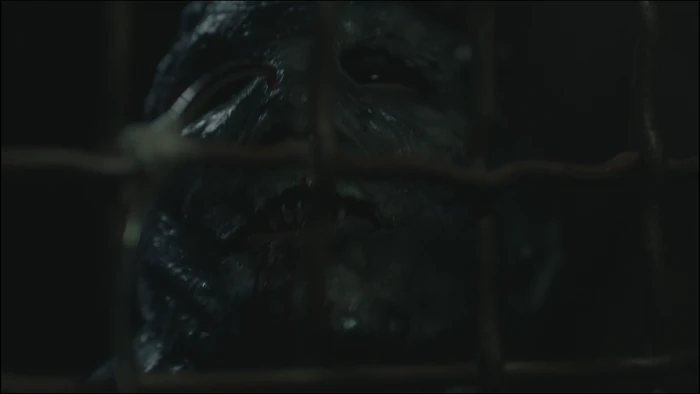

**Описание**

Марид — существо, способное даровать богатство и здоровье в обмен на кровь невинных. Внешне он выглядит как зелёный чешуйчатый гуманоид с шипами вокруг головы и питается кровью: в обмен на кормление он исполняет желания тех, кто его кормит.

В исламских преданиях марид — разновидность шайтана, то есть демона; арабское слово, означающее «мятежный», применяется к таким сверхъестественным существам. С джиннами и гениями у маридов много общего.

Обмен работает так: в благодарность за кормление марид может дать богатство, здоровье и вообще всё, о чём человек способен мечтать. Но его сила подпитывается кровью: разъярённый и усиленный человеческой кровью марид пробивает крепкую металлическую дверь. Единственный известный способ убить марида — отрубить ему голову: Дин сделал это.

В последней охоте перед выходом на пенсию охотник Ли Уэбб нашёл марида. Он поймал его и больше десяти лет кормил кровью в обмен на богатство и здоровье. Убийство Анджелы Салливан, совершённое Ли, заметил его старый друг Дин Винчестер и начал расследование. Ли попытался скормить Дину марида, но Дин вырвался и убил и марида, и Ли.

**Силы и способности**

- Искажение реальности — в обмен на кормление марид даёт богатство, здоровье и всё, о чём человек способен мечтать.
- Сверхчеловеческая сила — разъярённый и подпитанный человеческой кровью марид пробивает крепкую металлическую дверь.
- Питание кровью — марид кормится кровью: именно она даёт ему силу и служит платой за исполнение желаний.
- Обмен желаниями — марид служит тому, кто его кормит, и выполняет просьбы своего кормильца.

**Слабости**

- Обезглавливание — единственный известный способ убить марида: Дин отрубил ему голову.
- Кровная зависимость — сила марида зависит от крови: без кормления он слабеет и теряет способность исполнять желания.
- Привязка к кормильцу — марид получает добычу через человека, который его кормит; без кормильца он остаётся без крови.
- Возможность плена — Ли Уэбб больше десяти лет держал марида связанным и запертым, значит, его можно удержать.

**Как его убить.** Марид уязвим к обезглавливанию и почти ни к чему больше, поэтому охотнику нужен тяжёлый клинок или топор. Существо годами держат в плену и кормят кровью, значит, его можно связать, посадить на цепь и запереть — так с ним и поступил Ли Уэбб. Действовать нужно осторожно: в ярости марид ломает металлические двери, поэтому запор и ловушка должны быть рассчитаны на его силу. Если марида кормит человек, сначала придётся разобраться с ним: без кормильца существо теряет источник силы.

#### Марид
*Средний, Исчадие, нейтрально-злое*

---
- **Класс доспеха** 15 (природная броня)
- **Хиты** 105 (14d8 + 42)
- **Скорость** 30 фт.

| СИЛ | ЛОВ | ТЕЛ | ИНТ | МДР | ХАР |
|---|---|---|---|---|---|
| 20 | 13 | 17 | 12 | 13 | 17 |

- **Спасброски** Сил +8, Тел +6
- **Навыки** Восприятие +4, Запугивание +6, Обман +6
- **Сопротивление урону** холод, огонь, молния; дробящий, колющий и рубящий от немагического оружия
- **Иммунитет к урону** яд
- **Иммунитет к состояниям** очарование, отравленный
- **Чувства** тёмное зрение 60 фт., пассивное Восприятие 14
- **Языки** английский, арабский
- **Бонус мастерства** +3
- **Уровень опасности** 6 (2 300 опыта)

***Особенности***
- ***Исполнение желаний.*** Марид может исполнить желание существа, которое кормило его кровью в течение последних суток. Желание должно быть выполнимым: марид может воспроизвести эффект заклинания не выше 5 уровня, создать или уничтожить материальный предмет стоимостью не более 5000 золотых, излечить болезнь или дать преимущество на все проверки на сутки. Марид исполняет не больше одного желания в день.
- ***Кровавая подпитка.*** Пока марид получал кровь в течение последних суток, он совершает с преимуществом проверки и спасброски Силы. Если он сутки не пил кровь, он получает помеху на проверки Силы и не может исполнять желания.
- ***Нечеловеческая мощь.*** Марид ломает металлические двери и деревянные стены голыми руками; при определении того, что он может поднять, толкать и ломать, он считается на два размера больше.
- ***Смерть от обезглавливания.*** Если урон от рубящего оружия опускает хиты марида до 0, он погибает, только если удар пришёлся по шее. В остальных случаях марид приходит в себя через 1 час с 1 хитом.

***Действия***
- ***Мультиатака.*** Марид совершает две атаки когтями либо одну атаку когтями и одну атаку укусом.
- ***Когти.*** Рукопашная атака оружием: +8 к попаданию, досягаемость 5 фт., одна цель. Попадание: 12 (2d6 + 5) рубящего урона.
- ***Укус.*** Рукопашная атака оружием: +8 к попаданию, досягаемость 5 фт., одна цель, которая схвачена, обездвижена или без сознания. Попадание: 14 (2d8 + 5) колющего урона, и марид выпивает кровь: цель получает один уровень истощения, а марид восстанавливает 10 хитов.

**Тактика.** Марид не ищет драки первым: он предпочитает сидеть на цепи, получать кровь и исполнять желания кормильца, пока тот приносит жертвы. Если его разозлить или лишить кормления, он пробивает стены и двери и идёт напролом, полагаясь на силу, подпитанную кровью. Бьёт он тяжело и прямо, стараясь схватить противника и разорвать его; отступать марид не любит, но, оставшись без крови, слабеет и старается спрятаться. Опытный охотник этим и пользуется: выманивает марида, лишает его кормильца и рубит голову.

**Экология.** Мариды — существа из исламских преданий, близкие джиннам и шайтанам; в сериале один марид больше десяти лет прожил в плену у охотника Ли Уэбба, который держал его ради богатства и здоровья. Держат их в закрытых помещениях, подальше от людей, и кормят кровью невинных — обычно тех, кого поставляет кормилец. Самостоятельно мариды почти не действуют: их существование всегда связано с человеком, который их кормит.

> **Заметки мастеру.** Марид — сделка с дьяволом в облике монстра: он не нападает первым, а торгует желаниями, поэтому хорош как источник соблазна для партии. Бой с ним прямолинеен, но морально тяжёл: чтобы получить желаемое, игроки должны кормить его кровью невинных. Замена в 5e — джинн с ослабленными заклинательными способностями; для низкого уровня уберите исполнение желаний и снизьте хиты до 60, для высокого добавьте исполнение желания раз в день и легендарные действия.

[↑ к содержанию](#содержание)

---

### 64. Медуза

**Medusa** · Монстр · CR 10 · опасность в сериале 3/5

*Также известно как:* Горгона; Одна из трёх сестёр-горгон

*Первое появление:* Сезон 9, «Blade Runners» (упоминание); сезон 14, «Ouroboros»

*Сезоны:* 9, 14

Мифологическая горгона, жившая в прошлом и ставшая источником легенды о взгляде, обращающем в камень. В сериале она не действует: о ней напоминают лишь портрет кисти Рубенса и общие сведения о горгонах.

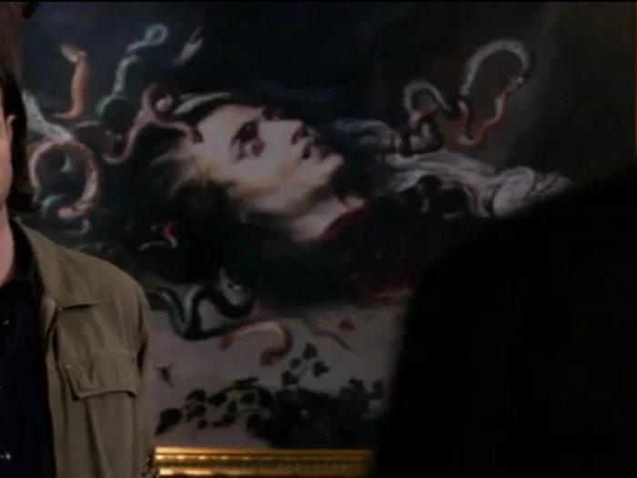

**Описание**

Медуза — мифологическая горгона, существовавшая в прошлом; в инфобоксе выжимки её статус обозначен как «мертва». В сериале она не действует: в «Blade Runners» (9 сезон) и «Ouroboros» (14 сезон) к ней только отсылают, а её портрет кисти Питера Пауля Рубенса висит в доме Катберта Синклера.

В греческой мифологии Медуза («защитница, покровительница») — чудовище-горгона, обычно описываемое как крылатая женщина с живыми ядовитыми змеями вместо волос. Тот, кто смотрел ей в лицо, обращался в камень. Большинство источников называют её дочерью Форкия и Кето, хотя у Гигина она дочь Горгона и Кето; по Гесиоду и Эсхилу, она жила и погибла на острове Сарпедон где-то возле Кистены.

Три сестры-горгоны — Медуза, Сфено и Евриала — были детьми древних морских божеств Форкия и его сестры Кето, хтонических чудовищ архаичного мира. Их родословная пересекается с сёстрами Грайями: в «Прикованном Прометее» Эсхила обе троицы сестёр помещены далеко «на ужасной равнине Кистены».

Судя по общим сведениям о горгонах, Медуза обладала парализующим ядом — тем самым, что породил миф об обращении в камень, — сверхчеловеческой силой, способностью говорить со змеями (в её случае со змеями вместо волос) и потенциальным бессмертием как полубог. Убить её, как и любую горгону, можно было только серебряным клинком, отсекая голову.

В выжимке отдельно отмечено, что настоящий облик Медузы неизвестен, а её изображают женщиной со змеями вместо волос. Живых свидетельств её появления в сериале нет: она принадлежит прошлому и мифу.

**Силы и способности**

- Парализующий яд — именно яд горгон породил миф о том, что Медуза и её сёстры обращают людей в камень; он настолько силён, что действует даже на серафимов.
- Сверхчеловеческая сила — как и все горгоны, Медуза с лёгкостью одолевала людей, а её полубожественная природа делала её сильнее любого человека.
- Общение со змеями — горгоны понимают змей и говорят с ними; у Медузы собеседницами были змеи вместо волос.
- Бессмертие — как представительница расы полубогов Медуза потенциально могла жить вечно, хотя по выжимке она мертва.
- Облик из мифа — в греческой традиции Медуза — крылатая женщина с живыми ядовитыми змеями вместо волос; настоящий её облик в сериале неизвестен.

**Слабости**

- Серебряный клинок — единственный известный способ убить горгону: отсечение головы серебряным лезвием.
- Она мертва — в инфобоксе выжимки статус Медузы указан как «мертва», поэтому как противник она возможна только через возвращение, видение или легенду.
- Миф вместо правды — рассказ об обращении в камень описывает действие яда, а не отдельную способность, поэтому защита от окаменения против Медузы бесполезна.
- Больше слабостей нет — за пределами серебряного клинка выжимка не называет для Медузы ни одного уязвимого места.

**Как его убить.** Против Медузы работает тот же рецепт, что и против любой горгоны: серебряный клинок или мачете и один точный удар по шее. Никаких зеркал и щитов выжимка не упоминает — легенда о каменящем взгляде объясняется парализующим ядом, поэтому защищаться нужно от яда, а не от взгляда. Поскольку Медуза мертва, в игре её вводят через ритуал, видение или проклятие, а не как живого противника, и тогда охотникам нужен ещё и способ развеять вызвавшую её силу.

**Известные особи:** Медуза; Сфено и Евриала — сёстры Медузы, названные в мифе

#### Медуза
*Средний, Монстр, нейтрально-злое*

---
- **Класс доспеха** 16 (природная броня)
- **Хиты** 136 (16d8 + 64)
- **Скорость** 30 фт., полёт 30 фт.

| СИЛ | ЛОВ | ТЕЛ | ИНТ | МДР | ХАР |
|---|---|---|---|---|---|
| 20 | 16 | 18 | 14 | 15 | 18 |

- **Спасброски** Тел +8, Хар +8
- **Навыки** Восприятие +6, Запугивание +8, Проницательность +6
- **Уязвимость к урону** серебро (см. «Смерть от серебра»)
- **Сопротивление урону** яд
- **Иммунитет к урону** дробящий, колющий и рубящий от немагического оружия
- **Иммунитет к состояниям** очарование, испуг, отравлено, окаменело
- **Чувства** тёмное зрение 60 фт., пассивное Восприятие 16
- **Языки** общий, греческий; понимает змей
- **Бонус мастерства** +4
- **Уровень опасности** 10 (5 900 опыта)

***Особенности***
- ***Парализующий взгляд.*** Легенда о каменящем взгляде Медузы — пересказ действия её яда. Существо, начинающее ход в пределах 30 фт. и способное видеть Медузу, проходит спасбросок Телосложения Сл 16; при провале оно парализовано до конца своего следующего хода. Существа, невосприимчивые к яду, автоматически преуспевают.
- ***Змеи вместо волос.*** В начале каждого своего хода Медуза может атаковать одну цель в пределах 5 фт.: 4 (1d4 + 2) колющего урона плюс 3 (1d6) урона ядом.
- ***Смерть от серебра.*** Медуза не умирает от обычных ран: при 0 хитов она падает без сознания и через 1d4 часа приходит в себя с 1 хитом. Только отсечение головы серебряным оружием убивает её окончательно.
- ***Бессмертная природа.*** Как полубог Медуза не стареет и не может умереть от старости; то, что она мертва, означает, что её уже убили серебряным клинком.

***Действия***
- ***Мультиатака.*** Медуза совершает две атаки: змеиным укусом и хвостом.
- ***Змеиный укус.*** Рукопашная атака оружием: +9 к попаданию, досягаемость 5 фт., одна цель. Попадание: 11 (2d6 + 4) колющего урона плюс 10 (3d6) урона ядом.
- ***Хвост.*** Рукопашная атака оружием: +9 к попаданию, досягаемость 10 фт., одна цель. Попадание: 13 (2d8 + 4) дробящего урона, и цель размера Средний или меньше должна преуспеть в спасброске Силы Сл 16, иначе сбита с ног.
- ***Парализующий взгляд.*** Медуза нацеливается на одно существо в пределах 30 фт., которое её видит. Цель проходит спасбросок Телосложения Сл 16, иначе парализована на 1 минуту; спасбросок можно повторять в конце каждого своего хода.
- ***Плевок ядом (перезарядка 5-6).*** Дальнобойная атака оружием: +7 к попаданию, дистанция 30 фт., одна цель. Попадание: 14 (4d6) урона ядом, и цель должна преуспеть в спасброске Телосложения Сл 16, иначе парализована на 1 минуту.

**Тактика.** Медуза не бросается в бой: она держит дистанцию и работает взглядом и ядом, парализуя по одному противнику и добивая тех, кто уже не может двигаться. Если группа подходит вплотную, она пускает в ход хвост и клыки, но при появлении серебряного оружия старается отступить и заманить преследователей в узкое место, где её взгляд достанет всех. Парализованных врагов она не убивает сразу, а оставляет как живые предупреждения — это её способ сломать волю группы.

**Экология.** Медуза — горгона-полубог из греческого мира, жившая на острове Сарпедон возле Кистены и погибшая задолго до событий сериала. В сериале она существует только как миф, портрет и общее правило для всех горгон: убить такую тварь можно лишь серебряным клинком. Других живых особей рядом с ней не описано, а её сестры Сфено и Евриала известны лишь по мифу.

> **Заметки мастеру.** Медуза в сериале мертва, поэтому используйте статблок как «возвращённую легенду»: ритуал, проклятие, иллюзия или ожившая статуя из дома Катберта Синклера. Механически это средний босс на 5-8 уровень: взгляд парализует, яд добивает, а серебро решает исход. Для низких уровней уберите плевок и позвольте защититься от взгляда; для высоких добавьте пару горгон-сестёр. Хорошая замена классической медузы из бестиария 5e, но с акцентом на паралич, а не на окаменение.

[↑ к содержанию](#содержание)

---

### 65. Мотра

**Mothra** · Монстр · CR 12 · опасность в сериале 4/5

*Также известно как:* Мотылёк; Мифический мотылёк-исполин

*Первое появление:* Сезон 1, «The Benders» (упоминание)

*Сезоны:* 1, 4, 7

Мифическая мотылёк-исполин, известная только по упоминаниям: колоссальные размеры, крылья и чудовищная сила. Выжимка связывает Мотру с Левиафанами и Чистилищем, но ни одного её появления в кадре не описывает.

**Описание**

Мотра — мифическое существо, которое выжимка описывает одной фразой: это мифологическая тварь, возможно связанная с Левиафанами и Чистилищем. Ни сцен охоты, ни встреч с Винчестерами, ни описания внешности в тексте нет: всё, что известно, подано через «понимается так», то есть как пересказ легенды, а не как наблюдение охотника.

Силы Мотры перечислены в том же ключе. Она обладает исполинской силой, колоссальными размерами и крыльями, из-за которых в её имени и стоит слово «мотыль». Иначе говоря, перед нами не монстр недели, а легенда о существе размером с гору: мощь, размах крыльев и полёт — три свойства, которые делают обычную охоту на неё бессмысленной.

Связь с Левиафанами и Чистилищем — единственная содержательная зацепка. Если Мотра действительно оттуда, она принадлежит миру древних тварей, которых не берёт ни пуля, ни клинок и которых изучают по чужим записям. Выжимка не уточняет, жива ли Мотра, где она обитает и встречался ли с ней хоть один человек.

В сериале Мотра упоминается в трёх сезонах: в первом («The Benders»), четвёртом («Heaven and Hell») и седьмом («Hello, Cruel World»). Это упоминания и отсылки, а не эпизоды с участием: ни кадра, ни убийства, ни одной охоты на неё в тексте не зафиксировано.

Для охотника Мотра — существо из разряда «если оно есть, нам конец». Оружия против неё выжимка не называет, слабостей тоже. Всё, что остаётся, — собирать упоминания, сверять их с записями о Чистилище и Левиафанах и надеяться, что легенда так и останется легендой.

**Силы и способности**

- Исполинская сила — по выжимке Мотра обладает чудовищной, «мега»-силой; конкретных проявлений этой мощи в тексте не описано.
- Колоссальные размеры — Мотра «понимается» как существо колоссального размера, то есть сопоставима с горой или городом, а не с человеком.
- Крылья и полёт — у Мотры есть крылья, из-за которых в её имени стоит слово «мотыль»; это единственная прямо названная способность передвижения.
- Связь с Чистилищем — выжимка допускает, что Мотра связана с Левиафанами и Чистилищем, то есть принадлежит к миру древних тварей.
- Статус неизвестен — в инфобоксе выжимки статус Мотры указан как «неизвестно», и подтверждённых появлений в кадре нет.

**Слабости**

- Слабости неизвестны — выжимка не называет ни одного способа убить, ранить или сдержать Мотру.
- Нет подтверждённых встреч — в сериале Мотра только упоминается, поэтому ни одно оружие и ни один ритуал против неё не проверены.
- Только легенда — все сведения поданы через «понимается», то есть источник — миф, а не отчёт охотника.
- Неизвестное местоположение — выжимка не говорит, где Мотра находится и как её вообще искать.

**Как его убить.** Рецепта охоты на Мотру выжимка не даёт: ни оружия, ни ритуала, ни слабости. Первый шаг — доказать, что Мотра вообще существует: собрать упоминания из трёх сезонов, сопоставить их с записями о Чистилище и Левиафанах и найти того, кто видел её своими глазами. Если тварь действительно колоссальна, готовят не бой, а эвакуацию: тяжёлая техника, огонь, ловушки на маршруте и, при удаче, оружие, способное пробить её броню.

#### Мотра
*Огромный, Зверь, нейтральное*

---
- **Класс доспеха** 17 (природная броня)
- **Хиты** 195 (17d12 + 85)
- **Скорость** 10 фт., полёт 80 фт.

| СИЛ | ЛОВ | ТЕЛ | ИНТ | МДР | ХАР |
|---|---|---|---|---|---|
| 24 | 12 | 20 | 4 | 14 | 10 |

- **Спасброски** Сил +11, Тел +9
- **Навыки** Восприятие +6
- **Сопротивление урону** дробящий, колющий и рубящий от немагического оружия
- **Чувства** тёмное зрение 120 фт., пассивное Восприятие 16
- **Языки** не говорит
- **Бонус мастерства** +4
- **Уровень опасности** 12 (8 400 опыта)

***Особенности***
- ***Осадное чудовище.*** Мотра наносит удвоенный урон объектам и строениям, а её атаки игнорируют укрытие, которое дают деревянные конструкции.
- ***Колосс.*** Существа размера Большой и меньше могут проходить сквозь пространство Мотры, но оно считается для них труднопроходимой местностью. Мотру нельзя схватить или сбить с ног существом размера Большой и меньше.
- ***Пыльцовое облако.*** В начале каждого своего хода Мотра осыпает пыльцой существ в пределах 15 фт. Каждое из них совершает спасбросок Телосложения (Сл 17); при провале оно ослеплено и отравлено до конца своего следующего хода.
- ***Гул крыльев.*** Пока Мотра летит, проверки Мудрости (Восприятие), основанные на слухе, в пределах 300 фт. от неё совершаются с помехой.

***Действия***
- ***Мультиатака.*** Мотра совершает две атаки крыльями.
- ***Удар крыла.*** Рукопашная атака оружием: +11 к попаданию, досягаемость 15 фт., одна цель. Попадание: 22 (3d10 + 6) дробящего урона, и цель отбрасывается на 10 фт.
- ***Порыв ветра (перезарядка 5-6).*** Мотра бьёт крыльями, поднимая линию 60 фт. длиной и 20 фт. шириной. Каждое существо в этой области совершает спасбросок Силы (Сл 17), получая 21 (6d6) дробящего урона и падая ничком при провале или половину урона при успехе; существа размера Средний и меньше дополнительно отбрасываются на 20 фт.
- ***Сокрушение.*** Мотра обрушивается на объект или строение в пределах 15 фт. и наносит ему 44 (8d10) дробящего урона, удвоенного для строений.

***Легендарные действия***
- ***Взмах (1 действие).*** Мотра совершает одну атаку крылом.
- ***Подъём (2 действия).*** Мотра поднимается на 30 фт. вверх, не провоцируя атак по возможности.

**Тактика.** Мотра не сражается с отрядом — она проходит сквозь местность, как ураган, и замечает людей не больше, чем слон замечает муравьёв. В бою она бьёт крыльями по площади, разбрасывает всё, что попало под удар, и поднимает в воздух пыль и обломки; укрываться в домах бесполезно, потому что осадное чудовище ломает стены. Отступает она не от урона, а когда теряет интерес или получает серьёзный магический отпор: догнать её пешком невозможно. Задача игроков — не отнять у Мотры хиты, а увести людей с её пути, сбить её с направления или отложить её пробуждение.

**Экология.** Выжимка не описывает среду Мотры: неизвестны ни ареал, ни численность, ни то, сколько таких существ есть. Единственная зацепка — предполагаемая связь с Чистилищем и Левиафанами, то есть с миром древних тварей, которых не берёт обычное оружие. Если Мотра и появляется среди людей, то как катаклизм: она ни с кем не соседствует. В сериале она упоминается в первом, четвёртом и седьмом сезонах — как легенда или отсылка, без сцены встречи.

> **Заметки мастеру.** Мотра — энкаунтер-катастрофа, а не монстр недели: уровень опасности 12 подходит партии 9-12 уровня, но настоящая задача здесь — спасти людей, а не отнять все хиты. В 5e её ближайшая замена — рок или взрослый дракон с полётом; вместо дыхания используйте Порыв ветра и пыльцу. Для низкого уровня держите Мотру за кадром: гул в небе, следы на земле, раздавленные дома. Для высокого поднимите хиты до 300, дайте сопротивление магии и три легендарных действия — тогда бой превращается в оборону города.

[↑ к содержанию](#содержание)

---

### 66. Муски

**Muscas** · Монстр · CR 5 · опасность в сериале 3/5

*Также известно как:* Мухи-люди; Fly creatures

*Первое появление:* S14E20 «Optimism»

*Сезоны:* 14

Гибрид человека и гигантской мухи: носит плащ и пчеловодную шляпу, бьёт слизью гнёзда и приковывает добычу к стене. Обычно держится своей общины, но раз в сотни лет один самец уходит охотиться на людей.

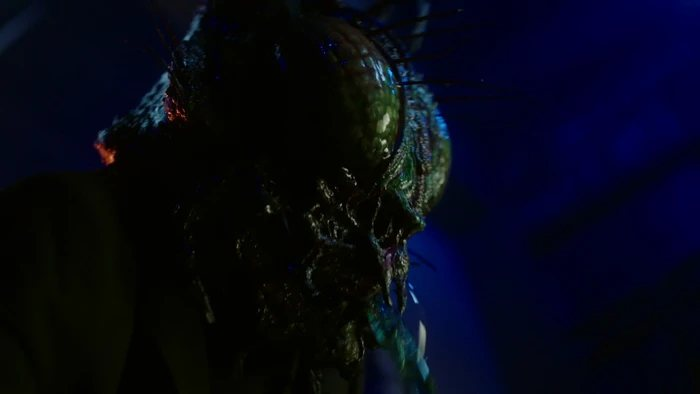

**Описание**

Муски (Muscas) — существа, выглядящие как гибрид человека и мухи. Лицо у них похоже на морду чудовищной гигантской мухи, поэтому, чтобы ходить среди людей, муски носят тёмные пчеловодные шляпы и кожаные одежды, скрывающие тело. Муски — гуманоиды, но их существование долгое время было только в записях и преданиях: никто не видел муску живьём, пока тварь не появилась в 2019 году.

Общины мусков держатся обособленно и не выходят к людям. Но раз в несколько сотен лет среди них рождается «плохое яйцо»: самец, который не может найти пару, покидает общину и нападает на людей, используя их тела для гнезда — он связывает жертвы воедино вязкой слизью. Даже после того как муска уходит из общины, его сородичи выслеживают отступника и забирают его тело, чтобы похоронить как положено: в эпизоде показано, как группа мусков оплакивает погибшего товарища.

В лоре индейцев муска связана с наказанием за лень: боги превратили одно из двух соседних племён в пчёл, а другое — в мух. Пчелиное племя получило возможность летать от цветка к цветку и есть мёд, а мушиное — питаться отбросами. Книга, в которой Чарли Брэдбери читала об этих существах, содержала первые два абзаца энциклопедической статьи о насекомых.

Убить муску можно обычным оружием: пули ранили и убивали их, а Чарли повредила одну тварь, ударив её в спину, судя по всему, обычным ножом. Ещё один способ — латунные гвозди, вымоченные в сахарной воде, но его никто и никогда не применял на настоящей муске, так что это остаётся догадкой, а не проверенным рецептом.

**Силы и способности**

- Клейкая слизь — муска выделяет вязкую жидкость, которой строит гнёзда из жертв; по этой слизи и определяют, что рядом завелась муска.
- Сверхскорость — муски перемещаются очень быстро, сокращая дистанцию до жертвы прежде, чем та успевает среагировать.
- Сверхсила — физически муска настолько сильна, что в схватке одолела Сэма Винчестера.
- Сверхловкость — муски ловко двигаются и перемахивают через препятствия, не сбавляя хода.
- Маскировка — пчеловодная шляпа и кожаная одежда полностью скрывают мушиную внешность, позволяя муске ходить среди людей.
- Поиск своих — сородичи выслеживают ушедшую из общины муску и забирают её тело, что говорит о развитом чутье и организации.

**Слабости**

- Смертность от обычного оружия — пули ранят и убивают муску, а удар обычным ножом в спину достаточно серьёзно её повредил.
- Латунные гвозди в сахарной воде — теоретическое средство против муски; на практике его не применяли ни разу, поэтому надёжность неизвестна.
- Изгой-одиночка — на людей нападает самец, покинувший общину; он без поддержки сородичей.
- Отсутствие скрытности на охоте — гнёзда из слизи и характерные следы выдают муску, а маскировка слетает в момент нападения.

**Как его убить.** Начинают с поиска следов: гнёзд из вязкой слизи и характерных повреждений на телах жертв, которых связывают вместе. Дальше вычисляют одиночку-самца, покинувшего общину: именно он охотится на людей, тогда как остальные муски людей не трогают. Идут на тварь с обычным огнестрелом и ножами — этого достаточно, чтобы убить или серьёзно ранить муску. Полезно заранее прочитать лор о мусках. Запасной вариант — латунные гвозди в сахарной воде, но это лишь догадка.

**Известные особи:** Чарли Брэдбери (участвовала в схватке с муской)

#### Муски
*Средний, Монстр, нейтрально-злое*

---
- **Класс доспеха** 15 (природная броня)
- **Хиты** 85 (10d8 + 40)
- **Скорость** 50 фт., лазание 30 фт.

| СИЛ | ЛОВ | ТЕЛ | ИНТ | МДР | ХАР |
|---|---|---|---|---|---|
| 18 | 18 | 18 | 9 | 14 | 8 |

- **Спасброски** Сил +7, Лов +7
- **Навыки** Акробатика +7, Восприятие +5, Скрытность +7
- **Сопротивление урону** яд
- **Иммунитет к состояниям** отравление
- **Чувства** тёмное зрение 60 фт., пассивное Восприятие 15
- **Языки** понимает английский, но не говорит
- **Бонус мастерства** +3
- **Уровень опасности** 5 (1 800 опыта)

***Особенности***
- ***Гибридная маскировка.*** В плаще и пчеловодной шляпе муска неотличима от высокого человека в одежде: заметить мушиное лицо можно только проверкой Мдр (Восприятие) Сл 16 или если снять с неё шляпу.
- ***Слизистые гнёзда.*** Муска оставляет за собой липкие следы и гнёзда: проверка Мдр (Выживание) Сл 14 в месте, где она охотилась, указывает направление её логова.
- ***Плохое яйцо.*** На людей нападает только самец-изгой, покинувший общину. Община мусков не нападает на людей, но выслеживает изгоя, чтобы забрать его тело.
- ***Сверхскорость.*** Муска может бонусным действием совершить Рывок. Её перемещение не провоцирует атак по возможности у существ, по которым она в этом ходу не атаковала.

***Действия***
- ***Мультиатака.*** Муска совершает три атаки: одну укусом и две когтями, либо две атаки плевком слизи.
- ***Укус.*** Рукопашная атака оружием: +7 к попаданию, досягаемость 5 фт., одна цель. Попадание: 11 (2d6 + 4) колющего урона.
- ***Когти.*** Рукопашная атака оружием: +7 к попаданию, досягаемость 5 фт., одна цель. Попадание: 9 (1d10 + 4) рубящего урона.
- ***Плевок слизи.*** Дальнобойная атака оружием: +7 к попаданию, дистанция 30/90 фт., одна цель. Попадание: 7 (2d6) дробящего урона, и цель схвачена (Сл высвобождения 15). Пока цель схвачена, в начале каждого её хода она получает 5 (2d4) урона и не может двигаться, если не высвободится.

***Бонусные действия***
- ***Рывок на четырёх.*** Муска совершает Рывок и игнорирует труднопроходимую местность до конца хода.

***Реакции***
- ***Отпрыг.*** Когда по муске попадает рукопашная атака, она может переместиться на 10 фт. в свободное пространство, не провоцируя атак по возможности.

***Действия в логове***
- ***Гнездо из слизи.*** Муска в своём логове может действием залить 15-футовый куб слизи: область считается труднопроходимой местностью, и существо, начинающее там ход, должно преуспеть в спасброске Лов (Сл 15), иначе схвачено.

**Тактика.** Муска нападает из засады: она подходит в маскировке вплотную, а первую атаку наносит плевком слизи, чтобы приклеить самую опасную цель к месту, и добивает её когтями. Против группы она работает по одному: сковывает слизистого противника и переключается на следующего, не давая себя окружить — бонусный Рывок и реакция «Отпрыг» позволяют ей держать дистанцию. Обычное оружие её ранит, поэтому муска не стоит насмерть: получив половину хитов урона, она уходит по стенам и потолку в своё логово, где ждёт партию в гнезде из слизи. Огонь она не любит, но специальных уязвимостей у неё нет.

**Экология.** Муски живут общинами, скрытно и обособленно, и веками не попадались людям на глаза: о них знали только по записям в книгах. Раз в несколько сотен лет у них рождается самец, не нашедший пару, — он покидает общину и обосновывается ближе к людям, устраивая гнездо из связанных слизью тел. Община людей не трогает, но идёт по следу изгоя, чтобы забрать его тело. В мифологии индейцев муски — племя, превращённое богами в мух.

> **Заметки мастеру.** Муска — быстрый, «липкий» противник для партии 4–6 уровня, отличная замена крюкастому ужасу или гигантскому насекомому с характером. Её сила не в уроне, а в контроле: слизистые плевки и труднопроходимое логово заставляют игроков тратить действия на высвобождение. Загадка с латунными гвоздями в сахарной воде — хороший повод дать партии ложную или частично верную подсказку из лора: например, гвозди работают только на изгое, но не на общине. Для низкого уровня уберите Мультиатаку и слизь, оставив 40 хитов; для высокого добавьте общину из трёх мусков и логово с гнёздами-ловушками.

[↑ к содержанию](#содержание)

---

### 67. Нахцерер

**Nachzehrer** · Монстр · CR 6 · опасность в сериале 3/5

*Также известно как:* Гуль-вампир; Тварь стаи

*Первое появление:* S11E04 «Baby»

*Сезоны:* 11

Тварь, похожая одновременно на гуля и вампира: одни пьют кровь и сердца живых, другие едят плоть мёртвых. Ходят небольшими стаями, а убить их можно только медной монетой в рот и отсечением головы.

**Описание**

Нахцереры — монстры, похожие одновременно на гулей и вампиров. Их существование известно со времён Древней Греции и было известно Людям Письма. Их можно исцелить, убив альфу стаи.

По фолианту, который Кастиэль читал в бункере Людей Письма, одни нахцереры питаются кровью и сердцами живых, другие — плотью мёртвых. Они бегают небольшими стаями и обычно держатся в тени. У нахцереров подавляющее стайное сознание: недавно обращённые полностью преданы альфе, вплоть до убийства тех, кого любили людьми, если те отказываются вступать в стаю. Если альфу убить, остальные возвращаются в человеческую форму. Единственный способ убить нахцерера — положить ему в рот обол Харона или медную монету и затем отсечь голову.

Слабости: серебро замедляет нахцерера, но серьёзного вреда не причиняет. Медная монета во рту вместе с отсечением головы — единственное, что его убивает. Нахцерера, которого убил Дин, прикончили монетами из женского кошелька и дверцей «Импалы». Убийство альфы стаи возвращает всех, кого он обратил, в человеческий вид.

Из-за склонности держаться в тени нахцереры мало контактируют с охотниками, хотя Люди Письма встречали и убивали их раньше. В 2015 году была освобождена Тьма — событие, которое ощутили все монстры. Стремясь прожить как можно дольше, нахцерер по имени заместитель Доннелли обратил шестнадцать человек за месяц, чтобы создать армию для выживания. Однако одна из обращённых, Лили Маркхэм, не смогла спрятать тело мужа, отказавшегося вступать в стаю, и его смерть привлекла внимание охотников Сэма и Дина Винчестеров. Дин выстрелил в Доннелли серебром и отрубил ему голову — ни то, ни другое его не убило, — после чего отправил Кастиэлю фото клыков. По архивам Людей Письма Кастиэль опознал нахцерера и узнал способ убийства.

**Силы и способности**

- Стайное сознание — нахцереры держатся небольшими стаями, а обращённые полностью преданы альфе, вплоть до убийства близких.
- Обращение — нахцерер способен обращать людей в себе подобных; Доннелли обратил шестнадцать человек за один месяц.
- Питание живыми и мёртвыми — одни особи пьют кровь и сердца живых, другие едят плоть мёртвых.
- Стойкость к серебру — серебро замедляет нахцерера, но серьёзного вреда ему не причиняет.
- Живучесть — отсечение головы само по себе нахцерера не убивает; он остаётся жив и способен говорить после того, как голову вернули на место.

**Слабости**

- Медная монета в рот — обол Харона или обычная медная монета, вложенная в рот, вместе с отсечением головы убивает нахцерера.
- Отсечение головы — полное отделение головы необходимо, но работает только в сочетании с монетой во рту.
- Серебро — замедляет нахцерера, хотя убить им нельзя; полезно как сдерживающее средство.
- Убийство альфы — смерть альфы стаи возвращает всех обращённых им людей в человеческую форму.
- Низкий профиль — нахцереры стараются не светиться, поэтому их можно застать врасплох при облаве.

**Как его убить.** Инвентарь: горсть медных монет или оболов Харона, серебряные пули для замедления, мачете или топор для отсечения головы и архивы Людей Письма, потому что в обычных бестиариях способ убийства нахцерера не описан. Порядок действий: замедлить тварь серебром, вложить монету в рот и одним ударом отсечь голову — только вместе это убивает. Стаю разумнее бить через альфу: вычислите его по тому, кому беспрекословно подчиняются остальные, и убейте тем же способом, тогда все обращённые снова станут людьми.

**Известные особи:** Заместитель Доннелли — альфа стаи, обратил шестнадцать человек за месяц в 2015 году; Лили Маркхэм — обращённая, не сумела спрятать тело мужа, отказавшегося вступать в стаю

#### Нахцерер
*Средний, Нежить, нейтрально-злое*

---
- **Класс доспеха** 14 (природная броня)
- **Хиты** 97 (13d8 + 39)
- **Скорость** 35 фт.

| СИЛ | ЛОВ | ТЕЛ | ИНТ | МДР | ХАР |
|---|---|---|---|---|---|
| 18 | 15 | 17 | 10 | 12 | 13 |

- **Спасброски** Тел +6, Мдр +4
- **Навыки** Восприятие +4, Скрытность +5
- **Сопротивление урону** некротический; дробящий, колющий и рубящий от немагического оружия
- **Иммунитет к урону** яд
- **Иммунитет к состояниям** истощение, отравление, очарование
- **Чувства** тёмное зрение 60 фт., пассивное Восприятие 14
- **Языки** английский
- **Бонус мастерства** +3
- **Уровень опасности** 6 (2 300 опыта)

***Особенности***
- ***Монета и голова.*** Нахцерер не может быть убит ничем, кроме отсечения головы при медной монете или оболе Харона во рту. Если голову отсечь без монеты, нахцерер остаётся жив: он недееспособен, но не мёртв, и его можно вернуть в строй, приставив голову обратно.
- ***Стайная преданность.*** Нахцерер подчиняется альфе своей стаи и совершает с преимуществом спасброски Мудрости против эффектов, наложенных на него альфой или членами его стаи.
- ***Серебро замедляет.*** Когда нахцерер получает урон серебряным оружием, его скорость уменьшается на 10 фт. до конца его следующего хода, и он не может совершать реакции.
- ***Возврат при смерти альфы.*** Когда альфа стаи погибает, все нахцереры, обращённые им, немедленно возвращаются в человеческую форму и теряют все свойства нахцерера.
- ***Тень стаи.*** Нахцерер совершает с преимуществом проверки Ловкости (Скрытность), находясь рядом хотя бы с одним членом своей стаи.

***Действия***
- ***Мультиатака.*** Нахцерер совершает две атаки: укусом и когтями или двумя атаками когтями.
- ***Укус.*** Рукопашная атака оружием: +7 к попаданию, досягаемость 5 фт., одна цель. Попадание: 11 (2d6 + 4) колющего урона, и цель должна преуспеть в спасброске Телосложения Сл 14, иначе её максимум хитов снижается на 5 (1d10).
- ***Когти.*** Рукопашная атака оружием: +7 к попаданию, досягаемость 5 фт., одна цель. Попадание: 9 (1d10 + 4) рубящего урона.
- ***Пожирание мёртвых.*** Нахцерер кормится на трупе, находившемся мёртвым не более часа: он восстанавливает 15 хитов и снимает один уровень истощения.

***Реакции***
- ***Защита альфы.*** Когда существо в пределах 5 фт. атакует альфу стаи, нахцерер может реакцией переместиться на 15 фт. к атакующему, если видит его.

**Тактика.** Нахцереры действуют стаей и по команде альфы: они окружают добычу, бьют с двух сторон и отходят, когда противник готовит добивающий удар. Голову они прикрывают осознанно — тварь, уже пережившая отсечение, знает, чем ей грозит монета. Против серебра нахцерер замедляется и старается выйти из схватки, но не бежит далеко: стая не оставляет своих. Альфа держится позади, направляя остальных, и вступает в бой, только когда противник ослаблен. Если альфу убили, стая рассыпается, и все обращённые снова становятся людьми.

**Экология.** Нахцереры держатся небольшими стаями и предпочитают низкий профиль: кладбища, морги, заброшенные окраины, где легко найти и мёртвых, и живых. Они известны со времён Древней Греции и знакомы Людям Письма, но обычные охотники с ними почти не сталкиваются. Альфа обращает новых членов, и стая быстро растёт при угрозе извне — например, когда в 2015 году освободилась Тьма и все монстры ощутили её появление.

> **Заметки мастеру.** Нахцерер — монстр на 5–7 уровень, построенный вокруг ритуала смерти: партия должна догадаться положить монету в рот перед отсечением головы, иначе тварь вернётся в бой. Замена в 5e — гуле или вампирский отпрыск, но без регенерации и с обязательной механической уязвимостью к монете. Стая из трёх-четырёх нахцереров и альфа дают хороший бой с понятной тактической целью. На низком уровне оставьте одного нахцерера с 45 хитами; на высоком добавьте альфу с легендарными действиями и обращённых горожан как заложников.

[↑ к содержанию](#содержание)

---

### 68. Нетеру

**Neteru** · Монстр · CR 4 · опасность в сериале 2/5

*Также известно как:* Зомби-подобные стражи; Бездушные стражи Анубиса

*Первое появление:* Supernatural: Children of Anubis

Бездушные зомби-подобные стражи, которых поднимает из мёртвых укус джаккала. Полностью безвольны и слушаются только своего создателя, живут не дольше двенадцати часов, а убить их можно лишь полным уничтожением тела.

**Описание**

Нетеру — зомби-подобные бездушные стражи. Они создаются из оживлённых трупов через укус джаккала: укус поднимает тело, и в нём остаётся оболочка без души. Сразу после подъёма нетеру выглядят как бездушный труп с багровыми глазами.

Разума у них нет вовсе. Источник прямо называет их полностью безвольными и уточняет, что они подчиняются только тому джаккалу, который их создал. По умолчанию они признают власть лишь своего создателя, но любой бог или сверхъестественное существо, стоящее выше джаккалов, может перехватить контроль; Анубис способен отменить власть джаккала над ними. Когда нетеру действуют под прямым управлением Анубиса, они становятся заметно сильнее.

Срок их существования предельно короток: максимум около двенадцати часов с момента поднятия. Когда время выходит, нетеру возвращаются в состояние смерти. Это делает их оружием одной ночи — их нельзя накопить и нельзя держать в запасе.

По силе нетеру заметно превосходят человека: они способны физически одолеть взрослого мужчину. Вдобавок они частично неуязвимы для большинства видов вреда. Ранить их можно серебром или золотом, но оружие из этих металлов должно попасть точно в мозг: удар в другое место не даёт никакого эффекта. Даже повреждение мозга не убивает нетеру — они быстро восстанавливаются и лишь ненадолго замедляются, после чего снова идут в атаку. Источник не уточняет, помогает ли им в этой регенерации сила Анубиса, так что вопрос остаётся открытым.

Единственный надёжный способ покончить с нетеру — полное уничтожение тела. В источнике описано, как Гарт сломал им позвоночники и вырвал сердца, буквально разнеся тела, и только это их убило. Опасность нетеру не в хитрости, а в упорстве: их нужно уничтожать целиком, пока не истекли их двенадцать часов. Появляются они в «Supernatural: Children of Anubis».

**Силы и способности**

- Сверхчеловеческая сила — нетеру достаточно сильны, чтобы физически одолеть взрослого человека.
- Частичная неуязвимость — большинство форм вреда им не вредит; урон проходят только серебро и золото, и лишь при попадании в мозг.
- Быстрая регенерация — даже с повреждённым мозгом нетеру ненадолго замедляются, а затем восстанавливаются и продолжают атаку.
- Подчинение создателю — они полностью безвольны и исполняют приказы только того джаккала, чей укус их поднял.
- Усиление под Анубисом — находясь под прямым контролем Анубиса, нетеру становятся значительно сильнее.

**Слабости**

- Мозг — серебряные пули и золотые ножи действуют на нетеру только при попадании в мозг; любое другое попадание не даёт эффекта.
- Полное уничтожение тела — единственный способ убить нетеру: Гарт сломал им позвоночники и вырвал сердца, разнеся тела целиком.
- Двенадцать часов — нетеру живут максимум около двенадцати часов, после чего снова становятся мёртвыми.
- Иерархия — джаккалы выше нетеру, а любой бог или существо выше джаккалов может перехватить над ними контроль; Анубис отменяет власть джаккала.
- Отсутствие разума — нетеру действуют прямолинейно и не способны к планированию, засадам или хитрости.

**Как его убить.** Охота на нетеру — работа на износ. Сначала выясняют, кто поднял стражей: укус джаккала означает, что рядом хозяин, и его смерть решает половину задачи. Бойцам нужны серебряные пули и золотые ножи, но бить следует только в голову, иначе урона не будет. Но и попадание в мозг лишь замедляет: цель надо разносить полностью, ломать позвоночник, вырывать сердце. При выходе на Анубиса проще перехватить над ними контроль. Инвентарь: серебряные патроны, золотые клинки, инструмент для расчленения, соль.

**Известные особи:** Гарт — охотник, который сломал нетеру позвоночники и вырвал сердца, полностью уничтожив их; Анубис — бог, способный отменить власть джаккала над нетеру и усилить их своим прямым контролем; Джаккалы — сверхъестественные существа, чей укус поднимает нетеру из мёртвых

#### Нетеру
*Средний, Нежить, нейтральное*

---
- **Класс доспеха** 13 (природная броня)
- **Хиты** 85 (10d8 + 40)
- **Скорость** 30 фт.

| СИЛ | ЛОВ | ТЕЛ | ИНТ | МДР | ХАР |
|---|---|---|---|---|---|
| 18 | 12 | 18 | 3 | 8 | 5 |

- **Спасброски** Тел +6, Мдр +1
- **Навыки** Атлетика +6, Восприятие +1
- **Сопротивление урону** дробящий, колющий и рубящий урон от немагического оружия
- **Иммунитет к урону** яд; некротический урон
- **Иммунитет к состояниям** очарование, испуг, отравление, истощение
- **Чувства** тёмное зрение 60 фт., пассивное Восприятие 11
- **Языки** понимает язык своего создателя, но не говорит
- **Бонус мастерства** +2
- **Уровень опасности** 4 (1 100 опыта)

***Особенности***
- ***Бездушный страж.*** Нетеру не имеет собственной воли. Он исполняет приказы только того существа, чей укус его поднял, и не может добровольно действовать иначе. Существо, стоящее выше джаккала по силе (например, божество), может перехватить контроль над нетеру, если потратит действие и преуспеет в проверке Харизмы (Запугивание) против Сл 15.
- ***Уязвимый мозг.*** Атаки серебряным или золотым оружием наносят нетеру полный урон и могут его убить только при попадании в голову: атакующий совершает бросок атаки с помехой, а при попадании нетеру получает урон и должен преуспеть в спасброске Телосложения (Сл 15), иначе умирает. Попадание в корпус урона не наносит вовсе.
- ***Живучесть трупа.*** Если нетеру получает 15 урона или меньше, который должен был опустить его хиты до 0, он вместо этого остаётся с 1 хитом. Пока он не уничтожен полностью, он восстанавливает 10 хитов в начале каждого своего хода.
- ***Полное уничтожение.*** Нетеру умирает окончательно только тогда, когда его хиты опускаются до 0 от дробящего урона, урона от критического попадания или после того, как он был обездвижен и расчленён. Прочие способы лишь замедляют его: он получает состояние недееспособности до конца своего следующего хода и возвращается в бой.
- ***Двенадцать часов.*** Через 12 часов после подъёма нетеру рассыпается и умирает окончательно, независимо от полученных повреждений. Мастер отслеживает время с момента создания стража.
- ***Ведомый богом.*** Если нетеру действует под прямым контролем божества (например, Анубиса), его показатели силы и телосложения увеличиваются на 2, он получает 20 временных хитов и преимущество на все броски атаки. Контроль прекращается, если божество отвлечено.

***Действия***
- ***Мультиатака.*** Нетеру совершает две атаки кулаком или одну атаку кулаком и одну атаку захвата.
- ***Кулак мертвеца.*** Рукопашная атака оружием: +6 к попаданию, досягаемость 5 фт., одна цель. Попадание: 11 (2d6 + 4) дробящего урона.
- ***Захват.*** Рукопашная атака оружием: +6 к попаданию, досягаемость 5 фт., одна цель не крупнее Среднего. Попадание: цель схвачена (Сл высвобождения 14). Нетеру не может одновременно удерживать больше двух целей.
- ***Вырвать сердце.*** Нетеру атакует схваченное или недееспособное существо. Цель совершает спасбросок Телосложения (Сл 14), получая 22 (4d10) некротического урона при провале или половину при успехе. Если урон опускает цель до 0 хитов, она умирает.

**Тактика.** Нетеру не знают страха и тактики: они идут к ближайшей цели, пытаясь повалить её и вырвать сердце. Против группы они разделяются, чтобы сковать как можно больше врагов, и не отступают даже при потере хитов, потому что не понимают угрозы. Противостоять им можно только расчленением: если нетеру обездвижен и разнесён по частям, он больше не поднимается. Хозяин-джаккал держит их на коротком поводке и может отозвать, а перехвативший контроль бог использует стражей как расходный строй. Через двенадцать часов они рассыпаются сами, поэтому затягивать бой невыгодно охотникам.

**Экология.** Нетеру не размножаются и не живут самостоятельно: каждое такое существо — чей-то труп, поднятый укусом джаккала, и существует оно не дольше двенадцати часов. Встречаются они рядом со своим создателем и в местах, связанных с Анубисом: кладбища, морги, дома жертв, храмовые подземелья. Питаться и отдыхать им не нужно, и держатся они только своей группой, поднятой одним хозяином. После истечения срока от нетеру остаётся обычный мёртвый труп.

> **Заметки мастеру.** Нетеру — идеальные «расходные» слуги для сюжета про Анубиса или джаккала-некроманта: они опасны не уроном, а тем, что не падают. Партия 3–5 уровня должна догадаться бить в голову серебром или золотом, а потом обязательно добивать тела, иначе стражи встанут снова. В 5e их собирают из зомби и упыря, добавляя правило Уязвимый мозг и таймер в двенадцать часов. Они заменяют каноничного зомби, когда нужен страж с загадкой. Для низкого уровня уберите Вырвать сердце и снизьте Сл до 12; для высокого дайте стражам контроль божества, доспехи и добавьте джаккала-хозяина как отдельного противника.

[↑ к содержанию](#содержание)

---

### 69. Обакэ

**Obake** · Монстр · CR 2 · опасность в сериале 2/5

*Также известно как:* Японский оборотень-защитник

*Первое появление:* Supernatural: Rite of Passage (роман)

Японский оборотень из фольклора, способный принимать облик любого животного. Враждует с они, но людей скорее защищает, чем ест; в каноне обакэ известен по роману «Rite of Passage».

**Описание**

Обакэ — монстры из японского фольклора, фигурирующие в романе «Supernatural: Rite of Passage». В телесериале они не появлялись, поэтому все сведения о них ограничены этим источником.

Обакэ — оборотни, способные принимать облик любого животного. В противостоянии с они один обакэ, судя по всему, ненадолго загипнотизировал монстра — способность, которую источник помечает как возможную.

Обакэ — японские монстры, враги они. По словам Роя Демпси, эти два вида ненавидят друг друга: они зловредны, а обакэ скорее благосклонны к людям, и некоторые из них даже берут на себя роль защитников человечества.

Один обакэ в облике бродячего кота — с одним слепым глазом и одним жёлтым — подружился с охотником Роем Демпси, который не подозревал, что это не просто подобранный кот. Когда в город Лорел-Хилл, штат Нью-Джерси, пришёл они по имени Тора и начал сеять разрушения, Рой рассказал Винчестерам и Бобби Сингеру об обакэ, и охотники решили использовать против они полицейских собак К-9 в надежде, что тот испугается мнимых обакэ. Однако они сумели разглядеть маскировку.

Когда Винчестеры и Бобби сошлись с они в последний раз, обакэ, защищавший Роя, пришёл на помощь: Тора испугался при виде обакэ и застыл, и это дало Дину Винчестеру время выбить канабо из руки монстра. Без канабо Бобби смог наконец убить они. После этого обакэ подружился с Сумико Джонс, которая назвала его Лаки и забрала к себе.

**Силы и способности**

- Оборотничество — обакэ может принимать облик любого животного; в описанном случае он жил в форме бродячего кота.
- Гипнотическое воздействие — по данным источника, обакэ способен ненадолго загипнотизировать даже такого могущественного монстра, как они.
- Защита людей — часть обакэ берёт на себя роль защитников человечества, что отличает их от большинства монстров.
- Вражда с они — обакэ враждебны они и способны встать против них на стороне охотников.

**Слабости**

- Слабости не описаны — источник не сообщает ни одного способа убить обакэ, поэтому судить о них нельзя.
- Маскировка под животных — обакэ скрывается в облике зверя, но охотники могут распознать его по необычным приметам, например по разным глазам.
- Противник сильнее него — они могущественнее обакэ, и в одиночку обакэ не способен его одолеть.

**Как его убить.** Охотиться на обакэ охотнику, как правило, не за чем: источник описывает их как скорее благосклонных к людям и даже защищающих их. Если обакэ всё же стал угрозой, действовать нужно как с оборотнем-животным: вычислить зверя по необычным приметам, загнать в замкнутое пространство и удерживать серебром, железом и ловушками. Прямых данных о смертельных средствах в источнике нет — надёжнее обезвредить обакэ и изолировать его.

**Известные особи:** Обакэ Роя Демпси — бродячий кот с одним слепым и одним жёлтым глазом; позже назван Лаки и взят Сумико Джонс

#### Обакэ
*Средний, Фея, нейтральное*

---
- **Класс доспеха** 14
- **Хиты** 39 (6d8 + 12)
- **Скорость** 30 фт.

| СИЛ | ЛОВ | ТЕЛ | ИНТ | МДР | ХАР |
|---|---|---|---|---|---|
| 12 | 17 | 14 | 12 | 15 | 15 |

- **Спасброски** Лов +5
- **Навыки** Восприятие +4, Скрытность +5, Уход за животными +4
- **Сопротивление урону** дробящий, колющий и рубящий от немагического оружия, пока обакэ в звериной форме
- **Иммунитет к состояниям** очарование
- **Чувства** тёмное зрение 60 фт., пассивное Восприятие 14
- **Языки** понимает японский и английский, но в звериной форме не говорит
- **Бонус мастерства** +2
- **Уровень опасности** 2 (450 опыта)

***Особенности***
- ***Оборотень-животное.*** Обакэ может действием превратиться в любое зверя с показателем опасности не выше 1 или принять свою истинную форму. Его игровые параметры, кроме размера и скорости, в каждой форме одинаковы, но в звериной форме он не может говорить и использовать предметы.
- ***Двойной глаз.*** В звериной форме у обакэ всегда есть заметная аномалия (например, разные глаза). Проверка Мдр (Восприятие) Сл 13 позволяет заподозрить необычность зверя; преимущество на неё даёт знакомство с фольклором.
- ***Взгляд-гипноз.*** Обакэ может действием приковать взгляд существа к себе в пределах 30 фт. Цель проходит спасбросок Мудрости Сл 12, иначе становится ошеломлённой до конца своего следующего хода и не может реагировать.
- ***Заступник людей.*** Обакэ не нападает на гуманоидов без причины и обычно защищает тех, кто его приютил. Он совершает с преимуществом проверки Мдр (Проницательность), оценивая намерения пришедших.
- ***Враг они.*** Обакэ получает преимущество на спасброски против эффектов они и может использовать Взгляд-гипноз по они, даже если тот невосприимчив к очарованию; в этом случае эффект длится 1 раунд.

***Действия***
- ***Мультиатака (звериная форма).*** Обакэ совершает две атаки: укусом и когтями.
- ***Укус (звериная форма).*** Рукопашная атака оружием: +5 к попаданию, досягаемость 5 фт., одна цель. Попадание: 6 (1d6 + 3) колющего урона.
- ***Когти (звериная форма).*** Рукопашная атака оружием: +5 к попаданию, досягаемость 5 фт., одна цель. Попадание: 5 (1d4 + 3) рубящего урона.
- ***Запутывающий взгляд (1/день).*** Обакэ пристально смотрит на одну цель в пределах 30 фт. Цель проходит спасбросок Мудрости Сл 12, иначе становится парализованной на 1 минуту; спасбросок повторяется в конце каждого её хода.

***Бонусные действия***
- ***Смена облика.*** Обакэ превращается в зверя или возвращается в истинную форму.

**Тактика.** Обакэ не боец, а союзник и разведчик: он держится в звериной форме, наблюдает за местностью и выдаёт себя только тогда, когда кто-то из его людей в опасности. Против превосходящего врага он не бьётся, а использует Взгляд-гипноз, чтобы выиграть союзникам раунд, и отходит, меняя облик на незаметный. Убегать ему легко: в форме кота или птицы он исчезает из виду и продолжает следить. Если обакэ всё-таки вынужден драться, он кусает и царапает самого слабого противника, стараясь не подставляться под численный перевес.

**Экология.** Обакэ — японские монстры, в описываемом случае обитавшие в городке Лорел-Хилл, штат Нью-Джерси. Держатся поодиночке, обычно рядом с человеком, которого выбрали защищать, и живут под видом обычного животного — кота, собаки, птицы. Питаются, судя по описанию, без вреда для людей. С они они находятся в постоянной вражде; с другими видами монстров связей не описано.

> **Заметки мастеру.** Обакэ — редкий случай монстра, которого партия может взять в союзники, а не убивать: он идеально подходит на роль проводника или неожиданного спасителя в сюжете про они. Механически он ближе всего к спрайту и оборотню-крысе, но с уникальным Взглядом-гипнозом. На низком уровне уберите Запутывающий взгляд и оставьте одну атаку; на высоком дайте ему три формы зверя и способность вести группу по городу. Для антагониста поверните трактовку: сделайте обакэ хитрым манипулятором, который защищает людей только ради собственной выгоды.

[↑ к содержанию](#содержание)

---

### 70. Оборотни (вервольфы)

**Werewolf** · Монстр · CR 4 · опасность в сериале 3/5

*Также известно как:* Ликантропы; Волки; Веры

*Первое появление:* S02 «Heart»

*Сезоны:* 2, 8, 9, 10, 11, 12, 13, 14, 15

Полулюди-полузвери, обращающиеся в волчью форму и питающиеся человеческой плотью: они всегда съедают сердце жертвы. Ликантропия передаётся укусом, но на ранней стадии её иногда удаётся вылечить переливанием живой крови оборотня-прародителя.

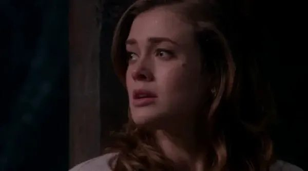

**Описание**

Оборотни, или ликантропы, — раса частично человеческих существ, способных превращаться в помесь человека и волка. Охотники считают их двоюродными братьями скинвокеров: у тех и других одна природа, одна заразная передача через укус и одна слабость. Оборотни происходят от Альфа-оборотня и входят в число монстров, созданных Евой.

Обращение подчиняется лунному циклу. Обычно оборотни меняют форму только в полнолуние; в шестом сезоне, накануне прихода Евы, они начали обращаться и под неполной луной, а после её смерти вернулись к прежнему порядку. Если Самхейн поднимается, он способен вызвать оборотней на Хэллоуин даже вне полнолуния. Чистокровные оборотни — первых поколений — умеют менять форму по собственному желанию.

В зверином облике тело оборотня быстро перестраивается, а сам он становится хищником: он охотится на то, что найдёт поблизости, а из-за роста городов это чаще всего люди. Отличительная черта почерка — съеденное сердце жертвы, хотя иногда оборотень поедает и другие части тела. Ликантропия передаётся укусом, но некоторые оборотни рождаются уже заражёнными.

На ранней стадии болезнь иногда удаётся остановить переливанием живой крови оборотня, который укусил жертву, — именно поэтому охотники сначала ищут прародителя заражённого. Британские Люди Письма пошли дальше и создали полноценное лекарство от ликантропии, а также отработали смертельную инъекцию нитрата серебра.

**Силы и способности**

- Обращение в звериную форму — под полнолуние, а в отдельные периоды и под неполную луну, оборотень превращается в гибрид человека и волка, становясь сильнее и быстрее.
- Сверхъестественная сила и скорость — в зверином облике оборотень без труда одолевает, поднимает и убивает взрослого человека.
- Заразный укус — укус передаёт ликантропию, именно так оборотни распространяют свой вид.
- Прирождённые оборотни — часть оборотней появляется на свет уже заражённой, им не нужен укус, чтобы стать монстром.
- Чистокровные оборотни — оборотни первых поколений обращаются по своему желанию, вне зависимости от фаз луны.

**Слабости**

- Серебро — главная слабость: серебряные пули, клинки, топоры, даже ложки и наручники ранят оборотня, а серебро в сердце или голову убивает его на месте.
- Боль от серебра — одного контакта с серебряным предметом достаточно, чтобы причинить оборотню сильную боль; по этой реакции его и опознают.
- Нитрат серебра — Люди Письма разработали смертельную инъекцию нитрата серебра; Мик Дэвис убил ею Хейдена Фостера.
- Лекарство — британские Люди Письма создали средство, излечивающее ликантропию; на ранней стадии помогает переливание живой крови оборотня-прародителя.
- Усиление благодатью — оборотни, усиленные благодатью, становятся невосприимчивы к серебру, и обычные охотничьи приёмы против них не работают.

**Как его убить.** Ищите почерк: оборотень всегда выедает сердце, поэтому вскрытые тела без сердца — первый признак. Сверьтесь с лунным календарём, но будьте готовы и к неполной луне. Зарядите оружие серебряными пулями и возьмите серебряный нож как запасной вариант. Если жертву укусили недавно, сначала найдите и убейте того оборотня, который её заразил: переливание его живой крови может снять проклятие. В крайнем случае годится инъекция нитрата серебра, но её ещё нужно приготовить.

**Известные особи:** Альфа-оборотень; Мэдисон; Глен; Гарт Фицджеральд IV; Клэр Новак; Хейден Фостер; Люденски

#### Оборотни (вервольфы)
*Средний, Монстр, нейтрально-злое*

---
- **Класс доспеха** 14 (природная броня)
- **Хиты** 60 (8d8 + 24)
- **Скорость** 40 фт.

| СИЛ | ЛОВ | ТЕЛ | ИНТ | МДР | ХАР |
|---|---|---|---|---|---|
| 17 | 16 | 16 | 10 | 12 | 9 |

- **Спасброски** Сил +5, Тел +5
- **Навыки** Восприятие +3, Скрытность +5, Выживание +3
- **Уязвимость к урону** серебро
- **Сопротивление урону** дробящий, колющий и рубящий от немагического оружия, кроме серебряного
- **Чувства** тёмное зрение 60 фт., пассивное Восприятие 13
- **Языки** общий (английский), в звериной форме речь недоступна
- **Бонус мастерства** +2
- **Уровень опасности** 4 (1 100 опыта)

***Особенности***
- ***Обращение под луной.*** В ночь полнолуния оборотень против своей воли принимает звериную форму и не может по своей воле вернуться в человеческий облик до рассвета. Вне полнолуния он остаётся человеком и не получает преимуществ звериной формы.
- ***Серебряная слабость.*** Уязвимость к серебру: урон серебряным оружием удваивается, а сопротивление немагическому оружию на серебряные атаки не распространяется.
- ***Пожиратель сердец.*** Оборотень всегда съедает сердце жертвы. Проверка Мудрости (Медицина или Выживание) Сл 12 на месте убийства позволяет опознать его почерк и отличить оборотня от скинвокера или зверя.
- ***Острый нюх.*** Оборотень имеет преимущество на проверки Мудрости (Восприятие), основанные на обонянии, и может выслеживать существо по запаху на расстоянии до 1 мили.

***Действия***
- ***Мультиатака.*** Оборотень совершает одну атаку укусом и одну атаку когтями.
- ***Укус.*** Рукопашная атака оружием: +5 к попаданию, досягаемость 5 фт., одна цель. Попадание: 7 (1d8 + 3) колющего урона, и цель должна преуспеть в спасброске Телосложения Сл 13, иначе заражается ликантропией.
- ***Когти.*** Рукопашная атака оружием: +5 к попаданию, досягаемость 5 фт., одна цель. Попадание: 6 (1d6 + 3) рубящего урона.

***Бонусные действия***
- ***Звериный бросок.*** Оборотень перемещается на половину своей скорости к раненой цели, не провоцируя атак по пути.

**Тактика.** Оборотень бьёт из засады, стараясь укусить, а затем оттащить жертву от группы, чтобы расправиться с ней в одиночку. Он не понимает, что серебро убивает его, пока не почувствует боль: первый контакт с серебряным оружием заставляет его сменить цель на того, кто кажется беззащитнее. Днём, в человеческом облике, оборотень избегает драки и предпочитает исчезнуть. Если бой идёт плохо, он отступает и возвращается ночью, уже в звериной форме.

**Экология.** Оборотни живут среди людей, снимают квартиры, работают и заводят семьи; в звериной форме они охотятся на окраинах городов, в лесах и на шоссе. В Соединённых Штатах их около тридцати, но вид постоянно пополняется новыми укушенными, а на ранней стадии заражения жертву ещё можно спасти.

> **Заметки мастеру.** Каноничный вервольф 5e сюда не подходит из-за проклятия и обязательного серебра — проще взять за основу берсерка или оборотня-зверя и добавить механику уязвимости к серебру. Одного оборотня удобно ставить на партию 3–4 уровня, стаю из трёх-четырёх — на 6–8 уровень. Чистокровный оборотень, обращающийся по желанию, — это уже CR 7–9; ему стоит дать сопротивление немагическому оружию целиком и одну-две легендарные действия. Сюжетно полезно заранее решить, есть ли у партии доступ к лекарству британских Людей Письма или к крови прародителя: это превращает охоту из драки в расследование с таймером.

[↑ к содержанию](#содержание)

---

### 71. Они

**Oni** · Монстр · CR 10 · опасность в сериале 4/5

*Также известно как:* Японский демон-катастрофа

*Первое появление:* Supernatural: Rite of Passage (роман)

Японский демон-катастрофа: насылает эпидемии и бедствия, читает мысли, скрывается от людского взгляда и бьёт канабо. Убить его можно только ударом в третий глаз, когда оружие-канабо потеряно.

**Описание**

Они — раса японских демонических существ из романа «Supernatural: Rite of Passage». Их считали виновниками катастроф и эпидемий крупного масштаба, неуязвимыми и связанными с дурными предзнаменованиями, и поедали человеческую плоть. Они враждуют с обакэ, более благосклонной расой японских монстров.

Они — могущественные монстры из японского фольклора, чьи способности усилены канабо. По желанию они исчезают из человеческого восприятия, но это требует сосредоточенности. Они насылают разрушительные грозы в знак своего прихода и вызывают турбулентность, из-за которой, например, парашютист ударился головой и погиб при падении. Они читают мысли своих целей, а сосредоточившись, способны мысленно наблюдать всё вокруг на большом расстоянии; дальность растёт, когда они открывают третий глаз. Они невероятно сильны: взрослых мужчин швыряют без усилий, одному приписывают раздавленное горло женщины.

Слабых мест у они мало: обряд с соевыми бобами изгоняет их из города. Несённые кем-то листья падуба нарушают силу они и не дают ей влиять на человека. Обакэ способны временно загипнотизировать они и заставить его замереть. Без канабо, прикрывающего третий глаз и усиливающего силу, они уязвим. Удар оружием — пулей или ножом — по третьему глазу убивает они. Молодые, ещё не завершившие превращение они уязвимы для смертельных ран, если взрослый они не передал им часть своей неуязвимости обрядом.

В 1993 году они по имени Тора пришёл в Лорел-Хилл, штат Нью-Джерси, сделал трёх женщин беременными своими полукровными отпрысками и ушёл. В 2011 году он вернулся за сыновьями — Райаном Брэмблом, Далтоном Рурком и Джесси Трамбеллом, устроил серию массовых происшествий, привлёк внимание Сэма и Дина Винчестеров и Бобби Сингера и начал обряд призыва, чтобы запустить превращение сыновей в полноценных они.

**Силы и способности**

- Невидимость — по желанию они исчезает из человеческого восприятия, но для этого требуется сосредоточенность и концентрация.
- Управление погодой — они насылает разрушительные грозы в знак своего прихода и вызывает турбулентность в воздухе.
- Телепатия — они читает мысли своих целей, добывая сведения о них.
- Ясновидение — сосредоточившись, они мысленно наблюдает всё вокруг на большом расстоянии, а с открытым третьим глазом — ещё дальше.
- Сверхчеловеческая сила — они без усилий швыряет взрослых мужчин; одному приписывают раздавленное горло женщины.
- Канабо — оружие усиливает силу они и одновременно прикрывает его третий глаз.

**Слабости**

- Обряд с соевыми бобами — ритуал с соевыми бобами изгоняет они из города.
- Листья падуба — падуб, который кто-то несёт с собой, нарушает силу они и не даёт ей никак влиять на этого человека.
- Обакэ — враждебные они существа, способные временно загипнотизировать его и заставить замереть на месте.
- Потеря канабо — без канабо они теряет защиту третьего глаза и становится уязвим для атак по нему.
- Третий глаз — попадание оружием, пулей или ножом, в третий глаз убивает они.
- Смертность молодых — не завершившие превращение молодые они уязвимы для смертельных ран, если взрослый они не передал им часть неуязвимости обрядом.
- Бронебойные патроны — вредят они, хотя убить его не способны.

**Как его убить.** Порядок охоты на они такой: сначала выбить или иным способом отобрать канабо — только тогда третий глаз становится уязвим. Затем одним точным ударом ножом или выстрелом поразить третий глаз; попадание в него убивает. До этого каждому охотнику стоит нести с собой листья падуба, чтобы они не мог повлиять лично на него, и держать под рукой обряд с соевыми бобами, если тварь нужно не убить, а изгнать из города. Против молодых они, ещё не прошедших превращение, работают обычные смертельные раны.

**Известные особи:** Тора — они из Лорел-Хилл, отец Райана Брэмбла, Далтона Рурка и Джесси Трамбелла

#### Они
*Средний, Монстр, нейтрально-злое*

---
- **Класс доспеха** 17 (природная броня)
- **Хиты** 136 (16d8 + 64)
- **Скорость** 40 фт.

| СИЛ | ЛОВ | ТЕЛ | ИНТ | МДР | ХАР |
|---|---|---|---|---|---|
| 22 | 16 | 19 | 15 | 17 | 16 |

- **Спасброски** Сил +10, Тел +8, Мдр +7
- **Навыки** Восприятие +7, Запугивание +7, Проницательность +7, Скрытность +7
- **Сопротивление урону** холод, электричество, некротический; дробящий, колющий и рубящий от немагического оружия
- **Иммунитет к состояниям** испуг, очарование
- **Чувства** истинное зрение 60 фт., тёмное зрение 120 фт., пассивное Восприятие 17
- **Языки** японский, английский, телепатия 120 фт.
- **Бонус мастерства** +4
- **Уровень опасности** 10 (5 900 опыта)

***Особенности***
- ***Канабо и третий глаз.*** Пока они держит канабо, его хиты не могут быть опущены ниже 1 ничем, кроме урона от освящённого оружия или урона по третьему глазу. Если они теряет канабо, эта защита пропадает до конца его следующего хода, а атаки по третьему глазу становятся смертельными.
- ***Третий глаз.*** Попадание атакой по третьему глазу они (атака с помехой, если он не схвачен и не обездвижен) убивает его мгновенно, независимо от оставшихся хитов. Требуется проверка атаки против КС 20.
- ***Невидимость по желанию.*** Они может бонусным действием стать невидимым, пока сохраняет сосредоточенность (как на заклинании). Он не может поддерживать невидимость и Ясновидение одновременно.
- ***Власть над погодой.*** Они может действием изменить погоду в радиусе 1 мили: вызвать грозу, ливень, град или сильный ветер. Эффект длится, пока они в этом районе.
- ***Чтение мыслей.*** Они читает поверхностные мысли существа в пределах 60 фт. и получает преимущество на проверки Мдр (Проницательность) и на атаки по этой цели, если та не скрывает намерений.
- ***Падуб.*** Существо, несущее при себе листья падуба, не может быть целью телепатии, чтения мыслей и внушения они и совершает с преимуществом спасброски против его способностей.
- ***Обряд с соевыми бобами.*** Обряд с соевыми бобами, проведённый в течение 10 минут, изгоняет они из города: он обязан покинуть поселение и не может вернуться 24 часа.

***Действия***
- ***Мультиатака.*** Они совершает две атаки канабо или одну атаку канабо и одну атаку кулаком.
- ***Канабо.*** Рукопашная атака оружием: +10 к попаданию, досягаемость 10 фт., одна цель. Попадание: 19 (3d8 + 6) дробящего урона, и цель должна преуспеть в спасброске Силы Сл 18, иначе падает ничком.
- ***Кулак.*** Рукопашная атака оружием: +10 к попаданию, досягаемость 5 фт., одна цель. Попадание: 13 (2d6 + 6) дробящего урона, и цель отбрасывается на 10 фт.
- ***Гроза (1/день).*** Они призывает грозу над площадью радиусом 60 фт. в пределах 120 фт. Каждое существо в области проходит спасбросок Ловкости Сл 16, получая 21 (6d6) урона электричеством при провале или половину при успехе. Гроза длится 1 минуту, и в начале каждого хода они каждое существо в ней повторяет спасбросок.
- ***Внушение (1/день).*** Они телепатически внушает одной цели в пределах 60 фт. одну мысль. Цель проходит спасбросок Мудрости Сл 16, иначе становится очарованной на 1 минуту или до получения урона.

***Бонусные действия***
- ***Исчезновение.*** Они становится невидимым, пока сохраняет сосредоточенность, максимум 1 минуту, или пока не атакует.
- ***Ясновидение.*** Они сосредоточивается и мысленно осматривает всё в радиусе 1 мили, получая преимущество на проверки Мдр (Восприятие) до конца своего следующего хода.

***Легендарные действия***
- ***Взмах канабо.*** Они совершает одну атаку канабо.
- ***Давление погоды.*** Они вызывает порыв ветра: одно существо в пределах 60 фт. проходит спасбросок Силы Сл 18, иначе его скорость уменьшается вдвое до конца его следующего хода.
- ***Скрыться в грозе.*** Они становится невидимым до конца своего следующего хода.

**Тактика.** Они не вступает в честный бой: он приходит в город с грозой, держится невидимым и бьёт из укрытия, читая мысли охотников и предугадывая их план. Сначала он старается раздавить самого сильного противника канабо, а затем отступить и сменить позицию; невидимость он поддерживает всегда, когда не атакует. Как только канабо выбит, они пытается вернуть его и переходит к обороне, прикрывая третий глаз. Против группы, знающей про падуб, он действует через погоду и внушение, а не через прямой контакт. Молодых они он защищает и старается увести с поля боя.

**Экология.** Они приходят в человеческие города, принося с собой катастрофы и эпидемии, и уходят, оставляя после себя полукровных детей. Держатся поодиночке, территориальны, враждуют с обакэ и не терпят их присутствия. Третий глаз и канабо делают они почти неуязвимым, пока оружие в его руках; без канабо он уязвим и старается отступить. За пределами Японии они появляются как редкая, но крайне разрушительная угроза, за которой тянется шлейф бедствий.

> **Заметки мастеру.** Они — босс для группы 9–12 уровня, построенный не на хитроле, а на задаче: партия должна выбить канабо и попасть в третий глаз. Это отличный повод для сцены с обакэ-союзником и обрядом с соевыми бобами. В 5e его можно собрать из оникса или марилита, добавив слабость к третьему глазу и падуб. На низком уровне уберите легендарные действия, грозу и невидимость, оставив канабо и чтение мыслей; на высоком добавьте двух молодых они-полукровок и логово с постоянной грозой.

[↑ к содержанию](#содержание)

---

### 72. Ооками

**Ōkami** · Монстр · CR 5 · опасность в сериале 3/5

*Также известно как:* Японский кузен вервольфа

*Первое появление:* S06E04 «Weekend at Bobby's»

*Сезоны:* 6

Японский родич вервольфа, внешне неотличимый от человека, но с волчьими клыками. Ест человеческие сердца и выбирает себе излюбленный тип добычи; обычным оружием его не убить.

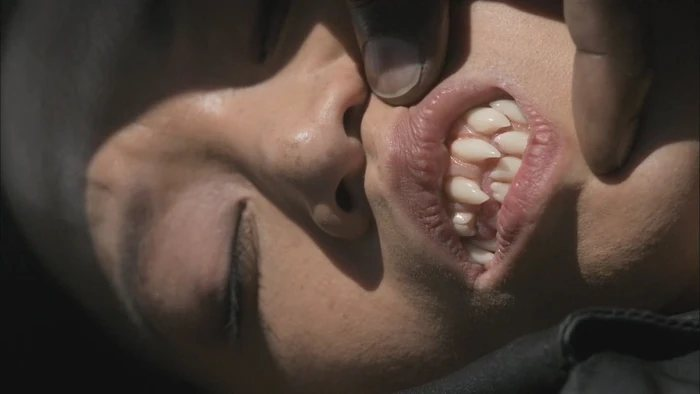

**Описание**

Ооками — сверхъестественные существа, с которыми охотники сталкивались лишь изредка: за пределами Японии они почти не встречаются, и в сериале о них известно очень мало. Один ооками появляется в эпизоде «Weekend at Bobby's» в деле, которое вели Руфус Тёрнер и Бобби Сингер.

По «Bobby Singer's Guide to Hunting» ооками — кузен вервольфа, но привязанный именно к Японии. Их свойства и способности почти совпадают с вервольфовыми, вплоть до рациона из человеческих сердец. В той же книге Бобби рассказывает, что его первая настоящая осознанная охота была как раз на ооками.

Внешне ооками, как и многие другие твари, ничем не отличаются от обычных людей. Однако, подобно вервольфам, у них вырастают собачьи клыки. Они кормятся человеческими жертвами, но, в отличие от прочих видов, у каждой особи есть любимый тип добычи: ооками из эпизода предпочитала одиноких белых женщин, как прямо указал Руфус.

Несмотря на кажущуюся человеческую хрупкость, ооками невероятно сильна. Она без труда одолевает, поднимает, швыряет и мечет взрослых людей, разрывает плоть, вырывает сердца из грудной клетки и разбирает человека по конечностям. Взрослых мужчин она поднимает в воздух, как перья, и бросает на несколько футов; она может повалить прочную стену и выкопаться из-под земли. Одна ооками очень быстро выбралась из земли на глубину шести футов, даже когда сверху лежали сотни фунтов грунта и обломков, легко одолела Бобби Сингера и небрежно отбросила его более чем на двадцать футов.

Учитывая влияние Евы на ооками, вероятно, существует и альфа-ооками, но подтверждений этому в сериале нет.

**Силы и способности**

- Сверхчеловеческая сила — ооками заметно сильнее человека: поднимает и мечет взрослых людей, разрывает плоть, вырывает сердце из грудной клетки.
- Разрывание на части — голыми руками разбирает жертву по конечностям и открывает грудную клетку.
- Сверхчеловеческая ловкость — ооками быстра и подвижна, что позволяет ей уходить от людей и выбираться из-под земли.
- Выкапывание из-под земли — одна ооками быстро выбралась с шестифутовой глубины даже из-под сотен фунтов грунта и обломков.
- Человеческая личина — внешне ооками неотличима от человека; выдают её только собачьи клыки.
- Избирательный вкус — каждая особь предпочитает свой тип добычи, что позволяет охотникам предсказать следующую жертву.

**Слабости**

- Бамбуковый кинжал, освящённый синтоистским жрецом — им нужно ударить семь раз; меньше семи ударов не убивают, но надолго выводят ооками из строя.
- Расчленение — Бобби Сингер убил ооками, засунув её в измельчитель древесины; Руфус заметил, что измельчитель убьёт что угодно.
- Неизвестность слабостей — об ооками известно настолько мало, что обычные охотничьи методы против них не описаны.

**Как его убить.** Без освящённого синтоистским жрецом бамбукового кинжала охота почти безнадёжна: обычное оружие ооками не берёт. Готовят такой кинжал заранее и бьют строго семь раз — меньшее число ударов лишь надолго обездвижит тварь, и её придётся добивать. Если кинжала нет, работает грубая механика: расчленение, например измельчитель древесины, в который ооками можно столкнуть. Выслеживают её по жертвам одного типа, чаще всего по одиноким женщинам.

**Известные особи:** Ооками из «Weekend at Bobby's» — охотилась на одиноких белых женщин

#### Ооками
*Средний, Монстр, нейтрально-злое*

---
- **Класс доспеха** 15 (природная броня)
- **Хиты** 85 (10d8 + 40)
- **Скорость** 40 фт.

| СИЛ | ЛОВ | ТЕЛ | ИНТ | МДР | ХАР |
|---|---|---|---|---|---|
| 20 | 16 | 18 | 9 | 13 | 10 |

- **Спасброски** Сил +8, Тел +7
- **Навыки** Атлетика +8, Восприятие +4, Скрытность +6, Выживание +4
- **Сопротивление урону** дробящий, колющий и рубящий от немагического оружия
- **Иммунитет к состояниям** испуг
- **Чувства** тёмное зрение 60 фт., чутьё на избранную добычу 120 фт., пассивное Восприятие 14
- **Языки** английский
- **Бонус мастерства** +3
- **Уровень опасности** 5 (1 800 опыта)

***Особенности***
- ***Освящённый бамбуковый кинжал.*** Ооками может быть убита только бамбуковым кинжалом, освящённым синтоистским жрецом. Любой другой урон не может опустить её хиты ниже 1. Каждое попадание таким кинжалом даёт один заряд; на седьмом заряде ооками немедленно погибает.
- ***Меньше семи — не смерть.*** Если ооками получает от одного до шести зарядов и после этого не получает новых в течение 10 минут, все заряды сгорают, а ооками становится недееспособной на 1 час, но остаётся жива.
- ***Расчленение.*** Ооками, опущенная до 0 хитов в измельчителе, под прессом или под другим механизмом, расчленяющим тело, погибает окончательно, даже если её хиты не были снижены освящённым бамбуком.
- ***Избирательный хищник.*** В каждой местности ооками выбирает одну категорию добычи (например, одинокие женщины). Она совершает с преимуществом проверки Мдр (Выживание), выслеживая такую добычу, и с помехой — любую другую.
- ***Землерой.*** Ооками может закопаться в рыхлую землю или выбраться из-под завала, тратя на каждые 5 фт. глубины 5 фт. перемещения, и не получает урона от давления грунта.

***Действия***
- ***Мультиатака.*** Ооками совершает две атаки: укусом и когтями либо двумя атаками когтями.
- ***Укус.*** Рукопашная атака оружием: +8 к попаданию, досягаемость 5 фт., одна цель. Попадание: 14 (2d8 + 5) колющего урона.
- ***Когти.*** Рукопашная атака оружием: +8 к попаданию, досягаемость 5 фт., одна цель. Попадание: 12 (2d6 + 5) рубящего урона.
- ***Вырывание сердца.*** Рукопашная атака оружием: +8 к попаданию, одна цель — схваченное, недееспособное или лишённое сознания существо. Попадание: 27 (6d6 + 6) рубящего урона, и цель получает один уровень истощения.

***Бонусные действия***
- ***Мощный бросок.*** Ооками швыряет схваченное существо Большого размера или меньше на 20 фт. в выбранном направлении. Существо получает 7 (2d6) дробящего урона и падает ничком.

***Реакции***
- ***Звериная ярость.*** Когда существо в пределах 5 фт. наносит ооками урон, она может реакцией совершить по нему одну атаку когтями.

**Тактика.** Ооками бьёт как хищник: выбирает избранную добычу, отсекает её от группы, сбивает с ног и разделывает, не тратя времени на остальных. В открытом бою она не боится боли и не отступает, но охотникам с огнестрелом предпочитает отвечать броском: схватить, отшвырнуть и переключиться на того, кто остался один. Услышав об освящённом кинжале, ооками уходит в землю или в узкие проходы, где численный перевес не работает. Если её ранили бамбуком меньше семи раз, она отступает и затаивается, чтобы вернуться ночью.

**Экология.** Ооками — японские твари, за пределами Японии почти не встречающиеся; в США зафиксирован единичный случай. Живут поодиночке, скрываясь среди людей, и питаются человеческими сердцами, выбирая одну категорию жертв. По «Bobby Singer's Guide to Hunting» возможен альфа-ооками как источник вида, но подтверждений его существования нет. С другими монстрами ооками не сосуществует: она одиночный территориальный хищник.

> **Заметки мастеру.** Ооками — монстр-загадка для группы 4–6 уровня: сюжет строится вокруг добычи освящённого синтоистским жрецом бамбукового кинжала, а не вокруг боя. Замена в 5e — вервольф, но без смены формы и с жёстким условием смерти через семь ударов. Механику семи зарядов удобно вынести в трекер: партия должна нанести ровно семь попаданий кинжалом, что превращает бой в задачу на выживание и контроль. На низком уровне уменьшите хиты до 45 и уберите Вырывание сердца; на высоком добавьте альфа-ооками с легендарными действиями и стаей обычных особей.

[↑ к содержанию](#содержание)

---

### 73. Первый вампир

**First Vampire** · Монстр · CR 10 · опасность в сериале 3/5

*Также известно как:* Безымянный древний вампир; Первый обычный вампир

*Первое появление:* S06 «Two And A Half Men»

*Сезоны:* 6, 8

Древний человек каменного века, которого Альфа-вампир утащил в темноту и обратил, сделав самым первым вампиром. Он породил остальных вампиров; если он ещё жив, ему около двух миллионов лет.

**Описание**

Первый вампир был безымянным древним человеком, которого Альфа-вампир обратил первым. Согласно его истории, дело было в каменном веке: к человеку явился Прометей и дал ему огонь. Он и его племя сбились вокруг костра, чтобы согреться, и тогда Альфа-вампир вытащил его в тени и накормился им, превратив в первого обычного вампира.

Именно от него происходят все остальные вампиры: он обращал других, и это положило начало целому виду. Если он всё ещё жив, его возраст должен составлять около двух миллионов лет — древность, сравнимая с возрастом самого Альфы, но без его статуса прародителя Альф.

О его характере, облике, привычках и дальнейшей судьбе выжимка почти ничего не сообщает: он остаётся безымянным фоном, от которого отсчитывается история вида. В отличие от Альфа-вампира, он не Альфа: он назван «первым обычным вампиром», то есть существом того же порядка, что и все его потомки, просто самым старым из них.

В сериале он упоминается в шестом сезоне («Two And A Half Men», «Family Matters») и в восьмом («Remember The Titans»). Для охотников это скорее легенда о происхождении вампиров, чем конкретная цель: прямых сведений о том, что он жив и где-то скрывается, выжимка не даёт.

**Силы и способности**

- Обращение — он создавал других вампиров, и именно его обращения привели к появлению всего вида.
- Бессмертие — если он ещё жив, ему около двух миллионов лет: он не старится и не умирает естественной смертью.
- Древность — как первый обычный вампир он старше любого другого вампира, кроме самого Альфы-вампира.

**Слабости**

- Слабости не описаны — выжимка не перечисляет его уязвимостей; он назван «первым обычным вампиром», поэтому охотнику разумно исходить из слабостей рядового вампира, но подтверждения в источнике нет.
- Он не Альфа — ему не приписывают ни неуязвимости к обычному оружию, ни психического зова, ни власти над сородичами, которыми обладает Альфа-вампир.
- Неизвестно, жив ли он — выжимка говорит о его бессмертии с оговоркой «если он ещё жив»; о его нынешнем состоянии ничего не сообщается.

**Как его убить.** Выжимка не описывает охоту на первого вампира, поэтому план приходится строить по аналогии. Единственное отличие, прямо указанное в источнике, — он не Альфа, а «первый обычный вампир», значит, у него нет ни неуязвимости к обычному оружию, ни психического зова, ни власти над гнездом. Работать с ним стоит как с рядовым вампиром: тяжёлый клинок, обезглавливание и мёртвая кровь для обездвиживания, но с поправкой на возраст и опыт.

**Известные особи:** Безымянный первый вампир; Альфа-вампир (создатель); Прометей

#### Первый вампир
*Средний, Монстр, нейтрально-злое*

---
- **Класс доспеха** 16 (природная броня)
- **Хиты** 136 (16d8 + 64)
- **Скорость** 40 фт.

| СИЛ | ЛОВ | ТЕЛ | ИНТ | МДР | ХАР |
|---|---|---|---|---|---|
| 20 | 18 | 18 | 12 | 13 | 14 |

- **Спасброски** Сил +9, Лов +8, Тел +8
- **Навыки** Восприятие +5, Скрытность +8, Запугивание +6
- **Сопротивление урону** некротический; дробящий, колющий и рубящий от немагического оружия
- **Иммунитет к состояниям** очарование, испуг
- **Чувства** тёмное зрение 90 фт., пассивное Восприятие 15
- **Языки** общий (английский)
- **Бонус мастерства** +4
- **Уровень опасности** 10 (5 900 опыта)

***Особенности***
- ***Регенерация 10.*** Первый вампир восстанавливает 10 хитов в начале своего хода, если у него есть хотя бы 1 хит и он не получал урона излучением с конца своего предыдущего хода.
- ***Смерть от обезглавливания.*** Опустившись до 0 хитов, он не умирает, а падает ничком и остаётся в сознании. Он окончательно погибает, только когда его голова полностью отделена от тела; иначе через 1 час восстанавливается до 1 хита.
- ***Древнее бессмертие.*** Он не стареет и не может умереть от болезней, ядов, истощения или естественных причин, а его возраст исчисляется миллионами лет.
- ***Обычный вампир, а не Альфа.*** У него нет неуязвимости к обычному оружию, психического зова и власти над гнездом, которыми обладает Альфа-вампир. При этом он наносит полный урон всем оружием, включая немагическое.
- ***Первый укус.*** Существо, убитое его укусом, поднимается через 1 минуту как вампир, преданный ему. Одновременно под его началом может быть не более двенадцати таких вампиров.
- ***Жажда крови.*** Если он не пил кровь более 24 часов, он в начале каждого часа совершает спасбросок Мудрости Сл 14, иначе до конца часа атакует ближайшего гуманоида.

***Действия***
- ***Мультиатака.*** Первый вампир совершает две атаки: одну когтями и одну укусом либо две атаки когтями.
- ***Когти.*** Рукопашная атака оружием: +9 к попаданию, досягаемость 5 фт., одна цель. Попадание: 12 (2d6 + 5) рубящего урона.
- ***Укус.*** Рукопашная атака оружием: +9 к попаданию, досягаемость 5 фт., одна цель — гуманоид или зверь. Попадание: 12 (2d6 + 5) колющего урона плюс 10 (3d6) некротического урона. Максимум хитов цели уменьшается на величину некротического урона, пока она не завершит продолжительный отдых.
- ***Обращение (1/день).*** Первый вампир касается мёртвого гуманоида, умершего не более суток назад, и тот поднимается как вампир, преданный ему. Обряд занимает 1 минуту и требует, чтобы тело не было освящено или обезглавлено.

***Бонусные действия***
- ***Рывок хищника.*** Первый вампир совершает действие Рывок или Отход.

**Тактика.** Первый вампир — древний, но обычный вампир, и он это знает: он не станет мериться силами с превосходящим противником, а будет действовать как опытный хищник. Он нападает из темноты, первым делом утаскивает одну жертву в укрытие, а затем использует её как приманку для остальных. Если бой идёт плохо, он разрывает дистанцию, залечивает раны и возвращается следующей ночью; при угрозе полного уничтожения он обратит павшего противника, чтобы получить союзника и время. Обезглавливания он боится больше всего и защищает шею любой ценой.

**Экология.** Сведений о его нынешнем существовании выжимка не даёт: он появляется как персонаж предыстории, а не как активный охотник. Если он жив, логичное место для него — изолированное древнее гнездо вдали от крупных городов, где он держит небольшой круг обращённых потомков. Встреча с ним в мире сериала — событие уровня легенды: вампиры считают его началом своего вида, а охотники — либо мифом, либо самым старым трофеем в истории.

> **Заметки мастеру.** Первый вампир — «мини-босс» для партии 8–11 уровня: CR 10 и обычные вампирские уязвимости делают бой честным, а его возраст — поводом дать ему древние знания и связи. Не превращайте его во второго Альфу: в источнике он прямо назван «первым обычным вампиром», поэтому неуязвимость к обычному оружию и психический зов ему не положены. Обращение используйте как тактический ресурс: каждый убитый им союзник становится врагом. Для низкого уровня снизьте CR до 7 и уберите обращение.

[↑ к содержанию](#содержание)

---

### 74. Первый перевёртыш

**First Shapeshifter** · Монстр · CR 5 · опасность в сериале 2/5

*Также известно как:* Безымянный перевёртыш каменного века

*Первое появление:* S06 «Two And A Half Men»

*Сезоны:* 6

Безымянный человек каменного века, которого Альфа-перевёртыш превратил в первого обычного перевёртыша. Он сам начал обращать других людей и тем самым положил начало всему виду.

**Описание**

Первый перевёртыш — безымянный монстр, ставший первым обычным перевёртышем, созданным Альфа-перевёртышем. В отличие от Альфы, он не прародитель вида, а первый его представитель: именно с него началась вся линия шифтеров.

Когда-то он был древним человеком, жившим в каменном веке. Альфа-перевёртыш устроил на него засаду и превратил его в первого перевёртыша, а тот, в свою очередь, обратил других людей — так и появился вид. В шестом сезоне его история раскрывается в эпизоде «Two And A Half Men», где братья Винчестеры имеют дело с младенцем-перевёртышем и его роднёй.

Как и все перевёртыши, он способен менять облик и становиться кем угодно. Его главное отличие — способность к обращению: он порождал других перевёртышей, и именно это сделало вид многочисленным. Никаких других уникальных способностей источники ему не приписывают.

Охотники не выделяют первого перевёртыша в отдельную цель: для них он лишь древнее подтверждение того, что вид когда-то начался с одного человека, обращённого Альфой. Убить его можно теми же средствами, что и любого шифтера, — серебром в сердце, — а опознать по блику сетчатки. С годами он стал одним из самых старых монстров своего вида, но в сериале его судьба после каменного века не раскрывается.

**Силы и способности**

- Обращение — первый перевёртыш порождал других перевёртышей, превращая людей в монстров своего вида; именно так возникла вся раса шифтеров.
- Смена облика — он способен принять внешность любого человека и выглядеть как кто угодно.
- Кража памяти — как и прочие перевёртыши, он получает память и навыки живого человека, чей облик принял.
- Древняя живучесть — он существует со времён каменного века и пережил тысячи лет, оставаясь в тени человеческой истории.

**Слабости**

- Серебро — как любой перевёртыш, он уязвим к серебру: серебряная пуля или клинок в сердце убивает его.
- Контакт с серебром — серебряный предмет обжигает его и причиняет нестерпимую боль.
- Блик сетчатки — при съёмке или свете, пересекающем глаза, его выдаёт характерный блик.
- Вампинит — левиафанская присадка, по словам Эдгара, убивает перевёртышей наравне с вампирами и гулями.

**Как его убить.** Первого перевёртыша убивают так же, как любого его потомка: серебряная пуля или серебряный клинок в сердце. Перед встречей проверьте подозреваемого камерой или фонарём — блик сетчатки выдаст его мгновенно. Память о нём есть только в древних записях, поэтому ищите его по следам обращения людей: там, где появился новый перевёртыш, рядом может быть тот, кто его создал. Держите в резерве вампинит и работайте группой: в одиночку против древнего шифтера шансов почти нет.

**Известные особи:** Первый перевёртыш (имя в источниках не указано); Альфа-перевёртыш

#### Первый перевёртыш
*Средний, Монстр, нейтрально-злое*

---
- **Класс доспеха** 15 (природная броня)
- **Хиты** 82 (11d8 + 33)
- **Скорость** 30 фт.

| СИЛ | ЛОВ | ТЕЛ | ИНТ | МДР | ХАР |
|---|---|---|---|---|---|
| 17 | 17 | 16 | 14 | 12 | 16 |

- **Спасброски** Лов +6, Тел +6
- **Навыки** Обман +9, Скрытность +6, Проницательность +4
- **Уязвимость к урону** серебро
- **Сопротивление урону** дробящий, колющий и рубящий от немагического оружия, кроме серебряного
- **Чувства** пассивное Восприятие 11
- **Языки** общий (английский), а также языки и манера речи оригинала в принятом облике
- **Бонус мастерства** +3
- **Уровень опасности** 5 (1 800 опыта)

***Особенности***
- ***Смена облика.*** Перевёртыш действием принимает облик любого гуманоида, которого видел, копируя внешность, голос, отпечатки пальцев и ДНК.
- ***Кража памяти.*** Приняв облик живого гуманоида, он получает его воспоминания, языки и владения навыками, а также преимущество на проверки Харизмы (Обман), выдавая себя за него.
- ***Первый из вида.*** Когда перевёртыш принимает облик гуманоида и удерживает его 10 минут, он может обратить этого гуманоида в перевёртыша: цель совершает спасбросок Телосложения Сл 15, и при провале становится перевёртышем под его контролем.
- ***Регенерация 5.*** Перевёртыш восстанавливает 5 хитов в начале своего хода, если у него есть хотя бы 1 хит и он не получал урона серебром с конца своего предыдущего хода.
- ***Серебряный ожог.*** Урон серебром по перевёртышу удваивается, а при контакте с серебряным предметом он до конца своего следующего хода совершает атаки с помехой.
- ***Блик сетчатки.*** На записи камеры или под лучом света виден блик его сетчатки; проверка Интеллекта (Анализ) Сл 13 позволяет распознать перевёртыша в чужом облике.

***Действия***
- ***Мультиатака.*** Перевёртыш совершает две атаки клинком или одну атаку клинком и одну безоружным ударом.
- ***Клинок.*** Рукопашная атака оружием: +6 к попаданию, досягаемость 5 фт., одна цель. Попадание: 7 (1d8 + 3) колющего урона.
- ***Ложное лицо.*** Перевёртыш принимает облик существа, которому цель доверяет. Цель должна преуспеть в спасброске Мудрости Сл 15, иначе до конца своего следующего хода не может атаковать перевёртыша.

***Бонусные действия***
- ***Быстрая подмена.*** Перевёртыш меняет облик, чтобы сбить противников с толку: до конца своего следующего хода атаки по нему из-за подмены совершаются с помехой.

**Тактика.** Первый перевёртыш действует как его потомки, но осторожнее: он веками живёт под чужими лицами и не рискует собой без нужды. В бою он принимает облик союзника партии, чтобы расколоть группу, и бьёт в спину тому, кто держит серебро. Против превосходящих сил он уходит под новым лицом и возвращается через годы, а не через дни. Единственное, что заставляет его рисковать, — возможность обратить сильного человека в перевёртыша и расширить свой вид.

**Экология.** Он существует с каменного века и за тысячи лет сменил бесчисленное множество личностей; вероятнее всего, он живёт в крупном городе, где легко менять документы и биографию. Прямых сведений о его нынешнем убежище нет, а других перевёртышей он воспринимает как своё потомство и при необходимости использует их как прикрытие.

> **Заметки мастеру.** Первый перевёртыш отличается от рядового шифтера только способностью обращать людей, поэтому его удобно использовать как скрытого антагониста городской арки: он не бьёт первым, а подставляет партию под своих новообращённых. Для партии 4–5 уровня он хорош в паре с двумя-тремя рядовыми перевёртышами, но способность обращения делайте медленной, иначе он заполонит город за одну ночь. Если нужен CR выше, добавьте легендарные действия на смену облика и союзников, которых он приводит с собой. Серебро должно быть у партии заранее: без него бой превратится в погоню за чужими лицами.

[↑ к содержанию](#содержание)

---

### 75. Перевёртыши

**Shapeshifters** · Монстр · CR 4 · опасность в сериале 3/5

*Также известно как:* Шифтеры; Сбрасывающие кожу

*Первое появление:* S01 «Skin»

*Сезоны:* 1, 2, 4, 6, 9, 10, 12, 13, 14, 15

Монстры, начинавшие людьми и научившиеся сбрасывать кожу, чтобы стать кем угодно: они получают чужие отпечатки, ДНК и даже раны. Они не движимы инстинктом, как вампиры или оборотни, и убивают по собственному выбору.

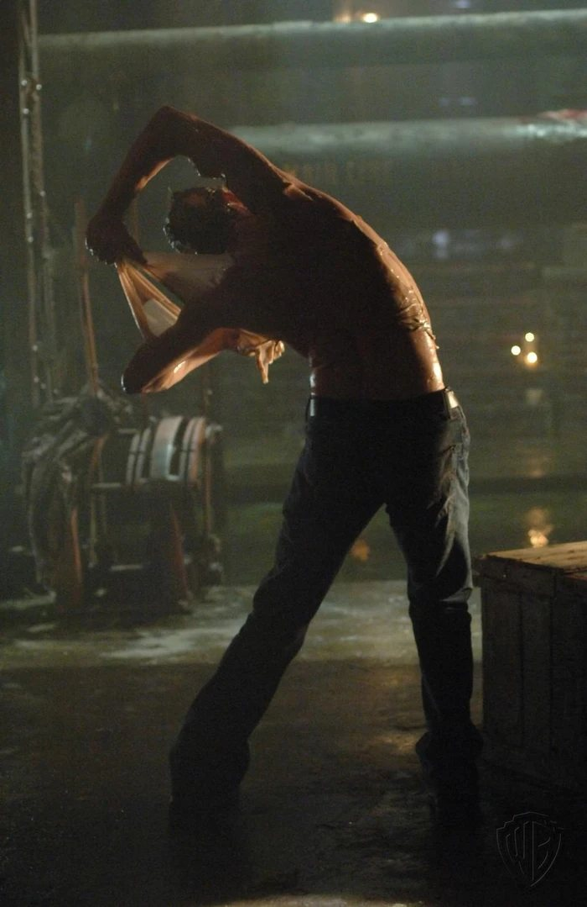

**Описание**

Перевёртыши, или шифтеры, — вид монстров, способных принимать облик любого человека. Они созданы Евой, а самым первым из них был Альфа-перевёртыш.

Смена облика у перевёртыша буквальна: он сбрасывает кожу и становится тем, кого копирует, вплоть до отпечатков пальцев, ДНК и даже тяжёлых ран оригинала. Если человек, чей облик принят, ещё жив, перевёртыш получает доступ к его мыслям, навыкам и памяти. Некоторые перевёртыши, как и их Альфа, умеют менять форму без сбрасывания кожи, а один из них продемонстрировал способность принимать облик вымышленных человекоподобных монстров.

Перевёртыши начинают людьми и лишь со временем учатся менять облик: одни осваивают это в младенчестве, другие — много позже. Из-за человеческого происхождения им знакомы человеческие пороки и желания — жадность, похоть, зависть, — и их справедливо называют самыми человечными из монстров. В отличие от вампиров и оборотней, которых ведёт инстинкт, перевёртыш убивает по собственному выбору.

Опознать перевёртыша можно по блику сетчатки, который виден на записи камеры или когда луч света пересекает ему глаза. Убивает его серебро — пуля или клинок в сердце, — а контакт с серебряным предметом обжигает и выдаёт его с головой. Кроме того, перевёртышам вредят иридий, испытанный Кроули, и левиафанская присадка вампинит. Охотники вроде Сэма и Дина Винчестеров сталкивались с ними не раз, и почти каждое такое дело начинается с человека, который ведёт себя не так, как должен.

**Силы и способности**

- Смена облика — перевёртыш сбрасывает кожу и становится живым или мёртвым человеком, копируя внешность, отпечатки пальцев и ДНК.
- Копирование ран — перевёртыш воспроизводит даже очень серьёзные травмы оригинала, чем сбивает со следа врачей и охотников.
- Кража памяти — пока оригинал жив, перевёртыш получает его мысли, навыки и воспоминания, а значит знает всё, что знает жертва.
- Смена без сбрасывания кожи — некоторые перевёртыши, как и их Альфа, меняют форму, не сбрасывая кожу, и делают это почти мгновенно.
- Чужой облик монстра — один перевёртыш сумел принять форму вымышленных человекоподобных монстров.
- Регенерация — лёгкость смены формы позволяет перевёртышу быстро залечивать повреждения.
- Человеческая природа — перевёртыши начинают людьми, поэтому ими движут человеческие желания, а не инстинкт: они убивают осознанно.

**Слабости**

- Серебро — серебряная пуля или клинок в сердце убивает перевёртыша; контакт с серебром обжигает его и выдаёт с головой.
- Боль от серебра — раны, нанесённые серебром, невероятно болезненны для перевёртыша и надолго выводят его из строя.
- Блик сетчатки — при съёмке на камеру или когда луч света пересекает глаза, у перевёртыша виден характерный блик, по которому его опознают.
- Иридий — по опытам Кроули, иридий способен вредить перевёртышам и годится как оружие против них.
- Вампинит — левиафанская присадка, по словам Эдгара, убивает перевёртышей наравне с вампирами и гулями.
- Перцовый баллончик — Джейми ослепила им перевёртыша, чтобы выиграть время, хотя тот оправился быстрее человека.

**Как его убить.** Серебряная пуля или серебряный клинок в сердце — единственный надёжный способ убить перевёртыша, поэтому серебро берут в первую очередь. Опознать его можно по блику сетчатки: запишите подозреваемого на камеру или посветите ему в лицо фонарём. Перевёртыш копирует память только живого оригинала, поэтому убитый или похищенный двойник быстро путается в деталях. Если оригинал жив, найдите его — перевёртыш рядом. Работайте вдвоём: шифтер силён, но не хочет, чтобы его голову пробили серебром.

**Известные особи:** Альфа-перевёртыш; Джейми

#### Перевёртыши
*Средний, Монстр, нейтрально-злое*

---
- **Класс доспеха** 14 (природная броня)
- **Хиты** 60 (8d8 + 24)
- **Скорость** 30 фт.

| СИЛ | ЛОВ | ТЕЛ | ИНТ | МДР | ХАР |
|---|---|---|---|---|---|
| 16 | 17 | 16 | 13 | 12 | 15 |

- **Спасброски** Лов +5, Тел +5
- **Навыки** Обман +6, Скрытность +5, Проницательность +3
- **Уязвимость к урону** серебро
- **Чувства** пассивное Восприятие 11
- **Языки** общий (английский), а также языки и манера речи оригинала в принятом облике
- **Бонус мастерства** +2
- **Уровень опасности** 4 (1 100 опыта)

***Особенности***
- ***Смена облика.*** Перевёртыш действием сбрасывает кожу и принимает облик любого гуманоида, которого видел: внешность, голос, отпечатки пальцев, ДНК и даже раны оригинала. Облик держится, пока перевёртыш не сменит его или не потеряет сознание.
- ***Кража памяти.*** Приняв облик живого гуманоида, перевёртыш получает его воспоминания, языки, владения навыками и знание мест. Он имеет преимущество на проверки Харизмы (Обман), выдавая себя за этого человека.
- ***Регенерация 5.*** Перевёртыш восстанавливает 5 хитов в начале своего хода, если у него есть хотя бы 1 хит и он не получал урона серебром с конца своего предыдущего хода.
- ***Серебряный ожог.*** Контакт с серебром причиняет перевёртышу сильную боль: если он касается серебряного предмета, то до конца своего следующего хода совершает атаки с помехой, а урон серебром по нему удваивается.
- ***Блик сетчатки.*** Когда перевёртыша снимают на камеру или луч света пересекает его глаза, виден характерный блик. Существо, изучающее запись, может проверкой Интеллекта (Анализ) Сл 13 распознать перевёртыша.

***Действия***
- ***Мультиатака.*** Перевёртыш совершает две атаки: одну оружием и одну безоружным ударом или две атаки оружием.
- ***Серебряный нож (клинок).*** Рукопашная атака оружием: +5 к попаданию, досягаемость 5 фт., одна цель. Попадание: 6 (1d6 + 3) колющего урона.
- ***Захват.*** Перевёртыш пытается схватить цель (Сл высвобождения 13) и, удерживая её, принимает облик её близкого, чтобы выиграть время до следующего хода.

***Бонусные действия***
- ***Быстрая подмена.*** Перевёртыш меняет облик на другого гуманоида, которого видел, чтобы сбить противников с толку: до конца своего следующего хода атаки по нему, если нападающий не знает о подмене, совершаются с помехой.

**Тактика.** Перевёртыш почти никогда не вступает в честный бой: он годами живёт чужой жизнью, устраняет оригинала и лишь потом позволяет себе действовать открыто. Если его раскрыли, он меняет облик на кого-то из союзников партии, чтобы внести смятение, и бьёт в спину тому, кто держит серебро. Он отступает при первых признаках серьёзного сопротивления и возвращается под новым лицом, поэтому упущенный перевёртыш почти всегда становится новой главой расследования. Серебра он боится панически и старается не подпускать вооружённых им врагов.

**Экология.** Перевёртыши живут среди людей — снимают жильё, работают, заводят отношения, — и часто их жертвами становятся те, чью жизнь они хотят получить. Они предпочитают города, где легко затеряться и найти одинокого человека, и держатся поодиночке или маленькими группами. Отдельные перевёртыши подчиняются Альфа-перевёртышу, который способен менять форму без сбрасывания кожи.

> **Заметки мастеру.** Перевёртыш — идеальный сюжетный монстр для городской кампании: статблок простой, а угроза строится на подмене личности и краже памяти. Для боя берите за основу шпиона или головореза, добавьте уязвимость к серебру и правило смены облика; этого достаточно для партии 3–4 уровня. Против партии 8+ уровня ставьте группу перевёртышей во главе с Альфой, который меняет форму без сбрасывания кожи и получает легендарные действия. Полезный приём — не показывать игрокам карту боя целиком: пусть перевёртыш меняет облик на союзника и заставляет партию сомневаться в каждом NPC.

[↑ к содержанию](#содержание)

---

### 76. Пиштако

**Pishtaco** · Монстр · CR 3 · опасность в сериале 2/5

*Также известно как:* Жировой вампир; Перуанский паразит

*Первое появление:* S09 «The Purge»

*Сезоны:* 9, 10, 11

Паразит родом из Перу, который питается человеческим жиром: снаружи он неотличим от человека, но при кормлении закатывает глаза и выпускает изо рта сосущий отросток, как у миноги. Жир даёт ему силу, а убить его можно только серебром.

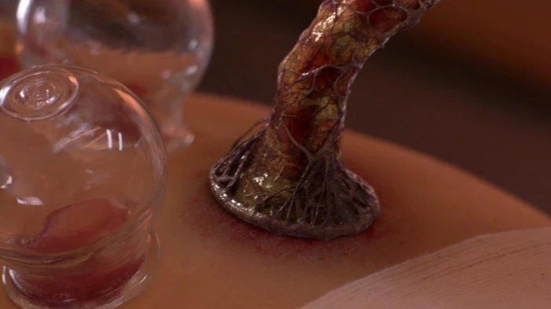

**Описание**

Пиштако — паразитический монстр, родом из Перу; в США он встречается редко. Он похож на вампира, но питается исключительно человеческим жиром, живёт только за его счёт и испытывает к жиру огромный голод.

В отличие от вампиров, которых пиштако считают убийцами, сами пиштако ведут себя как паразиты и не охотятся на жертву специально. Впрочем, некоторые из них всё же выслеживают людей ради жира. Как и большинство монстров, снаружи они выглядят совершенно по-человечески: только во время кормления глаза закатываются, и изо рта выходит удлинённый сосущий отросток.

Съеденный человеческий жир даёт пиштако сверхчеловеческую силу. При этом в мире монстров они очень слабы: сильный мужчина, как Сэм Винчестер, способен справиться с пиштако врукопашную.

Убить пиштако можно только серебром: Дин зарезал одного серебряным ножом. Если отсечь сосущий отросток серебряным клинком, пиштако тоже погибает — это делает его хоботок не только оружием, но и слабым местом. Отростком пиштако способен высосать слишком много жира или прорвать в человеке дыру и убить его.

Пиштако появлялись в нескольких эпизодах: в девятом сезоне («The Purge»), десятом («Hibbing 911») и одиннадцатом («Plush»). В инфобоксе вики среди связанных с ними существ указаны Ева, Левиафаны и альфа-пиштако; статус вида — существующий.

**Силы и способности**

- Сверхчеловеческая сила — наевшись человеческого жира, пиштако становится сильнее человека, хотя в сравнении с другими монстрами остаётся слабым.
- Хоботок миноги — изо рта пиштако выходит удлинённый сосущий отросток, которым он высасывает жир.
- Убийство через отросток — хоботком пиштако может высосать слишком много жира или прорвать в человеке дыру и убить его.
- Человеческий облик — вне кормления пиштако неотличим от обычного человека.

**Слабости**

- Серебро — пиштако можно убить только оружием из серебра; Дин зарезал одного серебряным ножом.
- Отрезанный хоботок — если отсечь сосущий отросток серебряным клинком, пиштако погибает.
- Слабость в мире монстров — по вики пиштако очень слаб по монстерским меркам: сильный человек вроде Сэма справляется с ним врукопашную.
- Голод — голод на жир управляет поведением пиштако и заставляет его подходить близко к жертве.

**Как его убить.** Пиштако уязвим только к серебру, поэтому главный инструмент охотника — серебряный нож или серебряные пули. Быстрее всего работает удар по хоботку: если отсечь сосущий отросток серебряным клинком, монстр умирает на месте. Второй вариант — бить серебром в корпус, как это сделал Дин. Поскольку пиштако физически слаб, его можно удержать врукопашную и добить; нельзя лишь давать ему добраться до жертвы, потому что прорванная хоботком дыра убивает быстро. Ищут пиштако по трупам без жира.

#### Пиштако
*Средний, Монстр, нейтрально-злое*

---
- **Класс доспеха** 13 (природная броня)
- **Хиты** 52 (8d8 + 16)
- **Скорость** 30 фт.

| СИЛ | ЛОВ | ТЕЛ | ИНТ | МДР | ХАР |
|---|---|---|---|---|---|
| 16 | 14 | 14 | 10 | 11 | 12 |

- **Спасброски** Сил +5, Тел +4
- **Навыки** Восприятие +2, Обман +3, Скрытность +4
- **Уязвимость к урону** серебро
- **Чувства** обычное зрение, пассивное Восприятие 12
- **Языки** английский, испанский
- **Бонус мастерства** +2
- **Уровень опасности** 3 (700 опыта)

***Особенности***
- ***Серебряная уязвимость.*** Пиштако получает двойной урон от серебряного оружия. Урон от другого оружия он переносит как обычно, но не может восстанавливать хиты, пока не поест.
- ***Запас жира.*** У пиштако есть запас жира на трое суток. Пока запас не пуст, он получает +2 к проверкам и спасброскам Силы. Кормление занимает 1 минуту, убивает беспомощного гуманоида и пополняет запас на сутки.
- ***Уязвимый хоботок.*** При кормлении пиштако выдвигает сосущий отросток. Пока отросток выдвинут, атака серебряным оружием по нему (КС 15) отсекает отросток и убивает пиштако. Любое другое оружие отросток не берёт.
- ***Человеческий облик.*** Вне кормления пиштако неотличим от человека. Проверка Мдр (Проницательность) Сл 16 нужна, чтобы заметить неестественную бледность и повадки.

***Действия***
- ***Мультиатака.*** Пиштако совершает две атаки: ударом и хоботком либо двумя ударами.
- ***Удар.*** Рукопашная атака оружием: +5 к попаданию, досягаемость 5 фт., одна цель. Попадание: 7 (1d8 + 3) дробящего урона.
- ***Хоботок.*** Рукопашная атака оружием: +5 к попаданию, досягаемость 10 фт., одна цель, которая схвачена, обездвижена или без сознания. Попадание: 9 (2d6 + 2) некротического урона, и максимум хитов цели уменьшается на столько же. Если максимум хитов цели опускается до 0, она погибает, а пиштако пополняет запас жира.

***Бонусные действия***
- ***Хватка.*** Пиштако совершает проверку Сил (Атлетика), чтобы схватить цель.

**Тактика.** Пиштако — паразит, а не боец: он старается подобраться к жертве тихо, застать её одну и вцепиться хоботком, чтобы высосать жир. В драке он полагается на силу, полученную от жира, но по монстерским меркам слаб и старается не доводить дело до честного обмена ударами. Захватив человека, пиштако не отпускает его и сосёт до смерти; если ему отрезали хоботок, он погибает, поэтому опытный противник целится именно туда. Против группы пиштако убегает и прячется среди людей, чей облик он копирует.

**Экология.** Пиштако родом из Перу, а в США встречаются редко; живут они среди людей, ничем не выделяясь внешне. Охотятся они поодиночке и не устраивают серий: пиштако-паразит просто присасывается к случайной жертве, хотя отдельные особи всё же специально выслеживают людей ради жира. С вампирами они не сходятся — по вики пиштако считают вампиров убийцами.

> **Заметки мастеру.** Пиштако — монстр на 3–5 уровень, который хорош не боем, а расследованием: трупы без жира дают партии зацепки. Его ключевая механика — уязвимость к серебру и хоботок, который можно отсечь, поэтому дайте игрокам понять это до схватки. Замена в 5e — отпрыск вампира без регенерации; для низкого уровня снизьте хиты до 30 и уберите силу, для высокого добавьте двух пиштако и культ, который их подкармливает.

[↑ к содержанию](#содержание)

---

### 77. Подменыш

**Changelings** · Монстр · CR 2 · опасность в сериале 2/5

*Также известно как:* Подменённый ребёнок; Дитя с лампареподобной пастью

*Первое появление:* Сезон 3, «The Kids Are Alright»

*Сезоны:* 3, 4, 9

Гуманоидные твари с обесцвеченной слизкой кожей, полыми глазами и круглой зубастой пастью, которые подменяют похищенных детей и кормятся синовиальной жидкостью их матерей.

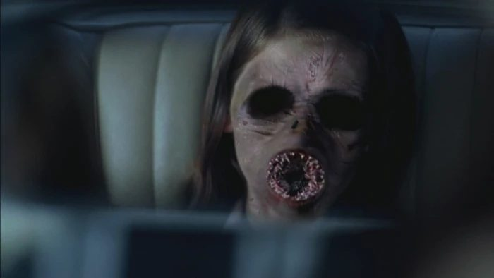

**Описание**

Подменыши — гуманоидные существа с обесцвеченной, слизкой кожей, полыми глазами и круглым ртом, усаженным множеством зубов, похожим на пасть миноги. Они умеют выглядеть как люди, но истинная природа выдаёт их в отражении. Кормятся подменыши людьми, а конкретно — синовиальной жидкостью.

Исторически подменышей описывали как замену человеческим детям, которых крадут монстры. Похищенных детей уводят под землю, и там ими кормится мать-подменыш. Подменыш, занявший место ребёнка, выглядит так же, как оригинал, но ведёт себя иначе и является злом. Кормится он матерью того ребёнка, чей облик принял: матери слабеют постепенно и умирают через несколько месяцев, после чего подменыши перебираются к следующей семье.

Свою «пищу» подменыши охраняют очень ревностно, не позволяя никому отделить их от источника, и убивают любого, кто встанет на пути. Дети-подменыши кормятся синовиальной жидкостью человеческой матери, присасываясь круглым зубастым ртом к задней части шеи и оставляя там отметину.

В эпизоде сериала Сэм и Дин сталкиваются с подменышами в Цицеро, штат Индиана. Всей их деятельностью руководит «мать»-подменыш, притворяющаяся взрослой женщиной: подменыши ночью похищают детей из соседних домов из их постелей и занимают места настоящих детей в семье, а похищенных держат живыми в клетках в подвале недостроенного дома, чтобы «мать» могла ими кормиться. В фольклоре подменышем называют отпрыска фей, троллей или эльфов, тайно оставленного вместо человеческого ребёнка.

**Силы и способности**

- Сверхсила — подменыши превосходят силой человека, хотя и сильно уступают большинству монстров; взрослый подменыш примерно равен в схватке охотнику.
- Лампареподобная пасть — множество острых зубов и круглый рот позволяют впиваться в человека и оставлять отметину на задней части шеи.
- Оборотничество — подменыш выглядит как человек, обычно как конкретный ребёнок, чьё место он занял.
- Сверхловкость — подменыши умеют взбираться по стенам, чтобы хватать добычу с высоты.

**Слабости**

- Огонь — подменыш, подожжённый огнём, стремительно сгорает до пепла.
- Мать-подменыш — если убить мать-подменыша, все её дети мгновенно умирают.
- Зеркала — истинный облик подменыша виден в отражении, что выдаёт его в доме.

**Как его убить.** Порядок работы: сначала найти мать-подменыша, а не гоняться за детьми, — без неё охота превратится в бесконечную погоню за мелюзгой. Нужны зеркало, чтобы опознать тварь, и огонь: зажигательная смесь, факелы или бензин. Спасать настоящих детей нужно с учётом того, что их держат живыми под землёй, обычно в подвале. В инвентаре охотника: зеркало, огонь, лом и фонарь, верёвка, носилки для вынесенных детей и нож на случай нападения. Убийство матери-подменыша одним ударом устраняет всех её детей.

**Известные особи:** Мать-подменыш из Цицеро, Индиана — руководила похищениями детей

#### Подменыш
*Малый, Монстр, нейтрально-злое*

---
- **Класс доспеха** 13 (природная броня)
- **Хиты** 32 (5d6 + 15)
- **Скорость** 30 фт., лазание 30 фт.

| СИЛ | ЛОВ | ТЕЛ | ИНТ | МДР | ХАР |
|---|---|---|---|---|---|
| 13 | 16 | 16 | 10 | 11 | 13 |

- **Спасброски** Лов +5
- **Навыки** Акробатика +5, Скрытность +5
- **Уязвимость к урону** огонь
- **Чувства** тёмное зрение 60 фт., пассивное Восприятие 10
- **Языки** английский (в детской личине), телепатическая связь с матерью-подменышем
- **Бонус мастерства** +2
- **Уровень опасности** 2 (450 опыта)

***Особенности***
- ***Материнская связь.*** Подменыш мгновенно умирает, если погибает мать-подменыш, создавшая его; расстояние значения не имеет.
- ***Истинный облик в отражении.*** В зеркалах и отражениях видна лампареподобная пасть и полые глаза. Существо, изучающее отражение, может действием совершить проверку Мудрости (Восприятие) Сл 14 и при успехе распознать подменыша.
- ***Цепкие конечности.*** Подменыш может лазать по вертикальным поверхностям, включая стены домов, не совершая проверок.
- ***Ревнивый охотник.*** Подменыш получает преимущество на броски атаки по существам, которые пытаются увести его «пищу» (мать или ребёнка, к которому он привязан), и не может быть убеждён отступить, пока источник кормления рядом.

***Действия***
- ***Мультиатака.*** Подменыш совершает две атаки: укус и удар когтями, либо два укуса.
- ***Лампареподобный укус.*** Рукопашная атака оружием: +5 к попаданию, досягаемость 5 фт., одна цель. Попадание: 6 (1d6 + 3) колющего урона, и максимум хитов цели снижается на 5 (1d10) до окончания её продолжительного отдыха, пока подменыш не будет убит или не перестанет кормиться.
- ***Когти.*** Рукопашная атака оружием: +5 к попаданию, досягаемость 5 фт., одна цель. Попадание: 5 (1d4 + 3) рубящего урона.
- ***Детский плач (1/день).*** Подменыш издаёт убедительный детский плач. Каждое существо в пределах 60 фт., которое может его слышать, проходит спасбросок Мудрости Сл 13, иначе в свой следующий ход обязано приблизиться к источнику звука, если это не очевидно опасно.

**Тактика.** Подменыш не бросается в бой первым: он играет роль ребёнка, прячется, плачет и подпускает к себе, чтобы укусить в шею сзади. В открытом столкновении он действует стаей: двое-трое отпрысков заходят с разных сторон, взбираются по стенам и целятся в мать — источник пищи. Огонь для них катастрофа: увидев пламя, подменыш бежит к матери и прячется за ней. Если мать убита, дети падают замертво, поэтому охотники часто предпочитают сначала разобраться именно с ней.

**Экология.** Гнездо подменышей — подземелье или недостроенное здание, где мать держит похищенных детей в клетках и постепенно питается ими, а её отпрыски рассылаются по соседним домам занимать места настоящих детей. Живут они только рядом с человеческими семьями, поскольку нуждаются в постоянном источнике синовиальной жидкости. Численность выводка зависит от матери: одна мать — от двух до нескольких детей-подменышей, действующих согласованно.

> **Заметки мастеру.** Подменыши отлично работают в сценарии «что-то не так с детьми в квартале»: партия должна заметить подмены, найти гнездо и понять, что убийство матери решает всё разом. Механически это слабые монстры (CR 2) для низких уровней; их сила — в количестве, ревнивой защите «пищи» и ночных нападениях. На высоких уровнях добавьте мать-подменыша (усиленный вариант с CR 6–8, огонь остаётся её главной уязвимостью) и таймер: пока дети заперты в клетках, матери семей умирают по одной. Хорошая замена гигантским крысам и гоблинам в городской кампании.

[↑ к содержанию](#содержание)

---

### 78. Ракшаса

**Rakshasa** · Монстр · CR 7 · опасность в сериале 3/5

*Также известно как:* Клоун-людоед; Индийский бес-оборотень

*Первое появление:* S02E02 «Everybody Loves a Clown»

*Сезоны:* 2, 3, 5

Древний индийский бес-оборотень, который маскируется под человека, становится невидимым и входит в дом только по приглашению. Питается родителями детей, а убить его можно лишь клинком из чистой латуни.

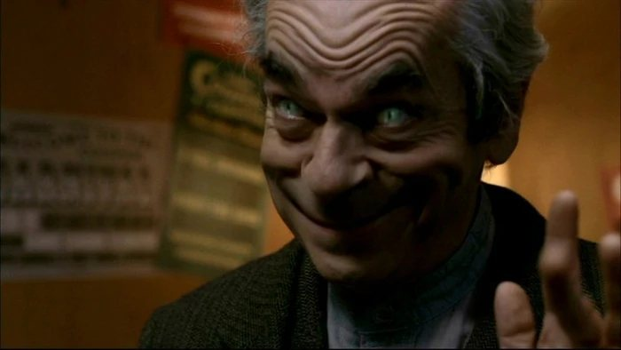

**Описание**

Ракшасы — древняя индийская раса озорных и человекоубийственных бесов. Это существа из индуистской мифологии, известные тем, что едят человеческую плоть, спят на ложе из мёртвых насекомых и меняют облик, маскируясь под людей.

К счастью для человечества, ракшасы едят очень скудно — раз в два-три десятилетия, из-за крайне медленного обмена веществ. Ракшаса не может войти в дом, не будучи приглашённым. Чтобы не привлекать внимания, они живут в бедности, а некоторые даже бродяжничают. Ракшаса из сериала выступал клоуном на ярмарке: он провожал детей домой, добивался, чтобы ребёнок впустил его, а затем съедал родителей.

Ракшасы умеют принимать человеческий облик и искажать лицо, частично показывая истинную форму. Они легко делают себя полностью невидимыми для глаза, и разглядеть их частично можно только сквозь густой дым, как показано в финале «Everybody Loves a Clown». Они невероятно сильны: без труда одолевают и терзают людей. Слух у них исключительный — один ракшаса подслушал весь разговор Дина, находясь за пределами человеческой слышимости. Двигаются они очень быстро, словно исчезая. Убить ракшасу можно только латунью: от любого другого урона он быстро и полностью восстанавливается.

В «Everybody Loves a Clown» ракшаса скрывался под личиной слепого метателя ножей, работающего в цирке. Детям он являлся в облике шута и, когда они впускали его в дом, убивал их родителей. Эллен сказала, что тварь можно убить ножом из чистой латуни. Пока Сэм считал настоящим ракшасой мистера С. Купера, Дин попросил у метателя ножей латунный нож и обнаружил в его сундуке клоунский костюм. Братья убежали в комнату смеха, где ракшаса стал невидимым и принялся метать в них ножи; Дин выпустил густой дым, и Сэм убил тварь, отломав латунную органную трубу и вонзив её.

**Силы и способности**

- Оборотничество — ракшаса принимает человеческий облик и может искажать лицо, частично показывая истинную форму.
- Невидимость — ракшаса легко становится полностью невидимым для глаза; частично его видно только сквозь густой дым.
- Неуязвимость — убить ракшасу можно только латунью, от любого другого урона он быстро и полностью восстанавливается.
- Сверхсила — ракшаса невероятно силён и без труда одолевает и терзает людей.
- Сверхслух — ракшаса слышит разговоры за пределами человеческой слышимости.
- Сверхскорость — ракшаса двигается очень быстро, словно исчезая.

**Слабости**

- Латунь — ракшасу убивает нож из чистой латуни; Сэм убил его, отломав латунную органную трубу и вонзив её в тварь.
- Приглашение — ракшаса не может войти в дом без приглашения, поэтому вынужден выманивать его у детей.
- Густой дым — в дыму ракшасу можно разглядеть частично, несмотря на невидимость.
- Медленный обмен веществ — ракшаса ест скудно, раз в два-три десятилетия, что ограничивает число его убийств.

**Как его убить.** Главный инструмент — латунный клинок. Подойдёт нож из чистой латуни или, как в сериале, отломанная латунная органная труба; сталь, свинец и железо бесполезны, потому что от любого другого урона ракшаса восстанавливается. Второй инструмент — дым: он делает невидимую тварь различимой хотя бы частично. Ищите ракшасу среди бродяг, бедняков и артистов — он живёт незаметно и охотится через детей, выманивая приглашение в дом.

**Известные особи:** Ракшаса-клоун из «Everybody Loves a Clown» — скрывался под личиной слепого метателя ножей Барри

#### Ракшаса
*Средний, Исчадие, нейтрально-злое*

---
- **Класс доспеха** 16 (природная броня)
- **Хиты** 110 (13d8 + 52)
- **Скорость** 40 фт.

| СИЛ | ЛОВ | ТЕЛ | ИНТ | МДР | ХАР |
|---|---|---|---|---|---|
| 19 | 18 | 18 | 13 | 14 | 16 |

- **Спасброски** Лов +7, Тел +7
- **Навыки** Восприятие +5, Обман +6, Скрытность +7
- **Уязвимость к урону** латунь
- **Сопротивление урону** холод; дробящий, колющий и рубящий от немагического оружия
- **Иммунитет к состояниям** очарование
- **Чувства** тёмное зрение 60 фт., пассивное Восприятие 15
- **Языки** индийские языки, английский
- **Бонус мастерства** +3
- **Уровень опасности** 7 (2 900 опыта)

***Особенности***
- ***Только латунь.*** Ракшаса не может быть опущен до 0 хитов ничем, кроме латунного оружия. В начале каждого своего хода, если он не опущен до 0 хитов, он восстанавливает 10 хитов, если только в этом раунде не получал урон латунью.
- ***Невидимость.*** Ракшаса может бонусным действием стать невидимым до конца своего следующего хода или пока не атакует. В области густого дыма он становится видимым частично: атаки по нему совершаются без помехи от невидимости.
- ***Не войти без приглашения.*** Ракшаса не может войти в жилище, принадлежащее гуманоиду, без явного приглашения от того, кто там живёт. Попытка войти без приглашения причиняет ему 11 (2d10) урона силовым полем.
- ***Смена личины.*** Ракшаса может действием принять облик конкретного гуманоида, которого видел, или исказить своё лицо, частично показав истинную форму. Проверка Мдр (Проницательность) Сл 16 раскрывает обман.
- ***Скудный обмен веществ.*** Ракшаса должен убивать и есть не чаще одного раза в 2–3 десятилетия. Он не получает истощения от голода и может подолгу жить в бедности, не привлекая внимания.
- ***Острый слух.*** Ракшаса совершает с преимуществом проверки Мдр (Восприятие), основанные на слухе, и не может быть застигнут врасплох.

***Действия***
- ***Мультиатака.*** Ракшаса совершает три атаки: одну укусом и две атаками когтями.
- ***Укус.*** Рукопашная атака оружием: +7 к попаданию, досягаемость 5 фт., одна цель. Попадание: 13 (2d8 + 4) колющего урона.
- ***Когти.*** Рукопашная атака оружием: +7 к попаданию, досягаемость 5 фт., одна цель. Попадание: 11 (2d6 + 4) рубящего урона.
- ***Метание ножей (только невидимым).*** Дальнобойная атака оружием: +7 к попаданию, дистанция 20/60 фт., одна цель. Попадание: 11 (2d6 + 4) колющего урона. Ракшаса может совершать эту атаку, оставаясь невидимым, не выдавая своего местоположения.

***Бонусные действия***
- ***Исчезнуть.*** Ракшаса становится невидимым до конца своего следующего хода.

***Реакции***
- ***Дымный просвет.*** Когда в пределах 30 фт. появляется густой дым или иная сильная завеса, ракшаса может реакцией переместиться на 15 фт., скрываясь в ней.

**Тактика.** Ракшаса не вступает в бой, пока может действовать скрытно: он держит невидимость, метает ножи из темноты и сменяет позицию после каждого броска. В открытом бою он бьёт тремя атаками, целясь в самого слабого, и старается увести схватку туда, где можно погасить свет и снова исчезнуть, — в комнату смеха, зеркальный лабиринт, лабиринт складов. Латунный клинок он распознаёт и обходит его владельца, нападая на других. Если бой идёт плохо, ракшаса бежит и меняет личину, возвращаясь к прежней жизни бродяги.

**Экология.** Ракшасы пришли из индийских стран, но со временем осели в западном мире, в том числе в США. Они редки, живут поодиночке, держатся в бедности и бродяжничестве, чтобы не привлекать внимания, и охотятся раз в 2–3 десятилетия, выманивая приглашение в дом через детей. Ярмарки и цирки — удобное для них прикрытие. Разглядеть ракшасу трудно, поэтому охотники вычисляют его по следу необъяснимых убийств родителей.

> **Заметки мастеру.** Ракшаса — монстр на 6–8 уровень с механикой невидимости и обязательной уязвимостью к латуни: без латунного клинка бой бессмыслен, поэтому партия должна добыть оружие до схватки. Замена в 5e — ракшаса из «Monster Manual», но без иммунитета к заклинаниям и с уязвимостью к латуни вместо благословлённого оружия. Отлично работает в сценарии про ярмарку или цирк, где тварь прячется среди артистов. На низком уровне снизьте хиты до 60, уберите Метание ножей и оставьте одну атаку когтями; на высоком добавьте двух ракшас и иллюзорное логово с дымом.

[↑ к содержанию](#содержание)

---

### 79. Ревенант

**Revenant** · Монстр · CR 3 · опасность в сериале 2/5

*Также известно как:* Оживший мертвец; Плотный призрак

*Первое появление:* Сезон 2, «Roadkill»

*Сезоны:* 2, 4, 5, 8, 13

Редкое существо, которое Дин описал как разновидность зомби — человек, восставший из мёртвых. В отличие от обычного призрака, ревенант материален, не знает о своей смерти и уверен, что жив.

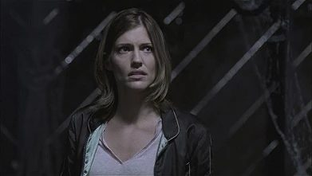

**Описание**

Ревенант — редкий вид сверхъестественного существа. По словам Дина из тринадцатого сезона, это что-то вроде зомби: человек, восставший из мёртвых. От обычных призраков ревенанта отличает несколько ключевых черт.

Главное: ревенант не знает и не верит, что мёртв. Он либо забыл, либо подавил воспоминания о своей смерти, либо искренне уверен, что восстал из могилы или вообще не умирал. Манифестация ревенанта непрерывна: если обычные призраки появляются рывками и вспышками насилия, то ревенант, проявившись, сохраняет присутствие — его тело не мерцает и не дёргается при движении.

Ревенант телесен. Все прочие призраки по природе бесплотны и обретают плотность лишь через спокойствие или гнев, а ревенант изначально твёрд: он не может проходить сквозь стены и взаимодействует с миром так же легко и постоянно, как живой, подчиняясь тем же физическим ограничениям, что и при жизни, — весу, силе, наличию тени. Из этого следует, что ревенанта можно ранить, он кровоточит и чувствует боль. Сознание у него полностью сохранно, что и отличает его от большинства призраков.

Слабости у ревенантов немногочисленны. Серебро действует на них негативно: Гарт советовал другому охотнику использовать серебряные шипы, чтобы обездвижить буйного ревенанта, и запереть его в гробу глубоко под землёй, — из чего следует, что серебро причиняет им вред. Соль, как и призракам, должна ревенанта обжигать и не пускать через линию, но это в источниках прямо не подтверждено. Наконец, помочь ревенанту разрешить его проблемы — значит упокоить его: именно так вышло в случае Молли Макнамары.

**Силы и способности**

- Телесность — ревенант материален, не проходит сквозь стены, оставляет тень и следы, взаимодействует с миром как живой.
- Живучесть плоти — его можно ранить, он кровоточит и чувствует боль, но продолжает действовать, не обращая внимания на смертельные для человека травмы.
- Непрерывное присутствие — проявившись, ревенант не мерцает и не исчезает, в отличие от обычных призраков.
- Полное сознание — ревенант сохраняет разум и память о своей жизни, что делает его опасным и непредсказуемым собеседником.

**Слабости**

- Серебро — серебро причиняет ревенанту вред; серебряные шипы способны обездвижить его, после чего его запирают в гробу глубоко под землёй.
- Соль — как призрак, ревенант должен бояться соли и быть неспособным пересечь её линию, хотя это в источниках прямо не подтверждено.
- Разрешение проблем — если помочь ревенанту завершить его незаконченные дела, он упокоится; так произошло с Молли Макнамарой.

**Как его убить.** Силовое решение: серебряные шипы в конечности, чтобы обездвижить ревенанта, затем гроб и захоронение глубоко под землёй — так советовал Гарт. В инвентаре нужны серебряные шипы или серебряное оружие, соль для линий и ловушек, гроб, лопаты и достаточно людей, чтобы удержать тварь. Но лучший путь — выяснить, что держит ревенанта в мире живых, и помочь ему завершить это дело: тогда он уйдёт сам, без боя. Помните, что ревенант искренне считает себя живым, поэтому разговор с ним возможен.

**Известные особи:** Молли Макнамара — ревенант, упокоенная разрешением её проблем

#### Ревенант
*Средний, Нежить, нейтральное*

---
- **Класс доспеха** 12 (природная броня)
- **Хиты** 45 (7d8 + 14)
- **Скорость** 30 фт.

| СИЛ | ЛОВ | ТЕЛ | ИНТ | МДР | ХАР |
|---|---|---|---|---|---|
| 14 | 12 | 15 | 11 | 12 | 12 |

- **Спасброски** Тел +4, Мдр +3
- **Навыки** Восприятие +3
- **Уязвимость к урону** серебро
- **Сопротивление урону** некротический
- **Иммунитет к урону** яд
- **Иммунитет к состояниям** очарование, отравление
- **Чувства** тёмное зрение 60 фт., пассивное Восприятие 13
- **Языки** все языки, которые он знал при жизни
- **Бонус мастерства** +2
- **Уровень опасности** 3 (700 опыта)

***Особенности***
- ***Не знает, что мёртв.*** Ревенант искренне уверен, что жив. Он невосприимчив к эффектам, которые изгоняют нежить или изобличают её природу, а попытка убедить его в обратном требует проверки Харизмы (Убеждение) Сл 18 и при провале вызывает у него ярость (преимущество на атаки по убеждавшему до конца следующего хода).
- ***Плотная плоть.*** Ревенант не может становиться бесплотным, проходить сквозь стены и предметы, не может парить и всегда оставляет тень. Он подвержен состояниям и урону как живое существо, за исключением иммунитетов, указанных выше.
- ***Серебряные шипы.*** При попадании серебряным оружием ревенант проходит спасбросок Телосложения Сл 13: при провале его скорость становится 0 и он недееспособен до конца своего следующего хода. Серебряный шип, вогнанный в сердце недееспособного ревенанта, обездвиживает его окончательно, пока шип не вынут.
- ***Незаконченное дело.*** У каждого ревенанта есть дело, удерживающее его в мире живых. Если его удаётся завершить (проверка Харизмы (Убеждение) Сл 15 и более плюс отыгрыш), ревенант уходит на покой и считается уничтоженным без боя.

***Действия***
- ***Мультиатака.*** Ревенант совершает две атаки: удар кулаком или оружием, которым владел при жизни.
- ***Удар.*** Рукопашная атака оружием: +4 к попаданию, досягаемость 5 фт., одна цель. Попадание: 6 (1d8 + 2) дробящего урона.
- ***Одержимость целью.*** Ревенант выбирает одно существо в пределах 30 фт. и требует завершить своё незаконченное дело. Цель проходит спасбросок Мудрости Сл 13, иначе становится испуганной ревенантом на 1 минуту и может повторять спасбросок в конце каждого своего хода.

**Тактика.** Ревенант дерётся как человек, которым он был: использует подручное оружие, толкает, хватает, бьёт в спину — но никогда не отступает и не торгуется, потому что не понимает, что уже мёртв и что его можно убить. Он вступает в разговор, спорит, требует вернуть ему жизнь или закончить его дело, и именно в этот момент охотник может перевести конфликт в переговоры. Столкнувшись с серебряными шипами или явным доказательством своей смерти, ревенант впадает в ярость и панику; если бой проигран, он не бежит, а продолжает драться до конца.

**Экология.** Ревенанты редки: появляются там, где человек умер, не завершив чего-то важного, и его тело или память не отпустили его. Держатся поодиночке, часто в родных местах — домах, на дорогах, рядом с близкими, которых они не узнают или пугают. С другими монстрами не связаны; охотники отличают ревенанта от призрака именно по телесности, непрерывности облика и полному неведению о собственной смерти.

> **Заметки мастеру.** Ревенант — идеальный монстр для сцены, которую можно решить без боя: он материален и разумен, поэтому партия может расследовать его смерть и упокоить его. Механически он близок к зомби (CR 1–2) и призраку, но без инкорпореальности: обычная атака, обычные хиты, никаких «проходит сквозь стены». Для низких уровней оставьте одного ревенанта и дайте партии шанс найти его историю; для высоких добавьте двух-трёх ревенантов, объединённых общим незаконченным делом, и ограничение по времени — иначе они начнут убивать жителей города.

[↑ к содержанию](#содержание)

---

### 80. Редкап

**Redcaps** · Монстр · CR 5 · опасность в сериале 3/5

*Также известно как:* Красный колпак

*Первое появление:* S06E09 «Clap Your Hands If You Believe»

*Сезоны:* 6

Фейри из Авалона, обожающий насилие: чудовищно силён, мгновенно телепортируется, невидим и умеет принимать человеческий облик. В открытом бою человеку против него не выстоять.

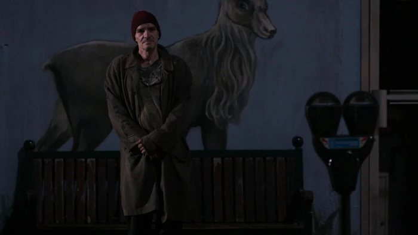

**Описание**

Редкапы — один из видов фейри, связанных с Авалоном и двором Оберона. В отличие от лепреконов-обманщиков, редкап не склонен к сделкам и разговорам: это грубая боевая сила, которая с одинаковой охотой пускает в ход кулаки и просто убивает. В шестом сезоне один редкап захватил Дина Винчестера и принялся швырять его по камере; Дин, один из лучших охотников своего времени, не смог ему ничем ответить и выжил лишь потому, что Сэм прочитал заклинание изгнания фейри и отправил редкапа обратно в Авалон.

Как и все фейри, редкапы невидимы для людей и открываются только по своей воле или перед теми, кто бывал в Авалоне. Они способны мгновенно перемещаться из одного места в другое, из-за чего их крайне трудно поймать, окружить или застать врасплох; именно телепортация делает редкапа неуловимым для обычной охоты. Вдобавок редкап умеет менять облик и принимать вид человека, чтобы скрыть свою истинную форму и не отличаться от окружающих — под этой личиной он спокойно живёт среди людей, пока не придёт время напасть.

Слабости редкапа в выжимке напрямую не перечислены, но он остаётся фейри, а значит подчиняется общим правилам своего народа: железо причиняет фейри боль, а заклинание изгнания фейри возвращает их в Авалон. Именно изгнание и стало тем приёмом, которым Сэм спас Дина. Прямая драка с редкапом для охотника — заведомо проигрышный вариант, поэтому правильная тактика сводится к тому, чтобы выиграть время и произнести заклинание.

Редкапы не проявляют ни хитрости лепреконов, ни обаяния эльфов — это чистая угроза, которую держат при себе как исполнителя и телохранителя. Для Винчестеров встреча с редкапом обернулась одним из редких случаев, когда исход боя решило не оружие, а правильно прочитанное заклинание.

**Силы и способности**

- Сверхчеловеческая сила — запросто швыряет взрослого мужчину по комнате; Дин Винчестер не смог оказать ему никакого сопротивления.
- Телепортация — мгновенно переносится с места на место, из-за чего его почти невозможно поймать или застать врасплох.
- Невидимость — как и все фейри, невидим для людей и открывается только по собственному желанию либо перед теми, кто побывал в Авалоне.
- Смена облика — принимает человеческий вид, чтобы скрыть истинную форму и беспрепятственно находиться среди людей.

**Слабости**

- Железо — железо очень вредно для фейри, поэтому редкап, как и прочие представители Авалона, плохо переносит железное оружие и прикосновение холодного железа.
- Заклинание изгнания фейри — именно им Сэм Винчестер отправил редкапа обратно в Авалон и спас Дина; это подтверждённый способ убрать редкапа.
- Соль и крупы — прямых данных по редкапам нет, но соль и сыпучие вещества сбивают фейри с толку и дают охотнику время на заклинание.

**Как его убить.** Инвентарь: железное оружие, мешочек соли или крупы и записанный текст заклинания изгнания фейри. В драку с редкапом не вступайте — он сильнее и телепортируется. Рассыпьте перед ним соль или крупу, чтобы сбить его с толку, держите железо наготове как сдерживающий фактор и сразу читайте заклинание изгнания фейри: только оно возвращает редкапа в Авалон. Если заклинания нет, единственный шанс — отступить и не дать ему сократить дистанцию.

#### Редкап
*Средний, Фея, хаотично-злое*

---
- **Класс доспеха** 17 (природная броня)
- **Хиты** 94 (9d8 + 54)
- **Скорость** 40 фт.

| СИЛ | ЛОВ | ТЕЛ | ИНТ | МДР | ХАР |
|---|---|---|---|---|---|
| 21 | 17 | 22 | 9 | 13 | 11 |

- **Спасброски** Сил +8, Тел +9
- **Навыки** Атлетика +8, Запугивание +3, Восприятие +4
- **Уязвимость к урону** железо
- **Сопротивление урону** холод, яд; дробящий, колющий и рубящий от немагического оружия, не железного и не посеребрённого
- **Иммунитет к состояниям** очарование, испуг
- **Чувства** тёмное зрение 60 фт., пассивное Восприятие 14
- **Языки** Общий, Сильван
- **Бонус мастерства** +3
- **Уровень опасности** 5 (1 800 опыта)

***Особенности***
- ***Железная немощь.*** Когда редкап начинает ход в контакте с холодным железом или получает урон железным оружием, он совершает спасбросок Телосложения Сл 15. При провале он отравлен до конца своего следующего хода, а его скорость уменьшается вдвое.
- ***Сопротивление магии.*** Редкап совершает спасброски от заклинаний и прочих магических эффектов с преимуществом.
- ***Смена облика.*** Редкап действием превращается в любого гуманоида Среднего размера, которого видел, либо возвращается в истинный облик. Его игровые характеристики в каждой форме одинаковы. Снаряжение, которое он несёт, не превращается.
- ***Неудержимый натиск.*** Если редкап перемещается не менее чем на 20 фт. по прямой к существу и затем попадает по нему рукопашной атакой в тот же ход, цель должна преуспеть в спасброске Силы Сл 16, иначе сбита с ног.

***Действия***
- ***Мультиатака.*** Редкап совершает две атаки кулаком.
- ***Кулак.*** Рукопашная атака оружием: +8 к попаданию, досягаемость 5 фт., одна цель. Попадание: 12 (1d10 + 7) дробящего урона.
- ***Швырок.*** Редкап швыряет схваченное существо или предмет. Рукопашная атака оружием: +8 к попаданию, одна цель в пределах 15 фт. Попадание: 11 (1d8 + 7) дробящего урона, и цель сбита с ног.

***Бонусные действия***
- ***Мгновенный шаг.*** Редкап магически телепортируется на расстояние до 60 фт. в незанятое пространство, которое видит.
- ***Хватка.*** Редкап пытается схватить существо в пределах досягаемости (Сл высвобождения 16, Атлетика или Акробатика).

***Реакции***
- ***Железный отпор.*** Когда по редкапу попадают железным оружием, он может немедленно телепортироваться на 30 фт. в незанятое пространство, которое видит; это перемещение не провоцирует атак.

**Тактика.** Редкап бьёт первым и бьёт вплотную: он телепортируется к самому хрупкому противнику, хватает его и бьёт до тех пор, пока тот не перестанет двигаться, а затем переключается на следующего. Он не оценивает силы и не отступает по расчёту — но телепортация даёт ему бесплатное бегство, если бой пошёл не так. Железа он боится и, получив урон железным оружием, предпочитает отскочить, а не стоять на месте. Против заклинателя, читающего изгнание, редкап бросает всё и атакует именно его.

**Экология.** Редкапы обитают в Авалоне и появляются в человеческом мире как боевая сила при высших фейри. Они держатся по одному или малыми группами, служат исполнителями и охраной у лепреконов, а в человеческом облике подолгу живут среди людей, не вызывая подозрений. Собственных логов в нашем мире они не строят и после изгнания возвращаются в Авалон.

> **Заметки мастеру.** Редкап — простой и злой «боевик» фейри для партии 5–6 уровня: крепкий, быстрый, телепортирующийся. Он отлично заменяет огра-мага или фейри-воина и хорош как телохранитель сюжетного злодея-лепрекона. Главное условие интересного боя — дать игрокам железное оружие и подсказку про заклинание изгнания, иначе редкап превращается в мешок хитов. На низких уровнях уберите «Неудержимый натиск» и снизьте CR до 3; для высокоуровневой партии ставьте редкапов отрядом по три-четыре и добавьте командира-лепрекона.

[↑ к содержанию](#содержание)

---

### 81. Роухед

**Rawhead** · Монстр · CR 5 · опасность в сериале 2/5

*Также известно как:* Тварь из подвала

*Первое появление:* Сезон 1, «Faith»

*Сезоны:* 1, 14

Тварь, обитающая в подвалах и охотящаяся на детей. Обладает огромной силой и скоростью, а убить её можно только электричеством высокого напряжения.

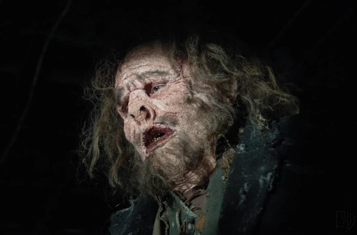

**Описание**

Роухед — существо, которое прячется в подвалах и охотится на детей. Впервые Винчестеры сталкиваются с ним, спустившись в подвал за спрятавшимися там мальчиком и девочкой: когда они выводят детей наверх, роухед нападает из засады.

Сэм уходит с детьми, а Дин остаётся драться с тварью один. Роухед атакует и одним ударом швыряет Дина на мокрый пол. Несмотря на то что оба они оказываются в луже воды, Дин бьёт роухеда электрошокером: тварь погибает, но и сам охотник получает тяжёлые травмы. Позже Дина исцеляет Рой Ле Гранж. Этот случай — единственное подробно описанное убийство роухеда в выжимке.

Сила роухеда позволяет ему одним ударом валить взрослого мужчину на землю, а скорость — мгновенно исчезать после первой атаки, так что охотники чаще имеют дело не с самим монстром, а с оставленными им следами. После нападений остаются характерные следы укусов и выбитые зубы, по которым можно опознать тварь.

Главная особенность роухеда — абсолютная неуязвимость ко всему, кроме электричества: только электрошок высокого напряжения способен его убить, поэтому электрошокер, оголённый провод или подручный генератор оказываются единственным оружием охотника. Роухеды встречаются в сериале редко и упоминаются как в первом, так и в четырнадцатом сезоне, а также в справочнике Бобби Сингера по охоте.

**Силы и способности**

- Сверхсила — роухед способен одним ударом кулака повалить взрослого человека на землю.
- Сверхскорость — после первой атаки роухед успевает мгновенно исчезнуть, не давая себя рассмотреть.
- Неуязвимость — тварь не берут обычное оружие и травмы: убить её можно только электрошоком высокого напряжения.
- Засадная охота — роухед прячется в подвалах и нападает внезапно, из темноты и укрытий.

**Слабости**

- Электричество — единственная уязвимость роухеда: подойдёт электрошокер, оголённый провод или генератор высокого напряжения.
- Вода — лужа или мокрый пол позволяют провести разряд, но бьют током и самого охотника, если он стоит рядом.
- Дети — роухед охотится на детей, и его можно выманить или перехватить у мест, где дети прячутся в одиночестве.

**Как его убить.** Оружие здесь одно — источник высокого напряжения: электрошокер, кабель с оголённым контактом или переносной генератор. Работать лучше в паре: один выводит детей и перекрывает выход, второй загоняет роухеда в сырое помещение и наносит разряд в упор, помня, что ток ударит и по нему. Снаряжение: резиновые перчатки и сапоги, фонарь, провод с изолированной рукоятью, ломик для вскрытия подвалов. Тело сжигают, а по следам укусов и выбитым зубам убеждаются, что тварь была одна.

#### Роухед
*Средний, Монстр, хаотично-злое*

---
- **Класс доспеха** 15 (природная броня)
- **Хиты** 68 (8d8 + 32)
- **Скорость** 40 фт.

| СИЛ | ЛОВ | ТЕЛ | ИНТ | МДР | ХАР |
|---|---|---|---|---|---|
| 20 | 18 | 18 | 6 | 12 | 8 |

- **Спасброски** Сил +8, Тел +7
- **Навыки** Атлетика +8, Скрытность +7, Восприятие +4
- **Уязвимость к урону** электричество (см. «Единственная смерть — ток»)
- **Сопротивление урону** дробящий, колющий и рубящий от немагического оружия; холод
- **Иммунитет к урону** яд
- **Иммунитет к состояниям** испуг
- **Чувства** тёмное зрение 60 фт., пассивное Восприятие 14
- **Языки** понимает английский, но не говорит
- **Бонус мастерства** +3
- **Уровень опасности** 5 (1 800 опыта)

***Особенности***
- ***Единственная смерть — ток.*** Роухед не может умереть ни от чего, кроме электричества. Если урон любого другого типа опускает его хиты до 0, он вместо этого остаётся с 1 хитом и получает состояние недееспособности до конца своего следующего хода. Урон электричеством игнорирует его сопротивления и иммунитеты.
- ***Прыжок из темноты.*** Если роухед начинает бой скрытым, он получает преимущество на броски атаки до конца своего первого хода.
- ***Чутьё подвала.*** В подвалах, тоннелях, подземельях и тёмных замкнутых помещениях роухед получает преимущество на проверки Мудрости (Восприятие) и Ловкости (Скрытность).
- ***Следы укуса.*** После каждой атаки укусом роухед оставляет на месте боя выбитый зуб. Охотник, нашедший зуб, может действием совершить проверку Интеллекта (Магия) Сл 13 и определить вид твари.

***Действия***
- ***Мультиатака.*** Роухед совершает две атаки: укус и удар кулаком.
- ***Укус.*** Рукопашная атака оружием: +8 к попаданию, досягаемость 5 фт., одна цель. Попадание: 12 (2d6 + 5) колющего урона, и цель получает помеху на проверки Мудрости (Восприятие) до конца своего следующего хода от боли.
- ***Удар кулаком.*** Рукопашная атака оружием: +8 к попаданию, досягаемость 5 фт., одна цель. Попадание: 14 (2d8 + 5) дробящего урона, и если цель размера Средний или меньше, она проходит спасбросок Силы Сл 16, иначе падает ничком и отлетает на 10 фт.

**Тактика.** Роухед — засадный хищник: он ждёт в темноте подвала, нападает на отставшего или на ребёнка и сразу отступает вглубь лабиринта комнат, чтобы ударить снова. В бою он давит силой, старается опрокинуть противника и увести его в сырое помещение, но не преследует убегающих далеко от логова. Электричества он боится по-настоящему: увидев оголённый провод, искрящий генератор или электрошокер, роухед отступает и старается сломать источник тока, а не драться рядом с ним.

**Экология.** Роухед живёт в подвалах, подземных уровнях и заброшенных строениях, где темно и сыро и где можно подолгу оставаться незамеченным. Охотится он на детей, которые спускаются вниз или прячутся в подвалах, поэтому его появление обычно связывают с пропажами и травмами детей в одном районе. Держится поодиночке; в выжимке не описано ни стай, ни сосуществования с другими монстрами.

> **Заметки мастеру.** Роухед — отличный пример монстра с одной-единственной уязвимостью, вокруг которой строится вся сцена: партия должна сначала выяснить, что тварь берёт только ток, и только потом лезть в подвал с генератором. Механически он близок к троллю или огру-мутанту, но вместо огня здесь электричество; следите, чтобы игроки не решили задачу одной молнией — пусть добыча генератора станет отдельной сценой. На низких уровнях ослабьте «Единственную смерть» до сопротивления всему, кроме электричества; на высоких дайте роухеду двух детёнышей и ловушки в виде затопленных коридоров.

[↑ к содержанию](#содержание)

---

### 82. Ругару

**Rugaru** · Монстр · CR 5 · опасность в сериале 3/5

*Также известно как:* Людоед по крови; Rugarou

*Первое появление:* S04 «Metamorphosis»

*Сезоны:* 4, 5, 6, 7, 8, 9, 10, 11, 12, 13, 14

Потомок людей с геном ругару: до первого куска человечины он обычный человек, а после — необратимый хищник-людоед, разрывающий жертв голыми руками и передвигающийся на четвереньках. Гибнет от огня, демонского клинка или ружья Людей Письма.

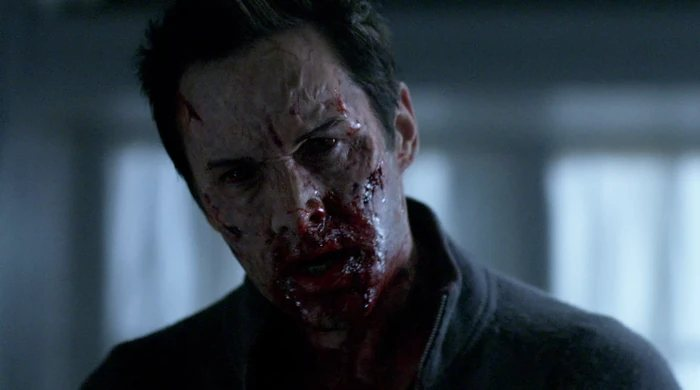

**Описание**

Ругару — плотоядные гуманоиды, питающиеся «долгой свининой», то есть человеческой плотью; в этом они схожи с вендиго. Создала их Ева, Мать всех монстров, и по её замыслу они появились на свет как люди. Ругару не заражают и не проклинают: состояние передаётся генетически. Человек с таким геном живёт обычной жизнью и, как правило, не подозревает о своей природе.

Перелом наступает в определённом возрасте. Сначала под кожей начинают двигаться кости, затем приходит зверский голод: сначала человек ест всё больше обычной еды, потом его тянет на плоть, и в первую очередь на человеческую. Первый кусок человечины запускает необратимую метаморфозу — ругару становится нелюдем-людоедом навсегда.

После превращения ругару охотится как хищник: ест жадно и жестоко, часто передвигается на четырёх конечностях и без труда разрывает взрослого мужчину на части. Человеческая, эмоциональная сторона угасает, но не исчезает: он помнит свою прежнюю жизнь и порой способен на жалость и привязанность, однако голод почти всегда перевешивает.

Охотники знают ругару как одну из тех тварей, которых страшно убивать: до первого кормления это ещё человек, и у Винчестеров не раз вставал вопрос, можно ли его спасти. О существовании альфа-ругару догадывались лишь потому, что Винчестеры добыли ругару для Кроули, — сам альфа так и не был найден.

**Силы и способности**

- Сверхчеловеческая сила — ругару заметно сильнее людей, животных и большинства монстров, одним ударом валит взрослого мужчину без сознания.
- Разрывание плоти — голыми руками разрывает тело на части за считанные секунды.
- Эволюция после первой плоти — первый кусок человечины запускает постоянную метаморфозу в нелюдя-людоеда.
- Звериная подвижность — в бою и при кормлении часто перемещается на четырёх конечностях, быстрее и устойчивее человека.
- Память о прошлом — сохраняет полную память о человеческой жизни, что делает его опасным и непредсказуемым.

**Слабости**

- Огонь — один из немногих способов убить ругару: его нужно сжечь заживо.
- Демонский клинок — в Чистилище Дин убил ругару, вонзив клинок через подбородок в мозг.
- Ружьё для убийства ругару — специальное оружие, изобретённое Британскими Людьми Письма.
- Человечность до кормления — до первой человечины ругару физически человек и не обладает силой монстра.
- Голод — потребность в человеческой плоти управляет им и делает его предсказуемым для засады.

**Как его убить.** Пока ругару не попробовал человечину, охота сводится к наблюдению: его можно попытаться удержать от срыва, но ген никуда не денется. После превращения работают три инструмента. Первый — огонь: бензин, коктейли Молотова, огнемёт; тварь нужно сжечь, а не застрелить. Второй — демонский клинок, которым бьют снизу в подбородок, пробивая мозг. Третий — ружьё Людей Письма, созданное именно под эту добычу. Загоняют ругару по следам исчезновений и запаху разложенной плоти на окраинах городов.

#### Ругару
*Средний, Монстр, нейтрально-злое*

---
- **Класс доспеха** 15 (природная броня)
- **Хиты** 85 (10d8 + 40)
- **Скорость** 40 фт.

| СИЛ | ЛОВ | ТЕЛ | ИНТ | МДР | ХАР |
|---|---|---|---|---|---|
| 20 | 14 | 18 | 9 | 12 | 8 |

- **Спасброски** Сил +8, Тел +7
- **Навыки** Атлетика +8, Восприятие +4, Выживание +4
- **Уязвимость к урону** огонь
- **Иммунитет к состояниям** испуг
- **Чувства** тёмное зрение 60 фт., чутьё на человеческую плоть 120 фт., пассивное Восприятие 14
- **Языки** английский
- **Бонус мастерства** +3
- **Уровень опасности** 5 (1 800 опыта)

***Особенности***
- ***Нечеловеческая мощь.*** Ругару совершает с преимуществом проверки и спасброски Силы и может поднимать и тащить вдвое больше обычного для своего размера.
- ***Чутьё на человеческую плоть.*** Ругару знает о присутствии раненых гуманоидов в пределах 120 фт. и совершает с преимуществом проверки Мдр (Восприятие) и Мдр (Выживание), выслеживая их.
- ***Охотник на четвереньках.*** В начале своего хода ругару может принять звериную стойку: его скорость увеличивается на 10 фт., но он не может использовать оружие и говорить.
- ***Вечный голод.*** Ругару должен съесть не меньше фунта человеческой плоти раз в 3 дня. Иначе он получает один уровень истощения, который снимается только свежей человечиной.
- ***Память о человеке.*** Ругару помнит свою прежнюю жизнь. Он имеет помеху на спасброски Мдр, когда ему напоминают о близких или о том, кем он был.

***Действия***
- ***Мультиатака.*** Ругару совершает две атаки: укусом и когтями либо двумя атаками когтями.
- ***Укус.*** Рукопашная атака оружием: +8 к попаданию, досягаемость 5 фт., одна цель. Попадание: 14 (2d8 + 5) колющего урона, и цель должна преуспеть в спасброске Сил (Сл 16), иначе схвачена.
- ***Когти.*** Рукопашная атака оружием: +8 к попаданию, досягаемость 5 фт., одна цель. Попадание: 12 (2d6 + 5) рубящего урона.
- ***Разрывание (только по схваченной цели).*** Ругару терзает схваченное существо: 21 (6d6) рубящего урона, и цель получает один уровень истощения от кровопотери.

***Бонусные действия***
- ***Прыжок хищника.*** Ругару совершает Рывок или Отход.

***Реакции***
- ***Дикая ярость.*** Когда существо в пределах 5 фт. наносит ругару урон, он может реакцией совершить по нему одну атаку когтями.

**Тактика.** Ругару бьёт прямо и жадно: выбирает самого слабого или раненого, сбивает его с ног и терзает, пока тот не перестанет двигаться. Он не боится боли и не отступает, пока голод не удовлетворён, но помнит про огонь и обходит открытое пламя, ломая мебель и стены, чтобы зайти сбоку. Если бой идёт плохо, ругару убегает на четырёх конечностях и прячется в подвалах, канализации или лесу, чтобы вернуться ночью. Против группы он старается разорвать строй и утащить одного противника.

**Экология.** Ругару живут среди людей: пригороды, фермерские районы, дешёвые мотели, городские окраины. Вне превращения они ничем не отличаются от соседей, поэтому их почти невозможно вычислить заранее. Кормятся они поодиночке, но иногда тянутся друг к другу; в Чистилище ругару — обычная дичь для более сильных тварей. Обычно на один город приходится одна особь, и серия исчезновений быстро выдаёт её логово.

> **Заметки мастеру.** Ругару — идеальный монстр на 4–6 уровень: он достаточно силён, чтобы всерьёз угрожать группе, но убивается огнём, который есть у любого охотника. Используйте его как трагедию, а не просто бой: до превращения это человек, и партия может пытаться спасти его. Замена в 5e — вервольф или огр, но с обязательной уязвимостью к огню и отсутствием регенерации. Для низкого уровня снизьте хиты до 45, уберите Разрывание и понизьте КС до 13; для высокого добавьте сопротивление к немагическому оружию и второго ругару в паре.

[↑ к содержанию](#содержание)

---

### 83. Румпельштильцхен

**Rumpelstiltskin** · Монстр · CR 4 · опасность в сериале 2/5

*Также известно как:* Тёмная фея; Сделочник; Возможно, лепрекон

*Первое появление:* Сезон 6, «Clap Your Hands If You Believe»

*Сезоны:* 6

Тёмная фея-сделочник из Авалона: невидимый по природе, он искажает реальность через договоры и уносит первенцев. В средневековье он помог смертному исполнить его мечты, потребовав взамен всех его первых сыновей.

**Описание**

Румпельштильцхен — тёмная фея из фольклора. Выжимка отмечает, что он может быть лепреконом, поскольку Марион упомянула его в одном предложении с ними. Он связан с Обероном и Авалоном, а род его занятий — сделки. В сериале он фигурирует в шестом сезоне, в эпизоде «Clap Your Hands If You Believe».

В средневековье Румпельштильцхена призывали, чтобы он помог человеку и исполнил мечты своего хозяина. Взамен он просил одно — первенцев. Действует он через договоры: как демоны с перекрёстков, он искажает реальность в известных пределах, а себя и первенцев способен переносить в Авалон.

Помимо этого, выжимка приводит фольклорный сюжет сказки братьев Гримм. Он помог дочери мельника прясть солому в золото, потому что её отец пообещал королю, будто она это умеет. Первой ночью он взял за помощь её ожерелье, второй — кольцо, а на третью заставил пообещать ему первенца. Через год, когда она уже была замужем за королём и родила ребёнка, он явился за платой. Она заплакала, и он сжалился: разрешил оставить ребёнка, если она угадает его имя за три дня. Два дня она не могла, а на третий подслушала его песню и угадала имя. Разъярённый, он топнул ногой, пробил дыру и провалился в неё.

Насколько этот фольклорный финал применим к сериалу, выжимка не уточняет: в сериале его судьба и способ избавиться от сделки не раскрыты.

**Силы и способности**

- Невидимость — как фея он невидим по природе, но люди, побывавшие в Авалоне, способны его видеть.
- Искажение реальности — через сделки, подобно демонам с перекрёстков, он в состоянии менять реальность в известных пределах.
- Телепортация — Румпельштильцхен может переносить себя и первенцев в Авалон.
- Исполнение мечтаний — он способен сделать так, чтобы мечты его хозяина сбылись, как это было в средневековье.

**Слабости**

- Прямых слабостей выжимка не называет: достоверного способа разорвать его сделку в файле нет.
- Фольклорный финал — в сказке он потерял право на ребёнка, когда женщина угадала его имя, и провалился в дыру, которую сам пробил; применимо ли это к сериалу, неизвестно.

**Как его убить.** Информации для полноценной охоты выжимка не даёт: в сериале Румпельштильцхен не был убит. Единственное известное оружие против него — знание: в фольклорном сюжете он теряет право на первенца, если его имя угадано, и это стоит проверить первым делом. Сделку лучше не заключать вовсе, а если она уже заключена — искать способ расторгнуть её через Авалон или фейский Трибунал. Прямой бой бессмысленен: фея невидима для тех, кто не бывал в Авалоне.

**Известные особи:** Румпельштильцхен — тёмная фея-сделочник, связанная с Обероном и Авалоном; Марион упомянула его вместе с лепреконами.

#### Румпельштильцхен
*Малый, Фея, нейтрально-злое*

---
- **Класс доспеха** 14 (природная броня)
- **Хиты** 55 (10d6 + 20)
- **Скорость** 25 фт.

| СИЛ | ЛОВ | ТЕЛ | ИНТ | МДР | ХАР |
|---|---|---|---|---|---|
| 10 | 16 | 14 | 16 | 14 | 18 |

- **Спасброски** Тел +4, Хар +6
- **Навыки** Обман +6, Проницательность +4, Скрытность +5
- **Уязвимость к урону** холодное железо (домысел механики: в выжимке такая уязвимость не подтверждена)
- **Сопротивление урону** дробящий, колющий и рубящий от немагического оружия
- **Иммунитет к состояниям** очарование
- **Чувства** тёмное зрение 60 фт., пассивное Восприятие 12
- **Языки** английский, язык Авалона
- **Бонус мастерства** +2
- **Уровень опасности** 4 (1 100 опыта)

***Особенности***
- ***Прирождённая невидимость.*** Румпельштильцхен невидим для всех, кто не бывал в Авалоне. Существа, побывавшие там, видят его как обычно. Он может действием стать видимым для одного существа, чтобы заключить сделку.
- ***Магия сделок.*** Румпельштильцхен может предложить существу договор: он исполняет его желание в пределах возможностей заклинаний 1–5 уровня или иного правдоподобного эффекта, а взамен получает согласованную плату — например, первенца. Договор нельзя нарушить без магии уровня «Снятия проклятия», произнесённой в Авалоне, или без согласия феи.
- ***Перенос в Авалон.*** Действием Румпельштильцхен может телепортироваться вместе с согласным или беспомощным существом в Авалон или обратно.
- ***Уязвимость к холодному железу.*** Оружие из холодного железа игнорирует его сопротивление немагическому урону, а урон от него нельзя восстановить регенерацией; эта деталь — домысел механики, в выжимке не подтверждена.

***Действия***
- ***Хватка.*** Рукопашная атака оружием: +5 к попаданию, досягаемость 5 фт., одна цель. Попадание: цель схвачена (Сл высвобождения 13) и получает 5 (1d6 + 2) дробящего урона.
- ***Печать сделки.*** Румпельштильцхен предлагает одному существу в пределах 5 фт. договор. Если существо соглашается, оно получает исполненное желание (на выбор мастера, в пределах заклинания 5 уровня), но его первенец или иная согласованная плата переходит фее.
- ***Исчезновение.*** Румпельштильцхен становится невидимым и телепортируется на расстояние до 60 фт. в видимое ему место.

***Бонусные действия***
- ***Обманный шёпот.*** Одно существо в пределах 30 фт. совершает спасбросок Мдр (Сл 14); при провале оно считает Румпельштильцхена дружелюбным до конца своего следующего хода.

***Реакции***
- ***Ускользание.*** Когда по Румпельштильцхену попадает атака, он может переместиться на 10 фт., не провоцируя атак, если находится в тусклом свете или тени.

**Тактика.** Румпельштильцхен не воюет, а торгуется: он показывает себя ровно одному существу, предлагает желание, а плату берёт первенцем или услугой, после чего исчезает. Если его атакуют, он становится невидимым, уходит в тень и переносится в Авалон, оставляя противника ни с чем. Против холодного железа он теряет уверенность и старается договориться, а не драться. Своё истинное имя он не называет никому.

**Экология.** Фея Авалона, связанная с Обероном; на Земле появляется там, где кто-то отчаянно хочет исполнения желания и готов заложить будущее ребёнка. В сериале упоминается в шестом сезоне в связи с делами фей и Авалона. Живёт в Авалоне, где и хранит полученную плату.

> **Заметки мастеру.** Это не боевой монстр, а сделка-энкаунтер для партии 3–5 уровня: используйте его вместо дьявола-искусителя или ночной карги, сделав ставку на договор и его последствия. Ключевая механика — договор, срок и цена: дайте игрокам шанс выяснить истинное имя феи или найти способ выкупить долг в Авалоне. Холодное железо оставьте как быстрый, но неочевидный выход — и обязательно оговорите, что это домысел, а не факт сериала. На высоком уровне он годится как второстепенный антагонист при дворе Оберона.

[↑ к содержанию](#содержание)

---

### 84. Рэйт

**Wraith** · Монстр · CR 4 · опасность в сериале 2/5

*Также известно как:* Призрачный убийца; Пожиратель мозговой жидкости

*Первое появление:* Сезон 5, «Sam, Interrupted»

*Сезоны:* 5, 6, 9, 12, 13, 14, 15

Монстр, питающийся человеческой мозговой жидкостью и заражающий жертв огромными дозами дофамина. Идеальное место охоты — психиатрическая лечебница, где жертвам всё равно не поверят.

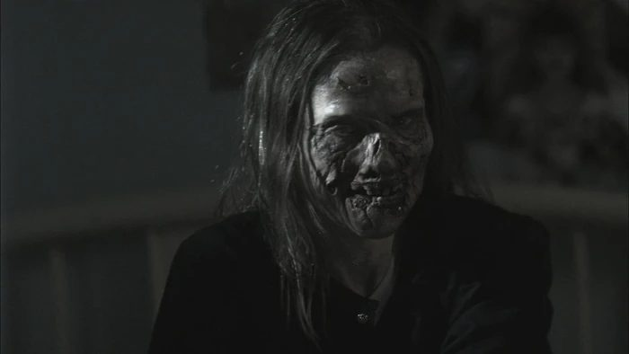

**Описание**

Рэйты — вид монстров, которые питаются человеческой мозговой жидкостью и способны заражать людей высокими дозами дофамина. Жидкость они вытягивают через шип, выдвигающийся из запястья: им пробивают слабое место за ухом, чтобы добраться до мозга. У жертв, из которых высосали мозговую жидкость, мозг остаётся полностью сухим.

В человеческом облике рэйт неотличим от обычного человека, но истинная форма видна в зеркале — там у него оказывается гнилое лицо. Через прикосновение рэйт заражает жертву, повышая уровень дофамина: он не сводит человека с ума, а лишь позволяет внутренним проблемам и эмоциям взять верх. Жертвы постепенно становятся всё более эмоционально нестабильными, и их собственные проблемы начинают проявляться реалистичными галлюцинациями.

Лучшим местом выживания для рэйта показана психиатрическая лечебница: там можно кормиться регулярно, а пациентам, заявляющим об убийце-монстре, никто из персонала не поверит. В эпизоде «Sam, Interrupted» один рэйт кормился пациентами такой лечебницы; другой известный рэйт предпочитал нападать на экстрасенсов. В «Mommy Dearest» Ева включила часть черт рэйтов в своих гибридных монстров «Jefferson Starship».

Рэйтов можно встретить и вне лечебниц: в эпизодах сериала они действуют и в других городах и ситуациях. Охотники считают их опасными не столько прямой силой, сколько скрытностью и умением превращать расследование в охоту за призраками там, где виноват вполне материальный хищник.

**Силы и способности**

- Маскировка под человека — рэйт выглядит как обычный человек, и только зеркало выдаёт его гнилое лицо.
- Заражение дофамином — через прикосновение рэйт повышает уровень дофамина, и внутренние проблемы жертвы выходят наружу.
- Наведённое безумие — жертвы постепенно теряют эмоциональную устойчивость, а их страхи проявляются реалистичными галлюцинациями.
- Шип в запястье — выдвижное костяное орудие для пробития слабого места за ухом и вытягивания мозговой жидкости.

**Слабости**

- Серебро — серебро обжигает кожу рэйта; удар серебряным клинком в сердце убивает его, а одного рэйта убил даже удар в бок, не задевший сердце.
- Зеркала — отражение показывает истинный облик рэйта, что лишает его маскировки.
- Перелом шипа — сломанный шип причиняет рэйту сильную боль и выводит его из строя.
- Тяжёлые травмы и повреждение мозга — Дин забил одного рэйта до смерти бейсбольной битой с колючей проволокой, а Бобби из «Апокалиптического мира» убил рэйта топором в голову.
- Экстрасенсы — люди с психическими способностями видят сквозь маскировку рэйта и распознают его.

**Как его убить.** Главное — серебро: серебряный клинок или нож, желательно с запасным, плюс наручники и кляп, чтобы не дать рэйту пустить в ход шип. Работать нужно в паре: один держит зеркало и следит за отражением, второй бьёт в сердце; удар в бок тоже может убить, но полагаться на это не стоит. Если клинка нет, годится любой тяжёлый тупой предмет — перелом шипа и травма головы добивают тварь. Тело сжигают вместе с одеждой, а расследование ведут через персонал лечебницы и списки пациентов.

#### Рэйт
*Средний, Монстр, нейтрально-злое*

---
- **Класс доспеха** 14 (природная броня)
- **Хиты** 65 (10d8 + 20)
- **Скорость** 30 фт.

| СИЛ | ЛОВ | ТЕЛ | ИНТ | МДР | ХАР |
|---|---|---|---|---|---|
| 12 | 16 | 15 | 12 | 14 | 14 |

- **Спасброски** Лов +5, Мдр +4
- **Навыки** Восприятие +4, Обман +6, Проницательность +4
- **Уязвимость к урону** серебро (см. «Серебряная рана»)
- **Сопротивление урону** психический
- **Иммунитет к состояниям** очарование, испуг
- **Чувства** тёмное зрение 60 фт., пассивное Восприятие 14
- **Языки** английский
- **Бонус мастерства** +2
- **Уровень опасности** 4 (1 100 опыта)

***Особенности***
- ***Серебряная рана.*** Атаки серебряным оружием игнорируют его сопротивление психическому урону и наносят дополнительно 7 (2d6) урона. Если серебряный клинок вонзается в сердце рэйта, тот умирает, а удар серебром в бок наносит 10 (3d6) дополнительного урона.
- ***Истинный облик в отражении.*** В зеркалах и других отражениях видно гнилое лицо рэйта. Существо, изучающее отражение, может действием совершить проверку Мудрости (Восприятие) Сл 15 и при успехе понять, что перед ним монстр.
- ***Шип в запястье.*** Из запястий рэйта выдвигаются костяные шипы. Если шип сломан (атака против КД 16 с нанесением 10 и более урона по нему), рэйт получает помеху на атаки шипами до конца следующего продолжительного отдыха.
- ***Заражение дофамином.*** Существо, которого рэйт коснулся, проходит спасбросок Мудрости Сл 14. При провале оно получает помеху на проверки Мудрости и спасброски против испуга на 24 часа и начинает видеть реалистичные галлюцинации о собственных проблемах. Повторять спасбросок можно в конце каждого продолжительного отдыха.

***Действия***
- ***Мультиатака.*** Рэйт совершает две атаки: шипом или ударом кулаком.
- ***Шип запястья.*** Рукопашная атака оружием: +5 к попаданию, досягаемость 5 фт., одна цель. Попадание: 7 (1d8 + 3) колющего урона плюс 7 (2d6) некротического урона, и максимум хитов цели снижается на величину некротического урона до окончания её продолжительного отдыха.
- ***Прикосновение безумия.*** Рукопашная атака заклинанием: +4 к попаданию, одна цель. Попадание: цель проходит спасбросок Мудрости Сл 14, иначе получает 10 (3d6) психического урона и до конца своего следующего хода не может совершать реакции.

**Тактика.** Рэйт не ищет открытого боя: он подбирает изолированную жертву, втирается в доверие в человеческом облике и наносит удар шипом ночью или в момент слабости. В бою он старается разорвать дистанцию, прикрываясь стенами и перегородками больничных коридоров, и атакует того, кто остался один. Серебро и зеркало мгновенно меняют его поведение: он отступает, прячется и пытается уничтожить источник улик. Сломанный шип заставляет его паниковать и бежать, а не драться до конца.

**Экология.** Чаще всего рэйты держатся поблизости от больших скоплений уязвимых людей — психиатрических лечебниц, больниц, ночлежек, приютов, где исчезновения списывают на болезнь. Живут они поодиночке и кормятся регулярно, стараясь не привлекать внимания. С другими монстрами не сосуществуют, но Ева использовала их черты в своих гибридах, что указывает на их родство с общей семьёй монстров.

> **Заметки мастеру.** Рэйт — идеальный «монстр недели» для детективного сценария в лечебнице или хосписе: улики ведут к персоналу, а не к чудовищу. Механически он близок к вампиру-одиночке (CR 4), но вместо регенерации у него серебро и зеркала; для низких уровней уберите «Заражение дофамином», для высоких дайте ему трёх обращённых санитаров и удвойте хиты. Хорошо работает как замена суккубу или ночному убийце, если нужен именно скрытный хирург-убийца, а не боец.

[↑ к содержанию](#содержание)

---

### 85. Сатир

**Satyrs** · Монстр · CR 2 · опасность в сериале 2/5

*Также известно как:* Козлоногий; Goat Dudes

*Первое появление:* S12E16 «The Memory Remains»

*Сезоны:* 12

Человекоподобные козлоногие существа из греческой мифологии. Заманивают путников в лес, устраивают с ними оргии, а затем пожирают их плоть. Их неконтролируемая похоть — их же главная уязвимость.

**Описание**

Сатиры — человекоподобные существа с козлиными чертами из греческой мифологии. В сериале братья Винчестеры наткнулись на них во время расследования охоты, начавшегося с описания человекоподобного существа с козлиными признаками, и вышли на лор о Пане — сатире-боге из греческой мифологии. Дин сначала сомневался, что Пан вообще причастен к делу: увиденное в интернете изображение Пана показалось ему «милым» — бог играет на флейте. Тогда Сэм изложил брату характеристики сатира, и разговор принял совсем другой оборот.

Согласно lore, сатиры уводят людей в леса, устраивают с ними оргии, а затем пожирают плоть своих жертв, «пока их животы не раздуются до предела от влажного, скользкого мяса». Дин прямо отметил, насколько подробно и жутко это описание, и разговор ушёл в сторону. Сочетание неудержимой похоти с людоедством и определяет сатира как монстра.

В выжимке из слабостей сатира указана ровно одна, и она же является его главной движущей силой: неконтролируемая похоть. Сатиры по природе нимфоманы — они ведут жертв в лес и насилуют их в массовых оргиях, после чего кормятся их плотью. Эта одержимость предсказуема и делает их уязвимыми: сатир теряет осторожность, поддавшись влечению.

В греческой мифологии сатир — мужской дух природы с ушами и хвостом лошади; в ранних изображениях у него могли быть лошадиные ноги, но уже к шестому веку до н. э. его чаще представляли с человеческими ногами. Он комично уродлив, с гривой волос, звериным лицом и курносым носом, всегда изображается голым. Сатиры славились распутством, любили вино, музыку, танцы и женщин, были спутниками бога Диониса и, как считалось, обитали в глухих местах — лесах, горах и на пастбищах. Они постоянно пытались соблазнить или изнасиловать нимф и смертных женщин, обычно без особого успеха.

**Силы и способности**

- Заманивание в лес — сатиры уводят людей в глубь леса, подальше от помощи и свидетелей, где жертва полностью в их власти.
- Неконтролируемая похоть — сатиры по природе нимфоманы: они устраивают с жертвами массовые оргии, и эта одержимость лишает их осторожности.
- Пожирание плоти — после оргий сатиры кормятся плотью своих жертв, пока их животы не раздуются до предела.
- Связь с Дионисом — по мифологии сатиры были спутниками бога Диониса, обитали в лесах, горах и на пастбищах и славились распутством, музыкой и вином.

**Слабости**

- Неконтролируемая похоть — единственная указанная слабость сатира: он настолько одержим влечением, что ведёт жертв в лес и теряет бдительность в оргии, чем можно воспользоваться.
- Уязвимость во время оргии — пока сатиры заняты жертвой, они не следят за окружением; именно тогда их проще застать врасплох.

**Как его убить.** Инвентарь: обычное охотничье снаряжение — огнестрельное оружие, серебряные ножи, ловушки и сети. Специфического средства против сатиров в выжимке нет, поэтому ставка на внезапность. Вычислите место, куда сатиры уводят жертв, — глухой лес вдали от людей. Используйте приманку и засаду: сатиры теряют осторожность, увлекшись жертвой.

#### Сатир
*Средний, Монстр, хаотично-злое*

---
- **Класс доспеха** 13 (природная броня)
- **Хиты** 45 (7d8 + 14)
- **Скорость** 40 фт.

| СИЛ | ЛОВ | ТЕЛ | ИНТ | МДР | ХАР |
|---|---|---|---|---|---|
| 16 | 14 | 15 | 10 | 11 | 16 |

- **Навыки** Атлетика +5, Восприятие +2, Выступление +5, Обман +5, Скрытность +4
- **Сопротивление урону** дробящий, колющий и рубящий от немагического оружия
- **Чувства** тёмное зрение 60 фт., пассивное Восприятие 12
- **Языки** Общий
- **Бонус мастерства** +2
- **Уровень опасности** 2 (450 опыта)

***Особенности***
- ***Флейта Пана.*** Сатир носит с собой флейту. Действием он может сыграть на ней: каждое существо в пределах 60 фт., которое слышит игру, должно преуспеть в спасброске Мудрости Сл 13, иначе очаровано на 1 минуту и вынуждено в свой ход приближаться к сатиру. Существо повторяет спасбросок в конце каждого своего хода и при получении урона от сатира или его союзников.
- ***Упоение.*** Сатир совершает с преимуществом броски атаки по очарованному, схваченному или иным образом беспомощному существу.
- ***Лесной шаг.*** Сатир игнорирует труднопроходимую местность из-за растительности. Он совершает проверки Скрытности в лесу с преимуществом.
- ***Ненасытность.*** Если сатир начинает свой ход схватившим существо, он должен преуспеть в спасброске Мудрости Сл 12, иначе не может voluntarily отпустить цель и до конца своего следующего хода атакует только её.

***Действия***
- ***Мультиатака.*** Сатир совершает две атаки: боданьем и кулаком.
- ***Бодание.*** Рукопашная атака оружием: +5 к попаданию, досягаемость 5 фт., одна цель. Попадание: 7 (1d8 + 3) дробящего урона.
- ***Кулак.*** Рукопашная атака оружием: +5 к попаданию, досягаемость 5 фт., одна цель. Попадание: 6 (1d6 + 3) дробящего урона, и цель схвачена (Сл высвобождения 13).
- ***Пожирание.*** Сатир кусает схваченное или беспомощное существо. Рукопашная атака оружием: +5 к попаданию, одна цель. Попадание: 10 (2d6 + 3) колющего урона, и сатир восстанавливает количество хитов, равное половине нанесённого урона.

***Бонусные действия***
- ***Захват.*** Сатир пытается схватить существо в пределах досягаемости (Сл высвобождения 13).
- ***Свист в лесу.*** Сатир издаёт призывный звук; все сатиры в пределах 300 фт. узнают направление и приближаются.

**Тактика.** Сатир не нападает настороже: он играет на флейте, очаровывает одинокого путника и уводит его в глубь леса, где ждут остальные. Там он хватает жертву и валит её на землю, а затем переходит к пожиранию, теряя всякий интерес к окружению. Именно в этот момент его проще всего застать врасплох. Сатиры дерутся только тогда, когда их потревожили: они бьют боданием и кулаками, стараясь схватить противника и удержать его. Оказавшись в численном меньшинстве или получив серьёзный урон, сатир убегает в чащу.

**Экология.** Сатиры обитают в глухих лесах, горах и на пастбищах, подальше от людей, и действуют там, где могут увести жертву с дороги без свидетелей. Встречаются поодиночке или небольшими группами, которые устраивают совместные оргии и трапезы. В мифологии они связаны с Дионисом и нимфами; в описанном случае они всплыли в расследовании, начавшемся с lore о Пане.

> **Заметки мастеру.** Сатир — монстр для партии 2–4 уровня и хороший пример того, как мифологический образ превращается в людоеда: играйте на контрасте между «милым» флейтистом и оргией с последующим пожиранием. Описанные сцены требуют аккуратности на столе — смещайте акцент на расследование, очарование и засаду, а не на натурализм. Отлично заменяет сатира из бестиария 5e, но с явно злой природой. Для низких уровней уберите «Флейту Пана», для высоких — поставьте шамана-сатира с заклинаниями и группой из четырёх-пяти особей.

[↑ к содержанию](#содержание)

---

### 86. Селки

**Selkies** · Монстр · CR 2 · опасность в сериале 3/5

*Также известно как:* Колониальный оборотень-тюлень

*Первое появление:* Supernatural: The Dogs of Edinburgh

Оборотни с Шотландских островов, принимающие человеческий облик. В истинном виде — чёрные глаза, серая морщинистая кожа и острые зубы. Живут колониями и захватывают целые города.

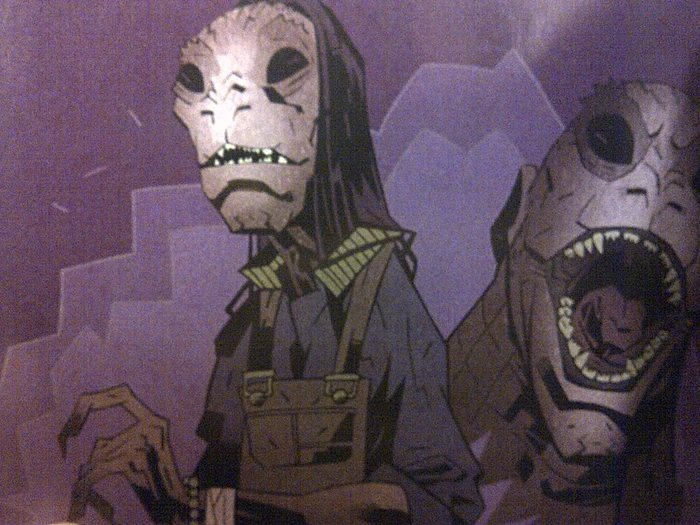

**Описание**

Селки — оборотни-монстры, способные принимать человеческий облик. Происходят они в первую очередь из Шотландии и сопредельных областей, а в историю попадают через роман «Supernatural: The Dogs of Edinburgh». В истинной форме у селки чёрные глаза, морщинистая серая кожа и острые зубы — облик, который они тщательно скрывают, выходя на берег и меняя внешность, чтобы сойти за человека.

В человеческом виде селки не просто маскируются: они вступают с людьми в длительные отношения и подолгу живут среди них, не вызывая подозрений. Именно на этом строится их экспансия. Колония селки управляется «матерью колонии», однако Эмма с Островов прямо говорит, что это объединение меньше похоже на семью и больше на воинское звание: после того как Эмма убила мать колонии, она сама стала новой матерью — и отказалась от этого положения.

Когда колония перестаёт сдерживаться, она превращается в катастрофу. Сэм Винчестер, столкнувшись с селки во время поездки в Великобританию, сначала счёл их мелкой проблемой, но это оказалось массовое нашествие: селки жили в городе под видом людей, а со временем самцы вышли из-под контроля и начали нападать и разрушать город. Сэм вызвал Дина из США, и братья вместе с Эммой — тайной селки, дочерью матери колонии и последней из исходного стада, — уничтожили колонию. Эмма после этого убила себя, чтобы нашествие действительно прекратилось и город был спасён.

В выжимке из слабостей селки указаны только смертельные раны, помеченные как неизученные. Это значит, что охотникам приходится действовать грубой силой: селки уязвимы к тяжёлым повреждениям, но специального средства против них не найдено. Пока колония едина, уничтожение отдельных особей ничего не решает — нужно либо вырезать её целиком, либо лишить её матери колонии, что на практике и произошло.

**Силы и способности**

- Смена облика — селки принимают человеческий вид и подолгу живут среди людей, вступая с ними в отношения и не вызывая подозрений.
- Истинная форма — чёрные глаза, морщинистая серая кожа и острые зубы; в этом виде селки переходят к открытым нападениям.
- Колониальная организация — селки действуют не поодиночке, а колонией во главе с матерью колонии, которая управляет остальными железной дисциплиной.
- Скрытное нашествие — колония способна незаметно разрастись в целом городе, заняв в нём ключевые места, прежде чем начнёт действовать открыто.

**Слабости**

- Смертельные раны — единственная указанная слабость селки: они гибнут от тяжёлых повреждений, специального средства против них в выжимке не приводится.
- Потеря матери колонии — убийство матери колонии лишает селки руководства; Эмма заняла её место лишь потому, что убила предшественницу.
- Разрозненность — пока колония едина, она почти неуязвима; уничтожение отдельных селки ничего не решает, и нашествие прекращается только с гибелью всей колонии.

**Как его убить.** Инвентарь: обычное охотничье снаряжение — огнестрельное оружие, серебряные ножи, ловушки; специфического средства против селки нет. Установите, кто в городе человек, а кто селки: в человеческом облике они неотличимы. Затем ищите мать колонии — без неё колония теряет управление. В выжимке отмечено, что селки уязвимы к смертельным ранам.

**Известные особи:** Эмма с Островов — селки, дочь матери колонии и последняя из исходного стада; помогла Винчестерам уничтожить колонию, став новой матерью колонии, от чего отказалась, а затем убила себя.; Мать колонии — предводительница колонии селки; была убита Эммой.

#### Селки
*Средний, Монстр, нейтрально-злое*

---
- **Класс доспеха** 14 (природная броня)
- **Хиты** 45 (7d8 + 14)
- **Скорость** 30 фт., плавание 40 фт.

| СИЛ | ЛОВ | ТЕЛ | ИНТ | МДР | ХАР |
|---|---|---|---|---|---|
| 16 | 14 | 15 | 11 | 12 | 14 |

- **Спасброски** Тел +4
- **Навыки** Атлетика +5, Восприятие +3, Обман +6, Скрытность +4
- **Сопротивление урону** холод; дробящий, колющий и рубящий от немагического оружия
- **Чувства** тёмное зрение 60 фт., пассивное Восприятие 13
- **Языки** Общий
- **Бонус мастерства** +2
- **Уровень опасности** 2 (450 опыта)

***Особенности***
- ***Смена облика.*** Селки действием превращается в гуманоида Среднего размера, облик которого видел, либо возвращается в истинную форму. Характеристики в обеих формах одинаковы. В истинной форме у него чёрные глаза, серая морщинистая кожа и острые зубы; узнать его в человеческом облике можно только магией.
- ***Врождённая двусредность.*** Селки может дышать воздухом и под водой. Его скорость плавания составляет 40 фт.
- ***Дисциплина колонии.*** Пока в пределах 60 фт. от селки находится сознательная мать колонии, он совершает спасброски от испуга и очарования с преимуществом и не может покинуть поле боя против своей воли.
- ***Тактика стаи.*** Селки совершает с преимуществом броски атаки по существу, если в пределах 5 фт. от этого существа находится хотя бы один союзный селки, не выведенный из строя.

***Действия***
- ***Мультиатака.*** Селки совершает две атаки: укусом и когтями.
- ***Укус.*** Рукопашная атака оружием: +5 к попаданию, досягаемость 5 фт., одна цель. Попадание: 7 (1d8 + 3) колющего урона.
- ***Когти.*** Рукопашная атака оружием: +5 к попаданию, досягаемость 5 фт., одна цель. Попадание: 6 (1d6 + 3) рубящего урона.
- ***Гарпун.*** Дальнобойная атака оружием: +5 к попаданию, дистанция 20/60 фт., одна цель. Попадание: 6 (1d6 + 3) колющего урона, и цель схвачена (Сл высвобождения 13), если она не крупнее Среднего размера.

***Бонусные действия***
- ***Рывок из воды.*** Селки, находящийся в воде, перемещается на расстояние до своей скорости плавания, не провоцируя атак, и совершает одну атаку когтями.

**Тактика.** Селки нападают не в одиночку, а группой и почти всегда из засады: они подходят под видом людей, а затем разом меняют облик и бьют окружённую цель, пользуясь тактикой стаи. В открытом поле один селки средний противник, и потому они отступают в воду, где их скорость плавания позволяет уйти от погони. Они держатся рядом с матерью колонии и теряют слаженность, если её убили. Специфического страха перед каким-либо веществом у них не отмечено — только тяжёлый урон.

**Экология.** Селки родом с Шотландских островов и прибрежных земель, живут колониями на берегу и в воде. В человеческом облике они селятся в приморских городах, вступают в отношения с людьми и подолгу остаются незамеченными. Численность колонии может быть значительной — в описанном случае это была настоящая напасть на город. Колония управляется матерью колонии и подчиняется ей как воинскому начальнику.

> **Заметки мастеру.** Селки — отличный монстр для прибрежной кампании 3–5 уровня: не одиночный враг, а колония, которую партия должна вскрыть и обезглавить. Уникальность в том, что врага нельзя опознать без магии, поэтому расследование становится важнее боя. Если нужен один статблок для среднего бойца, используйте его как есть; на роль матери колонии возьмите того же селки с удвоенными хитами и парой легендарных действий. Для высоких уровней соберите боевую группу из шести селки плюс мать колонии.

[↑ к содержанию](#содержание)

---

### 87. Сирена

**Siren** · Монстр · CR 5 · опасность в сериале 3/5

*Также известно как:* Искусительница; Морская дева из греческих легенд

*Первое появление:* Сезон 4, «Sex and Violence»

*Сезоны:* 4, 7, 12, 14

Существо, читающее желания человека и принимающее облик того, кого ему не хватает, чтобы вынудить жертву доказывать любовь разрушительными и кровавыми поступками.

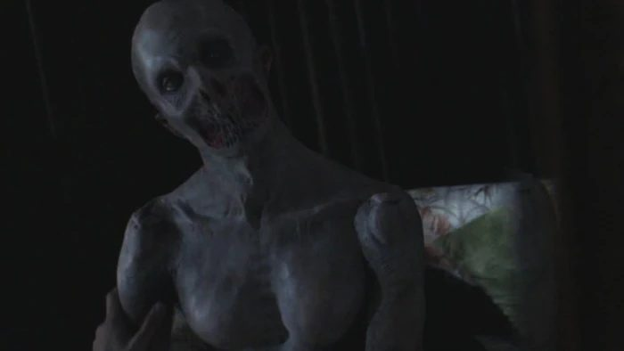

**Описание**

Сирены — сверхъестественные существа, которые принимают разные облики, чтобы приманивать людей и принуждать их к крайним, разрушительным поступкам во имя любви и преданности; такие поступки обычно заканчиваются чьей-то смертью. Известно о них немного: это редкие создания, которых почти не встречают за пределами Греции.

Сирены читают мысли своих целей и узнают, чего человек жаждет в других людях, а затем дают ему это через иллюзию. Речь идёт не только о внешности, но и о внутренних качествах: сирена, обольстившая Дина, предложила ему человека с похожими интересами к машинам, женщинам и жизненным взглядам и создала иллюзию того, кому можно доверять, — по сути нового младшего брата, который смотрит на него снизу вверх. Скорее всего, детали она брала прямо из его мозга.

Сирены меняют восприятие и облик, превращаясь в того, кто нужен цели, чтобы подобраться поближе и заразить её. Через некое подобие ядовитой железы во рту они вводят людям большие дозы окситоцина — «гормона любви» — и тем самым вызывают у жертвы привязанность и готовность доказывать свою преданность.

Истинный облик сирены — уродливое безволосое, смутно человекоподобное чудовище с измождёнными, нечеловеческими чертами лица. Как и многие существа этого мира, в зеркале они выглядят так, как есть. В древности сирены жили на островах и заставляли моряков гнаться за собой, направляя их корабли на скалы; в греческой мифологии сирен изображали как опасных женщин-птиц, заманивающих моряков пением.

**Силы и способности**

- Телепатия — сирена читает мысли цели и узнаёт, чего именно ей не хватает в других людях, а затем выдаёт это через иллюзию.
- Изменение восприятия и облика — сирена превращается в любое существо, подходящее цели, чтобы сблизиться и заразить её.
- Ядовитая железа — через рот сирена вводит большие дозы окситоцина, вызывая привязанность и готовность доказывать любовь.
- Принуждение к преданности — заражённая жертва совершает разрушительные и кровавые поступки во имя сирены, вплоть до убийства близких.

**Слабости**

- Бронзовый кинжал, смоченный кровью жертвы сирены, — только такое оружие способно убить её надёжно.
- Зеркала — как и у рэйтов, отражение показывает истинный облик сирены.
- Тяжёлые травмы — Дин убил одну сирену, забив её до смерти бейсбольной битой, обмотанной колючей проволокой.

**Как его убить.** Первым делом нужно найти и опознать жертву сирены, а затем добыть её кровь — без неё бронзовый кинжал бесполезен. Дальше охотник подставляет зеркало, чтобы вывести тварь на чистую воду перед её «возлюбленным», и наносит удар бронзой в сердце, при этом удерживая заражённых людей на расстоянии: они будут защищать сирену до смерти. В инвентаре: бронзовый кинжал, кровь жертвы в герметичном флаконе, зеркало, наручники и достаточно людей, чтобы разнять заражённых и не перебить своих.

**Известные особи:** Сирена под личиной Ника Манро (сезон 4)

#### Сирена
*Средний, Монстр, нейтрально-злое*

---
- **Класс доспеха** 14 (природная броня)
- **Хиты** 68 (8d8 + 32)
- **Скорость** 30 фт., плавание 30 фт.

| СИЛ | ЛОВ | ТЕЛ | ИНТ | МДР | ХАР |
|---|---|---|---|---|---|
| 12 | 16 | 16 | 14 | 13 | 18 |

- **Спасброски** Лов +6, Хар +7
- **Навыки** Обман +10, Убеждение +10, Проницательность +7
- **Уязвимость к урону** бронзовое оружие, смоченное кровью её жертвы
- **Сопротивление урону** психический
- **Иммунитет к состояниям** очарование
- **Чувства** тёмное зрение 60 фт., пассивное Восприятие 11
- **Языки** английский, телепатия 60 фт.
- **Бонус мастерства** +3
- **Уровень опасности** 5 (1 800 опыта)

***Особенности***
- ***Чтение желаний.*** Сирена телепатически читает поверхностные желания существа в пределах 60 фт. Против этой цели она получает преимущество на проверки Харизмы (Обман, Убеждение) и знает, кто для цели дороже всего.
- ***Изменчивая личина.*** Действием сирена принимает облик любого существа, которое её цель хотела бы видеть рядом: возлюбленного, друга, родственника. Облик не даёт ей новых способностей, но проверки Проницательности против неё совершаются с помехой, пока не использовано зеркало.
- ***Истинный облик в отражении.*** В зеркалах видна уродливая безволосая тварь. Существо, изучающее отражение, может действием совершить проверку Мудрости (Восприятие) Сл 16 и при успехе увидеть сирену в истинном виде.
- ***Любовный яд.*** Существо, с которым сирена целовалась или делила питьё, проходит спасбросок Телосложения Сл 15. При провале оно очаровано сиреной на 24 часа, считает её самым дорогим существом и получает помеху на все проверки, направленные против её воли.
- ***Только бронза и кровь.*** Урон обычного оружия может опустить хиты сирены не ниже 1: убить её способен лишь бронзовый кинжал, смоченный кровью одной из её жертв, или тяжёлая тупая травма, нанесённая после того, как её истинный облик раскрыт.

***Действия***
- ***Мультиатака.*** Сирена совершает две атаки когтями или одну атаку когтями и один поцелуй-инфекцию.
- ***Коготь.*** Рукопашная атака оружием: +6 к попаданию, досягаемость 5 фт., одна цель. Попадание: 6 (1d6 + 3) рубящего урона.
- ***Поцелуй-инфекция.*** Рукопашная атака заклинанием: +7 к попаданию, одна цель. Попадание: цель проходит спасбросок Телосложения Сл 15, иначе становится очарованной сиреной на 24 часа (см. «Любовный яд»).
- ***Внушение (перезарядка 5–6).*** Сирена внушает одной очарованной ею цели в пределах 60 фт. мысль. Цель проходит спасбросок Мудрости Сл 15; при провале она в течение 1 минуты выполняет одно указание сирены, даже если оно разрушительно для неё самой или её близких, и может повторять спасбросок при получении урона от того, кого любит.

***Реакции***
- ***Подмена личины.*** Когда по сирене попадает атака, она реакцией принимает облик существа, дорогого нападающему. Нападающий должен пройти спасбросок Мудрости Сл 15, иначе атака считается промахом.

**Тактика.** Сирена никогда не начинает с драки: она втирается в доверие в чужом облике, кормит цель иллюзиями и натравливает на охотников уже заражённых людей. В бою она держится за спинами своих «возлюбленных», меняет личины, чтобы сбить прицел, и внушает самой опасной цели предательство. Увидев зеркало или бронзовый кинжал с кровью жертвы, сирена пытается бежать: открытая схватка для неё проигрышна, и она предпочтёт сменить город и начать всё заново.

**Экология.** Сирены редки и встречаются поодиночке, обычно в прибрежных или портовых городах, где легко сойти за приезжего и где много одиноких людей. За пределами Греции их почти не видят, поэтому охотники редко имеют готовые наработки по ним. Питаются они привязанностью и разрушением чужих связей, а не плотью, и рядом с ними обычно крутится один-два заражённых человека, которых сирена использует как щит.

> **Заметки мастеру.** Сирена — социальный антагонист, а не боец: стройте вокруг неё городскую интригу, где партия должна сначала доказать, что «возлюбленная» одного из NPC — монстр. Механически она близка к суккубу (CR 4–5), но с двумя важными отличиями: без крови жертвы и бронзового кинжала её нельзя убить, а зеркало раскрывает облик. Для низких уровней оставьте только очарование и внушение; для высоких дайте ей трёх заражённых телохранителей и наделите способностью подменять личины союзников партии.

[↑ к содержанию](#содержание)

---

### 88. Скинвокеры

**Skinwalkers** · Монстр · CR 3 · опасность в сериале 3/5

*Также известно как:* Двоюродные братья оборотней; Псы-оборотни

*Первое появление:* S06 «All Dogs Go To Heaven»

*Сезоны:* 6

Сверхъестественные существа, полностью обращающиеся в собак в любое время суток. Они сбиваются в стаи, питаются человеческими сердцами, заражают укусом и убиваются только серебром.

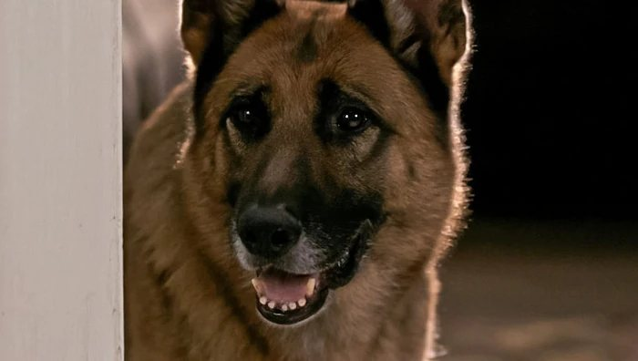

**Описание**

Скинвокеры — сверхъестественные существа, принимающие облик собаки. Дин Винчестер, прочитав журнал Джона Винчестера, называет их двоюродными братьями оборотней: как и те, скинвокеры меняют форму, заражают укусом и питаются человеческими сердцами.

Все скинвокеры происходят от Альфа-скинвокера. Альфа расставил тридцать скинвокеров в собачьем облике по семьям, планируя создать армию: по его сигналу тридцать существ должны были за одну ночь превратиться в сто пятьдесят, обратив целые семьи. С приходом смерти Евы эти планы, судя по всему, были заброшены, а судьба самого Альфы после встречи с Кроули остаётся неизвестной.

В отличие от оборотней, превращение скинвокера в собаку полное и не привязано к фазам луны: он меняет облик в любое время дня и ночи. Сверхъестественная сила проявляется только в животной форме — в человеческом облике скинвокер предпочитает бежать, а не драться, — и растёт вместе с положением в стае: вожак стаи легко расправляется с рядовым сородичем. Скинвокеры быстро заживают: сбитый минивэном и подстреленный скинвокер вернулся в человеческий облик без видимых повреждений.

Убивает скинвокера только серебро — серебряная пуля или клинок в сердце либо голову. Серебряные цепи удерживают его настолько надёжно, что позволяют допрашивать: именно так Сэм и Дин связали Лаки, скинвокера, который убивал всех, кто угрожал его хозяйке Мэнди и её сыну. Вид живёт стаями во главе с вожаком, а вожак подчиняется Альфа-скинвокеру.

**Силы и способности**

- Полное обращение в собаку — скинвокер превращается в обычную собаку в любое время дня и ночи, вне зависимости от лунного цикла.
- Сила в звериной форме — в собачьем облике скинвокер легко одолевает и убивает людей; сила растёт вместе с рангом в стае.
- Скорость — в животной форме скинвокер бегает и двигается быстрее человека.
- Ускоренное заживление — сбитый минивэном и подстреленный скинвокер вернулся в человеческий облик без видимых повреждений.
- Заразный укус — одного укуса достаточно, чтобы заразить человека и превратить его в скинвокера.
- Стайный уклад — скинвокеры живут стаями во главе с вожаком, который подчиняется Альфа-скинвокеру.

**Слабости**

- Серебро — скинвокера можно убить только серебряным оружием: серебряная пуля или клинок в сердце либо голову.
- Серебряные цепи — серебро надёжно удерживает скинвокера, поэтому связанного серебряными цепями и верёвками монстра можно допрашивать.
- Человеческий облик — вне звериной формы скинвокер лишён сверхъестественной силы и старается убежать, а не вступать в драку.

**Как его убить.** Работайте только серебром: серебряная пуля или клинок в сердце либо голову — единственный способ убить скинвокера. Ищите почерк: он выедает человеческие сердца, и по этому признаку его легко спутать с оборотнем, но скинвокер не привязан к полнолунию и обращается в обычную собаку. Если нужен живой пленник, возьмите серебряные цепи и верёвки — в них скинвокер беспомощен, и его можно допросить о вожаке и об Альфе. Перед облавой проверьте окрестные семьи с собаками: спящие ячейки вида живут так.

**Известные особи:** Лаки; Вожак стаи; Мэнди

#### Скинвокеры
*Средний, Монстр, нейтрально-злое*

---
- **Класс доспеха** 14 (природная броня)
- **Хиты** 52 (8d8 + 16)
- **Скорость** 30 фт. (40 фт. в собачьем облике)

| СИЛ | ЛОВ | ТЕЛ | ИНТ | МДР | ХАР |
|---|---|---|---|---|---|
| 16 | 16 | 15 | 10 | 13 | 11 |

- **Спасброски** Сил +5, Тел +4
- **Навыки** Скрытность +5, Восприятие +3, Выживание +3
- **Уязвимость к урону** серебро
- **Сопротивление урону** дробящий, колющий и рубящий от немагического оружия, кроме серебряного
- **Чувства** тёмное зрение 60 фт., пассивное Восприятие 13
- **Языки** общий (английский), в собачьем облике речь недоступна
- **Бонус мастерства** +2
- **Уровень опасности** 3 (700 опыта)

***Особенности***
- ***Обращение в собаку.*** Бонусным действием скинвокер превращается в собаку размера Средний или обратно. Превращение полное и не зависит от времени суток и лунного цикла.
- ***Сила стаи.*** В собачьем облике скинвокер получает преимущество на проверки Силы (Атлетика) и на атаки по существу, рядом с которым находится хотя бы один союзный скинвокер. В человеческом облике он не получает ни этого преимущества, ни сопротивления немагическому оружию.
- ***Регенерация 5.*** Скинвокер восстанавливает 5 хитов в начале своего хода, если у него есть хотя бы 1 хит и он не получал урона серебром с конца своего предыдущего хода.
- ***Серебряная слабость.*** Урон серебром по скинвокеру удваивается, а сопротивление немагическому оружию на серебряные атаки не распространяется. Серебряные цепи лишают его возможности обращаться.
- ***Заразный укус.*** Гуманоид, укушенный скинвокером, должен преуспеть в спасброске Телосложения Сл 12, иначе становится скинвокером; обращение занимает 1d4 дня.

***Действия***
- ***Мультиатака.*** В собачьем облике скинвокер совершает одну атаку укусом и одну атаку когтями.
- ***Укус.*** Рукопашная атака оружием: +5 к попаданию, досягаемость 5 фт., одна цель. Попадание: 7 (1d8 + 3) колющего урона, и цель должна преуспеть в спасброске Телосложения Сл 12, иначе заражается.
- ***Когти.*** Рукопашная атака оружием: +5 к попаданию, досягаемость 5 фт., одна цель. Попадание: 6 (1d6 + 3) рубящего урона.
- ***Вырвать сердце.*** Скинвокер совершает атаку укусом по схваченной или недееспособной цели. При попадании цель получает 10 (2d6 + 3) колющего урона, и её максимум хитов уменьшается на эту величину.

***Бонусные действия***
- ***Обращение.*** Скинвокер превращается в собаку или возвращается в человеческий облик.

**Тактика.** В собачьем облике скинвокер нападает стаей: двое отвлекают, третий валит жертву и выгрызает сердце. Он старается не показывать сверхъестественную силу при свидетелях и предпочитает нападать ночью в безлюдных местах. Если скинвокер ранен или его сородича убили серебром, он отступает и меняет облик на человеческий, чтобы раствориться в толпе. Загнанный в угол и связанный серебром, он сдаётся и говорит — страх перед серебром у него сильнее верности вожаку.

**Экология.** Скинвокеры живут стаями, часто маскируясь под обычных домашних собак в семьях; вожак держит стаю в подчинении и отвечает перед Альфа-скинвокером. Они обитают в пригородах и сельской местности, где легко найти одинокую жертву, и стараются не привлекать внимания охотников; численность вида оценивается примерно в тридцать особей, готовых по сигналу Альфы вырасти в пять раз.

> **Заметки мастеру.** Скинвокер — это вервольф без лунной привязки, поэтому его удобно собирать на базе волка-оборотня или берсерка с двумя формами; главное отличие — уязвимость к серебру и полное превращение в собаку, что делает его отличным городским шпионом. Стая из трёх-четырёх скинвокеров и вожак — энкаунтер на партию 3–4 уровня, а вожак в одиночку тянет на CR 5–6. Серебряные цепи как расходник дают партии небоевой путь: допрос пленника и выход на Альфу. Если кампания идёт по шестому сезону, держите в уме сигнал Альфы — это готовая катастрофа на одну ночь.

[↑ к содержанию](#содержание)

---

### 89. Сторожевой пёс Людей Письма

**Men of Letters Watchdog** · Монстр · CR 6 · опасность в сериале 3/5

*Также известно как:* Безымянный лу-гару; Сторож «Ящика монстров»

*Первое появление:* The Winchesters, сезон 1, «Pilot»

*Сезоны:* 1

Безымянный лу-гару, которого Люди Письма использовали как сторожевого пса для охраны «Ящика монстров». Его лоботомировали, лишив воли, оставив только силу, когти и одну задачу — убивать всякого, кто подойдёт к охраняемому объекту.

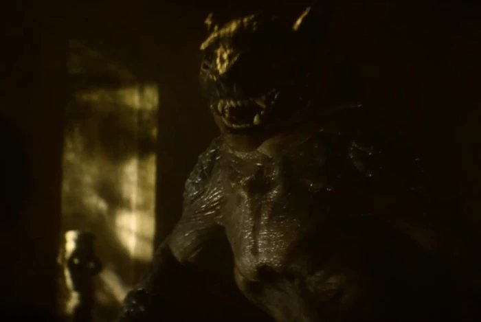

**Описание**

Этот безымянный лу-гару служил Людям Письма сторожевым псом: его поставили охранять «Ящик монстров». Лу-гару — довольно сильный вид монстров, и сторож оправдывал выбор: смертоносные когти, превосходящая человеческая сила и полное отсутствие колебаний.

Сторожа поймали и лоботомировали. Сделал это Джек Уилкокс — главный врач Людей Письма, который лоботомировал целый ряд монстров, чтобы те служили сторожами в самых защищённых местах организации. После операции у монстра не осталось ни воли, ни собственных желаний: только заложенная задача — охранять вверенный объект.

В 1972 году сторож напал на Джона Винчестера и Мэри Кэмпбелл после того, как они забрали «Ящик монстров». Мэри объяснила Джону, что это за тварь, но единственный серебряный клинок остался наверху, в фургоне Карлоса Сервантеса. Прячась, Джон вырезал из собственной руки осколок серебряного креста Хэнка Мёрфи, чтобы использовать его как оружие; Мэри считала, что этого не хватит, чтобы остановить сторожа, но Джон знал: осколок разозлит тварь и даст Мэри время уйти. Джон отправил Мэри к выходу, а сам побежал навстречу монстру.

В комнате с входом сторож атаковал Джона и отбросил его. Чем закончилась схватка, выжимка обрывает на этом месте; известно только, что сторож в итоге мёртв, а серебро против него работает иначе, чем против обычной нечисти: серебро ранит лу-гару, но убить его не может. Убить сторожа можно только отсечением головы.

Для бестиария это не самостоятельный монстр-злодей, а идеальный «замок»: тварь без разума и жалости, поставленная охранять важный предмет, которую нельзя переубедить, обмануть или запугать. Именно такими сторожами Люди Письма и запирали свои самые опасные хранилища.

**Силы и способности**

- Смертоносные когти — главное оружие сторожа; когти лу-гару в выжимке названы смертоносными.
- Сверхчеловеческая сила — лу-гару сильнее человека; сторож отбросил Джона Винчестера, едва начав бой.
- Выносливость вида — лу-гару описан как довольно сильный тип монстра, способный драться с вооружённым охотником.
- Отсутствие воли — после лоботомии сторож выполняет только одну задачу и не отвлекается ни на страх, ни на боль, ни на уговоры.
- Сторожевое чутьё — тварь неотрывно охраняет вверенный объект и реагирует на всякого, кто к нему приближается.

**Слабости**

- Обезглавливание — лу-гару можно убить только отсечением головы; любой другой урон его не убивает.
- Серебро — серебро ранит и останавливает лу-гару, но само по себе его не убивает: осколок серебряного креста лишь разозлил сторожа.
- Отсутствие разума — сторож не различает уловок и не идёт на переговоры, но и не способен к плану: его легко заманить и обойти.
- Привязка к объекту — тварь не покидает охраняемое место, поэтому её можно обойти, а не убивать.

**Как его убить.** Убить сторожа можно только отсечением головы, и для этого нужен клинок достаточной длины, лучше серебряный: серебро ранит и останавливает лу-гару, но не убивает. Сначала — разведка: найдите охраняемый объект и маршрут сторожа, затем подготовьте ловушку: сеть, цепь или узкий коридор, где тварь не развернётся. Пока союзники держат сторожа серебром, один бьёт по шее. Далеко от объекта сторож не преследует. Инвентарь: серебряный клинок, цепи, верёвка, бинты.

**Известные особи:** Безымянный лу-гару — сторож, лоботомированный Джеком Уилкоксом

#### Сторожевой пёс Людей Письма
*Средний, Монстр, нейтральное (лоботомирован, выполняет только приказ)*

---
- **Класс доспеха** 14 (природная броня)
- **Хиты** 97 (13d8 + 39)
- **Скорость** 40 фт.

| СИЛ | ЛОВ | ТЕЛ | ИНТ | МДР | ХАР |
|---|---|---|---|---|---|
| 18 | 15 | 16 | 6 | 14 | 8 |

- **Спасброски** Сил +7, Тел +6
- **Навыки** Восприятие +5, Скрытность +5
- **Сопротивление урону** дробящий, колющий и рубящий от немагического оружия, кроме серебряного
- **Иммунитет к состояниям** очарование, испуг
- **Чувства** тёмное зрение 60 фт., пассивное Восприятие 15
- **Языки** понимает английский, но не говорит (после лоботомии — только приказы хозяина)
- **Бонус мастерства** +3
- **Уровень опасности** 6 (2 300 опыта)

***Особенности***
- ***Лоботомия.*** Сторож не может быть очарован или испуган, не поддаётся уговорам и не отступает. Он выполняет только заложенную задачу: охранять вверенный объект и убивать всех, кто к нему приблизится.
- ***Серебро берёт, но не убивает.*** Серебряное оружие игнорирует сопротивление сторожа к немагическому оружию, наносит ему дополнительно 7 (2d6) урона и лишает его регенерации до конца его следующего хода.
- ***Регенерация.*** В начале своего хода сторож восстанавливает 10 хитов, если с прошлого хода не получал урона от серебряного оружия.
- ***Только обезглавливание.*** Если хиты сторожа опускаются до 0 уроном, не связанным с отсечением головы, он вместо смерти падает ничком и обездвижен; в конце своего следующего хода он восстанавливает 1 хит. Уничтожить его окончательно можно только отсечением головы.
- ***Чутьё сторожа.*** Сторож чувствует любое живое существо в пределах 60 фт. и не может быть застигнут врасплох, пока охраняет вверенный объект.

***Действия***
- ***Мультиатака.*** Сторож совершает две атаки когтями или одну атаку укусом и одну атаку когтями.
- ***Когти.*** Рукопашная атака оружием: +7 к попаданию, досягаемость 5 фт., одна цель. Попадание: 11 (2d6 + 4) рубящего урона.
- ***Укус.*** Рукопашная атака оружием: +7 к попаданию, досягаемость 5 фт., одна цель. Попадание: 9 (1d8 + 4) колющего урона, и цель размера Средний или меньше должна преуспеть в спасброске Силы (Сл 14), иначе схвачена (Сл освобождения 14).
- ***Отсечение головы.*** Сторож атакует обездвиженную, схваченную или бессознательную цель. Попадание: 22 (4d8 + 4) рубящего урона; если цель — гуманоид с максимумом хитов не выше 30, она обезглавлена и погибает.

***Реакции***
- ***Защита объекта.*** Когда существо в пределах 5 фт. от сторожа пытается взять, открыть, сломать или унести охраняемый предмет, сторож реакцией перемещается к нему на свою скорость и совершает одну атаку когтями.

***Действия в логове***
- ***Охраняемая комната.*** Пока бой идёт в помещении с охраняемым объектом, сторож знает о каждом движении внутри: скрытность против него невозможна, а все двери и проходы он перекрывает, навязывая бой в узком коридоре.

**Тактика.** Сторож не охотится и не хитрит: он стоит на пути к объекту и убивает всякого, кто подходит слишком близко. Серебро заставляет его переключиться на того, кто им владеет, поэтому серебряным клинком удобно уводить тварь от цели, а не убивать её. Сторож не отступает и не боится, но привязан к охраняемому месту: если группа отходит достаточно далеко, он возвращается на пост и больше не преследует. Отсюда лучшая тактика игроков — разделить роли: один держит сторожа на расстоянии, второй обходит его и забирает объект, третий готовит обезглавливание, когда тварь окажется обездвиженной или связанной.

**Экология.** Сторожа держат не в дикой природе, а в хранилищах Людей Письма: подземные комнаты, коридоры и защищённые схроны, где лежат самые опасные предметы организации. Это не популяция, а единичная особь, пойманная, лоботомированная и посаженная на цепь приказа. Рядом с ним не уживается никто, кроме тех, кто его поставил. Известен по крайней мере один такой сторож — тот, что охранял «Ящик монстров» и погиб в 1972 году.

> **Заметки мастеру.** Сторож — не монстр недели, а замок на двери с сокровищем: он хорош там, где партия 5-7 уровня должна достать предмет, а не победить в честном бою. Ключ к энкаунтеру — правило обезглавливания: без него тварь просто встаёт снова, поэтому дайте игрокам серебро, сети и узкое помещение, где можно связать сторожа и добраться до шеи. В 5e он заменяет тролля или вервольфа, но с одной поправкой: ни страх, ни уговоры, ни очарование на него не действуют. Для низкого уровня уберите реакцию и снизьте хиты до 60; для высокого добавьте второго сторожа и хозяина-Людей Письма, который отдаёт приказы.

[↑ к содержанию](#содержание)

---

### 90. Таша

**Tasha** · Монстр · CR 5 · опасность в сериале 3/5

*Также известно как:* Таша; Младшая сестра Кейт

*Первое появление:* S10 «Paper Moon»

*Сезоны:* 10

Оборотень-чистокровка, которую сестра Кейт обратила после тяжёлой аварии, чтобы спасти ей жизнь. В отличие от Кейт, Таша приняла свою природу и начала убивать людей, вырывая у жертв сердца; сестра остановила её серебряным ножом.

**Описание**

Таша была оборотнем и младшей сестрой Кейт. В детстве она была хорошей девочкой, но позволяла людям садиться себе на шею; с сестрой они были близки. После того как Кейт сама стала оборотнем, та тайно навещала семью: однажды она увидела в окне Ташу и родителей за ужином, но не вошла, чтобы никого не покалечить.

Позже Таша попала в серьёзную автомобильную аварию и, по словам врачей, не должна была выжить. Кейт узнала об этом из Facebook, приехала в больницу проститься — и вместо этого обратила сестру в оборотня и выкрала её из палаты, потому что поняла: силы оборотня могут спасти Ташу. Таша была удивлена собственным выздоровлением и быстро сообразила, что с ней произошло.

В отличие от Кейт, которая старалась держать себя в руках, Таша приняла новую природу и начала убивать. Она вырывала у жертв сердца — характерный почерк оборотня, — и это в итоге привлекло внимание Сэма и Дина Винчестеров. В инфобоксе выжимки указано, что у Таши была своя стая, а её душа после смерти отправилась в Чистилище, куда уходят все погибшие монстры.

Как и Кейт, Таша была чистокровным оборотнем: она обращалась по собственному желанию, в любой момент, а не только в полнолуние. Помимо силы, скорости, когтей и клыков, она быстро регенерировала: по выжимке, она залечила даже травмы после аварии, несовместимые с жизнью. Оборотнем её сделал укус сестры, и сама она тоже могла заражать других своим укусом.

Убить Ташу, как и любую чистокровку, могло только серебро. Остановила её собственная сестра: Кейт заколола Ташу серебряным ножом. В сериале Таша появляется в десятом сезоне, в эпизоде «Paper Moon».

**Силы и способности**

- Чистокровное обращение — как чистокровка Таша перекидывалась между человеческой и волчьей формой в любой момент, без привязки к луне.
- Сверхсила — она была очень сильна и одной рукой одолела Сэма Винчестера.
- Сверхскорость — двигалась невероятно быстро, быстрее любого человека.
- Регенерация — залечивала раны, смертельные для человека; по выжимке, она оправилась даже от травм после тяжёлой аварии.
- Заразный укус — её укус передавал проклятие ликантропии дальше.
- Когти и клыки — острые, как бритва: когтями она убивала, а клыками вырывала и съедала сердца жертв.

**Слабости**

- Серебро — единственное, что могло убить Ташу; её сестра Кейт заколола её именно серебряным ножом.
- Кровное родство — её нашла и остановила собственная сестра, знавшая её повадки и слабое место.
- Голод — приняв природу оборотня, Таша начала убивать людей и тем самым выдала себя охотникам.

**Как его убить.** Рецепт для чистокровного оборотня один: серебро. Серебряный клинок в сердце или серебряная пуля убивают Ташу — именно так с ней и покончили. Вплотную она опасна: одной рукой валит взрослого мужчину, а клыками вырывает сердце, поэтому бой нужно вести на дистанции или из засады. Ищите её почерк — тела с вырванными сердцами — и помните, что регенерация позволяет ей пережить раны, смертельные для человека, но не серебро. Инвентарь: серебряный клинок, серебряные пули, серебряные наручники.

**Известные особи:** Таша (убита сестрой Кейт); Кейт (сестра, обратила её); Сэм Винчестер; Дин Винчестер

#### Таша
*Средний, Монстр, нейтрально-злое*

---
- **Класс доспеха** 14 (природная броня)
- **Хиты** 82 (11d8 + 33)
- **Скорость** 40 фт.

| СИЛ | ЛОВ | ТЕЛ | ИНТ | МДР | ХАР |
|---|---|---|---|---|---|
| 18 | 16 | 17 | 10 | 12 | 11 |

- **Спасброски** Сил +7, Тел +6
- **Навыки** Атлетика +7, Восприятие +4, Скрытность +6
- **Уязвимость к урону** серебро
- **Сопротивление урону** дробящий, колющий и рубящий от немагического оружия, кроме серебряного
- **Чувства** тёмное зрение 60 фт., пассивное Восприятие 14
- **Языки** общий (английский), в звериной форме речь недоступна
- **Бонус мастерства** +3
- **Уровень опасности** 5 (1 800 опыта)

***Особенности***
- ***Серебряная слабость.*** Урон серебряным оружием удваивается, а сопротивление немагическому оружию не распространяется на серебряные атаки. Любой контакт с серебром причиняет Таше боль.
- ***Чистокровное обращение.*** Таша меняет облик бонусным действием по собственному желанию, в любой момент, без привязки к лунному циклу.
- ***Регенерация 10.*** Таша восстанавливает 10 хитов в начале своего хода, если у неё есть хотя бы 1 хит и она не получала урона от серебра или огня с конца своего предыдущего хода.
- ***Пожиратель сердец.*** Таша всегда вырывает и съедает сердце жертвы. Проверка Мудрости (Медицина) Сл 12 на месте убийства позволяет опознать почерк оборотня.
- ***Заразный укус.*** Гуманоид, укушенный Ташей и опустившийся до 0 хитов от этой атаки, вместо смерти заражается ликантропией под контролем мастера.

***Действия***
- ***Мультиатака.*** Таша совершает одну атаку укусом и одну атаку когтями, либо две атаки когтями.
- ***Когти.*** Рукопашная атака оружием: +7 к попаданию, досягаемость 5 фт., одна цель. Попадание: 11 (2d6 + 4) рубящего урона.
- ***Укус.*** Рукопашная атака оружием: +7 к попаданию, досягаемость 5 фт., одна цель. Попадание: 8 (1d8 + 4) колющего урона, и цель должна преуспеть в спасброске Телосложения Сл 14, иначе заражается ликантропией.
- ***Вырвать сердце.*** Таша совершает атаку когтями по схваченной или недееспособной цели с помехой. При попадании цель получает 24 (6d6 + 4) рубящего урона, и её максимум хитов уменьшается на эту величину до завершения продолжительного отдыха.

***Бонусные действия***
- ***Хищный рывок.*** Таша перемещается на половину своей скорости к цели, не провоцируя атак по пути.

**Тактика.** Таша бьёт как хищник, который не боится охотников: выбирает одиночную жертву, сбивает её с ног и вырывает сердце, а затем уходит до прихода подкрепления. Она не тратит время на переговоры и не узнаёт знакомых в бою. Серебро пугает её, но не останавливает: почувствовав боль от серебряного оружия, она меняет цель и пытается вырвать клинок вместе с рукой. Против превосходящих сил она отступает в человеческом облике и прячется в городе, где её примут за обычную девушку. Регенерация делает её самоуверенной — Таша дерётся до последнего, пока не поймёт, что раны не затягиваются.

**Экология.** Таша — городской монстр: после аварии она оказалась вне больницы и вне семьи, и, по выжимке, у неё была своя стая, промышлявшая в окрестностях. Она охотится на людей, вырывая сердца, и старается не привлекать внимания массовыми убийствами, поэтому её след находят по серии однотипных трупов. Её душа после гибели отправилась в Чистилище, куда уходят все мёртвые монстры. Единственный, кто искал её целенаправленно, — родная сестра Кейт.

> **Заметки мастеру.** Таша — прямой противник для партии 3–6 уровня: CR 5, серебряная уязвимость и «Вырвать сердце» делают бой страшным, но предсказуемым при наличии серебра. Если серебра нет, это отличный квест: охота превращается в поиск серебряных пуль или в попытку заманить Ташу в ловушку. Регенерация легко затягивает бой, поэтому дайте партии источник серебряного урона. Для высокого уровня добавьте стаю из двух-трёх обычных оборотней и повысьте CR до 7. Сюжетно её удобно противопоставить Кейт: две сестры с разным отношением к своей природе дают готовую моральную развилку.

[↑ к содержанию](#содержание)

---

### 91. Тинкс

**Tinks** · Монстр · CR 2 · опасность в сериале 2/5

*Также известно как:* Светящиеся феи; Крылатые огоньки

*Первое появление:* S06E09 «Clap Your Hands If You Believe»

*Сезоны:* 6, 7

Крошечные крылатые феи, выглядящие как парящие сгустки жёлтого света. Несмотря на размер, сбивают взрослых мужчин с ног, летают с огромной скоростью и остаются невидимыми.

**Описание**

Тинксы — один из видов фейри, подчинённых Авалону и Оберону. Человеку они являются как парящие в воздухе яркие сгустки света; на самом деле это крошечные обнажённые крылатые женщины, чьи крылья сияют и переливаются, а тело постоянно излучает жёлтое свечение. Именно это свечение выдаёт тинкса с головой: даже будучи невидимым по природе, он светится всегда, и по этому пятну света его можно засечь в тёмной комнате.

При всей своей крошечности тинксы невероятно сильны и способны расшвыривать взрослых людей, а в воздухе они движутся так быстро, что попасть по ним крайне трудно. Их размер — одновременно и преимущество, и слабость: тинкса очень тяжело задеть в полёте, но стоит его поймать, и он гибнет почти мгновенно. В шестом сезоне один тинкс напал на Дина Винчестера после того, как тот заметил, что фея голая, — впрочем, не исключено, что тинкса и послали напасть.

Как и все фейри, тинксы невидимы для людей и открываются только по собственному желанию или перед теми, кто побывал в Авалоне. Они подчиняются высшим фейри и использовались в качестве исполнителей — в седьмом сезоне тинксы появляются вновь, уже в связи с заведениями вроде «Plucky Pennywhistle's Magical Menagerie».

У тинксов есть и совсем неожиданная уязвимость: при достаточной дозе радиации тинкс, а возможно и любой фейри, взрывается. Кроме этого они подчиняются общим слабостям своего народа — не переносят железо, обязаны пересчитывать рассыпанные крупинки и обожают сливки, которыми их легко задобрить.

**Силы и способности**

- Полёт — стремительно перемещается по воздуху на крыльях, что делает его очень трудной мишенью.
- Сверхчеловеческая сила — при крошечных размерах тинкс способен сбить с ног и расшвырять взрослого мужчину.
- Невидимость — как все фейри, невидим для людей и открывается только по своей воле либо перед побывавшими в Авалоне.
- Крошечный размер как преимущество — тинкса очень трудно задеть в полёте, и он легко проникает туда, куда человек не пролезет.

**Слабости**

- Крошечный размер — стоит тинкса поймать или загнать в замкнутое пространство, и он гибнет очень легко; в сериале его можно было запереть даже в микроволновке.
- Радиация — при достаточной дозе облучения тинкс, а возможно и любой фейри, взрывается.
- Крупы и зерно — рассыпанное сыпучее вещество заставляет тинкса остановиться и пересчитывать каждую крупинку.
- Железо — железо очень вредно для фейри, включая тинксов.
- Сливки — тинксы любят сливки, и ими легко их задобрить или отвлечь.
- Непроизвольное свечение — жёлтый свет, который тинкс излучает постоянно, выдаёт его местоположение, даже когда он невидим.

**Как его убить.** Инвентарь: сачок или плотная ткань, стеклянная банка, железные опилки, сливки и источник радиации, если он доступен. Засеките тинкса по жёлтому свечению — невидимость его не спасает. Приманите сливками и накройте тканью: в полёте по нему почти невозможно попасть, но пойманный тинкс гибнет моментально. При достаточной дозе радиации тинкс взрывается.

#### Тинкс
*Крошечный, Фея, хаотично-нейтральное*

---
- **Класс доспеха** 18
- **Хиты** 27 (6d4 + 12)
- **Скорость** 10 фт., полёт 50 фт. (парит)

| СИЛ | ЛОВ | ТЕЛ | ИНТ | МДР | ХАР |
|---|---|---|---|---|---|
| 16 | 22 | 14 | 10 | 13 | 15 |

- **Спасброски** Лов +8
- **Навыки** Акробатика +8, Восприятие +3, Скрытность +8
- **Уязвимость к урону** железо; излучение (радиация)
- **Сопротивление урону** дробящий, колющий и рубящий от немагического оружия, не железного и не посеребрённого
- **Иммунитет к состояниям** очарование, испуг
- **Чувства** тёмное зрение 60 фт., пассивное Восприятие 13
- **Языки** Сильван, понимает Общий, но не говорит
- **Бонус мастерства** +2
- **Уровень опасности** 2 (450 опыта)

***Особенности***
- ***Свечение.*** Тинкс постоянно излучает яркий жёлтый свет в радиусе 10 фт. и тусклый свет ещё на 10 фт. Он не может погасить это свечение и не может скрыться, находясь в поле зрения: проверки Скрытности против существ, которые могут его видеть, совершаются с помехой. Пока тинкс светится, он видим для всех.
- ***Невидимость фейри.*** Тинкс невидим для гуманоидов, не побывавших в Авалоне, если только сам не решит открыться. Существа, побывавшие в Авалоне, видят его как обычно.
- ***Железная немощь.*** Когда тинкс начинает ход в контакте с холодным железом или получает урон железным оружием, он совершает спасбросок Телосложения Сл 13. При провале он отравлен до конца своего следующего хода, а его скорость полёта уменьшается вдвое.
- ***Хрупкость.*** Тинкс уязвим к урону, когда не может двигаться: если он схвачен, опутан, обездвижен или заперт в замкнутом пространстве, все атаки по нему совершаются с преимуществом, а его сопротивление немагическому оружию не действует.
- ***Обязательный пересчёт.*** Если в пределах 10 фт. от тинкса рассыпано сыпучее вещество, он должен преуспеть в спасброске Мудрости Сл 13 в начале своего хода, иначе теряет действие, пересчитывая крупинки.

***Действия***
- ***Мультиатака.*** Тинкс совершает две атаки: ударом и световым росчерком.
- ***Удар.*** Рукопашная атака оружием: +8 к попаданию, досягаемость 5 фт., одна цель. Попадание: 6 (1d4 + 4) дробящего урона, и цель должна преуспеть в спасброске Силы Сл 13, иначе сбита с ног.
- ***Световой росчерк.*** Дальнобойная атака заклинанием: +4 к попаданию, дистанция 30 фт., одна цель. Попадание: 9 (2d6 + 2) урона излучением.

***Бонусные действия***
- ***Стремительный полёт.*** Тинкс совершает действие Рывок или Отход.

**Тактика.** Тинксы держатся в воздухе и не подпускают к себе: они носятся вокруг цели, бьют в спину и отскакивают, пользуясь высокой скоростью полёта и трудностью попадания по крошечной цели. Если противник начинает махать железом или рассыпает крупу, тинксы отлетают и ждут. Они легко отвлекаются на сливки — это их главная слабость в бою. Пойманного или загнанного в угол тинкса союзники обычно бросают: спасать крошечное существо они не станут.

**Экология.** Тинксы живут в Авалоне и появляются в человеческом мире как прислужницы и исполнительницы воли высших фейри, чаще всего лепреконов. Встречаются поодиночке или небольшими роями, обычно в помещениях, где их можно принять за светильники и лампы. Вне Авалона собственных гнёзд не устраивают и заметны прежде всего по свечению.

> **Заметки мастеру.** Тинкс — не убийца, а раздражитель и разведчик: для партии 2–4 уровня он хорош как рой помех, который мешает сосредоточиться и срывает планы, но не может убить сам по себе. Уникальная фишка — свечение, сводящее на нет его невидимость, и уязвимость при захвате; награждайте игроков за смекалку, а не за попадания. Каноничная радиационная уязвимость позволяет устроить нестандартную сцену с микроволновкой, рентгеном или радиоактивным источником. Для высокоуровневой партии ставьте рой из шести-восьми тинксов во главе с лепреконом.

[↑ к содержанию](#содержание)

---

### 92. Троги

**Trogs** · Монстр · CR 3 · опасность в сериале 2/5

*Также известно как:* Доисторические люди пещеры Мамонт

*Первое появление:* Сезон 11, «The Usual Sacrifices»

*Сезоны:* 11

Доисторические гуманоиды, живущие в глубине пещеры Мамонт в Кентукки. Сверхъестественных сил у них нет, но они очень сильны, живучи и убивают людей обычными клыками и когтями.

**Описание**

Троги — доисторические человекоподобные существа, обитающие в глубине пещеры Мамонт близ Браунсдейла, штат Кентукки. По словам шерифа Майкла Томпсона, они жили здесь задолго до основания города: это не порождение проклятия и не дух, а очень древний вид, так и не вышедший из пещер.

Люди Письма фиксировали загадочные исчезновения в Кентукки в 1750–1792 годах и в 1853 году свели их в отчёт, но объяснения так и не нашли. Сэм позже нашёл этот отчёт в библиотеке Людей Письма и сопоставил его с государственной статистикой пропавших без вести за 1949 год. До Винчестеров троги не были опознаны никем.

Внешне троги похожи на людей лишь отчасти: лица напоминают современного человека, а остальное тело выглядит примитивнее. Они низкорослые — меньше пяти футов даже когда тянутся вверх с факелами, — с рыхлыми складками бледной кожи, покрытой грязью и вздутыми венами. Руки почти достают до земли, а пальцы толщиной с небольшие ветки заканчиваются загнутыми двухдюймовыми ногтями. Одежды они не носят, а из-за складок кожи различить среди них самцов и самок не удаётся.

Сверхъестественных способностей у трогов нет — они полагаются только на биологию. Сила позволяет легко сбивать человека с ног, челюсти дробят кости, а живучесть такова, что они выдерживают несколько выстрелов из обреза. Специфических слабостей не зафиксировано: Люди Письма не оставили ни строчки о том, чем их убивать. Только Сэм и Дин выяснили, что троги смертны и убиваются обычными средствами, хотя требуют заметно больше урона, чем человек. Пули их ранят и убивают, если стрелять много раз; обвал пещеры раздавил и убил многих из них.

**Силы и способности**

- Сверхсила — трог без труда сбивает взрослого человека с ног одним ударом.
- Мощные челюсти — способны раздробить человеческую кость.
- Когти и клыки — острые ногти и зубы служат основным оружием и используются для разрывания плоти.
- Живучесть — биология позволяет выдержать несколько выстрелов из обреза, прежде чем трог умрёт.
- Приспособленность к пещерам — троги живут и охотятся в полной темноте подземных лабиринтов.

**Слабости**

- Смертность — троги не неуязвимы: пули их ранят и убивают, просто требуется много попаданий.
- Обычное оружие — обрез, крупный калибр и тяжёлое оружие работают, если бить долго и сосредоточенно.
- Обвал — обрушение породы в пещере давит и убивает трогов; в выжимке это описано как действенный способ.
- Отсутствие сверхъестественных защит — у них нет ни магии, ни регенерации, ни иммунитетов.

**Как его убить.** Специального рецепта убийства трогов не существует: Люди Письма не оставили ни одного. Работает обычный арсенал охотника — обрез, винтовка, крупный калибр, — но стрелять придётся много: одного трога кладут только серией попаданий. Второй инструмент — сама пещера: обвал породы давит их насмерть, поэтому изучите своды и заложите заряд в узком проходе. Снаряжение: фонари с запасом батарей, верёвка, каска, лом, взрывчатка, аптечка.

#### Троги
*Средний, Монстр, нейтральное*

---
- **Класс доспеха** 13 (природная броня)
- **Хиты** 52 (7d8 + 21)
- **Скорость** 30 фт.

| СИЛ | ЛОВ | ТЕЛ | ИНТ | МДР | ХАР |
|---|---|---|---|---|---|
| 18 | 14 | 16 | 5 | 12 | 6 |

- **Спасброски** Сил +6, Тел +5
- **Навыки** Атлетика +6, Восприятие +3, Скрытность +4
- **Сопротивление урону** дробящий, колющий и рубящий от немагического оружия
- **Иммунитет к состояниям** испуг
- **Чувства** тёмное зрение 60 фт., пассивное Восприятие 13
- **Языки** не говорит; понимает язык жестов и интонации
- **Бонус мастерства** +2
- **Уровень опасности** 3 (700 опыта)

***Особенности***
- ***Доисторическая живучесть.*** Когда урон опускает трога до 0 хитов, он проходит спасбросок Телосложения Сл 12; при успехе остаётся с 1 хитом. Срабатывает не чаще одного раза в минуту.
- ***Звериное чутьё.*** Трог получает преимущество на проверки Мудрости (Восприятие), основанные на слухе и запахе.
- ***Подземный охотник.*** В пещерах и подземельях трог получает преимущество на проверки Ловкости (Скрытность) и не имеет помехи от тусклого света.

***Действия***
- ***Мультиатака.*** Трог совершает две атаки: укус и удар когтями.
- ***Укус.*** Рукопашная атака оружием: +6 к попаданию, досягаемость 5 фт., одна цель. Попадание: 9 (1d10 + 4) колющего урона; если цель — существо размера Средний или меньше, она проходит спасбросок Силы Сл 14, иначе падает ничком.
- ***Когти.*** Рукопашная атака оружием: +6 к попаданию, досягаемость 5 фт., одна цель. Попадание: 7 (1d6 + 4) рубящего урона.
- ***Каменный удар.*** Трог швыряет обломок породы: дальнобойная атака оружием +6 к попаданию, дистанция 20/60 фт., одна цель. Попадание: 8 (1d8 + 4) дробящего урона.

**Тактика.** Троги — засадные пещерные хищники без всякой магии: они гасят факелы, окружают отставшего и валят его на землю, после чего рвут когтями и зубами. Пользуются темнотой и узкими проходами, чтобы драться по одному с каждым членом группы, и отступают вглубь лабиринта, если теряют двоих-троих сородичей. Огня они не боятся сверхъестественно, но свет выдаёт охотников, поэтому троги стараются держаться вне его круга. Обвал и обрез в упор — то, что действительно их останавливает.

**Экология.** Обитают в глубине пещеры Мамонт у Браунсдейла и, судя по отчёту Людей Письма, жили в Кентукки как минимум с середины XVIII века. Держатся небольшой колонией, охотятся на случайно забредших людей и скот; численность неизвестна, но обвал в пещере убил сразу многих, что говорит о десятках особей, а не о паре.

> **Заметки мастеру.** Троги — идеальный «человеческий» монстр для кампании на 3–5 уровень: никакой магии, только голод, темнота и численность, поэтому партия решает задачу светом, верёвкой и тактикой, а не серебряным оружием. Механически они близки к оркам и троглодитам 5e, но соберите их в стаю из четырёх-шести особей и добавьте обвал как ловушку на 2d6 дробящего урона. На низком уровне оставьте двух трогов и узкий проход; на высоком превратите колонию в пещерный культ с шаманом-полукровкой и ловушками.

[↑ к содержанию](#содержание)

---

### 93. Ундина

**Ondines** · Монстр · CR 3 · опасность в сериале 3/5

*Также известно как:* Морская дева; Матриарх клана

*Первое появление:* Bobby Singer's Guide to Hunting

Морские существа, похожие на русалок, которые утаскивают моряков в море, чтобы накормить клан. Живут семьями, охотятся преимущественно самки, а на жертв выбирают тех, у кого неверное сердце.

**Описание**

Ундины — похожие на русалок существа из моря, с которыми Бобби Сингер столкнулся во время работы над «Bobby Singer's Guide to Hunting». По выжимке они возводятся к японскому фольклору. Ундины близки к русалкам: они забирают людей, главным образом моряков, в море, чтобы прокормить свой клан. Живут они тесными семейными группами, в которых охотятся в основном самки, а самцы охраняют детей и дом. Это моно­гамные существа, и именно поэтому они особенно не выносят мужчин с «неверным сердцем» — таких они предпочитают и съедать.

Семейные узы для ундин не пустой звук. Матриарх клана по имени Кэйко отказалась убивать Бобби Сингера и даже подружилась с ним: она почувствовала то огромное горе, которое он нёс после смерти жены. Это единственный описанный случай, когда ундина пощадила человека, и он прямо связан с их способностью чувствовать чужую утрату. В остальном ундины действуют как хищники, для которых человек — пища, а не собеседник.

Описанный случай произошёл на японском торговом судне «Nishigo Maru»: двигатели вышли из строя, а члены экипажа один за другим стали бесследно исчезать. Бобби сначала подозревал Икути — гигантское морское чудовище из японского фольклора, — но вскоре выяснил, что дружелюбная старушка, с которой он сошёлся на судне, и есть ундина: матриарх клана, убивавшая моряков, чтобы прокормить семью. Ундины держались на судне незамеченными именно потому, что выглядели как обычные люди.

Как вид ундины находятся на грани исчезновения: их популяция в основном вымерла из-за голода и потери среды обитания. В выжимке отмечено, что Бобби предполагал подходящие способы убийства ундин, но так и не смог их проверить; среди возможных слабостей названы жар и удушье, оба помечены как неизученные.

**Силы и способности**

- Охота в море — ундины забирают людей, преимущественно моряков, в море и убивают их, чтобы прокормить клан.
- Облик человека — ундины выглядят как обычные люди и способны подолгу жить среди экипажа или поселения, не вызывая подозрений.
- Обострённое чутьё на утрату — ундина почувствовала огромное горе Бобби Сингера после смерти жены и из-за этого пощадила его и подружилась с ним.
- Клановое разделение труда — самки охотятся, а самцы охраняют детей и дом, что делает клан устойчивым и опасным для чужаков.

**Слабости**

- Жар — назван в выжимке как возможная слабость ундин; Бобби предполагал, что это их убьёт, но проверить не успел.
- Удушье — также указано как возможный способ убить ундину, оставшийся непроверенным.
- Моно­гамия и неприязнь к неверным — ундины выбирают жертвами мужчин с «неверным сердцем»; это не защита, но предсказуемость, которой можно пользоваться при выслеживании.
- Исчезающий вид — популяция ундин в основном вымерла из-за голода и потери среды обитания, поэтому встретить их можно редко и колонии их малочисленны.

**Как его убить.** Инвентарь: гарпун или багор, сети, огонь или иной источник сильного жара и средства для удержания под водой. Ундина неотличима от человека, пока не нападёт, поэтому вычислите её по исчезновениям в замкнутом коллективе. Убить её надёжнее всего жаром или удушьем, но в выжимке сказано, что эти методы никто не проверял. Сражаться лучше на суше: в море ундина забирает жертву и уходит.

**Известные особи:** Кэйко — матриарх клана ундин на судне «Nishigo Maru», убивавшая моряков, чтобы прокормить семью; пощадила Бобби Сингера, почувствовав его горе, и подружилась с ним.

#### Ундина
*Средний, Монстр, нейтрально-злое*

---
- **Класс доспеха** 14 (природная броня)
- **Хиты** 65 (10d8 + 20)
- **Скорость** 20 фт., плавание 50 фт.

| СИЛ | ЛОВ | ТЕЛ | ИНТ | МДР | ХАР |
|---|---|---|---|---|---|
| 15 | 17 | 14 | 12 | 16 | 17 |

- **Спасброски** Мдр +5
- **Навыки** Восприятие +5, Обман +7, Проницательность +5, Убеждение +7
- **Уязвимость к урону** огонь
- **Сопротивление урону** холод; дробящий, колющий и рубящий от немагического оружия
- **Иммунитет к состояниям** очарование
- **Чувства** тёмное зрение 60 фт., пассивное Восприятие 15
- **Языки** Общий, Акван
- **Бонус мастерства** +2
- **Уровень опасности** 3 (700 опыта)

***Особенности***
- ***Амфибия.*** Ундина может дышать воздухом и под водой. Её скорость плавания составляет 50 фт.
- ***Чутьё на утрату.*** Ундина автоматически чувствует, испытывает ли существо в пределах 30 фт. сильное горе, вину или тоску по умершему. Она также знает, был ли человек верен своему партнёру, если наблюдала за ним хотя бы минуту.
- ***Песня прилива.*** Ундина может действием петь. Каждое существо в пределах 60 фт., которое слышит её и не является ундиной, должно преуспеть в спасброске Мудрости Сл 13, иначе очаровано на 1 минуту и вынуждено перемещаться к ундине по самому прямому безопасному пути. Существо повторяет спасбросок в конце каждого своего хода и при получении урона.
- ***Уязвимость к жару.*** Ундина получает двойной урон от огня. Получив урон огнём, она не может использовать «Песнь прилива» до конца своего следующего хода.
- ***Хрупкое дыхание.*** Ундина может задерживать дыхание на 1 минуту. Если она не может дышать дольше этого срока, в начале каждого своего хода она получает 5 (1d10) урона.

***Действия***
- ***Мультиатака.*** Ундина совершает две атаки: когтями и захватом.
- ***Когти.*** Рукопашная атака оружием: +5 к попаданию, досягаемость 5 фт., одна цель. Попадание: 7 (1d8 + 3) рубящего урона.
- ***Захват и утаскивание.*** Рукопашная атака оружием: +5 к попаданию, досягаемость 5 фт., одна цель не крупнее Среднего размера. Попадание: цель схвачена (Сл высвобождения 13). Пока ундина удерживает цель и находится в воде, она может бонусным действием переместиться вместе с ней на расстояние до половины скорости плавания, и цель должна преуспеть в спасброске Телосложения Сл 13, иначе начинает задыхаться.
- ***Поцелуй глубин (1/день).*** Ундина целует согласное, очарованное или схваченное существо. Цель должна преуспеть в спасброске Телосложения Сл 13, иначе получает 10 (3d6) урона некротической энергией и не может восстанавливать хиты до конца своего следующего хода.

***Бонусные действия***
- ***Скользну́ть в воду.*** Ундина, находящаяся в пределах 5 фт. от воды, погружается в неё, не провоцируя атак.

**Тактика.** Ундина избегает честного боя: она поёт, чтобы выманить жертву к воде, хватает очарованного и утаскивает его на глубину, где тот тонет. На суше она слабее, поэтому старается держаться у борта, пирса или берега и всегда имеет путь отхода в воду. Огня она боится по-настоящему: получив урон огнём, теряет песнь и предпочитает скрыться. Клан действует сообща — одна ундина заманивает, другие ждут под водой; если жертва сопротивляется слишком упорно, они бросят её и вернутся позже.

**Экология.** Ундины живут семейными кланами в прибрежных водах и на судах, где подолгу остаются незамеченными. Охотятся самки, самцы стерегут детей и жилище. Вид в основном вымер из-за голода и потери среды обитания, поэтому крупные кланы редкость; чаще встречаются единичные семьи, привязанные к одному судну или посёлку. С людьми они сосуществуют только до тех пор, пока те их не раскусят.

> **Заметки мастеру.** Ундина — монстр-соблазнитель для приключения 3–5 уровня на корабле или в порту: она не нападает в лоб, а изолирует жертву и топит её. Отлично заменяет сирен и морских ведьм, но с клановой структурой и мотивом кормить семью. Сделайте убийства загадкой: экипаж тает, а виновник — милая старушка, с которой партия успела сдружиться. Для низких уровней снимайте «Песнь прилива», для высоких — добавьте матриарха с удвоенными хитами и двумя легендарными действиями.

[↑ к содержанию](#содержание)

---

### 94. Фейри

**Fairies** · Монстр · CR 6 · опасность в сериале 3/5

*Также известно как:* Ультра-террестриалы; Народ Авалона; Слуги Оберона

*Первое появление:* Сезон 1, «Scarecrow»

*Сезоны:* 1, 3, 4, 5, 6, 7, 8, 9, 10, 11, 15

Озорные сверхъестественные существа из иного измерения Авалон, которых видят лишь те, кто там побывал, или те, кому они сами покажутся. Именно они стоят за большинством «встреч с НЛО».

**Описание**

Фейри, которых называют также ультра-террестриалами, — озорные сверхъестественные существа, встречающиеся в самых разных формах. Увидеть их может только тот, кто побывал в их измерении, либо тот, кому они сами захотят показаться. Именно фейри оказались причиной наблюдений НЛО и прочих «внеземных» контактов на Земле. Теорий о том, зачем они похищают людей, много; одна из них — увести человека в Авалон, чтобы он прислуживал Оберону, королю фейри.

Их силы, как известно, бывают «разных форм и размеров» и зависят от конкретного фейри: отдельные виды обладают собственными способностями. Общее — магия: фейри невероятно могущественные магические существа, которые, по сути, «состоят из энергии». Лепреконы, например, умеют заключать сделки, как демоны с перекрёстков, и творить заклинания. Невидимость фейри сохраняется даже после его смерти: люди, не бывавшие в их измерении, не видят и останков.

Убить фейри почти невозможно: ни один из известных способов не был признан полностью смертельным. Единственный надёжный выход — изгнать его в родное измерение заклинанием. Есть и исключение: если фейри достаточно долго подвергать очень сильному электромагнитному полю, он теряет контроль над собой и взрывается — Дин убил одного, заперев его в микроволновой печи, но тот фейри был очень слаб, и как подействует поле на более могущественного, неизвестно.

Общество фейри имеет свой суд — Фейский трибунал, решающий судьбу нарушителей их законов. Сами фейри делятся на светлых и тёмных, хотя чётких признаков этого деления не приводится. «Добрые» фейри выглядят по-человечески, живут в лесах Авалона, куда более благожелательны и не любят причинять вред, но их можно связать магией и принудить убивать.

**Силы и способности**

- Магия — фейри невероятно могущественные магические существа, которые, по сути, состоят из энергии.
- Заклинания и сделки — отдельные виды, например лепреконы, умеют заключать сделки, как демоны с перекрёстков, и творить заклинания.
- Невидимость — фейри виден только тем, кто бывал в их измерении, или тем, кому он сам покажется; это работает даже после его смерти.
- Фотокинез — как существа из энергии, фейри управляют светом.
- Разнообразие форм — их силы зависят от конкретного вида, поэтому разные фейри обладают разными способностями.

**Слабости**

- Изгнание — единственный проверенный способ остановить фейри: заклинание, отправляющее его обратно в измерение фей, в Авалон.
- Сильное электромагнитное поле — при долгом воздействии фейри теряет контроль над собой и взрывается; слабого фейри Дин убил, заперев его в микроволновке.
- Связывание магией — «доброго» фейри можно связать заклинанием и принудить убивать против его воли.
- Фейский трибунал — собственный суд фейри решает судьбу тех, кто нарушил их законы, и является на них управой.

**Как его убить.** Ставка делается на изгнание, а не на убийство: нужно заклинание, отправляющее фейри в Авалон, и способ удержать тварь на месте, пока оно читается, — соль, железо, магический круг или ловушка. Слабого фейри берёт электромагнитная ловушка: микроволновка, генератор или катушка, от поля которых он теряет контроль и взрывается. Снаряжение: текст изгнания, железо, соль, зеркала, электроприборы и союзник-маг. Помните, что без визита в Авалон фейри вообще может остаться невидимым.

**Известные особи:** Оберон — король фейри, правитель Авалона; Гильда — «добрая» фейри; Марион — фейри, объяснявший Винчестерам повадки своего народа

#### Фейри
*Малый, Фея, хаотично-нейтральное*

---
- **Класс доспеха** 16 (природная броня)
- **Хиты** 45 (10d6 + 10)
- **Скорость** 30 фт., полёт 40 фт.

| СИЛ | ЛОВ | ТЕЛ | ИНТ | МДР | ХАР |
|---|---|---|---|---|---|
| 8 | 18 | 12 | 16 | 15 | 20 |

- **Спасброски** Лов +7, Хар +8
- **Навыки** Обман +8, Магия +6, Скрытность +7
- **Сопротивление урону** холод, электричество; дробящий, колющий и рубящий от немагического оружия
- **Иммунитет к урону** яд
- **Иммунитет к состояниям** очарование
- **Чувства** тёмное зрение 60 фт., пассивное Восприятие 12
- **Языки** английский, сильван, телепатия 30 фт.
- **Бонус мастерства** +3
- **Уровень опасности** 6 (2 300 опыта)

***Особенности***
- ***Невидимость для непосвящённых.*** Фейри невидим для всех, кто никогда не бывал в Авалоне, если сам не пожелает показаться. Это не рассеивается от атак и не требует концентрации, но фейри может стать видимым по своей воле. Даже его останки невидимы для таких существ.
- ***Природа из энергии.*** Фейри может действием испускать свет: яркий свет в радиусе 60 фт. либо вспышку — тогда каждое существо в пределах 30 фт. проходит спасбросок Телосложения Сл 16, иначе ослеплено до конца своего следующего хода.
- ***Электромагнитная уязвимость.*** В сильном электромагнитном поле (микроволновая печь, мощный генератор, заклинание электричества) фейри теряет контроль над собой: в начале каждого своего хода в таком поле он проходит спасбросок Телосложения Сл 15, при провале получая 22 (4d10) урона электричеством. Если фейри умирает в поле, он взрывается (см. «Изгнание вместо смерти»).
- ***Изгнание вместо смерти.*** Фейри невозможно убить обычными средствами. Если его хиты опускаются до 0 не от урона электричеством в сильном поле, он не умирает, а возвращается в Авалон и восстанавливается через 1d4 дня. Ритуал изгнания (1 минута, проверка Интеллекта (Магия) Сл 16) мгновенно возвращает его домой на 1 год и 1 день.
- ***Фейская сделка.*** Фейри может заключить сделку, как демон с перекрёстка: исполнить желание в обмен на услугу или плату. Нарушивший сделку получает помеху на все проверки и спасброски до тех пор, пока не искупит нарушение.
- ***Связанный магией.*** «Доброго» фейри можно связать заклинанием (проверка Интеллекта (Магия) Сл 18 у связывающего). Связанный фейри обязан выполнять приказы, даже убивать против своей воли, и может повторять спасбросок Харизмы Сл 18 в начале каждого дня, чтобы освободиться.
- ***Слуга Оберона.*** Фейри подчиняется Оберону, королю Авалона, и Фейскому трибуналу и не может прямо ослушаться приказа Оберона.

***Действия***
- ***Мультиатака.*** Фейри совершает две атаки: кинжалом или чарами.
- ***Кинжал.*** Рукопашная атака оружием: +7 к попаданию, досягаемость 5 фт., одна цель. Попадание: 6 (1d4 + 4) колющего урона плюс 3 (1d6) урона электричеством.
- ***Чары (1/день).*** Одна цель в пределах 30 фт. проходит спасбросок Мудрости Сл 16, иначе очарована фейри на 1 час. Очарованная цель считает фейри другом и выполняет его просьбы, если они не угрожают ей напрямую.
- ***Фейская услуга (1/день).*** Фейри предлагает сделку: он исполняет одно желание существа в пределах 60 фт., а взамен получает услугу по своему выбору. Существо может отказаться, пройдя спасбросок Харизмы Сл 16; при провале оно обязано принять условия (см. «Фейская сделка»).

***Реакции***
- ***Скрыться из виду.*** В ответ на атаку фейри становится невидимым для тех, кто не бывал в Авалоне, и перемещается на 15 фт.

***Действия в логове***
- ***Тропа в Авалоне.*** На инициативе 20 в области фейри на 1 раунд возникает проход в измерение фей: существа, вошедшие туда, должны пройти спасбросок Харизмы Сл 16, иначе их уводит в Авалон.

**Тактика.** Фейри избегает честного боя: он невидим, бьёт из засады, путает следы и предлагает сделку вместо драки. В бою он держится на расстоянии, пользуется светом и чарами, старается разделить партию и увести одного-двух персонажей в Авалон, где они становятся товаром. При появлении электромагнитного поля или заклинания изгнания фейри паникует и пытается уничтожить источник угрозы: поле он боится сильнее, чем оружия. Добрый фейри, связанный магией, дерётся неохотно и при первой возможности просит о помощи.

**Экология.** Фейри живут в Авалоне — измерении рядом с человеческим миром, — но регулярно появляются на Земле: в лесах, на дорогах, в старых домах. Численность их неизвестна, формы и силы отдельных особей сильно различаются; среди них есть светлые и тёмные, а порядок поддерживает Фейский трибунал. С людьми их связывают похищения и сделки: людей уводят в Авалон прислуживать Оберону, а взамен одаривают или обманывают. С другими монстрами фейри не сосуществуют.

> **Заметки мастеру.** Фейри — универсальный «городской/сельский» антагонист: его главная сила в невидимости для тех, кто не был в Авалоне, поэтому сцена начинается с того, что партия вообще не понимает, с кем имеет дело. Механически это фея-манипулятор (CR 6), близкая к ночной карге и суккубу; для низких уровней уберите невидимость и оставьте одного фейри-обманщика, для высоких добавьте Фейский трибунал и Оберона как покровителя. Помните о двух ключах: изгнание как «мирный» выход и сильное электромагнитное поле как единственный способ действительно убить фейри.

[↑ к содержанию](#содержание)

---

### 95. Феникс

**Phoenix** · Монстр · CR 11 · опасность в сериале 4/5

*Также известно как:* Пепельная тварь; Огненный монстр

*Первое появление:* S06 «You Can't Handle The Truth»

*Сезоны:* 6, 7

Практически неуязвимое и бессмертное чудовище, обращающее человека в пепел одним касанием руки. Известен только один надёжный способ убить его — выстрел из Кольта; железо обжигает феникса и удерживает его.

**Описание**

Феникс — один из самых сильных и опасных монстров, какие вообще существуют в этом мире. Он выглядит как человек, но при этом настолько редок, что даже опытные охотники вроде Бобби Сингера и Сэмюэла Кольта считали фениксов выдумкой. О его существовании знали единицы, и они же полагали, что фениксы давно вымерли.

Происхождение феникса необычно. Он родился от Евы, Матери всех монстров, но оказался для неё ядовит, как раковая опухоль: Ева изгнала его, и с тех пор все монстры ненавидят феникса, потому что он отравляет их мать. Тысячи лет он скрывается и бежит, не имея ни дома, ни союзников.

Сила феникса чудовищна: он бессмертен, не старится и не умирает от естественных причин, почти невосприимчив к земному оружию и физическому урону, а простым прикосновением руки за секунды сжигает человека или предмет в пепел. Единственное, что его надёжно убивает, — Кольт; до него способа не знали вовсе. При смерти феникс вспыхивает и рассыпается пеплом, и этот пепел способен убить саму Еву.

Ещё одна слабость феникса — железо: как и многие твари, он не может его касаться, потому что металл обжигает его плоть, и не может вырваться из железных кандалов. Именно так Дин Винчестер справился с фениксом, застрелив его из Кольта в 1861 году. Для охотников встреча с фениксом — почти приговор: без Кольта, железа и очень хорошего плана на него лучше не выходить.

**Силы и способности**

- Испепеляющее касание — прикосновением руки феникс за секунды обращает человека или предмет в пепел.
- Бессмертие — феникс не старится и не может умереть от естественных причин, болезней и времени.
- Почти полная неуязвимость — он невосприимчив к земному оружию и физическому урону, выдерживая множество попаданий.
- Возгорание при смерти — погибая, он вспыхивает и рассыпается пеплом, ядовитым для Евы, Матери всех монстров.
- Порождение Евы — он родился от Матери всех монстров, но стал для неё отравой, как рак, и был изгнан.
- Вражда всех монстров — его ненавидят все твари, потому что он отравляет их создательницу.

**Слабости**

- Кольт — выстрел из легендарного револьвера убивает феникса; до Кольта способа убить его не знали.
- Железо — феникс не может касаться железа: оно обжигает его плоть, а железные кандалы не дают ему вырваться.
- Пепел после смерти — погибнув, феникс оставляет пепел, который смертельно ядовит для Евы и её порождений.
- Отсутствие союзников — феникса ненавидят все монстры, поэтому ему негде укрыться и не на кого опереться.

**Как его убить.** Обычное оружие против феникса бесполезно: пули и клинки ему не вредят, а касание убивает мгновенно. Единственный надёжный инструмент — Кольт, и достать его труднее, чем найти самого феникса. Запасной вариант — железо: кандалы, цепи и железные капканы обжигают феникса и держат его, хотя и не убивают. Ловушку строят так, чтобы загнать его в железную клетку или подвал, а потом достать Кольт. Без Кольта остаётся одно: держать феникса в железе и ждать подмоги с оружием, способным его убить.

**Известные особи:** Элиас Финч — феникс, застреленный Дином Винчестером из Кольта в 1861 году

#### Феникс
*Средний, Элементаль, нейтральное*

---
- **Класс доспеха** 17 (природная броня)
- **Хиты** 161 (17d8 + 85)
- **Скорость** 40 фт.

| СИЛ | ЛОВ | ТЕЛ | ИНТ | МДР | ХАР |
|---|---|---|---|---|---|
| 16 | 18 | 20 | 14 | 15 | 18 |

- **Спасброски** Тел +9, Хар +8
- **Навыки** Восприятие +6, Запугивание +8, Выживание +6
- **Уязвимость к урону** холодное железо
- **Сопротивление урону** дробящий, колющий и рубящий от немагического оружия
- **Иммунитет к урону** огонь, яд
- **Иммунитет к состояниям** очарование, испуг, отравление
- **Чувства** тёмное зрение 60 фт., пассивное Восприятие 16
- **Языки** английский
- **Бонус мастерства** +4
- **Уровень опасности** 11 (7 200 опыта)

***Особенности***
- ***Бессмертие.*** Феникс не стареет и не может умереть от естественных причин, болезни или времени. Эффекты, убивающие мгновенно (например, «Убить живое»), на него не действуют; снизить его до 0 хитов можно только уроном.
- ***Неуязвимость к земному оружию.*** Феникс получает сопротивление ко всем видам урона от немагического оружия. Магическое оружие и заклинания наносят ему урон как обычно.
- ***Железо жжёт.*** Феникс не может добровольно касаться холодного железа: при контакте он получает 7 (2d6) урона огнём и должен преуспеть в спасброске Мдр (Сл 15), иначе отступает. В железных кандалах он получает помеху на проверки Силы и Ловкости.
- ***Пепел-отрава.*** Погибая, феникс сгорает дотла. Существо, происходящее от Евы, которое коснётся его пепла, получает 55 (10d10) урона ядом и должно преуспеть в спасброске Тел (Сл 18), иначе отравлено на 24 часа.
- ***Легендарная сопротивляемость (3/день).*** Если феникс проваливает спасбросок, он может вместо этого преуспеть в нём.

***Действия***
- ***Мультиатака.*** Феникс совершает две атаки: одну Испепеляющим касанием и одну Огненной дланью.
- ***Огненная длань.*** Рукопашная атака заклинанием: +8 к попаданию, досягаемость 5 фт., одна цель. Попадание: 13 (2d8 + 4) урона огнём.
- ***Испепеляющее касание.*** Рукопашная атака заклинанием: +8 к попаданию, досягаемость 5 фт., одна цель. Попадание: 22 (4d10) урона огнём, и цель совершает спасбросок Тел (Сл 17). При провале она получает ещё 22 (4d10) урона огнём; если от этого урона цель опускается до 0 хитов, её тело обращается в пепел.
- ***Вспышка пламени (перезарядка 5–6).*** Феникс вспыхивает: каждое существо в пределах 30 фт. совершает спасбросок Лов (Сл 17), получая 45 (10d8) урона огнём при провале или половину при успехе. Горючие предметы в области загораются.

***Реакции***
- ***Опаляющий отпор.*** Когда существо в пределах 5 фт. попадает по фениксу рукопашной атакой, оно получает 7 (2d6) урона огнём.

***Легендарные действия***
- ***Огненный шлейф.*** Феникс перемещается до половины своей скорости, и одно существо в пределах 5 фт. от его нового положения получает 7 (2d6) урона огнём.
- ***Тлеющий взгляд.*** Одно существо в пределах 60 фт. совершает спасбросок Тел (Сл 17), иначе получает 10 (3d6) урона огнём и не может восстанавливать хиты до конца своего следующего хода.
- ***Догорание (стоит 2 действия).*** Феникс совершает одну атаку Огненной дланью.

**Тактика.** Феникс не прячется и не хитрит: он идёт напрямую к цели, зная, что обычное оружие ему не вредит, и первым делом убивает того, кто несёт Кольт или железо. В бою он держит дистанцию ровно на один шаг, чтобы не подставить грудь под железный клинок, и жжёт всех, кто подходит ближе. Если противник уходит в железную ловушку, феникс не лезет внутрь, а выжигает помещение снаружи. Потеряв много хитов, он всё равно не бежит — он бессмертен и уверен в себе, но перед Кольтом отступает, зная, чем это кончилось для предыдущего.

**Экология.** Феникс — одиночка без дома: тысячи лет он скрывается, потому что его ненавидят все монстры как отраву для их матери. Встретить его можно где угодно, но он предпочитает безлюдные места, старые здания и ночное время, где легко скрыть следы испепеления. Себе подобных он избегает, а с людьми сходится лишь настолько, чтобы не выделяться. Его появление в городе всегда означает серию странных смертей без тел: остаётся только пепел.

> **Заметки мастеру.** Феникс — босс на 9–12 уровень, и его сложность держится не на хиты, а на оружии: партия без Кольта или железной ловушки проигрывает почти гарантированно. В 5e он заменяет саламандру-босса или элементального майора огня, но без полёта и с уязвимостью к холодному железу. Для низкого уровня уберите легендарные действия, снизьте урон Испепеляющего касания до 4d6 и оставьте уязвимость к железу как ключ к бою; для высокого — дайте ему сопротивление к магии и пару «детёнышей»-элементалей, которых он прикрывает.

[↑ к содержанию](#содержание)

---

### 96. Фея-крёстная

**Fairy Godmother** · Монстр · CR 5 · опасность в сериале 2/5

*Также известно как:* Крёстная-фея; Исполнительница желаний

*Первое появление:* Сезон 3, «Bedtime Stories»

*Сезоны:* 3, 6, 11

Фея-крёстная — разновидность фей, которая, предположительно, исполняет желания и тем самым меняет реальность. В сериале она появляется как сказочная фигура, а её единственная упомянутая сила — исполнение желаний.

**Описание**

Феи-крёстные — разновидность фей. Выжимка предельно кратка: о них сказано только то, что они предположительно умеют исполнять желания. Это именно предположение, а не подтверждённый факт сериала, поэтому судить о границах их силы по файлу нельзя.

Феи — волшебные существа из Авалона, измерения, отдельного от Земли. Обычные люди их не видят: фею замечает лишь тот, кто побывал в её измерении, либо тот, кому она сама покажется. Поэтому встреча с феей-крёстной обычно происходит по её собственной воле и выглядит как исполнение чьего-то желания.

В сериале феи-крёстные фигурируют в трёх сезонах: в третьем — в эпизоде «Bedtime Stories», в шестом — в «Clap Your Hands If You Believe», в одиннадцатом — в «Just My Imagination».

Никаких имён, конкретных особей, внешности, способов убийства или слабостей выжимка не приводит. Для охотника это существо-загадка: единственная описанная механика — исполнение желаний, а значит, опасность исходит не от прямого нападения, а от самой формулировки просьбы и её последствий.

**Силы и способности**

- Исполнение желаний — феи-крёстные, предположительно, способны исполнять желания и тем самым искажать реальность.
- Природа фей — как феи Авалона они невидимы для тех, кто не бывал в их измерении, и показываются только по собственной воле.
- Сказочный облик — в сериале они подаются как фигуры из сказок, что позволяет им втираться в доверие к людям.

**Слабости**

- Слабости и способ убийства в выжимке не указаны: известно лишь, что это феи, а значит, к ним применимы общие свойства народа фей из сериала.
- Ограничение желания — сказано, что они способны исполнять желания «предположительно»; границы этой силы в файле не описаны, значит, мастер вправе ограничить её.

**Как его убить.** Выжимка не даёт способа убить фею-крёстную: в сериале таких сведений нет. Охотнику остаётся работать с её природой — это фея, невидимая для тех, кто не бывал в Авалоне, поэтому подготовка начинается с доступа в измерение фей или с услуг того, кто там побывал. Само желание опасно: формулировку просьбы нужно проверять, прежде чем что-то загадывать. Прямая охота без этих данных слепа, поэтому разумнее выманить фею через чужое желание и уже потом решать, что с ней делать.

#### Фея-крёстная
*Средний, Фея, нейтральное*

---
- **Класс доспеха** 15 (природная броня)
- **Хиты** 68 (12d8 + 12)
- **Скорость** 30 фт., полёт 40 фт.

| СИЛ | ЛОВ | ТЕЛ | ИНТ | МДР | ХАР |
|---|---|---|---|---|---|
| 8 | 16 | 12 | 15 | 16 | 20 |

- **Спасброски** Мдр +6, Хар +8
- **Навыки** Проницательность +6, Убеждение +8, Обман +8
- **Уязвимость к урону** холодное железо (домысел механики: в выжимке такая уязвимость не подтверждена)
- **Сопротивление урону** дробящий, колющий и рубящий от немагического оружия
- **Иммунитет к состояниям** очарование
- **Чувства** тёмное зрение 60 фт., пассивное Восприятие 16
- **Языки** английский, язык Авалона
- **Бонус мастерства** +3
- **Уровень опасности** 5 (1 800 опыта)

***Особенности***
- ***Прирождённая невидимость.*** Фея-крёстная невидима для всех, кто не бывал в Авалоне; существа, побывавшие там, видят её как обычно. Она может действием стать видимой для одного существа, чтобы принять просьбу.
- ***Исполнение желаний.*** Фея-крёстная может исполнить желание существа в пределах заклинания 5 уровня или иного правдоподобного эффекта. Исполнение всегда следует буквальному смыслу просьбы и не может включать урон, наносимый напрямую по желанию отправителя. За один долгий отдых фея исполняет не более одного желания.
- ***Магия фей.*** Фея-крёстная может накладывать заклинания без материальных компонентов: «Обнаружение мыслей», «Внушение», «Малое восстановление» и «Полёт» — по 3 раза в день каждое.
- ***Дар крёстной.*** Действием фея может благословить согласное существо: на 1 час оно получает 10 временных хитов и преимущество на спасброски Мдр.
- ***Уязвимость к холодному железу.*** Оружие из холодного железа игнорирует её сопротивление немагическому урону; эта деталь — домысел механики, в выжимке не подтверждена.

***Действия***
- ***Удар чарами.*** Рукопашная или дальнобойная атака заклинанием: +8 к попаданию, досягаемость 5 фт. или дистанция 60 фт., одна цель. Попадание: 13 (3d6 + 3) урона силовым полем.
- ***Исполнение желания (1/день).*** Фея исполняет желание одного существа в пределах 30 фт. в пределах возможностей своей черты «Исполнение желаний». Мастер описывает результат строго по формулировке просьбы.
- ***Чары (перезарядка 5–6).*** Одно существо в пределах 30 фт. совершает спасбросок Мдр (Сл 16); при провале оно очаровано на 1 час и считает фею своим доброжелателем, готовым исполнить его мечту.

***Бонусные действия***
- ***Мерцание.*** Фея-крёстная становится невидимой до начала своего следующего хода или до тех пор, пока не совершит атаку.

***Реакции***
- ***Исполненная просьба.*** Когда существо в пределах 60 фт. вслух чего-то желает, фея может бонусным действием начать исполнение — это позволяет ей немедленно использовать «Исполнение желания», если оно ещё не израсходовано.

**Тактика.** Фея-крёстная избегает боя: она невидима, показывается только тому, кому хочет, и предлагает исполнить желание, ловя жертву на буквальной формулировке. Если её атакуют, она взлетает, становится невидимой и уходит, оставляя «исполненное» желание с неприятным побочным эффектом. Против группы она разделяет противников чарами и обещаниями. Она сдаётся или торгуется, если ей предложить желание, которого она сама хочет.

**Экология.** Феи Авалона, отдельного от Земли измерения. На Земле появляются редко, обычно по собственной воле и в связи с чьей-то мечтой; замечены в эпизодах о сказках и фейских делах. Сведений о численности, логовах и иерархии внутри вида выжимка не даёт.

> **Заметки мастеру.** Готовый социальный энкаунтер для партии 4–6 уровня: замените ею дриаду или ночную каргу, но ведите сцену через желание и его цену, а не через инициативу. Хорошо работает как «джинн-ловушка»: игроки получают ровно то, что попросили, а разбираются с последствиями. Если нужен честный бой, дайте ей пару очарованных слуг и стаю фей. На высоком уровне сделайте её придворной Оберона с легендарными действиями, на низком — снизьте CR до 3, убрав полёт и чары.

[↑ к содержанию](#содержание)

---

### 97. Фигуры в плащах

**Cloaked Figures** · Монстр · CR 3 · опасность в сериале 3/5

*Также известно как:* Обитатели Плохого места

*Первое появление:* S13E09 «The Bad Place»

*Сезоны:* 13, 15

Безымянные стайные монстры из Плохого места: быстрые, сильные и ловкие, но без всяких сопротивлений — пули и нож их берут. Через открытый портал они вырвались в Южную Дакоту.

**Описание**

Фигуры в плащах — безымянные существа, обитающие в Плохом месте (The Bad Place), альтернативном мире, куда Кая Нивес и Джек случайно открыли портал, пытаясь попасть в Мир Апокалипсиса. Портал оставался открытым много дней, и часть этих тварей выбралась наружу: некоторые оказались в Су-Фолсе, Южная Дакота. В 2017 году с ними столкнулись сестры-охотницы и их союзники, а позже они ещё раз появились в 2020 году.

Своих сил у этих существ немного, но каждая из них серьёзна: они очень быстро двигаются, когда гонят цель, физически очень сильны и ловко преодолевают препятствия. Плохое место — их родной мир, и там они охотятся стаями.

Определяющая черта фигур в плащах — отсутствие защит. У них нет никаких особых сопротивлений, поэтому они сравнительно легко убиваются: пули их ранят и убивают, а Клэр убила нескольких, ударив обычным, судя по всему, ножом в горло. Рассеянное пламя их берёт, но по-настоящему надёжное средство — сосредоточенный огонь из огнемёта: против него они гибнут эффективно. Слабость проявляется и в другом: когда фигуру ранят, из неё течёт синяя кровь.

Есть и то, что для этих монстров непреодолимо: первобытные сущности. Когда Бог решил уничтожить Мультивселенную, он стёр фигур в плащах вместе с их вселенной, и ничего они этому противопоставить не смогли.

**Силы и способности**

- Сверхскорость — фигуры в плащах очень быстро двигаются, когда преследуют цель.
- Сверхсила — физически они весьма сильны и в схватке опасны даже для опытных охотников.
- Сверхловкость — твари ловко передвигаются и перемахивают через препятствия.
- Стайная охота — фигуры в плащах живут и охотятся стаями, что делает их опаснее поодиночке.
- Синяя кровь — при ранении из фигуры течёт синяя кровь; это признак, по которому её узнают.

**Слабости**

- Отсутствие сопротивлений — у этих монстров нет особых защит, поэтому они сравнительно легко убиваются.
- Обычное оружие — пули способны ранить и убить фигуру в плаще.
- Нож — Клэр убила нескольких тварей, ударив обычным ножом в горло.
- Огонь — сосредоточенный огонь из огнемёта надёжно убивает фигур в плащах.
- Первобытные сущности — Бог стёр их вместе с их вселенной, когда уничтожал Мультивселенную.

**Как его убить.** Охота на фигур в плащах проста по снаряжению: им хватает обычного огнестрела и ножа, потому что сопротивлений у тварей нет. Нужно лишь выдерживать темп: они быстры, сильны и ловки, бьют стаей и гонят цель, поэтому в одиночку против них не выходят — работают группой, держат дистанцию и стреляют навстречу бегущим. Против стаи самый надёжный вариант — огнемёт или подготовленная огневая засада. Убитых проверяют по синей крови. Если фигуры пришли из портала, охоту начинают с самого портала.

#### Фигуры в плащах
*Средний, Исчадие, нейтрально-злое*

---
- **Класс доспеха** 13
- **Хиты** 58 (9d8 + 18)
- **Скорость** 45 фт.

| СИЛ | ЛОВ | ТЕЛ | ИНТ | МДР | ХАР |
|---|---|---|---|---|---|
| 16 | 17 | 14 | 7 | 12 | 8 |

- **Спасброски** Лов +5
- **Навыки** Акробатика +5, Восприятие +3, Скрытность +5
- **Чувства** тёмное зрение 60 фт., пассивное Восприятие 13
- **Языки** не говорит; между собой общается шипением и жестами
- **Бонус мастерства** +2
- **Уровень опасности** 3 (700 опыта)

***Особенности***
- ***Без защит.*** У фигуры в плаще нет ни сопротивлений, ни иммунитетов. Она не получает никаких преимуществ против обычного оружия и огня — наоборот, огонь причиняет ей урон как обычно и не может быть уменьшен.
- ***Стайная тактика.*** Фигура совершает атаку с преимуществом, если в пределах 5 фт. от цели есть хотя бы один её союзник, и не может быть испугана, пока в бою есть другая фигура в плаще.
- ***Синяя кровь.*** При получении колющего или рубящего урона фигура оставляет синие брызги. Проверка Мдр (Выживание) Сл 10 позволяет отличить её следы от крови раненого человека.
- ***Порождение Плохого места.*** Фигура в плаще — существо из чужого мира. В родном мире (Плохое место) она получает преимущество на все проверки Мдр; вне его — помеху на спасброски против испуга, если рядом нет сородичей.

***Действия***
- ***Мультиатака.*** Фигура в плаще совершает три атаки: одну укусом и две когтями.
- ***Укус.*** Рукопашная атака оружием: +5 к попаданию, досягаемость 5 фт., одна цель. Попадание: 7 (1d8 + 3) колющего урона.
- ***Когти.*** Рукопашная атака оружием: +5 к попаданию, досягаемость 5 фт., одна цель. Попадание: 6 (1d6 + 3) рубящего урона.
- ***Гон.*** Фигура перемещается до своей скорости к цели, которую видит, и совершает по ней одну атаку когтями. Если цель в этом ходу отступала, атака совершается с преимуществом, и при попадании цель должна преуспеть в спасброске Сил (Сл 13), иначе сбита с ног.

***Бонусные действия***
- ***Скольжение в плаще.*** Фигура совершает Рывок и до конца хода игнорирует труднопроходимую местность.

***Реакции***
- ***Стайный бросок.*** Когда другое существо атакует фигуру в пределах 30 фт., вторая фигура в пределах 30 фт. может переместиться на половину своей скорости к атакующему.

***Действия в логове***
- ***Открытый портал.*** Пока в логове открыт портал в Плохое место, в начале каждого раунда из него выходит одна новая фигура в плаще (максимум три одновременно). Закрыть портал можно только извне, магией или артефактом, открывшим его.

**Тактика.** Фигуры в плащах бьют числом и скоростью: две-три твари занимают фланги, гонят отстающего и стараются сбить его с ног, а затем разрывают когтями. Они не боятся ни огня, ни ножей, потому что сопротивление им не помогает, — их сила в темпе, поэтому партия выигрывает бой, только если сломает стае мобильность: узкий коридор, завал, огневая засада. Против огнемёта и сосредоточенного огня они гибнут быстро, поэтому опытная стая атакует того, у кого в руках источник пламени. Получив серьёзный урон, отдельная фигура не отступает, но без сородичей рядом теряет уверенность и уходит в темноту.

**Экология.** Фигуры в плащах — коренные обитатели Плохого места, мира-антипода, где они охотятся стаями. В мир людей они попали только потому, что портал, открытый Каей Нивес и Джеком, оставался открытым несколько дней: часть тварей успела вырваться и обосноваться в Су-Фолсе. Они держатся группами, нападают из темноты и не строят поселений, а после уничтожения Мультивселенной были стёрты вместе со своей вселенной.

> **Заметки мастеру.** Фигуры в плащах — простые и «честные» враги для партии 3–5 уровня: у них нет ни сопротивлений, ни иммунитетов, поэтому они не ломают бой, а испытывают партию темпом и числом. Держите их стаей по три-пять, добавляйте портал как таймер и логово с новой волной, и не давайте партии растянуться. В 5e их можно собрать из багбира или квазита, убрав все сопротивления и добавив скорость 45 фт. Для низкого уровня ставьте одну-двух фигур и уберите Мультиатаку; для высокого — стаю из шести, портал на волны и вожака с удвоенными хитами, которого партия должна узнать по синей крови.

[↑ к содержанию](#содержание)

---

### 98. Хан-червь

**Khan worm** · Монстр · CR 2 · опасность в сериале 3/5

*Также известно как:* Двенадцатидюймовый герпес; Червь Евы

*Первое появление:* S06 «...And Then There Were None»

*Сезоны:* 6, 10

Червь, созданный Евой: он вползает человеку в ухо или рот, полностью подчиняет его, усиливает и стирает память о времени одержимости. Вторая разновидность не подчиняет, а мучает носителя жаждой и заставляет пить кровь.

**Описание**

Хан-черви — новый вид монстров, созданный Евой, Матерью всех. Имя им дал Дин Винчестер: официального названия у существа не было. Позже появилась вторая разновидность хан-червя, которую Дин назвал «кузеном» первого, — этот вариант не захватывает тело полностью, а ведёт себя как паразит.

Червь проникает в человека через ухо или рот и управляет его действиями. Пока хан-червь контролирует носителя, тот становится заметно сильнее физически, а после освобождения не помнит ничего о времени, проведённом под контролем. Как ангелы и демоны, хан-червь способен вселяться в людей, но ближе всего он к бисаанам: во время одержимости он получает доступ ко всем воспоминаниям носителя. Это его главная способность, потому что собственное тело червя слабо и хрупко.

Одержимость выдаёт тёмно-зелёная слизь в ушах жертвы, хотя червь может её не оставлять; та же слизь выступает из носа, когда червь ранен или ему больно.

Вторая разновидность отличается сильнее. Она впитывает все жидкости тела, из-за чего носитель сходит с ума от жажды и пьёт всё, что найдёт, а затем убивает людей и пьёт их кровь. Такой червь действует как паразит, высушивая своего носителя.

Ева создала первого известного червя и подсадила его дальнобойщику, который убил свою семью. Затем червь перешёл к коллеге дальнобойщика, убившему двенадцать человек. Во время расследования он вселился в Дина Винчестера, который убил свою кузину Гвен Кэмпбелл, потом — в Сэмюэла Кэмпбелла и, наконец, в Бобби Сингера, убившего Руфуса Тёрнера. Из тела Бобби червь сообщил Дину и Сэму, что его создала Ева и что она хочет отдать мир монстрам. Дин убил его электричеством прямо внутри Бобби, и тот выжил. Через четыре года вариант червя вселился в американского солдата, взятого в плен в Ираке.

**Силы и способности**

- Вселение — червь входит в человека через ухо или рот и полностью подчиняет его действия.
- Усиление носителя — под контролем хан-червя человек становится значительно сильнее.
- Доступ к памяти — во время одержимости червь получает все воспоминания носителя.
- Стирание памяти — освободившись, носитель не помнит ничего о времени одержимости.
- Зелёная слизь — червь оставляет тёмно-зелёную слизь в ушах, а при боли или ранении — в носу жертвы.
- Вариант-паразит — вторая разновидность впитывает жидкости тела, вызывает неутолимую жажду и принуждает носителя пить кровь.

**Слабости**

- Размер — хан-червь мал и хрупок: его легко раздавить, если добраться до него вне тела.
- Электричество — ток ранит червя, а долгое воздействие убивает; вариант-паразит к электричеству невосприимчив.
- Обезвоживание — вариант, питающийся жидкостями тела, можно выгнать, если долго не давать носителю пить и держать его у сильного жара.
- Слабое тело — собственное тело червя крайне уязвимо, поэтому он полагается на носителя и без него почти беспомощен.

**Как его убить.** Первый шаг — вычислить носителя: тёмно-зелёная слизь в ушах и провалы в памяти выдают червя. Дальше носителя нужно обездвижить, чтобы червь не ушёл: подойдут ловушка, наркотики или крепкая фиксация. Против обычного хан-червя работает электричество: Дин убил червя током прямо внутри Бобби, и тот выжил. Вариант-паразит к электричеству устойчив, поэтому его выгоняют обезвоживанием: носителя долго не поят и держат у сильного жара, пока червь не покинет тело. В финале червя нужно раздавить.

#### Хан-червь
*Крошечный, Монстр, нейтрально-злое*

---
- **Класс доспеха** 15 (природная броня)
- **Хиты** 21 (6d4 + 6)
- **Скорость** 20 фт., копание 10 фт.

| СИЛ | ЛОВ | ТЕЛ | ИНТ | МДР | ХАР |
|---|---|---|---|---|---|
| 4 | 18 | 12 | 7 | 12 | 8 |

- **Навыки** Скрытность +6
- **Уязвимость к урону** электричество
- **Чувства** слепое зрение 30 фт., пассивное Восприятие 11
- **Языки** не говорит; понимает языки, известные носителю, пока находится в его теле
- **Бонус мастерства** +2
- **Уровень опасности** 2 (450 опыта)

***Особенности***
- ***Хрупкость.*** Хан-червь крошечный и хрупкий. Любая атака, попавшая по нему вне тела, наносит удвоенный урон, и он не может восстанавливать хиты.
- ***Вселение.*** Хан-червь может вселиться в гуманоида, которого видит в пределах 5 фт. Цель совершает спасбросок Хар (Сл 13); при провале червь проникает в неё через ухо или рот и получает полный контроль над телом. Вселившись, червь получает доступ ко всем воспоминаниям носителя.
- ***Усиленный носитель.*** Пока червь контролирует тело, носитель получает силу 16, если его сила была меньше, и совершает с преимуществом проверки и спасброски Силы.
- ***Провал в памяти.*** Когда вселение заканчивается, носитель ничего не помнит о времени под контролем червя.
- ***Зелёная слизь.*** Одержимость выдаёт тёмно-зелёная слизь в ушах носителя. Червь может подавить этот признак, но, получая урон, всегда выдаёт себя слизью из носа.
- ***Вариант-паразит.*** Вторая разновидность не берёт тело под контроль, а высасывает жидкости: носитель испытывает неутолимую жажду и получает помеху на проверки Инт и Мдр, а червь принуждает его нападать на людей и пить их кровь. Такой червь невосприимчив к урону электричеством и покидает носителя, если тот сутки не пил и находился вблизи сильного жара.

***Действия***
- ***Укус.*** Рукопашная атака оружием: +6 к попаданию, досягаемость 5 фт., одна цель. Попадание: 4 (1d4 + 2) колющего урона.
- ***Вселение (перезарядка 5–6).*** Червь вселяется в гуманоида в пределах 5 фт. Цель совершает спасбросок Хар (Сл 13); при провале червь проникает в тело и полностью контролирует его. Пока червь внутри, изгнать или убить его можно только способами, действующими на носителя: электричеством, обезвоживанием или изгнанием.

***Бонусные действия***
- ***Скольжение.*** Червь совершает Рывок или Отход.

**Тактика.** Хан-червь не сражается сам: он прячется в теле носителя и действует его руками. Управляя человеком, он бьёт в спину, убивает близких жертвы и заметает следы, а при первой возможности переходит в новое тело через ухо. Одержимый говорит и ведёт себя почти как обычно, что делает засаду неожиданной; единственные внешние признаки — слизь и провалы в памяти. Если червь ранен, он выдаёт себя слизью из носа и старается сменить носителя: уничтожив тело, охотник не убьёт червя — тот просто переползёт дальше.

**Экология.** Хан-черви — искусственный вид, созданный Евой; в природе они не встречаются. Живут они внутри людей, переходя от носителя к носителю, поэтому география червя — это география его жертв: сначала американская глубинка, где работали дальнобойщики, позже военная база в Ираке. Каждый червь действует в одиночку, а оставшись без носителя, он уязвим и легко уничтожается.

> **Заметки мастеру.** Хан-червь — не боевой монстр, а скрытая угроза для партии 3–5 уровня: он превращает союзника или важного персонажа в оружие против группы. Отличный сюжетный энкаунтер с расследованием, где победа зависит от того, как быстро игроки заметят слизь и провалы в памяти. Замена в 5e — пожиратель разума с ослабленными параметрами; для низкого уровня уберите доступ к памяти и уменьшите КС вселения, для высокого добавьте вариант-паразит с иммунитетом к электричеству.

[↑ к содержанию](#содержание)

---

### 99. Хилеры

**Heelers** · Монстр · CR 3 · опасность в сериале 3/5

*Также известно как:* Спрингхил-Джек; Spring-Heeled Jacks

*Первое появление:* S01E11 «Scarecrow» (упоминание)

*Сезоны:* 1

Гуманоидные существа с обострённой ловкостью, способные прыгать на пятнадцать футов в воздух. В Британии XIX века их называли Спрингхил-Джек: они убивают жертву, а затем скрываются гигантским прыжком.

**Описание**

Хилеры, известные также как Спрингхил-Джеки (Spring-Heeled Jacks), — гуманоидные существа с усиленной ловкостью. В 1800-х годах британцы прозвали их Спрингхил-Джек из-за умения прыгать в воздух выше обычного человека: в одном из донесений нападавший, будучи хилером, прыгнул на пятнадцать футов. По словам британцев, хилеры убивали своих жертв, а затем покидали место преступления, уходя прыжками.

Неизвестно, когда именно хилеры появились и кто их создал, но существуют они как минимум с XIX века. Хилеры — одиночки и охотятся по ночам, но при этом легко живут среди людей: в 1983 году охотник Ичи рассказывал, что хилер, действовавший в Лондоне, выглядел как одетый по форме человек в плаще.

Около октября 1983 года Ичи получил сообщения о нападении на женщину в лесу. Власти считали, что это работа пумы, но охотник понял, что это хилер: в донесении упоминалось, что нападавший скрылся, прыгнув на пятнадцать футов в воздух. Ичи хотел поручить дело Джону Винчестеру, но тот предложил идти вместо него, и Ичи согласился; Сэма и Дина оставили в придорожном баре Харвеллов ради их безопасности.

В лесу тварь напала на троих охотников и убежала; Ичи бросился следом, но не выжил и был убит. Однако хилером в том лесу оказался оборотень в чужом облике: расправившись с охотником, он перестал носить форму хилера и принял облик убитого Ичи, чтобы обмануть Хантера и Джона. В 2006 году Сэм вспоминал их под именем Спрингхил-Джеков, когда сидел с братом в баре.

**Силы и способности**

- Прыжки на пятнадцать футов — задокументированный случай: нападавший-хилер прыгнул в воздух на пятнадцать футов, что и дало существу имя Спрингхил-Джек.
- Обострённая ловкость — хилеры двигаются и уходят от погони с лёгкостью, недоступной обычному человеку.
- Живучесть и выносливость — за хилером охотились с 1800-х годов, но истребить или хотя бы поймать его не удалось.
- Скрытность и маскировка — хилер действует ночью и способен выглядеть как обычный человек в плаще, поэтому его вычисляют по способу побега, а не по внешности.

**Слабости**

- Смертность — хилер смертен: охотники идут на него с обычным оружием, и полученных ран ему достаточно.
- Одиночество — хилеры действуют поодиночке, поэтому охота не превращается в бой с группой.
- Демаскирующий прыжок — манера уходить пятнадцатифутовым прыжком выдаёт хилера и отличает его от зверя или обычного убийцы.
- Подмена облика — оборотень может выдавать себя за хилера, что сбивает охотника с толку и заставляет бить не ту тварь.

**Как его убить.** Сначала отделяют хилера от зверя: если в донесении сказано, что нападавший ушёл, прыгнув примерно на пятнадцать футов в воздух, а власти списывают всё на пуму, это хилер. Дальше ищут сообщения о нападениях в лесу и работают по ночам, вооружившись обычным огнестрелом и холодным оружием: смертность хилера позволяет убить его выстрелом. Главное — не гнаться за тварью в одиночку: раненый хилер разворачивается на преследователя, как это вышло с Ичи. Перед охотой проверяют, не оборотень ли это.

**Известные особи:** Ичи

#### Хилеры
*Средний, Исчадие, нейтрально-злое*

---
- **Класс доспеха** 14 (природная броня)
- **Хиты** 52 (8d8 + 16)
- **Скорость** 30 фт.

| СИЛ | ЛОВ | ТЕЛ | ИНТ | МДР | ХАР |
|---|---|---|---|---|---|
| 14 | 20 | 14 | 10 | 13 | 12 |

- **Спасброски** Лов +7, Мдр +3
- **Навыки** Акробатика +9, Восприятие +3, Скрытность +7
- **Сопротивление урону** дробящий, колющий и рубящий от немагического оружия (только пока хилер двигался в этом ходу)
- **Чувства** тёмное зрение 60 фт., пассивное Восприятие 13
- **Языки** понимает английский, но не говорит
- **Бонус мастерства** +2
- **Уровень опасности** 3 (700 опыта)

***Особенности***
- ***Пятнадцатифутовый прыжок.*** Дальность прыжка хилера в длину и в высоту равна 15 фт., и для разбега ему не нужно двигаться по прямой. Прыжок не провоцирует атак по возможности.
- ***Уклончивый бег.*** Если хилер переместился в этом ходу хотя бы на 10 фт., он получает сопротивление дробящему, колющему и рубящему урону от немагического оружия до конца своего следующего хода.
- ***Живучий одиночка.*** Хилер не получает преимущества от союзников и не даёт его им. Он невосприимчив к состоянию испуга, пока рядом нет двух и более видимых врагов.

***Действия***
- ***Мультиатака.*** Хилер совершает три атаки: одну когтями и две дубиной.
- ***Когти.*** Рукопашная атака оружием: +7 к попаданию, досягаемость 5 фт., одна цель. Попадание: 8 (1d6 + 5) рубящего урона.
- ***Дубина.*** Рукопашная атака оружием: +4 к попаданию, досягаемость 5 фт., одна цель. Попадание: 6 (1d8 + 2) дробящего урона.
- ***Прыжок-удар.*** Хилер перемещается прыжком до 15 фт. по прямой и совершает одну атаку когтями по цели на линии прыжка. Если цель не видит хилера, атака совершается с преимуществом; после атаки хилер может уйти прыжком ещё на 15 фт., не провоцируя атак по возможности.

***Бонусные действия***
- ***Отход прыжком.*** Хилер совершает Рывок и перемещается только прыжками, игнорируя труднопроходимую местность.

***Реакции***
- ***Разворот на преследователя.*** Когда существо заканчивает перемещение в пределах 5 фт. от хилера, он может немедленно атаковать его когтями.

**Тактика.** Хилер нападает ночью на одиночную жертву и старается закончить дело одной серией, после чего уходит пятнадцатифутовыми прыжками — преследовать его почти бесполезно. Против группы он не стоит на месте: использует бонусное действие, чтобы отпрыгнуть, и возвращается, когда противники разошлись. Раненый хилер не отступает сразу, а разворачивается на того, кто его догнал: именно на этом погиб охотник Ичи. Если рядом больше двух противников, хилер уходит прыжками и завершает охоту в другую ночь.

**Экология.** Хилеры существуют как минимум с XIX века, их родиной считают Британию, где в Лондоне 1983 года действовал один из них. Держатся поодиночке, охотятся по ночам в лесах и у дорог, жертву выбирают среди случайных людей. Хилеров настолько мало и они настолько осторожны, что за полтора века их не удалось ни истребить, ни изучить: известны единичные случаи нападений. Оборотни иногда подражают хилеру, используя его облик как приманку для охотников.

> **Заметки мастеру.** Хилеры — отличный противник-«одиночка со сценой» для партии 2–4 уровня: он не босс, а хищник, который изматывает и уходит. Обычный огонь его убивает, поэтому главная сложность партии — не урон, а мобильность и ночной бой: дайте ему туман, деревья и крыши. Если нужен монстр 5e для замены, берите бандита-ветерана или ворга с добавленным прыжком. Для низкого уровня уберите Мультиатаку и Прыжок-удар, оставив 20 хитов; для высокого — сделайте хилера стаей из двух-трёх особей (CR 5 на группу), которые страхуют друг друга и не дают партии передышки.

[↑ к содержанию](#содержание)

---

### 100. Химера

**Chimera** · Монстр · CR 9 · опасность в сериале 4/5

*Также известно как:* Головная химера; Гибрид из частей животных

*Первое появление:* Роман «Supernatural: Cold Fire»

Гибрид из частей разных животных и людей из романа «Cold Fire». Её кровь превращает людей в армию чудовищных гибридов, а обезглавливание головной химеры излечивает тех, кого обратили недавно.

**Описание**

Химера — легендарное существо, составленное из частей разных животных и людей; она фигурирует в романе «Supernatural: Cold Fire». Химеру выпустили на фабрику в безымянном округе США, и она принялась заражать людей, попутно перебив тяжёлый отряд охраны. Сэм и Дин отправились на фабрику, чтобы прекратить угрозу, но выяснили, что имеют дело не с одной тварью, а с целым гнездом химер-гуманоидов — минотаврами, змеелюдьми, человекоподобными обезьянами и лобстерами, — которого хватило бы, чтобы стереть с лица земли соседний город. Охотникам пришлось уничтожать гнездо, пока не стало слишком поздно.

Источником заражения оказалась кровь химеры: прямое соприкосновение с ней превращает ту часть тела, которая коснулась крови, в случайную часть животного. Попытка срезать мутирующую часть привела к тому, что она быстро отмирала; из этого Сэм и Дин сделали вывод, что мутация привязана к самой химере.

Спасение зависит от стадии. Если кровь распространилась по телу слишком далеко, человека уже не спасти — отлов и уничтожение заражённых лишь замедляют мутацию. Обезглавливание убивает химеру и всех обращённых, а отсечение головы главной химеры излечивает тех, кого обратили недавно; при застарелой инфекции лекарства нет, и убийство остаётся единственным решением.

В греческой мифологии химера — огнедышащее гибридное чудовище из Ликии, обычно изображаемое львом с головой козы на спине и хвостом, оканчивающимся змеиной головой; она была одним из отпрысков Тифона и Ехидны и сестрой Кербера и Лернейской гидры. Увидеть химеру считалось предзнаменованием беды.

**Силы и способности**

- Кровавая инфекция — прямое соприкосновение с кровью химеры превращает ту часть тела, которая коснулась крови, в случайную часть животного.
- Армия гибридов — химера порождает химер-гуманоидов: минотавров, змеелюдей, человекоподобных обезьян и лобстеров, которых хватило бы на целый город.
- Живучесть гнезда — пока гнездо не уничтожено полностью, заражение продолжается, и число гибридов растёт.
- Боевые приёмы не описаны — выжимка подробно рассказывает о заражении и армии гибридов, но не описывает, как сражается сама химера.

**Слабости**

- Обезглавливание — отсечение головы убивает химеру и всех обращённых, а обезглавливание главной химеры излечивает недавно заражённых.
- Отсечение заражённой части — если отрезать мутирующую часть сразу, процесс замедляется, но при глубоком распространении крови в теле спасти человека уже нельзя.
- Поздняя стадия неизлечима — если инфекция держится долго, лекарства нет: заражённых приходится убивать.
- Отлов заражённых — уничтожение обращённых замедляет мутацию, но не останавливает её, если кровь распространилась слишком далеко.

**Как его убить.** Главное — не касаться крови химеры: работают в перчатках и плотной одежде, раненых немедленно оттаскивают. Заражённых отсеивают и по возможности обезглавливают: свежих обращённых это излечивает, застарелых — только убивает. Головную химеру нужно обезглавить, и лучше сделать это в гнезде, пока армия гибридов не вышла в город. В инвентаре — мачете или топор, защита рук, огонь для зачистки гнезда и карантин для тех, кого ещё можно спасти.

#### Химера
*Большой, Аберрация, хаотично-злое*

---
- **Класс доспеха** 16 (природная броня)
- **Хиты** 152 (16d10 + 64)
- **Скорость** 40 фт.

| СИЛ | ЛОВ | ТЕЛ | ИНТ | МДР | ХАР |
|---|---|---|---|---|---|
| 21 | 14 | 19 | 10 | 12 | 14 |

- **Спасброски** Сил +9, Тел +8
- **Навыки** Восприятие +5, Запугивание +6
- **Сопротивление урону** яд
- **Иммунитет к состояниям** отравлено, испугано
- **Чувства** тёмное зрение 60 фт., пассивное Восприятие 15
- **Языки** понимает общий, но не говорит
- **Бонус мастерства** +4
- **Уровень опасности** 9 (5 000 опыта)

***Особенности***
- ***Кровавая инфекция.*** Существо, коснувшееся крови химеры голой кожей или получившее от неё колющий либо рубящий урон, проходит спасбросок Телосложения Сл 16. При провале часть тела, контактировавшая с кровью, мутирует в случайную часть животного: помеха на проверки и спасброски, использующие эту часть тела, и минус 5 (1d10) к максимуму хитов. Повторять спасбросок можно в конце каждого продолжительного отдыха.
- ***Гнездо химеры.*** Пока головная химера жива и находится в своём гнезде, заражённые гибриды восстанавливают 10 хитов в начале своего хода и не могут быть испуганы.
- ***Смерть от обезглавливания.*** Химера умирает только тогда, когда её обезглавливают: атака с преимуществом по обездвиженной или потерявшей сознание химере. Обезглавливание головной химеры излечивает заражённых не более суток; заражённых дольше оно просто убивает.

***Действия***
- ***Мультиатака.*** Химера совершает три атаки: укусом, когтями и хвостом-змеёй.
- ***Укус.*** Рукопашная атака оружием: +9 к попаданию, досягаемость 5 фт., одна цель. Попадание: 16 (2d10 + 5) колющего урона, и цель проходит спасбросок Телосложения Сл 16 против заражения кровью.
- ***Когти.*** Рукопашная атака оружием: +9 к попаданию, досягаемость 5 фт., одна цель. Попадание: 12 (2d6 + 5) рубящего урона.
- ***Хвост-змея.*** Рукопашная атака оружием: +9 к попаданию, досягаемость 10 фт., одна цель. Попадание: 10 (1d10 + 5) колющего урона плюс 7 (2d6) урона ядом.
- ***Рёв гибридов (1/день).*** Химера издаёт рёв. Каждое существо по её выбору в пределах 60 фт. проходит спасбросок Мудрости Сл 14, иначе испугано на 1 минуту.

***Действия в логове***
- ***Пробуждение гнезда.*** Из стен и пола вырывается очередной гибрид — химер-гуманоид с показателями гуманоида CR 2, подчиняющийся химере.
- ***Брызги крови.*** Гнездо разбрызгивает кровь химеры. Каждое существо в пределах 10 фт. от выбранной точки проходит спасбросок Ловкости Сл 15, иначе получает 7 (2d6) урона ядом и должно пройти спасбросок Телосложения Сл 16 против заражения.
- ***Едкий пар.*** Коридоры фабрики наполняются паром: область радиусом 20 фт. становится труднопроходимой местностью, а существа в ней получают 5 (1d10) урона ядом в начале своего хода.

**Тактика.** Химера не прячется в дальнем углу: она держит гнездо и бросает в бой всё новых гибридов, а сама вступает в драку, когда враг уже устал. Она бьёт по одному противнику, стараясь заразить его кровью, и отступает вглубь фабрики, заманивая группу в узкие коридоры, где гибриды окружают её. Обезглавливания она боится осознанно и защищает шею, прикрываясь телами обращённых. Как только гнездо начинает рушиться, химера пытается прорваться наружу, чтобы увести заражение в город.

**Экология.** Химера существует как гнездо: она занимает заброшенную фабрику, подвал или иное замкнутое место с несколькими выходами и превращает его в рассадник гибридов. Она не сосуществует с другими монстрами, но обращённые люди становятся её частью и служат ей. Численность гнезда растёт, пока его не вычистят; при заражении города масштаб угрозы становится катастрофическим.

> **Заметки мастеру.** Химера — босс с механикой заражения: партия должна думать не только о хитах, но и о том, кого ещё можно спасти. Для 5-6 уровня снизьте хиты вдвое и уберите «Пробуждение гнезда»; для 12+ дайте ей двух подросших гибридов и заражённого союзника. Как замена каноничной химеры 5e она выигрывает за счёт гнезда и инфекции — это уже не зверь, а эпидемия. Если партия любит детективы, начните с пропавших людей на фабрике, а не с боя.

[↑ к содержанию](#содержание)

---

### 101. Цицимиме

**Tzitzimimeh** · Монстр · CR 11 · опасность в сериале 4/5

*Также известно как:* Звёздные демоны; Star Demons

*Первое появление:* Книга «Supernatural: Coyote's Kiss»

Мощная раса ацтекских монстров из другого измерения за Пограничьем. Укус звёздного демона пожирает душу жертвы, а жертва превращается в зомби, охотящегося за чужими душами.

**Описание**

Цицимиме, известные также как звёздные демоны, — мощная раса ацтекских монстров, действующая в книге «Supernatural: Coyote's Kiss». В телесериале они не появляются: сезонов у них нет, а в появлениях указана только книга.

Звёздные демоны существуют в другом измерении, за Пограничьем. При этом как минимум одного из них убили на Земле, и его зуб превратили в нож под названием Ицтлитлантль, который принадлежал семье Сочи Касадоры. Это единственная известная связь между миром демонов и людьми.

В США о звёздных демонах не знают, но мексиканские охотники о них осведомлены и боятся их. Причина страха — укус: зуб демона пожирает душу жертвы, и даже небольшая царапина одним из зубов заставляет душу медленно умирать. Укушенные превращаются в зомби, которые идут за душами других людей. Именно поэтому выжимка прямо указывает: если звёздных демонов выпустить на Землю, это может привести к концу мира.

У них есть и другие силы: королева звёздных демонов Ицапапалотль умеет вселяться сразу в нескольких людей из другого мира и принуждать их выполнять её волю, а силой демоны способны швырять минивэн. Уязвимости тоже известны: если разрушить зубы демона, он теряет возможность пожирать души, а существо без души демон просто не может обнаружить.

18 апреля 1995 года королева звёздных демонов Ицапапалотль вселилась в четырёх сотрудников таможенной и пограничной службы и заставила их изнасиловать Эльвию Ревеултас, оставив её при смерти. Прежде чем отпустить мужчин, Ицапапалотль через одного из них поставила свою метку на шее Эльвии. Как она и планировала, когда Пограничник превратил Эльвию в такого же Пограничника, метка испортила превращение.

**Силы и способности**

- Пожирание души — укус звёздного демона пожирает душу жертвы; даже небольшая царапина зубом заставляет душу медленно умирать.
- Оживление жертв — укушенные превращаются в зомби, которые идут за душами других людей, распространяя заражение дальше.
- Сверхчеловеческая сила — звёздные демоны достаточно сильны, чтобы швырять минивэн.
- Вселение — королева звёздных демонов Ицапапалотль вселяется в нескольких людей сразу из другого измерения и принуждает их выполнять её приказы.
- Метка порчи — Ицапапалотль через вселённого человека ставит на жертве метку, которая портит превращение в Пограничника.

**Слабости**

- Утрата зубов — если разрушить зубы звёздного демона, он теряет способность пожирать человеческие души.
- Бездушные — существо без души демон не может обнаружить, поэтому оно для него невидимо как цель.
- Изгнание из мира — демоны существуют в другом измерении за Пограничьем; их выпуск на Землю описан как событие, ещё не случившееся массово.

**Как его убить.** Мексиканские охотники знают о звёздных демонах и боятся их, но конкретного ритуала против них выжимка не даёт. Тактика строится на их слабых местах: сначала выбить зубы — тогда демон перестаёт пожирать души и становится обычным сильным противником. Бездушный охотник может подойти вплотную незамеченным. Инвентарь: тяжёлое оружие, чтобы ломать зубы, нож из зуба демона вроде Ицтлитлантля и сведения об укушенных, чтобы остановить распространение зомби.

**Известные особи:** Ицапапалотль — королева звёздных демонов, вселявшаяся в нескольких людей и ставившая метку на Эльвии Ревеултас; Ицтлитлантль — нож, сделанный из зуба убитого на Земле звёздного демона, принадлежал семье Сочи Касадоры; Эльвия Ревеултас — жертва Ицапапалотль, чьё превращение в Пограничника было испорчено меткой

#### Цицимиме
*Средний, Исчадие, хаотично-злое*

---
- **Класс доспеха** 17 (природная броня)
- **Хиты** 172 (19d8 + 76)
- **Скорость** 40 фт.

| СИЛ | ЛОВ | ТЕЛ | ИНТ | МДР | ХАР |
|---|---|---|---|---|---|
| 22 | 16 | 18 | 12 | 14 | 16 |

- **Спасброски** Сил +10, Тел +8
- **Навыки** Атлетика +10, Запугивание +7, Восприятие +6, Скрытность +7
- **Сопротивление урону** холод, огонь; дробящий, колющий и рубящий от немагического оружия
- **Иммунитет к урону** некротический урон
- **Иммунитет к состояниям** очарование, испуг, отравление
- **Чувства** истинное зрение 60 фт., пассивное Восприятие 16
- **Языки** понимает ацтекский, английский и испанский, но не говорит; телекоммуникация 60 фт.
- **Бонус мастерства** +4
- **Уровень опасности** 11 (7 200 опыта)

***Особенности***
- ***Пожирание души.*** Когда звёздный демон попадает по существу атакой укуса, цель должна преуспеть в спасброске Харизмы (Сл 16) или её душа начинает умирать: максимум её хитов уменьшается на величину нанесённого укусом урона. Уменьшение длится до тех пор, пока существо не получит эффект «Высшее восстановление» или не завершит продолжительный отдых в освящённом месте. Существо, чей максимум хитов уменьшен до 0 этим эффектом, умирает, а его тело встаёт как зомби-работа под контролем демона.
- ***Зубы пожирателя.*** У звёздного демона есть клыки, отдельный предмет с КД 17 и 30 хитами. Пока хотя бы один клык цел, демон может использовать Пожирание души. Если все клыки разрушены (например, атакой по ним или спасброском Силы против захвата), демон теряет Пожирание души до конца сцены, а существо, ранее укушенное им, может восстановить максимум хитов.
- ***Чутьё душ.*** Звёздный демон чувствует существ с душой в пределах 300 фт. и получает преимущество на проверки Восприятия и Выживания против них. Существа без души (например, нежить или лишённые души) для него невидимы: он не может их обнаружить и не может выбрать их целью, пока они не атакуют его.
- ***Сопротивление магии.*** Звёздный демон получает преимущество на спасброски от заклинаний и прочих магических эффектов.
- ***Сила звёздного демона.*** Звёздный демон считается существом на один размер больше при захвате, толкании и переносе тяжестей, а его рукопашные атаки наносят дополнительно 7 (2d6) урона.

***Действия***
- ***Мультиатака.*** Звёздный демон совершает одну атаку укусом и две атаки когтями.
- ***Укус.*** Рукопашная атака оружием: +10 к попаданию, досягаемость 5 фт., одна цель. Попадание: 20 (4d6 + 6) колющего урона, и срабатывает Пожирание души.
- ***Коготь.*** Рукопашная атака оружием: +10 к попаданию, досягаемость 5 фт., одна цель. Попадание: 13 (2d6 + 6) рубящего урона.
- ***Швырнуть обломок.*** Дальнобойная атака оружием: +10 к попаданию, дистанция 60/120 фт., одна цель. Попадание: 22 (5d6 + 6) дробящего урона, и цель должна преуспеть в спасброске Силы (Сл 18), иначе падает ничком.
- ***Зомби-работа (1/день).*** Звёздный демон поднимает как зомби труп существа, чья душа была пожрана им. Зомби подчиняется демону, имеет обычные характеристики зомби и атакует ближайшее существо с душой. Одновременно демон может контролировать не более трёх таких зомби.

***Бонусные действия***
- ***Вселение (только королева, 3/день).*** Ицапапалотль, королева звёздных демонов, вселяется в гуманоида, которого видит в пределах 60 фт. Цель совершает спасбросок Харизмы (Сл 16). При провале она попадает под контроль королевы до конца её следующего хода и совершает одну атаку по цели, выбранной королевой. Королева может удерживать контроль над несколькими телами одновременно, но не более чем над тремя.

***Реакции***
- ***Захват укусом.*** Когда существо промахивается по звёздному демону рукопашной атакой, он может реакцией совершить по нему атаку укусом.

***Действия в логове***
- ***Шёпот Пограничья.*** На инициативе 20 в логове королевы каждое существо с душой в пределах 120 фт. совершает спасбросок Мудрости (Сл 16) или получает 10 (3d6) психического урона и не может восстанавливать хиты до начала своего следующего хода.
- ***Метка королевы.*** На инициативе 20 одно существо в логове получает метку на шее. Пока метка держится, все атаки звёздных демонов по этой цели совершаются с преимуществом; метку можно снять заклинанием «Снятие проклятия» (Сл 16) или ритуалом очищения.

**Тактика.** Звёздные демоны бьют по тем, у кого есть душа, и не понимают боя с бездушными: такого противника они просто не замечают, пока он не нападёт. Обычный демон швыряет в партию обломки и машины, чтобы разбить строй, а затем бросается на одиночку и кусает, стараясь уменьшить максимум хитов, а не убить сразу. Королева держится в стороне, вселяется в тело союзника и заставляет его бить своих, а метку ставит на самого сильного, чтобы вся стая била по нему с преимуществом. Поняв, что противник бездушен или что клыки ломают, стая отступает за Пограничье, оставляя за собой заражённых зомби.

**Экология.** Звёздные демоны обитают в другом измерении, за Пограничьем, и появляются на Земле редко: в выжимке упомянут лишь один убитый здесь демон, из зуба которого сделали нож. Встречаются они в приграничных землях, где действуют мексиканские охотники, знающие о них и боящиеся их; в США о звёздных демонах не известно. Численность вида не указана, но у них есть королева, что говорит об иерархии. Существа без души они не воспринимают.

> **Заметки мастеру.** Звёздные демоны — отличный «вирусный» монстр: их укус не убивает сразу, а отнимает максимум хитов и плодит зомби, так что бой превращается в гонку со временем. Используйте их в кампании о границе и карантине, где партия должна не столько победить, сколько не дать заражению выйти за пределы города. В 5e они заменяют глейбрейна или вампира-воина с механикой укуса; для удобства уберите зубы как отдельную цель и просто дайте спасбросок. Для низкого уровня снизьте показатель опасности до 6, убрав Мультиатаку и зомби-работ. Для высокого — добавьте королеву с легендарными действиями.

[↑ к содержанию](#содержание)

---

### 102. Чешуйчатая тварь

**Scaly Thing** · Монстр · CR 1 · опасность в сериале 2/5

*Также известно как:* Протожизнь; Стегоцефал

*Первое появление:* S06E20 «The Man Who Would Be King»

*Сезоны:* 6, 9

Одно из первых четвероногих-стегоцефалов, появившихся в водах Земли в доисторические времена. О самих тварях известно очень мало: выжимка описывает только их происхождение, а силы, слабости и способ охоты в ней не указаны.

**Описание**

Чешуйчатые твари (Scaly Things) — одни из первых стегоцефалов (Stem-tetrapods), то есть первых четвероногих позвоночных, которые эволюционировали в водах Земли в доисторические времена. В инфобоксе они отнесены к протожизни (proto-lifeform), а в родственные связи им записаны Бог, Адам, Ева, люди и все позвоночные: иначе говоря, эти существа стоят у самого начала той ветви, к которой принадлежит человечество.

В сериале они появляются в шестом и девятом сезонах: в эпизодах «The Man Who Would Be King», «Let It Bleed» и «Meta Fiction». К девятому сезону чешуйчатые твари уже мертвы — в инфобоксе их статус указан как deceased.

Практически всё остальное о чешуйчатых тварях неизвестно. Выжимка не описывает ни того, как они выглядят помимо принадлежности к чешуйчатым четвероногим, ни их размеров, ни поведения, ни того, охотились ли они на людей. Не указаны ни силы и способности, кроме самого факта их существования, ни слабости, ни способ их убить. Неизвестно также, сколько их было и как именно они погибли.

Для охотника это значит, что о чешуйчатой твари нельзя сказать почти ничего практического: известно лишь её место в истории жизни на Земле — один из первых выходцев из воды, древняя протожизнь, стоящая у истоков позвоночных. Всё остальное — домысел, а не канон, и мастеру придётся решать самому, чем эта тварь является в его игре.

**Силы и способности**

- Древняя протожизнь — одна из первых форм жизни Земли, стоящая в начале ветви позвоночных, к которой относятся люди.
- Доисторическая природа — тварь возникла в водах Земли в доисторические времена, задолго до людей.
- Родство с позвоночными — в инфобоксе она связана с Богом, Адамом, Евой, людьми и всеми позвоночными, что указывает на её ключевое место в истории жизни.

**Слабости**

- Смертность — к девятому сезону чешуйчатые твари мертвы, то есть они уязвимы и могут погибнуть.
- Неизвестность — выжимка не называет ни одной слабости, сопротивления или способа убить чешуйчатую тварь; всё это остаётся неизвестным.

**Как его убить.** Охотиться на чешуйчатую тварь по канону невозможно: в выжимке нет ни описания её поведения, ни слабостей, ни способа её убить. Единственное, что известно, — тварь смертна и к девятому сезону мертва. Мастеру придётся самому решить, что она умеет и чем берётся: ниже предложена трактовка древнего водного хищника. Если опираться только на сериал, охотник может установить лишь то, что перед ним древний стегоцефал.

#### Чешуйчатая тварь
*Средний, Зверь, без мировоззрения*

---
- **Класс доспеха** 13 (природная броня)
- **Хиты** 26 (4d8 + 8)
- **Скорость** 20 фт., плавание 40 фт.

| СИЛ | ЛОВ | ТЕЛ | ИНТ | МДР | ХАР |
|---|---|---|---|---|---|
| 14 | 13 | 14 | 2 | 12 | 6 |

- **Навыки** Восприятие +3, Скрытность +3
- **Чувства** тёмное зрение 30 фт., пассивное Восприятие 13
- **Языки** —
- **Бонус мастерства** +2
- **Уровень опасности** 1 (200 опыта)

***Особенности***
- ***Древняя протожизнь.*** Чешуйчатая тварь — существо из начала времён. Заклинания и эффекты, действующие только на естественных зверей, на неё не распространяются, но и обычное оружие ранит её как всегда.
- ***Дыхание под водой.*** Тварь может дышать под водой неограниченно долго и не получает помех на передвижение и атаки в воде.
- ***Засадный хищник.*** В воде чешуйчатая тварь совершает проверки Скрытности с преимуществом. Её первая атака по существу, которое её не заметило, считается критическим попаданием.
- ***Холоднокровность.*** При температуре ниже нуля скорость твари снижается до 10 фт., и она теряет способность использовать Рывок.

***Действия***
- ***Укус.*** Рукопашная атака оружием: +4 к попаданию, досягаемость 5 фт., одна цель. Попадание: 7 (1d10 + 2) колющего урона, и если цель — существо размера Средний или меньше, она должна преуспеть в спасброске Сил (Сл 12), иначе схвачена (Сл высвобождения 12).
- ***Хвост.*** Рукопашная атака оружием: +4 к попаданию, досягаемость 10 фт., одна цель. Попадание: 5 (1d6 + 2) дробящего урона.
- ***Утаскивание.*** Тварь, схватившая существо, перемещается вместе с ним на расстояние до половины своей скорости. Если она уходит под воду, схваченное существо должно задержать дыхание.

**Тактика.** Чешуйчатая тварь — примитивный водный хищник и ведёт себя соответственно: она поджидает добычу на мелководье, у берега или под водой, где её почти не видно, и бьёт из засады, стараясь сразу схватить цель и утащить её на глубину. На берегу она неуклюжа и медлительна, поэтому партия может победить её, просто выманив на сушу и не давая вернуться в воду. Тварь не отступает от добычи, но и не преследует врагов на земле: раз упустив цель, она снова прячется и ждёт следующей. На холоде она становится почти беспомощной — скорость падает, и она предпочитает затаиться в иле, пока не потеплеет.

**Экология.** Чешуйчатые твари — одни из первых стегоцефалов, обитатели вод Земли доисторических времён; в инфобоксе они связаны с Богом, Адамом, Евой, людьми и всеми позвоночными. В сериале они появляются в шестом и девятом сезонах и к девятому уже мертвы, поэтому как вид они не существуют в современном мире. Живут поодиночке в мелких водах и у берегов. Ни численности, ни причин их исчезновения источники не описывают.

> **Заметки мастеру.** Источник по этой твари предельно беден: канон даёт только её происхождение и смертность, поэтому статблок ниже — чистый домысел мастера, и в карточке это отмечено прямо. Берите его как «древнего зверя-засадника» для партии 1–2 уровня: сцена с мелководьем, туманом и утаскиванием под воду работает лучше любых цифр. В 5e его заменяет гигантский крокодил или плезиозавр. Для низкого уровня снизьте хиты до 15 и уберите Утаскивание; для высокого сделайте тварь Огромной (CR 4, 60 хитов) и добавьте ей легендарные действия на рывок из-под воды.

[↑ к содержанию](#содержание)

---

### 103. Чупакабра

**Chupacabra** · Монстр · CR 3 · опасность в сериале 2/5

*Также известно как:* Козодой; Unknown Creature

*Первое появление:* S02E03 «Bloodlust»

*Сезоны:* 2, 4, 8, 11, 12

Чупакабра — сверхъестественное существо, о котором в сериале известно только то, что оно существует: Винчестеры и другие охотники упоминают её как одну из многих тварей, но на экране она ни разу не показана и не убита.

**Описание**

Чупакабры — вид сверхъестественных существ, о котором в сериале почти ничего не известно, потому что чупакабру только упоминают. В инфобоксе она отнесена к неизвестным существам со статусом «Extant», а сезон появлений указан как «None»: подтверждённого эпизода с ней нет.

Первое упоминание — в «Bloodlust»: Гордон Уокер говорит Сэму и Дину, что он человек, предпочитающий работать в одиночку. Дин отвечает, что давно хочет на охоту, и Гордон предлагает ему чупакабру через два штата: «идите и развлекайтесь». Тварь здесь — просто безобидный повод для охоты, а не дело.

Второе упоминание — в «Yellow Fever»: Сэм и Дин расследуют смерть от призрачной болезни, и Сэм спрашивает, что могло напугать человека до смерти. Дин отвечает: «Что угодно. Призраки, вампиры, чупакабра? Это может быть сотня вещей». Чупакабра снова оказывается в списке возможных тварей, но её даже не проверяют.

Третье упоминание — во флешбэке «Goodbye Stranger», где молодой Сэм называет чупакабру. Наконец, в «The British Invasion» Артур Кетч в телефонном разговоре с Винчестерами сообщает, что их мать занята охотой на чупакабру в Техасе. Это единственный случай, когда чупакабру называют реальной целью конкретного охотника и конкретного места.

Помимо этих четырёх эпизодов и строки в «The Devil in the Details», выжимка не даёт ни описания внешности, ни повадок, ни слабостей. Для охотничьего мира чупакабра — тварь из общего перечня, которой удобно заполнить пустоту в разговоре.

**Силы и способности**

- Сверхъестественная природа — чупакабра отнесена к сверхъестественным существам, а не к обычным животным.
- Охота на скот — само имя «чупакабра» означает «козодой», то есть существо, высасывающее кровь у домашнего скота; в выжимке подробностей нет.
- Скрытность — за все упоминания её никто не увидел и не поймал, что косвенно говорит о редкой неуловимости.
- Статус «Extant» — существо считается существующим по сей день, о чём говорит инфобокс.

**Слабости**

- Нет данных — выжимка прямо утверждает, что о чупакабре мало что известно, так как она только упоминалась.
- Не подтверждена на экране — сезон появлений указан как «None»: ни одного кадра, ни одного боя, ни одного тела.
- Обычная тварь из списка — Дин перечисляет её в одном ряду с призраками и вампирами, то есть как рядовую опасность, а не как уникальную угрозу.
- Доступность для охотника — Гордон предлагает её Дину как простую охоту «через два штата», намекая, что она по силам обычному охотнику.

**Как его убить.** Рецепта против чупакабры выжимка не даёт: в сериале её никто не убивал и оружия против неё не называл. Надёжно известно лишь то, что на неё ходят как на рядовую добычу и что в Техасе её в какой-то момент выслеживала Мэри Винчестер. Строить дело стоит по схеме охоты на скотокрада: искать обескровленные туши с двумя проколами, ставить приманку и капканы, вести ночное наблюдение у водопоя и загонять тварь к свету. Оружие — серебро, сеть, огонь, крупный калибр.

#### Чупакабра
*Средний, Монстр, без мировоззрения*

---
- **Класс доспеха** 14 (природная броня)
- **Хиты** 52 (8d8 + 16)
- **Скорость** 40 фт., лазание 30 фт.

| СИЛ | ЛОВ | ТЕЛ | ИНТ | МДР | ХАР |
|---|---|---|---|---|---|
| 15 | 17 | 15 | 5 | 13 | 8 |

- **Спасброски** Лов +5
- **Навыки** Восприятие +3, Скрытность +7, Акробатика +5
- **Сопротивление урону** яд
- **Чувства** тёмное зрение 60 фт., чутьё на кровь 1 миля, пассивное Восприятие 13
- **Языки** не говорит
- **Бонус мастерства** +2
- **Уровень опасности** 3 (700 опыта)

***Особенности***
- ***Чутьё на кровь.*** Чупакабра знает о раненых существах в пределах 1 мили и совершает с преимуществом проверки Мдр (Восприятие) и Мдр (Выживание), выслеживая их.
- ***Ночной охотник.*** В темноте чупакабра совершает с преимуществом проверки Лов (Скрытность) и атаки по существам, которые её не видят.
- ***Прыжок из засады.*** Если чупакабра перемещается не менее 20 фт. по прямой к существу перед атакой, цель должна преуспеть в спасброске Сил (Сл 13), иначе падает ничком.
- ***Проворство.*** Чупакабра может бонусным действием совершить Отход или Рывок.

***Действия***
- ***Мультиатака.*** Чупакабра совершает две атаки: одну укусом и одну когтями.
- ***Укус.*** Рукопашная атака оружием: +5 к попаданию, досягаемость 5 фт., одна цель. Попадание: 10 (2d6 + 3) колющего урона, и цель получает один уровень истощения, если не преуспеет в спасброске Тел (Сл 13).
- ***Когти.*** Рукопашная атака оружием: +5 к попаданию, досягаемость 5 фт., одна цель. Попадание: 7 (1d8 + 3) рубящего урона.
- ***Высасывание крови.*** Чупакабра присасывается к схваченной, обездвиженной или беспомощной цели. Цель получает 14 (4d6) некротического урона, чупакабра восстанавливает столько же хитов, и цель не может восстанавливать хиты до конца своего следующего хода.

**Тактика.** Чупакабра бьёт из засады в темноте: прыгает на отставшего или раненого, валит его и пьёт кровь, пока рядом никого нет. При первой серьёзной угрозе она уходит по стенам и крышам, а не бьётся до конца, и возвращается к тому же загону ночью. Скот она режет быстро и бесшумно, а трупы бросает. Против группы она старается разделить противников, утащив одного; света и открытого огня избегает.

**Экология.** Место обитания чупакабры в выжимке не описано. Из упоминаний следует лишь то, что она встречается в США: Гордон отправляет за ней «через два штата», а Мэри Винчестер охотится на неё в Техасе. Как и легендарная чупакабра, в игре она держится окраин посёлков, ферм и пастбищ, охотится поодиночке и нападает на скот, редко показываясь людям; численность её неизвестна.

> **Заметки мастеру.** Чупакабра удобна как «пустая клетка» бестиария: канон не описал её, поэтому вы вправе сделать её кем угодно, но не стоит выдавать её за каноничную — лучше подать как местную легенду, за которой может скрываться иной монстр. По механике она близка к мелкому хищнику вроде гоблина-следопыта или лютого волка с чутьём на кровь. Для партии 2–3 уровня это хороший одиночный противник; для низкого снизьте хиты до 30 и уберите Мультиатаку, для высокого сделайте её стаей из трёх особей или добавьте регенерацию, пока она пьёт кровь.

[↑ к содержанию](#содержание)

---

### 104. Шёпоты

**Whispers** · Монстр · CR 6 · опасность в сериале 3/5

*Также известно как:* Оборотни-вампиры; Were-pires

*Первое появление:* S11 «Baby»

*Сезоны:* 11

Существа, сочетающие черты оборотней и вампиров, — Дин Винчестер прозвал их «оборотнями-вампирами». Они убивают бесшумно, почти неуязвимы для обычного оружия, а серебро и обезглавливание — единственные известные способы их остановить.

**Описание**

Шёпоты — существа, о которых рассказывает Кастиэль. Они имеют сходство и с оборотнями, и с вампирами, из-за чего Дин Винчестер дал им прозвище «оборотни-вампиры». Своё имя они получили за бесшумность: нападают Шёпоты молча и незаметно, и именно скрытность считается их главным отличием.

Шёпоты питались сердцами и кровью во время солнечного затмения. Из-за этого их считали роднёй оборотней, но по своим качествам они были ближе к демонам. Известно, что Шёпоты веками жили на окраинах, в стороне от людей.

Шёпоты почти неуязвимы для большинства видов урона. Согласно преданиям, убить их можно либо серебром, либо обезглавливанием, и при этом рана серебром может их и не убить. Обезглавливание убивает Шёпота надёжно, тогда как после серебра он иногда выживает.

Во время салемских процессов над ведьмами многих Шёпотов выследили и убили. Больше о их происхождении, истинном облике и численности в известных охотникам записях не сообщается.

Для охотников Шёпоты — редкая и неудобная цель: они не оставляют следов шума, а обычные пули и клинки против них почти бесполезны.

**Силы и способности**

- Скрытность — благодаря бесшумности Шёпоты способны нападать незаметно, что и дало им имя.
- Неуязвимость — Шёпоты практически не получают вреда от большинства воздействий; остановить их можно лишь серебром или обезглавливанием.

**Слабости**

- Серебро — раны от серебра могут убить Шёпота, хотя иногда он выживает и после смертельных ран.
- Обезглавливание — отсечение головы убивает Шёпота наверняка, в отличие от серебра.

**Как его убить.** Охоту на Шёпота строят на двух средствах: серебряном оружии и тяжёлом клинке для отсечения головы. Серебро ненадёжно — известны случаи, когда Шёпот выживал после смертельных ран, — поэтому серебряный заряд считается лишь способом ослабить или задержать существо. Обезглавливание надёжно: именно его и нужно доводить до конца, когда цель обездвижена. Поскольку Шёпоты нападают бесшумно, охотнику важнее наблюдение, чем оружие: без напарника заметить засаду почти невозможно.

#### Шёпоты
*Средний, Исчадие, нейтрально-злое*

---
- **Класс доспеха** 15 (природная броня)
- **Хиты** 102 (12d8 + 48)
- **Скорость** 40 фт.

| СИЛ | ЛОВ | ТЕЛ | ИНТ | МДР | ХАР |
|---|---|---|---|---|---|
| 18 | 18 | 18 | 10 | 14 | 12 |

- **Спасброски** Лов +7, Тел +7
- **Навыки** Восприятие +5, Скрытность +10
- **Сопротивление урону** холод, некротический урон; дробящий, колющий и рубящий от немагического оружия
- **Иммунитет к состояниям** очарование, испуг
- **Чувства** тёмное зрение 60 фт., пассивное Восприятие 15
- **Языки** понимает английский, но не говорит
- **Бонус мастерства** +3
- **Уровень опасности** 6 (2 300 опыта)

***Особенности***
- ***Бесшумный охотник.*** Шёпот совершает проверки Ловкости (Скрытность) с преимуществом. Пока он не атаковал и не выдал себя, существа, не обладающие слепым зрением или чутьём, замечают его только при выигранной проверке Мдр (Восприятие) против его Скрытности.
- ***Стойкость к ранам.*** Когда урон от немагического оружия опускает Шёпота до 0 хитов, он не умирает: он падает ничком и приходит в сознание с 1 хитом через 1d4 раунда, если только урон не был нанесён посеребрённым оружием.
- ***Смерть от серебра и обезглавливания.*** Шёпот умирает окончательно, только если его хиты опущены до 0 атакой посеребрённым оружием (при этом он умирает лишь при провале спасброска Телосложения Сл 14, иначе возвращается с 1 хитом) или если ему отрубили голову, пока он обездвижен, схвачен, недееспособен или лежит ничком.
- ***Трапеза затмения.*** Когда Шёпот убивает гуманоида или съедает сердце недавно погибшего гуманоида, он восстанавливает 10 (3d6) хитов. Один раз в день во время солнечного затмения он восстанавливает 30 хитов.

***Действия***
- ***Мультиатака.*** Шёпот совершает две атаки когтями или две атаки укусом.
- ***Когти.*** Рукопашная атака оружием: +7 к попаданию, досягаемость 5 фт., одна цель. Попадание: 11 (2d6 + 4) рубящего урона.
- ***Укус.*** Рукопашная атака оружием: +7 к попаданию, досягаемость 5 фт., одна цель. Попадание: 13 (2d8 + 4) колющего урона, и цель должна преуспеть в спасброске Телосложения Сл 15, иначе её максимум хитов уменьшается на столько же.

***Бонусные действия***
- ***Исчезновение.*** Шёпот совершает действие Засада или Рывок.

**Тактика.** Шёпот никогда не вступает в честный бой: он выбирает одиночную жертву, идёт за ней бесшумно и бьёт в спину, когда та отвлечена. Против группы он разрывает дистанцию, прячется и повторяет засаду снова и снова, стараясь вытянуть одного противника подальше от остальных. Серебряное оружие противника заставляет его отступить: он понимает, что эта рана может стать смертельной. Обездвиженный или схваченный Шёпот сражается до конца — он знает, что обезглавливание станет для него последним.

**Экология.** Шёпоты веками жили на окраинах, вдали от людных мест, и питались кровью и сердцами, совершая трапезу во время солнечного затмения. Часть их была истреблена ещё во время салемских процессов над ведьмами. Живут они поодиночке, скрытно, и в известных записях не описано ни их логова, ни общественного устройства.

> **Заметки мастеру.** Шёпот — редкий для 5e противник-загадка: прямое сражение с ним почти бессмысленно, поскольку урон от немагического оружия он переносит. Замените каноничного монстра на вампирского отпрыска, добавив черты оборотня, и выдайте отряду посеребрённое оружие до энкаунтера. Для низкого уровня уберите «Стойкость к ранам» и снизьте хиты до 60, для высокого добавьте регенерацию 10 в начале хода, которую останавливают серебро и огонь.

[↑ к содержанию](#содержание)

---

### 105. Эльф

**Elves** · Монстр · CR 1/4 · опасность в сериале 1/5

*Также известно как:* Малый народец Авалона; Работники мистера Бреннана

*Первое появление:* S06E09 «Clap Your Hands If You Believe»

*Сезоны:* 6

Крошечные человекоподобные фейри из Авалона, которых используют как рабочую силу. Сами по себе почти безобидны, но их много, и они выполняют волю высших фейри.

**Описание**

Эльфы — человекоподобный магический вид фейри, обитающий в Авалоне. Это очень маленькие существа, чей рост позволяет им работать быстро, точно и в больших числах: они занимают мало места и справляются с задачами, для которых человеку потребовалось бы куда больше времени. Их появление в сериале связано с шестым сезоном и эпизодом «Clap Your Hands If You Believe». Судя по всему, это были безобидные фейри из Авалона, не имевшие собственных злых замыслов.

В том эпизоде мистер Бреннан заключил сделку с лепреконом Уэйном Уиттакером, и тот наладил работу в его магазине, приставив к делу эльфов. Эльфы трудились на Бреннана не по своей воле: тёмный лепрекон Уиттакер принудил их выполнять волю человека, что показывает их место в иерархии Авалона — они подчиняются высшим фейри и не перечат им.

Физически эльфы несопоставимы с человеком. Дин Винчестер предпочёл не вступать с ними в бой, а опоить их сливками: сливки эльфы любят, и они действуют на них как алкоголь. Это лучшая иллюстрация того, насколько эльфы не опасны в честной схватке один на один — и насколько удобны как массовая рабочая сила. Впрочем, в большом числе они всё же представляют угрозу для обычного человека.

Как и все фейри, эльфы подчиняются общим слабостям своего народа. Любое вещество, состоящее из множества крупинок, заставляет их остановиться и пересчитывать крупинки по одной. Каменная соль отвлекает даже высокопоставленных фейри, и на этом строился план Сэма: пока Уэйн отвлёкся на рассыпанную соль, Сэм произнёс заклинание изгнания фейри и отправил в Авалон и лепрекона, и всех эльфов разом.

**Силы и способности**

- Крошечный размер — эльфы занимают мало места, работают точнее обычного человека и действуют большими группами, что делает их идеальной рабочей силой.
- Невидимость фейри — как и все фейри, эльфы невидимы для людей и открываются только по собственной воле или перед теми, кто побывал в Авалоне.
- Подчинение высшим фейри — эльфы действуют как исполнители воли лепреконов и прочих высоких фейри, выполняя порученную им работу без пререканий.

**Слабости**

- Сливки — эльфы обожают сливки, и те действуют на них как алкоголь: опоённый эльф теряет способность к сопротивлению.
- Сыпучие вещества — если рассыпать перед эльфами что-либо состоящее из множества крупинок, они обязаны остановиться и пересчитывать крупинки одну за другой.
- Каменная соль — даже высокопоставленные фейри отвлекаются на соль; именно солью Сэм отвлёк Уэйна Уиттакера и выиграл время на заклинание.
- Высшие фейри — тёмный лепрекон Уиттакер принуждал эльфов выполнять волю мистера Бреннана, то есть эльфы подчиняются более сильным фейри и не могут им противостоять.
- Заклинание изгнания фейри — отправляет эльфов обратно в Авалон; в конце эпизода Сэм изгнал ими Уэйна и остальных эльфов.

**Как его убить.** Инвентарь: сливки или густые молочные продукты, мешочек соли или крупы, железное оружие и записанный текст заклинания изгнания фейри. Эльфов не нужно убивать — их проще нейтрализовать. Выставьте сливки: эльфы набросятся на них и опьянеют. Рассыпьте соль или крупу, чтобы они остановились пересчитывать крупинки, а затем читайте заклинание изгнания фейри — оно отправит их в Авалон.

#### Эльф
*Крошечный, Фея, нейтральное*

---
- **Класс доспеха** 13
- **Хиты** 10 (4d4)
- **Скорость** 20 фт.

| СИЛ | ЛОВ | ТЕЛ | ИНТ | МДР | ХАР |
|---|---|---|---|---|---|
| 6 | 16 | 10 | 12 | 11 | 13 |

- **Навыки** Атлетика +0, Восприятие +2, Ловкость рук +5, Скрытность +5
- **Уязвимость к урону** железо
- **Сопротивление урону** дробящий, колющий и рубящий от немагического оружия, не железного и не посеребрённого
- **Иммунитет к состояниям** очарование
- **Чувства** тёмное зрение 60 фт., пассивное Восприятие 12
- **Языки** Сильван, понимает Общий, но не говорит
- **Бонус мастерства** +2
- **Уровень опасности** 1/4 (50 опыта)

***Особенности***
- ***Невидимость фейри.*** Эльф невидим для гуманоидов, не побывавших в Авалоне, если только сам не решит открыться. Существа, побывавшие в Авалоне, видят его как обычно.
- ***Малый размер и сноровка.*** Эльф может проходить через пространство, занятое существом на два размера больше его. Он совершает проверки Ловкости рук, направленные на мелкую работу, с преимуществом.
- ***Роевая работа.*** Эльф совершает с преимуществом броски атаки по цели, если в пределах 5 фт. от этой цели находится хотя бы один другой эльф, не выведенный из строя.
- ***Железная немощь.*** Когда эльф начинает ход в контакте с холодным железом или получает урон железным оружием, он совершает спасбросок Телосложения Сл 10. При провале он отравлен до конца своего следующего хода.
- ***Сладость сливок.*** Если в пределах 5 фт. от эльфа находится открытая посуда со сливками или иным жирным молочным продуктом, он должен преуспеть в спасброске Мудрости Сл 12 в начале своего хода, иначе теряет действие, поглощая угощение.
- ***Обязательный пересчёт.*** Если в пределах 10 фт. от эльфа рассыпано сыпучее вещество, он обязан преуспеть в спасброске Мудрости Сл 12, иначе теряет действие, пересчитывая крупинки.

***Действия***
- ***Иголка-швайка.*** Рукопашная атака оружием: +5 к попаданию, досягаемость 5 фт., одна цель. Попадание: 5 (1d4 + 3) колющего урона.
- ***Мелкая пакость.*** Эльф совершает проверку Ловкости (Ловкость рук) против пассивного Восприятия цели, чтобы незаметно вывести из строя снаряжение: развязать ремни, испортить тетиву, вынуть порох из патрона или заклинить замок.

***Бонусные действия***
- ***Юркнуть.*** Эльф совершает действие Отход или Засада.

**Тактика.** Эльфы не ищут боя и почти не наносят урона: они действуют числом и мелкой пакостью. В схватке они окружают цель, путаются под ногами, портят снаряжение и мешают сосредоточиться, а при первой возможности отступают или прячутся. Единственная реальная тактика против них — рассыпать соль, выставить сливки или изгнать всех разом; на этом и строится охота. Эльф, оставшийся один без хозяина, предпочтёт скрыться, а не драться.

**Экология.** Эльфы обитают в Авалоне и появляются в человеческом мире только как рабочая сила при высших фейри, чаще всего при лепреконе. Держатся группами от трёх до двенадцати особей, живут в подсобках, подвалах и мастерских, где незаметно выполняют порученную работу. Без хозяина разбегаются и возвращаются в Авалон.

> **Заметки мастеру.** Эльфы — не боевой монстр, а головоломка: партия 4–6 уровня разберётся с ними только смекалкой, поскольку прямые атаки по крошечным невидимым целям бесполезны. Используйте их для сцен с расследованием, саботажем и загадкой «кто работает в магазине по ночам». Они хорошо заменяют спрайтов и пикси, но без полёта и заклинаний. Для боевой сцены объединяйте их в массовку из восьми-десяти особей вокруг лепрекона, а разгадкой сделайте соль, сливки и заклинание изгнания фейри.

[↑ к содержанию](#содержание)

---

## 😈 Демон

### 106. Абаддон

**Abaddon** · Демон · CR 17 · опасность в сериале 4/5

*Также известно как:* Рыцарь Ада; Королева Ада; Рыжая королева; Aba-douche

*Первое появление:* S08 «As Time Goes By»

*Сезоны:* 8, 9, 12

Один из двух последних Рыцарей Ада и один из сильнейших демонов сериала: в одиночку вырезала старейшин первых Людей Письма и подняла гражданскую войну за трон Ада. Ранить её почти невозможно, а её крик вызывает грозу.

**Описание**

Абаддон была человеком — одной из первых падших человеческих душ, обратившихся в демона в Аду. Она принадлежит к числу первых демонов, и сам Люцифер, создатель демонов, лично выбрал её в Рыцари Ада. Как и остальных Рыцарей, её обучал первый из них, Каин; вместе с ним она тысячи лет сеяла хаос на Земле. В выжимке есть намёк на то, что Абаддон питала к Каину романтические чувства, которых он не разделял.

Ко времени сериала Абаддон оставалась одним из двух уцелевших Рыцарей Ада — вторым был отошедший от дел Каин. Через путешествие во времени она явилась в наши дни, охотясь на Генри Винчестера и доверенный ему ключ Ордена Письма. Ключ она не получила: он достался внукам Генри, Сэму и Дину. Зато, узнав, во что превратился Ад за время её отсутствия — им правил Кроули, — Абаддон забросила охоту за ключом и начала гражданскую войну за власть над Адом, намереваясь затем переделать мир по-своему: стать Королевой Ада и править демонами, ангелами и людьми одинаково.

В рамках этого плана её немногочисленные верные демоны вырывали души из невинных людей, чтобы те попадали в Ад и превращались в новых демонов. Использовав Кроули, Абаддон заманила Винчестеров в ловушку, но в итоге была побеждена.

В бою она почти неодолима: она в одиночку вырезала группу старейшин первых Людей Письма, несмотря на всё их знание магии, и считала себя способной легко убить Кроули — впрочем, тот утверждал, что может убить её. По силе она, возможно, превосходила трёх обычных черноглазых демонов вместе. Её крик, а порой и само присутствие вызывали гром и молнию. При этом она оставалась уязвима для части демонических слабостей и опасалась падших ангелов, отказываясь сражаться даже с одним из них в одиночку.

**Силы и способности**

- Сила Рыцаря Ада — Абаддон в одиночку истребила группу старейшин Людей Письма, несмотря на всё их знание магии.
- Превосходство над демонами — по словам Кроули, она сильнее трёх обычных черноглазых демонов вместе; она считала, что убьёт Кроули без труда.
- Гроза — её крик или само присутствие вызывают удары грома и молнии, выдавая её приближение за мили вокруг.
- Вырывание душ — её верные демоны вытаскивали души из живых людей, чтобы те попали в Ад и стали новыми демонами.
- Чтение памяти — Абаддон читает воспоминания человека, чтобы узнать нужное, не тратя времени на допрос.

**Слабости**

- Демонические слабости — она уязвима для части обычных демонических средств, хотя ранить её крайне трудно.
- Падшие ангелы — Абаддон опасается падших ангелов и отказывается драться даже с одним из них в одиночку.
- Изгнание и ловушки — дьявольская ловушка и обряд изгнания действуют, но требуют сосредоточенной подготовки и союзников.
- Самонадеянность — она недооценивает охотников и играет с ними, чем и позволила Винчестерам себя заманить и победить.

**Как его убить.** Прямой бой с Абаддон — самоубийство: святая вода, соль и дьявольская ловушка её почти не берут, а обычное оружие оставляет лишь царапины. Брать её нужно расчётом: сначала выманить из окружения верных демонов, затем удерживать в освящённом круге и бить только оружием, способным убить Рыцаря Ада. В одиночку охотник не имеет шансов — в сериале её победили лишь объединёнными силами, и цена ошибки здесь — собственная душа, вырванная для армии Ада.

**Известные особи:** Абаддон — Королева Ада, в прошлом человек, одна из первых душ, ставших демонами

#### Абаддон
*Средний, Демон, нейтрально-злое*

---
- **Класс доспеха** 19 (природная броня)
- **Хиты** 207 (18d8 + 126)
- **Скорость** 40 фт.

| СИЛ | ЛОВ | ТЕЛ | ИНТ | МДР | ХАР |
|---|---|---|---|---|---|
| 22 | 18 | 24 | 18 | 16 | 22 |

- **Спасброски** Тел +13, Хар +12, Мдр +9
- **Навыки** Восприятие +9, Запугивание +12, Проницательность +9, Обман +12
- **Сопротивление урону** холод, огонь, электричество; дробящий, колющий и рубящий урон от немагического оружия
- **Иммунитет к урону** яд
- **Иммунитет к состояниям** очарование, испуг, отравление
- **Чувства** тёмное зрение 120 фт., пассивное Восприятие 19
- **Языки** английский
- **Бонус мастерства** +6
- **Уровень опасности** 17 (18 000 опыта)

***Особенности***
- ***Рыцарь Ада.*** Абаддон совершает с преимуществом спасброски против обрядов изгнания, а урон от святой воды и освящённой соли уменьшается вдвое. Дьявольская ловушка удерживает её тело, но не отнимает способностей.
- ***Сопротивление легендарного существа (3/день).*** Если Абаддон проваливает спасбросок, она может выбрать успех.
- ***Гроза.*** Пока Абаддон в пределах 1 мили, вокруг неё бьют гром и молния: её нельзя застать врасплох, а существа, идущие по её следу, получают помеху на проверки Мудрости (Восприятие), пока не увидят её.
- ***Сила трёх.*** Против демонов Абаддон совершает броски атаки с преимуществом и игнорирует их сопротивление урону от немагического оружия.
- ***Чтение памяти.*** Касанием Абаддон может прочесть поверхностные воспоминания существа: цель совершает спасбросок Мдр (Сл 20), иначе Абаддон узнаёт одну правду о её прошлом по своему выбору.
- ***Трепет перед падшими.*** Если в пределах 60 фт. от неё нет союзников, Абаддон получает помеху на броски атаки по падшему ангелу и не может к нему приближаться.

***Действия***
- ***Мультиатака.*** Абаддон совершает две атаки когтями или одну атаку когтями и использует Вырывание души.
- ***Когти.*** Рукопашная атака оружием: +12 к попаданию, досягаемость 5 фт., одна цель. Попадание: 13 (2d6 + 6) рубящего урона.
- ***Вырывание души.*** Одна видимая цель в пределах 30 фт. совершает спасбросок Телосложения (Сл 20), получая 27 (6d8) некротического урона при провале или половину при успехе. При провале цель также не может восстанавливать хиты до конца своего следующего хода.
- ***Крик бури (перезарядка 5–6).*** Каждое существо в пределах 30 фт. совершает спасбросок Телосложения (Сл 20). При провале существо получает 21 (6d6) урона звуком и становится оглохшим и испуганным до конца своего следующего хода, при успехе — половину урона без дополнительных эффектов.

***Бонусные действия***
- ***Рывок сквозь тень.*** Абаддон перемещается на расстояние до своей скорости, не провоцируя атак.

***Реакции***
- ***Насмешка силой.*** Когда по Абаддон попадает атака, она может оттолкнуть нападающего: тот совершает спасбросок Силы (Сл 20), иначе отлетает на 10 фт. и падает ничком.

***Легендарные действия***
- ***Удар когтями.*** Абаддон совершает одну атаку когтями.
- ***Глоток душ (стоит 2 действия).*** Абаддон выбирает существо в пределах 30 фт., у которого не больше половины хитов: оно совершает спасбросок Тел (Сл 20), иначе получает 22 (5d8) некротического урона, а Абаддон восстанавливает столько же хитов.
- ***Властный окрик.*** Одно существо в пределах 30 фт. совершает спасбросок Мдр (Сл 20), иначе становится испуганным до конца своего следующего хода.

***Действия в логове***
- ***Тронный зал.*** Абаддон правит из разорённого зала: в её логове пол усыпан костями. Одно существо в логове совершает спасбросок Лов (Сл 15), иначе падает ничком и не может встать до конца своего следующего хода.
- ***Рёв грома.*** Абаддон кричит: каждое существо в логове совершает спасбросок Тел (Сл 20), иначе получает 10 (3d6) урона звуком и не может произносить заклинания до конца своего следующего хода.

**Тактика.** Абаддон идёт в бой уверенно и не прячется: она выбирает самую опасную цель и бьёт первой, стараясь вырвать душу у заклинателя или жреца, пока остальные не перестроились. Против толпы она использует Крик бури, а одиночек разрывает когтями в упор. Дьявольская ловушка её задерживает, но не лишает сил, поэтому Абаддон спокойно ждёт, пока союзники разберутся с ловушкой, и злится всё сильнее. Увидев падшего ангела без поддержки, она отступает: страх перед ними пересиливает гордость. Потеряв половину хитов, она зовёт верных демонов и вырывает души из пленных.

**Экология.** Абаддон не охотится на людей ради пропитания: ей нужны их души, а не тела. Она держит немногочисленных верных демонов, которые таскают ей людей и разжигают войну, и обитает там, где можно устроить трон — в заброшенных зданиях, логове культа и самом Аду. С Кроули и его сторонниками она в состоянии открытой войны, ангелов избегает, а охотников считает досадной помехой.

> **Заметки мастеру.** Абаддон — босс на 14–17 уровень, который наказывает партию за попытку решить дело стандартным набором охотника: святая вода, соль и ловушки почти бесполезны, и игроки должны найти оружие, способное убить Рыцаря Ада. В 5e её удобно собрать из балорга, заменив хлыст и меч на когти, вырывание души и грозовые эффекты. Для низкого уровня снизьте CR до 11, уберите легендарные действия и дайте уязвимость к демоническому кинжалу; для высокого добавьте ей двух демонов-телохранителей и вторую фазу с призывом бури.

[↑ к содержанию](#содержание)

---

### 107. Абраксас

**Abraxas** · Демон · CR 13 · опасность в сериале 4/5

*Также известно как:* Бракси

*Первое появление:* Сезон 5, «Sympathy for the Devil»

*Сезоны:* 5, 14

Черноглазый демон-убийца, преданный Люциферу и отличавшийся крайней жестокостью. Опытный охотник Мэри Винчестер не могла одолеть его в бою и считала, что он способен убить и её, и Ника.

**Описание**

Абраксас был черноглазым демоном, служившим Люциферу как убийца. В 2009 году, когда начался Апокалипсис, Люцифер приказал ему убить чью-то семью, чтобы подготовить себе сосуд на случай, если Сэм Винчестер окажется недоступен. Абраксас выбрал Ника из Пайк-Крика в Делавэре, ткнув наугад пальцем в телефонную книгу. Жена Ника, Сара, заметила его и вызвала полицию, сообщив о бродяге. Прибывший патрульный Фрэнк Келлог представился, и Абраксас тут же вселился в него, после чего в теле полицейского зверски убил Сару и её сына Тедди молотком. Затем он оставил Фрэнка в его же патрульной машине и покинул тело. Как и было задумано, Люцифер использовал эти убийства, чтобы сломать Ника и сделать его своим сосудом.

Позже Абраксас вместе с другим демоном зверски вырезал отряд герлскаутов. На месте расправы его застала охотница Мэри Винчестер, которой удалось спасти одну девочку из отряда. Демон оказался слишком силён для охотницы, и она не смогла одолеть его в бою — по её собственному убеждению, если бы он вырвался, то мог убить и её, и Ника.

Мэри сумела запереть Абраксаса в его дымной форме внутри энохианской шкатулки-головоломки. Когда шкатулку вскрыли, дым оказался в дьявольской ловушке: выйти наружу демон не мог и был вынужден вселиться в тело Джеффа вместо того, чтобы сбежать или выбрать другого носителя. Убил его Ник — ударом ангельского клинка. После смерти душа Абраксаса отправилась в Пустоту.

**Силы и способности**

- Демоническая одержимость — как и всякий демон, он нуждался в сосуде, чтобы ходить по Земле.
- Бессмертие — он не умирал и не старел, пока его не убили.
- Неуязвимость — все обычные формы вреда для него ничего не значили.
- Сверхсила — он был сильнее людей настолько, что опытная охотница Мэри Винчестер не смогла одолеть его в бою.
- Телекинез — он поднимал в воздух сразу пятерых: Дина, Сэма, Мэри, Ника и Донну.
- Разрыв пут — после того как ловушку сломали, он разорвал верёвки, державшие его в кресле, просто разведя руки.

**Слабости**

- Архангелы — как и многие демоны, Абраксас подчинялся Люциферу и выполнял его приказы.
- Энохианская шкатулка-головоломка — Мэри Винчестер заперла в ней Абраксаса в дымной форме до тех пор, пока шкатулку не вскрыли.
- Дьявольская ловушка — ловушка удерживала его, и освободиться от неё он смог только после того, как Ник её сломал.
- Ангельский клинок — Ник убил Абраксаса именно ангельским клинком.
- Обычные слабости демона — он обладал всеми стандартными уязвимостями демонов.

**Как его убить.** В честном бою Абраксас не по зубам даже опытному охотнику: он сильнее человека, а телекинезом поднимает в воздух всю группу. Сначала его нужно обездвижить: начертите дьявольскую ловушку и выманите демона внутрь. Держите под рукой энохианскую шкатулку-головоломку, чтобы запереть его дым, если он вырвется из тела. Добивать следует ангельским клинком: по канону им Ник и убил Абраксаса. Не стойте плотной группой — телекинез бьёт по всем сразу.

**Известные особи:** Абраксас — демон-убийца Люцифера, вырезавший семью Ника; Ник — будущий сосуд Люцифера, чью семью убил Абраксас; он же и убил демона; Мэри Винчестер — заперела Абраксаса в энохианской шкатулке

#### Абраксас
*Средний, Демон, хаотично-злое*

---
- **Класс доспеха** 18 (природная броня)
- **Хиты** 180 (19d8 + 95)
- **Скорость** 40 фт.

| СИЛ | ЛОВ | ТЕЛ | ИНТ | МДР | ХАР |
|---|---|---|---|---|---|
| 22 | 18 | 20 | 14 | 14 | 18 |

- **Спасброски** Сил +11, Тел +10, Мдр +7
- **Навыки** Атлетика +11, Запугивание +9, Восприятие +7, Скрытность +9
- **Сопротивление урону** холод, огонь, электричество; дробящий, колющий и рубящий урон от немагического оружия
- **Иммунитет к урону** яд
- **Иммунитет к состояниям** очарование, испуг, отравление
- **Чувства** тёмное зрение 120 фт., пассивное Восприятие 17
- **Языки** английский, латынь
- **Бонус мастерства** +5
- **Уровень опасности** 13 (10 000 опыта)

***Особенности***
- ***Одержимость.*** Абраксас действует в чужом теле. Если его изгнать или убить сосуд, он возвращается в Ад в дымной форме; чтобы вернуться, ему нужен новый сосуд, и вселиться он может только в того, кто не защищён оберегами.
- ***Демоническая неуязвимость.*** Абраксас не старится и не умирает от ран, болезней и яда. Чтобы убить его, нужно оружие, способное убить демона (например, ангельский клинок), либо изгнание с последующим уничтожением в Аду.
- ***Запертый дым.*** Абраксас не может покинуть дьявольскую ловушку или энохианскую шкатулку-головоломку. Пока он заперт внутри ловушки, он не может телепортироваться и обязан вселяться только в существо в пределах ловушки.
- ***Телекинетический подъём.*** Абраксас может действием поднять в воздух до пяти существ, которых видит в пределах 60 фт. Существо может сопротивляться спасброском Сил (Сл 17); пока оно поднято, оно висит в 10 футах над землёй, считается опутанным и не может двигаться по горизонтали.
- ***Сопротивление легендарного существа (3/день).*** Если Абраксас проваливает спасбросок, он может вместо этого выбрать успех.

***Действия***
- ***Мультиатака.*** Абраксас совершает две атаки когтями или одну атаку когтями и применяет Телекинетический удар.
- ***Когти.*** Рукопашная атака оружием: +11 к попаданию, досягаемость 5 фт., одна цель. Попадание: 15 (2d8 + 6) рубящего урона, и цель схвачена (Сл высвобождения 19), пока Абраксас не отпустит её.
- ***Телекинетический удар.*** Одно существо в пределах 60 фт. совершает спасбросок Сил (Сл 17), получая 27 (6d8) дробящего урона и падая ничком при провале либо половину урона при успехе. При провале Абраксас может отбросить цель на 15 фт. в любом направлении.
- ***Взрыв телекенеза (перезарядка 5–6).*** Каждое существо в сфере радиусом 20 фт. в пределах 120 фт. совершает спасбросок Лов (Сл 17), получая 45 (10d8) дробящего урона при провале или половину при успехе. При провале цель также отбрасывается на 20 фт. и падает ничком.

***Бонусные действия***
- ***Хватка на расстоянии.*** Абраксас телекинетически схватывает одно существо в пределах 60 фт.: спасбросок Сил (Сл 17), иначе цель схвачена (Сл высвобождения 17) до конца его следующего хода.

***Реакции***
- ***Телекинетический щит.*** Когда Абраксас получает урон от атаки, он может уменьшить этот урон на 15 (3d10). Если урон снижен до нуля, он может отбросить атакующего на 10 фт.

***Легендарные действия***
- ***Рывок.*** Абраксас перемещается на расстояние до половины своей скорости, не провоцируя атак.
- ***Раздавить.*** Одно схваченное или поднятое существо получает 11 (2d10) дробящего урона.
- ***Поднять и бросить (стоит 2 действия).*** Абраксас поднимает существо в пределах 60 фт. на 20 фт. в воздух и бросает его вниз: спасбросок Лов (Сл 17), иначе 21 (6d6) дробящего урона и цель падает ничком.

**Тактика.** Абраксас не любит возиться: он сразу бьёт по самой сильной цели, чтобы сломать сопротивление группы. Первым делом он разбрасывает врагов телекинезом — поднимает нескольких в воздух и швыряет их друг в друга или в стены, а потом добивает схваченного когтями. Оказавшись в ловушке или шкатулке, он не тратит силы на пустые угрозы, а ждёт первого, кто её сломает, и тогда бьёт в полную силу. Опытного охотника он не боится и никогда не отступает: если ему грозит изгнание и он не может убить читающего, он попытается вселиться в другого и уйти на новом теле.

**Экология.** Абраксас появляется там, где ему прикажет Люцифер: в пригородах, на дорогах, в домах обычных семей. Он орудие, а не самостоятельная сила, и работает в паре с другими демонами — по канону вместе с напарником он вырезал отряд герлскаутов. Между заданиями он прячется в сосудах, а его истинная среда обитания — Ад и Пустота, куда после смерти ушла его душа.

> **Заметки мастеру.** Абраксас — боевой одиночка на 11–14 уровень, чья фишка в вертикальном контроле поля: телекинез поднимает и разбрасывает всю партию, поэтому сцены с ним ставьте в узком помещении с хрупкими опорами. В 5e его собирают из глейбрийского дьявола, заменив оружие на когти и добавив Телекинетический удар. Ключевой элемент — дьявольская ловушка и энохианская шкатулка: дайте игрокам подготовить их заранее, иначе бой превратится в избиение. Для низкого уровня уберите Взрыв телекенеза и легендарные действия, снизив CR до 9; для высокого добавьте двух рядовых демонов.

[↑ к содержанию](#содержание)

---

### 108. Аграт бат Махлат

**Agrat Bat Mahlat** · Демон · CR 15 · опасность в сериале 4/5

*Первое появление:* Supernatural: War of the Sons (роман, вне эпизодов)

Демон Ада и сестра Лилит и Эйшет. О её человеческой жизни, поле и обстоятельствах падения в Ад ничего не известно, поэтому оценивать её можно лишь по родству с Лилит и по общей природе демона такого круга.

**Описание**

Аграт бат Махлат — демон Ада, сестра Лилит и Эйшет. Этим её описание в доступных источниках исчерпывается: никаких сведений о том, кем она была до превращения в демона, какого была пола и что привело её в Ад, найти не удалось. Неизвестно и то, кто именно её создал и как она связана с Лилит помимо родства — создана ли она тем же путём, что и первый демон, или пришла в Ад иначе.

Родство с Лилит — единственный надёжный ориентир. Лилит была первым демоном и занимала высшее место в иерархии Ада, и сам факт того, что Аграт бат Махлат называют её сестрой наряду с Эйшет, помещает её в круг древних и значимых фигур преисподней, а не в число рядовых одержимых. Точное место Аграт в иерархии Ада при этом неизвестно, и приписывать ей власть Лилит нельзя.

В сериале Аграт бат Махлат не появляется: единственное известное появление — роман «Supernatural: War of the Sons», то есть сюжет вне телевизионной хронологии. Соответственно у неё нет ни показанного облика, ни продемонстрированных способностей, ни эпизодов столкновения с Винчестерами. Всё, что о ней можно сказать как о противнике, выводится из природы демона Ада и её родства с первым демоном.

Как и любой демон Ада, она нуждалась бы в сосуде, чтобы ходить по земле, обладала бы свойственной демонам неуязвимостью к обычному вреду и уязвимостью к экзорцизму, ловушке дьявола, соли и святой воде. Никаких личных способностей, реликвий или ритуалов, связанных именно с Аграт, источники не называют, поэтому в деле её лучше подавать как фигуру за кулисами — имя из древнего договора, подпись на странице, которого охотники не видели.

Для охотника это редкий случай: известно имя, известно родство, неизвестно всё остальное. Такая неопределённость сама по себе работает на атмосферу — противник, о котором нельзя сказать даже, как он выглядит.

**Силы и способности**

- Природа демона Ада — как демон она обладает сверхчеловеческой силой, неуязвимостью к обычному вреду и не стареет.
- Одержимость — чтобы действовать на земле, демон такого рода нуждается в человеческом сосуде.
- Родство с Лилит — она названа сестрой Лилит наряду с Эйшет, что помещает её в круг древних фигур Ада.
- Неизвестные личные способности — источники не называют ни одной уникальной силы Аграт бат Махлат, поэтому судить о них нельзя.
- Статус в иерархии неизвестен — её место в Аду не указано, и приписывать ей власть Лилит было бы домыслом.

**Слабости**

- Экзорцизм — как любого демона, её можно изгнать обратно в Ад латинским обрядом.
- Ловушка дьявола — демоническая ловушка удерживает её на месте.
- Соль — линия соли для демона непроходима.
- Святая вода — обжигает и причиняет демону сильную боль.
- Оружие против демонов — клинок или пули, созданные для убийства демонов, ей прямо опасны.
- Личные слабости неизвестны — источники не описывают ни одного уязвимого места именно Аграт, поэтому в деле опираться нужно только на общие свойства демонов.

**Как его убить.** Основная сложность в том, что Аграт действует через чужие тела и сделки, а не в открытом бою. Сначала вычисляют сосуд, затем ловушкой дьявола лишают демона подвижности и изгоняют экзорцизмом либо добивают оружием против демонов. Соль держит её в комнате, святая вода даёт окно для подготовки. Поскольку об её личных способностях и слабостях ничего не известно, разведка перед схваткой обязательна: охотник сам должен выяснить, чем она отвечает, — источниками это не установлено.

**Известные особи:** Аграт бат Махлат (сестра Лилит и Эйшет, появляется только в романе «War of the Sons»)

#### Аграт бат Махлат
*Средний, Исчадие, нейтрально-злое*

---
- **Класс доспеха** 18 (природная броня)
- **Хиты** 170 (20d8 + 80)
- **Скорость** 40 фт., полёт 60 фт.

| СИЛ | ЛОВ | ТЕЛ | ИНТ | МДР | ХАР |
|---|---|---|---|---|---|
| 20 | 20 | 18 | 19 | 17 | 22 |

- **Спасброски** Лов +10, Тел +9, Хар +11
- **Навыки** Обман +11, Проницательность +8, Запугивание +11, Магия +9
- **Сопротивление урону** холод, огонь, электричество; дробящий, колющий и рубящий от немагического оружия
- **Иммунитет к урону** яд
- **Иммунитет к состояниям** очарование, испуг, отравление
- **Чувства** тёмное зрение 120 фт., пассивное Восприятие 13
- **Языки** абиссальный, инфернальный, английский, телепатия 60 фт.
- **Бонус мастерства** +5
- **Уровень опасности** 15 (13 000 опыта)

***Особенности***
- ***Сопротивление магии.*** Аграт совершает с преимуществом спасброски от заклинаний и других магических эффектов.
- ***Врождённое колдовство.*** Заклинательная характеристика Аграт — Хар (Сл спасброска 19). Она может без материальных компонентов творить: по желанию — Обнаружение мыслей, Внушение; 3/день — Подчинение личности, Рассеивание магии; 1/день — Врата (только в Ад или из Ада).
- ***Сестра первого демона.*** Аграт имеет преимущество на спасброски от эффектов, направленных против исчадий, и не может быть обнаружена как исчадие заклинаниями вроде Обнаружения зла и добра, пока сама этого не захочет.
- ***Нематериальная суть.*** Если Аграт опускается до 0 хитов, её тело обращается в дым и уходит в Ад. Она возвращается в мир только после того, как найдёт новый сосуд; уничтожить её окончательно можно лишь в Аду или заклинанием, убивающим исчадие на его родном плане.
- ***Регенерация.*** Аграт восстанавливает 15 хитов в начале своего хода, если у неё есть хотя бы 1 хит и она не получала урона от святой воды или освящённого оружия с прошлого хода.

***Действия***
- ***Мультиатака.*** Аграт совершает три атаки: две когтями и одну Чёрным пламенем.
- ***Когти.*** Рукопашная атака оружием: +10 к попаданию, досягаемость 5 фт., одна цель. Попадание: 12 (2d6 + 5) рубящего урона плюс 5 (2d4) некротического урона.
- ***Чёрное пламя.*** Дальнобойная атака заклинанием: +11 к попаданию, дальность 120 фт., одна цель. Попадание: 22 (4d8 + 4) огненного урона, который игнорирует сопротивление огню, но не иммунитет.
- ***Одержимость (перезарядка 6).*** Аграт пытается вселиться в гуманоида в пределах 5 фт. Цель совершает спасбросок Хар (Сл 19). При провале Аграт исчезает внутри цели: цель одержима, а её тело действует по воле Аграт, пока демон не будет изгнан или не покинет сосуд. Хиты сосуда при этом остаются его собственными.
- ***Голос из преисподней (1/день).*** Аграт произносит истинное имя существа, которое может её слышать. Существо совершает спасбросок Мдр (Сл 19); при провале оно испугано на 1 минуту и в начале каждого своего хода должно повторять спасбросок. При провале на 5 и более существо также обязано в свой ход ответить на один вопрос Аграт правдиво.

***Легендарные действия***
- ***Дымный шаг.*** Аграт телепортируется на расстояние до 60 фт. в видимое свободное пространство.
- ***Шёпот сестры (1 действие).*** Одно существо в пределах 60 фт., которое слышало имя Лилит за последний час, совершает спасбросок Мдр (Сл 19), иначе получает 14 (4d6) психического урона и не может произносить слова до конца своего следующего хода.
- ***Атака когтями (1 действие).*** Аграт совершает одну атаку когтями.

**Тактика.** Аграт предпочитает не драться, а договариваться: она выходит на контакт через чужой рот, говорит голосом сосуда и предлагает обмен, в котором охотник получает нужное имя или снятое проклятие, а платит обязательством. Если бой всё же начался, она держит дистанцию, работает Чёрным пламенем и телепортируется каждые несколько секунд, не давая себя связать ловушкой. Против ангелов и превосходящих исчадий она отступает в дым — терять сосуд ей не страшно. Её главная ошибка — недооценка смертных, которые знают её имя: истинное имя в чужих руках для неё опаснее клинка.

**Экология.** По канону Аграт бат Махлат действует вне телевизионной линии и появляется лишь в романе «Supernatural: War of the Sons». Как демон Ада она существует среди прочих демонических сил преисподней, но её круг общения и место в иерархии не описаны. В кампании её уместно помещать туда, где нужна древняя фигура за сделкой: старый договор, родословная ведьмы, забытая страница гримуара.

> **Заметки мастеру.** Аграт — босс-интриган, а не боец, поэтому ведите её как социального противника: сделки, чужие тела, правда, сказанная только под давлением. Механически за основу удобно взять суккуба, усиленного до CR 15, и выдать ему легендарные действия. Если в группе нет ничего, что может изгнать исчадие, уберите Нематериальную суть и позвольте добить её на месте; для низкого уровня срежьте хиты до 90, снимите легендарные действия и оставьте только Обнаружение мыслей и Внушение. Отсутствие канонических данных — преимущество: любые её личные свойства вы определяете сами, не противореча факту родства с Лилит.

[↑ к содержанию](#содержание)

---

### 109. Адские гончие

**Hellhounds** · Демон · CR 8 · опасность в сериале 4/5

*Также известно как:* Демонические питбули; Твари Ада; Чёрные псы Ада

*Первое появление:* Сезон 1, «Hell House»

*Сезоны:* 1, 2, 3, 4, 5, 6, 8, 9, 10, 11, 12, 13, 15

Демонические псы Ада, которых демоны используют как солдат, сторожей и палачей: они забирают души людей, чьи сделки истекли. Смертным гончая невидима, обычным оружием не убивается, а соль, гуль-пыль и дьявольская шнуровка держат её на расстоянии.

**Описание**

Адские гончие — неистовые пёсьи твари сверхъестественного мира, принадлежащие Аду и служащие демонам. Их описывают как демонических питбулей: свирепые и страшные существа, внушающие страх людям, демонам и даже ангелам.

Со временем им поручили собирать души людей, чьи сделки истекли. В таких случаях гончая видна только тому, за кем она пришла, — получается своего рода жнец для проклятых. В поздних сезонах они работают и на других демонов, обычно как пехотинцы, сторожевые псы и убийцы.

По словам Кроули, ни один демон не знает гончих лучше него. Как «демонические питбули» Ада, они появились ещё в начале творения: когда Бог создавал вселенную, он сделал множество существ и хотел, чтобы гончие стали «лучшими друзьями Творца». Создавая лучшее, надо сперва понять худшее — гончие и стали пределом звериной свирепости. Слишком злобных, их решили уничтожить всех.

Но Люцифер, пав с Небес, спас одну гончую — беременную Рэмси, и от неё популяция восстановилась. С тех пор гончие тысячелетиями служат демонам «демоническими питбулями», ходя за людьми, заключившими сделки.

Выглядят они как свирепые чёрные псы с красными глазами, размеры сильно разнятся — от крупной собаки. Всего они появляются в двенадцати эпизодах, начиная с «Hell House» и заканчивая пятнадцатым сезоном. Вой гончей пугает насмерть: одного её присутствия иногда достаточно, чтобы человек умер от страха, а иных жертв она доводит до самоубийства.

**Силы и способности**

- Невидимость — гончая невидима для людей, кроме тех, за кем она пришла; демоны и ангелы видят её, а также существо с предметом, обожжённым святым огнём.
- Смертельная хватка — гончие без труда убивают людей и демонов и разрывают их на части за секунды; большинство демонов в ужасе бегут от них.
- Неподатливость — обычным оружием и привычными способами гончую не убить, поэтому охотники ищут особые средства.
- Вечный след — взяв след цели, гончая не теряет его до смерти одного из них, если хозяин не отзовёт её.
- Ужас — одного присутствия гончей бывает достаточно, чтобы человек умер от страха; некоторых жертв она доводит до самоубийства.
- Сборщик душ — гончая приходит за теми, чья сделка истекла, и забирает их души в Ад.

**Слабости**

- Соль — соль работает и как барьер, который гончая не может перейти, и как оружие: она ранит гончую.
- Гуль-пыль — из неё делают барьер наподобие соляного, непроходимый для гончей.
- Дьявольская шнуровка — эта трава, положенная над дверью, не даёт гончей пройти внутрь.
- Специальное оружие — обычными средствами гончую не убить, но особое оружие вроде клинка Руби способно ей навредить.

**Как его убить.** Охота на гончую строится на барьерах, а не на прямой схватке. Первым делом обсыпают солью пороги, окна и двери, добавляют гуль-пыль и дьявольскую шнуровку — тогда тварь не пройдёт в дом. Чтобы увидеть гончую, жгут святой огонь и держат рядом обожжённый им предмет: сквозь него она становится видимой. Дальше нужен клинок, способный её убить, — обычное оружие бесполезно. И помните: гончая приходит за конкретным человеком и не отступает, пока сделка не отменена или не оплачена.

**Известные особи:** Рэмси — беременная гончая, спасённая Люцифером; от неё пошла вся популяция

#### Адские гончие
*Средний, Исчадие, нейтрально-злое*

---
- **Класс доспеха** 15 (природная броня)
- **Хиты** 105 (14d8 + 42)
- **Скорость** 50 фт.

| СИЛ | ЛОВ | ТЕЛ | ИНТ | МДР | ХАР |
|---|---|---|---|---|---|
| 20 | 18 | 17 | 6 | 14 | 8 |

- **Спасброски** Сил +8, Тел +6
- **Навыки** Восприятие +5, Скрытность +7, Выживание +5
- **Сопротивление урону** холод, огонь, некротический
- **Иммунитет к урону** дробящий, колющий и рубящий от немагического оружия
- **Иммунитет к состояниям** очарование, испуг, отравленный
- **Чувства** тёмное зрение 120 фт., чутьё на добычу 30 фт., пассивное Восприятие 15
- **Языки** понимает языки Ада и английский, но не говорит
- **Бонус мастерства** +3
- **Уровень опасности** 8 (3 900 опыта)

***Особенности***
- ***Невидимость для смертных.*** Гончая невидима для всех гуманоидов, кроме существа, за которым она охотится, и любого, кто смотрит на неё через предмет, обожжённый святым огнём. Демоны, ангелы и существа с истинным зрением видят её нормально. Собственная атака не делает гончую видимой для остальных.
- ***Неподатливость к оружию.*** Гончая не получает урона от дробящего, колющего и рубящего оружия, если оно немагическое. Убить её можно магическим оружием, клинком, выкованным против демонов, ангельским клинком или магией.
- ***Соль и обереги.*** Гончая не может пересечь непрерывную линию соли, гуль-пыли или дьявольской шнуровки. Если она начинает ход в контакте с солью, она получает 11 (2d10) урона излучением и вынуждена отступить на 10 фт.
- ***Вечный след.*** Раз взяв след существа, гончая всегда знает, где оно находится, пока они на одном плане. Она не теряет след и имеет преимущество на проверки Мудрости (Выживание), чтобы выследить цель.
- ***Смерть от страха.*** Существо, которое впервые видит гончую, совершает спасбросок Мудрости Сл 14, иначе становится испуганным на 1 минуту и получает 7 (2d6) психического урона.

***Действия***
- ***Мультиатака.*** Гончая совершает один укус и две атаки когтями.
- ***Укус.*** Рукопашная атака оружием: +8 к попаданию, досягаемость 5 фт., одна цель. Попадание: 18 (3d8 + 5) колющего урона, и если цель не больше Большого размера, она схвачена (Сл высвобождения 15).
- ***Когти.*** Рукопашная атака оружием: +8 к попаданию, досягаемость 5 фт., одна цель. Попадание: 12 (2d6 + 5) рубящего урона.
- ***Забрать душу (1/день).*** Гончая выбирает существо в пределах 5 фт., чья сделка с демоном истекла и за которым она послана. Цель совершает спасбросок Телосложения Сл 15. При провале она опускается до 0 хитов, её душа отправляется в Ад, и вернуть её к жизни не может ничто, кроме исполнения желания.
- ***Вой Ада (перезарядка 5–6).*** Каждое существо в пределах 60 фт., которое слышит вой, совершает спасбросок Мудрости Сл 14. При провале оно получает 14 (4d6) психического урона и становится испуганным на 1 минуту; существо с 20 хитами или меньше, провалившее спасбросок на 5 и более, опускается до 0 хитов от страха.

***Бонусные действия***
- ***Рывок хищника.*** Гончая совершает действие Рывок или Засада.

***Реакции***
- ***Мёртвая хватка.*** Когда существо в пределах 5 фт. от гончей перемещается, гончая может совершить по нему одну атаку укусом.

***Действия в логове***
- ***Сделка истекла.*** На инициативе 20 перекрёсток наполняется запахом серы: гончая становится видимой для всех до конца раунда, но получает преимущество на все броски атаки.
- ***Запах греха.*** Существо в пределах 30 фт., связанное с действующей сделкой, совершает спасбросок Мудрости Сл 14, иначе до конца своего следующего хода не может покинуть перекрёсток.

**Тактика.** Гончая охотится как зверь, а не как боец: она идёт по следу, не отвлекается на других и атакует только свою цель. В бою она сбивает жертву укусом, вцепляется и рвёт когтями, не пытаясь уворачиваться; против нескольких противников она всё равно тянется к отмеченному. Гончая не боится боли, но барьеры из соли и гуль-пыли для неё непреодолимы: она будет кружить у линии, выть и ждать, пока оберег рассыплется или кто-то выйдет наружу. Против превосходящих сил она отступает в темноту и возвращается в удобный момент, но никогда не бросает охоту окончательно.

**Экология.** Гончие обитают в Аду и появляются на Земле, когда демон отправляет их за должником или в качестве охраны. В сериале они встречаются в двенадцати эпизодах, с первого сезона по пятнадцатый, чаще всего на перекрёстках, где заключаются сделки, и в домах их жертв. Живут они стаями у хозяина-демона, а по одной ходят редко.

> **Заметки мастеру.** Гончая — идеальный ужас на ночь: партия не может её видеть, не может ранить обычным оружием и не может от неё убежать. Официальный аналог — адский пёс из 5e (CR 3), но его надо серьёзно усилить: уберите огненное дыхание и добавьте невидимость, вечный след и неуязвимость к немагическому оружию. Обязательно дайте игрокам шанс найти соль, гуль-пыль и дьявольскую шнуровку до ночной сцены, иначе бой превратится в избиение. Для 5–6 уровня снизьте хиты до 60 и оставьте одну атаку когтями; для 12+ используйте трёх гончих и хозяина-демона, который отзывает их, когда ему выгодно.

[↑ к содержанию](#содержание)

---

### 110. Азазель

**Azazel** · Демон · CR 16 · опасность в сериале 4/5

*Также известно как:* Желтоглазый демон; Демон; Тот, кто убил маму и Джесс

*Первое появление:* S01E01 «Pilot»

*Сезоны:* 1, 2, 3, 4, 5, 6

Могущественный демон и Принц Ада, служивший Люциферу. Именно он убил Мэри Винчестер, и Винчестеры охотились за ним почти двадцать пять лет и убили его в финале второго сезона.

**Описание**

Азазель был могущественным демоном и Принцем Ада, служившим Люциферу. До эпизода «Sin City» его имя не раскрывалось, и его называли прозвищами: Демон, Желтоглазый Демон, Жёлтые Глаза. Убив Мэри Винчестер, он почти два с половиной десятилетия был целью охоты Винчестеров, и в финале второго сезона они его убили. Однако его дела продолжали влиять на события и героев ещё годы после смерти: и Сэма, и Дина преследовали видения и галлюцинации Азазеля, а его план освободить Люцифера и начать Апокалипсис осуществился.

До смерти Азазель был тираническим правителем демонического мира. Он занимал очень высокое место в иерархии Ада, был наследником трона и уступал только Люциферу и Лилит, а также возглавлял план по освобождению Люцифера. Руби называла его одним из двух существ в «списке А» демонов — вторым была Лилит. Демон Кейси описывал его как тирана, который держал всех демонов вместе: «Когда ты его прикончил, всё рассыпалось». Азазель был одним из самых могущественных демонов сериала — наряду с Лилит, Каином, Аластером, Самхейном и Аббадон, а также со своими братьями и сёстрами Рамиэлем, Дагон и Асмодеем.

Как Принц Ада он обладал очень немногими слабостями и был невосприимчив к самым распространённым средствам защиты от демонов, включая святую воду. Для проявления он часто вселялся в людей.

Ничего не известно о его человеческой жизни, но в какой-то момент Люцифер выбрал его — вместе с Рамиэлем, Асмодеем и Дагон — и лично превратил в Принца Ада, сделав одним из первых четырёх демонов, созданных после Лилит. Азазель был фанатично верен Люциферу: когда остальные Принцы отказались от его планов, он остался править Адом и освобождать Люцифера. Будучи правителем Ада, он имел «дочь» Мэг и «сына» Тома.

**Силы и способности**

- Высшее положение в Аде — Азазель был наследником трона Ада и уступал только Люциферу и Лилит, возглавляя план по освобождению Люцифера.
- Один из сильнейших демонов — Руби называла его одним из двух существ в «списке А» демонов, наряду с Лилит.
- Власть над демонами — по словам демона Кейси, он был тираном, который держал всех демонов вместе.
- Невосприимчивость к обычным средствам — как Принц Ада он был нечувствителен к самым распространённым способам защиты от демонов, включая святую воду.
- Демоническая одержимость — он часто вселялся в людей, чтобы проявляться в мире.
- Знание тайн Люцифера — Азазель знал расположение крипт Люцифера и осматривал их вместе с Мэг.

**Слабости**

- Мало слабостей — как Принц Ада Азазель обладал очень немногими известными уязвимостями.
- «Кольт» — именно из этого оружия Азазель был убит, что показывает: Принцев Ада можно убить особым оружием.

**Как его убить.** Прямая охота на Азазеля почти невозможна: святая вода и обычные средства против демонов на него не действуют, поэтому единственный рабочий путь — найти оружие, способное убить Принца Ада. В каноне таким оружием оказался «Кольт»: из него Азазель и был убит в финале второго сезона. До этого нужны сведения о нём самом: его имя долго оставалось неизвестным, и до «Sin City» его знали только по прозвищам. Кроме того, он действует через одержимых и своих «детей» — Мэг и Тома.

**Известные особи:** Мэг; Том

#### Азазель
*Средний, Исчадие, хаотично-злое*

---
- **Класс доспеха** 19 (природная броня)
- **Хиты** 221 (26d8 + 104)
- **Скорость** 40 фт.

| СИЛ | ЛОВ | ТЕЛ | ИНТ | МДР | ХАР |
|---|---|---|---|---|---|
| 22 | 18 | 19 | 18 | 16 | 22 |

- **Спасброски** Сил +11, Тел +9, Мдр +8, Хар +11
- **Навыки** Обман +11, Запугивание +11, Проницательность +8, Восприятие +8, Убеждение +11
- **Сопротивление урону** холод, огонь, молния, некротический урон; дробящий, колющий и рубящий от немагического оружия
- **Иммунитет к урону** яд
- **Иммунитет к состояниям** очарование, испуг, отравленный
- **Чувства** истинное зрение 120 фт., пассивное Восприятие 18
- **Языки** все языки; телепатия 120 фт.
- **Бонус мастерства** +5
- **Уровень опасности** 16 (15 000 опыта)

***Особенности***
- ***Сопротивление магии.*** Азазель совершает с преимуществом спасброски от заклинаний и других магических эффектов.
- ***Невосприимчивость к святыням.*** Азазель не получает урона от святой воды и невосприимчив к обычным средствам изгнания демонов: изгнание действует на него только если он сам этого хочет, а проверки против его одержимости совершаются с помехой.
- ***Одержимость.*** Действием Азазель в дымной форме входит в гуманоида в пределах 5 фт., который провалил спасбросок Харизмы (Сл 19). Он подчиняет тело и получает доступ к памяти носителя; его глаза в сосуде светятся жёлтым.
- ***Дымная форма.*** Действием Азазель принимает облик облака чёрного дыма или покидает сосуд. В этом виде он получает сопротивление всему урону, кроме силового поля, проходит сквозь щели шириной 2,5 см и не может атаковать.
- ***Только особое оружие.*** Урон от немагического оружия снижает хиты Азазеля, но не может опустить его ниже 1: убить его способно лишь оружие, названное мастером смертельным для Принцев Ада (в каноне — «Кольт»).
- ***Легендарное сопротивление (3/день).*** Если Азазель проваливает спасбросок, он может вместо этого выбрать успех.

***Действия***
- ***Мультиатака.*** Азазель совершает три атаки: ударом и двумя оскверняющими касаниями.
- ***Удар.*** Рукопашная атака оружием: +11 к попаданию, досягаемость 5 фт., одна цель. Попадание: 15 (2d8 + 6) дробящего урона.
- ***Оскверняющее касание.*** Рукопашная атака заклинанием: +11 к попаданию, досягаемость 5 фт., одна цель. Попадание: 27 (6d8) некротического урона, и максимум хитов цели уменьшается на столько же.
- ***Психический натиск.*** Азазель выбирает одного гуманоида в пределах 60 фт.: цель должна преуспеть в спасброске Мудрости (Сл 19), иначе получает 22 (4d10) психического урона и состояние испуга до конца своего следующего хода.

***Бонусные действия***
- ***Телепортация.*** Азазель телепортируется на расстояние до 120 фт. в видимое незанятое пространство.
- ***Видение.*** Азазель посылает одному существу в пределах 1 мили видение или галлюцинацию себя. Цель должна преуспеть в спасброске Мудрости (Сл 19), иначе до конца своего следующего хода совершает атаки с помехой.

***Легендарные действия***
- ***Тень в дыму.*** Азазель телепортируется на расстояние до 60 фт. и совершает одну атаку ударом.
- ***Поработить (стоит 2 действия).*** Азазель выбирает одного гуманоида в пределах 30 фт.: цель должна преуспеть в спасброске Харизмы (Сл 19), иначе очарована Азазелем на 1 минуту и повторяет спасбросок в конце каждого своего хода.
- ***Кошмар наяву.*** Азазель наносит 10 (3d6) психического урона одному существу в пределах 60 фт., которое уже испугано или очаровано им.

**Тактика.** Азазель не воюет с охотниками — он их использует: сначала посылает своих демонов и «детей», затем является сам, когда цель уже сломлена видениями. В открытом бою он давит на самого слабого противника психическим натиском и оскверняющим касанием, а саму схватку ведёт холодно, без ярости: ему важнее сохранить план, чем убить конкретного человека. Единственное, что заставляет его отступить, — оружие, способное убить Принца: увидев такое, он телепортируется и возвращается с подкреплением. Обычное оружие и святая вода для него лишь помеха, поэтому он не боится подпускать врага вплотную.

**Экология.** До своей смерти Азазель был тираном демонического мира и держал всех демонов вместе: после его гибели, по словам Кейси, демонический мир рассыпался. На Земле он действует через одержимых людей и своих «детей» — Мэг и Тома. Он был настолько близок к Люциферу, что знал расположение его крипт, и возглавлял план по освобождению Люцифера.

> **Заметки мастеру.** Азазель — сюжетный антагонист на 15–17 уровень: он неуязвим для всего, кроме особого оружия, поэтому энкаунтер должен быть охотой за «Кольтом», а не стычкой. Замените в 5e балор'а или архидьявола, но уберите у него телепортацию через дьявольскую ловушку — в каноне она на него не действует. Для низкого уровня используйте его как заказчика и голос за сценой и снизьте CR до 10; для высокой игры добавьте ему свиту из демонов, Мэг и Тома и видения, которые мучают партию между эпизодами.

[↑ к содержанию](#содержание)

---

### 111. Аластер

**Alastair** · Демон · CR 17 · опасность в сериале 4/5

*Также известно как:* Пикассо с бритвой; Великий инквизитор; Главный палач Ада

*Первое появление:* S04 «I Know What You Did Last Summer»

*Сезоны:* 4

Белоглазый демон, главный палач Ада и один из первых и старейших демонов. Даже израненный и обессиленный он одолевает обычного ангела вроде Кастиэля, а его появление заставляет статую Богородицы плакать кровью.

**Описание**

О жизни Аластера человеком не известно ничего, как и о том, как он стал главным палачом Ада. Известно лишь, что он был одним из первых и старейших демонов, созданных раньше Руби. В Аду он заработал репутацию жестокого садиста, которого боялись даже другие демоны, и стал одним из немногих, кому жизнь в Аду нравилась больше, чем жизнь на Земле. В какой-то момент он обучил «дочь» Азазеля Мег искусству пыток.

Последний раз до событий сериала Аластер ходил по Земле в оккупированной нацистами Польше около 1943 года, во время Второй мировой войны. Учитывая его любовь к пыткам, он, возможно, вселился в нацистского врача и пытал жертв Холокоста. Позже, когда в Аду томился Джон Винчестер, Аластер взял на себя командование попытками сломать его, чтобы отменить первую печать, но Джон выдержал пытки целое столетие.

Именно Аластер по прямому приказу Лилит пытал Дина Винчестера, чтобы сломать первую печать. За сорок лет по адовому времени (четыре месяца земного) он каждый день предлагал Дину обменять своё место на другую душу. Тридцать лет Дин отказывался, и каждый день его резали, убивали и снова собирали, чтобы цикл продолжался. В конце концов Дин не выдержал и десять лет пытал души сам — именно это и сломало первую печать.

Как боец Аластер принадлежал к высшей иерархии Ада, хотя всё равно подчинялся Лилит. Руби назвала его «важной шишкой» за миг до его появления в церкви. Его присутствие было настолько мощным, что от него статуя Девы Марии в церкви зарыдала кровью. Даже ослабленный последствиями долгих пыток, которым его подверг Дин, Аластер одолел обычного ангела, Кастиэля. Его истинных слабостей почти нет: он один из самых сильных и живучих демонов, когда-либо существовавших.

**Силы и способности**

- Главный палач Ада — Аластер веками пытал души и обучал этому других, включая Мег, а его жестокости боялись сами демоны.
- Чёрный дым — он летает демоническим чёрным дымом и умеет становиться невидимым, так что его видят только жнецы и призраки.
- Биокинез — поднятой рукой он одновременно наносил психический удар Сэму и Дину, от которого те хватались за грудь.
- Превосходство над ангелом — даже израненный и ослабленный, он одолевает обычного ангела вроде Кастиэля.
- Осквернение святынь — от его появления статуя Девы Марии в церкви зарыдала кровью.
- Свобода перемещения — он с невероятной лёгкостью ходит между Адом и Землёй, как и Азазель.

**Слабости**

- Подчинение Лилит — несмотря на своё положение, Аластер вынужденно подчинялся приказам Лилит, которая его переигрывала.
- Изгнание — как демон он уязвим для обряда экзорцизма, хотя для этого нужно удержать его на месте.
- Дьявольская ловушка — ловушка удерживает его тело, но не отнимает сил; нужны и другие средства, чтобы его добить.
- Собственная одержимость пытками — он тратит время на истязание жертвы вместо того, чтобы быстро её убить.

**Как его убить.** Аластер — одна из худших целей для охотника: обычные средства против демонов на нём почти не сказываются, а силой он превосходит даже ангелов. Сначала его нужно удержать — дьявольской ловушкой или освящённым кругом, причём держать придётся крепко, потому что в ловушке он не теряет способностей. Затем потребуется обряд изгнания в исполнении опытного экзорциста либо оружие, способное убить демона высшего круга. В одиночку идти нельзя: Аластер бьёт биокинезом по нескольким целям сразу.

**Известные особи:** Аластер — главный палач Ада, пытавший Дина Винчестера и Джона Винчестера

#### Аластер
*Средний, Демон, нейтрально-злое*

---
- **Класс доспеха** 19 (природная броня)
- **Хиты** 199 (21d8 + 105)
- **Скорость** 40 фт., полёт 60 фт.

| СИЛ | ЛОВ | ТЕЛ | ИНТ | МДР | ХАР |
|---|---|---|---|---|---|
| 20 | 18 | 20 | 18 | 16 | 20 |

- **Спасброски** Тел +11, Мдр +9, Хар +11
- **Навыки** Запугивание +11, Обман +11, Проницательность +9, Медицина +9, Восприятие +9
- **Сопротивление урону** холод, огонь, электричество; дробящий, колющий и рубящий урон от немагического оружия
- **Иммунитет к урону** яд
- **Иммунитет к состояниям** очарование, испуг, отравление
- **Чувства** тёмное зрение 120 фт., пассивное Восприятие 19
- **Языки** английский, латынь
- **Бонус мастерства** +6
- **Уровень опасности** 17 (18 000 опыта)

***Особенности***
- ***Великий инквизитор.*** Аластер совершает с преимуществом проверки Запугивания и Медицины. Существо, связанное или парализованное в пределах 5 фт. от него, получает помеху на все проверки и спасброски.
- ***Чёрный дым.*** Аластер может превращаться в чёрный дым: в этой форме он получает скорость полёта 60 фт., может становиться невидимым и проходит сквозь щели, но не может атаковать. Призраки и жнецы видят его и в невидимости.
- ***Свобода в ловушке.*** Магические круги и дьявольские ловушки удерживают тело Аластера, но не отнимают у него способностей: он может действовать из ловушки и совершает с преимуществом спасброски против магии, сковывающей движение.
- ***Сопротивление легендарного существа (3/день).*** Если Аластер проваливает спасбросок, он может выбрать успех.
- ***Живучесть палача.*** Аластер не обращает внимания на боль: он получает только половину урона от источников, которые не убивают его сразу, и не может быть оглушён до конца своего следующего хода.
- ***Осквернение святыни.*** Пока Аластер находится в освящённом месте, он получает по 10 (3d6) урона некротического типа в начале каждого своего хода, но все священные символы в пределах 60 фт. начинают кровоточить, а жрецы и верующие получают помеху на спасброски против страха.

***Действия***
- ***Мультиатака.*** Аластер совершает две атаки пыточным клинком или одну атаку клинком и применяет Биокинез.
- ***Пыточный клинок.*** Рукопашная атака оружием: +11 к попаданию, досягаемость 5 фт., одна цель. Попадание: 12 (2d6 + 5) колющего урона плюс 10 (3d6) некротического урона.
- ***Биокинез.*** Одно или два существа в пределах 60 фт. совершают спасбросок Тел (Сл 19), получая 33 (6d10) некротического урона при провале или половину при успехе. При провале существо также не может восстанавливать хиты до конца своего следующего хода.
- ***Разрыв плоти (перезарядка 6).*** Одно существо в пределах 30 фт. совершает спасбросок Тел (Сл 19), иначе получает 36 (8d8) некротического урона и его максимум хитов уменьшается на столько же до окончания продолжительного отдыха.

***Бонусные действия***
- ***Раствориться в дыме.*** Аластер превращается в чёрный дым или принимает прежний облик и перемещается на расстояние до 30 фт., не провоцируя атак.

***Реакции***
- ***Отражение боли.*** Когда существо в пределах 60 фт. наносит Аластеру урон, он может заставить его совершить спасбросок Мдр (Сл 19); при провале существо получает 11 (2d10) психического урона, а Аластер — половину полученного урона.

***Легендарные действия***
- ***Порез.*** Аластер совершает одну атаку пыточным клинком.
- ***Дым (стоит 2 действия).*** Аластер превращается в чёрный дым, становится невидимым и перемещается на расстояние до 30 фт.
- ***Внушение муки.*** Одно существо в пределах 30 фт. совершает спасбросок Мдр (Сл 19), иначе получает 16 (3d10) психического урона и до конца своего следующего хода не может совершать реакции.

***Действия в логове***
- ***Пыточная.*** В своём логове Аластер один раз за раунд может заставить связанное существо совершить спасбросок Тел (Сл 19): при провале оно получает один уровень истощения.
- ***Кровь на стенах.*** Одно существо в логове совершает спасбросок Мдр (Сл 19), иначе получает 10 (3d6) психического урона и становится испуганным до конца своего следующего хода.

**Тактика.** Аластер не убивает быстро — он растягивает мучение. Сначала он бьёт Биокинезом по самой опасной паре противников, чтобы сбить их с ног, потом подходит к связанному или упавшему и работает клинком, попутно выпытывая, что тот боится. От прямого окружения он уходит в чёрный дым и возвращается с новой стороны. Даже запертый в дьявольской ловушке, он не сдаётся: он говорит, тянет время и ждёт ошибки. Получив больше половины урона, он не отступает, а начинает мстить тому, кто его ранил, — и почти всегда добивается своего.

**Экология.** Аластер обитает в самых глубоких пыточных Ада и появляется на Земле редко, но по важным делам: чтобы сломать печать или выполнить приказ Лилит. На Земле он занимает тела людей, связанных с насилием, — например, нацистского врача в оккупированной Польше 1943 года. В Аду ему подчиняются демоны-палачи, и он сам подчиняется Лилит; на Земле он действует в одиночку и не заводит союзников.

> **Заметки мастеру.** Аластер — босс на 14–17 уровень, который наказывает партию за медлительность: он бьёт по нескольким целям сразу и не даёт поднять упавших. В 5e его собирают из балорга или нальфешни, заменив оружие на пыточный клинок и добавив Биокинез и Разрыв плоти. Главный сюжетный крючок — пытки: если персонаж попал к нему в руки, он не умирает, а ломается, и это отличная возможность для сделки о душе. Для низкого уровня снизьте CR до 12, уберите Разрыв плоти и оставьте один Биокинез за бой. Для высокого — добавьте свиту демонов-палачей и правила длительных истязаний на сцену.

[↑ к содержанию](#содержание)

---

### 112. Асмодей

**Asmodeus** · Демон · CR 15 · опасность в сериале 3/5

*Также известно как:* Принц Ада; Временный король Ада; Слабейшее создание Люцифера

*Первое появление:* S12E06 «Stuck in the Middle (With You)»

*Сезоны:* 12, 13, 14, 15

Принц Ада и отставной демонический генерал, временно правивший Адом до возвращения Люцифера. Он тайно годами вводил себе благодать архангела Гавриила и был убит разъярённым Гавриилом, после чего Принцы Ада исчезли.

**Описание**

Асмодей был Принцем Ада и отставным демоническим генералом. Некоторое время он был временным королём Ада. Обнаружив, что Люцифер ослаблен, Асмодей решил навсегда занять трон и запер отца вместе с Кастиэлем, чтобы подготовиться к вторжению Михаила из мира Апокалипсиса. После Апокалипсиса он захватил Гавриила и использовал его благодать, чтобы получить значительную силу. Во время нападения на бункер Людей Письма Асмодей был убит разъярённым архангелом, после чего Принцы Ада вымерли.

Как один из Принцев Ада, Асмодей — один из древнейших и могущественнейших демонов, когда-либо живших. Его сила такова, что он с большой лёгкостью одолевает и калечит ангелов вплоть до серафимов. Однако, по словам Люцифера, Асмодей был его «слабейшим созданием», что ставит его ниже остальных Принцев Ада, хотя часть способностей он приобрёл не от Люцифера: в эпизоде «The Thing» выясняется, что он больше восьми лет вводил себе благодать архангела Гавриила.

Асмодей — один из четырёх Принцев Ада вместе с Азазелем, Рамиэлем и Дагон. По словам Люцифера, он слабейшее его создание; в истории Гавриила он тоже назван слабейшим из Принцев. Желая угодить Люциферу, он попытался освободить Шедим — «существ настолько тёмные и низкие, что сам Бог не позволил им выйти к свету»: в гордыне Асмодей полагал, что сможет их использовать, хотя Люцифер боялся их «и правильно делал». В наказание Люцифер нанёс ему два шрама на лицо.

Он обладает очень немногими слабостями. «Кольт» способен убить Принца Ада — Азазель, тоже Принц, был им убит. Архангелы неизмеримо сильнее: Люцифер наносил ему незаживающие шрамы. В бою с Гавриилом он оказался не соперником и был без усилий уничтожен, несмотря на то что архангел был сильно ослаблен.

**Силы и способности**

- Превосходство над ангелами — Асмодей с большой лёгкостью одолевал и калечил ангелов вплоть до серафимов.
- Заимствованная благодать — больше восьми лет он вводил себе благодать архангела Гавриила, и это источник значительной части его силы.
- Высшее положение — как Принц Ада он один из древнейших и могущественнейших демонов, стоящий выше Рыцарей Ада и обычных демонов.
- Временный король Ада — он занял трон Ада после возвращения Люцифера и правил, пока не объявился сам Люцифер.
- Тайные знания — он знал о Шедим и пытался освободить этих существ, которых боялся даже Люцифер, а также был причастен к захвату Гавриила.

**Слабости**

- «Кольт» — Азазель, тоже Принц Ада, был убит из этого оружия, что показывает его способность убивать Принцев.
- Архангелы — Люцифер оставил Асмодею незаживающие шрамы, а Гавриил, даже ослабленный, без усилий его уничтожил.
- Джек — когда Джек разъярился, Асмодей бежал, не пытаясь с ним сражаться.
- Слабейший из Принцев — по словам Люцифера и по истории Гавриила, он слабейшее создание Люцифера и слабейший из Принцев Ада.

**Как его убить.** Асмодея можно убить только особым оружием — в каноне его, как и других Принцев, способен убить «Кольт»; вселяться в людей он умеет, поэтому сначала нужно лишить его путей отступления. Второй путь — натравить на него архангела: Гавриил уничтожил Асмодея без усилий, даже будучи ослабленным. Третий рычаг — его трусость: он бежит от того, кого боится, и его можно вытеснить, изображая силу. Отдельная задача — источник его могущества: пока он получает благодать Гавриила, он сильнее, чем должен быть.

#### Асмодей
*Средний, Исчадие, нейтрально-злое*

---
- **Класс доспеха** 18 (природная броня)
- **Хиты** 189 (22d8 + 88)
- **Скорость** 40 фт.

| СИЛ | ЛОВ | ТЕЛ | ИНТ | МДР | ХАР |
|---|---|---|---|---|---|
| 20 | 16 | 18 | 18 | 14 | 20 |

- **Спасброски** Тел +9, Инт +9, Мдр +7, Хар +10
- **Навыки** Обман +15, Запугивание +10, Проницательность +7, Восприятие +7, Убеждение +15
- **Сопротивление урону** холод, огонь, молния, некротический урон; дробящий, колющий и рубящий от немагического оружия
- **Иммунитет к урону** яд
- **Иммунитет к состояниям** очарование, испуг, отравленный
- **Чувства** истинное зрение 120 фт., пассивное Восприятие 17
- **Языки** все языки; телепатия 120 фт.
- **Бонус мастерства** +5
- **Уровень опасности** 15 (13 000 опыта)

***Особенности***
- ***Сопротивление магии.*** Асмодей совершает с преимуществом спасброски от заклинаний и других магических эффектов.
- ***Украденная благодать.*** Пока Асмодей получает благодать архангела, его атаки считаются магическими, он получает сопротивление урону от небожителей и может восстанавливать 15 хитов в начале каждого своего хода. Если источник благодати уничтожен или отобран, эти преимущества исчезают до конца сцены.
- ***Одержимость.*** Действием Асмодей в дымной форме входит в гуманоида в пределах 5 фт., который провалил спасбросок Харизмы (Сл 19). Он подчиняет тело и получает доступ к памяти носителя.
- ***Смертный страх перед высшими.*** Асмодей совершает с помехой спасброски против эффектов, источником которых являются архангелы, и не может добровольно приблизиться к архангелу ближе 30 фт.
- ***Легендарное сопротивление (2/день).*** Если Асмодей проваливает спасбросок, он может вместо этого выбрать успех.

***Действия***
- ***Мультиатака.*** Асмодей совершает три атаки: двумя ударами и оскверняющим касанием либо двумя оскверняющими касаниями.
- ***Удар.*** Рукопашная атака оружием: +10 к попаданию, досягаемость 5 фт., одна цель. Попадание: 14 (2d8 + 5) дробящего урона.
- ***Оскверняющее касание.*** Рукопашная атака заклинанием: +10 к попаданию, досягаемость 5 фт., одна цель. Попадание: 27 (6d8) некротического урона, и максимум хитов цели уменьшается на столько же.
- ***Выкачать благодать.*** Асмодей касается недееспособного, обездвиженного или согласного существа: цель должна преуспеть в спасброске Телосложения Сл 19, иначе получает 22 (4d10) некротического урона, а Асмодей восстанавливает 22 хита и снимает одно состояние (испуг, очарование или отравление).

***Бонусные действия***
- ***Телепортация.*** Асмодей телепортируется на расстояние до 120 фт. в видимое незанятое пространство.
- ***Ложь властителя.*** Асмодей выбирает одно существо в пределах 60 фт.: цель должна преуспеть в спасброске Мудрости (Сл 19), иначе до конца своего следующего хода считается союзником Асмодея и не может атаковать его.

***Реакции***
- ***Отступление.*** Когда Асмодей получает урон от архангела или от оружия, названного мастером смертельным для Принцев Ада, он телепортируется на расстояние до 60 фт. в видимое незанятое пространство.

***Легендарные действия***
- ***Бегство в тень.*** Асмодей телепортируется на расстояние до 60 фт. и совершает одну атаку ударом.
- ***Забрать жизнь (стоит 2 действия).*** Асмодей выбирает одно существо в пределах 30 фт., у которого осталось не более 40 хитов: цель должна преуспеть в спасброске Телосложения Сл 19, иначе получает 27 (6d8) некротического урона.
- ***Унижение.*** Асмодей наносит 10 (3d6) психического урона одному существу в пределах 60 фт., которое уже испугано или очаровано им.

**Тактика.** Асмодей не любит рисковать и ведёт бой как интриган: он подставляет союзников и одержимых, лжёт, очаровывает и вытягивает жизнь у беспомощных, держась подальше от настоящих бойцов. Если против него применяют архангельскую силу или оружие, способное убить Принца Ада, он немедленно отступает, потому что собственная сохранность для него важнее трона. Против обычных охотников он смелеет и старается захватить их живыми, чтобы допросить или выпить благодать. В окружении слабых он правит и наслаждается унижением — именно это делает его уязвимым для провокации.

**Экология.** Асмодей, как и остальные Принцы Ада, был генералом демонических армий, а после пленения Люцифера ушёл на Землю. В тринадцатом сезоне он правит Адом как временный король, держит в плену Гавриила и использует его благодать, а его агентура действует по всей стране. Он пытается освободить Шедим и готовит почву под вторжение Михаила из мира Апокалипсиса. Погиб в бункере Людей Письма от руки Гавриила, после чего Принцы Ада окончательно вымерли.

> **Заметки мастеру.** Асмодей — «слабейший из Принцев», и это его главная механика: он опасен, пока подключён к чужой силе (благодати), и быстро теряет лицо, когда источник отобран. Стройте энкаунтер вокруг спасения пленника, питающего его, а не вокруг урона. В 5e его заменяет архидьявол или усиленный марилит; для низкого уровня снизьте CR до 10 и уберите легендарные действия, для высокого дайте ему логово, свиту демонов и «Кольт» у противников — тогда Асмодей будет убегать, а партия — охотиться.

[↑ к содержанию](#содержание)

---

### 113. Ачери

**Acheri** · Демон · CR 5 · опасность в сериале 3/5

*Также известно как:* Демон-девочка; Горный дух-демон

*Первое появление:* S02 «All Hell Breaks Loose — Part 1»

*Сезоны:* 2, 4

Уникальный демон, который сам создаёт себе тело, не нуждаясь в сосуде, и почти всегда принимает облик маленькой девочки. Невидимый, быстрый и сильный, он играет с людьми перед тем, как разорвать их; соль и железо разрушают его форму.

**Описание**

Ачери — уникальный вид демона, способный материализовать собственную форму без сосуда: как правило, если не всегда, он принимает облик маленькой девочки. Это отличает его от большинства демонов, которым нужно чужое тело. Свой второй, истинный облик ачери прячет за человеческими чертами, которые любой человек назвал бы чудовищными.

В индийской мифологии ачери — призрак или дух маленькой девочки, который спускается с гор и холмов ночью и приносит болезни людям, особенно детям. Единственной защитой от ачери считалась красная лента, повязанная на шею.

Ачери может становиться невидимым, чтобы играть с людьми перед убийством, и менять облик, принимая вид девочки, которой доверяют. Истинную форму демон показывает, когда собирается убить добычу. Как все демоны, ачери сильнее человека и способен разорвать его на части, а его скорость намного превосходит человеческую: один ачери за секунды исписал всю классную доску словами «Я не буду убивать».

Ачери не могут переступить линию соли или коснуться её, а железо растворяет их физическую форму. Кроме того, ачери подчиняются Детям Избранного: в эпизоде «All Hell Breaks Loose — Part 1» Ава Уилсон вызвала одного ачери и с его помощью убила Лили и Эндрю. Позже ачери появились в четвёртом сезоне, в эпизоде «It's A Terrible Life», а также в аниме-версии «All Hell Breaks Loose — Part 1».

**Силы и способности**

- Материализация тела — ачери, как и даэва, единственный вид демона, который создаёт себе физическую форму без сосуда.
- Невидимость — ачери становится невидимым, чтобы играть с людьми перед убийством.
- Смена облика — он принимает вид маленькой девочки, чтобы вызвать доверие, и показывает истинную форму перед расправой.
- Сверхчеловеческая сила — как все демоны, ачери сильнее людей и способен разорвать человека на части.
- Сверхчеловеческая скорость — за секунды ачери исписал всю классную доску, что намного быстрее человека.

**Слабости**

- Соль — ачери не может переступить линию соли или коснуться её.
- Железо — железо растворяет физическую форму ачери.
- Дети Избранного — ачери подчиняются им: Ава Уилсон вызывала и контролировала ачери своей силой.
- Красная лента — в индийской мифологии единственной защитой от ачери считалась красная лента на шее.

**Как его убить.** Ачери — демон, поэтому охота строится на соли и железе. Сначала его ограничивают линией соли: переступить её ачери не может, и невидимый демон оказывается в замкнутом круге. Дальше в ход идёт железо: оно растворяет его форму, и именно железным оружием ачери уничтожают. Драться с ним в открытом поле не стоит: он быстрее и сильнее человека, поэтому нужны засада и ловушка. Если ачери контролирует Дитя Избранного, сначала придётся разобраться с хозяином: демон подчиняется его воле.

#### Ачери
*Маленький, Исчадие, нейтрально-злое*

---
- **Класс доспеха** 15 (природная броня)
- **Хиты** 85 (10d8 + 40)
- **Скорость** 40 фт.

| СИЛ | ЛОВ | ТЕЛ | ИНТ | МДР | ХАР |
|---|---|---|---|---|---|
| 18 | 18 | 18 | 12 | 13 | 16 |

- **Спасброски** Лов +7, Тел +7
- **Навыки** Обман +6, Запугивание +6, Скрытность +7
- **Уязвимость к урону** железо
- **Сопротивление урону** холод, огонь, молния; дробящий, колющий и рубящий от немагического оружия
- **Иммунитет к урону** яд
- **Иммунитет к состояниям** очарование, истощение, испуг, отравленный
- **Чувства** тёмное зрение 60 фт., пассивное Восприятие 11
- **Языки** английский, хинди
- **Бонус мастерства** +3
- **Уровень опасности** 5 (1 800 опыта)

***Особенности***
- ***Материализация.*** Ачери создаёт себе тело сам и не нуждается в сосуде. Его нельзя изгнать как обычного демона: чтобы победить, нужно уничтожить его форму.
- ***Невидимость.*** Ачери может действием стать невидимым до конца своего следующего хода или пока не атакует.
- ***Облик девочки.*** Вне боя ачери выглядит как маленькая девочка, и проверка Мдр (Проницательность) Сл 16 нужна, чтобы заподозрить неладное. Истинную форму он показывает перед расправой.
- ***Растворение железом.*** От атаки железным оружием ачери получает удвоенный урон, и до конца своего следующего хода его форма полупрозрачна: он не может становиться невидимым.
- ***Соляная преграда.*** Ачери не может пересечь линию соли и не может атаковать того, кто находится за замкнутой соляной линией.
- ***Слуга Детей Избранного.*** Ачери подчиняется тому, кто вызвал его силой Детей Избранного, и не может ослушаться прямого приказа хозяина.

***Действия***
- ***Мультиатака.*** Ачери совершает две атаки когтями либо одну атаку когтями и одну атаку разрыванием.
- ***Когти.*** Рукопашная атака оружием: +7 к попаданию, досягаемость 5 фт., одна цель. Попадание: 11 (2d6 + 4) рубящего урона.
- ***Разрывание.*** Рукопашная атака оружием: +7 к попаданию, досягаемость 5 фт., одна цель, которая схвачена или недееспособна. Попадание: 18 (4d6 + 4) рубящего урона, и цель получает один уровень истощения.
- ***Жуткая шалость (1/день).*** Ачери устраивает выходку: надпись на доске, детский смех, движение предметов. Каждое существо в пределах 30 фт. должно преуспеть в спасброске Мдр (Сл 14), иначе испугано до конца своего следующего хода.

***Бонусные действия***
- ***Исчезновение.*** Ачери совершает Отход или становится невидимым.

**Тактика.** Ачери действует как хищник-искуситель: он становится невидимым и принимает облик маленькой девочки, чтобы вызвать доверие, а затем нападает, когда жертва остаётся одна. Истинную форму он показывает в момент убийства, стараясь напугать и обездвижить жертву. В бою ачери полагается на скорость и силу: он разрывает людей на части и уходит из-под удара прежде, чем противник успевает ответить. Линия соли и железо — единственное, что заставляет его отступить; попав в замкнутое пространство, он попытается прорваться к хозяину или исчезнуть.

**Экология.** Ачери — демоны, но действуют они там, где живут люди: школы, дома, тихие пригороды. Они почти всегда принимают облик маленьких девочек и охотятся поодиночке, обычно по приказу — например, по воле Детей Избранного. Корнями ачери связаны с индийскими преданиями о горных духах, приносящих болезни детям; в сериале они появлялись во втором и четвёртом сезонах, а также в аниме.

> **Заметки мастеру.** Ачери — демон-убийца на 5–7 уровень: он невидим, быстр и бьёт по одиночкам, поэтому партии нужны соль, железо и свет. Отлично подходит для энкаунтера в школе или детском доме, где важно не перепутать демона с ребёнком. Замена в 5e — теневой демон; для низкого уровня уберите невидимость и снизьте хиты до 45, для высокого добавьте легендарные действия и хозяина — Дитя Избранного с телепатической связью с ачери.

[↑ к содержанию](#содержание)

---

### 114. Бартамус

**Barthamus** · Демон · CR 11 · опасность в сериале 4/5

*Также известно как:* Барт; Король перекрёстков

*Первое появление:* Сезон 12, «Somewhere Between Heaven and Hell»

*Сезоны:* 12, 13

Демон перекрёстков, ставший Королём перекрёстков после того, как Кроули занял трон Ада. Заключает сделки и держит должников на коротком поводке, но его собственная жизнь зависит от горстки человеческих костей.

**Описание**

Бартамус был демоном перекрёстков и работал под началом Кроули, пока тот был Королём перекрёстков. Он жил на Земле в теле человека и за двести с лишним лет успел заключить множество сделок, ни одну из которых не собирался исполнять честно. Животным он не был, но в сделке с Лютером Шрайком, заключённой в XIX веке, повёл себя именно так.

Шрайк попросил вылечить смертельно больного сына. Бартамус выполнил условие, однако позволил мальчику умереть через несколько лет — тот утонул. Когда срок сделки истёк, адские гончие Бартамуса утащили Шрайка в Ад, но к тому времени тот уже раздобыл человеческие кости самого демона. Костями Шрайк выторговал себе воскрешение и бессмертие в пределах своей земли, а Бартамус потерял возможность его достать: кости остались у Шрайка как гарантия, что демон не тронет его.

После восхождения Кроули на престол Ада Бартамус занял его прежнее место — стал Королём перекрёстков. Как и всякий демон перекрёстков, он обладал стандартным набором способностей, но как король был сильнее рядового собрата. В какой-то момент он заключил сделку с Алисой и удержал своих адских гончих от того, чтобы те забрали её душу в Ад, — в обмен на что-то, о чём выжимка не сообщает.

Он также появлялся в деле, связанном с Лютером Шрайком, которому за прошедшие века удалось выжить в своём укрытии, защищённом оберегами. Бартамус угрожал Алисе, держал её одной рукой без всякого усилия и обещал свернуть ей шею «как щепку». Погиб он от рук Алисы: та сожгла его человеческие кости, и это оборвало жизнь демона.

**Силы и способности**

- Демоническая одержимость — как все демоны, Бартамус ходит по Земле только в чужом теле-сосуде.
- Бессмертие — он не старится и не умирает сам по себе; на момент смерти ему было больше двухсот лет.
- Неуязвимость — обычные способы нанести ему вред не работают.
- Сверхсила — он заявил, что свернёт Алисе шею «как щепку», и одной рукой без усилий удерживал её.
- Сверхскорость — по его словам, ему хватило бы половины секунды, чтобы убить Алису.
- Телепортация — он мгновенно перемещается в любую точку Земли: так он появился рядом с Лютером и обезглавил его.
- Адские гончие — в его распоряжении есть адские гончие, которые забирают души должников в Ад.

**Слабости**

- Обереги — защита, поставленная на земле Лютера Шрайка, не пускала Бартамуса внутрь.
- Человеческие кости — пока кости Бартамуса существовали, их владелец мог торговаться с ним и приказывать ему.
- Сожжение костей — Алиса сожгла человеческие кости Бартамуса и тем самым убила его.
- Обычные слабости демона — Бартамус обладал всеми стандартными уязвимостями рядового демона.

**Как его убить.** Убить Бартамуса в бою почти невозможно: он телепортируется, не старится и не боится обычного оружия. Работать нужно через его кости: выясните, у кого они хранятся, и добудьте их — такой залог был у Лютера Шрайка и позволил тому выторговать себе жизнь. Затем кости надо сжечь: это единственный показанный в сериале способ убить Бартамуса, он срабатывает мгновенно, без обряда и без боя. Пока кости у вас, демон вынужден торговаться — но обереги на убежище ему придётся обходить.

**Известные особи:** Бартамус — Король перекрёстков после Кроули; Лютер Шрайк — должник, двести лет державший кости Бартамуса как рычаг; Алиса — женщина, с которой у Бартамуса была сделка; она и сожгла его кости

#### Бартамус
*Средний, Демон, нейтрально-злое*

---
- **Класс доспеха** 17 (природная броня)
- **Хиты** 152 (16d8 + 80)
- **Скорость** 40 фт.

| СИЛ | ЛОВ | ТЕЛ | ИНТ | МДР | ХАР |
|---|---|---|---|---|---|
| 18 | 18 | 20 | 16 | 14 | 20 |

- **Спасброски** Тел +9, Мдр +6, Хар +9
- **Навыки** Запугивание +9, Обман +13, Проницательность +6, Убеждение +9
- **Сопротивление урону** холод, огонь; дробящий, колющий и рубящий урон от немагического оружия
- **Иммунитет к урону** яд
- **Иммунитет к состояниям** очарование, испуг, отравление
- **Чувства** тёмное зрение 120 фт., пассивное Восприятие 12
- **Языки** английский, латынь
- **Бонус мастерства** +4
- **Уровень опасности** 11 (7 200 опыта)

***Особенности***
- ***Одержимость.*** Бартамус ходит по Земле в человеческом теле. Если его изгнать из сосуда, он возвращается в Ад и может вселиться в новое тело только там; изгнание не убивает его.
- ***Демоническая неуязвимость.*** Бартамус не старится и не умирает от ран, болезней и яда. Единственный способ убить его — уничтожить его человеческие кости; в этом случае он гибнет немедленно и окончательно.
- ***Кости-залог.*** Пока его человеческие кости существуют и находятся у другого существа, Бартамус не может причинить этому существу вред и не может действовать против него косвенно, а также обязан выполнять его требования, если они касаются условий сделки. Он знает, где находятся кости, и всегда ищет способ их вернуть.
- ***Владения Короля перекрёстков.*** Бартамус совершает с преимуществом проверки Обмана и Убеждения против существа, связанного с ним сделкой. Пока он находится в пределах 1 мили от перекрёстка, где была заключена его действующая сделка, он совершает с преимуществом спасброски от эффектов, изгоняющих его из сосуда.
- ***Свобода перемещения.*** Бартамус не может войти на территорию, защищённую действующими оберегами против демонов. Обереги действуют на него как непреодолимая преграда, но не наносят ему урона.
- ***Сопротивление легендарного существа (3/день).*** Если Бартамус проваливает спасбросок, он может вместо этого выбрать успех.

***Действия***
- ***Мультиатака.*** Бартамус совершает две атаки адским клинком или одну атаку адским клинком и применяет Хватку.
- ***Адский клинок.*** Рукопашная атака оружием: +8 к попаданию, досягаемость 5 фт., одна цель. Попадание: 8 (1d8 + 4) колющего урона плюс 7 (2d6) урона огнём.
- ***Хватка.*** Рукопашная атака оружием: +8 к попаданию, досягаемость 5 фт., одна цель. Попадание: 6 (1d4 + 4) дробящего урона, и цель схвачена (Сл высвобождения 16). Одной рукой Бартамус может удерживать только одно существо.
- ***Адское пламя (перезарядка 5–6).*** Бартамус выбирает точку в пределах 60 фт.; каждое существо в сфере радиусом 15 фт. с центром в этой точке совершает спасбросок Лов (Сл 17), получая 28 (8d6) урона огнём при провале или половину при успехе.

***Бонусные действия***
- ***Мгновенный шаг.*** Бартамус телепортируется в видимое или известное ему место в пределах 120 фт. Если он схватил существо, он не может забрать его с собой.

***Реакции***
- ***Оборвать на полуслове.*** Когда существо в пределах 30 фт. произносит обряд изгнания или начинает читать заклинание, Бартамус телепортируется в пределы 5 фт. от него и совершает одну атаку адским клинком.

***Легендарные действия***
- ***Телепорт.*** Бартамус телепортируется на расстояние до 60 фт.
- ***Хватка за горло.*** Одно существо в пределах 30 фт. совершает спасбросок Сил (Сл 17). При провале оно получает 10 (3d6) дробящего урона, притягивается на 10 фт. к Бартамусу и схвачено.
- ***Чтение должника (стоит 2 действия).*** Бартамус задаёт один вопрос существу, связанному с ним сделкой. Существо совершает спасбросок Мдр (Сл 17); при провале оно обязано правдиво ответить и получает 13 (3d8) психического урона.
- ***Свистнуть гончих (стоит 2 действия).*** Бартамус призывает 1d4 адских гончих в свободные точки в пределах 30 фт. Гончие действуют сразу после него и подчиняются ему; они исчезают, когда бой заканчивается.

***Действия в логове***
- ***Договор на перекрёстке.*** Пока Бартамус находится на перекрёстке, где заключена его действующая сделка, он один раз за раунд может заставить одно существо в пределах 30 фт. совершить спасбросок Хар (Сл 17): при провале существо подчиняется букве сделки до конца своего следующего хода.
- ***Красный туман.*** Перекрёсток заволакивает кроваво-красный туман. До конца раунда местность в пределах 30 фт. от Бартамуса считается сильно заслонённой, а он получает преимущество на проверки Скрытности.
- ***Кости, что зовут.*** Если человеческие кости Бартамуса находятся в пределах 1 мили, он чувствует их точное направление. Если они горят, все действия логова прекращаются и Бартамус немедленно погибает.

**Тактика.** Бартамус не воин — он делец и в бой вступает только тогда, когда торг провалился. Сначала он говорит: предлагает сделку, угрожает должнику, перечисляет, что потеряет его семья. Если разговор перешёл в драку, он держит дистанцию, бьёт Адским пламенем по группе и телепортируется к тому, кто читает обряд изгнания. Схваченного использует как щит и повод для нового торга. Если кости в опасности, он забывает о бое и идёт к ним. Получив больше половины урона, он предлагает перемирие и выкупает жизнь услугой или снятием сделки.

**Экология.** Бартамус обитает там, где сходятся дороги: на перекрёстках, в придорожных барах и заброшенных домах, куда приходят отчаявшиеся. В Аду он числится при дворе Кроули и распоряжается демонами перекрёстков и адскими гончими; на Земле он почти всегда один, потому что делиться властью не любит. Его постоянные спутники — адские гончие и должники, которых он держит на крючке годами.

> **Заметки мастеру.** Бартамус — идеальный социальный босс на 9–12 уровень: партия может победить его вообще без боя, если добудет и сожжёт кости, а может потерять всё, если начнёт драться. В 5e его собирают из инкуба или камбриона, добавив телепортацию, адских гончих и Хватку. Главный крючок — залог: дайте игрокам узнать, у кого кости, и пусть Бартамус предложит за них такую сделку, от которой трудно отказаться. Для низкого уровня уберите легендарные действия и адских гончих, оставив его как заказчика, а не противника; для высокого — пусть кости охраняет целый культ должников, обязанных демону жизнью.

[↑ к содержанию](#содержание)

---

### 115. Белиал

**Belial** · Демон · CR 18 · опасность в сериале 4/5

*Также известно как:* Первый Принц Ада; Коронованный Принц Ада; демон-полукозёл

Первый Принц Ада, созданный Люцифером и сразу низвергнутый в преисподнюю. Один из самых могущественных демонов: почти неуязвим для оружия, меняет облик и был почти призван Констанс Болл по заклинанию из Некрономикона.

**Описание**

Белиал — один из Коронованных Принцев Ада, которого Констанс Болл едва не призвала с помощью заклинания из Некрономикона. Он был очень могущественным демоном, созданным Люцифером и немедленно низвергнутым в самые глубины преисподней. Как Первого Принца Ада его называют одним из самых сильных демонов, когда-либо созданных.

Его главная защита — неуязвимость: как демон высшего ранга, он невосприимчив к большинству видов оружия. Второе его свойство — оборотничество: Белиал принял облик Джона, чтобы помешать Дину провести обряд изгнания, а Натаниэль Кэмпбелл описывал его как «человека, похожего на полукозла-демона», хотя неизвестно, был ли это его настоящий облик.

Несмотря на свою мощь, у Белиала есть уязвимости. Обряд изгнания на него действует: именно поэтому он и сменил облик на Джона, пытаясь остановить Дина. Кроме того, его отправили обратно в Ад неизвестным обратным заклинанием из Некрономикона. Ни сезонов, ни конкретных эпизодов с его участием в выжимке не указано, поэтому время и обстоятельства его появлений остаются неустановленными.

Для охотника Белиал — цель, к которой нельзя подходить с обычным арсеналом. Он не просто сильный демон, он Принц, а значит, держит удар от того, что убивает рядовую нечисть. Знание его истинного имени и текста обратного заклинания из Некрономикона здесь ценнее любого клинка: в сериале его остановили именно ритуалом, а не оружием.

**Силы и способности**

- Неуязвимость Принца — как демон высшего ранга Белиал невосприимчив к большинству видов оружия.
- Оборотничество — он принял облик Джона Винчестера, чтобы помешать обряду изгнания.
- Козлиный облик — по описанию Натаниэля Кэмпбелла он выглядел как человек-полукозёл, хотя истинность этого облика не подтверждена.
- Сила Первого Принца — он один из самых могущественных демонов, созданных Люцифером, и был низвергнут в глубины Ада сразу после создания.
- Обман через облик — меняя тело, он сбивает с толку охотников и мешает им закончить ритуал.

**Слабости**

- Обряд изгнания — изгнание на Белиала действует; ради того, чтобы его не закончили, он и сменил облик.
- Обратное заклинание из Некрономикона — неизвестный обратный ритуал отправил его обратно в Ад.
- Облик как уловка — приняв чужое тело, он выдаёт себя и позволяет охотникам понять, с кем имеют дело.
- Зависимость от призыва — без ритуала призыва он не может действовать на Земле по своей воле.

**Как его убить.** Против Белиала грубая сила почти бесполезна: как Принц Ада он неуязвим для большинства оружия, и клинок охотника его лишь разозлит. Работать нужно ритуалом: удержать его в освящённом круге или дьявольской ловушке, не дать сменить облик и провести обряд изгнания. В сериале его отправили обратно в Ад неизвестным обратным заклинанием из Некрономикона, но точный текст ритуала в выжимке не приводится — мастеру решать, что потребуется: страница Некрономикона, истинное имя или кровь призывателя.

**Известные особи:** Белиал — Первый Принц Ада, едва не призванный Констанс Болл и явившийся в облике Джона Винчестера

#### Белиал
*Средний, Демон, нейтрально-злое*

---
- **Класс доспеха** 20 (природная броня)
- **Хиты** 241 (23d8 + 138)
- **Скорость** 40 фт.

| СИЛ | ЛОВ | ТЕЛ | ИНТ | МДР | ХАР |
|---|---|---|---|---|---|
| 22 | 18 | 22 | 19 | 18 | 22 |

- **Спасброски** Инт +10, Мдр +10, Тел +12, Хар +12
- **Навыки** Обман +12, Запугивание +12, Проницательность +10, Восприятие +10
- **Сопротивление урону** холод, огонь, электричество; дробящий, колющий и рубящий урон от немагического оружия
- **Иммунитет к урону** яд; некротический урон
- **Иммунитет к состояниям** очарование, испуг, отравление, паралич
- **Чувства** истинное зрение 120 фт., пассивное Восприятие 20
- **Языки** английский, латынь, языки Ада
- **Бонус мастерства** +6
- **Уровень опасности** 18 (20 000 опыта)

***Особенности***
- ***Неуязвимость Принца.*** Белиал обладает сопротивлением ко всем видам урона, кроме урона от магического оружия, силового поля, излучением и некротического. Урон от немагического оружия он игнорирует полностью.
- ***Сопротивление легендарного существа (3/день).*** Если Белиал проваливает спасбросок, он может выбрать успех.
- ***Оборотень.*** Белиал может действием принять облик любого гуманоида, которого видел, или вернуться в истинный вид. В чужом облике он сохраняет все характеристики и не может быть опознан обычным зрением — только магией обнаружения или спасброском Мдр (Сл 22) при подозрении.
- ***Первый Принц Ада.*** Демоны и исчадия с показателем опасности ниже 15 подчиняются Белиалу, если провалят спасбросок Хар (Сл 20). Он совершает с преимуществом проверки Обмана и Запугивания.
- ***Помеха для изгнания.*** Пока Белиал находится в чужом облике, обряд изгнания против него требует спасброска Хар (Сл 20) у проводящего ритуал, иначе чтение сбивается и обряд проваливается.

***Действия***
- ***Мультиатака.*** Белиал совершает три атаки: две кулаками и одну рогами, либо две атаки и использует Смятение.
- ***Кулак.*** Рукопашная атака оружием: +12 к попаданию, досягаемость 5 фт., одна цель. Попадание: 15 (2d8 + 6) дробящего урона, и цель должна преуспеть в спасброске Сил (Сл 20), иначе падает ничком.
- ***Рога.*** Рукопашная атака оружием: +12 к попаданию, досягаемость 5 фт., одна цель. Попадание: 24 (3d12 + 6) колющего урона.
- ***Смятение (перезарядка 5–6).*** Белиал выбирает до трёх существ в пределах 60 фт.: каждое совершает спасбросок Мдр (Сл 20), иначе в течение 1 минуты считает одного союзника врагом и должно повторять спасбросок в конце каждого своего хода.

***Бонусные действия***
- ***Смена облика.*** Белиал принимает облик гуманоида, которого видел, или возвращается в истинный вид.
- ***Шаг сквозь тьму.*** Белиал телепортируется на расстояние до 60 фт. в видимое свободное пространство.

***Реакции***
- ***Сорванный ритуал.*** Когда существо в пределах 30 фт. начинает читать заклинание или ритуал, Белиал может заставить его совершить спасбросок Хар (Сл 20); при провале заклинание тратится впустую.

***Легендарные действия***
- ***Удар.*** Белиал совершает одну атаку кулаком.
- ***Чужое лицо.*** Белиал принимает облик существа, которое цель знает и любит: цель совершает спасбросок Мдр (Сл 20), иначе получает помеху на броски атаки по нему до конца своего следующего хода.
- ***Прилив силы (стоит 2 действия).*** Белиал совершает атаку рогами и отталкивает цель на 10 фт.

***Действия в логове***
- ***Место призыва.*** Пока Белиал находится там, где его призывали, он один раз за раунд может заставить одно существо совершить спасбросок Тел (Сл 20), иначе то получает 21 (6d6) некротического урона.
- ***Кровавые знаки.*** Ритуальные знаки на полу вспыхивают: одно существо в логове совершает спасбросок Мдр (Сл 20), иначе становится испуганным до конца своего следующего хода.

**Тактика.** Белиал не бросается в бой первым: он является в чужом облике, чтобы посеять сомнение и не дать закончить ритуал, и только потом принимает истинный вид. В драке он идёт напролом, рассчитывая на неуязвимость, и бьёт кулаками и рогами по самому сильному противнику, а Смятением разворачивает группу друг против друга. Заклинателя он старается выключить Сорванным ритуалом, а как только понимает, что охотники знают обряд изгнания, — телепортируется и меняет тело. По-настоящему его останавливает не урон, а ритуал: если партия добыла верное заклинание, Белиал теряет всё преимущество.

**Экология.** Белиал обитает в глубинах Ада, куда был низвергнут сразу после создания, и появляется на Земле только по призыву: Констанс Болл едва не вызвала его заклинанием из Некрономикона. Он не охотится за душами и не строит планов мирового господства — это древняя сила, к которой обращаются за могуществом, не понимая цены. Демоны низшего ранга ему подчиняются, а охотники сталкиваются с ним редко и косвенно: через Некрономикон или неудачливого призывателя.

> **Заметки мастеру.** Белиал — босс на 15–18 уровень, построенный вокруг ритуала, а не вокруг урона: без знания обряда изгнания партия не может его победить, как бы хорошо ни дралась. В 5e его собирают из балорга или пит-фенда, добавив сопротивление ко всему немагическому и Оборотня. Чтобы энкаунтер не превратился в тупик, устройте поиск страницы Некрономикона и истинного имени как отдельное приключение. Для низкого уровня снизьте CR до 14, уберите Смятение и сделайте так, чтобы изгнание требовало лишь удержания в круге; для высокого дайте ему свиту Коронованных Принцев и вторую фазу после провала изгнания.

[↑ к содержанию](#содержание)

---

### 116. Белоглазые демоны

**White-eyed Demons** · Демон · CR 17 · опасность в сериале 5/5

*Также известно как:* Демонические начальники штаба; Высшая демоническая власть Ада

*Первое появление:* S02E22 «All Hell Breaks Loose - Part 2»

*Сезоны:* 2, 3, 4, 5, 6, 7, 8, 12, 15

Древнейшие и сильнейшие демоны Ада наряду с Каином и четырьмя Принцами. Представляют высшую демоническую власть преисподней: не могут убить ангела своей силой, но легко его одолевают, и почти все прочие демоны их боятся.

**Описание**

Белоглазые демоны — очень могущественная группа демонов, известная как одни из самых старых и сильных во всём Аду наряду с Каином и четырьмя Принцами Ада. Они представляли высшую демоническую власть преисподней: право на трон имели пятеро демонов — Лилит и четыре Принца Ада. Сила их была такова, что убить ангела собственными силами они не могли, но с лёгкостью его одолевали. Прочие демоны их панически боялись. Известны лишь двое: Лилит и Аластер.

Лилит была первым белоглазым демоном. После того как Люцифер был испорчен Печатью Каина, его ненависть к человечеству росла, и он пытал Лилит, пока она не превратилась в первого демона. За это Люцифера и Лилит изгнали глубоко в Ад, а Лилит сделали 66-й печатью из более чем шестисот. Она была настолько сильна, что могла создать трубу, поглощающую призраков и демонов. После воскрешения Лилит открылось, что она позволила Сэму себя убить; без этого ограничения она показала больше способностей и неуязвимостей.

Как и когда точно был создан Аластер, ставший великим палачом Ада, неизвестно. Известно, что он был среди самых первых и старых демонов, старше, чем была создана Руби, и обладал достаточным возрастом и опытом: он знал енохианские сигилы и латинские заклинания, что позволяло ему ловить и убивать жнецов и даже одолевать ангелов. Кастиэль не сумел испепелить Аластера и не смог ему противостоять.

Несмотря на превосходство над обычными ангелами, белоглазые прекрасно понимали, насколько могущественны архангелы, и предпочитали бежать при встрече с одним из них — шансов против них у них не было. Несмотря на это, они сыграли ключевую роль в подготовке освобождения Люцифера, а смерть Лилит стала финальной печатью. Оба отличались жестокостью и пытали жертв перед убийством, а Аластер был великим палачом Ада.

**Силы и способности**

- Превосходство над ангелами — своей силой они не могут убить ангела, но легко его одолевают, а Кастиэль не одолел Аластера.
- Биокинез — за белоглазыми закреплена способность к биокинезу, то есть воздействию на живую плоть.
- Ловля жнецов — Аластер знал енохианские сигилы и латинские заклинания и с их помощью ловил и убивал жнецов.
- Труба Лилит — Лилит могла создать трубу, поглощающую призраков и демонов.
- Сила после воскрешения — без ограничения, позволившего Сэму её убить, Лилит проявила новые способности и неуязвимости.
- Страх в подчинённых — почти все демоны Ада боялись белоглазых и знали об их могуществе.

**Слабости**

- Архангелы — при встрече с архангелом белоглазые предпочитают бежать, поскольку шансов у них нет.
- Ловушка дьявола — Аластер попал в ловушку дьявола; значит, этого удержания они не лишены.
- Уязвимости есть, но узкие — они были иммунны к большинству обычных демонических слабостей, однако не ко всем.
- Обычное оружие против демонов — демонский клинок и подобные средства остаются рабочим инструментом охотника.
- Экзорцизм — как демонов, их можно изгнать в Ад латинским обрядом.
- Гордыня и жестокость — оба известных белоглазых любили пытать жертв перед смертью, что даёт охотнику время и ошибки противника.

**Как его убить.** Охота на белоглазого — дело уровня апокалипсиса, а не рядового выезда. Сначала выясняют, с кем именно имеют дело: Лилит и Аластер действуют по-разному, и знать имя обязательно. Соль и святая вода почти не дают эффекта, поэтому ставка на ловушку дьявола — она доказанно удерживает даже Аластера — и на экзорцизм в исполнении того, кто удержит концентрацию под давлением. Архангельский клинок — единственный известный способ гарантированно закончить бой.

**Известные особи:** Лилит (первый демон, 66-я печать, высшее место в иерархии Ада); Аластер (великий палач Ада, ловил и убивал жнецов, одолевал ангелов)

#### Белоглазые демоны
*Средний, Исчадие, нейтрально-злое*

---
- **Класс доспеха** 19 (природная броня)
- **Хиты** 231 (22d8 + 132)
- **Скорость** 40 фт., полёт 60 фт.

| СИЛ | ЛОВ | ТЕЛ | ИНТ | МДР | ХАР |
|---|---|---|---|---|---|
| 23 | 20 | 22 | 20 | 19 | 23 |

- **Спасброски** Тел +12, Мдр +10, Хар +12
- **Навыки** Магия +11, Обман +12, Запугивание +12, Проницательность +10, Восприятие +10
- **Сопротивление урону** холод, огонь, электричество, некротический; дробящий, колющий и рубящий от немагического оружия
- **Иммунитет к урону** яд; дробящий, колющий и рубящий от немагического оружия без серебра
- **Иммунитет к состояниям** очарование, испуг, отравление
- **Чувства** истинное зрение 60 фт., тёмное зрение 120 фт., пассивное Восприятие 20
- **Языки** абиссальный, инфернальный, енохианский, латынь, английский, телепатия 120 фт.
- **Бонус мастерства** +6
- **Уровень опасности** 17 (18 000 опыта)

***Особенности***
- ***Сопротивление магии.*** Белоглазый демон совершает с преимуществом спасброски от заклинаний и других магических эффектов.
- ***Врождённое колдовство.*** Заклинательная характеристика — Хар (Сл спасброска 20). Без материальных компонентов: по желанию — Обнаружение мыслей, Внушение, Внушение страха; 3/день — Подчинение личности, Рассеивание магии, Наблюдение; 1/день — Врата (только между Адом и материальным планом), Изгнание.
- ***Сигилы и мёртвые языки.*** Белоглазый знает енохианские сигилы и латинские формулы. Действием он может начертить сигил на поверхности в пределах 5 фт. Существо, начинающее ход в пределах 10 фт. от сигила, должно преуспеть в спасброске Хар (Сл 20), иначе не может покидать эту зону, пока сигил не будет уничтожен (действие, проверка Инт (Магия) Сл 20). Заклинание действует до конца следующего длительного отдыха демона.
- ***Одержимость.*** Белоглазый может действием вселиться в гуманоида в пределах 5 фт. Цель совершает спасбросок Хар (Сл 20); при провале демон исчезает внутри цели и управляет её телом, пока не будет изгнан или не покинет сосуд. Хиты остаются хитами сосуда.
- ***Едва уязвим.*** Белоглазый иммунен к большинству обычных демонических слабостей: святая вода наносит ему лишь 2 (1d4) урона вместо обычного, соль не останавливает его (он может пересекать линии соли, но за каждую потраченную на это действие получает 5 урона), а эффекты экзорцизма действуют на него только если читающий преуспеет в проверке Инт (Магия) Сл 20.
- ***Бегство от архангела.*** Если белоглазый видит небожителя с показателем опасности 21 и выше, он должен преуспеть в спасброске Мдр (Сл 20) в начале своего хода, иначе обязан использовать действие, чтобы переместиться в сторону от этого существа и не может атаковать его в этот ход.

***Действия***
- ***Мультиатака.*** Белоглазый совершает три атаки: две когтями и одну Костяным хлыстом.
- ***Когти.*** Рукопашная атака оружием: +12 к попаданию, досягаемость 5 фт., одна цель. Попадание: 14 (2d8 + 5) рубящего урона плюс 7 (2d6) некротического урона.
- ***Костяной хлыст.*** Рукопашная атака оружием: +12 к попаданию, досягаемость 15 фт., одна цель. Попадание: 16 (2d10 + 5) рубящего урона, и цель должна преуспеть в спасброске Сил (Сл 20), иначе схвачена и притянута на 10 фт. к демону.
- ***Биокинез (перезарядка 5–6).*** Одна цель в пределах 60 фт. совершает спасбросок Тел (Сл 20). При провале она получает 27 (6d8) некротического урона, её скорость уменьшается вдвое, и она не может восстанавливать хиты до конца своего следующего хода. Если цель опускается до 0 хитов от этого эффекта, её тело превращается в кровавую массу.
- ***Труба Лилит (1/день, только вариант Лилит).*** Демон создаёт магическую трубу и трубит в неё. Каждый призрак и демон в пределах 120 фт. должен преуспеть в спасброске Хар (Сл 20), иначе втягивается в трубу и исчезает внутри неё. Освободить пойманных можно только уничтожением трубы (КД 20, 40 хитов) или смертью владельца.

***Реакции***
- ***Ловушка для ангела.*** Когда небожитель в пределах 60 фт. от демона совершает атаку или творит заклинание, демон реакцией накладывает на него енохианский сигил. Небожитель совершает спасбросок Хар (Сл 20); при провале он не может покинуть зону радиусом 30 фт. и получает помеху на атаки и проверки концентрации на 1 минуту.

***Легендарные действия***
- ***Дымный шаг.*** Демон телепортируется на расстояние до 60 фт. в видимое свободное пространство.
- ***Пытка (1 действие).*** Одно схваченное или обездвиженное существо в пределах 5 фт. совершает спасбросок Тел (Сл 20), иначе получает 14 (4d6) некротического урона и его максимум хитов снижается на столько же до конца длительного отдыха.
- ***Одолеть ангела (2 действия).*** Демон нацеливается на небожителя в пределах 30 фт. Небожитель совершает спасбросок Сил (Сл 20); при провале он обездвижен до конца своего следующего хода, а демон получает преимущество на атаки по нему. Демоны этого типа не могут убить ангела своей силой, но могут его удержать и избить.

**Тактика.** Белоглазый демон дерётся как палач, а не как боец: он не торопится убивать, а ломает противника и наслаждается процессом. Первым делом он накрывает енохианскими сигилами тех, кто полагается на божественную поддержку, лишая ангелов и жрецов манёвра, затем рвёт дистанцию и работает Костяным хлыстом, притягивая жертву к себе. Одержимость он применяет не для укрытия, а для унижения — чтобы заставить союзников бить своего. Единственное, что заставляет его отступить без раздумий, — появление архангела: тогда он уходит в дым и не возвращается в этот день.

**Экология.** Белоглазые демоны относятся к верхушке Ада и вне преисподней появляются редко, обычно на земле через сосуд ради конкретной задачи — печати, сделки, подготовки освобождения Люцифера. Известных особей всего две: Лилит и Аластер; группа считается вымершей, но её наследие лежит в основе всей демонической иерархии. Подчинённые демоны их не сопровождают, а разбегаются.

> **Заметки мастеру.** Это не рядовой монстр, а босс финала арки: пятнадцать-семнадцать уровень, подготовка, союзники, реликвии. В 5e ближе всего по духу балор или архидьявол, но с упором не на урон, а на контроль: сигилы против небожителей, биокинез, ловушки. Для варианта Лилит добавьте трубу и удвойте хиты; для Аластера усильте пытки и сигилы, оставив слабее прямой урон. На низком уровне белоглазый почти не работает как боевой противник: используйте его как заказчика, голос в сосуде или угрозу за кадром. Если у группы нет способа убить исчадие на родном плане, дайте изгнать его и закрыть арку ритуалом.

[↑ к содержанию](#содержание)

---

### 117. Бельфегор

**Belphegor** · Демон · CR 5 · опасность в сериале 2/5

*Также известно как:* Кроули-младший; Бел; палач Ада

*Первое появление:* S15 «Back and to the Future»

*Сезоны:* 15

Обычный демон-палач, вырвавшийся на Землю, когда Бог выпустил все души из Ада. В бою он слаб, но знает магию и ведьмовство, а его истинная цель — собрать все души Ада и стать новым правителем.

**Описание**

Как и все демоны, Бельфегор когда-то был человеком. Он умер и попал в Ад, по всей видимости, тысячи лет назад: Дину он рассказывал, что при его жизни люди поклонялись «огромному камню, похожему на мужской орган». Сколько именно он пробыл демоном, не уточняется — Бельфегор говорил только, что «это было давно».

В Аду он стал палачом душ. Когда в 2008 году Дина Винчестера отправили в Ад, Бельфегор наблюдал за его работой и стал поклонником его пыточных талантов. По словам Ардат, он веками вынашивал замысел стать Королём Ада, «кланяясь и пресмыкаясь» перед прежними правителями вроде Лилит и Кроули и выжидая свой шанс.

Когда Бог вскрыл Ад и выпустил все души, Бельфегор воспользовался случаем и впервые с момента своей человеческой смерти покинул Ад. Сначала он представился союзником Винчестеров и Кастиэля, но позже предал их, попытавшись впитать в себя все души Ада, чтобы стать новым правителем, — это и было его истинной целью с самого начала. Замысел провалился: Кастиэль одолел и уничтожил его.

Сил у Бельфегора немного. Он выглядит обычным демоном со всеми полагающимися способностями, но при этом обладает большим знанием магии и ведьмовства и является опытным палачом — достаточно опытным, чтобы попасть в палачи Ада. Несмотря на свой возраст, он не производит впечатления особенно могущественного: никаких выдающихся способностей, кроме магии, он не показывает, а в бою оказывается слабее даже других демонов и призраков. Даже сорвав маску и признавшись в своей природе, Бельфегор не явил скрытых сил, которыми можно было бы оправдать его прикрытие.

**Силы и способности**

- Знание магии — Бельфегор обладает обширными познаниями в магии и ведьмовстве и умеет пользоваться ритуалами.
- Палач Ада — он опытный палач, достаточно умелый, чтобы истязать души в Аду на постоянной основе.
- Одержимость — как демон он не может действовать на Земле без оболочки и нуждается в теле.
- Бессмертие — как демон он не стареет и не умирает от естественных причин, его можно только убить.
- Сбор душ — его истинный замысел состоял в том, чтобы впитать все души Ада и стать новым правителем Ада.

**Слабости**

- Слабость в бою — он не показывает выдающихся способностей и оказывается слабее даже других демонов и призраков.
- Высшие демоны — он слабее и подчиняется таким демонам, как Лилит и Кроули, которым «кланялся и пресмыкался».
- Серафимы — Кастиэль, пригрозив, прижал его к стене, а затем без усилий одолел и уничтожил его.
- Ангельские клинки — он опасался ангельского клинка в руках Кастиэля, а Ардат пыталась убить его именно таким оружием.
- Ардат — в схватке с Ардат он не имел ни малейшего шанса: тот легко одолел его.

**Как его убить.** Бельфегор — редкий случай демона, которого охотник может взять в одиночку: соль, святая вода, дьявольская ловушка и обряд изгнания работают против него, а в бою он слабее даже обычного демона. Надёжнее всего ангельский клинок, хотя в выжимке это указано как вероятное, а не подтверждённое: точно известно лишь, что серафим вроде Кастиэля убивает его без усилий. Главная опасность не в нём самом, а в ритуале сбора душ.

**Известные особи:** Бельфегор — палач Ада, пытавшийся впитать все души Ада и стать новым правителем

#### Бельфегор
*Средний, Демон, нейтрально-злое*

---
- **Класс доспеха** 14 (природная броня)
- **Хиты** 66 (12d8 + 12)
- **Скорость** 30 фт.

| СИЛ | ЛОВ | ТЕЛ | ИНТ | МДР | ХАР |
|---|---|---|---|---|---|
| 12 | 15 | 12 | 17 | 14 | 16 |

- **Спасброски** Инт +6, Мдр +5
- **Навыки** Магия +6, Обман +9, История +6, Проницательность +5, Запугивание +6
- **Сопротивление урону** холод, огонь, электричество; дробящий, колющий и рубящий урон от немагического оружия
- **Иммунитет к урону** яд
- **Иммунитет к состояниям** очарование, испуг, отравление
- **Чувства** тёмное зрение 60 фт., пассивное Восприятие 15
- **Языки** английский, латынь
- **Бонус мастерства** +3
- **Уровень опасности** 5 (1 800 опыта)

***Особенности***
- ***Знаток ведьмовства.*** Бельфегор знает ритуалы и может использовать магические предметы, рассчитанные на заклинателей. Он совершает с преимуществом проверки Интеллекта (Магия) для распознавания магии и проклятий.
- ***Палач душ.*** Существо, связанное или недееспособное рядом с Бельфегором, получает помеху на спасброски Тел, а он получает преимущество на проверки Запугивания против него.
- ***Собиратель душ.*** Бельфегор может поглощать освобождённые души Ада: за каждую поглощённую душу он получает 10 временных хитов и +1 к КД и броскам атаки, максимум +4. Поглощение души требует действия и свободной души в пределах 5 фт.
- ***Лживый союзник.*** Бельфегор совершает с преимуществом проверки Обмана против существ, которые считают его союзником, и не может быть разоблачён обычной проверкой Проницательности — только магией обнаружения.
- ***Трепет перед сильными.*** При виде ангела, серафима или демона с показателем опасности выше его Бельфегор должен преуспеть в спасброске Мдр (Сл 15), иначе становится испуганным на 1 минуту и старается уклониться от боя.

***Действия***
- ***Мультиатака.*** Бельфегор совершает две атаки пыточным крюком или одну атаку крюком и применяет Колдовской разряд.
- ***Пыточный крюк.*** Рукопашная атака оружием: +5 к попаданию, досягаемость 5 фт., одна цель. Попадание: 7 (1d8 + 2) колющего урона плюс 4 (1d8) некротического урона.
- ***Колдовской разряд.*** Дальнобойная атака заклинанием: +6 к попаданию, дистанция 120 фт., одна цель. Попадание: 18 (4d8) некротического урона.
- ***Ритуал сбора душ (1/день).*** Бельфегор проводит ритуал длительностью 1 минута: все свободные души в пределах 60 фт. поглощаются, и он получает по 10 временных хитов и +1 к КД и атакам за каждую душу, максимум +4. Ритуал прерывается, если Бельфегор получает урон.

***Бонусные действия***
- ***Скрыться под личиной.*** Бельфегор принимает облик дружественного существа или совершает Отход.

***Реакции***
- ***Подставить чужое тело.*** Когда по Бельфегору попадает атака, он может перевести удар на очарованного или связанного союзника в пределах 5 фт. от себя; тот получает урон вместо него.

***Действия в логове***
- ***Разверстый Ад.*** В логове, где рвётся печать Ада, одно существо совершает спасбросок Тел (Сл 14), иначе получает 10 (3d6) некротического урона и не может восстанавливать хиты до конца своего следующего хода.

**Тактика.** Бельфегор не воин и знает это: он держится за спинами сильных, предлагает помощь, флиртует и болтает, выигрывая время на свой ритуал. В бою он жмётся к укрытиям, бьёт Колдовским разрядом по раненым и подставляет под удар связанных или очарованных. Увидев ангела или высшего демона, он сразу теряет уверенность и ищет, как сбежать или сдаться. Его настоящая угроза — не урон, а Собиратель душ: если партия позволит ему поглощать души раунд за раундом, слабак превратится в серьёзного противника, а потому тянуть нельзя.

**Экология.** Бельфегор обитает в Аду, где работает палачом, и появляется на Земле только тогда, когда Ад вскрыт и души вырвались наружу. Он не держит свиты и не строит армию — он ищет места, где рвётся печать Ада, и ждёт возможности забрать души. Вокруг него обычно союзники, которых он использует: Винчестеры, Кастиэль, охотники. Среди демонов он фигура второго плана, тот, кому веками приходилось кланяться Лилит и Кроули и кто ждал своего часа.

> **Заметки мастеру.** Бельфегор — монстр-обманщик на 4–6 уровень: он не должен выигрывать бой, он должен выиграть время для ритуала. В 5e его собирают из культиста-заклинателя с демоническими чертами, дав низкие хиты, хороший Интеллект и Обман с преимуществом. Ключ энкаунтера — души: каждая поглощённая душа усиливает Бельфегора, так что партия оказывается в гонке со временем, а не в обычной драке. Для низкого уровня снизьте CR до 3, уберите Колдовской разряд и оставьте одну атаку крюком; для высокого добавьте ему двух демонов-телохранителей и возможность поглощать до шести душ.

[↑ к содержанию](#содержание)

---

### 118. Вавилонская блудница

**Whore of Babylon** · Демон · CR 11 · опасность в сериале 4/5

*Также известно как:* Лея Гидеон (имя, под которым она скрывалась); Ложный пророк; Тварь Вавилона

*Первое появление:* Сезон 5, «99 Problems»

*Сезоны:* 5, 10

Тварь Вавилона и ложный пророк: она приходит в маленькие города, прикрывается верой людей и подталкивает их к убийствам, чтобы забрать как можно больше душ для Ада. Убить её можно только кипарисовым колом в руках истинного служителя Небес.

**Описание**

Вавилонская блудница — злая сущность из Ада, «тварь Вавилона», появившаяся в пятом сезоне. Её работа — губить людей: она убеждает их совершать убийства и тем самым отправляет души в Ад. В инфобоксе её статус обозначен как «мертва», при этом она фигурирует и в десятом сезоне, в эпизоде «Brother's Keeper».

Она действует как ложный пророк: использует преданность людей Богу, чтобы манипулировать ими и толкать на подлости, для чего называет среди горожан заранее выбранных «грешников». В эпизоде «99 Problems» она явилась под видом Леи, дочери пастора Дэвида Гидеона, объявила себя пророком и принялась «предсказывать», где случится следующая атака демонов, — и превратила город в вооружённую милицию.

Горожанам она дала «экзорцизм», который на самом деле контролировала сама; Кастиэль, услышав фразу, раскрыл, что это енохианское выражение, означающее «Ты спариваешься с пастью козла». Её истинный облик — ужасающее лицо, которое она прячет под чужой личиной.

Среди её сил — изменение формы, чтение мыслей, телепатия, телекинез, сверхчеловеческая сила, власть над демонами и знание енохианского заклинания, способного вредить ангелам. При этом она слабее обычных ангелов: Кастиэль без труда её удержал и отпустил лишь тогда, когда она начала читать антиангельское заклинание.

Погибла она от руки Дина Винчестера, который убил её колом из ветви кипариса. Оружие сработало потому, что Дин — истинный сосуд Михаила, то есть истинный служитель Небес, а именно это и было единственным условием её смерти.

**Силы и способности**

- Перевоплощение — блудница меняет облик и выдаёт себя за человека, как в случае с Леей, дочерью пастора.
- Чтение мыслей — телепатия позволяет ей знать, что о ней думают, и держать роль пророка.
- Сверхчеловеческая сила — в драке она без труда отбрасывает людей, хотя и уступает обычным ангелам.
- Власть над демонами — она может приказывать демонам и управлять ими.
- Телекинез — мыслью она двигает предметы и отталкивает противников, как отбросила Дина, когда он раскрыл её.
- Енохианское колдовство — она знает заклинание на енохианском, способное вредить ангелам.
- Неподатливость — обычными средствами её не убить: смертелен только кипарисовый кол, и лишь в руках истинного служителя Небес.

**Слабости**

- Кипарисовый кол — её убивает кол, сделанный из кипарисового дерева Вавилона, и только если его держит истинный служитель Небес.
- Ангелы — ангелы легко её обездвиживают, хотя убить не могут; Кастиэль удержал её без особого труда.
- Слабее ангелов — по силе она уступает обычному ангелу, поэтому против небесного противника держится только на заклинаниях.

**Как его убить.** Убить блудницу можно только колом из кипариса, найденного в Вавилоне, и держать его должен истинный служитель Небес — не падший ангел и не обычный охотник (в сериале это Дин как истинный сосуд Михаила). Охота делится на две задачи: раздобыть кипарисовую древесину и обеспечить, чтобы удар нанёс подходящий человек. Пока кола нет, блудницу можно лишь сдерживать: ангел способен её удержать, но не убить. Её обрядам верить нельзя, а перед схваткой нужно вывести из-под её влияния городскую милицию.

**Известные особи:** Лея Гидеон — облик, который блудница приняла в «99 Problems»

#### Вавилонская блудница
*Средний, Исчадие, нейтрально-злое*

---
- **Класс доспеха** 16 (природная броня)
- **Хиты** 152 (16d8 + 80)
- **Скорость** 30 фт.

| СИЛ | ЛОВ | ТЕЛ | ИНТ | МДР | ХАР |
|---|---|---|---|---|---|
| 22 | 16 | 20 | 16 | 15 | 20 |

- **Спасброски** Тел +9, Мдр +6, Хар +9
- **Навыки** Обман +9, Запугивание +9, Убеждение +9, Проницательность +6, Восприятие +6
- **Сопротивление урону** холод, огонь, некротический; дробящий, колющий и рубящий от немагического оружия
- **Иммунитет к урону** яд
- **Иммунитет к состояниям** очарование, испуг, отравленный
- **Чувства** тёмное зрение 120 фт., пассивное Восприятие 16
- **Языки** все языки; телепатия 120 фт.
- **Бонус мастерства** +4
- **Уровень опасности** 11 (7 200 опыта)

***Особенности***
- ***Приговор Вавилона.*** Блудницу нельзя убить обычным способом: если она опускается до 0 хитов от любого урона, кроме удара кипарисовым колом в руках истинного служителя Небес, она вместо этого остаётся с 1 хитом. Только такой удар убивает её окончательно.
- ***Ложный пророк.*** Блудница имеет преимущество на проверки Харизмы (Обман и Убеждение) против существ, которые считают её пророком или служителем Бога. Она также читает поверхностные мысли любого существа в пределах 60 фт.
- ***Истинное лицо.*** Действием блудница открывает своё истинное лицо. Каждое существо в пределах 30 фт., которое её видит, совершает спасбросок Мудрости Сл 17, иначе становится испуганным на 1 минуту.
- ***Владычица демонов.*** Бонусным действием блудница отдаёт приказ: один демон или исчадие с CR не выше 5 в пределах 60 фт. подчиняется ей и в свой следующий ход атакует указанную ею цель.
- ***Тварь Вавилона.*** Блудница не стареет, не нуждается в пище, воде и сне, и её нельзя изгнать обычным экзорцизмом.

***Действия***
- ***Мультиатака.*** Блудница совершает два удара кулаком либо один удар кулаком и применяет «Телекинетический толчок».
- ***Удар кулаком.*** Рукопашная атака оружием: +10 к попаданию, досягаемость 5 фт., одна цель. Попадание: 20 (4d6 + 6) дробящего урона.
- ***Телекинетический толчок.*** Одна цель в пределах 60 фт. совершает спасбросок Силы Сл 17. При провале цель получает 18 (4d8) урона силовым полем, отбрасывается на 20 фт. и падает ничком; при успехе — половину урона без отбрасывания.
- ***Слово Вавилона (перезарядка 5–6).*** Блудница произносит енохианскую фразу. Каждое существо в конусе 60 фт. совершает спасбросок Харизмы Сл 17, получая 36 (8d8) психического урона и становясь испуганным на 1 минуту при провале либо половину урона без испуга при успехе. Небожители совершают этот спасбросок с помехой.
- ***Поддельный экзорцизм.*** Блудница «дарует» гуманоиду в пределах 30 фт. обряд, который выглядит как экзорцизм. Пока цель ему следует, она не может атаковать блудницу и имеет помеху на спасброски против её способностей. Эффект снимается снятием проклятия.

***Бонусные действия***
- ***Милиция.*** Блудница указывает на «грешника». До трёх существ в пределах 60 фт., находящихся под влиянием её обряда, могут реакцией переместиться на половину своей скорости к указанному существу.

***Реакции***
- ***Отталкивание.*** Когда существо входит в пределы 5 фт. от блудницы или атакует её, она может применить против него «Телекинетический толчок».

***Действия в логове***
- ***Проповедь.*** На инициативе 20 блудница произносит проповедь. Каждое существо в пределах 60 фт., которое её слышит и не является её союзником, совершает спасбросок Мудрости Сл 17, иначе до конца раунда не может атаковать блудницу.
- ***Знамение.*** Блудница «предсказывает» атаку: в 60 фт. появляются демоны (2d4 исчадий), которые в свой ход атакуют тех, на кого она укажет.
- ***Смятение в толпе.*** Каждое существо в пределах 30 фт. совершает спасбросок Мудрости Сл 17, иначе в свой следующий ход атакует ближайшее существо, если не преуспеет в повторном спасброске в начале своего хода.

**Тактика.** Блудница почти никогда не ищет драки ради драки: сначала она обрабатывает город, ставит себя пророком, превращает людей в ополчение, а охотников объявляет «грешниками». В бою она держится на расстоянии, отталкивает телекинезом тех, кто подошёл слишком близко, и открывает истинное лицо, чтобы рассеять ряды противника. Против ангела она тянет время и читает енохианское заклинание, потому что в честной схватке уступает небесному воину. Поняв, что у врага есть кипарисовый кол и подходящий носитель, она пытается бежать и спрятаться в толпе верующих.

**Экология.** Блудница действует в небольших крепко верующих городках, где власть принадлежит церкви: там роль ложного пророка работает лучше всего. Она не живёт в лесу и не охотится в одиночку — её оружие это община, милиция и страх перед демонами. В сериале известна одна такая тварь; сколько их существует всего, из выжимки неизвестно.

> **Заметки мастеру.** Это социальный босс для 9–12 уровня: партия должна сначала разоблачить проповедницу, а потом раздобыть кипарисовый кол и найти среди союзников истинного служителя Небес — паладина, жреца или небожителя; без этого блудницу не убить, и бой превращается в бесконечное сдерживание. Официального аналога нет, ближе всего к ней архидьявол или высокоуровневый жрец-исчадие, поэтому берите статблок жрицы или камбьона и добавьте «Приговор Вавилона» и телекинез. Для 6–8 уровня снизьте хиты до 90 и уберите «Слово Вавилона»; для 15+ дайте ей легендарные действия и культ, который нужно развалить до схватки.

[↑ к содержанию](#содержание)

---

### 119. Владыка перекрёстков

**Ruler of the Crossroads** · Демон · CR 13 · опасность в сериале 4/5

*Также известно как:* Король перекрёстков; Королева перекрёстков; Босс

*Первое появление:* S05E05 «The Real Ghostbusters»

*Сезоны:* 5, 12, 13

Титул демона, командующего всеми демонами перекрёстков: он властен над всеми их сделками и контрактами, но остаётся ниже Владыки Ада. Возраст и сила каждого носителя титула различаются.

**Описание**

Владыка перекрёстков — титул демона, командующего всеми демонами перекрёстков. В зависимости от пола носителя он называется Королём перекрёстков или Королевой перекрёстков. Владыка обладает высшей властью над всеми демонами перекрёстков, которых называют его «сотрудниками», а он для них — «босс», а также над всеми контрактами их сделок с людьми. При этом Владыка перекрёстков стоит ниже Владыки Ада. Поскольку это титул, возраст и сила каждого Владыки зависят от того, кто носит его в данный момент.

Владыка — сам демон перекрёстков и, как его подчинённые, занимается покупкой душ у людей. Из-за положения он обладает дополнительной властью: может отменять решения других демонов перекрёстков, забирать и даже разрывать их контракты. Демонам перекрёстков запрещено выдавать людям имя своего короля; обычные демоны тоже неохотно делятся этими сведениями, поскольку он сурово наказывает за это.

Кроули, бывший Король перекрёстков, однажды был назван Дином «всего лишь мелким демоном с перекрёстка». Тем не менее он выше по рангу большинства черноглазых демонов и всех демонов перекрёстков, поэтому способен одолеть и убить их: он вырезал всех демонов в гнезде, кроме одного, намеренно позволив выжившему уйти. Ангелы — включая серафимов и архангелов — превосходят Владыку по грубой силе. Зная, что в одиночку ему не одолеть Люцифера, Кроули выстроил сложную интригу вместо прямой схватки.

Внешне Владыка не отличается от прочих демонов: у него ужасающий истинный облик, а на Земле он проявляется облаком дыма, если у него нет сосуда. Люди обычно не видят его истинную форму даже в виде дыма, тогда как другие демоны — видят.

**Силы и способности**

- Власть над сделками — Владыка распоряжается всеми контрактами демонов перекрёстков, может отменять решения подчинённых и забирать или разрывать их договоры.
- Высокий ранг — он выше большинства черноглазых демонов и всех демонов перекрёстков и способен одолеть и убить их.
- Телепортация — Владыка может мгновенно исчезать и появляться в другом месте, как и прочие демоны перекрёстков.
- Вызов на перекрёстке — человека могут вызвать его, если тот закопает на перекрёстке коробку с землёй с кладбища, его фотографией, тысячелистником и чёрной кошкой.
- Скрытность истинной формы — люди обычно не видят истинную форму Владыки даже в виде дыма; её различают другие демоны.

**Слабости**

- Дьявольская ловушка — внутри целого символа Владыка не может пользоваться силами и не способен выйти сам: он освободится только если рисунок повредят.
- Ангелы — все ангелы, включая серафимов и архангелов, превосходят его по грубой силе в открытом противостоянии.
- Стандартные слабости демонов — несмотря на могущество и высокий ранг, ему присущи почти все обычные уязвимости демонов.
- Подчинённое положение — Владыка перекрёстков ниже Владыки Ада и обязан считаться с его властью.

**Как его убить.** Прямой бой с Владыкой бессмыслен: сильнее него только ангелы, поэтому охотник работает через ограничения. Первое средство — дьявольская ловушка: внутри целого символа Владыка беспомощен и не может выйти, пока рисунок не повредят, а предмет с выгравированной ловушкой связывает его силы. Второе — давление через подчинённых: Владыка дорожит контрактами, и угроза сорвать сделку вынуждает его к переговорам. Наконец, он избегает схваток с теми, кого не одолеет, и охотнику выгодно изображать силу.

**Известные особи:** Кроули; Бартамус; Лилит

#### Владыка перекрёстков
*Средний, Исчадие, нейтрально-злое*

---
- **Класс доспеха** 18 (природная броня)
- **Хиты** 172 (23d8 + 69)
- **Скорость** 30 фт.

| СИЛ | ЛОВ | ТЕЛ | ИНТ | МДР | ХАР |
|---|---|---|---|---|---|
| 20 | 18 | 16 | 18 | 16 | 22 |

- **Спасброски** Тел +8, Инт +9, Мдр +8, Хар +11
- **Навыки** Обман +16, Запугивание +11, Проницательность +8, Восприятие +8, Убеждение +16
- **Сопротивление урону** холод, огонь, молния, некротический урон; дробящий, колющий и рубящий от немагического оружия
- **Иммунитет к урону** яд
- **Иммунитет к состояниям** очарование, испуг, отравленный
- **Чувства** истинное зрение 60 фт., пассивное Восприятие 18
- **Языки** все языки; телепатия 120 фт.
- **Бонус мастерства** +5
- **Уровень опасности** 13 (10 000 опыта)

***Особенности***
- ***Сопротивление магии.*** Владыка совершает с преимуществом спасброски от заклинаний и других магических эффектов.
- ***Одержимость.*** Действием Владыка в дымной форме входит в гуманоида в пределах 5 фт., который провалил спасбросок Харизмы (Сл 19). Он подчиняет тело и сохраняет внешность и голос носителя; выдать его могут только покрасневшие глаза. Изгнание или смерть сосуда освобождают его.
- ***Дымная форма.*** Действием Владыка принимает облик облака чёрного дыма или покидает сосуд. В этом виде он получает сопротивление всему урону, кроме урона от магии, проходит сквозь щели шириной 2,5 см и не может атаковать. Люди его в этом виде обычно не воспринимают.
- ***Хозяин контрактов.*** Владыка знает обо всех действующих сделках демонов перекрёстков и может действием разорвать одну из них или переназначить срок её исполнения. Он также может приказать любому демону перекрёстков в пределах 1 мили и тот обязан подчиниться.
- ***Уязвимость к дьявольской ловушке.*** Находясь внутри целой петли дьявольской ловушки или касаясь предмета с выгравированным символом, Владыка не может телепортироваться, использовать магию и легендарные действия, а также не может покинуть ловушку по своей воле, пока рисунок не будет повреждён.

***Действия***
- ***Мультиатака.*** Владыка совершает три атаки: двумя ударами и телепортацией либо двумя оскверняющими касаниями.
- ***Удар.*** Рукопашная атака оружием: +10 к попаданию, досягаемость 5 фт., одна цель. Попадание: 14 (2d8 + 5) дробящего урона, и цель должна преуспеть в спасброске Силы (Сл 18), иначе падает ничком.
- ***Оскверняющее касание.*** Рукопашная атака заклинанием: +11 к попаданию, досягаемость 5 фт., одна цель. Попадание: 27 (6d8) некротического урона, и максимум хитов цели уменьшается на столько же.
- ***Приказ подчинённому.*** Владыка магически приказывает одному демону в пределах 60 фт. Тот обязан преуспеть в спасброске Мудрости (Сл 19), иначе в свой следующий ход совершает одну атаку по цели, выбранной Владыкой, или перемещается в указанное место.

***Бонусные действия***
- ***Телепортация.*** Владыка телепортируется на расстояние до 120 фт. в видимое незанятое пространство.
- ***Исполнить желание.*** Владыка исполняет эффект, эквивалентный заклинанию 4-го уровня или ниже, для существа, заключившего с ним сделку, без затрат компонентов.

***Легендарные действия***
- ***Резкая тень.*** Владыка телепортируется на расстояние до 60 фт. и совершает одну атаку ударом.
- ***Сорвать сделку.*** Владыка выбирает одно существо в пределах 60 фт., получившее благо по сделке с демоном: цель должна преуспеть в спасброске Харизмы (Сл 19), иначе теряет это благо до конца следующего хода.
- ***Шёпот власти.*** Владыка внушает одному существу в пределах 30 фт. сомнение: цель должна преуспеть в спасброске Мудрости (Сл 19), иначе совершает следующую атаку с помехой.

**Тактика.** Владыка перекрёстков не ищет драки: он выходит на переговоры и старается купить, запугать или перекупить противника, а телепортацию держит на случай засады. Завидев дьявольскую ловушку, он немедленно уходит — попадание в символ опаснее любого урона. Если бой неизбежен, он держит дистанцию, приказывает подчинённым демонам и гончим, бьёт некротическим касанием по слабейшему и отступает, потеряв больше половины хитов. К тем, кто сильнее, он никогда не выходит в открытую: вместо схватки выстраивает интригу.

**Экология.** Владыка действует там, где заключаются сделки: на дорожных перекрёстках, в городах, в местах, где люди отчаянны. Он часть адской иерархии — формально ниже Владыки Ада, но выше всех демонов перекрёстков, и его власть измеряется числом действующих контрактов. Титул переходит от демона к демону: Кроули был Королём перекрёстков до восхождения на трон Ада, после него титул носил Бартамус — до гибели в 2017 году.

> **Заметки мастеру.** Владыка перекрёстков — «босс интриги» на 13–15 уровень: его статблок сильнее, чем нужно для прямой схватки, поэтому используйте его как переговорщика и заказчика, а бой заканчивайте дьявольской ловушкой, а не снижением хитов до нуля. Каноничная замена в 5e — архидьявол или высокоуровневый демон-лорд; для кампании пониже уберите легендарные действия и снизьте CR до 9. Для высокой игры дайте ему свиту из демонов перекрёстков и адских гончих, а также контракт, который связывает одного из игроков.

[↑ к содержанию](#содержание)

---

### 120. Гибриды

**Hybrid** · Демон · CR 9 · опасность в сериале 4/5

*Также известно как:* Камбионы; Полукровки; Джефферсон Старшипы; Нефилимы

*Первое появление:* Сезон 4, «Metamorphosis»

*Сезоны:* 4, 5, 6, 8, 12, 13, 14, 15

Потомки союза двух и более видов, один из которых обычно человек: камбионы, полубоги, «Джефферсон Старшипы» и нефилимы. Наследие даёт им чужие силы, но делает изгоями, и именно гибриды в сериале решают судьбу мира.

**Описание**

Гибрид — это потомок союза двух или более видов, один из которых обычно человек. В инфобоксе к гибридам отнесены камбионы, полубоги, «Джефферсон Старшипы» и нефилимы; статус обозначен как «существуют», а родословная в каждом случае идёт от собственных прародителей.

Самая громкая линия гибридов — нефилимы. Джек Клайн — сын человека Келли Клайн и падшего архангела Люцифера; до того как отец поглотил его благодать, он был самым могущественным из известных нефилимов, а после того как восстановился, поглотив благодать архангела Михаила, его вновь стали называть едва ли не сильнейшим существом во Вселенной. Бог убил его, но Били позже воскресила Джека.

Джейн — последний известный нефилим до своего кузена Джека; её убил Кастиэль. Царица Савская жила много веков назад и была женой царя Соломона.

Определение камбиона за столетия менялось: в средневековой традиции камбионом называли демона, рождённого от союза двух демонов, без участия человека, и родители-демоны прятали отпрыска среди людей, почти как подменыша, пока он не вырастет или его не обнаружат. В «Dictionaire Infernal» начала XIX века приводится сходное описание: дети демонов, рождённые от союза инкубов и суккубов.

Гибриды появляются в сериале с четвёртого сезона («Metamorphosis») и вплоть до пятнадцатого, а также в комиксе «Supernatural: Rite of Passage» и в спин-оффе «The Winchesters». Их судьба почти всегда трагична: за ними охотятся обе стороны, а сами они вынуждены выбирать, чью кровь слушать.

**Силы и способности**

- Смешанное наследие — гибрид сочетает признаки двух и более видов, обычно получая силы нечеловеческого родителя.
- Нефилимская мощь — нефилимы вроде Джека Клайна считаются одними из сильнейших существ во Вселенной.
- Возвышение через благодать — поглотив благодать архангела, гибрид вроде Джека восстанавливает и приумножает силы.
- Двойственная природа — гибрид принадлежит сразу двум мирам, поэтому его трудно классифицировать и ещё труднее прогнать обычными обрядами.
- Разнообразие форм — под это определение попадают и камбионы, и полубоги, и «Джефферсон Старшипы», и нефилимы, так что силы каждого гибрида индивидуальны.

**Слабости**

- Одиночество — гибрида не принимает ни одна сторона: за нефилимом охотятся и демоны, и ангелы.
- Благодать — сила нефилима держится на благодати, и её можно поглотить или отнять, как это сделал Люцифер с собственным сыном.
- Уязвимость к высшим силам — нефилимов убивали ангелы и боги: Джейн погибла от руки Кастиэля, а Джека убил сам Бог.
- Нестабильность — смешение видов даёт не только силу, но и уязвимость к тому, что убивает любую из родительских пород.

**Как его убить.** Единого рецепта нет: гибрид гибриду рознь, и охотник сначала должен понять, чья кровь в нём сильнее. Против камбиона и мелкого полукровки работает тот же набор, что и против родителя-демона: экзорцизм, дьявольская ловушка, демонский нож и серебро. Против нефилима прямой бой бессмысленен: Джека не смогли убить ни ангелы, ни демоны, а Джейн погибла от ангельского клинка в руках Кастиэля. Значит, бить надо по источнику силы: отнять или истощить благодать и лишить гибрида покровителя.

**Известные особи:** Джек Клайн; Джейн; Царица Савская

#### Гибриды
*Средний, Исчадие, любое (обычно нейтральное)*

---
- **Класс доспеха** 15 (природная броня)
- **Хиты** 127 (15d8 + 60)
- **Скорость** 30 фт.

| СИЛ | ЛОВ | ТЕЛ | ИНТ | МДР | ХАР |
|---|---|---|---|---|---|
| 18 | 16 | 18 | 14 | 12 | 16 |

- **Спасброски** Сил +8, Тел +8
- **Навыки** Восприятие +5, Запугивание +7, Скрытность +7
- **Сопротивление урону** холод, огонь, некротический (два вида выбираются при создании гибрида)
- **Иммунитет к урону** яд
- **Иммунитет к состояниям** очарование, отравленный
- **Чувства** тёмное зрение 60 фт., пассивное Восприятие 15
- **Языки** Общий и язык родителя-нечеловека; телепатия 30 фт.
- **Бонус мастерства** +4
- **Уровень опасности** 9 (5 000 опыта)

***Особенности***
- ***Смешанное наследие.*** При создании гибрида выберите двух родительских существ. Гибрид получает по одной черте или действию от каждого родителя, два вида сопротивления урону и одно чувство родителя: тёмное зрение, слепое зрение или чутьё.
- ***Джефферсон Старшип.*** Тело гибрида собрано из разных пород и плохо держится вместе. Если урон опускает его до 0 хитов, он может реакцией прирастить себе часть ближайшего трупа и вернуться к жизни с 30 хитами. Один раз в день.
- ***Изгой двух миров.*** Гибрид имеет преимущество на спасброски против эффектов, нацеленных на исчадий или гуманоидов, и его нельзя изгнать обычным экзорцизмом, пока он сам не согласится.
- ***Нефилимская благодать.*** Если гибрид — нефилим (например, Джек Клайн), поднимите его CR до 20 и выше: он получает сопротивление всему урону, кроме урона от оружия, выкованного в Небесах, и Сл его способностей растёт на 4.

***Действия***
- ***Мультиатака.*** Гибрид совершает две атаки: когтями, оружием или унаследованной способностью.
- ***Когти или оружие.*** Рукопашная атака оружием: +8 к попаданию, досягаемость 5 фт., одна цель. Попадание: 11 (2d6 + 4) рубящего урона плюс 7 (2d6) урона того вида, который унаследован от родителя.
- ***Родовой выброс (перезарядка 5–6).*** Гибрид выпускает силу родителя: конус 30 фт., спасбросок Ловкости Сл 16. При провале 27 (6d8) урона, при успехе половина. Вид урона определяется наследием: огонь, холод, некротический или силовое поле.
- ***Пожирание (1/день).*** Гибрид кусает существо в пределах 5 фт.: +8 к попаданию, 13 (2d8 + 4) колющего урона, и гибрид восстанавливает столько же хитов.

***Бонусные действия***
- ***Перевоплощение.*** Гибрид меняет облик на гуманоидный или звериный, если эта способность унаследована от родителя.

**Тактика.** Гибрид дерётся так, как велит его наследие: камбион полагается на демоническую силу и запугивание, полубог — на мощь и стойкость, нефилим просто перекраивает бой одной мыслью. Пока силы хватает, гибрид наступает и бьёт в лоб, используя родовой выброс против группы. Как только противник оказался сильнее, он отступает, меняет облик и пытается сбежать: гибриды привыкли, что их травят обе стороны. Раненый гибрид становится опаснее — «Джефферсон Старшип» возвращает его в бой, даже если он уже упал.

**Экология.** Гибриды живут среди людей, чаще всего не зная о своём происхождении: их прячут в приёмных семьях, как Джесси и Джека. Они встречаются по всему миру, от маленьких городков до дворцов древности, и держатся поодиночке, потому что не образуют собственных сообществ. За каждым гибридом рано или поздно приходит либо демон, либо ангел.

> **Заметки мастеру.** «Гибрид» — не один монстр, а шаблон: возьмите статблок родителя и добавьте две черты другого вида, как в шаблоне полудракона. Для кампании 5–7 уровня берите слабую версию (CR 5–6, сопротивления вместо иммунитетов, никакой благодати), для 12–15 — гибрида-нефилима с CR 15 и полётом. Настоящий Джек Клайн выходит за рамки таблицы: если он появляется в кампании, это не противник, а сила уровня CR 25 и выше и повод переписать сюжет, а не бросать инициативу.

[↑ к содержанию](#содержание)

---

### 121. Гэвин Маклауд

**Gavin MacLeod** · Демон · CR 4 · опасность в сериале 1/5

*Также известно как:* Маленький паршивец; Принц Ада

*Первое появление:* Сезон 6, «Weekend at Bobby's»

*Сезоны:* 6, 9, 12

Сын Кроули, чья судьба была предопределена: он должен был отплыть в Америку и погибнуть. Абаддон вырвала его из прошлого, чтобы давить на отца, а в 2017 году Гэвин сам вернулся в своё время и стал мстительным духом.

**Описание**

Гэвин Маклауд родился в Шотландии в конце XVII века. Его отцом был Фергус Родрик Маклауд — человек, который позже станет демоном Кроули. Отец и сын ненавидели друг друга и при жизни, и после смерти: Фергус был жестоким алкоголиком, запрещал сыну ходить в школу, из-за чего Гэвин так и остался неграмотным, и никогда не рассказывал ему о семье, например о своей матери. Матерью Гэвина в выжимке названа безымянная женщина, и о ней не сообщается ничего.

Когда отец умер, Гэвин его похоронил, а сам стал капитаном торгового судна «Звезда» и в 1723 году ушёл из Шотландии в Америку. Вскоре он погиб: корабль затонул в шторме недалеко от Массачусетса. У него была невеста Фиона Дункан, которую он горячо любил и хотел взять с собой в плавание.

Демон Абаддон путешествовала во времени и вытащила Гэвина из его эпохи, перенеся в 2014 год — по всей видимости, чтобы использовать его как рычаг давления на Кроули. Отец спас его от предназначенной судьбы и оставил жить, но в 2017 году Гэвин встретил Фиону и решил вернуться в своё время. Вернувшись, он погиб так, как и было предопределено, а его душа стала мстительным духом. Тем самым Гэвин восстановил ход истории и позволил всему идти так, как шло прежде.

В шестом сезоне он появляется в деле, связанном с Бобби Сингером, а в девятом и двенадцатом сезонах его история продолжается уже вокруг Кроули и семьи Маклаудов. Хотя выжимка помещает его среди демонов, по природе Гэвин человек — и как призрак он остаётся сыном Короля Ада, которого тот так и не смог по-настоящему спасти.

**Силы и способности**

- Призрачная природа — он существует как дух, не старится и не умирает от обычных ран и болезней.
- Проявление — дух способен становиться видимым и пугать живых своим появлением.
- Влияние на предметы — как призрак он может холодом и движением вещей выдавать своё присутствие.
- Наследие Кроули — он сын Короля Ада, и это делает его ценным и опасным рычагом в демонической политике.
- Знание прошлого — он жил в начале XVIII века и помнит события и людей, о которых не знает никто из ныне живущих.

**Слабости**

- Соль и железо — как всякий призрак, он уязвим для соли и железа и не может пересечь соляной круг.
- Останки — он привязан к своим останкам: пока их не уничтожили, дух держится в мире живых.
- Незаконченное дело — его держит в мире не месть вообще, а Фиона и собственная судьба, которую он сам выбрал.
- Человеческая природа — при жизни он был обычным неграмотным моряком и не обладал демоническими силами.
- Отец — Кроули способен влиять на него и манипулировать им, чем и пользуются враги.

**Как его убить.** Гэвин не боец: он призрак, и убивать его в честной схватке не нужно. Сначала определите, к чему он привязан, — по канону это его собственная судьба и Фиона. Затем найдите останки: соль и огонь по костям — стандартный способ упокоить такого духа. До этого держите его на расстоянии соляными кругами и железом: сквозь соль он не пройдёт, а железо заставит отступить. Помните, что он сын Кроули, поэтому его смерть — политический ход.

**Известные особи:** Гэвин Маклауд — сын Кроули, капитан «Звезды»; Фергус Родрик Маклауд (Кроули) — отец Гэвина, жестокий алкоголик при жизни; Фиона Дункан — невеста Гэвина, к которой он вернулся в 2017 году; Абаддон — демон, перенёсшая Гэвина из прошлого в 2014 год

#### Гэвин Маклауд
*Средний, Нежить, нейтральное*

---
- **Класс доспеха** 13
- **Хиты** 58 (13d8)
- **Скорость** 0 фт., полёт 40 фт. (парение)

| СИЛ | ЛОВ | ТЕЛ | ИНТ | МДР | ХАР |
|---|---|---|---|---|---|
| 7 | 16 | 10 | 11 | 12 | 16 |

- **Спасброски** Мдр +3, Хар +5
- **Навыки** Запугивание +5, Проницательность +3, Восприятие +3
- **Сопротивление урону** холод, некротический урон; дробящий, колющий и рубящий урон от немагического оружия
- **Иммунитет к урону** яд
- **Иммунитет к состояниям** очарование, испуг, отравление, истощение, паралич, окаменение, схваченный, сбитый с ног, опутанный
- **Чувства** тёмное зрение 60 фт., пассивное Восприятие 13
- **Языки** английский, шотландский гэльский
- **Бонус мастерства** +2
- **Уровень опасности** 4 (1 100 опыта)

***Особенности***
- ***Бесплотное движение.*** Гэвин может перемещаться сквозь других существ и предметы как по труднопроходимой местности. Он получает 5 (1d10) урона силовым полем, если заканчивает ход внутри предмета.
- ***Привязанность к останкам.*** Гэвин не может удалиться более чем на 1 милю от места, где находятся его останки. Он всегда знает направление к ним. Если останки уничтожить (например, сжечь с солью), дух окончательно исчезает.
- ***Соляные преграды.*** Гэвин не может пересечь непрерывную линию соли, освящённую землю или круг, защищённый оберегами против нежити. Он не может пересечь их даже в бесплотной форме.
- ***Незаконченное дело.*** Пока существует то, что удерживает Гэвина в мире живых (по канону — Фиона и его собственная судьба), уничтожение останков упокаивает его лишь на время: через 1d4 дня он возвращается, если дело не завершено.
- ***Уязвимость к железу.*** Оружие из холодного железа игнорирует его сопротивление немагическому оружию и наносит полный урон.

***Действия***
- ***Прикосновение утопленника.*** Рукопашная атака заклинанием: +5 к попаданию, досягаемость 5 фт., одна цель. Попадание: 13 (3d8) некротического урона, и максимум хитов цели уменьшается на столько же до окончания продолжительного отдыха.
- ***Явление.*** Гэвин становится видимым и принимает облик утонувшего моряка. Каждое существо по его выбору в пределах 30 фт. совершает спасбросок Мдр (Сл 13), получая 10 (3d6) психического урона и становясь испуганным на 1 минуту при провале. Существо может повторять спасбросок в конце каждого своего хода.
- ***Вселение.*** Одно гуманоидное существо в пределах 5 фт. совершает спасбросок Хар (Сл 13). При провале Гэвин вселяется в него, и существо попадает под его контроль; его тело при этом лежит без сознания. Вселённый дух может быть изгнан заклинанием, изгоняющим нежить, или обрядом экзорцизма. Гэвин не может вселяться в цель, защищённую соляным кругом или оберегами.

***Бонусные действия***
- ***Исчезнуть.*** Гэвин становится невидимым, пока не совершит атаку или не использует Явление.

**Тактика.** Гэвин не идёт в открытый бой: он появляется в темноте, пугает и давит на жалость, а потом исчезает в стене. Против группы он действует хитро — вселяется в самого слабого или самого близкого к нему человека и заставляет союзников драться друг с другом, а сам тем временем ищет выход к тому, что считает своим. Железо и соль для него непреодолимы: заметив соляной круг или железное оружие, он отступает и ждёт, пока защита ослабнет. По-настоящему его останавливает не урон, а разговор: если ему вернуть то, что он потерял, он уходит сам.

**Экология.** Гэвин привязан к месту, связанному с его смертью и его останками, — по канону это история вокруг затонувшей «Звезды» и его невесты Фионы, а его появление в шестом сезоне связано с делами Бобби Сингера. Как призрак он держится в тёмных, сырых и заброшенных местах, избегает освящённой земли и соляных преград. Соперников у него нет: он одиночка, чей единственный настоящий противник — собственная семья и отец, Король Ада.

> **Заметки мастеру.** Гэвин — не про бой, а про трагедию: в каноне он человек, ставший призраком, и категория «Демон» у него лишь по формальной принадлежности к семье Кроули. В 5e его собирают из спектра (Specter), добавив Вселение и Незаконченное дело. Используйте его как моральную дилемму: партия может упокоить его солью и огнём, а может дать ему закончить дело и уйти самому — и второе должно быть выгоднее. Для низкого уровня уберите Вселение и понизьте CR до 2; для высокого сделайте его заложником политики Ада, за которым охотятся и демоны, и охотники.

[↑ к содержанию](#содержание)

---

### 122. Дагон

**Dagon** · Демон · CR 16 · опасность в сериале 4/5

*Также известно как:* Принц Ада; Защитница Джека; Демонический генерал

*Первое появление:* S12E06 «Stuck in the Middle (With You)»

*Сезоны:* 12, 13

Принц Ада, единственная женщина среди первых демонов, созданных Люцифером, и отставной генерал армий Ада. Она защищала Джека, сына Люцифера, и была одним из второстепенных антагонистов двенадцатого сезона.

**Описание**

Дагон была Принцем Ада, одним из первых демонов, созданных Люцифером, и отставным генералом армий Ада. Она — единственная женщина среди Принцев Ада, первого поколения демонов после Лилит, созданного самим Люцифером. В двенадцатом сезоне она выступает одним из трёх второстепенных антагонистов наряду с доктором Хесс и Артуром Кетчем.

Как Принц Ада Дагон была одной из древнейших и могущественнейших демонов, когда-либо существовавших. Предполагается, что её силы усилились, когда она во время поисков Келли Клайн вновь присягнула Люциферу. Она была необычайно могущественным демоном — единственным демоном, достаточно сильным, чтобы легко убивать ангелов собственной силой: она без усилий обращала ангелов в пыль одним прикосновением и могла легко одолеть и убить серафимов. Она без труда одолела серафима Кастиэля и избила его до кровавого месива, и могла бы сжечь его прикосновением, если бы не вмешались Винчестеры.

Дагон служила генералом Ада, пока Люцифер не был заперт. Несмотря на то что Принцы были законными наследниками его трона, Дагон вместе с братьями Рамиэлем и Асмодеем предпочла удалиться на Землю, и лишь Азазель принял власть над Адом. В эпизоде «The British Invasion» Люцифер даёт понять, что когда-то давно Дагон чем-то его подвела.

У неё очень мало слабостей. «Кольт» способен легко её убить. Сын Люцифера, усилив серафима Кастиэля, дал ему силу убить Дагон и лишить её могущества. Архангелы смертельно опасны: Люцифер мог причинить ей сильную боль телепатическим криком, и Дагон ужасалась его угрозам вечных мучений.

В реальной мифологии Дагон — древнее месопотамское божество, изображавшееся мужчиной с рыбьим телом, так что версия сериала расходится с первоисточником.

**Силы и способности**

- Уничтожение ангелов — Дагон была единственным демоном, достаточно сильным, чтобы легко убивать ангелов собственной силой, и обращала их в пыль одним прикосновением.
- Превосходство над серафимами — она без усилий одолела и избила серафима Кастиэля и была способна сжечь его прикосновением.
- Усиление через верность Люциферу — предполагается, что её силы возросли, когда она вновь присягнула Люциферу во время поисков Келли Клайн.
- Принц Ада — как одна из первых демонов она принадлежала к числу древнейших и могущественнейших существ Творения и была наследницей трона Ада.
- Демоническая одержимость — как демон, для жизни на Земле она нуждалась в человеческом сосуде.
- Защита Джека — она служила защитницей сына Люцифера и действовала от его имени.

**Слабости**

- «Кольт» — это оружие способно легко убить Дагон.
- Нефилим — сын Люцифера, усилив серафима Кастиэля, дал ему силу убить Дагон и легко одолеть её, лишив могущества.
- Архангелы — Люцифер мог причинить ей сильную боль телепатическим криком, и Дагон была откровенно напугана его угрозами вечных мучений.

**Как его убить.** Дагон нельзя взять обычным демоническим арсеналом: единственное оружие, о котором известно, что оно способно легко её убить, — «Кольт». Второй путь, показанный в каноне, — сила нефилима: сын Люцифера усилил Кастиэля настолько, что тот смог одолеть Дагон и убить её. Третий рычаг — её страх перед архангелами: она боится Люцифера и его угроз, и на этом можно сыграть, но обмануть её удаётся ненадолго. Дагон ищет и защищает Джека, поэтому охота на неё почти всегда пересекается с охотой за ребёнком.

**Известные особи:** Келли Клайн

#### Дагон
*Средний, Исчадие, хаотично-злое*

---
- **Класс доспеха** 19 (природная броня)
- **Хиты** 210 (28d8 + 84)
- **Скорость** 40 фт.

| СИЛ | ЛОВ | ТЕЛ | ИНТ | МДР | ХАР |
|---|---|---|---|---|---|
| 20 | 20 | 16 | 18 | 16 | 22 |

- **Спасброски** Лов +10, Тел +8, Мдр +8, Хар +11
- **Навыки** Обман +11, Запугивание +11, Проницательность +8, Восприятие +8, Убеждение +11
- **Сопротивление урону** холод, огонь, молния, некротический урон; дробящий, колющий и рубящий от немагического оружия
- **Иммунитет к урону** яд
- **Иммунитет к состояниям** очарование, испуг, отравленный
- **Чувства** истинное зрение 120 фт., пассивное Восприятие 18
- **Языки** все языки; телепатия 120 фт.
- **Бонус мастерства** +5
- **Уровень опасности** 16 (15 000 опыта)

***Особенности***
- ***Сопротивление магии.*** Дагон совершает с преимуществом спасброски от заклинаний и других магических эффектов.
- ***Погибель небожителей.*** Атаки Дагон игнорируют сопротивление и иммунитет небожителей к некротическому урону. Когда Дагон опускает небожителя до 0 хитов, тот рассыпается в пыль и не возрождается.
- ***Одержимость.*** Действием Дагон в дымной форме входит в гуманоида в пределах 5 фт., который провалил спасбросок Харизмы (Сл 19). Она подчиняет тело и получает доступ к памяти носителя.
- ***Дымная форма.*** Действием Дагон принимает облик облака чёрного дыма или покидает сосуд. В этом виде она получает сопротивление всему урону, кроме силового поля, проходит сквозь щели шириной 2,5 см и не может атаковать.
- ***Смертный страх перед архангелами.*** Дагон совершает с помехой спасброски против эффектов, источником которых является архангел, и не может добровольно приблизиться к нему ближе 30 фт.
- ***Легендарное сопротивление (3/день).*** Если Дагон проваливает спасбросок, она может вместо этого выбрать успех.

***Действия***
- ***Мультиатака.*** Дагон совершает три атаки: двумя ударами и испепеляющим касанием либо двумя испепеляющими касаниями.
- ***Удар.*** Рукопашная атака оружием: +10 к попаданию, досягаемость 5 фт., одна цель. Попадание: 14 (2d8 + 5) дробящего урона.
- ***Испепеляющее касание.*** Рукопашная атака заклинанием: +11 к попаданию, досягаемость 5 фт., одна цель. Попадание: 27 (6d8) некротического урона, и цель должна преуспеть в спасброске Телосложения Сл 19, иначе не может восстанавливать хиты до конца своего следующего хода.
- ***Обратить в пыль.*** Дагон выбирает одного небожителя или гуманоида в пределах 30 фт., у которого осталось не более 50 хитов: цель должна преуспеть в спасброске Телосложения Сл 19, иначе рассыпается в пыль и погибает.

***Бонусные действия***
- ***Телепортация.*** Дагон телепортируется на расстояние до 120 фт. в видимое незанятое пространство.
- ***Внушение преданности.*** Дагон обращается к одному гуманоиду в пределах 30 фт.: цель должна преуспеть в спасброске Мудрости (Сл 19), иначе очарована Дагон на 1 минуту и считает её защитницей.

***Легендарные действия***
- ***Скольжение в дыму.*** Дагон телепортируется на расстояние до 60 фт. и совершает одну атаку испепеляющим касанием.
- ***Казнь небожителя (стоит 2 действия).*** Дагон совершает одну атаку испепеляющим касанием по небожителю либо наносит 13 (3d8) некротического урона существу, которое уже испугано ею.
- ***Материнская ярость.*** Дагон наносит 10 (3d6) некротического урона всем существам в пределах 10 фт. от неё, если в этом радиусе находится тот, кого она защищает.

**Тактика.** Дагон дерётся как телохранитель, а не как воин: она всегда ставит между собой и угрозой того, кого защищает, и применяет «Обратить в пыль» на раненых и на небожителей, чтобы убрать их с поля одним действием. Против ангелов она действует без колебаний, потому что превосходит их; против охотников — расчётливо, используя внушение, чтобы расколоть группу. Увидев «Кольт» или нефилима, она отступает и возвращается лишь при явном перевесе. Архангела она не встретит в бою ни при каких условиях.

**Экология.** Как и прочие Принцы Ада, Дагон была генералом демонических армий, а после пленения Люцифера удалилась на Землю. В двенадцатом сезоне она действует как защитница Джека, сына Люцифера, и ради этого вновь служит Люциферу. Она работает через одержимых людей, союзников вроде Келли Клайн и демоническую агентуру, а после гибели её душа находится в Пустоте.

> **Заметки мастеру.** Дагон — босс-телохранитель для кампании 15–17 уровня: её сила проявляется в защите цели, а не в дуэли, поэтому ставьте её рядом с тем, кого партия должна спасти или похитить. Каноничная замена в 5e — марилит или балор'а с иммунитетом к ангельским атакам; для низкого уровня уберите «Обратить в пыль» и легендарные действия, снизив CR до 11. Для высокой игры добавьте ей слуг-демонов и «Кольт» в руках противников, чтобы игроки искали контр-оружие, а не просто били по хитам.

[↑ к содержанию](#содержание)

---

### 123. Даэва

**Daeva** · Демон · CR 6 · опасность в сериале 3/5

*Также известно как:* Демон Тьмы; Теневой демон; Зороастрийский демон

*Первое появление:* Сезон 1, «Shadow»

*Сезоны:* 1, 2

Древние демоны-тени, которых другие демоны вызывают как невидимых убийц: чтобы нападать на людей, им не нужен сосуд. Свет отгоняет даэву, а чёрная магия и печать с зороастрийским знаком позволяют ею управлять.

**Описание**

Даэва — древняя демоническая тварь из тени, особая разновидность демона, которую способны вызывать другие демоны. Как и адским гончим, даэвам не нужен сосуд, чтобы нападать на людей: они действуют и без тела.

О них известно немного. Как и адские гончие, даэвы служат демонам невидимыми убийцами. В невидимости они выглядят как человекоподобные тени. Известно также, что, потеряв над собой контроль, они оборачиваются против того, кто их вызвал.

Мэг вызывает даэв с помощью чёрного алтаря. Калеб рассказывает Дину Винчестеру, что зороастрийский символ в виде буквы Z с кружком в середине — это сигил даэвы и древняя магия, возможно, на две тысячи лет старше Рождества Христова.

Мэг владеет даэвами лишь отчасти. Когда её чёрный алтарь уничтожили, даэвы, казалось, обернулись против неё и вытащили её через окно, так что она упала с высоты нескольких этажей. Но это, скорее всего, было представлением: вскоре Мэг показала подвеску с сигилом даэвы, которая ненадолго вернула ей контроль.

После её мнимого поражения, выманившего Джона Винчестера из укрытия, Мэг натравила даэв на всех трёх Винчестеров. Сэм отогнал их из сигнального пистолета: «теневые демоны» не могут проявиться в помещении, наполненном светом. Инфобокс относит даэв к семейству Люцифера и к Аду, а статус вида оставляет неизвестным.

**Силы и способности**

- Невидимость — даэва невидима и проявляется лишь как человекоподобная тень, поэтому заметить её приближение почти невозможно.
- Не нужен сосуд — в отличие от большинства демонов, даэва нападает на людей без человеческого тела, как адская гончая.
- Вызов чёрной магией — даэву призывают другие демоны с помощью чёрного алтаря и управляют ею при помощи колдовства.
- Невидимый убийца — демоны используют даэв как наёмных убийц, которых жертва не видит до последнего мгновения.
- Теневое обличье — в невидимости даэва выглядит как силуэт человека из тени.

**Слабости**

- Свет — свет отгоняет даэву, а в наполненном светом помещении «теневой демон» вовсе не может проявиться.
- Чёрная магия — даэвами можно управлять колдовством, поэтому тот, кто знает ритуал, способен перехватить контроль.
- Потеря контроля — лишившись хозяина или алтаря, даэвы оборачиваются против того, кто их вызвал.
- Сигил-подвеска — контроль над даэвами держится на печати с зороастрийским знаком: уничтожьте или отберите её, и хозяин потеряет власть.

**Как его убить.** Проще всего даэву не убивать, а отогнать: сигнальный пистолет или любой мощный источник света заставляет «теневого демона» отступить и не даёт ему проявиться в помещении. Второй путь — ударить по управлению: без чёрного алтаря и подвески с сигилом даэвы выходят из-под власти хозяина, и их можно стравить с ним же, как это вышло у Мэг. Прямой бой с невидимым убийцей почти невозможен: даэву сначала загоняют в освещённую комнату, а затем бьют оружием и магией.

#### Даэва
*Средний, Исчадие, нейтрально-злое*

---
- **Класс доспеха** 15 (природная броня)
- **Хиты** 91 (14d8 + 28)
- **Скорость** 30 фт.

| СИЛ | ЛОВ | ТЕЛ | ИНТ | МДР | ХАР |
|---|---|---|---|---|---|
| 17 | 20 | 15 | 11 | 14 | 10 |

- **Спасброски** Лов +8, Мдр +5
- **Навыки** Скрытность +8, Восприятие +5
- **Уязвимость к урону** излучение
- **Сопротивление урону** холод, некротический
- **Иммунитет к состояниям** очарование, испуг, отравленный
- **Чувства** тёмное зрение 120 фт., пассивное Восприятие 15
- **Языки** понимает языки Ада, но не говорит
- **Бонус мастерства** +3
- **Уровень опасности** 6 (2 300 опыта)

***Особенности***
- ***Теневая природа.*** В тусклом свете и темноте даэва невидима: существа, полагающиеся на обычное зрение, видят лишь человекоподобный силуэт тени. В темноте она также получает сопротивление дробящему, колющему и рубящему урону от немагического оружия.
- ***Смерть свету.*** В ярком свете, в том числе от сигнальной ракеты или заклинания «Дневной свет», даэва не может становиться невидимой, получает 10 урона излучением в начале каждого своего хода и имеет помеху на броски атаки.
- ***Печать даэвы.*** Существо, владеющее подвеской или алтарём с зороастрийским сигилом даэвы, может действием отдать ей приказ. Даэва подчиняется, пока печать цела; если владелец теряет сознание или печать уничтожена, даэва в конце своего следующего хода атакует ближайшее существо, включая бывшего хозяина.
- ***Тень без тела.*** Даэва не нуждается в сосуде и не может быть изгнана экзорцизмом или поймана в дьявольскую ловушку.

***Действия***
- ***Мультиатака.*** Даэва совершает две атаки теневыми когтями.
- ***Теневые когти.*** Рукопашная атака оружием: +8 к попаданию, досягаемость 5 фт., одна цель. Попадание: 12 (2d6 + 5) рубящего урона плюс 5 (2d4) некротического.
- ***Удушающая тень (перезарядка 5–6).*** Даэва окутывает одно существо в пределах 30 фт. Цель совершает спасбросок Телосложения Сл 14, получая 27 (6d8) некротического урона при провале и половину при успехе; при провале максимум её хитов уменьшается на величину урона, пока она не завершит продолжительный отдых.

***Бонусные действия***
- ***Растворение.*** Даэва совершает действие Засада, даже если её видят, при условии что она находится в тусклом свете или темноте.

***Действия в логове***
- ***Зов алтаря.*** Пока чёрный алтарь с сигилом цел, на инициативе 20 даэва получает 10 временных хитов и совершает действие Засада.
- ***Сгущение тьмы.*** Тьма сгущается в радиусе 20 фт. от алтаря: немагический свет здесь гаснет, а каждое существо, кроме даэв, получает помеху на проверки Восприятия до конца раунда.
- ***Печать подчинения.*** Хозяин алтаря указывает цель. Даэва перемещается к ней на полную скорость, игнорируя труднопроходимую местность, и совершает одну атаку теневыми когтями.

**Тактика.** Даэва — убийца, а не воин: она подкрадывается невидимой, бьёт из темноты и старается закончить дело за пару раундов, пока жертва не поняла, что происходит. Если противник зажигает свет, даэва немедленно отступает в тень и меняет укрытие, а в ярко освещённую комнату не заходит вовсе. Против группы она держится на расстоянии, нападая на отставших, и никогда не бьётся до конца, если теряет контроль над собой: освободившаяся от печати даэва атакует всех подряд, включая хозяина.

**Экология.** Даэвы не живут среди людей: их призывают из тени демоны, владеющие чёрной магией и зороастрийскими сигилами, и держат как охотничьих псов. В сериале известна лишь группа даэв, подчинённая Мэг; об их собственной иерархии и численности в выжимке ничего нет. После гибели хозяина такие твари остаются без власти и становятся опасны для всех.

> **Заметки мастеру.** Даэва — идеальный невидимый убийца для сцен в мотеле или заброшенном доме: используйте её, когда хотите напугать партию, а не просто побить. Официальный аналог — тень или квизит, но удобнее взять статблок призрака и добавить уязвимость к свету и печать-подвеску. Для 4–5 уровня уберите «Удушающую тень» и оставьте одну атаку; для 10–12 добавьте вторую даэву и алтарь, который нужно уничтожить под огнём, пока твари не вышли из-под контроля. Обязательно дайте игрокам найти зороастрийский знак заранее, иначе бой превращается в слепую возню.

[↑ к содержанию](#содержание)

---

### 124. Демон катастроф

**Disaster Demon** · Демон · CR 5 · опасность в сериале 3/5

*Также известно как:* Демон, роняющий самолёты

*Первое появление:* Сезон 1, «Phantom Traveler»

*Сезоны:* 1, 2

Безымянный демон низшего уровня, который устраивает катастрофы, вселяясь в людей через глаза. Выживших в первой авиакатастрофе он методично добивает, снова и снова роняя самолёты.

**Описание**

Имени у этого демона нет: в выжимке он проходит как демон, роняющий самолёты. Как демон низшего уровня, он обладает всеми способностями и слабостями своего ранга.

Его отличительная черта — вселение через глаза: в отличие от других демонов, он входит в человека через зрительный контакт. Именно так он овладел Джорджем Фелпсом в туалете перед посадкой на рейс 2485 авиакомпании United Britannia.

В воздухе демон проявил огромную физическую силу: он открыл дверь самолёта, несмотря на давление более двенадцати тонн снаружи. Тем не менее Сэм и Дин смогли совместно удержать его — с огромным трудом, — пока проводили экзорцизм и раз за разом плескали в него святой водой, причинявшей ему сильную боль. Это доказывает, что демон был очень силён для своего уровня. Ещё одна способность — электромагнитные помехи: после изгнания из тела второго пилота демон оказался внутри самолёта и вызвал отказ питания, чтобы уронить лайнер. Он также выжил, когда его сосуды были выброшены из самолёта и погибли в катастрофе.

В первой серии демон, воспользовавшись расшатанными нервами Джорджа Фелпса, вселился в него и в полёте разорвал дверь, чтобы уронить самолёт; однако несколько человек выжили. Тогда он принялся добивать выживших: вселился в бортпроводников того самолёта, на который сел один из них, и попытался убить его во второй катастрофе. Ему удалось убить второго пилота рейса 2485 Чака Ламберта: сыграв на его посттравматическом стрессе, демон заставил его разбить самолёт, которым тот управлял. Затем он взялся за бортпроводницу Аманду Уокер, тоже выжившую в рейсе 2485: ради этого он вселился во второго пилота рейса 424.",

Слабости у него стандартные для низшего демона: святая вода причиняет ему боль, а экзорцизм отправляет обратно в Ад. Именно так с ним покончил Сэм.

**Силы и способности**

- Вселение через глаза — в отличие от других демонов, этот входит в человека через зрительный контакт.
- Сверхсила — демон в одиночку открыл дверь самолёта в воздухе при давлении более 12 тонн снаружи.
- Электромагнитные помехи — изгнанный из тела, он вызвал отказ питания в самолёте, чтобы уронить его.
- Неуязвимость — он выжил, когда его сосуды были выброшены из самолёта и погибли в катастрофе.
- Бессмертие — как демон, он не умирает от старости и обычных причин.
- Обычные силы демона — как демон низшего уровня, обладает всем стандартным набором способностей своего ранга.

**Слабости**

- Святая вода — причиняет демону сильную боль и мешает ему действовать.
- Экзорцизм — изгоняет демона обратно в Ад; именно так Сэм одолел его.
- Все слабости низшего демона — выжимка прямо указывает, что у него есть все уязвимости его ранга.
- Физическое удержание — Сэм и Дин смогли удержать его вдвоём, хоть и с огромным трудом, что даёт время на ритуал.

**Как его убить.** Задача охотника — не убить тело, а изгнать демона. Нужен экзорцизм: пока двое удерживают одержимого, третий читает формулу, а кто-то постоянно плещет святой водой, чтобы сбить демона. Если демон покинул сосуд, следите за электроприборами: отказ питания и помехи — признак, что он рядом и готовит новую катастрофу. Определить одержимого можно по глазам и реакции на святую воду. Снаряжение: латинский текст экзорцизма, запас святой воды, наручники, соль, записи о рейсах и списках выживших.

**Известные особи:** Чака Ламберта, второго пилота рейса 2485, демон убил, вселившись в него и обрушив его самолёт

#### Демон катастроф
*Средний, Исчадие, хаотично-злое*

---
- **Класс доспеха** 15 (природная броня)
- **Хиты** 95 (10d8 + 50)
- **Скорость** 30 фт.

| СИЛ | ЛОВ | ТЕЛ | ИНТ | МДР | ХАР |
|---|---|---|---|---|---|
| 18 | 14 | 20 | 13 | 12 | 16 |

- **Спасброски** Сил +7, Тел +8, Хар +6
- **Навыки** Обман +6, Запугивание +6, Восприятие +4, Магия +4
- **Уязвимость к урону** святая вода (см. «Святая вода») 
- **Сопротивление урону** холод, огонь, электричество; дробящий, колющий и рубящий от немагического оружия
- **Иммунитет к урону** яд
- **Иммунитет к состояниям** отравление, очарование, испуг
- **Чувства** тёмное зрение 120 фт., пассивное Восприятие 14
- **Языки** Общий, Латынь, Инфернальный
- **Бонус мастерства** +3
- **Уровень опасности** 5 (1 800 опыта)

***Особенности***
- ***Вселение через взгляд.*** Демон может вселиться в гуманоида, только если тот смотрит ему в глаза. Цель проходит спасбросок Харизмы Сл 15; при провале демон перемещается в её тело и получает полный контроль над ним. Изгнание из тела возвращает демона в Ад.
- ***Демоническая неуязвимость.*** Уничтожение сосуда не убивает демона: он бесплотен и может вселиться в новое тело в пределах 60 фт. (спасбросок Харизмы Сл 15). Изгнать его окончательно можно только экзорцизмом.
- ***Электромагнитные помехи.*** Демон действием вызывает сбой всех электрических устройств в радиусе 100 фт. от себя: устройства перестают работать, связь пропадает, освещение гаснет. В самолёте или иной машине это создаёт аварийную ситуацию по усмотрению мастера.
- ***Святая вода.*** Попадание святой водой наносит демону 7 (2d6) урона излучением, и до конца своего следующего хода он не может вселяться.
- ***Слабости низшего демона.*** Экзорцизм изгоняет демона в Ад. Демон не может пересечь линию соли и не входит в освящённую землю, если не пройдёт спасбросок Харизмы Сл 15.

***Действия***
- ***Мультиатака.*** Демон совершает две рукопашные атаки.
- ***Демоническая сила.*** Рукопашная атака оружием: +7 к попаданию, досягаемость 5 фт., одна цель. Попадание: 11 (2d6 + 4) дробящего урона.
- ***Разрыв обшивки.*** Демон выламывает дверь, люк или переборку: проверка Силы +7 против Сл, назначенной мастером (для двери самолёта — Сл 20). При успехе он создаёт разгерметизацию, и все существа в радиусе 10 фт. проходят спасбросок Силы Сл 15 или их затягивает в пролом (3d6 дробящего урона и падение).
- ***Внушение паники.*** Демон выбирает существо в пределах 30 фт., которое его видит. Цель проходит спасбросок Мудрости Сл 15; при провале она получает 9 (2d8) урона психической энергией и должна в свой следующий ход использовать действие, чтобы укрыться или отступить.

***Реакции***
- ***Прыжок в новое тело.*** Когда демон покидает или теряет сосуд, он может реакцией переместиться в другое гуманоидное существо, которое видит, если то проваливает спасбросок Харизмы Сл 15.

**Тактика.** Демон катастроф не драться любит, а убивать руками сосуда: он вселяется через взгляд, ломает технику и создаёт аварию, а потом добивает выживших по одному, выбирая самых травмированных. В бою он полагается на силу и пытается вырваться к технике или к пролому, а не стоять насмерть; плеснувшая святая вода заставляет его отступить и искать новый сосуд. Он охотно меняет тела и не жалеет носителей.

**Экология.** Как демон низшего уровня, он действует в человеческом мире, вселяясь в людей в транспорте и общественных местах; излюбленная его схема — авиакатастрофы и добивание выживших. В сериале он появляется в первом сезоне (эпизод «Phantom Traveler») и во втором («What Is And What Should Never Be»). Собратьев и иерархию в выжимке не описывают.

> **Заметки мастеру.** Демон катастроф — редкий случай, когда бой идёт в замкнутом пространстве салона самолёта: используйте разгерметизацию, пассажиров и таймер экзорцизма вместо обычной арены. Механически это ослабленный вариант демона 5e с силой и вселением через взгляд; главное — сделать изгнание целью сцены, а не убийство. На низком уровне уберите «Разрыв обшивки» и оставьте одного демона; на высоком дайте ему три сосуда подряд и сообщников-культистов в аэропорту.

[↑ к содержанию](#содержание)

---

### 125. Демон перекрёстков

**Crossroad Demon** · Демон · CR 7 · опасность в сериале 3/5

*Также известно как:* Красноглазый демон; Торговец душами

*Первое появление:* S02E08 «Crossroad Blues»

*Сезоны:* 2, 3, 4, 5, 6, 7, 8, 9, 10, 11, 12, 13, 15

Демоны, чья работа — «покупать» души для Ада: они исполняют желание человека в обмен на его душу, а через условленный срок за ним приходят адские гончие. Выше обычных черноглазых по рангу и силе.

**Описание**

Демоны перекрёстков — демоны, которым поручено «покупать» души для Ада через сделки с людьми. Сделка состоит в том, что демон исполняет желание человека в обмен на право на его душу: человек умирает, попадает в Ад и после смерти сам превращается в демона. Своё название эти демоны получили потому, что их можно вызвать на перекрёстке, где люди и заключают сделки.

Как и все демоны, они обладают стандартными демоническими способностями, но, будучи продавцами, физически сильнее и могущественнее черноглазых: они занимают более высокий ранг. Кроме того, они, по-видимому, управляют отдельными адскими гончими — именно гончие служат их основным способом утащить душу в Ад, — хотя другие демоны (например, Мэг) тоже могут управлять гончими. Чужими гончими демоны перекрёстков управлять не могут.

Красноглазых демонов обычно ставят именно на перекрёстки, поскольку они умеют телепортироваться. Они подчиняются Владыке перекрёстков: раньше им был Кроули, а после его восхождения на трон Ада Владыкой перекрёстков несколько лет был Бартамус — до своей гибели в 2017 году. Обычным демонам запрещено выдавать людям имя своего владыки, и они неохотно делятся этими сведениями даже тогда, когда Владыка ими не управляет: считается, что за это он сурово наказывает.

Условия сделок почти всегда выгодны человеку только на время: цена — душа, которую забирают после оговорённого срока (обычно через десять лет), убивая человека руками адских гончих.

В 2020 году новая королева Ада Ровена Маклауд запретила заключать сделки, фактически оставив демонов перекрёстков без работы.

**Силы и способности**

- Одержимость — как и все демоны, для жизни на Земле им нужен человеческий сосуд; без него они существуют как облако дыма.
- Сверхчеловеческая сила — они сильнее людей, большинства монстров и обычных черноглазых демонов.
- Астральное восприятие — демон перекрёстков видит существ, невидимых людям: адских гончих, призраков и жнецов.
- Власть над адскими гончими — он может управлять отдельными гончими и именно ими утаскивает душу в Ад, но не может командовать чужими гончими.
- Исполнение желаний по сделке — его главная сила: он исполняет желание человека в обмен на его душу.
- Телепортация — красноглазые демоны умеют мгновенно перемещаться, поэтому их и ставят на перекрёстки.

**Слабости**

- Средний ранг — как демоны среднего уровня они обладают множеством слабостей, которые позволяют ранить и убить их.
- Адские гончие — их главное оружие можно повернуть против них: гончие подчиняются только своему хозяину, и лишившись контроля, демон теряет способ забрать душу.

**Как его убить.** С демоном перекрёстков работают от сделки, а не от атаки: его вызывают на перекрёстке и заманивают в дьявольскую ловушку, чтобы заставить разорвать чужой контракт, а затем изгнать экзорцизмом. В «Crossroad Blues» Дин именно так и поступает: он вызывает демона и пытается вынудить его отказаться от сделки Эвана, но демон избегает ловушки и предлагает ему сделку ради отца. Нужен готовый экзорцизм: он не убивает демона, а лишь даёт время. Если гончие выпущены, придётся убить демона.

**Известные особи:** Бартамус

#### Демон перекрёстков
*Средний, Исчадие, нейтрально-злое*

---
- **Класс доспеха** 16 (природная броня)
- **Хиты** 112 (15d8 + 45)
- **Скорость** 30 фт.

| СИЛ | ЛОВ | ТЕЛ | ИНТ | МДР | ХАР |
|---|---|---|---|---|---|
| 20 | 16 | 16 | 14 | 14 | 18 |

- **Спасброски** Сил +8, Тел +6, Хар +7
- **Навыки** Обман +7, Запугивание +7, Восприятие +5, Убеждение +7
- **Сопротивление урону** холод, огонь, молния; дробящий, колющий и рубящий от немагического оружия
- **Иммунитет к урону** яд
- **Иммунитет к состояниям** очарование, испуг, отравленный
- **Чувства** тёмное зрение 120 фт., астральное зрение (видит невидимых существ), пассивное Восприятие 15
- **Языки** все языки, известные сосуду; телепатия 60 фт.
- **Бонус мастерства** +3
- **Уровень опасности** 7 (2 900 опыта)

***Особенности***
- ***Одержимость.*** Действием демон в дымной форме входит в гуманоида в пределах 5 фт., который провалил спасбросок Харизмы (Сл 17). Демон подчиняет тело и получает доступ к памяти сосуда. Изгнание или смерть сосуда освобождают его.
- ***Дымная форма.*** Действием демон может принять облик облака чёрного дыма или покинуть сосуд. В этом виде он получает сопротивление всему урону, кроме урона от магии, может проходить сквозь щели шириной 2,5 см и не может атаковать.
- ***Астральное восприятие.*** Демон видит невидимых существ (призраков, жнецов, адских гончих) и существ на Эфирном плане в пределах 60 фт.
- ***Повелитель гончих.*** Демон может действием призвать одну адскую гончую в незанятое пространство в пределах 30 фт. Гончая действует сразу после него в порядке инициативы и подчиняется ему. Одновременно у демона может быть не более одной гончей; если демон погибает или теряет сознание, гончая исчезает.

***Действия***
- ***Мультиатака.*** Демон совершает две атаки: ударом и оскверняющим касанием либо двумя ударами.
- ***Удар.*** Рукопашная атака оружием: +8 к попаданию, досягаемость 5 фт., одна цель. Попадание: 12 (2d6 + 5) дробящего урона.
- ***Оскверняющее касание.*** Рукопашная атака заклинанием: +7 к попаданию, досягаемость 5 фт., одна цель. Попадание: 18 (4d8) некротического урона, и цель должна преуспеть в спасброске Телосложения Сл 17, иначе её максимум хитов уменьшается на столько же.
- ***Сделка на перекрёстке.*** Демон предлагает одному гуманоиду в пределах 30 фт. исполнение одного желания в обмен на его душу. Если цель добровольно соглашается и подписывает договор, желание исполняется в течение 24 часов (эффект определяет мастер, обычно это не более чем заклинание 5-го уровня или эквивалентное благо), а через 10 лет цель умирает и её душа отправляется в Ад. Договор можно разорвать, если демон будет изгнан или убит до истечения срока.

***Бонусные действия***
- ***Телепортация.*** Демон магически телепортируется вместе с переносимыми предметами на расстояние до 60 фт. в видимое незанятое пространство.

**Тактика.** Демон перекрёстков избегает честного боя: он торгуется, флиртует и давит на слабые места, а гончую выпускает только тогда, когда сделка состоялась или когда его прижали. При появлении дьявольской ловушки он немедленно телепортируется прочь — в бою его первая задача не победить, а не оказаться связанным. Если противник сильнее, демон отступает, уводя с собой контракт, и возвращается позже: он терпелив и знает, что срок сделки работает на него. Против группы он разделяет охотников, обещая каждому своё, — и почти всегда находит того, кто согласится.

**Экология.** Демоны перекрёстков работают на перекрёстках дорог — там их и вызывают люди, желающие заключить сделку. Они подчиняются Владыке перекрёстков, а тот, в свою очередь, стоит ниже Владыки Ада, поэтому вся их деятельность — часть адской экономики душ. После запрета сделок в 2020 году они остались без работы, но сами никуда не исчезли.

> **Заметки мастеру.** Демон перекрёстков — не боевой, а социальный противник: энкаунтер с ним строится вокруг торга, а не инициативы, и статблок нужен лишь на случай, если партия решит его ловить. Механически это усиленный бес с договорным эффектом; для низкого уровня замените его каноничным бесом и уберите сделку. Для высокого уровня добавьте ему второго гончего и возможность перекладывать срок сделки на других, чтобы партия гонялась за ним по нескольким городам.

[↑ к содержанию](#содержание)

---

### 126. Демоны

**Demons** · Демон · CR 5 · опасность в сериале 2/5

*Также известно как:* Черноглазые демоны; Демоническая мелочь

*Первое появление:* S01E01 «Pilot»

*Сезоны:* 1

Злобные духовные сущности, прямые противоположности ангелов: они получаются из человеческих душ, истязаемых в Аду, пока в них не останется ничего человеческого. Одержимые ими тела становятся орудиями боли, хаоса и смерти.

**Описание**

Демоны — злобные духовные сущности, которые считаются прямыми противоположностями ангелов. Они получаются из человеческих душ, перенёсших в Аду долгие крайние мучения: через этот процесс душа портится, становится крайне злой и очень сильной. Как и ангелы, демоны — духовные существа, поэтому для полноценного взаимодействия с физическим миром им нужен сосуд, хотя в виде дыма они могут перемещаться свободно. Как вид демоны — главные антагонисты сериала и самые часто встречающиеся сверхъестественные существа.

Демон — результат попадания человеческой души в Ад и её истязания до тех пор, пока в ней не останется человечности. По словам Руби, большинство демонов забывают, что значит быть человеком, а некоторые забыли даже, что когда-то были людьми. Обычно демоны занимаются истязаниями и разрушением потому, что это весело или потому что так они избегают мучений для себя. Часть демонов — искренние сторонники плана Люцифера «очистить» Землю и считает себя морально выше людей.

Путей стать демоном много: сделка с демоном перекрёстков, превращение ведьмы, сделка с другим демоном. На Земле они проявляются в виде длинного тонкого облака чёрного дыма; Кроули — единственное исключение, он появляется как кроваво-красное облако. Свои истинные облики демоны на экране не показывали, но Дин видел их до того, как попал в Ад, и называл их ужасными.

Иерархия демонов различается по цвету глаз. Белоглазые — вторые после Люцифера в военной иерархии, начальники штаба Ада. Желтоглазые — генералы демонической армии. Красноглазые — те, кто заключает сделки. Черноглазые — безликая масса: солдаты, бандиты, прислужники и мелкие исполнители. Рыцари Ада, по описанию Каина — «солдаты»: несмотря на чёрные глаза, они значительно сильнее обычных черноглазых демонов.

**Силы и способности**

- Одержимость — демону нужен человеческий сосуд, чтобы полноценно действовать в физическом мире; без него он существует как облако дыма.
- Дымная форма — на Земле демон проявляется как длинное тонкое облако чёрного дыма и может перемещаться в этом виде (Кроули — исключение, его дым кроваво-красный).
- Сверхчеловеческая сила — одержимое тело становится заметно сильнее и выносливее обычного человека.
- Разложение души — демоны происходят из душ, испорченных Адом, и потому нечувствительны к человеческим нормам морали и не боятся смерти.
- Иерархические ступени — цвет глаз демона показывает его ступень: белоглазые, желтоглазые, красноглазые и черноглазые обладают разной властью и силой.

**Слабости**

- Иерархия — обычные черноглазые демоны слабее своих начальников и подчиняются им; это позволяет охотникам бить по верхушке, а не по всей массе.
- Внутренние распри — Ад постоянно делит власть: демоны служат сильнейшему и легко меняют хозяина.

**Как его убить.** Против рядового демона охотник работает по стандартному набору: связать его, не дать уйти из тела и вычитать экзорцизм, чтобы вернуть душу владельцу и отправить демона в Ад. Одержимое тело остаётся человеком, поэтому убивать сосуд без нужды нельзя — сначала демона нужно изгнать. Когда изгнание невозможно, применяют ловушку дьявола, чтобы обездвижить демона, и лишь затем добивают или допрашивают. Обычное оружие против одержимого малоэффективно, поэтому охота строится на подготовке.

**Известные особи:** Руби; Мэг; Аластер; Самхейн; Кейси

#### Демоны
*Средний, Исчадие, хаотично-злое*

---
- **Класс доспеха** 15 (природная броня)
- **Хиты** 85 (10d8 + 40)
- **Скорость** 30 фт.

| СИЛ | ЛОВ | ТЕЛ | ИНТ | МДР | ХАР |
|---|---|---|---|---|---|
| 18 | 14 | 18 | 12 | 12 | 14 |

- **Спасброски** Сил +7, Тел +7
- **Навыки** Запугивание +5, Восприятие +4
- **Сопротивление урону** холод, огонь, молния; дробящий, колющий и рубящий от немагического оружия
- **Иммунитет к урону** яд
- **Иммунитет к состояниям** очарование, испуг, отравленный
- **Чувства** тёмное зрение 120 фт. (только в дымной форме), пассивное Восприятие 14
- **Языки** все языки, известные сосуду; телепатия 60 фт.
- **Бонус мастерства** +3
- **Уровень опасности** 5 (1 800 опыта)

***Особенности***
- ***Дымная форма.*** Действием демон может покинуть сосуд или вернуться в него, а также принять облик облака чёрного дыма. В дымной форме он получает сопротивление всему урону, кроме урона от магии и силового поля, может проходить сквозь щели шириной 2,5 см и не может совершать атаки.
- ***Одержимость.*** Действием демон в дымной форме входит в гуманоида в пределах 5 фт., который провалил спасбросок Харизмы (Сл 15) и не защищён защитой от зла и добра. Демон подчиняет тело цели и получает доступ к её памяти, но не к её класс-способностям. Изгнание, снятие проклятия или смерть сосуда изгоняют демона.
- ***Дьявольская ловушка.*** Пока демон находится внутри целой петли дьявольской ловушки, он не может пользоваться телепортацией, магией и покидать пределы фигуры, пока символ не будет повреждён.

***Действия***
- ***Мультиатака.*** Демон совершает две атаки: ударом или оружием, которым владеет его сосуд.
- ***Удар.*** Рукопашная атака оружием: +7 к попаданию, досягаемость 5 фт., одна цель. Попадание: 11 (2d6 + 4) дробящего урона.
- ***Оскверняющее касание.*** Рукопашная атака заклинанием: +5 к попаданию, досягаемость 5 фт., одна цель. Попадание: 14 (4d6) некротического урона, и цель должна преуспеть в спасброске Телосложения Сл 15, иначе её максимум хитов уменьшается на столько же.

***Бонусные действия***
- ***Внушение.*** Демон телепатически шепчет одному существу в пределах 60 фт., которое его понимает: цель должна преуспеть в спасброске Мудрости (Сл 13), иначе получает помеху на следующий бросок атаки до конца своего следующего хода.

**Тактика.** Рядовой демон действует нагло и в лоб: он полагается на прочность сосуда, бьёт первым и старается запугать противника, а при появлении экзорциста немедленно пытается атаковать именно его. В группе демоны сбиваются вокруг слабейшей цели и добивают её. Как только демон понимает, что ловушка или изгнание неизбежны, он бросает сосуд: в дымной форме он неуязвим для оружия и старается уйти или вселиться в нового носителя. Своей гибели он не боится, но и не ищет её — предпочитает сохранить силы для нового тела.

**Экология.** Демоны — самые распространённые сверхъестественные существа сериала: как главные антагонисты они вместе с ангелами появляются более чем в сотне эпизодов, начиная с пилота. В Аду они образуют иерархию, а на Земле действуют через одержимых людей, чаще всего в городах и на трассах. Мелкие черноглазые демоны служат начальникам, но при слабости хозяина легко переходят на другую сторону.

> **Заметки мастеру.** Это базовый статблок одержимого демона — удобная «пехота» Ада для кампаний 5–7 уровня. Механически он ближе всего к каноничному бесу или квейзиту, но крупнее: замените их этим блоком, если хотите показать, что любой демон опасен для горожан. Для низкого уровня уберите «Оскверняющее касание» и снизьте хиты до 45; для высокого добавьте черты по цвету глаз — жёлтые получают телепортацию, белые становятся командирами с легендарными действиями.

[↑ к содержанию](#содержание)

---

### 127. Демоны-искусители

**Tempter Demons** · Демон · CR 3 · опасность в сериале 2/5

*Также известно как:* Пехота Ада

*Первое появление:* S12E23 «All Along the Watchtower»

*Сезоны:* 12, 13

Тип демонов из мира Апокалипсиса, пехотинцы армии Ада при Люцифере и Азазеле. От прочих демонов отличаются телесными проявлениями — рогами и острыми зубами, — а убить их можно пулями, сделанными из ангельских клинков.

**Описание**

Демоны-искусители — тип демонов, существовавший в мире Апокалипсиса. Чем именно и отличаются ли они от прочих демонов, кроме телесных проявлений в виде рогов и острых зубов, источники не уточняют: это единственная зафиксированная внешняя черта. В инфобоксе их относят к людям, ставшими демонами, приписывают к Аду, Люциферу и Азазелю и называют пехотой — то есть рядовыми бойцами армии, а не командирами.

В мир Апокалипсиса, разорённый войной между Раем и Адом, попадают через разрыв, который Нефилим Джек создал в ткани пространства и времени, когда у Келли Клайн начались роды. Именно туда отправился Кастиэль, защитник Джека, и там на него напал демон-искуситель. Ангела спас Бобби Сингер из альтернативной реальности, застреливший демона из дробовика, заряженного пулями для убийства ангелов.

Их слабости зафиксированы прямым текстом: демоны-искусители погибают от пуль, сделанных из ангельских клинков, а также от самих ангельских клинков, поскольку такие пули из них и изготавливают. Это делает их редким случаем демона, которого надёжнее всего убивает не экзорцизм, а огнестрельное оружие с правильным боеприпасом.

Второй слабостью назван сам Бог: он уничтожил их целую вселенную вместе с ними, истребив весь вид. Впоследствии, после гибели той вселенной, вид был восстановлен Джеком Клайн, и потому в инфобоксе статус указан двойственно — вымершие в уничтоженной вселенной и вновь существующие после воскрешения. Появление в сериале относится к двенадцатому и тринадцатому сезонам.

Для охотника это противник, которого легко недооценить: рогатый, шумный, наглый и абсолютно расходный. Их сила не в отдельной особи, а в количестве и в том, что ими командует Ад.

**Силы и способности**

- Рога и острые зубы — телесные проявления, отличающие их от прочих демонов; это единственная зафиксированная внешняя черта.
- Демоническая природа — сверхчеловеческая сила и неуязвимость к обычному вреду, свойственные демонам.
- Пехота Ада — они служат рядовыми бойцами армии Люцифера и Азазеля и действуют массами.
- Нападение на ангелов — демон-искуситель без колебаний бросился в атаку на Кастиэля, то есть на ангела.
- Одержимость — как демоны, они нуждаются в сосудах для действий на материальном плане.

**Слабости**

- Ангельские клинки — от них демоны-искусители погибают напрямую.
- Пули из ангельских клинков — такой боеприпас убивает их; именно так одного застрелил Бобби Сингер.
- Бог — он уничтожил всю их вселенную вместе с ними, истребив вид целиком.
- Экзорцизм — как демонов, их можно изгнать в Ад латинским обрядом.
- Ловушка дьявола — демоническая ловушка удерживает их на месте.
- Соль и святая вода — линии соли их не пропускают, святая вода обжигает и причиняет боль.

**Как его убить.** Оружие выбора здесь — ангельский клинок или, что практичнее для пехоты, дробовик с пулями из ангельских клинков: одного демона-искусителя так и убили. Соль и святая вода работают на удержание и дают время, ловушка дьявола фиксирует отдельную особь, а экзорцизм изгоняет без убийства — но против отряда это слишком медленно. Тактика против них строится как против толпы: узкий коридор, дистанция, огневой заслон. Если ангельского оружия нет, охотнику придётся отступать или ловить их по одному.

#### Демоны-искусители
*Средний, Исчадие, нейтрально-злое*

---
- **Класс доспеха** 14 (природная броня)
- **Хиты** 45 (7d8 + 14)
- **Скорость** 30 фт., полёт 30 фт.

| СИЛ | ЛОВ | ТЕЛ | ИНТ | МДР | ХАР |
|---|---|---|---|---|---|
| 17 | 14 | 15 | 10 | 11 | 14 |

- **Спасброски** Сил +5
- **Навыки** Запугивание +4, Восприятие +2, Атлетика +5
- **Уязвимость к урону** излучение
- **Сопротивление урону** холод, огонь, электричество; дробящий, колющий и рубящий от немагического оружия
- **Иммунитет к урону** яд
- **Иммунитет к состояниям** отравление
- **Чувства** тёмное зрение 60 фт., пассивное Восприятие 12
- **Языки** абиссальный, инфернальный, английский
- **Бонус мастерства** +2
- **Уровень опасности** 3 (700 опыта)

***Особенности***
- ***Сопротивление магии.*** Демон-искуситель совершает с преимуществом спасброски от заклинаний и других магических эффектов.
- ***Рога и клыки.*** Демон не может скрывать свою природу, находясь в собственном облике: его рога и острые зубы видны всем, кто его рассматривает, а проверки Хар (Запугивание) он совершает с преимуществом.
- ***Пехотинец Ада.*** Пока в пределах 30 фт. от демона находится другое исчадие, враждебное тем же целям, демон получает преимущество на первый бросок атаки в каждом своём ходу.
- ***Одержимость.*** Действием демон вселяется в гуманоида в пределах 5 фт., который не способен действовать. Цель совершает спасбросок Хар (Сл 12); при провале демон исчезает внутри цели и управляет её телом, пока не будет изгнан или не покинет сосуд. В собственном облике он при этом сохраняет рога и клыки.
- ***Пепел Ада.*** При опускании до 0 хитов демон обращается в дым и уходит в Ад. Окончательно его можно уничтожить только в Аду, заклинанием, убивающим исчадие на родном плане, или оружием из ангельского клинка.

***Действия***
- ***Мультиатака.*** Демон совершает две атаки: одну укусом и одну ятаганом или когтями.
- ***Укус.*** Рукопашная атака оружием: +5 к попаданию, досягаемость 5 фт., одна цель. Попадание: 7 (1d8 + 3) колющего урона.
- ***Ятаган.*** Рукопашная атака оружием: +5 к попаданию, досягаемость 5 фт., одна цель. Попадание: 6 (1d6 + 3) рубящего урона.
- ***Удар крылом.*** Рукопашная атака оружием: +5 к попаданию, досягаемость 5 фт., одна цель. Попадание: 5 (1d4 + 3) дробящего урона, и цель должна преуспеть в спасброске Сил (Сл 13), иначе сбита с ног.
- ***Шипение Ада.*** Демон издаёт рёв. Каждое существо по его выбору в пределах 30 фт., которое может его слышать, совершает спасбросок Мдр (Сл 12); при провале оно испугано до конца своего следующего хода.

**Тактика.** Демоны-искусители не воюют в одиночку — они наваливаются толпой, стараясь обойти группу с флангов и оттеснить самого слабого. В воздух они поднимаются, чтобы не дать себя связать ловушкой, и нападают сверху, но при появлении серьёзного отпора рассыпаются и отходят. Против одиночной цели они охотно применяют одержимость и потом используют её тело как щит. Против ангельского оружия они безрассудны ровно до первого выстрела: увидев, как падает их сородич, отряд предпочитает бежать, а не проверять боеприпас на себе.

**Экология.** Демоны-искусители относятся к миру Апокалипсиса — реальности, разорённой войной Рая и Ада, куда можно попасть только через разрыв в пространстве и времени. Там они составляют пехоту адской армии и действуют отрядами под началом более высоких демонических чинов. После уничтожения вселенной Богом вид был истреблён, но восстановлен Джеком Клайн. В основной реальности они не встречаются иначе как через разрывы между мирами.

> **Заметки мастеру.** Это отличный «монстр-толпа»: берите их по три-четыре штуки на группу 3–4 уровня и играйте на количестве, а не на силе отдельной особи. Для 5e их удобно собрать из квотиля или беса, подняв до CR 3 и добавив Одержимость и Шипение. Ангельский клинок сделайте единственным надёжным ответом на них — тогда поиск оружия превращается в отдельную мини-задачу приключения. На низком уровне оставьте одного демона и уберите полёт; на высоком дайте отряд во главе с демоном старшего ранга и ограничьте поле боя узким проходом, чтобы игроки могли использовать тактику, а не только урон.

[↑ к содержанию](#содержание)

---

### 128. Джесси Тёрнер

**Jesse Turner** · Демон · CR 18 · опасность в сериале 5/5

*Также известно как:* Антихрист; Камбион; Катако; Орудие Апокалипсиса

*Первое появление:* Сезон 5, «I Believe the Children Are Our Future»

*Сезоны:* 5

Мальчик, родившийся от одержимой демоном женщины и оказавшийся камбионом, которому предназначено стать антихристом. Пока Люцифер на Земле, Джесси меняет реальность одной фразой и, по словам Кастиэля, в пике силы мог уничтожить Небесное воинство «одним словом».

**Описание**

Джесси Тёрнер, родившийся 29 марта 1998 года, — юный, но очень могущественный «камбион», или «катако»: наполовину человек, наполовину демон. По словам Кастиэля, ему было предначертано стать антихристом и помогать Люциферу в войне против Небес.

Он появился на свет, когда одержимой оказалась девственница Джулия Райт: она сумела вернуть контроль над телом настолько, чтобы во время родов изгнать демона. Она думала убить новорождённого, боясь, что он вырастет злым, но вместо этого отдала его на усыновление.

Джесси приняла семья Тёрнеров из Альянса, штат Небраска. Приёмные родители часто бывали вне дома, и мальчик в основном заботился о себе сам. Он не знал ни своей истории рождения, ни даже того, что он приёмный. Несмотря на происхождение, он был вполне обычным ребёнком: ходил в школу, любил суп и верил в детские выдумки вроде Зубной феи.

В своё время Джесси был одним из самых могущественных существ, с которыми Винчестеры сталкивались. Пока Люцифер находился на Земле, он мог добиться почти всего, просто сказав это: заставить замолчать демона низшего ранга или изгнать его одной командой. Он рос в силе вместе с возвышением Люцифера, и Кастиэль утверждал, что в пике могущества камбион способен уничтожить Небесное воинство «одним словом».

Когда Джесси исчез, он отменил всё, что сделал бессознательно, для всех, кто остался жив, но воскресить погибших не смог. Статус его неизвестен: он не был убит, а просто ушёл. Инфобокс относит его к семейству Тёрнеров, Джулии Райт, демона Джулии и Люцифера, а его занятием называет «орудие Апокалипсиса».

**Силы и способности**

- Искажение реальности — Джесси добивался очень многого мыслью или словом, и его сила росла вместе с возвышением Люцифера.
- Слово-приказ — он мог заставить замолчать демона низшего ранга или изгнать его одной командой.
- Уничтожение Небесного воинства — по словам Кастиэля, в пике силы камбион был способен уничтожить воинство Небес «одним словом».
- Биокинез — он проявлял способность влиять на живые тела, хотя она срабатывала и неосознанно.
- Отмена содеянного — исчезая, Джесси отменил всё, что сделал бессознательно, для всех, кто ещё был жив.
- Предназначение антихриста — Кастиэль считал, что Джесси предназначено стать антихристом и помогать Люциферу в войне против Небес.

**Слабости**

- Отсутствие Люцифера — сила Джесси активировалась и крепла, пока Люцифер был на Земле; без него он куда слабее.
- Ограничение силы — до того как он узнал о своём происхождении, Джесси не умел пользоваться силой сознательно: он не смог разбудить родителей и не смог обездвижить Кастиэля, когда приказал ему остановиться.
- Необратимость — он не сумел отменить смерти, которые вызвал его же силой, и не смог воскресить погибших.
- Демонский нож — Кастиэль пытался убить Джесси демонским ножом; насколько нож вообще эффективен, осталось неизвестным, потому что мальчик превратил Кастиэля в игрушку до удара.

**Как его убить.** Охоты в обычном смысле здесь нет: Джесси не монстр, а ребёнок, который сам не знает, кто он, и не управляет своей силой. Единственная известная попытка — удар демонским ножом: Джесси превратил ангела в игрушку прежде, чем клинок его коснулся. Прямой бой заведомо проигрышен, ведь сила камбиона срабатывает быстрее любого оружия. Стратегия иная — убрать источник его могущества: без Люцифера на Земле Джесси куда слабее, и с ним можно договориться как с ребёнком.

**Известные особи:** Джесси Тёрнер; Джулия Райт — его мать

#### Джесси Тёрнер
*Маленький, Исчадие, нейтральное*

---
- **Класс доспеха** 17 (магическая защита)
- **Хиты** 175 (27d6 + 81)
- **Скорость** 30 фт.

| СИЛ | ЛОВ | ТЕЛ | ИНТ | МДР | ХАР |
|---|---|---|---|---|---|
| 9 | 16 | 16 | 18 | 14 | 24 |

- **Спасброски** Тел +9, Инт +10, Мдр +8, Хар +13
- **Навыки** Обман +13, Убеждение +13, Проницательность +8, Восприятие +8
- **Сопротивление урону** холод, огонь, некротический; дробящий, колющий и рубящий от немагического оружия
- **Иммунитет к урону** яд, психический
- **Иммунитет к состояниям** очарование, испуг, отравленный
- **Чувства** истинное зрение 30 фт., пассивное Восприятие 18
- **Языки** все языки; телепатия 120 фт.
- **Бонус мастерства** +6
- **Уровень опасности** 18 (20 000 опыта)

***Особенности***
- ***Легендарное сопротивление (3/день).*** Если Джесси проваливает спасбросок, он может вместо этого выбрать успех.
- ***Возвышение антихриста.*** Пока Люцифер находится на Материальном плане, Джесси получает +2 к КД, преимущество на все спасброски, регенерацию 20 и четвёртое легендарное действие в раунд. Если Люцифера на плане нет, его КД равно 15, а легендарных действий только два.
- ***Неосознанная сила.*** Джесси не управляет своей силой. В начале каждого своего хода бросьте d6: на 1–2 он действует как обычный ребёнок и может только перемещаться и уклоняться; на 3–4 он совершает одну атаку по случайной цели; на 5–6 его сила вырывается наружу, и мастер выбирает действие или «Искажение реальности».
- ***Смертная плоть.*** Джесси — человеческий ребёнок: он не имеет сопротивления к урону, если застигнут врасплох во сне, и умирает от демонского ножа так же, как любой человек.
- ***Камбион.*** Джесси одновременно считается исчадием и гуманоидом для эффектов, нацеленных на любую из этих категорий существ.

***Действия***
- ***Мультиатака.*** Джесси дважды использует «Слово антихриста» или «Биокинез».
- ***Слово антихриста.*** Каждое исчадие или демон в пределах 60 фт. совершает спасбросок Харизмы Сл 21. При провале существо очаровано на 1 минуту и обязано подчиняться простым приказам Джесси, а исчадие с CR не выше 5 мгновенно изгоняется в Ад. При успехе существо получает 22 (4d10) психического урона.
- ***Биокинез.*** Одна цель в пределах 120 фт. совершает спасбросок Силы Сл 21, получая 36 (8d8) урона силовым полем и становясь схваченной при провале, либо половину урона без схватывания при успехе.
- ***Игрушка.*** Одна цель в пределах 60 фт. совершает спасбросок Харизмы Сл 21. При провале она превращается в игрушечную фигурку, как при превращении в предмет; эффект длится, пока Джесси не отменит его или не потеряет сознание. Существо в облике игрушки сохраняет сознание, но не может действовать.
- ***Искажение реальности (3/день).*** Джесси воспроизводит любое заклинание 8-го уровня или ниже без слов, жестов и материальных компонентов.

***Бонусные действия***
- ***Мысль.*** Джесси телепортируется на 60 фт. в видимое пространство или оканчивает на себе одно состояние.

***Реакции***
- ***Отмена.*** Когда по Джесси или существу в пределах 60 фт. попадает атака или заклинание, он может реакцией отменить эффект, если преуспеет в проверке Харизмы против Сл 21.

***Легендарные действия***
- ***Вспышка.*** Джесси совершает одну атаку или перемещается на свою скорость.
- ***Отмена эффекта.*** Джесси оканчивает одно заклинание или состояние на себе либо на существе в пределах 60 фт.
- ***Крик (2 действия).*** Каждое существо в пределах 30 фт. совершает спасбросок Мудрости Сл 21, получая 22 (4d10) психического урона и становясь испуганным на 1 минуту при провале либо половину урона при успехе.
- ***Волна (3 действия).*** Джесси выпускает вспышку силы: каждое существо по его выбору в пределах 60 фт. получает 45 (10d8) урона силовым полем и падает ничком.

**Тактика.** Джесси не сражается как чудовище: он испуганный ребёнок, который не понимает, что делает. В бою он прячется за спинами, кричит, и его сила срабатывает сама — превращает противника в игрушку, отшвыривает биокинезом, изгоняет демонов. Если его не трогать, он не нападёт; если напасть, он сначала попытается убежать и позвать взрослых. По-настоящему он опасен, когда кто-то угрожает его близким или когда рядом Люцифер: тогда он бьёт в полную силу, а после боя сам ужасается содеянному и отменяет всё, что успел натворить.

**Экология.** Джесси живёт в обычном американском городке — Альянс, Небраска, — в семье приёмных родителей. Он не часть популяции: за всю историю известен один такой камбион-антихрист, и появляется он раз в эпоху. Рядом с ним всегда крутятся демоны и ангелы, потому что от него зависит исход Апокалипсиса.

> **Заметки мастеру.** Это не монстр для боя, а сюжетная сила: если партия просто нападёт на Джесси, она проиграет — «Игрушка» с Сл 21 выключает почти любого персонажа, а «Крик» добивает остальных. Используйте его как ребёнка, которого надо спасти, спрятать или переубедить, а бой ставьте только на его условиях: без Люцифера на плане берите КД 15, два легендарных действия и уберите «Искажение реальности». Для кампании 8–10 уровня вырежьте легендарные сопротивления и снизьте Сл до 17. Официального аналога нет; ближайший каркас — архимаг или соляр, переписанный под ребёнка.

[↑ к содержанию](#содержание)

---

### 129. Дрексель

**Drexel** · Демон · CR 5 · опасность в сериале 2/5

*Первое появление:* Сезон 12, «The British Invasion»

*Сезоны:* 12, 13

Демон низшего класса, преданный Люциферу, который берёт не силой, а магией и редким для демона инженерным даром. Он боится ангелов и высших демонов и служит тому, кто в данный момент сильнее.

**Описание**

Дрексель — демон, сохранивший верность Люциферу даже тогда, когда Кроули объявил, что сломал архангела и превратил его в послушного «пса». Он был среди демонов, собранных в тронном зале Кроули, чтобы присягнуть новому хозяину; когда Люцифер заговорил о настоящем короле, имея в виду только себя, Дрексель вместе с остальными зааплодировал, и Кроули решил, что аплодисменты адресованы ему.

Как только Кроули отлучился, именно Дрексель подошёл к Люциферу и снял с него цепи. Несмотря на низкое положение в иерархии, он показал превосходные способности к магии. Его главный талант — работа с сосудами: прикоснувшись к телу Ника, он мог ощутить состояние сосуда и даже встроить в него определённые устройства. Кроули наложил на Ника защитный слой, и обойти его Дрексель не смог, зато собрал устройство, которое перебивало манипуляцию сосудом со стороны Кроули и позволило Люциферу вернуть над собой контроль.

Трусливым он тоже был по-своему последовательно. Как и большинство демонов, Дрексель подчинялся Люциферу и откровенно его боялся. Кроули он опасался настолько, что прятался от него, ожидая гнева Короля Ада, и так же сильно боялся Асмодея, исполнял любые его приказы и без сопротивления дал утащить себя телекинезом. В тринадцатом сезоне он всё ещё действует как демон, сохраняющий верность прежнему хозяину.

**Силы и способности**

- Магия — будучи демоном, Дрексель способен творить магию и делает это лучше большинства демонов своего уровня.
- Ясновидение — прикоснувшись к сосуду Люцифера, он ощущал и проверял его состояние, а также умел встраивать в сосуд определённые устройства.
- Демоническая инженерия — редкое для демона знание: он собрал устройство, перебивавшее манипуляцию сосудом со стороны Кроули и вернувшее Люциферу контроль над собой.
- Одержимость — как все демоны, он ходит по Земле только в чужом теле.
- Бессмертие и неуязвимость — он не старится и не уязвим для обычных способов вреда.

**Слабости**

- Архангелы — как и большинство демонов, он подчинялся Люциферу и заметно его боялся.
- Высшие демоны — он боялся Кроули и прятался от его гнева, а также беспрекословно подчинялся Асмодею.
- Телекинез Асмодея — Асмодей без труда притянул Дрекселя к себе телекинезом.
- Защита Кроули — наложенный Кроули защитный слой он обойти не смог и был вынужден строить устройство-обход.

**Как его убить.** Дрексель не боец: он слабее рядового демона и предпочтёт убежать или спрятаться за чужой спиной. Обычная тактика охотника здесь работает — дьявольская ловушка, обряд изгнания, освящённая земля. Главная сложность не в нём, а в его поделках: перед боем заберите устройства, книги, чертежи и всё, что связано с сосудами, иначе он перебьёт защиту на вашем союзнике или вскроет чужую одержимость. Если рядом высший демон вроде Кроули или Асмодея, Дрексель побежит к нему, а не станет драться.

**Известные особи:** Дрексель — демон, снявший цепи с Люцифера и вернувший ему контроль над телом Ника

#### Дрексель
*Средний, Демон, нейтрально-злое*

---
- **Класс доспеха** 15 (природная броня)
- **Хиты** 78 (12d8 + 24)
- **Скорость** 30 фт.

| СИЛ | ЛОВ | ТЕЛ | ИНТ | МДР | ХАР |
|---|---|---|---|---|---|
| 14 | 16 | 15 | 20 | 14 | 16 |

- **Спасброски** Тел +5, Инт +8, Мдр +5
- **Навыки** Магия +8, История +8, Проницательность +5, Расследование +8, Скрытность +6
- **Сопротивление урону** холод, огонь, электричество; дробящий, колющий и рубящий урон от немагического оружия
- **Иммунитет к урону** яд
- **Иммунитет к состояниям** очарование, отравление
- **Чувства** тёмное зрение 120 фт., пассивное Восприятие 12
- **Языки** английский, латынь, язык Ада
- **Бонус мастерства** +3
- **Уровень опасности** 5 (1 800 опыта)

***Особенности***
- ***Одержимость.*** Дрексель действует в чужом теле. Если его изгнать или убить сосуд, он возвращается в Ад, откуда может явиться снова в новом теле.
- ***Демоническая неуязвимость.*** Дрексель не старится и не умирает от ран, болезней и яда; убить его можно только оружием, способным убить демона, либо изгнанием с уничтожением в Аду.
- ***Ремонт сосудов.*** Дрексель совершает с преимуществом проверки Инт, связанные с магическими сосудами, одержимостью и защитными оберегами. Действием он может обследовать согласное или беспомощное существо, чтобы узнать состояние его тела, наличие одержимости и уровень любого эффекта, управляющего им.
- ***Технологический обход (3/день).*** Действием Дрексель устанавливает на существо в пределах 5 фт. устройство размером с монету. Устройство подавляет один эффект, управляющий этим существом (одержимость, очарование, магический контроль), на 1 час. Существо должно быть беспомощным, связанным или согласным. Устройство можно снять проверкой Инт (работа с инструментами) Сл 16.
- ***Ужас перед высшими.*** Дрексель совершает с помехой спасброски против эффектов, исходящих от архангелов и от существ, которые командуют Адом как Короли Ада. Если такое существо приказывает ему, он обязан подчиниться, если приказ не ведёт к неминуемой смерти.

***Действия***
- ***Мультиатака.*** Дрексель совершает две атаки когтями или одну атаку когтями и применяет Тоскливую хватку, либо использует одну атаку когтями и накладывает заклинание.
- ***Когти.*** Рукопашная атака оружием: +5 к попаданию, досягаемость 5 фт., одна цель. Попадание: 6 (1d6 + 3) рубящего урона.
- ***Тоскливая хватка.*** Одно существо в пределах 5 фт. совершает спасбросок Тел (Сл 16), получая 21 (6d6) некротического урона при провале или половину при успехе. При провале максимум хитов цели уменьшается на 10 (3d6) до окончания продолжительного отдыха.
- ***Сотрясение защиты (перезарядка 6).*** Дрексель разрушает один магический эффект, наложенный на существо в пределах 30 фт. Эффект заканчивается, а существо получает 18 (4d8) психического урона, если этот эффект его защищал и был для него полезен.

***Бонусные действия***
- ***Трусливый шаг.*** Дрексель совершает действие Засада или Отход.

***Реакции***
- ***Чужая спина.*** Когда существо в пределах 5 фт. атакует Дрекселя, он может перевести атаку на другое согласное или беспомощное существо рядом с собой.

**Тактика.** Дрексель не ищет боя и вступает в него, только если отступать некуда. Он держится позади союзников, бьёт Тоскливой хваткой по тому, кто выглядит слабее, и заставляет цель тратить ресурсы на лечение, а не на драку. Его главное оружие — Сотрясение защиты: он снимает с противника оберег или защитное заклинание ровно в тот момент, когда это ломает чужой план. Получив больше половины урона, он убегает, прячется и предлагает сделку: информацию о хозяине в обмен на жизнь. Драться до конца он станет только при высшем демоне, который накажет его за трусость.

**Экология.** Дрексель обитает там, где идёт политика Ада: в тронных залах, у сцен сделок и рядом с важными сосудами вроде тела Ника. В Аду он держится в стороне от самых сильных и перебегает к тому, кто наверху, — служил Кроули, Люциферу и Асмодею в зависимости от обстановки. На Земле он предпочитает укромные помещения, где можно разложить чертежи и инструменты, и почти никогда не появляется один, если рядом есть враг.

> **Заметки мастеру.** Дрексель — не босс, а полезный «мозг» для чужого энкаунтера: слабый в бою демон, который ломает планы партии. В 5e его собирают из культиста-мага, подняв Инт и добавив Технологический обход и Сотрясение защиты. Отличная роль — прислужник более сильного демона: он снимает с игроков защитные эффекты, а бьётся с ними кто-то другой. Как самостоятельная угроза он хорош на 3–5 уровень, особенно если партия охотится за его устройствами. Для высокого уровня он опасен для важного союзника: пока игроки заняты, Дрексель переписывает защиту на его теле.

[↑ к содержанию](#содержание)

---

### 130. Зеленоглазые демоны

**Green-eyed Demons** · Демон · CR 3 · опасность в сериале 2/5

*Первое появление:* S11E19 «The Chitters»

*Сезоны:* 11

Тип демонов, существование которого лишь предполагалось: Сэм и Дин, расследуя дело о Бисаане, были уверены, что похищение — дело рук зеленоглазого демона, и не удивились бы такому существу. Подтверждений из сериала не последовало.

**Описание**

Зеленоглазые демоны — тип демонов, чьё существование в сериале только подразумевалось. Когда Сэм и Дин расследовали дело о Бисаане, они были совершенно уверены, что похищение — работа зеленоглазого демона, и ничуть не удивились бы самому факту существования такого демона. Никаких дальнейших доказательств из сериала так и не последовало: зеленоглазых демонов не показывали и не подтверждали.

Вместе с оранжевоглазыми демонами они остаются одним из немногих типов демонов, упомянутых, но не показанных. Это важная деталь: реакция братьев говорит не о редкости, а о том, что такие демоны для охотников не сенсация — они вписываются в известную картину и не требуют отдельного объяснения.

В инфобоксе источника их причисляют к особой категории демонов, в прошлом людям, с affiliation «Ад»; статус определён как «теоретически существующие», а сезон появления указан как отсутствующий. Это значит, что ни один эпизод не даёт нам ни их облика, ни способа одержимости, ни набора сил: известен только сам факт, что охотники считают их возможными и связывают с похищением людей.

Из этого следует практический вывод для дела: «зеленоглазый» здесь — это версия, а не улика. Похищение объясняли демоном, но подтверждения не нашлось, и настоящей причиной оказался Бисаан. Охотнику стоит держать это в голове: уверенность в типе демона по одному признаку — самый быстрый способ ошибиться.

Как и любой демон, зелёноглазый нуждался бы в сосуде, был бы уязвим к экзорцизму, ловушке дьявола, соли, святой воде и оружию против демонов. Всё остальное — личные способности, внешность, иерархия, истинные имена — источниками не установлено, и сочинять это в охотничьем деле нельзя.

**Силы и способности**

- Одержимость — как демон, зелёноглазый нуждался бы в человеческом сосуде для действий на земле.
- Похищения людей — с этим типом демонов охотники связывали похищение, расследуя дело о Бисаане.
- Неуязвимость к обычному вреду — стандартное свойство демонов, к которым этот тип причисляют.
- Известность охотникам — Сэм и Дин не удивились такому демону, что говорит о его месте в знакомой картине мира.
- Ничего не подтверждено — ни одной конкретной силы источники за ними не закрепляют.

**Слабости**

- Экзорцизм — демона можно изгнать в Ад латинским обрядом.
- Ловушка дьявола — демоническая ловушка удерживает его на месте.
- Соль — линия соли для демона непроходима.
- Святая вода — обжигает и причиняет сильную боль.
- Оружие против демонов — демонский клинок и подобные средства способны его убить.
- Неопределённость — существование типа лишь предполагалось, и подтверждённых слабостей у него в источниках нет.

**Как его убить.** Охоты на подтверждённого зелёноглазого демона в источниках нет: известен лишь случай, когда его заподозрили и ошиблись. Поэтому дело строится на проверке версии, а не на готовом рецепте. Сначала собирают признаки одержимости и проверяют их независимо, затем готовят обычный набор: соль для удержания, святую воду для окна, ловушку дьявола для фиксации и экзорцизм. Тип не подтверждён, поэтому охотник должен быть готов к тому, что перед ним другое существо.

#### Зеленоглазые демоны
*Средний, Исчадие, нейтрально-злое*

---
- **Класс доспеха** 15 (природная броня)
- **Хиты** 65 (10d8 + 20)
- **Скорость** 30 фт.

| СИЛ | ЛОВ | ТЕЛ | ИНТ | МДР | ХАР |
|---|---|---|---|---|---|
| 16 | 15 | 14 | 12 | 12 | 15 |

- **Спасброски** Хар +4
- **Навыки** Обман +6, Скрытность +4, Восприятие +3
- **Сопротивление урону** холод, огонь; дробящий, колющий и рубящий от немагического оружия
- **Иммунитет к урону** яд
- **Иммунитет к состояниям** очарование, отравление
- **Чувства** тёмное зрение 60 фт., пассивное Восприятие 11
- **Языки** абиссальный, инфернальный, английский
- **Бонус мастерства** +2
- **Уровень опасности** 3 (700 опыта)

***Особенности***
- ***Сопротивление магии.*** Демон совершает с преимуществом спасброски от заклинаний и других магических эффектов.
- ***Врождённое колдовство.*** Заклинательная характеристика — Хар (Сл спасброска 12). Без материальных компонентов: по желанию — Малая иллюзия; 3/день — Очарование личности, Невидимость (только на себя); 1/день — Внушение.
- ***Одержимость.*** Действием демон вселяется в гуманоида в пределах 5 фт., который не способен действовать. Цель совершает спасбросок Хар (Сл 12); при провале демон исчезает внутри цели и управляет её телом, пока не будет изгнан или не покинет сосуд. Хиты остаются хитами сосуда.
- ***Неуловимая версия.*** Пока демон не совершит явно сверхъестественного действия на глазах у свидетелей, он и его сосуд неотличимы от обычных людей: заклинания вроде Обнаружения зла и добра не выявляют его, а попытки опознать одержимость по внешности автоматически проваливаются.
- ***Пепел Ада.*** При опускании до 0 хитов демон обращается в дым и уходит в Ад. Окончательно его можно уничтожить только в Аду или заклинанием, убивающим исчадие на родном плане.

***Действия***
- ***Мультиатака.*** Демон совершает две атаки когтями или одну атаку когтями и одну Захват.
- ***Когти.*** Рукопашная атака оружием: +5 к попаданию, досягаемость 5 фт., одна цель. Попадание: 7 (1d8 + 3) рубящего урона.
- ***Захват.*** Рукопашная атака оружием: +5 к попаданию, досягаемость 5 фт., одна цель. Попадание: цель схвачена (Сл высвобождения 13). Демон утаскивает схваченную цель со скоростью 15 фт. в свой ход.
- ***Похищение (1/день).*** Демон выбирает одного гуманоида, схваченного или обездвиженного. Если демон и цель проводят вместе 1 минуту вне поля зрения свидетелей, цель исчезает: её уносят в укрытие, и найти её можно только по следам и опросам. Демон при этом не обязан оставаться рядом.
- ***Затуманивание (перезарядка 5–6).*** Демон внушает одному существу в пределах 30 фт. ложное воспоминание о том, кого и куда унесли. Существо совершает спасбросок Мдр (Сл 12); при провале его воспоминание о последних 10 минутах искажено в пользу демона до снятия проклятия или заклинанием Восстановление.

**Тактика.** Этот демон дерётся только тогда, когда его прижали, и всегда с одной целью — уйти или унести добычу. Он нападает из засады на одиночек, хватает жертву и тащит её в темноту, не пытаясь добить остальных. Против группы он использует ложные воспоминания, чтобы направить поиски по ложному следу, и уходит, пока охотники спорят о версии. Если его узнали, он меняет сосуд на первого же потерявшего сознание или раненого, потому что тело для него расходный материал. Единственное, чего он избегает, — быть в ловушке дьявола: оттуда ему не перепрыгнуть.

**Экология.** Подтверждённых сведений о среде нет: тип известен лишь по предположению охотников. Для кампании разумно держать их редкими одиночками, действующими в захолустье и на окраинах, там где исчезновения людей списывают на отъезд или несчастный случай. Связей с другими демонами и иерархией Ада у них не описано.

> **Заметки мастеру.** Ключевая особенность этого монстра — неопределённость, и она же его главное оружие в кампании: игроки не должны быть уверены, что имеют дело именно с ним. Держите его на 2–4 уровень как противника для дела о похищениях с ложным следом; за основу возьмите культиста с Одержимостью и способностью менять носителя. Для низкого уровня уберите Похищение и оставьте одного демона на одну линию исчезновений; для среднего добавьте ему двух смертных подручных, уверенных, что помогают пострадавшему. Не давайте группе подтвердить тип одним броском.

[↑ к содержанию](#содержание)

---

### 131. Иуда Искариот

**Judas Iscariot** · Демон · CR 13 · опасность в сериале 4/5

*Также известно как:* Апостол-предатель; Сверхъестественный коллекционер

*Первое появление:* Сезон 6, «The Man Who Knew Too Much»

*Сезоны:* 6

Один из двенадцати апостолов Христа, предавший его за 30 монет и повесившийся. После смерти он попал в Ад, вернулся демоном и стал сверхъестественным коллекционером, а его удавка — проклятым артефактом.

**Описание**

Иуда Искариот был одним из двенадцати апостолов Иисуса Христа и состоял с ним в близких отношениях. Однако он предал его за 30 монет; причина предательства в выжимке прямо названа неясной. Тяготясь своим поступком и не выдержав груза на душе, он покончил с собой, повесившись.

Его удавка позже стала известна как удавка Иуды и попала в руки демонов. Сам же Иуда после смерти отправился в Ад и вернулся оттуда уже демоном. Какую именно ступень он занимает в адской иерархии, выжимка не сообщает, но известно, что он стал своего рода сверхъестественным коллекционером и держал при себе несколько демонических духов-сборщиков.

В какой-то момент удавку вернули ему, и она стала его собственностью. Позже её добыла неизвестная белая ведьма из Луизианы — общая прародительница семейств Макклейн и Дэниелс — и запечатала в защищённой от демонов комнате под городской Первой пятидесятнической церковью; по крайней мере один из её потомков, ставший предком семьи Дэниелс, был связан клятвой охранять артефакт.

Другой её потомок, Томми Макклейн, поддался искушению силой удавки и был ею испорчен. Во время Апокалипсиса он, используя свою магию и союз с демонами, позволил одному из высокопоставленных демонов-сторонников Люцифера вселиться в себя — чтобы удавку применили для ускорения подготовки Сэма как сосуда Люцифера.

В сериале Иуда появляется в шестом сезоне, в эпизоде «The Man Who Knew Too Much», а также фигурирует в книге «Supernatural: The Unholy Cause». Для охотников он опаснее как владелец артефакта и хозяин сборщиков, чем как боец: его удавка работает и без него.

**Силы и способности**

- Демоническая природа — после смерти Иуда попал в Ад и вернулся оттуда демоном, сохранив разум и собственную волю.
- Коллекционер — он стал своего рода сверхъестественным коллекционером и собрал вокруг себя несколько демонических духов-сборщиков, действующих от его имени.
- Удавка Иуды — его собственная удавка после возвращения стала его достоянием: проклятый артефакт, из-за которого Томми Макклейн поддался искушению и был испорчен.
- Влияние на людей — через удавку он косвенно направлял людей: Томми Макклейн, используя свою магию и союз с демонами, позволил высокопоставленному демону Люцифера вселиться в себя ради подготовки Сэма как сосуда.
- Связи в Аду — его имя связано с демонами, заполучившими удавку, и с высокопоставленными сторонниками Люцифера, хотя конкретное место в адской иерархии выжимка не называет.

**Слабости**

- Место в иерархии неизвестно — выжимка не сообщает, какую ступень Иуда занимает в Аду, а значит неизвестно и то, кто может им командовать.
- Зависимость от артефакта — его главное орудие, удавка, существовало отдельно от него: её забрали демоны, а потом запечатала белая ведьма из Луизианы в комнате под церковью.
- Уязвим как демон — выжимка не описывает его личных боёв и не называет исключений; всё, что применимо к демонам (изгнание, ловушка, дьявольская западня), против него не проверено в кадре.
- Смертность доказана — он уже умирал: не выдержав груза предательства, он повесился, и именно после этой смерти стал демоном.

**Как его убить.** Прямого рецепта против Иуды выжимка не даёт: его слабостей и оружия против него она не называет. Охота строится вокруг артефакта. Удавку запечатала белая ведьма в комнате, защищённой от демонов, под Первой пятидесятнической церковью, а охрану несёт род, связанный клятвой, — значит, нужен архив семьи и вход в тайник. Инвентарь: ловушка для демона, святая вода, экзорцизм, соль и железо, а также защищённый контейнер для удавки.

**Известные особи:** Томми Макклейн — потомок ведьмы, испорченный силой удавки и позволивший демону Люцифера вселиться в себя

#### Иуда Искариот
*Средний, Исчадие, нейтрально-злое*

---
- **Класс доспеха** 19 (природная броня)
- **Хиты** 189 (28d8 + 56)
- **Скорость** 30 фт., полёт 40 фт.

| СИЛ | ЛОВ | ТЕЛ | ИНТ | МДР | ХАР |
|---|---|---|---|---|---|
| 18 | 18 | 15 | 22 | 18 | 23 |

- **Спасброски** Лов +9, Тел +7, Инт +11, Хар +11
- **Навыки** Обман +11, Убеждение +11, Проницательность +9, Восприятие +9, Магия +11
- **Уязвимость к урону** излучение
- **Сопротивление урону** холод, огонь, молния; дробящий, колющий и рубящий от немагического оружия
- **Иммунитет к урону** яд
- **Иммунитет к состояниям** очарование, испуг, отравление
- **Чувства** истинное зрение 60 фт., пассивное Восприятие 19
- **Языки** все языки; телепатия 120 фт.
- **Бонус мастерства** +5
- **Уровень опасности** 13 (10 000 опыта)

***Особенности***
- ***Регенерация.*** Иуда восстанавливает 15 хитов в начале своего хода, если в предыдущем раунде не получал урона излучением и по нему не наносили удар освящённым или серебряным оружием.
- ***Сопротивление магии.*** Иуда совершает с преимуществом спасброски от заклинаний и других магических эффектов.
- ***Легендарное сопротивление (3/день).*** Если Иуда проваливает спасбросок, он может вместо этого выбрать успех.
- ***Хозяин сборщиков.*** Иуда может телепатически отдавать приказы своим демоническим духам-сборщикам на любом расстоянии в пределах одного плана. Он всегда знает, где находятся его слуги и что они видят.
- ***Удавка Иуды.*** Пока удавка Иуды находится при нём, он может бонусным действием применить её против существа в пределах 30 фт. (см. действия). Если артефакт у него отобрать или запечатать, эта способность и действие «Удавка» становятся недоступны.

***Действия***
- ***Мультиатака.*** Иуда совершает две атаки: две теневые или одну теневую и одну удавкой.
- ***Теневые когти.*** Рукопашная атака заклинанием: +11 к попаданию, досягаемость 5 фт., одна цель. Попадание: 17 (2d10 + 6) урона некротической энергией.
- ***Удавка (перезарядка 5-6).*** Иуда набрасывает удавку на горло существа в пределах 30 фт. Цель совершает спасбросок Ловкости (Сл 19), получая 27 (6d8) урона некротической энергией при провале или половину урона при успехе. При провале цель также схвачена и не может говорить, пока схвачена; она может освободиться проверкой Силы или Акробатики (Сл 19) в конце каждого своего хода.
- ***Сделка коллекционера.*** Иуда предлагает существу в пределах 30 фт. услугу в обмен на услугу: он возвращает цель, отнимает у неё воспоминание или отдаёт магический предмет, а взамен требует выполнения условия, названного им. Отказ не имеет эффекта; согласие связывает цель магически.
- ***Слово Ада (1/день).*** Иуда произносит адскую формулу. Каждое существо на его выбор в пределах 60 фт. проходит спасбросок Харизмы (Сл 19), иначе получает 22 (5d8) урона некротической энергией и становится испуганным до конца своего следующего хода.

***Бонусные действия***
- ***Тень предателя.*** Иуда телепортируется в незанятое пространство в пределах 30 фт., которое видит, оставляя за собой на 1 раунд область магической тьмы радиусом 10 фт.

***Реакции***
- ***Увести удар.*** Когда существо в пределах 30 фт. попадает по Иуде атакой, он может заставить нападавшего повторить бросок атаки с помехой; новый результат обязателен.

***Легендарные действия***
- ***Хлыст тени (1 действие).*** Иуда совершает одну атаку теневыми когтями.
- ***Приказ сборщикам (1 действие).*** Один демонический дух-сборщик, подчинённый Иуде и находящийся в пределах 60 фт., совершает одну рукопашную атаку (+8 к попаданию, попадание 13 (3d6 + 3) урона некротической энергией).
- ***Шёпот вины (2 действия).*** Одно существо в пределах 60 фт. проходит спасбросок Мудрости (Сл 19), иначе получает 14 (4d6) урона психической энергией и до конца своего следующего хода совершает атаки по Иуде с помехой.

**Тактика.** Иуда не бросается в бой: он держится за спинами сборщиков, говорит и торгуется, а когда разговор кончился — набрасывает удавку на того, кто громче всех угрожает, и лишает его возможности произнести экзорцизм. Теневые когти и Слово Ада он использует по одиночным целям, а Тенью предателя уходит из-под удара, оставляя за собой темноту. Если артефакт под угрозой, он отступает без колебаний: удавка для него важнее победы в бою. Против освящённого оружия и урона излучением он осторожен и старается не подпускать к себе жрецов и охотников с дьявольскими ловушками.

**Экология.** Выжимка не описывает, где Иуда обитает: его удавка хранилась запечатанной в защищённой от демонов комнате под Первой пятидесятнической церковью, а охрану несла семья, связанная клятвой. Сам он действует как коллекционер — собирает артефакты и держит при себе демонических духов-сборщиков. Для игры его логовом логично сделать тайник с собранными предметами, куда ведут следы украденных вещей, а не открытое поле боя.

> **Заметки мастеру.** Иуда удобен как торговец-антагонист: он предлагает услуги, а не сражение, и почти всегда выигрывает от того, что партия с ним разговаривает. Ключевая механика — удавка как предмет: пока она у него, он может лишить персонажа речи, поэтому игроки должны сначала выкрасть или запечатать артефакт. Механически он заменяет высшего демона или архидьявола малого ранга. Для низкого уровня оставьте только сборщиков и удавку как проклятый предмет, CR 5. Для высокого дайте ему свиту из шести сборщиков и святилище, где он заранее расставил ловушки.

[↑ к содержанию](#содержание)

---

### 132. Каин

**Cain** · Демон · CR 21 · опасность в сериале 5/5

*Также известно как:* Отец Убийства; Первый сын; Первый Рыцарь Ада

*Первое появление:* S09 «First Born»

*Сезоны:* 9, 10

Первый сын Адама и Евы, первый Рыцарь Ада и носитель Печати Каина. Один из самых старых и могущественных демонов: убивает демонов одним касанием, а с Печатью его нельзя убить никому.

**Описание**

Каин — первенец Адама и Евы и старший брат Авеля. Обычно считалось, что он убил брата из зависти, потому что Авель был любимцем Бога; на деле Авель говорил с Люцифером, и Каин, желая спасти брата от порчи, сам предложил Люциферу сделку: его душа отправится в Ад, а душа Авеля — в Рай. Люцифер согласился при условии, что именно Каин отправит брата на небеса. Так Каин сразил Авеля Первым клинком, который выковал из ослиной челюсти. Это братоубийство задало образец: их потомки стали оболочками Михаила и Люцифера, и в Апокалипсисе снова понадобилось, чтобы брат убил брата.

После смерти Авеля Люцифер перенёс на Каина Печать. Каин стал первым Рыцарем Ада, основателем, прежним предводителем и наставником всех Рыцарей, и до своего ухода считался худшим демоном, когда-либо существовавшим. Он отошёл от дел на 150 лет ради любви, но вышел из отставки, чтобы воевать с силами Абаддон, снова попал под влияние Печати и начал вырезать собственных потомков, пока Дин Винчестер его не убил.

Сила Каина исключительна. Его репутация заставляла Кроули отказываться даже приближаться к нему: Кроули предпочитал держаться «на другом конце мира». Демонов Каин убивает одним касанием, а простым жестом обездвижил самого Кроули, короля Ада, лишив его возможности бежать или говорить. В одиночку он вырезал целый взвод демонов, оставив Дина и Кроули в оцепенении. Даже запертый в дьявольской ловушке он не терял сил, а когда Винчестеры, Кастиэль и Кроули вышли против него вместе, он не пострадал ни от чего из того, что они применили.

Слабость у него одна, и она же — его проклятие: пока на Каине Печать, его нельзя убить никому. Именно Печать сделала его неуязвимым и именно она толкала его убивать род, а снять её можно лишь через смерть носителя — что и произошло, когда Дин сошёлся с ним в бою.

**Силы и способности**

- Смертельное касание — Каин убивает демона одним прикосновением, без броска и усилий.
- Жест-обездвиживание — простым жестом он сковал Кроули, короля Ада, лишив его речи и движения.
- Взвод одним ударом — он в одиночку вырезал целый взвод демонов, оставив наблюдателей в оцепенении.
- Свобода в ловушке — даже запертый в дьявольской ловушке, Каин не терял ни сил, ни способностей.
- Стойкость к ангелам — объединённые усилия Винчестеров, Кастиэля и Кроули не причинили ему вреда.
- Первый клинок — оружие, выкованное им из ослиной челюсти и связанное с Печатью, служит ему и после смерти.

**Слабости**

- Печать Каина — пока Печать на нём, его нельзя убить никому; но именно она заставляет его убивать и мучит его.
- Первый клинок — оружие, которым Каин убил Авеля, единственное, что связано с Печатью и способно оборвать его существование.
- Гордыня и тоска — Каин устал от собственного существования и сам ищет того, кто его остановит.
- Репутация — его боятся даже демоны, поэтому Каин всегда один и не ищет союзников.

**Как его убить.** Обычная охота на Каина невозможна: святая вода, соль, дьявольская ловушка и обряд изгнания против него бесполезны, а всё, что партия может применить, он переносит без вреда. Пока на нём Печать, убить его нельзя никому. Единственный путь — найти человека с Первым клинком, оружием, которое Каин сам выковал из ослиной челюсти, и свести его с Каином в бою: только удар этого клинка в руках достаточно сильного носителя обрывает его существование.

**Известные особи:** Каин — первый Рыцарь Ада, носитель Печати Каина, братоубийца Авеля

#### Каин
*Средний, Демон, нейтрально-злое*

---
- **Класс доспеха** 20 (природная броня)
- **Хиты** 300 (24d8 + 192)
- **Скорость** 40 фт.

| СИЛ | ЛОВ | ТЕЛ | ИНТ | МДР | ХАР |
|---|---|---|---|---|---|
| 24 | 20 | 26 | 19 | 18 | 24 |

- **Спасброски** Сил +14, Тел +15, Мдр +11, Хар +14
- **Навыки** Восприятие +11, Запугивание +14, Проницательность +11, История +11
- **Сопротивление урону** холод, огонь, электричество; дробящий, колющий и рубящий урон от немагического оружия
- **Иммунитет к урону** яд; некротический урон
- **Иммунитет к состояниям** очарование, испуг, отравление, паралич
- **Чувства** тёмное зрение 120 фт., пассивное Восприятие 21
- **Языки** английский
- **Бонус мастерства** +7
- **Уровень опасности** 21 (33 000 опыта)

***Особенности***
- ***Печать Каина.*** Пока Печать на Каине, он не может быть убит: опустившись до 0 хитов, он не умирает, а через 1d4 часа возвращается с 100 хитами. Урон от Первого клинка игнорирует это свойство.
- ***Сопротивление легендарного существа (3/день).*** Если Каин проваливает спасбросок, он может выбрать успех.
- ***Свобода в ловушке.*** Магические ловушки, круги и обряды изгнания не отнимают у Каина способностей: он действует в дьявольской ловушке как вне неё и совершает с преимуществом спасброски против магии, сковывающей движение.
- ***Смертельное касание.*** Касание Каина игнорирует сопротивление урону у демонов. Если демон с показателем опасности 5 или ниже погибает от его касания, он умирает окончательно и не может быть возвращён.
- ***Владыка Рыцарей.*** Демоны и исчадия в пределах 60 фт. получают помеху на броски атаки по Каину, если их показатель опасности ниже 15, а сам Каин совершает с преимуществом проверки Запугивания против них.
- ***Ужасающая репутация.*** Существо, впервые увидевшее Каина, совершает спасбросок Мдр (Сл 22), иначе становится испуганным на 1 минуту и может повторять спасбросок в конце каждого своего хода.

***Действия***
- ***Мультиатака.*** Каин совершает три атаки Первым клинком, либо две атаки Первым клинком и использует Смертельное касание.
- ***Первый клинок.*** Рукопашная атака оружием: +14 к попаданию, досягаемость 5 фт., одна цель. Попадание: 16 (2d8 + 7) рубящего урона плюс 9 (2d8) некротического урона.
- ***Смертельное касание.*** Рукопашная атака заклинанием: +14 к попаданию, досягаемость 5 фт., одна цель. Попадание: 31 (7d8) некротического урона, и цель не может восстанавливать хиты до конца своего следующего хода.
- ***Волна убийства (перезарядка 6).*** Каин взмахивает рукой: каждое существо в конусе 60 фт. совершает спасбросок Тел (Сл 22), получая 45 (10d8) некротического урона при провале или половину при успехе. Демоны совершают этот спасбросок с помехой.

***Бонусные действия***
- ***Хватка воли.*** Одно существо в пределах 60 фт. совершает спасбросок Хар (Сл 22), иначе становится парализованным до конца своего следующего хода.
- ***Шаг сквозь тьму.*** Каин телепортируется на расстояние до 60 фт. в видимое им свободное пространство.

***Реакции***
- ***Ответный клинок.*** Когда по Каину попадает рукопашная атака, он может совершить одну атаку Первым клинком по нападавшему.

***Легендарные действия***
- ***Удар.*** Каин совершает одну атаку Первым клинком.
- ***Подавление (стоит 2 действия).*** Одно существо в пределах 60 фт. совершает спасбросок Мдр (Сл 22), иначе до конца своего следующего хода не может произносить заклинания и получает помеху на броски атаки.
- ***Жатва (стоит 3 действия).*** Каин совершает атаку Смертельным касанием по каждому существу в пределах 10 фт. от себя.

***Действия в логове***
- ***Дом в глуши.*** Логово Каина — дом вдали от людей. Пока он в логове, он восстанавливает 20 хитов в начале своего хода.
- ***Родовое проклятие.*** Одно существо в логове совершает спасбросок Хар (Сл 22), иначе до конца своего следующего хода все его союзники кажутся ему врагами-родственниками, и он получает помеху на атаки по ним.

**Тактика.** Каин не суетится и не прячется: он идёт прямо на самую сильную цель, зная, что почти ничто не может его ранить. Сначала он отвечает на угрозу Хваткой воли, чтобы выключить заклинателя или лучника, затем сближается и работает Первым клинком, а толпу рвёт Волной убийства. Демонов он не считает противниками и убивает их касанием, походя. Единственное, чего он ждёт, — противника с Первым клинком: увидев его, Каин не отступает, а наоборот, идёт навстречу, потому что ищет смерти. Умирать он не боится и никогда не просит пощады.

**Экология.** Каин живёт отшельником в доме в глуши, вдали от людей и охотников, и за 150 лет отставки не показывался в Аду. Его боятся все демоны без исключения: Кроули предпочёл бы оказаться «на другом конце мира», лишь бы не встречаться с ним. Рыцари Ада считали его наставником, Абаддон искала его расположения, а сам Каин не стремится ни к власти, ни к армии — он устал от собственного существования и ждёт того, кто сумеет его остановить.

> **Заметки мастеру.** Каин — финальный босс на 17–20 уровень и одновременно головоломка: победить его обычным оружием нельзя, и партия должна добыть Первый клинок и носителя, способного его удержать. В 5e он собирается из балорга или пит-фенда: уберите полёт, добавьте Печать, Хватку воли и Волну убийства. Для средней партии снизьте CR до 15, уберите Жатву и дайте Печати уязвимость к освящённому серебру. Для высокой — оставьте всё как есть и позвольте Печати при каждом возвращении усиливать Каина, превратив бой в гонку за клинком, пока он вырезает свой род.

[↑ к содержанию](#содержание)

---

### 133. Коллекционеры

**The Collectors** · Демон · CR 7 · опасность в сериале 4/5

*Также известно как:* Собиратели

*Первое появление:* Novel «Supernatural: The Unholy Cause» (роман)

Раса похожих на духов существ, обитающих в Аду и служащих Иуде Искариоту, другим демонам или людям. Обычное оружие их не берёт: убить коллекционера можно только двумя ударами демонского ножа прямо в сердце.

**Описание**

Коллекционеры — раса похожих на духов существ, обитающих в Аду. Многие из них работали на Иуду Искариота, а некоторые служили другим демонам и даже людям — в последнем случае по договору. Единственное известное появление коллекционеров — роман «Supernatural: The Unholy Cause»; в сериале они не показаны.

Внешне коллекционер — худощавая фигура в плаще. У того, с которым столкнулись Сэм и Дин, было бородатое лицо, отдалённо напоминавшее Иуду, и бездонные чёрные глаза. Он был высоким и скелетообразным; кожа казалась почти неестественно белой и гладкой, но при этом влажной — не как фарфор, а скорее как мякоть гриба. С сутулых костлявых плеч до самого пола свисал бесцветный обтрёпанный плащ, капюшон был откинут, а подол волочился по полу. При себе коллекционер носил мешок с собранными предметами, включая сребреники — кровавые деньги.

Коллекционеры не боятся обычного оружия: у них частичный иммунитет, и никакое традиционное оружие им не вредит. Демонский нож тоже не убивает коллекционера сам по себе — он берёт его только при попадании в слабое место, то есть в сердце, и для надёжности требуется два прямых смертельных удара в сердце. Магия работает иначе: коллекционера можно связать. Нейт Макклейн связал одного из них при помощи худу-заклинания, и на одного коллекционера успешно подействовал связывающий амулет худу.

Коллекционеры физически сильны: один из них просто схватил Дина за шею и поднял его, а затем едва не задушил до смерти. При этом их тела необычайно легки — коллекционер свободно двигается, даже когда его карманы и мешок набиты множеством собранных вещей.

**Силы и способности**

- Сверхчеловеческая сила — коллекционер поднимает Дина в воздух, схватив его за шею, и едва не душит его насмерть.
- Частичный иммунитет — обычное оружие коллекционерам не вредит; демонский нож берёт их только при ударе в слабое место, в сердце.
- Необычайная лёгкость — коллекционер делает своё тело почти невесомым и свободно двигается, даже неся множество собранных предметов.
- Служение — коллекционеры работают на Иуду Искариота, на других демонов и даже на людей по договору, что делает их исполнителями чужой воли.
- Обитание в Аду — коллекционеры живут в Аду, откуда приходят за добычей и куда возвращаются с собранным.

**Слабости**

- Магия — коллекционера можно связать: Нейт Макклейн сделал это при помощи худу-заклинания.
- Связывающий амулет худу — на одного коллекционера успешно подействовал связывающий амулет худу.
- Два удара в сердце — прямые смертельные удары демонским ножом в сердце убивают коллекционера, но требуется два удара, чтобы он точно умер.
- Слабое место — сердце — единственная точка, по которой демонский нож причиняет коллекционеру вред.

**Как его убить.** Обычный арсенал охотника тут бесполезен: пули и клинки коллекционерам не вредят, поэтому ставка делается на магию и демонский нож. Сначала коллекционера обездвиживают — связывающим заклинанием худу или одноимённым амулетом, как это сделал Нейт Макклейн; магия накладывается до боя, потому что в честной схватке тварь сильнее человека. Затем нужно нанести два прямых удара демонским ножом строго в сердце: одного удара недостаточно. До этого нужно выжить, поэтому с ним идут вдвоём.

**Известные особи:** Нейт Макклейн (связал коллекционера худу-заклинанием)

#### Коллекционеры
*Средний, Исчадие, нейтрально-злое*

---
- **Класс доспеха** 15 (природная броня)
- **Хиты** 105 (14d8 + 42)
- **Скорость** 30 фт., парение 20 фт.

| СИЛ | ЛОВ | ТЕЛ | ИНТ | МДР | ХАР |
|---|---|---|---|---|---|
| 20 | 14 | 17 | 14 | 15 | 15 |

- **Спасброски** Сил +8, Тел +6, Мдр +5
- **Навыки** Запугивание +5, Восприятие +5, Проницательность +5
- **Сопротивление урону** холод, некротическая энергия; дробящий, колющий и рубящий от немагического оружия
- **Иммунитет к урону** яд
- **Иммунитет к состояниям** очарование, истощение, отравление, испуг
- **Чувства** тёмное зрение 120 фт., пассивное Восприятие 15
- **Языки** все, говорит на языках Ада и на английском
- **Бонус мастерства** +3
- **Уровень опасности** 7 (2 900 опыта)

***Особенности***
- ***Частичный иммунитет.*** Коллекционер не получает урона от немагического оружия. Магическое оружие и заклинания ранят его как обычно, но прямые удары в сердце магическим оружием, наносящие колющий урон, считаются критическими попаданиями.
- ***Слабое сердце.*** Когда хиты коллекционера впервые опускаются до 0, он не умирает: он живёт с 1 хитом и состояние «два удара в сердце» только теперь позволяет его добить. Следующий удар магическим оружием по нему автоматически попадает и убивает его.
- ***Невесомость.*** Коллекционер игнорирует труднопроходимую местность, не может быть сбит с ног и не проваливается в ловушки, рассчитанные на вес существа.
- ***Связанный дух.*** Коллекционер получает помеху на все проверки и атаки, пока на нём действует связывающее заклинание (например, «Держащий монстр» или ритуал худу, спасбросок Мдр Сл 15). Будучи связанным, он не может выйти из круга соли или магического круга.
- ***Чужая воля.*** Коллекционер действует по приказу хозяина — Иуды Искариота, другого демона или человека по договору. Пока хозяин жив, коллекционер не отступает и не торгуется; смерть хозяина отпускает его.

***Действия***
- ***Мультиатака.*** Коллекционер совершает две атаки: одну удушающим захватом и одну когтями.
- ***Удушающий захват.*** Рукопашная атака оружием: +8 к попаданию, досягаемость 5 фт., одна цель. Попадание: 11 (2d6 + 4) дробящего урона, и цель схвачена (Сл высвобождения 16). Пока цель схвачена, она не может говорить и дышать, и в начале каждого её хода получает 7 (2d6) дробящего урона.
- ***Когти.*** Рукопашная атака оружием: +8 к попаданию, досягаемость 5 фт., одна цель. Попадание: 13 (2d8 + 4) рубящего урона.
- ***Сбор долга.*** Коллекционер касается схваченного, недееспособного или согласившегося существа. Цель должна преуспеть в спасброске Хар (Сл 15), иначе получает 18 (4d8) некротического урона, а коллекционер восстанавливает столько же хитов и забирает у цели один предмет, который она несла, — предмет исчезает в его мешке.

***Бонусные действия***
- ***Облегчение.*** Коллекционер становится невесомым до конца своего следующего хода, получая скорость парения 30 фт. и помеху на атаки по нему от немагического оружия.

***Реакции***
- ***Хватка за шею.*** Когда существо в пределах 5 фт. от коллекционера совершает по нему атаку и промахивается, коллекционер может немедленно использовать по нему Удушающий захват.

**Тактика.** Коллекционер не тратит время на перестрелку: он идёт вплотную, хватает самую слабую или самую ценную цель за шею и душит её, пока остальные пытаются пробить его частичный иммунитет. Особенно опасен он в узком пространстве и в темноте, где его чёрные глаза и бледная фигура пугают сильнее, чем урон. Магию и связывающие заклинания он боится по-настоящему: связанный, он теряет инициативу и старается вырваться, а не драться. Получив магический урон в сердце, коллекционер немедленно отступает к своему мешку и своему хозяину — он служит, а не сражается насмерть.

**Экология.** Коллекционеры обитают в Аду и появляются среди людей как сборщики: они забирают предметы — от сребреников, кровавых денег, до чужих вещей. Многие подчиняются Иуде Искариоту, часть — другим демонам, а часть работает на людей по договору. Держатся поодиночке или малыми группами, служат господину, а не своей расе. В мире людей их выдают бледная грибная кожа, чёрные глаза и обтрёпанный плащ до пола.

> **Заметки мастеру.** Коллекционеры — идеальная «загадка с двумя ударами» для партии 5–8 уровня: обычное оружие бесполезно, и партия обязана добыть демонский нож или связывающую магию. Его механика хитов заставляет игроков считать удары, поэтому держите её на виду и подсказывайте через проверку Мдр (Религия или Магия) Сл 15. В 5e его проще всего собрать из дьявола-кости или ночного карги, добавив частичный иммунитет и удушающий захват. Для низкого уровня снизьте хиты до 60 и уберите Сбор долга; для высокого дайте ему хозяина-демона, мешок с проклятыми предметами и двух сородичей, работающих в паре.

[↑ к содержанию](#содержание)

---

### 134. Кроули

**Crowley** · Демон · CR 12 · опасность в сериале 4/5

*Также известно как:* Фергус Родерик Маклауд; Король Ада; Король перекрёстков; Кроули-младший

*Первое появление:* S03 «Bedtime Stories»

*Сезоны:* 3, 5, 6, 7, 8, 9, 10, 11

Фергус Родерик Маклауд, человек, ставший демоном и провозгласивший себя Королём Ада. Лично он не сильнее среднего демона, но он торгует душами, держит контракты и живёт дольше всех врагов Винчестеров.

**Описание**

Кроули родился как Фергус Родерик Маклауд около 1661 года и умер в 1723-м, после чего стал демоном. Он был Королём перекрёстков, а после второго заточения Люцифера занял трон Ада. Сначала он служил Лилит её правой рукой, но в пятом сезоне вышел из подчинения и помог Винчестерам вернуть Люцифера в клетку, а когда в Аду образовался вакуум власти, по наущению Рамиэля объявил себя новым Королём Ада.

Его союзы меняются так же часто, как интересы: в пятом сезоне он был с Винчестерами против Люцифера, затем с Кастиэлем ради силы Чистилища, в седьмом — снова с ними против Левиафанов. В восьмом сезоне он разрывает союз ради мести и Слова Божьего, но его берут в плен в рамках плана закрыть врата Ада; в девятом он временно пленник Винчестеров, а его трон оспаривает Абаддон. Освободившись по сделке с Дином, Кроули возвращает себе власть и позже ведёт Дина по пути превращения в демона.

Характер у него соответствующий: обходительный, язвительный, любящий оскорбления и пикировку. Он давит на собеседника намёками, чтобы тот потерял преимущество, гордится честностью в делах — и тут же пользуется любой лазейкой себе на пользу. Так он поступил с Бобби: вернул ему ноги, но оставил себе его душу как рычаг. Кроули крайне нарциссичен, считает, что равных ему почти нет, и мастерски обманывает жертв обаянием.

Его долгая карьера тем удивительнее, что силы у него средние, а уязвимости общеизвестны. Секрет в том, что Кроули никогда не недооценивает противника, особенно Винчестеров.

**Силы и способности**

- Королевская власть — как Король Ада Кроули повелевает демонами, раздаёт титулы и карает отступников.
- Хозяин перекрёстков — он заключает сделки на души, держит контракты и всегда находит лазейку в их условиях себе на пользу.
- Обворожительная ложь — Кроули очаровывает жертв, давит намёками и почти каждую семью, с которой вёл дела, заставлял называть себя обворожительным.
- Долголетие — он пережил Азазеля, Руби, Аластера и Лилит вместе взятых и остаётся самым часто появляющимся демоном сериала.
- Расчётливость — он никогда не недооценивает противника, особенно Винчестеров, и потому почти всегда выходит сухим из воды.

**Слабости**

- Средняя сила — по собственным меркам Кроули демон среднего уровня, и его общеизвестные уязвимости работают против него.
- Ангельский клинок — Кроули вооружён ангельским клинком и хорошо понимает, что такое же оружие убьёт и его самого.
- Плен и ловушки — его не раз брали в плен Винчестеры, а Абаддон охотилась на него, чтобы забрать трон.
- Тщеславие — он гордится своей честностью в делах и нарциссизмом, из-за чего попадается на лесть и на угрозу собственному статусу.

**Как его убить.** Кроули берут не силой, а договором: он уязвим для дьявольской ловушки, святой воды, обряда изгнания, демонического кинжала и ангельского клинка, но сам прекрасно знает об этом и в открытую драку не лезет. Реальный путь — прижать его контрактом или рычагом: пленником, долгом или угрозой его трону. Изгнание вернёт его в Ад, но не убьёт, а нажить в его лице врага на всю жизнь охотнику не стоит: в сериале выгоднее было держать его союзником, чем покойником.

**Известные особи:** Кроули — он же Фергус Родерик Маклауд (ок. 1661–1723), человек, ставший демоном и Королём Ада

#### Кроули
*Средний, Демон, нейтрально-злое*

---
- **Класс доспеха** 17 (природная броня)
- **Хиты** 150 (20d8 + 60)
- **Скорость** 30 фт.

| СИЛ | ЛОВ | ТЕЛ | ИНТ | МДР | ХАР |
|---|---|---|---|---|---|
| 16 | 16 | 16 | 18 | 16 | 20 |

- **Спасброски** Тел +7, Мдр +7, Хар +9
- **Навыки** Обман +13, Проницательность +7, Убеждение +9, Восприятие +7
- **Сопротивление урону** холод, огонь, электричество; дробящий, колющий и рубящий урон от немагического оружия
- **Иммунитет к урону** яд
- **Иммунитет к состояниям** очарование, испуг, отравление
- **Чувства** тёмное зрение 60 фт., пассивное Восприятие 17
- **Языки** английский, латынь, языки Ада
- **Бонус мастерства** +4
- **Уровень опасности** 12 (8 400 опыта)

***Особенности***
- ***Хозяин сделок.*** Кроули может заключить сделку с разумным существом: он исполняет одно желание, а душа существа после смерти отправляется в Ад. Условия он обязан соблюдать буквально, но волен трактовать их в свою пользу; сделку можно разорвать только уничтожением контракта.
- ***Король Ада.*** Демоны и исчадия с показателем опасности ниже 10 подчиняются приказам Кроули, если провалят спасбросок Хар (Сл 17). Он совершает с преимуществом проверки Харизмы против демонов.
- ***Никогда не недооценивает.*** Кроули не может быть застигнут врасплох, а на первом раунде боя совершает с преимуществом броски инициативы и проверки Проницательности.
- ***Обворожительный делец.*** Кроули совершает с преимуществом проверки Обмана и Убеждения. Существо, ведущее с ним переговоры, получает помеху на проверки Проницательности, если Кроули успел его чем-то заинтересовать.
- ***Мастер лазеек.*** Если существо нарушило договор с Кроули или пытается обойти его, Кроули узнаёт об этом и может немедленно применить Последствие сделки, даже находясь на другом плане.

***Действия***
- ***Мультиатака.*** Кроули совершает две атаки ангельским клинком или одну атаку клинком и применяет Приказ.
- ***Ангельский клинок.*** Рукопашная атака оружием: +7 к попаданию, досягаемость 5 фт., одна цель. Попадание: 10 (2d6 + 3) рубящего урона плюс 9 (2d8) урона излучением по исчадиям, небожителям и нежити.
- ***Приказ.*** Один демон или исчадие в пределах 60 фт. совершает рукопашную атаку по цели на выбор Кроули, если может её достать.
- ***Последствие сделки (1/день).*** Кроули взывает к контракту: существо, связанное с ним сделкой, совершает спасбросок Тел (Сл 17), получая 27 (6d8) некротического урона при провале или половину при успехе. При провале оно также не может восстанавливать хиты до конца своего следующего хода.

***Бонусные действия***
- ***Исчезнуть из разговора.*** Кроули телепортируется на расстояние до 60 фт. в видимое свободное пространство, захватив с собой одного согласного союзника.
- ***Укол словами.*** Одно существо в пределах 30 фт., понимающее Кроули, совершает спасбросок Мдр (Сл 17), иначе до конца своего следующего хода получает помеху на броски атаки по Кроули.

***Реакции***
- ***Подставить другого.*** Когда по Кроули попадает атака, он может перевести удар на демона или союзника в пределах 5 фт. от себя; тот получает урон вместо него.

***Действия в логове***
- ***Тронный зал Ада.*** Пока Кроули в своём логове, он восстанавливает 10 хитов в начале своего хода и может один раз за раунд отдать Приказ без затрат действия.
- ***Контракты на столе.*** Одно существо в логове совершает спасбросок Хар (Сл 17), иначе до конца своего следующего хода не может лгать Кроули и обязано отвечать на его вопросы правдиво.

**Тактика.** Кроули не дерётся, если можно договориться, и старается вообще не входить в зону досягаемости. Он начинает разговор, тянет время, выясняет, чем можно надавить, и подставляет под удар демонов или наёмников. Если бой всё же начался, он держится за спинами, бьёт клинком только по заведомо слабой цели и в любой момент готов телепортироваться. Потеряв половину хитов, Кроули предлагает сделку — и это не блеф: он предпочтёт отдать что-то ценное, но остаться живым и сохранить трон. Осознав, что противник сильнее, он исчезает и возвращается с армией.

**Экология.** Кроули обитает в Аду, где занимает тронный зал и вершит суд над демонами, а на Земле появляется по делам: перекрёстки, контракты, сделки с семьями и охота за артефактами вроде колец Всадников или Слова Божьего. Вокруг него всегда свита демонов, информаторов и должников, он держит связи и с ангелами, и с охотниками, и с Левиафанами. В сериале его не раз брали в плен и отпускали: живой Кроули полезнее мёртвого.

> **Заметки мастеру.** Кроули — не боевой босс, а социальный: лучший энкаунтер с ним — переговоры, где партия пытается выторговать информацию, а он продаёт её по частям и всегда оставляет лазейку. В 5e его собирают из архидьявола низкого ранга: снизьте урон, добавьте сделку с душой и Последствие сделки. Как противник он подходит на 9–12 уровень и опасен не хитами, а тем, что каждое слово в контракте работает против игроков. Для низкого уровня снизьте CR до 8 и уберите телепортацию; для высокого добавьте ему отряд демонов и право один раз за бой отменить смертельный удар сделкой.

[↑ к содержанию](#содержание)

---

### 135. Лилит

**Lilith** · Демон · CR 23 · опасность в сериале 5/5

*Также известно как:* Первый демон; Последняя печать; Королева Ада; Королева перекрёстков; Мессия демонов

*Первое появление:* S02 «All Hell Breaks Loose – Part 2»

*Сезоны:* 3, 4, 15

Первый демон, созданный Люцифером, и самая могущественная демоница сериала: она стояла выше Каина, Рыцарей Ада и Принцев, правила Адом и была 66-й печатью клетки Люцифера. Убить её обычными средствами невозможно.

**Описание**

Лилит была одной из первых людей. Бог потребовал, чтобы ангелы любили людей больше него, но Люцифер отказался, считая людей недостойными, и был низвергнут с небес. Чтобы доказать свою правоту, Люцифер «искривил и соблазнил» душу Лилит, превратив её в демона. За это Бог по приказу Михаила запер Люцифера в клетке, закрытой более чем 600 печатями, из которых для освобождения нужно было сломать 66. Лилит как первый демон Люцифера стала 66-й печатью: её смерть после слома 65 печатей выпустила бы Люцифера на свободу. Как самый старый демон она была создана раньше Каина и Рыцарей Ада, а вскоре Люцифер обратил ещё четверых людей в первое поколение демонов.

До мая 2007 года Лилит была заперта в Аду. Вырвавшись, она без усилий разбила демонов-соперников и заняла место покойного Азазеля, став бесспорной королевой Ада и главой огромной армии, которую тот вместе с ней выпустил на Землю. Во главе этой армии она вела войну печатей против небесного воинства и в 2008 году разрушила шестьдесят шесть печатей, хранивших клетку Люцифера, а в 2009-м позволила Сэму Винчестеру убить себя, освободив Люцифера.

По силе ей не было равных: лишь Каин и Принцы Ада приближались к ней, а в иерархии Ада она уступала только самому Люциферу. Она повелевала всеми демонами и адскими гончими, и её боялись практически все демоны; Астарот называл её «мессией» демонов. По словам Белы, в бытность её у власти Лилит держала контракты всех сделок на перекрёстках, и она умела заключать собственные сделки.

Лилит была невосприимчива к большинству стандартных демонических слабостей — настолько, что Сэм считал: убить её под силу только его собственным силам.

**Силы и способности**

- Первый демон — Лилит старше Каина, Рыцарей Ада и Принцев, и в иерархии Ада уступает только Люциферу.
- Власть над Адом — она правила Адом железной рукой и повелевала всеми демонами и адскими гончими без исключения.
- Уничтожение зданий — её силы хватало, чтобы стереть с лица земли целый полицейский участок вместе с людьми.
- Хозяйка перекрёстков — по словам Белы, при ней ей принадлежали контракты всех сделок на перекрёстках.
- Собственные сделки — она заключала сделки на своих условиях, отличаясь этим от прочих демонов-торговцев.
- Внушаемый ужас — её боялись почти все демоны, включая Аластера, и беспрекословно ей подчинялись.

**Слабости**

- Только силы Сэма — Лилит была невосприимчива к большинству демонических слабостей; Сэм считал, что убить её могут лишь его собственные силы.
- Собственный замысел — она сама позволила Сэму убить себя, потому что её смерть была последней печатью клетки Люцифера.
- 66-я печать — пока не сломаны 65 предыдущих печатей, её смерть не освобождает Люцифера и теряет смысл.
- Гордыня первенца — Лилит недооценивает людей и играет с ними, позволяя подойти вплотную.

**Как его убить.** Обычная охота на Лилит невозможна: святая вода, соль, дьявольская ловушка, демонический кинжал и ангельский клинок не решают дело, потому что она невосприимчива к большинству стандартных демонических слабостей. Единственное, что в сериале её убило, — силы Сэма Винчестера, «особого ребёнка» с демонической кровью, и то лишь потому, что Лилит сама этого хотела. Охотнику нужно сначала найти носителя таких сил, а затем помнить, что её смерть может выпустить Люцифера на свободу.

**Известные особи:** Лилит — первый демон Люцифера и 66-я печать его клетки; в бытность на Земле носила облик девочки и молодой женщины

#### Лилит
*Средний, Демон, нейтрально-злое*

---
- **Класс доспеха** 21 (природная броня)
- **Хиты** 345 (30d8 + 210)
- **Скорость** 40 фт., полёт 60 фт.

| СИЛ | ЛОВ | ТЕЛ | ИНТ | МДР | ХАР |
|---|---|---|---|---|---|
| 20 | 22 | 24 | 22 | 20 | 26 |

- **Спасброски** Инт +13, Мдр +12, Тел +14, Хар +15
- **Навыки** Обман +15, Запугивание +15, Проницательность +12, Восприятие +12
- **Сопротивление урону** холод, огонь, электричество; дробящий, колющий и рубящий урон от немагического оружия
- **Иммунитет к урону** яд; некротический урон
- **Иммунитет к состояниям** очарование, испуг, отравление, паралич
- **Чувства** истинное зрение 120 фт., пассивное Восприятие 22
- **Языки** английский, все языки демонов
- **Бонус мастерства** +7
- **Уровень опасности** 23 (50 000 опыта)

***Особенности***
- ***Королева Ада.*** Лилит повелевает демонами и адскими гончими. Демон или исчадие с показателем опасности ниже 20 не может добровольно атаковать её и подчиняется её приказам, если провалит спасбросок Хар (Сл 23).
- ***Невосприимчивость к слабостям демонов.*** Лилит совершает с преимуществом спасброски против обрядов изгнания, эффектов святой воды, соли и освящённых символов, а урон от них уменьшается вдвое.
- ***Сопротивление легендарного существа (3/день).*** Если Лилит проваливает спасбросок, она может выбрать успех.
- ***Последняя печать.*** Пока не сломаны 65 прочих печатей, смерть Лилит не имеет эффекта освобождения Люцифера. Когда условия выполнены, её гибель выпускает заключённую сущность — это сюжетный эффект, а не боевой.
- ***Демонические силы как казнь.*** Лилит может быть окончательно убита только атакой существа, обладающего демонической кровью или силами «особого ребёнка»; любой другой урон, опустивший её до 0 хитов, лишь рассеивает тело на 1d4 дня.
- ***Испепеляющая мощь.*** Атаки Лилит игнорируют сопротивление урону и иммунитет к немагическому оружию у целей с показателем опасности ниже 10.

***Действия***
- ***Мультиатака.*** Лилит совершает две атаки касанием или одну атаку касанием и применяет Разрушение.
- ***Касание гибели.*** Рукопашная атака заклинанием: +15 к попаданию, досягаемость 5 фт., одна цель. Попадание: 27 (6d8) некротического урона, и цель не может восстанавливать хиты до конца своего следующего хода.
- ***Разрушение (перезарядка 5–6).*** Лилит выбирает точку в пределах 120 фт.: каждое существо и предмет в сфере радиусом 20 фт. получает 45 (10d8) урона силовым полем, спасбросок Лов (Сл 23) — половина. Немагические строения в области разрушаются.
- ***Подчинение разума.*** Одно существо в пределах 60 фт. совершает спасбросок Мдр (Сл 23), иначе становится очарованным Лилит на 1 час и выполняет её приказы, пока не получит урон от неё.

***Бонусные действия***
- ***Господство.*** Одно существо, очарованное Лилит, совершает одну рукопашную атаку по цели, которую она укажет.
- ***Перенос.*** Лилит телепортируется на расстояние до 60 фт. в видимое свободное пространство.

***Реакции***
- ***Отведение.*** Когда по Лилит попадает атака, она может заставить нападающего совершить спасбросок Хар (Сл 23); при провале атака считается промахом и нападающий получает 11 (2d10) психического урона.

***Легендарные действия***
- ***Приказ.*** Один демон или исчадие в пределах 60 фт. совершает рукопашную атаку по цели на выбор Лилит.
- ***Волна ужаса.*** Каждое существо в пределах 30 фт. совершает спасбросок Мдр (Сл 23), иначе становится испуганным до конца своего следующего хода.
- ***Печать крови (стоит 2 действия).*** Лилит наносит себе 10 урона: одно существо в пределах 60 фт. должно преуспеть в спасброске Тел (Сл 23), иначе падает до 0 хитов, а Лилит восстанавливает 30 хитов.

***Действия в логове***
- ***Трон Ада.*** Пока Лилит в своём логове, все демоны и исчадия в нём получают +2 к КД и восстанавливают 10 хитов в начале своего хода.
- ***Адский холод.*** Одно существо в логове совершает спасбросок Тел (Сл 23), иначе получает 21 (6d6) урона холодом и до конца своего следующего хода не может восстанавливать хиты.

**Тактика.** Лилит не воюет как солдат: она стоит в стороне и отдаёт приказы, позволяя демонам и адским гончим делать работу. Заклинателя или лучника она ломает Подчинением разума, самого упорного — Разрушением, а тех, кто подошёл слишком близко, ждёт Касание гибели. Она любит играть с жертвой и подпускать её вплотную, потому что уверена в своей невосприимчивости. Если бой идёт не по её сценарию, Лилит телепортируется и возвращается с новой волной демонов. По-настоящему опасна она тем, что её гибель — часть плана: смерть Лилит может выпустить в мир Люцифера.

**Экология.** Лилит обитает в Аду, где правит из своего тронного зала, и появляется на Земле в теле девочки или молодой женщины, когда нужно сломать очередную печать или заключить сделку. Она держит вокруг себя Аластера, Астарот, Руби и армию черноглазых демонов, контролирует адских гончих и все сделки на перекрёстках. Серафимы и охотники не могут ей ничего противопоставить, а среди демонов нет никого, кто осмелился бы ей перечить, кроме самого Люцифера.

> **Заметки мастеру.** Лилит — угроза уровня финала кампании, босс на 17–20 уровень с легендарными действиями и свитой демонов: она не должна драться в одиночку, иначе партия просто окружит её. В 5e её удобно собрать из Юголота, убрав полёт-телепорт на дальние дистанции и добавив Подчинение разума и Разрушение. Ключ к энкаунтеру — не урон, а условие: пока у партии нет носителя демонических сил, убить её нельзя, и победа над ней оборачивается провалом в другом месте. Для низкого уровня уберите легендарные действия и снизьте CR до 14, сделав Лилит марионеткой культистов.

[↑ к содержанию](#содержание)

---

### 136. Моа'ах

**Moa'ah** · Демон · CR 9 · опасность в сериале 4/5

*Также известно как:* Демонический мор; Сигнал Апокалипсиса

*Первое появление:* Supernatural: The Unholy Cause (роман)

Уникальная демоническая порода, встречающаяся на землях, где произошла массовая резня. Оно вселяется в людей, передаётся касанием как вирус и одним своим присутствием доводит людей до взаимного убийства; его появление — знак Апокалипсиса.

**Описание**

Моа'ах — уникальная демоническая порода существ, обычно встречающаяся на юге Америки. Его находят на земле, которая была свидетелем массовой резни. По словам Кастиэля, оно было очень распространено на полях сражений Гражданской войны, где обе стороны — Союз и Конфедерация — проливали кровь в жестоких битвах, но каким-то образом было истреблено до такой степени, что его перестали обнаруживать даже ангелы. Само его присутствие на земле служит сигналом Апокалипсиса.

В какой-то момент оно было привязано к петле Иуды — артефакту, с которым моа'ах оказалось связано. Появление существа описано в романе «Supernatural: The Unholy Cause».

Оно проявляется как совершенно чёрная вязкая жидкость. Позже у него начинают проступать крошечные ресничкоподобные ножки — десятки — которые шевелятся вокруг него. С жуткой, нарочитой скоростью оно превращается и начинает семенить, как уродливый таракан. Даже в незрелой форме оно издаёт пронзительный вопль, способный вывести из строя взрослого мужчину. Полностью освободившись, моа'ах выглядит как гигантский вихрь.

Это очень могущественное существо: оно вселяется в людей, передаёт себя касанием как вирус и влияет на мысли, память и эмоции. Присутствие моа'аха вызывает такую ярость, что люди без колебаний убивают друг друга.

**Силы и способности**

- Одержимость — моа'ах способно вселяться в людей и действовать через их тела.
- Заражение — передаётся как вирус: чтобы заразить, одержимого должно коснуться другое существо.
- Управление разумом — влияет на мысли, память и эмоции, а его присутствие вызывает ярость, толкающую людей убивать друг друга.
- Сверхчеловеческая сила — легко одолевает взрослых людей и отбрасывает их.
- Биокинез — способно с лёгкостью жестоко растерзать человеческое тело.
- Вопль — даже в незрелой форме издаёт пронзительный крик, выводящий из строя взрослого мужчину.

**Слабости**

- Экзорцизм — моа'ах бурно реагирует на изгнание: чтение отрывка Rituale Romanum заставило его насильно покинуть тело.
- Святая вода — от струи святой воды моа'ах растворяется, но лишь частично: это не убивает его.
- Магия — его можно запереть магией, например в зачарованном сосуде вроде гроба Джубала Бошана.
- Перенапряжение — если перегрузить моа'ах, оно расширяется до предела, и его сосуд начинает разрушаться.
- Нож для убийства демонов — им можно убить моа'ах, но только если оно заключено в сосуд; при смерти оно взрывается вместе с сосудом.

**Как его убить.** Охоту начинают с того, что не дают моа'аху распространиться: любое касание заражённого создаёт нового носителя, поэтому одержимых изолируют. Дальше нужен экзорцизм — отрывок Rituale Romanum заставляет тварь насильно покинуть тело, хотя не убивает её. Чтобы уничтожить моа'аха, его сперва запирают в зачарованном сосуде (например, в гробу Джубала Бошана) и лишь потом бьют ножом для убийства демонов: он взорвётся вместе с сосудом. Святую воду держат как сдержку: она растворяет лишь часть.

#### Моа'ах
*Средний, Демон, хаотично-злое*

---
- **Класс доспеха** 15 (природная броня)
- **Хиты** 126 (12d8 + 72)
- **Скорость** 40 фт., лазание 30 фт.

| СИЛ | ЛОВ | ТЕЛ | ИНТ | МДР | ХАР |
|---|---|---|---|---|---|
| 20 | 16 | 22 | 14 | 14 | 18 |

- **Спасброски** Тел +10, Мдр +6, Хар +8
- **Навыки** Запугивание +8, Обман +8, Проницательность +6, Скрытность +7
- **Уязвимость к урону** урон от святой воды и от ножа для убийства демонов
- **Сопротивление урону** холод, огонь, молния; дробящий, колющий и рубящий от немагического оружия
- **Иммунитет к урону** яд, некротическая энергия
- **Иммунитет к состояниям** очарование, испуг, отравление, сбивание с ног
- **Чувства** тёмное зрение 120 фт., пассивное Восприятие 12
- **Языки** все; телепатия 60 фт.
- **Бонус мастерства** +4
- **Уровень опасности** 9 (5 000 опыта)

***Особенности***
- ***Заражение касанием.*** Когда гуманоид касается существа, одержимого моа'ахом, он совершает спасбросок Тел (Сл 18). При провале он становится носителем: в конце каждого часа он повторяет спасбросок, и при провале одержимость переходит к нему, а прежний носитель освобождается. Экзорцизм (см. действия) разрывает эту цепь.
- ***Аура резни.*** Каждое существо, начинающее ход в пределах 30 фт. от моа'аха, совершает спасбросок Мдр (Сл 16), иначе до конца своего следующего хода не может отличить союзника от врага. Существа, уже находящиеся под действием этой ауры, при провале повторного спасброска атакуют ближайшее существо.
- ***Вопль.*** Действием моа'ах издаёт пронзительный крик. Каждое существо в пределах 60 фт. совершает спасбросок Тел (Сл 18), получая 14 (4d6) урона звуком и становясь оглохшим на 1 минуту при провале или половину урона без оглохнув при успехе.
- ***Жидкая плоть.*** Моа'ах может просачиваться через щели шириной в дюйм и не может быть схвачено, пока находится в форме чёрной слизи.
- ***Перенапряжение.*** Если моа'ах за раунд получает 40 или более урона, оно перегружается: его сосуд (текущее тело или контейнер) начинает разрушаться, и в начале своего следующего хода моа'ах получает 10 урона некротической энергией.

***Действия***
- ***Мультиатака.*** Моа'ах совершает три атаки: двумя хватающими отростками и укусом, либо использует Вопль и совершает одну атаку отростком.
- ***Хватающий отросток.*** Рукопашная атака оружием: +9 к попаданию, досягаемость 10 фт., одна цель. Попадание: 12 (2d6 + 5) дробящего урона, и цель схвачена (Сл высвобождения 17).
- ***Укус.*** Рукопашная атака оружием: +9 к попаданию, досягаемость 5 фт., одна цель. Попадание: 18 (3d8 + 5) колющего урона, и цель заражена (см. «Заражение касанием»).
- ***Вселение (перезарядка 6).*** Моа'ах вселяется в гуманоида в пределах 5 фт. Цель совершает спасбросок Хар (Сл 18). При провале она одержима: моа'ах контролирует её тело, а цель недееспособна и не может быть целью экзорцизма иначе как через своё тело. Изгнанное вселение возвращает моа'ах в его истинную форму в пределах 10 фт.

***Бонусные действия***
- ***Скользкий ход.*** Моа'ах перемещается до половины своей скорости, не провоцируя атак, и может протиснуться через щель или под дверь.

***Реакции***
- ***Разъедающая кровь.*** Когда существо в пределах 5 фт. наносит моа'аху рубящий или колющий урон, оно получает 5 (1d10) урона кислотой.

***Действия в логове***
- ***Земля резни.*** Местность, связанная с моа'ахом, оживает: до конца следующего раунда все существа, кроме моа'аха, совершают проверки Мдр (Восприятие) с помехой, а поле боя наполняется видениями погибших.
- ***Вихрь.*** На одно мгновение моа'ах разворачивается гигантским вихрем: каждое существо в пределах 30 фт. совершает спасбросок Сил (Сл 18), иначе получает 11 (2d10) дробящего урона и отбрасывается на 10 фт.

**Тактика.** Моа'ах не изображает честный бой: оно разжигает ярость в окружающих и заставляет их убивать друг друга, а само прячется за телами. Оно стремится вселиться в самого сильного противника, чтобы получить живой щит, и немедленно заражает любого, кто его касается, превращая спасение союзников в новую волну врагов. Против святой воды и ножа для убийства демонов моа'ах отступает: течёт в щели, уходит в почву и меняет носителя. Перенапрягшись, оно торопится закончить бой до того, как разрушится его сосуд.

**Экология.** Моа'ах селится только там, где пролилась кровь множества людей: на полях сражений, местах расправ и массовых захоронений. Одиночка по природе, оно не образует стай и старается не попадаться ангелам. На полях Гражданской войны его когда-то было так много, что Кастиэль считал его обычным, но затем моа'ах исчез настолько, что перестал обнаруживаться даже ангелами. Само его появление на земле — знак Апокалипсиса.

> **Заметки мастеру.** Моа'ах — босс на 8–10 уровень, построенный на распространении: партия проигрывает не от урона, а от того, что каждый союзник становится новым носителем. В 5e он заменяет глэбредзу или теневого демона, но с цепочкой заражения вместо телепортации. Для низкого уровня уберите «Вселение» и «Ауру резни», снизьте КС до 15; для высокого — дайте ему поле боя с десятками спящих носителей и таймер экзорцизма: пока ритуал не закончен, цепочка заражения растёт. Обязательно дайте игрокам найти гроб-ловушку Джубала Бошана как ключ к победе.

[↑ к содержанию](#содержание)

---

### 137. Моракс

**Morax** · Демон · CR 9 · опасность в сериале 2/5

*Также известно как:* Демон второго ранга; 21-й дух Арс Гоэтии

*Первое появление:* S12E15 «Somewhere Between Heaven and Hell»

*Сезоны:* 12

Демон второго ранга на службе у Кроули. Похитил двух младенцев у демона третьего ранга Авара, и жалоба на это не имела последствий — настолько Моракс был уверен в своей безнаказанности.

**Описание**

Моракс — демон второго ранга, служивший Кроули в бытность того правителем Ада. Это фигура средней руки в демонической иерархии: не Принц Ада и не древняя сила, но и не рядовой одержимый из толпы, поскольку ранг второй подразумевает право распоряжаться демонами ниже себя.

В какой-то момент Моракс похитил двух младенцев у Авара — демона третьего ранга. Авар обратился с этим делом к Кроули, но тот, по всей видимости, не придал этому значения. Так Моракс получил подтверждение тому, что его положение защищает его от последствий: конфликт между демонами решается не правом, а тем, насколько высоко ты стоишь и насколько ты нужен начальству.

В демонологии Моракс — великий граф и президент Ада, а также 21-й дух Арс Гоэтии. Ему приписывают власть над тридцатью двумя легионами демонов и умение обучать смертных астрономии. Это книжное описание — единственное, что даёт представление о том, в чём Моракс силён помимо статуса: знание и обучение, а не только грубая сила.

В сериале он появляется в двенадцатом сезоне, в эпизоде «Somewhere Between Heaven and Hell». Никаких показанных сверхъестественных способностей, отличных от обычных демонических, источники за ним не закрепляют, и охотничьего дела вокруг него не строится: он действует внутри демонической бюрократии, а не против людей напрямую.

Для охотника Моракс — противник не в бою, а в сделке и в чужой иерархии. С ним имеет смысл работать через сведения: он знает структуру Ада, знает, кто кому подчиняется, и умеет пользоваться тем, что начальство смотрит сквозь пальцы.

**Силы и способности**

- Ранг в иерархии Ада — демон второго ранга имел право распоряжаться другими демонами и служил напрямую Кроули.
- Демоническая природа — сверхчеловеческая сила, неуязвимость к обычному вреду и потребность в сосуде для действий на земле.
- Власть над легионами — по демонологии ему подчинены тридцать два легиона демонов.
- Покровительство Кроули — жалоба на Моракса со стороны Авара осталась без последствий, что показывает его защищённость.
- Обучение астрономии — по демонологии Моракс способен обучать смертных этой науке, то есть владеет знанием, а не только силой.

**Слабости**

- Экзорцизм — как любого демона, Моракса можно изгнать обратно в Ад.
- Ловушка дьявола — демоническая ловушка удерживает его на месте и лишает подвижности.
- Соль — линия соли для него непроходима, пока кто-нибудь её не нарушит.
- Святая вода — обжигает и причиняет сильную боль.
- Оружие против демонов — демонский клинок и освящённые средства способны его убить.
- Собственная служба — он подчинён Кроули, и приказ сверху для него обязателен, а ссора с начальством опаснее любого охотника.

**Как его убить.** Прямого дела против Моракса в источниках нет, поэтому охота строится на стандартном наборе: вычисляют сосуд, затем ловушкой дьявола обездвиживают и либо изгоняют экзорцизмом, либо убивают оружием против демонов. Соль и святая вода дают время на подготовку обряда. Ключевая особенность — не сила, а связи: Моракс действует под прикрытием Кроули, поэтому охотнику выгоднее сначала выяснить, что именно он похитил и зачем, и использовать это как рычаг, а не вступать в бой вслепую.

**Известные особи:** Моракс (демон второго ранга на службе Кроули); Авар (демон третьего ранга, у которого Моракс похитил младенцев)

#### Моракс
*Средний, Исчадие, нейтрально-злое*

---
- **Класс доспеха** 17 (природная броня)
- **Хиты** 110 (17d8 + 34)
- **Скорость** 40 фт.

| СИЛ | ЛОВ | ТЕЛ | ИНТ | МДР | ХАР |
|---|---|---|---|---|---|
| 18 | 18 | 15 | 18 | 14 | 19 |

- **Спасброски** Лов +8, Хар +8
- **Навыки** Магия +8, Обман +8, Убеждение +8, Запугивание +7, Восприятие +6
- **Сопротивление урону** холод, огонь, электричество; дробящий, колющий и рубящий от немагического оружия
- **Иммунитет к урону** яд
- **Иммунитет к состояниям** очарование, испуг, отравление
- **Чувства** тёмное зрение 120 фт., пассивное Восприятие 16
- **Языки** абиссальный, инфернальный, английский, телепатия 60 фт.
- **Бонус мастерства** +4
- **Уровень опасности** 9 (5 000 опыта)

***Особенности***
- ***Сопротивление магии.*** Моракс совершает с преимуществом спасброски от заклинаний и других магических эффектов.
- ***Врождённое колдовство.*** Заклинательная характеристика Моракса — Хар (Сл спасброска 16). Он может без материальных компонентов творить: по желанию — Обнаружение магии, Внушение, Понимание языков; 3/день — Очарование личности, Невидимость; 1/день — Прорицание, Наблюдение.
- ***Наставник астрономии.*** Моракс владеет небесной премудростью. Он может обучить смертного: существо, потратившее с ним 8 часов, получает владение навыком Магия или инструментами навигатора, но при этом Моракс может раз в день заставить его совершить спасбросок Хар (Сл 16), иначе тот правдиво ответит на один вопрос.
- ***Безнаказанность.*** Пока Моракс действует по поручению вышестоящего демона, он получает преимущество на все проверки Хар (Обман и Убеждение) против демонов и не может быть вызван на суд демонической иерархии иначе как его господином.
- ***Пепел Ада.*** Когда Моракс опускается до 0 хитов, он обращается в дым и уходит в Ад, оставляя на месте смерти горстку серого пепла. Убить его окончательно можно лишь в Аду.

***Действия***
- ***Мультиатака.*** Моракс совершает две атаки: одну клинком и одну когтями, либо две атаки клинком.
- ***Клинок.*** Рукопашная атака оружием: +8 к попаданию, досягаемость 5 фт., одна цель. Попадание: 8 (1d8 + 4) рубящего урона плюс 7 (2d6) огненного урона.
- ***Когти.*** Рукопашная атака оружием: +8 к попаданию, досягаемость 5 фт., одна цель. Попадание: 9 (2d4 + 4) рубящего урона, и цель должна преуспеть в спасброске Тел (Сл 16), иначе получает помеху на следующую атаку.
- ***Приказ подчинённому (1/день).*** Моракс называет имя демона, который ему подчинён по рангу. Если этот демон находится в пределах 1 мили, он обязан явиться и в течение 1 минуты действовать по указанию Моракса. Отказ невозможен, пока демон не преуспеет в спасброске Хар (Сл 16) и не выдержит 1 минуту концентрации.
- ***Кража (перезарядка 5–6).*** Моракс совершает проверку Лов (Ловкость рук) с преимуществом против пассивного Восприятия цели в пределах 5 фт. При успехе он забирает у цели один предмет, который та держит или носит, включая магический. Цель замечает пропажу только по прошествии 1 минуты.

***Реакции***
- ***Свалить вину.*** Если в пределах 60 фт. от Моракса находится другое исчадие, он реакцией перекладывает на него эффект проваленного спасброска от заклинания, нацеленного на Моракса.

**Тактика.** Моракс не ищет честного боя и не выходит на него, если есть выбор. Он работает через подчинённых: приказывает демонам ниже рангом, прячется за их спинами и уходит, как только схватка перестаёт быть выгодной. Если его всё же загнали в угол, он бьёт клинком и когтями, стараясь разорвать дистанцию, а в критический момент использует безнаказанность как аргумент — предлагает сделку и ссылается на Кроули. Уязвим он не к урону, а к свидетелям: разглашение его дел перед начальством страшнее для него, чем клинок.

**Экология.** Моракс существует внутри демонической иерархии Ада и действует на земле через сосуд, когда у него есть поручение. Он держится городов и тех мест, где демоны ведут свои дела: бары, склады, чужие квартиры. Настоящих врагов у него не охотники, а демоны более низкого ранга вроде Авара, чьи интересы он задевает безнаказанно. Вне конфликтов Ада он безвреден и появляется редко.

> **Заметки мастеру.** Моракс — удобный «демон-чиновник»: он даёт группе противника, с которым можно договориться, обмануть или стравить его с начальством, а не только убить. Держите его как CR 9-среднего босса для 7–9 уровня, за основу берите кембьона или дьявола-советника из 5e и добавьте Приказ подчинённому. Для низкого уровня снизьте хиты до 60 и уберите легендарные эффекты вроде Кражи. Для высокого — сделайте его рупором Кроули: пусть он действует не сам, а через отряды демонов, и тогда настоящей угрозой станет тот, кто стоит за ним.

[↑ к содержанию](#содержание)

---

### 138. Оранжевоглазые демоны

**Orange-eyed Demons** · Демон · CR 3 · опасность в сериале 2/5

*Также известно как:* Новобрачные-убийцы

*Первое появление:* Bobby Singer's Guide to Hunting (справочник, вне эпизодов)

Редкий тип демонов, упомянутый в справочнике Бобби Сингера. Бобби сам ни одного не встречал и знал о них только по рассказам; известно одно: они любят вселяться в недавно вышедших замуж женщин и убивать их мужей.

**Описание**

Оранжевоглазые демоны — редкий тип демонов, упомянутый в «Bobby Singer's Guide to Hunting», справочнике по охоте, составленном Бобби Сингером. Бобби сам ни одного такого демона не встречал и знал о них лишь по чужим рассказам, поэтому в записях о них нет ни проверенных слабостей, ни описанной внешности, ни случаев, которые можно было бы разобрать до конца.

Единственная устойчивая черта, которую источники за ними закрепляют, — способ одержимости. Оранжевоглазые демоны предпочитают вселяться в недавно вышедших замуж женщин и убивать их мужей. Это не случайный выбор жертвы: они приходят именно в момент, когда человек наиболее уязвим и когда рядом есть ничего не подозревающий супруг, а подозрение падает не на демона, а на саму женщину.

Сам факт того, что такие дела вообще попадали в охотничьи записи, говорит, что схема повторяется и что демон действует не один раз, а серией. Для охотника это редкий и малозаметный противник: ни один из братьев Винчестер или Бобби не столкнулся с ним лично в сериале, и ни одного эпизода с подтверждённым появлением оранжевоглазого демона в хронологии нет.

Поскольку это демон Ада, к нему применимы общие правила: он нуждается в сосуде, неуязвим к обычному вреду и уязвим к экзорцизму, ловушке дьявола, соли, святой воде и оружию против демонов. Всё, что выходит за эти рамки — личные способности, истинное имя, отношения в иерархии, — для оранжевоглазых не установлено, и в деле их лучше подавать как серию «тихих» смертей, где настоящая загадка не в силе противника, а в том, почему никто не замечает одержимость.

**Силы и способности**

- Одержимость новобрачных — они предпочитают вселяться в недавно вышедших замуж женщин.
- Убийство супруга — закономерный итог одержимости: муж погибает от рук собственной жены.
- Скрытность — схема работает за счёт подозрения, падающего на живого человека, а не на демона.
- Природа демона Ада — сверхчеловеческая сила, неуязвимость к обычному вреду и потребность в сосуде.
- Известно по рассказам — Бобби не сталкивался с ними лично, поэтому о прочих способностях ничего не известно.

**Слабости**

- Экзорцизм — демона можно изгнать в Ад латинским обрядом, освободив тело женщины.
- Ловушка дьявола — демоническая ловушка удерживает его в одном месте.
- Соль — линия соли для демона непроходима.
- Святая вода — обжигает и причиняет сильную боль.
- Оружие против демонов — демонский клинок и подобные средства способны его убить.
- Неизвестность — ни одной личной слабости оранжевоглазых источники не называют; охотнику придётся выяснять всё самому.

**Как его убить.** Первым делом в такой охоте находят закономерность: череда несчастий в семьях, где свадьба была совсем недавно, и мужья умирали первыми. Подозреваемая — не убийца, а сосуд, поэтому её нужно не казнить, а удерживать и расколдовать: ловушка дьявола, соль и святая вода дают время, после чего читается экзорцизм. Обычная улика помогает мало, зато работает наблюдение за поведением: одержимая меняется в мелочах, но демон этого не скрывает.

#### Оранжевоглазые демоны
*Средний, Исчадие, нейтрально-злое*

---
- **Класс доспеха** 15 (природная броня)
- **Хиты** 65 (10d8 + 20)
- **Скорость** 30 фт.

| СИЛ | ЛОВ | ТЕЛ | ИНТ | МДР | ХАР |
|---|---|---|---|---|---|
| 16 | 15 | 14 | 11 | 12 | 16 |

- **Спасброски** Хар +5
- **Навыки** Обман +7, Скрытность +4, Проницательность +3
- **Сопротивление урону** холод, огонь; дробящий, колющий и рубящий от немагического оружия
- **Иммунитет к урону** яд
- **Иммунитет к состояниям** очарование, отравление
- **Чувства** тёмное зрение 60 фт., пассивное Восприятие 11
- **Языки** абиссальный, инфернальный, английский
- **Бонус мастерства** +2
- **Уровень опасности** 3 (700 опыта)

***Особенности***
- ***Сопротивление магии.*** Демон совершает с преимуществом спасброски от заклинаний и других магических эффектов.
- ***Врождённое колдовство.*** Заклинательная характеристика — Хар (Сл спасброска 13). Без материальных компонентов: по желанию — Малая иллюзия, Дружба с животными; 3/день — Очарование личности, Маскировка; 1/день — Внушение.
- ***Маска супруги.*** Пока демон находится в теле недавно вышедшей замуж женщины, он получает преимущество на проверки Хар (Обман) и Убеждение против её родных и знакомых, а проверки Мдр (Проницательность) для раскрытия одержимости совершаются с помехой.
- ***Одержимость.*** Действием демон вселяется в гуманоида в пределах 5 фт., который не способен действовать. Цель совершает спасбросок Хар (Сл 13); при провале демон исчезает внутри цели и управляет её телом, пока не будет изгнан или не покинет сосуд. Хиты остаются хитами сосуда.
- ***Пепел Ада.*** При опускании до 0 хитов демон обращается в дым и уходит в Ад. Окончательно его можно уничтожить только в Аду или заклинанием, убивающим исчадие на родном плане.

***Действия***
- ***Мультиатака.*** Демон совершает две атаки: одну кухонным ножом или другим импровизированным оружием и одну когтями.
- ***Импровизированное оружие.*** Рукопашная атака оружием: +5 к попаданию, досягаемость 5 фт., одна цель. Попадание: 6 (1d6 + 3) колющего или рубящего урона.
- ***Когти.*** Рукопашная атака оружием: +5 к попаданию, досягаемость 5 фт., одна цель. Попадание: 7 (1d8 + 3) рубящего урона.
- ***Супружеский шёпот (1/день).*** Демон нашёптывает одному существу в пределах 30 фт., которое может его слышать. Существо совершает спасбросок Мдр (Сл 13); при провале оно считает демона своим близким и не может атаковать его, пока не получит урон от демона или не преуспеет в повторном спасброске в конце каждого своего хода.
- ***Удар в спину.*** Демон совершает одну атаку импровизированным оружием с преимуществом, если цель застигнута врасплох или дружелюбна к нему. Попадание: 10 (2d6 + 3) урона, и цель не может кричать до конца своего следующего хода.

**Тактика.** Оранжевоглазый демон избегает открытого боя и вообще любой сцены, где его могут опознать. Он действует в доме, в спальне, на кухне — там, где есть нож, темнота и один ничего не подозревающий человек. Если его раскрыли, он не защищает сосуд: он пытается уйти, вселившись в кого-то другого, и для этого ищет раненого, спящего или обездвиженного. Прямое столкновение для него провал, поэтому единственное, чего он по-настоящему боится, — быть связанным ловушкой до того, как найдёт новое тело.

**Экология.** Оранжевоглазые демоны редки и существуют, судя по всему, разрозненно, по одному в местности. Они держатся пригородов и маленьких городков, где свадьба и смерть мужа выглядят как трагедия, а не как дело для охотника. Сведений об их иерархии, численности и связях с другими демонами нет; единственный источник, который о них знает, — охотничьи записи Бобби Сингера.

> **Заметки мастеру.** Это монстр-тайна, а не боевая единица: на 2–4 уровень группа должна сначала понять, что дело вообще есть, а потом уже поймать демона до того, как он сменит тело. Держите его как «тихого» противника — он опасен социальными последствиями, а не уроном. За основу возьмите культиста или кембьона и добавьте Одержимость и Маску супруги. Для низкого уровня снизьте хиты до 35 и уберите Удар в спину; для среднего дайте ему двух подручных-одержимых, чтобы создать ощущение серии, а не единичного случая. Раскрытие одержимости стройте на уликах, а не на одном броске.

[↑ к содержанию](#содержание)

---

### 139. Палачи Ада

**Hell's Torturers** · Демон · CR 11 · опасность в сериале 3/5

*Также известно как:* Великий палач; The Grand Torturer

*Первое появление:* S04E09 «I Know What You Did Last Summer»

*Сезоны:* 4, 6, 8, 12, 13, 14, 15

Должность в Аду, которую занимает демон, специализирующийся на пытках; их главу называют Великим палачом. Именно палачи ломают души: Джон Винчестер терпел пытки столетие, а Дин продержался тридцать лет, прежде чем начал пытать других.

**Описание**

Палачи Ада — это не отдельный вид существ, а должность в Аду, которую занимает демон, специализирующийся на пытках. Главу палачей называют Великим палачом. Когда Джон Винчестер заключил сделку за жизнь Дина и умер, он попал в Ад, и там его пытал Аластер — на тот момент Великий палач. Джон не соглашался пытать других проклятых душ даже ради облегчения своих страданий, и это не сработало ровно век.

Когда то же самое сделали с его сыном Дином, тот продержался тридцать лет, прежде чем наконец не выдержал страданий и согласился. Согласие Дина начать пытать других душ, сам того не зная, открыло первую печать. Так становится ясно, зачем Аду палачи: это не кара, а технология. Пытка здесь — инструмент, которым душу доводят до согласия, а согласие в свою очередь становится рычагом, открывающим то, что нужно преисподней.

Оборот, который прошёл Джон, а затем Дин, описывает всю механику этой должности: сначала мучают тебя, потом предлагают облегчение в обмен на то, что ты станешь мучить других, и в конце концов человек либо ломается, либо становится палачом сам. Именно этим объясняется, почему палачи Ада — не просто садисты, а кадровая структура с главой, подчинёнными и постоянным притоком новых исполнителей из числа сломленных.

В сериале линия палачей проходит через множество сезонов, от четвёртого до пятнадцатого, чаще всего через Аластера и его преемников и через фигуры вроде Кроули, занимавшиеся устройством Ада. Отдельной истории у самой должности в источниках нет.

Для охотника это противник, которого нельзя победить в бою: палач силён ровно настолько, насколько далеко он может зайти с чужой душой, а его настоящее поле — не перекрёсток, а комната без выхода. Встреча с ним заканчивается либо сделкой, либо тем, что охотник сам становится инструментом Ада.

**Силы и способности**

- Мастерство пытки — палач специализируется на том, чтобы довести душу до согласия, а не просто убить её.
- Право на облегчение — палач может уменьшить страдания пленника в обмен на то, что тот начнёт пытать других душ.
- Иерархия — у палачей есть глава, Великий палач, которому подчиняются остальные.
- Сломленные как пополнение — те, кто согласился пытать других, сами становятся частью структуры палачей.
- Демоническая природа — сверхчеловеческая сила, неуязвимость к обычному вреду и потребность в сосуде.
- Долговременное давление — Аластер пытал Джона Винчестера целое столетие, не ослабляя напора.

**Слабости**

- Демонский клинок — палач Ада остаётся демоном и убивается этим оружием.
- Экзорцизм — его можно изгнать в Ад латинским обрядом, как любого демона.
- Ловушка дьявола — демоническая ловушка удерживает палача на месте.
- Соль — линия соли для него непроходима, пока кто-нибудь её не нарушит.
- Святая вода — обжигает и причиняет сильную боль.
- Зависимость от сосуда — без тела на земле палач не действует, и его можно лишить работы с пленником.

**Как его убить.** Охоты на палача как на рядовую цель не бывает: он работает в Аду, куда охотник обычно попадает не по своей воле. Если палач действует на земле через сосуд, дело сводится к стандартному набору: вычислить тело, связать ловушкой дьявола, удерживать солью и святой водой и либо изгнать экзорцизмом, либо убить демонским клинком. Сложность в другом — палач почти всегда имеет на руках живого пленника и условия сделки, поэтому охотнику нужно решить заранее, готов ли он жертвовать человеком ради победы.

**Известные особи:** Аластер (Великий палач Ада, пытал Джона Винчестера); Джон Винчестер (выдержал сто лет пыток, не согласившись пытать других); Дин Винчестер (продержался тридцать лет, согласился и открыл первую печать)

#### Палачи Ада
*Средний, Исчадие, нейтрально-злое*

---
- **Класс доспеха** 17 (природная броня)
- **Хиты** 133 (18d8 + 54)
- **Скорость** 30 фт.

| СИЛ | ЛОВ | ТЕЛ | ИНТ | МДР | ХАР |
|---|---|---|---|---|---|
| 19 | 16 | 17 | 18 | 16 | 18 |

- **Спасброски** Тел +7, Инт +8, Хар +8
- **Навыки** Запугивание +8, Проницательность +7, Медицина +7, Обман +8, Восприятие +7
- **Сопротивление урону** холод, огонь, электричество; дробящий, колющий и рубящий от немагического оружия
- **Иммунитет к урону** яд
- **Иммунитет к состояниям** очарование, испуг, отравление
- **Чувства** тёмное зрение 120 фт., пассивное Восприятие 17
- **Языки** абиссальный, инфернальный, латынь, английский, телепатия 60 фт.
- **Бонус мастерства** +4
- **Уровень опасности** 11 (7 200 опыта)

***Особенности***
- ***Сопротивление магии.*** Палач совершает с преимуществом спасброски от заклинаний и других магических эффектов.
- ***Врождённое колдовство.*** Заклинательная характеристика — Хар (Сл спасброска 16). Без материальных компонентов: по желанию — Малая иллюзия, Обнаружение мыслей, Внушение; 3/день — Удержание личности, Нанесение ран; 1/день — Страх, Разговор с мёртвыми.
- ***Знаток душ.*** Палач видит предел чужой выдержки. Действием он изучает существо в пределах 30 фт.: Мастер сообщает палачу (а не игроку) текущие хиты цели и её низшую характеристику. Проверки Мдр (Проницательность) против этой цели палач совершает с преимуществом.
- ***Искусство сделки.*** Палач может предложить пленнику облегчение страданий в обмен на службу. Если существо добровольно соглашается, палач получает на 1 час преимущество на все проверки Хар и на спасброски от эффектов, направленных на его подчинение, а согласившееся существо не может атаковать палача, пока эффект активен.
- ***Долгосрочное давление.*** Палач не теряет эффективности со временем. Пока он пытает существо не менее 8 часов подряд, все его проверки Запугивания и Проницательности против этой цели автоматически считаются успешными на 20 или выше. Пытка такого рода требует, чтобы цель была беспомощна и связана.
- ***Пепел Ада.*** При опускании до 0 хитов палач обращается в дым и уходит в Ад. Окончательно его можно уничтожить только в Аду, заклинанием, убивающим исчадие на родном плане, или демонским клинком.

***Действия***
- ***Мультиатака.*** Палач совершает две атаки: одну инструментом и одну когтями, либо две атаки Душевным скальпелем, если он доступен.
- ***Когти.*** Рукопашная атака оружием: +8 к попаданию, досягаемость 5 фт., одна цель. Попадание: 8 (1d8 + 4) рубящего урона плюс 5 (2d4) некротического урона.
- ***Орудие пытки.*** Рукопашная атака оружием: +8 к попаданию, досягаемость 5 фт., одна цель. Попадание: 11 (2d6 + 4) колющего урона, и цель получает помеху на следующий спасбросок до конца своего следующего хода.
- ***Душевный скальпель (перезарядка 5–6).*** Одна цель в пределах 30 фт. совершает спасбросок Мдр (Сл 16). При провале цель получает 27 (6d8) психического урона, и её максимум хитов снижается на столько же до окончания длительного отдыха. Эффект не действует на конструктов и существ, у которых нет души.
- ***Обещание облегчения (1/день).*** Палач обращается к одному существу в пределах 30 фт., которое может его слышать. Цель совершает спасбросок Мдр (Сл 16); при провале она обездвижена на 1 минуту и в начале каждого своего хода должна повторять спасбросок. Пока эффект действует, цель не может совершать реакции, а палач получает преимущество на атаки по ней.

***Бонусные действия***
- ***Пытка словом.*** Палач называет одно существо в пределах 60 фт. и произносит то, что оно больше всего боится услышать. Существо совершает спасбросок Мдр (Сл 16), иначе получает 7 (2d6) психического урона и не может использовать бонусные действия до конца своего следующего хода.

***Реакции***
- ***Продлить агонию.*** Когда существо в пределах 30 фт. от палача опускается до 0 хитов, палач реакцией может оставить его на 1 хите и обездвиженным до конца своего следующего хода. Существо не получает спасброски от смерти, пока эффект активен, но и не умирает.

***Действия в логове***
- ***Покои пыток.*** На инициативе 20 палач в своём логове выбирает одного пленника или существо, обездвиженное в пределах 30 фт. Оно совершает спасбросок Тел (Сл 16), иначе получает 10 (3d6) некротического урона и не может восстанавливать хиты до конца раунда.
- ***Инструменты под рукой.*** Палач в своём логове получает преимущество на все броски атаки до конца раунда: вокруг него всегда есть подходящее орудие.
- ***Шёпот из соседней камеры.*** Одно существо в пределах 60 фт. совершает спасбросок Мдр (Сл 16), иначе получает 10 (3d6) психического урона. Звуки чужих страданий работают на палача не хуже его рук.

**Тактика.** Палач не убивает — он ломает. В бою он сначала лишает противника подвижности: удержание, обещание облегчения, пытка словом, и только потом работает скальпелем и орудиями, каждый раз предлагая сделку. Он спокойно тратит раунды на разговоры, потому что время на его стороне, а противник слабеет от ран и страха. Если бой пошёл не в его пользу, он отступает, оставляя пленника как приманку, и возвращается с подкреплением. Его настоящая слабость в том, что он не считает смертного угрозой.

**Экология.** Палачи Ада существуют внутри преисподней, где занимают камеры, коридоры и устроенные покои для пыток. Они не самостоятельная сила, а часть администрации Ада, подчинённая Великому палачу и высшим демонам вроде Кроули. На землю они выходят редко, через сосуд, обычно с конкретным поручением — вернуть беглеца, заключить сделку или забрать должника. Пополняются они за счёт тех, кого сломали: согласившийся пытать сам становится палачом.

> **Заметки мастеру.** Это социальный и моральный противник, а не просто CR 11: играйте его через сделки, камеру и невозможность спасти всех. Великого палача вроде Аластера стройте отдельно по карточке белоглазых демонов — там он на несколько ступеней выше. Для группы 7–9 уровня обычный палач хорош как тюремщик в чужом логове, где бой идёт за пленника, а не за хиты. В 5e за основу берите дьявола-инкуба и добавьте Душевный скальпель и Обещание облегчения. Если группа не готова к теме пыток, замените её на стирание памяти — механика сохранится.

[↑ к содержанию](#содержание)

---

### 140. Принцы Ада

**Princes of Hell** · Демон · CR 17 · опасность в сериале 4/5

*Также известно как:* Желтоглазые демоны; Первое поколение демонов; Демонические генералы

*Первое появление:* S01E01 «Pilot»

*Сезоны:* 1, 2, 4, 5, 6, 12, 13

Первое поколение демонов, созданное самим Люцифером после Лилит, ещё до гибели Атлантиды. Генералы его армий, почти неубиваемые и настолько сильные, что убивали ангелов вплоть до серафимов.

**Описание**

Принцы Ада были первым поколением демонов, созданных самим Люцифером после появления Лилит. Люцифер создал их лично до того, как Атлантида ушла под воду. В демонической иерархии Ада они стояли среди высших, уступая только первородному демону Лилит. Изначально Принцы были генералами демонических армий Люцифера, но со временем отделились от Ада и предпочли скрываться на Земле. Единственным известным исключением был Азазель, остававшийся верным Люциферу до самой смерти. После обещания править рядом с Люцифером Дагон ненадолго снова ему служила — как защитница его сына.

Как одни из самых первых созданных демонов, Принцы Ада были среди древнейших и могущественнейших демонов всего Творения, представляя высшую власть в Аду после Люцифера и Лилит. Люцифер дал им неизмеримую сверхъестественную силу и сделал их почти невозможными для убийства. Принцы были достаточно сильны, чтобы убивать ангелов, включая серафимов. Их боялись практически все демоны: даже Кроули показывал страх перед Принцами, откровенно ужасался Рамиэлю и боялся его угроз.

В иерархии Ада Принцы уступали только Лилит: они были личными лейтенантами Люцифера и генералами его армий — ниже Лилит, но выше элитной гвардии вроде Рыцарей Ада, которых Каин называл «солдатами». Они считались законными наследниками трона Ада. Поскольку Принцы появились примерно тогда же, когда Люцифер передал Каину Метку, а Рыцарей Ада он отобрал как элитную силу, обученную Каином, именно Принцы и Рыцари считаются первыми из падших людей.

В демонологии Принцами Ада называют семерых высших демонов, соответствующих семи смертным грехам. В сериале Принцы Ада — Азазель, Рамиэль, Дагон и Асмодей; после гибели Асмодея этот вид демонов считается истреблённым.

**Силы и способности**

- Почти неубиваемость — Люцифер сделал Принцев практически невозможными для убийства, и известных слабостей у них очень мало.
- Убийство ангелов — Принцы достаточно сильны, чтобы убивать ангелов, вплоть до серафимов.
- Высшая власть в Аду — они стоят выше Рыцарей Ада и всех прочих демонов, уступая только Люциферу и Лилит, и считаются наследниками трона Ада.
- Одержимость — как демоны, они нуждаются в человеческом сосуде для жизни на Земле.
- Ужас для демонов — даже могущественные демоны вроде Кроули боялись Принцев и их угроз.
- Врождённая жестокость — Принцы веками служили генералами демонических армий и личными лейтенантами Люцифера.

**Слабости**

- Малое число известных слабостей — из-за своей силы Принцы Ада имеют очень мало известных уязвимостей.
- Архангелы — Люцифер наказывал Принцев лично: он оставил Асмодею шрамы на лице, а Дагон испытывала ужас от его угроз.
- Метка Каина — Принцы созданы примерно в одно время с Каином и Рыцарями Ада, то есть их сила одного порядка, а не выше.

**Как его убить.** Охота на Принца Ада — не бой, а операция с подобранным оружием: обычные средства против демонов, включая святую воду, на Принцев не действуют. Работает лишь то, что способно убить высшего демона: в каноне Азазель погиб от «Кольта», а ранение демоноубийственным кинжалом само по себе не смертельно — Рамиэля удалось убить лишь тогда, когда он держал Копьё Михаила. У каждого Принца свои иммунитеты, поэтому сначала нужны сведения о существе, затем оружие, способное его убить, и лишь потом ловушка.

**Известные особи:** Азазель; Рамиэль; Дагон; Асмодей

#### Принцы Ада
*Средний, Исчадие, хаотично-злое*

---
- **Класс доспеха** 19 (природная броня)
- **Хиты** 256 (27d8 + 135)
- **Скорость** 40 фт.

| СИЛ | ЛОВ | ТЕЛ | ИНТ | МДР | ХАР |
|---|---|---|---|---|---|
| 22 | 18 | 20 | 18 | 16 | 22 |

- **Спасброски** Сил +12, Тел +11, Мдр +9, Хар +12
- **Навыки** Аркана +10, Обман +12, Запугивание +12, Проницательность +9, Восприятие +9, Убеждение +12
- **Сопротивление урону** холод, огонь, молния, некротический урон; дробящий, колющий и рубящий от немагического оружия
- **Иммунитет к урону** яд
- **Иммунитет к состояниям** очарование, испуг, отравленный
- **Чувства** истинное зрение 120 фт., пассивное Восприятие 19
- **Языки** все языки; телепатия 120 фт.
- **Бонус мастерства** +6
- **Уровень опасности** 17 (18 000 опыта)

***Особенности***
- ***Сопротивление магии.*** Принц совершает с преимуществом спасброски от заклинаний и других магических эффектов.
- ***Почти неубиваемый.*** Если Принц проваливает спасбросок от эффекта, который должен его убить, он вместо этого не получает никакого эффекта. Кроме того, пока Принц не опущен до 0 хитов артефактным оружием или оружием, названным мастером его слабостью, снижение его хитов до 0 лишь изгоняет его в Ад на 1d10 дней, после чего он возвращается на Землю.
- ***Убийца ангелов.*** Атаки Принца игнорируют сопротивление ангелов урону от немагического оружия, а когда Принц опускает небожителя до 0 хитов, тот погибает окончательно и не возрождается.
- ***Одержимость.*** Действием Принц в дымной форме входит в гуманоида в пределах 5 фт., который провалил спасбросок Харизмы (Сл 20). Он подчиняет тело и получает доступ к памяти носителя. Изгнание освобождает сосуд, но для Принца это лишь неудобство.
- ***Дымная форма.*** Действием Принц принимает облик облака чёрного дыма или покидает сосуд. В этом виде он получает сопротивление всему урону, кроме силового поля, проходит сквозь щели шириной 2,5 см и не может атаковать.
- ***Легендарное сопротивление (3/день).*** Если Принц проваливает спасбросок, он может вместо этого выбрать успех.

***Действия***
- ***Мультиатака.*** Принц совершает три атаки: ударом, оскверняющим касанием или оружием, которым владеет его сосуд.
- ***Удар.*** Рукопашная атака оружием: +12 к попаданию, досягаемость 5 фт., одна цель. Попадание: 15 (2d8 + 6) дробящего урона, и цель должна преуспеть в спасброске Силы (Сл 20), иначе падает ничком.
- ***Оскверняющее касание.*** Рукопашная атака заклинанием: +12 к попаданию, досягаемость 5 фт., одна цель. Попадание: 31 (7d8) некротического урона, и максимум хитов цели уменьшается на столько же.
- ***Телекинез.*** Принц выбирает одно существо или предмет до 500 фунтов в пределах 60 фт. и перемещает его на расстояние до 30 фт. в любом направлении. Если целью выбрано существо, оно должно преуспеть в спасброске Силы (Сл 20), иначе становится обездвиженным до конца своего следующего хода. Существо можно швырнуть: оно получает 14 (4d6) дробящего урона и падает ничком.

***Бонусные действия***
- ***Телепортация.*** Принц телепортируется на расстояние до 120 фт. в видимое незанятое пространство.
- ***Слово власти.*** Принц обращается к одному демону или культисту в пределах 60 фт.: цель должна преуспеть в спасброске Мудрости (Сл 20), иначе в свой следующий ход выполняет приказ Принца или получает состояние испуга до конца своего следующего хода.

***Реакции***
- ***Отвести удар.*** Когда Принц получает урон, он может уменьшить его на 15 (3d10), если видит источник урона.

***Легендарные действия***
- ***Рывок в дыму.*** Принц телепортируется на расстояние до 60 фт. и совершает одну атаку ударом.
- ***Подавить волю (стоит 2 действия).*** Принц выбирает одного гуманоида в пределах 60 фт.: цель должна преуспеть в спасброске Харизмы (Сл 20), иначе получает состояние испуга на 1 минуту и может повторять спасбросок в конце каждого своего хода.
- ***Жестокость.*** Принц совершает одну атаку оскверняющим касанием или наносит 10 (3d6) некротического урона одному существу, которое уже схвачено или обездвижено.

**Тактика.** Принц Ада не считает схватку опасной, пока противник не принёс оружие, способное его убить, поэтому начинает бой демонстративно: телекинезом разбрасывает врагов, подавляет волю и добивает слабейшего. Появившееся артефактное оружие мгновенно меняет его поведение — он либо телепортируется прочь, либо старается отобрать предмет. Против ангелов и Рыцарей Ада он действует как генерал: держит линию и не тратит силы на поединки. Отступает он не из страха, а из расчёта: вернуться через несколько дней для него нормальная тактика.

**Экология.** Принцы Ада были генералами демонических армий Люцифера и его личными лейтенантами, а после заключения Люцифера в Клетку большинство из них ушло на Землю. Там они живут скрытно, выдавая себя за людей: Рамиэль собирал сверхъестественные предметы, Асмодей правил Адом как временный король, Дагон охраняла сына Люцифера. Обычные демоны боялись их, а сами Принцы отказывались подчиняться тем, кого считали ниже себя.

> **Заметки мастеру.** Принц Ада — противник на 17–20 уровень или финальный босс кампании: он фактически заменяет в 5e балор'а или архидьявола, но должен требовать не столько урона, сколько поиска конкретного оружия. Заранее решите, чем именно его можно убить, и не сообщайте игрокам прямо — пусть это будет цель приключения. Для низкого уровня уберите легендарные действия и телекинез, снизив CR до 11–13; для высокой игры дайте свиту из демонов и Рыцарей Ада, а также «Копьё», смертельное для того, кто его держит.

[↑ к содержанию](#содержание)

---

### 141. Рамиэль

**Ramiel** · Демон · CR 17 · опасность в сериале 3/5

*Также известно как:* Принц Ада; Собиратель сверхъестественного; Демонический генерал

*Первое появление:* S12E06 «Stuck in the Middle (With You)»

*Сезоны:* 12

Принц Ада, один из первых демонов, созданных Люцифером после Лилит, и бывший демонический генерал. Ушёл на Землю и стал собирателем сверхъестественных предметов, оставаясь одним из древнейших и могущественнейших демонов.

**Описание**

Рамиэль был Принцем Ада, одним из первых демонов, созданных Люцифером после Лилит, и демоническим генералом — до того как ушёл жить на Землю. Он считается либо старшим, либо вторым по старшинству среди Принцев Ада: он старше Дагон и Асмодея, поскольку Кроули называл его следующим в очереди на трон Ада после поражения Люцифера, Лилит и Азазеля.

Как Принц Ада Рамиэль был одним из древнейших и могущественнейших демонов, когда-либо существовавших. Он без усилий одолевал и калечил ангелов вплоть до серафимов и был единственным демоном, полностью невосприимчивым к символам дьявольской ловушки и к пулям с дьявольской ловушкой: он не пострадал, когда в него несколько раз выстрелили такими пулями, и с огромной легкостью вышел из дьявольской ловушки. Как Принц Ада он был невосприимчив к древнему демоноубийственному кинжалу и оказался единственным демоном, о котором известно, что он невосприимчив и к ангельским клинкам. В бою с Мэри Винчестер, опытным охотником, он дрался в сосуде.

После создания первой демона Лилит Люцифер создал четырёх Принцев Ада: Азазеля, Рамиэля, Асмодея и Дагон. Все четверо служили генералами демонических армий, пока Люцифер не был заперт в своей Клетке. Оставшись без хозяина, Рамиэль, Асмодей и Дагон потеряли интерес к планам Люцифера и удалились на Землю, тогда как Азазель стал править Адом, чтобы освободить Люцифера и вызвать Апокалипсис.

Его душа после смерти находится в Пустоте. В реальном предании Рамиэль (от древнееврейского ra'am — «гром» и El — «Бог») — имя падшего ангела-наблюдателя из Книги Еноха, а не демона, и он упоминается шестым среди двадцати вождей Григори; при этом его называют ангелом надежды.

**Силы и способности**

- Убийство ангелов — он без усилий одолевал и калечил ангелов вплоть до серафимов.
- Невосприимчивость к дьявольской ловушке — Рамиэль единственный демон, полностью нечувствительный к символам ловушки: он легко вышел из неё и не пострадал от нескольких пуль с этим символом.
- Невосприимчивость к демоноубийственному кинжалу — как Принц Ада он был невосприимчив к древнему демоноубийственному кинжалу.
- Невосприимчивость к ангельским клинкам — он единственный демон, о котором известно, что ангельский клинок ему не вредит.
- Демоническая одержимость — как демон он нуждался в сосуде, чтобы жить на Земле.
- Первый в очереди на трон — Кроули называл Рамиэля следующим наследником трона Ада после Люцифера, Лилит и Азазеля.

**Слабости**

- Очень мало слабостей — как Принц Ада и один из могущественнейших демонов Рамиэль обладал очень немногими уязвимостями.
- Копьё Михаила — Рамиэль погиб, получив удар демоноубийственным кинжалом в тот момент, когда держал это оружие; то есть убить его можно лишь при особых обстоятельствах.

**Как его убить.** Рамиэля нельзя убить обычным демоническим арсеналом: он нечувствителен к дьявольским ловушкам, пулям с их символом, демоноубийственному кинжалу и ангельским клинкам. Единственный известный способ — использовать против него его же оружие или артефакт, который он держит: в каноне Рамиэль погиб, когда получил удар демоноубийственным кинжалом, держа Копьё Михаила. Значит, охота строится не на бое, а на краже сокровищ: нужное оружие вполне может быть у него самого.

#### Рамиэль
*Средний, Исчадие, нейтрально-злое*

---
- **Класс доспеха** 19 (природная броня)
- **Хиты** 243 (26d8 + 130)
- **Скорость** 40 фт.

| СИЛ | ЛОВ | ТЕЛ | ИНТ | МДР | ХАР |
|---|---|---|---|---|---|
| 22 | 18 | 20 | 18 | 18 | 20 |

- **Спасброски** Сил +12, Тел +11, Мдр +10, Хар +11
- **Навыки** Восприятие +10, Проницательность +10, Запугивание +11, Магия +10
- **Сопротивление урону** холод, огонь, молния, некротический урон; дробящий, колющий и рубящий от немагического оружия
- **Иммунитет к урону** яд
- **Иммунитет к состояниям** очарование, испуг, отравленный
- **Чувства** истинное зрение 120 фт., пассивное Восприятие 20
- **Языки** все языки; телепатия 120 фт.
- **Бонус мастерства** +6
- **Уровень опасности** 17 (18 000 опыта)

***Особенности***
- ***Сопротивление магии.*** Рамиэль совершает с преимуществом спасброски от заклинаний и других магических эффектов.
- ***Невосприимчивость к ловушкам.*** Рамиэль невосприимчив к эффектам дьявольской ловушки: он может свободно входить в такую фигуру и выходить из неё, а его телепортация и магия в её пределах не блокируются. Он также не получает дополнительного урона от оружия с символом дьявольской ловушки.
- ***Невосприимчивость к клинкам.*** Рамиэль обладает сопротивлением урону от любого оружия, названного демоноубийственным или ангельским клинком, и не может быть убит таким оружием. Лезвие, вонзённое в него, не опускает его хиты ниже 1.
- ***Одержимость.*** Действием Рамиэль в дымной форме входит в гуманоида в пределах 5 фт., который провалил спасбросок Харизмы (Сл 19). Он подчиняет тело и получает доступ к памяти носителя.
- ***Собиратель.*** Рамиэль знает свойства и местонахождение сверхъестественных предметов в пределах 1 мили и может действием определить свойства любого магического предмета, которого касается.
- ***Легендарное сопротивление (3/день).*** Если Рамиэль проваливает спасбросок, он может вместо этого выбрать успех.

***Действия***
- ***Мультиатака.*** Рамиэль совершает три атаки: двумя ударами и ударом копьём или тремя ударами.
- ***Удар.*** Рукопашная атака оружием: +12 к попаданию, досягаемость 5 фт., одна цель. Попадание: 15 (2d8 + 6) дробящего урона, и цель должна преуспеть в спасброске Силы (Сл 20), иначе падает ничком.
- ***Копьё.*** Рукопашная или дальнобойная атака оружием: +12 к попаданию, досягаемость 5 фт. или дистанция 60/180 фт., одна цель. Попадание: 24 (3d10 + 6) колющего урона, и если это Копьё Михаила, то цель дополнительно должна преуспеть в спасброске Телосложения Сл 20, иначе получает 22 (4d10) некротического урона.
- ***Оскверняющее касание.*** Рукопашная атака заклинанием: +11 к попаданию, досягаемость 5 фт., одна цель. Попадание: 27 (6d8) некротического урона, и максимум хитов цели уменьшается на столько же.

***Бонусные действия***
- ***Телепортация.*** Рамиэль телепортируется на расстояние до 120 фт. в видимое незанятое пространство, даже если находится внутри дьявольской ловушки.
- ***Оценка добычи.*** Рамиэль изучает одно существо в пределах 60 фт.: до конца своего следующего хода он знает его сопротивления, иммунитеты и уязвимости, а также видит, какие магические предметы оно несёт.

***Легендарные действия***
- ***Выход из ловушки.*** Рамиэль телепортируется на расстояние до 60 фт. и совершает одну атаку ударом.
- ***Демонстрация силы (стоит 2 действия).*** Рамиэль выбирает одного гуманоида в пределах 30 фт.: цель должна преуспеть в спасброске Телосложения (Сл 20), иначе получает 18 (4d8) некротического урона и не может восстанавливать хиты до конца своего следующего хода.
- ***Презрительный удар.*** Рамиэль совершает одну атаку копьём или наносит 10 (3d6) дробящего урона одному существу, которое уже схвачено или обездвижено.

**Тактика.** Рамиэль не считает охотников противниками и дерётся лениво, как хозяин, выгоняющий гостей: он подпускает врагов близко, зная, что ловушки, демоноубийственные кинжалы и ангельские клинки ему не вредят, и наносит тяжёлый удар, когда противник уверен в безопасности. Его настоящее оружие — сокровища: если в бою появляется артефакт, Рамиэль переключается на него. Проигрывать он не станет: при падении ниже половины хитов он телепортируется в убежище и возвращается с подкреплением. Уязвим он лишь в момент, когда сам держит смертельное для него оружие.

**Экология.** После заключения Люцифера Рамиэль, как и его братья и сестра, потерял интерес к его планам и удалился на Землю, где жил скрытно, собирая сверхъестественные предметы. Он действует вдали от охотников и не ищет конфликтов, пока его коллекция в безопасности. Его душа после смерти находится в Пустоте. В реальном предании Рамиэль — падший ангел-наблюдатель из Книги Еноха, шестой из двадцати вождей Григори, которого называют ангелом надежды.

> **Заметки мастеру.** Рамиэль — не боевой, а «складской» босс: его невозможно убить стандартным демонским арсеналом, поэтому приключение строится вокруг его коллекции и Копья, которое его же и губит. В 5e он заменяет балор'а с иммунитетами к ловушкам и клинкам. Для низкого уровня используйте его как заказчика артефактов и снизьте CR до 10–12; для высокой игры дайте ему логово с ловушками, слугами и набором предметов, которые партия может украсть, — и пусть каждая кража делает финальный бой возможным.

[↑ к содержанию](#содержание)

---

### 142. Руби

**Ruby** · Демон · CR 6 · опасность в сериале 3/5

*Также известно как:* Кристи; падший ангел (ложное имя); двойной агент Лилит

*Первое появление:* S02 «All Hell Breaks Loose – Part 2»

*Сезоны:* 3, 4, 15

Черноглазый демон среднего, низкого ранга, преданная возвращению Люцифера. Она слабее почти всех своих врагов, но берёт хитростью, засадами и демоническим кинжалом — и именно она подсадила Сэма на демоническую кровь.

**Описание**

Руби была демоном, посвятившим себя возвращению Люцифера. После смерти Азазеля она сговорилась с Лилит о том, как выпустить Люцифера из клетки: Лилит ломала печати, а Руби охраняла оставшегося «особого ребёнка» Сэма Винчестера и готовила его к тому, чтобы он сломал последнюю печать и стал оболочкой Люцифера. Об этом плане знали только она и Лилит, из-за чего остальной Ад считал Руби предательницей.

Сначала она заключила шаткий союз с Сэмом, пообещав вытащить брата из сделки на перекрёстке. Когда обман раскрылся, она предложила обучить Сэма убить Лилит — в отместку за Дина, отправленного в Ад. Пока Дин был в Аду, Руби всё крепче держала Сэма: была полезной, говорила то, что он хотел слышать, приучила его к демонической крови и была рядом в его горе, так что их отношения становились всё ближе.

При жизни Руби была человеком, жившим в разгар Чёрной смерти 1346–1353 годов, унёсшей почти 200 миллионов жизней в Европе. Возможно, она потеряла близких во время чумы: она утешала Сэма словами, что знает, каково терять кого-то, хотя это могло быть и манипуляцией. Руби стала ведьмой, продав душу Астарот. По условиям сделки её душа после смерти попала в Ад, где её пытали до тех пор, пока она сама не стала демоном. В Аду она время от времени работала с Анаэль, одной из немногих, кто знал о её истинной верности.

Силой Руби не блистала: она чёрноглазая, и Аластер называл её «молодой» по демоническим меркам. Она была куда слабее и высокопоставленных демонов, и низкоранговых ангелов и смертельно боялась и тех и других. Зато она отлично уходила от мстительных сил Ада два года, часто в одиночку: когда в «Jus In Bello» её окружили 30–40 демонов, Руби подняла кинжал и спросила: «Кто хочет меня остановить?» — и все пропустили её без единой царапины.

**Силы и способности**

- Демонический кинжал — Руби предпочитает оружие, способное убить демона, а не собственные силы, и владеет им мастерски.
- Засады и рукопашный бой — она полагается на хитрость, внезапные нападения и боевые искусства, а не на мощь.
- Вселение — как демон Руби не может действовать на Земле без оболочки и меняет тела по мере надобности.
- Ведьмовское прошлое — при жизни она была ведьмой, продавшей душу Астарот, и сохранила знание ритуалов и магии.
- Упорство беглеца — два года она уходила от мстительных сил Ада, часто в одиночку, и её не могли поймать.

**Слабости**

- Низкий ранг — Аластер называл её «молодой», и она куда слабее высокопоставленных демонов и даже низкоранговых ангелов.
- Страх перед сильными — Руби смертельно боится и высших демонов, и ангелов и старается не оказываться с ними в одном бою.
- Изгнание — Астарот почти изгнал Руби из её светловолосой оболочки, а обычные демонические слабости ей полностью подходят.
- Кровь и зависимость — её власть над Сэмом держалась на демонической крови, и без этой опоры она теряет рычаг.

**Как его убить.** Руби — самый «обычный» из демонов списка, и охотнику хватает стандартного набора: соль, святая вода, дьявольская ловушка и обряд изгнания работают, а демонический кинжал убивает её окончательно. Трудность в другом: Руби никогда не встречает охотника в лоб. Она бьёт из засады, подставляет чужие тела и исчезает, как только бой пошёл не по её сценарию. Брать её нужно в закрытом помещении, на своей территории и в компании, которая прикрывает спину.

**Известные особи:** Руби — демон, жившая человеком во время Чёрной смерти; дважды меняла оболочку, обе — светловолосые женщины

#### Руби
*Средний, Демон, нейтрально-злое*

---
- **Класс доспеха** 15 (природная броня)
- **Хиты** 97 (15d8 + 30)
- **Скорость** 30 фт.

| СИЛ | ЛОВ | ТЕЛ | ИНТ | МДР | ХАР |
|---|---|---|---|---|---|
| 16 | 18 | 14 | 15 | 14 | 17 |

- **Спасброски** Лов +7, Хар +6
- **Навыки** Обман +9, Скрытность +7, Акробатика +7, Проницательность +5
- **Сопротивление урону** холод, огонь, электричество; дробящий, колющий и рубящий урон от немагического оружия
- **Иммунитет к урону** яд
- **Иммунитет к состояниям** очарование, испуг, отравление
- **Чувства** тёмное зрение 60 фт., пассивное Восприятие 12
- **Языки** английский
- **Бонус мастерства** +3
- **Уровень опасности** 6 (2 300 опыта)

***Особенности***
- ***Клинок против демонов.*** Демонический кинжал Руби игнорирует сопротивление урону и иммунитет к немагическому оружию у исчадий и нежити. Если демон с показателем опасности 5 или ниже опускается от этого клинка до 0 хитов, он умирает окончательно.
- ***Засадник.*** Руби совершает с преимуществом броски атаки по существам, которые её не обнаружили, и может прятаться, даже если её видят лишь частично.
- ***Мастер лжи.*** Руби совершает с преимуществом проверки Обмана и Убеждения, если говорит правду лишь частично: она умеет вплести ложь в честный ответ так, что обнаружить её можно только спасброском Мдр (Сл 14).
- ***Ведьмовское прошлое.*** Руби знает ритуалы: один раз в день она может наложить на себя или союзника в пределах 5 фт. эффект защиты от зла и добра без компонентов на 10 минут.
- ***Трепет перед сильными.*** При виде ангела или демона с показателем опасности выше её Руби должна преуспеть в спасброске Мдр (Сл 15), иначе становится испуганной на 1 минуту и старается выйти из боя.

***Действия***
- ***Мультиатака.*** Руби совершает две атаки демоническим кинжалом.
- ***Демонический кинжал.*** Рукопашная атака оружием: +7 к попаданию, досягаемость 5 фт., одна цель. Попадание: 8 (1d8 + 4) колющего урона, а если цель — исчадие или нежить, дополнительно 9 (2d8) некротического урона.
- ***Кровавое внушение (1/день).*** Существо, добровольно выпившее кровь Руби, совершает спасбросок Тел (Сл 14), иначе становится зависимым: пока оно не выпьет кровь снова, оно получает помеху на все спасброски против очарования и не может восстанавливать хиты от отдыха.
- ***Обманный выпад.*** Одно существо в пределах 30 фт., понимающее Руби, совершает спасбросок Мдр (Сл 14), иначе Руби совершает с преимуществом броски атаки по нему до конца своего следующего хода.

***Бонусные действия***
- ***Уйти в тень.*** Руби совершает Отход или проверку Скрытности.

***Реакции***
- ***Прыжок в сторону.*** Когда по Руби попадает атака, она может переместиться на 10 фт., не провоцируя атак; если она выходит из зоны атаки, та считается промахом.

***Действия в логове***
- ***Убежище.*** В своём логове Руби однажды за бой может заставить одно существо совершить спасбросок Мдр (Сл 14), иначе оно теряет из виду Руби, и она получает преимущество на следующую атаку по нему.

**Тактика.** Руби никогда не начинает бой в открытую. Она подходит под видом союзника или жертвы, втирается в доверие и бьёт в тот момент, когда охотник повернулся спиной. В бою она держится за укрытиями, работает кинжалом по отставшим и тут же уходит в тень. Заклинателя она старается выключить Обманным выпадом, а затем добить вместе с союзниками. Увидев ангела или демона выше себя по рангу, Руби теряет кураж и ищет путь к отступлению — она выживает не силой, а тем, что всегда знает, когда бежать.

**Экология.** Руби обитает там, где её не найдут: в мотелях, заброшенных домах и у чужих тел, меняя оболочку, когда прежняя становится опасной. Она действует в одиночку, но поддерживает связь с Анаэль и выполняет волю Лилит, оставаясь для остального Ада предательницей. На охотников она нападает редко и только по расчёту: ей нужны не жертвы, а рычаги — в первую очередь Сэм Винчестер и его демоническая кровь.

> **Заметки мастеру.** Руби — идеальный «тихий» злодей на 5–7 уровень: она не должна побеждать партию в бою, она должна сначала стать её союзником, а потом ударить в спину. В 5e её собирают из кинжального демона-ассасина: низкие хиты, высокая Ловкость, Обман с преимуществом и Кровавое внушение как сюжетный рычаг. Держите её на втором плане: она даёт наводки, продаёт правду по частям и подставляет партию под чужие удары. Для низкого уровня снизьте CR до 4 и уберите Трепет перед сильными; для высокого добавьте ей группу черноглазых демонов и один уровень Лилит как покровительницы.

[↑ к содержанию](#содержание)

---

### 143. Рыцари Ада

**Knights of Hell** · Демон · CR 11 · опасность в сериале 4/5

*Также известно как:* Первый падший; Солдаты

*Сезоны:* 3, 5, 6, 8, 9, 10, 11, 12, 15

Особая порода демонов, обученная Каином, первым рыцарем, и, вероятно, отобранная самим Люцифером. Они древнее и сильнее обычных демонов, обладают редкими способностями и намного меньше уязвимостей. Каин истребил весь орден, выжила лишь Аббадон.

**Описание**

Рыцари Ада — особая порода демонов, обученная Каином, первым рыцарем. Их считают одними из древнейших и могущественнейших представителей своего вида; точное место в иерархии Ада не указано, однако для большинства демонов они — фигуры, внушающие благоговение, и они отказываются подчиняться тем демонам, которых считают ниже себя.

Как вид демонов, Рыцари Ада — злые духовные сущности, получившиеся из человеческих душ, лишённых человечности. Благодаря обучению Каина они очень сильные демоны с уникальными способностями. Их называют первыми демонами: значит, они были созданы вскоре после появления, а возможно — одновременно с Принцами Ада и самой Лилит. Каин лично создал орден Рыцарей и обучал их сам; он был их командиром и вёл их, пока они совершали злодеяния на Земле. Орден обозначается символом на доенохианском языке, найденным в монастыре Святого Бонавентуры в 1958 году.

В 1863 году Каин оставил своё положение, и это вызвало недовольство Рыцарей: они похитили его человеческую жену Колетт Маллен, пытаясь вернуть его к прежним делам. В отместку Каин уничтожил весь орден, и спастись удалось только его бывшей возлюбленной и подчинённой Аббадон. Вплоть до её появления в 1958 году и снова в 2013-м считалось, что все Рыцари были истреблены архангелами.

Рыцарь Ада — особенно сильный тип демона: один Рыцарь опаснее группы обычных демонов. У них есть способности, редкие и даже неслыханные среди прочих демонов, и меньше слабостей, чем у большинства демонов. Как и все демоны, Рыцари вселяются в человеческие тела и используют их как сосуды.

Король Ада стоит выше Рыцарей, и они обязаны ему служить, но могут устроить переворот, если не одобряют нынешнего короля. Рыцари выше по рангу обычных демонов и, скорее всего, демонов перекрёстков.

**Силы и способности**

- Сила выше обычных демонов — по словам Кроули, один Рыцарь Ада опаснее целой группы обычных демонов, и они обладают редкими и даже неслыханными среди демонов способностями.
- Меньше слабостей — Рыцари Ада проявляют меньше уязвимостей, чем большинство прочих демонов.
- Одержимость — они вселяются в человеческие тела и используют их как сосуды на Земле.
- Разделённая сущность — Рыцарь может вложить часть своей сущности во второго человека, находясь при этом в первом теле, и действовать через двоих одновременно.
- Независимость — они отказываются подчиняться демонам, которых считают ниже себя, и могут восстать против Короля Ада, если не одобряют его.
- Обучение Каина — их боевое мастерство и способности восходят к личному обучению Каина, первого рыцаря.

**Слабости**

- Слабости демонов — несмотря на древность и мощь, Рыцари Ада подвержены части обычных демонических слабостей.
- Первое лезвие — Каин собственноручно истребил весь орден этим оружием в 1863 году, спастись удалось только Аббадон.
- Архангелы — одно время считалось, что архангелы полностью истребили Рыцарей Ада, что говорит о том, что они им не ровня.
- Король Ада — Рыцари обязаны служить Королю Ада, хотя и могут попытаться его свергнуть.

**Как его убить.** Против Рыцаря Ада обычный арсенал охотника почти бесполезен: это демон с меньшим числом слабостей, чем у обычных демонов, и один Рыцарь опаснее целой группы демонов. Единственным действенным средством оказывается Первое лезвие: именно им Каин уничтожил весь орден, и только Аббадон сумела спастись. Дьявольская ловушка и экзорцизм лишь сдерживают его, а против Рыцаря нужно древнее оружие. Поскольку его сущность может делиться между двумя телами, уничтожение одного сосуда не гарантирует победы.

**Известные особи:** Каин; Аббадон; Колетт Маллен

#### Рыцари Ада
*Средний, Исчадие, хаотично-злое*

---
- **Класс доспеха** 18 (природная броня)
- **Хиты** 168 (16d8 + 96)
- **Скорость** 40 фт.

| СИЛ | ЛОВ | ТЕЛ | ИНТ | МДР | ХАР |
|---|---|---|---|---|---|
| 22 | 18 | 22 | 14 | 14 | 18 |

- **Спасброски** Сил +10, Тел +10, Хар +8
- **Навыки** Атлетика +10, Запугивание +8, Восприятие +6
- **Сопротивление урону** холод, огонь, молния, некротический урон; дробящий, колющий и рубящий от немагического оружия
- **Иммунитет к урону** яд
- **Иммунитет к состояниям** очарование, испуг, отравленный
- **Чувства** тёмное зрение 120 фт., пассивное Восприятие 16
- **Языки** все языки, известные сосудам; телепатия 60 фт.
- **Бонус мастерства** +4
- **Уровень опасности** 11 (7 200 опыта)

***Особенности***
- ***Сопротивление магии.*** Рыцарь совершает с преимуществом спасброски от заклинаний и других магических эффектов.
- ***Одержимость.*** Действием Рыцарь в дымной форме входит в гуманоида в пределах 5 фт., который провалил спасбросок Харизмы (Сл 17), и подчиняет его тело. Изгнание освобождает сосуд, но не убивает Рыцаря.
- ***Разделённая сущность.*** Бонусным действием Рыцарь может вложить часть себя во второго гуманоида в пределах 30 фт., который провалил спасбросок Харизмы (Сл 17). Пока эффект длится, Рыцарь видит и слышит через оба тела и в свой ход может совершать действия из любого из них, но его хиты общие. В конце каждого своего хода он может прекратить эффект, и второе тело освобождается; эффект также заканчивается, если Рыцарь теряет сознание.
- ***Древняя плоть.*** Урон от немагического оружия не может опустить хиты Рыцаря ниже 1. Оружие, названное мастером древним (например, Первое лезвие), игнорирует это свойство.
- ***Оружейное мастерство Каина.*** Рыцарь владеет любым оружием, которое держит, и один раз в ход может нанести дополнительно 10 (3d6) урона того же типа при попадании.

***Действия***
- ***Мультиатака.*** Рыцарь совершает три атаки оружием или две атаки оружием и одну атаку оскверняющим касанием.
- ***Древний клинок.*** Рукопашная атака оружием: +10 к попаданию, досягаемость 5 фт., одна цель. Попадание: 15 (2d8 + 6) рубящего урона, а если Рыцарь использует «Оружейное мастерство Каина», то дополнительно 10 (3d6) некротического урона.
- ***Оскверняющее касание.*** Рукопашная атака заклинанием: +8 к попаданию, досягаемость 5 фт., одна цель. Попадание: 22 (5d8) некротического урона, и максимум хитов цели уменьшается на столько же.

***Бонусные действия***
- ***Телепортация.*** Рыцарь телепортируется на расстояние до 60 фт. в видимое незанятое пространство.

**Тактика.** Рыцарь Ада дерётся как ветеран, а не как зверь: он выбирает самого опасного противника, сближается телепортацией и наносит серию ударов, стараясь закончить бой за один-два раунда. Против группы он применяет разделённую сущность, чтобы держать под контролем двух противников сразу или зайти в тыл через второе тело, и почти всегда сохраняет путь к отступлению. Обычное оружие его не пугает, но при виде древнего клинка или архангельской силы он меняет тактику: отходит и бьёт из засады.

**Экология.** Рыцари Ада были орденом, созданным и обученным Каином, и действовали на Земле, совершая злодеяния под его командованием. После того как Каин оставил орден в 1863 году, они попытались вернуть его, похитив его жену Колетт, и были за это истреблены; выжила только Аббадон. Рыцари выше обычных демонов по рангу, подчиняются Королю Ада, но готовы устроить переворот. Их символ на доенохианском языке находили в монастыре Святого Бонавентуры в 1958 году.

> **Заметки мастеру.** Рыцарь Ада — элитный противник на 11–13 уровень, «чемпион» Ада для боевых сцен: замените в 5e марилит с чертами одержимости и дайте ему древний клинок как сюжетный ключ. Свойство «Древняя плоть» превращает обычный урон в бесполезный, поэтому партия должна добыть оружие, названное древним, — это и есть задача приключения. Для низкого уровня уберите разделённую сущность и снизьте хиты до 110; для высокой игры дайте Рыцарю отряд демонов, логово с ловушками и командира-архандемона.

[↑ к содержанию](#содержание)

---

### 144. Самайн

**Samhain** · Демон · CR 16 · опасность в сериале 4/5

*Также известно как:* Владыка Мёртвых; Исток Хэллоуина; Гамельнский крысолов; Sawin; Sauin

*Первое появление:* S04E07 «It's the Great Pumpkin, Sam Winchester»

*Сезоны:* 4, 8, 15

Древний и особо могущественный демон Ада, персонификация Хэллоуина. Его восход — одна из 66 печатей, а после освобождения он поднимает призраков, зомби и упырей и постепенно стягивает к себе всех монстров, с которыми когда-либо сталкивались Винчестеры.

**Описание**

Самайн — древний и невероятно могущественный демон Ада, персонификация Хэллоуина и его исток. Его оккультное имя — Sawin/Sauin. Он считается одним из самых старых и сильных демонов, когда-либо существовавших: по силе его превосходят лишь Лилит, Каин, Аластер, Абаддон и Принцы Ада. Звание «Владыка Мёртвых» и то, что его восход был одной из 66 печатей, делают Самайна демоном особого статуса — единственным другим демоном-печатью была Лилит. Место Самайна в иерархии Ада неизвестно.

Подняться Самайн мог только одним способом: две могущественные ведьмы призывали его через три кровавых жертвоприношения за три дня, причём последний день жертвы приходился на последний урожай — Хэллоуин. Эта привязка к ритуалу — единственное, что удерживало его в Аду.

Восстав, Самайн получал редкие и уникальные способности. Он умел призывать существ без внешнего источника силы: Сэм отмечал, что чем дольше Самайн остаётся на свободе, тем более опасных монстров он притягивает, пока к нему не сойдутся все твари, которых Винчестеры одолели к тому моменту. Он владел некромантией — поднимал призраков и командовал ими, наслав одного на Дина, — и реанимацией, превращая тела поблизости в зомби, а также упырей и прочих созданий.

Его восход в современности отмечен в четвёртом сезоне, в эпизоде «It's the Great Pumpkin, Sam Winchester». Противостояние закончилось тем, что Самайна изгнал Сэм. В поздних сезонах его имя появляется лишь как отсылка — в восьмом сезоне в связи с линией Кевина, а в пятнадцатом в связи с Разрывом.

Для охотников Самайн — не рядовое дело, а событие уровня печати: к нему готовятся как к ритуальному противнику, а не как к монстру в лесу. Его главная опасность не в когтях, а в том, что армия вокруг него растёт с каждой минутой промедления.

**Силы и способности**

- Некромантия — Самайн поднимает призраков и командует ими; одного призрака он наслал прямо на Дина.
- Реанимация — Самайн превращает тела поблизости в зомби, а также поднимает упырей и других созданий.
- Призыв без источника силы — он притягивает существ сам, без внешнего источника; со временем список становится опаснее.
- Растущая орда — чем дольше Самайн на свободе, тем больше монстров приходит к нему, вплоть до всех, с кем встречались Винчестеры.
- Демон-печать — его восход был одной из 66 печатей, что выделяет Самайна среди демонов Ада.
- Древняя мощь — по силе его превосходят лишь Лилит, Каин, Аластер, Абаддон и Принцы Ада.

**Слабости**

- Изгнание — Самайна можно изгнать экзорцизмом: именно так с ним справился Сэм.
- Ритуал восхода — подняться он может только через двух могущественных ведьм и три кровавых жертвы за три дня.
- Хэллоуин как срок — последнее жертвоприношение обязано прийтись на последний урожай; сдвиг даты ломает весь ритуал.
- Ведьмы-призыватели — ритуал держится на двух конкретных ведьмах, и их устранение срывает появление Самайна.
- Демонические слабости — как демон Ада он уязвим к ловушке дьявола, соли, святой воде и оружию против демонов.
- Ангелы — небесные силы способны справиться с демонами такого ранга; полный перечень его личных слабостей в источниках не раскрыт.

**Как его убить.** Охота начинается задолго до Хэллоуина: ищут следы двух могущественных ведьм и кровавых жертв, потому что, пока ритуал не завершён, Самайна на земле нет вовсе. Если он уже восстал, тянуть нельзя — с каждой минутой его орда растёт. Основной инструмент — экзорцизм: именно им Самайна изгнал Сэм. Пока читают изгнание, группу держат соль, святая вода, ловушки дьявола и оружие против демонов, сдерживая призраков, зомби и упырей. Тела павших сжигают или обезглавливают, иначе Самайн поднимет их снова.

**Известные особи:** Самайн (демон-печать, изгнан Сэмом Винчестером)

#### Самайн
*Средний, Исчадие, нейтрально-злое*

---
- **Класс доспеха** 18 (природная броня)
- **Хиты** 195 (17d10 + 102)
- **Скорость** 40 фт.

| СИЛ | ЛОВ | ТЕЛ | ИНТ | МДР | ХАР |
|---|---|---|---|---|---|
| 22 | 18 | 22 | 18 | 17 | 21 |

- **Спасброски** Тел +11, Мдр +8, Хар +10
- **Навыки** Магия +9, Запугивание +10, Восприятие +8
- **Сопротивление урону** холод, огонь, электричество; дробящий, колющий и рубящий от немагического оружия
- **Иммунитет к урону** яд, некротический
- **Иммунитет к состояниям** очарование, испуг, отравление
- **Чувства** тёмное зрение 120 фт., пассивное Восприятие 13
- **Языки** абиссальный, инфернальный, понимает английский
- **Бонус мастерства** +5
- **Уровень опасности** 16 (15 000 опыта)

***Особенности***
- ***Сопротивление магии.*** Самайн совершает с преимуществом спасброски от заклинаний и других магических эффектов.
- ***Врождённое колдовство.*** Заклинательная характеристика Самайна — Хар (Сл спасброска 18). Он может без материальных компонентов творить: по желанию — Разговор с мёртвыми, Пляска мёртвых; 3/день — Сотворение нежити, Порча; 1/день — Перст смерти.
- ***Владыка Мёртвых.*** Нежить, поднятая или призванная Самайном, не может действовать против него и подчиняется его приказам, даже если создана другим заклинателем. Самайн не может быть обращён или изгнан нежитью.
- ***Некротическая аура.*** В начале каждого своего хода Самайн поднимает один труп в пределах 30 фт. как зомби (блокировка: зомби; 22 хита) под своим контролем. Одновременно под его властью могут находиться не более восьми таких зомби.
- ***Демон-печать.*** Если Самайн опускается до 0 хитов, он не умирает, а развеивается: его душа уходит в Ад, а тело исчезает. Самайна нельзя убить окончательно, пока не разорвана связывающая его печать; до этого его можно лишь изгнать экзорцизмом.

***Действия***
- ***Мультиатака.*** Самайн совершает две атаки когтями и одну атаку Похищением души.
- ***Когти.*** Рукопашная атака оружием: +11 к попаданию, досягаемость 5 фт., одна цель. Попадание: 15 (2d8 + 6) рубящего урона плюс 7 (2d6) некротического урона.
- ***Похищение души.*** Одна цель в пределах 30 фт. совершает спасбросок Хар (Сл 18). При провале цель получает 27 (6d8) некротического урона, а Самайн получает временные хиты в размере половины этого урона. При успехе — половина урона без временных хитов.
- ***Призыв орды (1/день).*** Самайн призывает существ из ближайших теней. Эффект зависит от того, как долго он на свободе: 1-й день — 2d4 скелетов или зомби; 2-й день — 1d4 упырей или призраков; 3-й день и далее — 1d4 упырей плюс 1d4 зомби, а при повторном применении также один вампирский отпрыск или упырь-предводитель на выбор Мастера. Призванные служат, пока Самайн не будет уничтожен или изгнан.
- ***Парализующий взгляд (перезарядка 5–6).*** Одна цель в пределах 60 фт., которая видит Самайна, совершает спасбросок Мдр (Сл 18). При провале цель парализована до конца своего следующего хода, при успехе получает 13 (3d8) психического урона.

***Реакции***
- ***Извращённое воскрешение.*** Когда существо в пределах 30 фт. от Самайна погибает, он реакцией поднимает его как зомби под своим контролем (учитывается в лимите Некротической ауры).

***Легендарные действия***
- ***Обнаружение.*** Самайн совершает проверку Мдр (Восприятие) или Мдр (Проницательность).
- ***Прах Ада (1 действие).*** Одно существо в пределах 60 фт. совершает спасбросок Тел (Сл 18), иначе получает 10 (3d6) некротического урона и не может восстанавливать хиты до конца своего следующего хода.
- ***Призыв призрака (2 действия).*** Самайн призывает одного призрака в свободном пространстве в пределах 60 фт. Призрак действует сразу после хода Самайна и рассыпается через 1 минуту.

***Действия в логове***
- ***Тление урожая.*** Вся местность вокруг логова Самайна считается осквернённой: в начале каждого раунда на инициативе 20 любое живое существо в пределах 60 фт. от точки, выбранной Самайном, получает 5 (1d10) некротического урона.
- ***Мёртвая почва.*** Самайн выбирает точку в пределах 120 фт. Из земли в радиусе 10 фт. поднимаются 2d4 скелета.
- ***Свет Хэллоуина.*** Огни в пределах 120 фт. гаснут, наступает магическая тьма радиусом 30 фт. вокруг выбранной точки. Тьма рассеивается через 1 минуту.

**Тактика.** Самайн не бросается в бой — он бой создаёт. Первые раунды он держит дистанцию, поднимает павших, гонит на противников призраков и зомби, выдавливая у охотников святую воду и соль, и ждёт, пока орда наберёт массу. Прямая рубка ему не нужна: он парализует самого опасного противника, вытягивает души и отступает на расстояние, недосягаемое для клинка. Он понимает, что изгнание — единственный быстрый способ закончить бой, и старается держать читающего экзорцизм вне досягаемости.

**Экология.** Самайн — не существо экосистемы, а ритуальное явление: он появляется там, где две могущественные ведьмы совершают три кровавых жертвы за три дня, завершая их на последнем урожае. В остальное время его душа пребывает в Аду. Когда он всё же восходит, вокруг него собирается всё, что умирало рядом: призраки, зомби, упыри, а затем и более опасные твари. Место его восхода — обычно захолустный город с ведьмовской общиной и с Harvest-фестивалем.

> **Заметки мастеру.** Самайн — «событийный» босс: идеален для приключения, привязанного к календарю, где до Хэллоуина надо найти ведьм и не дать завершить третий ритуал. По духу это гибрид демона-владыки нежити и некроманта, поэтому за основу берите нальфешни-демона и добавьте массовое поднятие мёртвых. Для группы 9–11 уровня уберите легендарные действия, снизьте хиты до 120 и ограничьте призыв скелетами; для 15–17 уровня оставьте всё как есть, но каждые три раунда усильте орду. Если в кампании нет места печатям, замените Некротическую ауру на обычную ауру без поднятия трупов, чтобы не перегружать сцену.

[↑ к содержанию](#содержание)

---

### 145. Семь смертных грехов

**Seven Deadly Sins** · Демон · CR 10 · опасность в сериале 3/5

*Также известно как:* Гордыня; Зависть; Лень; Чревоугодие; Похоть; Гнев; Жадность; Носители греха

*Первое появление:* S03E01 «The Magnificent Seven»

*Сезоны:* 2, 3, 4, 5, 7

Группа из семи демонов, каждый — физическое воплощение одного из смертных грехов. Черноглазые, но с уникальными личными силами; были заперты глубоко в Аду рядом с Лилит и вырвались только когда открылись врата Ада.

**Описание**

Семь смертных грехов — группа из семи демонов. Несмотря на то что они были всего лишь черноглазыми демонами, каждый из них обладал особыми силами, присущими только ему. Из-за этих сил их держали запертыми глубоко в Аду, рядом с Лилит: до того, как врата Ада открылись, они не могли вырваться. После смерти Азазеля они действовали по собственному усмотрению — Гордыня с отвращением отверг мысль о Сэме Винчестере как о вожде демонической армии.

Как физические воплощения семи смертных грехов они были довольно могущественными демонами. Как и все демоны, они нуждались в сосудах и предпочитали тела, виновные именно в том грехе, который воплощали. В дымной форме их приближение заставляло лампы мерцать, а радиоприёмники оживать. Они были неуязвимы к обычным формам вреда, потенциально бессмертны — им было не меньше пятисот лет — и сопротивлялись святой воде: она причиняла сильную боль, но вывести из строя могло лишь значительно больше воды. Каждый из них умел влиять на чужой разум.

Слабости у них остались демонические: ловушка дьявола, экзорцизм, кол из пало санто, святая вода, соль и демонский клинок. Они подчинялись Принцам Ада: Азазелю служили, и Гордыня заявил, что может убить Сэма, раз Желтоглазый больше не у дел.

В 1589 году Петер Бинсфельд первым описал их как настоящих демонов, а не просто пороки. Со времён Тёмных веков они не появлялись на земле. В 2000-х Азазель через Джейка Тэлли заставил открыть Кольтом Врата Дьявола на кладбище Голгофы в Вайоминге, и вместе с другими демоническими силами вырвались Семь. На земле они принялись убивать людей, а после столкновения с охотниками были уничтожены или изгнаны в Ад.

Для охотников Семь смертных грехов остаются случаем, какого не было сотни лет: древние демоны, у каждого свой порок и своя власть над разумом.

**Силы и способности**

- Воплощение греха — каждый из семи был физическим воплощением своего греха и обладал особыми силами, присущими только ему.
- Влияние на разум — каждый из демонов мог воздействовать на чужой разум, подталкивая человека к своему пороку.
- Выбор сосудов — они предпочитали тела людей, виновных именно в том грехе, который воплощали.
- Электрокинезис — их приближение в дымной форме заставляло лампы мерцать, а старый радиоприёмник оживать.
- Неуязвимость — как демоны, они были неуязвимы к обычным формам вреда.
- Бессмертие — потенциально могли жить вечно; на момент встречи с братьями им было не меньше пятисот лет.

**Слабости**

- Ловушка дьявола — Семь смертных грехов можно связать демонической ловушкой.
- Экзорцизм — их можно изгнать обратно в Ад латинским обрядом.
- Пало санто — это дерево причиняет им вред, а удар колом из него способен вывести демона из строя.
- Святая вода — жжёт и причиняет сильную боль, хотя для этого требуется значительно больше воды, чем обычно.
- Соль — они не могут пересечь линию соли, пока кто-то её не нарушит.
- Демонский клинок — как и большинство демонов, они убиваются этим оружием.

**Как его убить.** Работа против Семи смертных грехов строится как против группы: их семеро, у каждого своя сила, и все они работают на толпу. Сначала выясняют, кто именно вышел в город, по характеру смертей и поведению людей. Держат соль по периметру, святую воду заготавливают с запасом, потому что обычной дозы мало, а кол из пало санто даёт единственный надёжный способ вывести демона из строя. Бой ведут по одному: ловушка дьявола фиксирует, затем экзорцизм или демонский клинок.

**Известные особи:** Гордыня (заявлял, что может убить Сэма, раз Азазель мёртв); Остальные шестеро — Зависть, Лень, Чревоугодие, Похоть, Гнев и Жадность

#### Семь смертных грехов
*Средний, Исчадие, нейтрально-злое*

---
- **Класс доспеха** 16 (природная броня)
- **Хиты** 127 (15d8 + 60)
- **Скорость** 40 фт.

| СИЛ | ЛОВ | ТЕЛ | ИНТ | МДР | ХАР |
|---|---|---|---|---|---|
| 18 | 16 | 18 | 14 | 16 | 19 |

- **Спасброски** Тел +8, Мдр +7, Хар +8
- **Навыки** Обман +8, Запугивание +8, Проницательность +7, Восприятие +7
- **Сопротивление урону** холод, огонь, электричество; дробящий, колющий и рубящий от немагического оружия
- **Иммунитет к урону** яд
- **Иммунитет к состояниям** очарование, испуг, отравление
- **Чувства** тёмное зрение 120 фт., пассивное Восприятие 17
- **Языки** абиссальный, инфернальный, английский, телепатия 60 фт.
- **Бонус мастерства** +4
- **Уровень опасности** 10 (5 900 опыта)

***Особенности***
- ***Сопротивление магии.*** Демон совершает с преимуществом спасброски от заклинаний и других магических эффектов.
- ***Врождённое колдовство.*** Заклинательная характеристика — Хар (Сл спасброска 16). Без материальных компонентов: по желанию — Обнаружение мыслей, Малая иллюзия; 3/день — Внушение, Очарование личности; 1/день — Замешательство.
- ***Грех воплощённый.*** При создании демона Мастер выбирает его грех. Демон получает сопротивление к урону, связанному с его грехом по выбору Мастера, и преимущество на проверки Хар (Убеждение) против существ, уже виновных в этом грехе.
- ***Устойчивость к святой воде.*** Святая вода причиняет демону боль, но не выводит из строя с одного раза: он получает 5 (2d4) урона от порции святой воды вместо обычных 2d6 и совершает с преимуществом спасброски от эффектов, основанных на святой воде.
- ***Мерцание ламп.*** Демон не может быть застигнут врасплох в помещении с электричеством: его присутствие заранее выдаёт мерцание света и оживающие радиоприёмники. Зато он не может скрытно приблизиться к существам, которые находятся в такой комнате, если они внимательны.
- ***Пепел Ада.*** При опускании до 0 хитов демон обращается в дым и уходит в Ад. Окончательно его можно уничтожить только демонским клинком или в Аду.

***Действия***
- ***Мультиатака.*** Демон совершает две атаки когтями и использует Взгляд греха, если может.
- ***Когти.*** Рукопашная атака оружием: +8 к попаданию, досягаемость 5 фт., одна цель. Попадание: 9 (1d10 + 4) рубящего урона плюс 5 (2d4) психического урона.
- ***Взгляд греха.*** Одна цель в пределах 60 фт., которая видит демона, совершает спасбросок Мдр (Сл 16). При провале цель получает 18 (4d8) психического урона и до конца своего следующего хода вынуждена тратить движение и действие на поведение, соответствующее греху демона: Гордыня заставляет хвастаться и не отступать, Похоть — приближаться к демону, Лень — не двигаться, Гнев — атаковать ближайшее существо, Зависть — отбирать предмет у союзника, Чревоугодие — искать еду или питьё, Жадность — хватать и прятать вещи.
- ***Влияние на разум (1/день).*** Демон выбирает гуманоида в пределах 30 фт. Цель совершает спасбросок Мдр (Сл 16); при провале она очарована демоном на 1 час и считает его своим доверенным советником, пока не получит от него урон или не преуспеет в повторном спасброске в конце каждого своего хода.
- ***Дымная форма (перезарядка 5–6).*** Демон превращается в чёрный дым и перемещается со скоростью 50 фт., игнорируя немагические препятствия и не провоцируя атак. В этой форме он не может атаковать, но может проходить сквозь щели. Действием он возвращается в телесную форму.

**Тактика.** Семь смертных грехов действуют стаей, и каждый ведёт себя так, как велит его порок: Гнев лезет вперёд, Гордыня держится в центре и командует, Лень отсиживается в тылу, Похоть и Чревоугодие работают на публику, Жадность и Зависть тянут у противника снаряжение. Они не убивают быстро — им интереснее разложить человека через его слабость, поэтому начинают с влияния на разум и взглядов. Их главное уязвимое место — поодиночке: разделённый отряд они проигрывают.

**Экология.** Семь смертных грехов держатся вместе, но не как единая иерархия: после смерти Азазеля они следовали собственным целям, и Гордыня лишь считал себя первым среди равных. Они появляются в городах и захолустье, где есть достаточно людей, чтобы кормить их пороки. До освобождения они были заперты глубоко в Аду рядом с Лилит и не выходили на землю со времён Тёмных веков. Охотникам они запомнились как нечто, чего не встречали столетиями.

> **Заметки мастеру.** Это энкаунтер, а не одиночный монстр: планируйте столкновение группы демонов CR 10 против партии 8–10 уровня, где каждый грех играет свою роль. В 5e за основу возьмите кембьона или малебранше, разделив силы между семью телами. Если группа ниже уровнем, дайте не всех семерых, а трёх — например, Гордыню, Гнев и Лень, — и уберите Влияние на разум. Для высокого уровня добавьте грехам легендарные действия. Ключ к сцене — пало санто и демонский клинок: пусть игроки добывают их заранее, тогда победа будет за заслуги, а не за урон.

[↑ к содержанию](#содержание)

---

### 146. Суккубы

**Succubi** · Демон · CR 4 · опасность в сериале 2/5

*Также известно как:* Суккуб; Инкуб (мужская ипостась); Суккубис (написание из инфобокса)

*Первое появление:* Сезон 3, «Sin City»

*Сезоны:* 3

Демоны-искусители, нападающие на спящих людей и вытягивающие из них силы: женские особи — суккубы, мужские — инкубы. По преданию, они дети Лилит от Люцифера или Саммаэля, а потому служат Аду.

**Описание**

Суккубы — редко упоминаемая разновидность демонов: в сериале о них говорят, но почти не показывают. О сексуальном демоническом существе по имени суккуб упоминает Ричи. 14 мая 1998 года охотник Гордон Уокер рассказал Джо Харвелл, кто такие суккубы и что они делают, — но Джо, решив, что матери знать об этом не обязательно, записала в свой журнал совсем другое.

По lore суккубы — демоны, которые вступают в связь со спящими мужчинами и вытягивают из них энергию; их мужская ипостась называется инкубами и делает то же самое со спящими женщинами.

Согласно преданию, после того как Лилит стала демоном, она и Люцифер (или Саммаэль) произвели на свет демонических детей — и этими детьми были суккубы и инкубы. Инфобокс относит суккубов к семейству Люцифера и к Аду, а статус вида обозначает как «существует»; в графе категории у них указаны демоны, а прежде — люди.

В сериале суккубы отмечены в записях сезона 3 («Sin City»), а также в комиксе «Supernatural: Rising Son» и книгах — «The Supernatural Book of Monsters, Spirits, Demons, and Ghouls», «Bobby Singer's Guide to Hunting» и блоге Джо. Отдельного эпизода с суккубом нет, поэтому почти всё, что о них известно, — это строчки из охотничьих справочников. Охотники воспринимают их как одну из разновидностей демонической мелочи, работающей по ночам.

**Силы и способности**

- Вытягивание энергии — суккуб нападает на спящего человека и выкачивает из него жизненные силы, оставляя жертву обессиленной.
- Ночная охота — существо действует, пока жертва спит, поэтому в спальне оно застаёт человека беспомощным.
- Демоническая природа — суккуб относится к демонам, а в инфобоксе приписан к семейству Люцифера и к Аду.
- Наследие Лилит — по преданию, суккубы и инкубы — демонические дети Лилит от Люцифера или Саммаэля, а значит, их род идёт от первых демонов.
- Парная ипостась — у суккубов есть мужская форма, инкуб, действующая по той же схеме, но на спящих женщин.

**Слабости**

- Неизвестно — в выжимке не описано ни одной слабости суккубов: полноценного эпизода с ними не было, поэтому канонических способов убийства нет.
- Сон — суккуб работает только с погружённым в сон человеком, так что разбуженная или бодрствующая жертва лишает демона его главного преимущества.
- Мало данных — всё, что известно о суккубах, ограничено справочниками охотников и блогом Джо Харвелл, поэтому подготовиться наверняка невозможно.
- Сосуд — как демон, суккуб связан с телом, которое занимает, но подтверждений того, что это работает как уязвимость, в выжимке нет.

**Как его убить.** Канонический рецепт охоты на суккуба в выжимке отсутствует: существо упоминается лишь вскользь и описано как демон, нападающий на спящих. Работа строится как охота на демона: найти жильё, где подряд обессиливают люди, устроить засаду у спящей приманки и накрыть тварь прежде, чем она покинет тело. Пока суккуб в сосуде, его удерживают дьявольской ловушкой, затем изгоняют экзорцизмом или добивают демонским ножом. Это рабочая логика, а не канон: мастеру стоит заранее решить, что именно сработает.

#### Суккубы
*Средний, Исчадие, хаотично-злое*

---
- **Класс доспеха** 14 (природная броня)
- **Хиты** 84 (13d8 + 26)
- **Скорость** 30 фт.

| СИЛ | ЛОВ | ТЕЛ | ИНТ | МДР | ХАР |
|---|---|---|---|---|---|
| 11 | 18 | 14 | 14 | 12 | 20 |

- **Спасброски** Лов +6, Хар +7
- **Навыки** Обман +7, Убеждение +7, Скрытность +6, Проницательность +3
- **Сопротивление урону** холод, огонь, яд; дробящий, колющий и рубящий от немагического оружия
- **Иммунитет к состояниям** очарование, испуг, отравленный
- **Чувства** тёмное зрение 60 фт., пассивное Восприятие 11
- **Языки** все языки, известные сосуду; телепатия 60 фт.
- **Бонус мастерства** +2
- **Уровень опасности** 4 (1 100 опыта)

***Особенности***
- ***Ночной хищник.*** Суккуб имеет преимущество на проверки Ловкости (Скрытность) и на броски атаки по существам, которые спят или находятся без сознания. Если жертву разбудили до его хода, это преимущество теряется.
- ***Вкус сна.*** Суккуб может действием войти в сон спящего гуманоида в пределах 30 фт. и говорить с ним во сне. Цель не помнит разговора, если не преуспеет в спасброске Мудрости Сл 15.
- ***Демоническая природа.*** Суккуб — исчадие: он не стареет, не нуждается в еде и сне, а обычное оружие почти не причиняет ему вреда.
- ***Обольщение.*** Суккуб имеет преимущество на проверки Харизмы (Убеждение) против существ, которые не считают его враждебным.

***Действия***
- ***Мультиатака.*** Суккуб совершает две атаки истощающим касанием.
- ***Истощающее касание.*** Рукопашная атака заклинанием: +7 к попаданию, досягаемость 5 фт., одна цель. Попадание: 14 (4d6) некротического урона, и максимум хитов цели уменьшается на столько же, пока она не завершит продолжительный отдых.
- ***Обольщение.*** Одна цель в пределах 30 фт., которая видит суккуба, совершает спасбросок Мудрости Сл 15. При провале цель очарована на 1 минуту, не сопротивляется приближению суккуба и позволяет ему касание. Она повторяет спасбросок, получив урон.
- ***Ночной кошмар (1/день).*** Суккуб насылает кошмар на спящее существо в пределах 60 фт. Цель совершает спасбросок Телосложения Сл 15, получая 21 (6d6) психического урона при провале и половину при успехе; при провале она не восстанавливает хиты и не может завершить продолжительный отдых.

***Бонусные действия***
- ***Скольжение в тень.*** Суккуб совершает действие Рывок или Засада.

**Тактика.** Суккуб не ищет честного боя: он работает по ночам, выбирает одинокую жертву, усыпляет её и вытягивает силы, пока та не ослабеет настолько, что не сможет сопротивляться. В стычке он избегает прямого столкновения, очарованием выводит из игры самого сильного противника и отступает, как только теряет преимущество. Против группы он старается разделить её: увести одного человека и добить его в одиночестве. Загнанный в угол суккуб дерётся истощающим касанием, но при первой возможности покидает тело и растворяется в ночи.

**Экология.** Суккубы встречаются в городах и на трассах, где легко найти одинокую спящую жертву: в мотелях, общежитиях, съёмных квартирах. Они действуют поодиночке и редко попадают в поле зрения охотников, поэтому охота на них — скорее работа со слухами и справочниками, чем с эпизодами. Особей немного, и, по преданию, все они потомки Лилит.

> **Заметки мастеру.** Суккуб — удобный социальный монстр для города: он не ломает стены, а высасывает жизнь из ночлежек, поэтому расследование строится на опросе пострадавших и поиске общего места. Официальный суккуб и инкуб из 5e (CR 4) — прямая основа этого блока; заменяйте его, если хотите, чтобы демон был опаснее слуг, но не боссом. Для кампании 3–4 уровня уберите «Ночной кошмар» и снизьте максимум хитов до 60; для 8–10 уровня разрешите два касания в мультиатаке и добавьте легендарное действие «Сладкий шёпот», позволяющее очаровать цель вне её хода.

[↑ к содержанию](#содержание)

---

### 147. Шедим

**Shedim** · Демон · CR 19 · опасность в сериале 4/5

*Также известно как:* Бенаг-Он; Самые дикие твари Ада

*Первое появление:* S13E01 «The Rising Son»

*Сезоны:* 13

Неизвестный тип сверхъестественных существ, признанный настолько опасным, что его заперли в недоступной части Ада. Даже Люцифер боялся шедим, а освободивший их Асмодей был наказан шрамами за то, что разочаровал падшего архангела.

**Описание**

Шедим — неизвестный тип сверхъестественных существ, которых сочли слишком опасными и потому заперли в недоступной части Ада. По словам Асмодея, Люцифер боялся шедим, и сам Асмодей признавал, что падший архангел боялся их не зря: это самые дикие твари Ада. Когда Асмодей попытался выслужиться перед Люцифером, освободив шедим в расчёте на то, что сможет их обучить и использовать, Люцифер запер их обратно и изуродовал Асмодея шрамами в наказание за разочарование.

Причина их заточения названа прямо: из-за того, что шедим были абсолютно тёмными и невообразимо злыми, Бог не позволил им существовать в свете на земном плане и запер их в уединённом кармане Ада.

В отличие от большинства демонов, шедим не нуждаются в сосудах: как и Ашери, они материализуют тело сами, и их телесная форма была видна, когда их выпускали из Ада. Их нельзя изгнать из человека, потому что человека в них нет, и убить их можно только как физическое существо.

По лору шедим — еврейское слово, обозначающее демонов, а также класс демонов в еврейском фольклоре. В Танахе оно встречается лишь дважды, всегда во множественном числе, в Псалме 106:37 и Второзаконии 32:17, и оба раза речь идёт о жертвоприношениях детей или животных ложным богам, называемым демонами. Слово, возможно, заимствовано из аккадского, где «шеду» обозначало защитного, благожелательного духа; есть и версия происхождения от «седим», ассирийских духов-стражей. По преданиям шедим делят часть свойств с людьми и ангелами: как ангелы, они имеют крылья, но, как люди, должны есть, пить, размножаться и в конце концов умирают; также они способны насылать болезни и несчастья.

Для охотника шедим — не монстр недели, а запретная тема: существо, запертое на том основании, что само его существование не должно было состояться на земле.

**Силы и способности**

- Материализация тела — шедим не нуждаются в сосудах и проявляются на земле в собственной телесной форме.
- Ужас для архангела — по словам Асмодея, Люцифер боялся шедим, и Асмодей признавал, что тот боялся не зря.
- Самые дикие твари Ада — так их называют прямо; они считаются самыми свирепыми существами преисподней.
- Болезни и несчастья — по преданиям шедим способны насылать на людей болезни и несчастья.
- Крылья — как ангелы, они обладают крыльями, что даёт им способность к полёту.
- Неизвестный тип — их природа не определена, поэтому заранее неизвестно, чем ещё они могут ответить.

**Слабости**

- Бог — именно он запер шедим в уединённом кармане Ада, не позволив им существовать в свете на земном плане.
- Архангелы — Люцифер сумел запереть их обратно после того, как Асмодей их выпустил.
- Смертность — как люди, шедим должны есть, пить, размножаться и в конце концов умирают.
- Повторное заточение — их можно вернуть в карман Ада, и это уже делали один раз.
- Отсутствие сосуда — их нельзя изгнать из человека, но и скрываться среди людей им нечем.
- Карман Ада — место их заключения остаётся рабочим инструментом против них, если найти к нему доступ.

**Как его убить.** Обычная охота не работает: экзорцизм бессмыслен, потому что шедим не одержимы, а материальны. Единственные известные способы — запереть их обратно, как сделал Люцифер, или уничтожить физически, что требует силы уровня архангела и подготовки, сравнимой с осадой. Охотник выясняет, кто и зачем их выпустил, и работает по выпустившему: Асмодей, освободивший шедим ради выгоды, потерял над ними контроль. Если сдерживание провалено, задача — держать тварей в замкнутом пространстве и перекрыть выходы.

**Известные особи:** Шедим (выпущены Асмодеем, заперты обратно Люцифером)

#### Шедим
*Большой, Аберрация, хаотично-злое*

---
- **Класс доспеха** 19 (природная броня)
- **Хиты** 256 (19d10 + 152)
- **Скорость** 40 фт., полёт 60 фт.

| СИЛ | ЛОВ | ТЕЛ | ИНТ | МДР | ХАР |
|---|---|---|---|---|---|
| 24 | 18 | 26 | 16 | 18 | 20 |

- **Спасброски** Сил +13, Тел +14, Мдр +10
- **Навыки** Запугивание +11, Восприятие +10, Выживание +10
- **Сопротивление урону** холод, огонь, электричество, некротический; дробящий, колющий и рубящий от немагического оружия
- **Иммунитет к урону** яд; дробящий, колющий и рубящий от немагического оружия без серебра
- **Иммунитет к состояниям** испуг, отравление, очарование
- **Чувства** истинное зрение 60 фт., тёмное зрение 120 фт., пассивное Восприятие 20
- **Языки** абиссальный, инфернальный; понимает все языки, но говорит редко и рычанием
- **Бонус мастерства** +6
- **Уровень опасности** 19 (22 000 опыта)

***Особенности***
- ***Материализация без сосуда.*** Шедим не одерживает никого. Его нельзя изгнать экзорцизмом или выгнать из тела: он существует на плане физически, и любое заклинание, изгоняющее исчадий в родной план, действует на него только если он сам находится в кармане Ада.
- ***Сопротивление магии.*** Шедим совершает с преимуществом спасброски от заклинаний и других магических эффектов.
- ***Дыхание мора.*** Аура радиусом 30 фт. Каждое живое существо, начинающее свой ход в этой области, совершает спасбросок Тел (Сл 22), иначе получает 10 (3d6) некротического урона и отравлено до конца своего следующего хода. Существо, провалившее спасбросок, также не может восстанавливать хиты до конца своего следующего хода.
- ***Невообразимо злой.*** Шедим иммунен к испугу и очарованию. Существа, которые пытаются читать его мысли или мысленно с ним связаться, совершают спасбросок Мдр (Сл 22), иначе получают 21 (6d6) психического урона и испуганы на 1 минуту.
- ***Мерзкая живучесть.*** В начале своего хода шедим восстанавливает 15 хитов, если у него есть хотя бы 1 хит. Урон от освящённого оружия или заклинаний школы ограждения этот эффект не отключает, но уменьшает восстановление вдвое до конца следующего хода шедим.
- ***Крылья.*** Шедим не может быть схвачен или удержан существом, которое не может летать или не имеет соответствующего снаряжения: он вырывается и поднимается в воздух.

***Действия***
- ***Мультиатака.*** Шедим совершает три атаки: одну укусом и две когтями, либо две атаки когтями и использует Моровое дыхание, если оно доступно.
- ***Укус.*** Рукопашная атака оружием: +13 к попаданию, досягаемость 10 фт., одна цель. Попадание: 19 (2d12 + 6) колющего урона плюс 7 (2d6) некротического урона.
- ***Когти.*** Рукопашная атака оружием: +13 к попаданию, досягаемость 10 фт., одна цель. Попадание: 17 (2d10 + 6) рубящего урона, и цель должна преуспеть в спасброске Сил (Сл 21), иначе сбита с ног.
- ***Моровое дыхание (перезарядка 5–6).*** Шедим выдыхает заразу в конусе 60 фт. Каждое существо в этой области совершает спасбросок Тел (Сл 22), получая 45 (10d8) некротического урона при провале или половину при успехе. Существо, провалившее спасбросок, также заражено: его максимум хитов снижается на 10 (3d6) до окончания длительного отдыха.
- ***Рёв голодной твари (1/день).*** Шедим издаёт вой. Каждое существо в пределах 120 фт., которое может его слышать, совершает спасбросок Мдр (Сл 20); при провале оно испугано на 1 минуту и в начале каждого своего хода должно повторять спасбросок, чтобы действовать. Существа с иммунитетом к испугу не получают этот эффект.

***Бонусные действия***
- ***Насылание несчастья (1/день).*** Шедим выбирает существо в пределах 60 фт. Цель совершает спасбросок Мдр (Сл 22), иначе получает помеху на все броски атаки и проверки характеристик на 1 минуту, а при первом провале спасброска от любого источника в течение этого времени дополнительно получает 14 (4d6) некротического урона.

***Легендарные действия***
- ***Обнаружение.*** Шедим совершает проверку Мдр (Восприятие) или Мдр (Выживание).
- ***Хлёст крыльями (1 действие).*** Шедим совершает одну атаку когтями. После этого он может переместиться на расстояние до половины своей скорости полёта, не провоцируя атак.
- ***Проглотить (2 действия).*** Одна схваченная или обездвиженная цель в пределах 5 фт. совершает спасбросок Сил (Сл 21). При провале цель получает 21 (6d6) колющего урона и поглощена: она схвачена, ослеплена и опустошена, а шедим восстанавливает 21 хит. Освободиться можно только победой в проверке Сил против Сл 21.

***Действия в логове***
- ***Гниль кармана.*** На инициативе 20 вся область в радиусе 120 фт. от логова шедим считается заражённой: каждое существо в этой зоне, не являющееся исчадием или аберрацией, должно преуспеть в спасбросе Тел (Сл 18), иначе не может восстанавливать хиты до конца раунда.
- ***Дверь кармана.*** Одна стена или проход в пределах 120 фт. становится проходимой для шедим на 1 минуту, но остаётся непроходимой для всех остальных существ. Шедим используют это, чтобы разорвать отступление противника.
- ***Шёпот из тьмы.*** Каждое существо в пределах 60 фт. от выбранной точки совершает спасбросок Мдр (Сл 18), иначе получает 10 (3d6) психического урона и не может совершать реакции до конца следующего раунда.

**Тактика.** Шедим не сражаются построением — они набрасываются, рвут и пожирают, не обращая внимания на собственные раны, потому что регенерируют и почти ничего не боятся. Открывают они боем с Морового дыхания и рёва, чтобы ослабить и рассеять группу, после чего выбирают самую слабую цель и добивают её, игнорируя остальных. К отступлению они не склонны, но не потому что глупы: их просто нечем остановить. Единственное, что заставляет их отойти, — появление силы уровня архангела, поскольку именно архангел однажды запер их обратно. Против них не работает изгнание, и это нужно понимать до боя, а не в нём.

**Экология.** Шедим существуют в уединённом кармане Ада, куда их запер Бог, и в мире не появляются самостоятельно: для их выхода нужен разлом или чужое вмешательство. Они не создают иерархии и не подчиняются демонам — Асмодей, попытавшийся их использовать, потерял над ними контроль. По преданиям они, в отличие от прочих обитателей Ада, едят, пьют, размножаются и умирают, а их присутствие сопровождается болезнями и несчастьями.

> **Заметки мастеру.** Это босс конца кампании: девятнадцатая ступень, легендарные действия, аура, регенерация и невозможность решить бой изгнанием. Держите их как «запретных» существ — их выпуск должен быть следствием предательства или ошибки, а не случайной встречи. В 5e ближе всего по духу пит-фиенд, но с аберрантной природой и без подчинения демонической иерархии. Для группы 13–15 уровня оставьте одного шедим и уберите Моровое дыхание; для 17–20 уровня дайте двух, нападающих с разных концов поля боя. Если группа не может запереть противника, а не убить его, дайте шанс найти путь в карман Ада.

[↑ к содержанию](#содержание)

---

## 😇 Ангел

### 148. Акобель

**Akobel** · Ангел · CR 9 · опасность в сериале 3/5

*Также известно как:* Серафим Шестого хора; Наблюдатель за человечеством

*Первое появление:* S12E10 «Lily Sunder Has Some Regrets»

*Сезоны:* 12

Серафим, посланный наблюдать за человечеством: он настолько увлёкся людьми, что женился на Лили Сандер и стал растить её дочь Мэй. Из ревности Ишим объявил девочку нефилимом и привёл звено ангелов убить Акобеля, что и стало причиной его смерти.

**Описание**

Акобель — серафим, посланный наблюдать за человечеством. Он был тем ангелом, который женился на Лили Сандер, и его история известна по эпизоду «Lily Sunder Has Some Regrets» в 12-м сезоне.

Отправленный следить за людьми, Акобель ими увлёкся. В какой-то момент он познакомился с Лили Сандер и женился на ней. После свадьбы Акобель помогал растить дочь Лили Мэй и защищал обеих от преследований Ишима.

Когда Ишим, одержимый Лили, узнал об отношениях Акобеля и Лили, он решил убить Акобеля и Мэй из мести. Для этого он заявил своему звену, что Мэй — дочь Акобеля и нефилим, а значит, обоих нужно уничтожить. Вместе со звеном, в которое входили Бенджамин, Мирабель, Кастиэль и два безымянных ангела, Ишим явился к Акобелю домой в Ороно, штат Мэн. Акобель, зная, зачем пришёл Ишим, велел Лили взять Мэй и бежать, а сам вышел навстречу ангелам.

Ишим упрекал Акобеля за любовь к человечеству, но Акобель ответил, что Ишим лицемерит, и объяснил, почему любит людей. Акобель выхватил оружие, но силы были неравны: трое ангелов смогли его сдержать, а после того как его лишили ангельского клинка, Бенджамин и Мирабель держали его, а Ишим схватил за горло, чтобы он не мог возражать против обвинений. В итоге Мирабель убила Акобеля его же клинком.

О силах Акобеля известно, что он обладал обычными ангельскими способностями. Несмотря на то что он серафим, чем именно его силы отличаются и как они соотносятся с силами другого серафима — Кастиэля, неизвестно.

**Силы и способности**

- Стандартные силы ангела — Акобель обладал обычным набором ангельских способностей.
- Ангельское вселение — чтобы ходить по Земле, ему требовался сосуд и согласие носителя.
- Бессмертие — как ангел, Акобель бессмертен и не умирает от естественных причин.
- Неуязвимость — как ангел, он невосприимчив к большинству форм вреда.
- Сверхъестественное восприятие — Акобель видел других ангелов сквозь их сосуды.
- Серафим — Акобель принадлежал к серафимам и был наблюдателем человечества, но чем его силы отличались от сил других серафимов, неизвестно.

**Слабости**

- Ангельские клинки — Мирабель убила Акобеля ангельским клинком.
- Множество ангелов — чтобы захватить Акобеля, Ишим привёл целое звено: трое смогли его сдержать.
- Разоружение — после того как Акобеля лишили ангельского клинка, его удержали и обездвижили.
- Обычные слабости ангела — Акобель обладал всем стандартным набором ангельских уязвимостей.
- Привязанность к семье — он думал сначала о Лили и Мэй, а не о собственном бое, что и дало врагам преимущество.

**Как его убить.** Акобель не монстр, а жертва: в каноне его убивает не охотник, а своё же звено ангелов. Если он противник, работает стандартный набор — ангельский клинок или святое пламя, но важен численный перевес: трое ангелов смогли его удержать, а обезоруженный он уже не сопротивлялся. Если партия на его стороне, задача переворачивается: надо успеть вывести из дома Лили и Мэй, пока звено Ишима не окружило Акобеля, и не дать забрать его клинок. Его дом в Ороно, штат Мэн, — зацепка на всю сцену.

**Известные особи:** Акобель (убит Мирабель); Лили Сандер (жена Акобеля); Мэй (дочь Лили, которую Акобель растил)

#### Акобель
*Средний, Небожитель, нейтрально-добрый*

---
- **Класс доспеха** 17 (природная броня)
- **Хиты** 119 (14d8 + 56)
- **Скорость** 30 фт., полёт 60 фт. (парит)

| СИЛ | ЛОВ | ТЕЛ | ИНТ | МДР | ХАР |
|---|---|---|---|---|---|
| 18 | 18 | 18 | 16 | 18 | 16 |

- **Спасброски** Мдр +8, Хар +7
- **Навыки** Магия +7, Проницательность +8, Восприятие +8
- **Уязвимость к урону** святое пламя (урон от священного огня)
- **Сопротивление урону** дробящий, колющий и рубящий урон от немагического оружия; урон от яда
- **Иммунитет к состояниям** очарование, испуг, отравление
- **Чувства** тёмное зрение 120 фт., пассивное Восприятие 18
- **Языки** все языки; телепатия 120 фт.
- **Бонус мастерства** +4
- **Уровень опасности** 9 (5 000 опыта)

***Особенности***
- ***Ангельская природа.*** Акобель не стареет и не нуждается в еде, сне и воздухе. Обычное оружие его не убивает: только ангельский клинок, святое пламя или сила архангела.
- ***Взор ангела.*** Акобель видит истинную природу существ: он автоматически распознаёт небожителей, исчадий и демонов, скрывающихся в сосудах, и видит сквозь иллюзии, созданные магией 3-го уровня и ниже.
- ***Наблюдатель человечества.*** Акобель совершает проверки Проницательности и Медицины с преимуществом, когда имеет дело с людьми, и может определить состояние здоровья существа касанием.
- ***Защитник семьи.*** Акобель получает +2 к КД, пока сражается в пределах 30 фт. от существа, которое защищает, и может реакцией принять атаку, нацеленную на это существо, на себя.
- ***Врождённое сотворение заклинаний.*** Базовой характеристикой Акобеля для заклинаний является Харизма (Сл спасброска 15). Без материальных компонентов он может сотворять: обнаружение мыслей, лечение ран, рассеивание магии (3/день каждое) и охрану от зла и добра (1/день).

***Действия***
- ***Мультиатака.*** Акобель совершает две атаки ангельским клинком.
- ***Ангельский клинок.*** Рукопашная атака оружием: +8 к попаданию, досягаемость 5 фт., одна цель. Попадание: 13 (2d8 + 4) рубящего урона, и цель не может восстанавливать хиты до конца своего следующего хода.
- ***Свет небес.*** Дальнобойная атака заклинанием: +7 к попаданию, дистанция 60 фт., одна цель. Попадание: 18 (4d8) урона излучением. Исчадие или Демон получает дополнительно 9 (2d8) урона излучением.

***Бонусные действия***
- ***Ангельский шаг.*** Акобель телепортируется на расстояние до 60 фт. в видимое свободное пространство, не защищённое сигилом.

***Реакции***
- ***Заслонить.*** Когда существо в пределах 30 фт. от Акобеля получает урон от атаки, он перемещается к нему и принимает атаку на себя.

**Тактика.** Акобель дерётся не за себя, а за тех, кого защищает. Первым делом он отправляет их прочь и разворачивается так, чтобы держать дверной проём или узкий проход, — в открытом поле против трёх и более ангелов он проигрывает. Он бьёт клинком по тому, кто зажат, и держит союзников под лечением, но не тратит силы на преследование отступающих. Поняв, что врагов слишком много, он не пытается победить, а выигрывает время. Его слабое место — клинок: лишившись его, он теряет половину угрозы.

**Экология.** Акобель — ангел-наблюдатель, который живёт среди людей так, что его не отличают от них: дом, семья, десятилетия незаметного присутствия. Он держится вдали от Небесного Воинства и его войн, за что и поплатился: свои же ангелы пришли за ним по ложному обвинению. В кампании он удобен как союзник-небожитель с человеческими привязанностями или как трагический эпизод: партия приходит на помощь, но не успевает.

> **Заметки мастеру.** Акобель — союзник, а не чудовище: используйте его как ангела-защитника для партии 7–10 уровня, который сильнее в обороне, чем в нападении. В 5e его ближе всего заменяет дева, но уберите у неё смену формы и добавьте «Защитника семьи» — так акцент боя смещается на спасение близких. Готовая сцена: партия приходит в дом в Ороно, штат Мэн, когда звено ангелов уже выбило дверь, и должна выбрать, кого вытаскивать и чем платить. Для низкого уровня уменьшите хиты до 80 и оставьте одного противника; для высокого добавьте Акобелю звено союзников и легендарное действие на защиту.

[↑ к содержанию](#содержание)

---

### 149. Амвриил

**Ambriel** · Ангел · CR 9 · опасность в сериале 3/5

*Также известно как:* Ангел-наблюдатель Небес; Расходный ангел

*Первое появление:* Сезон 11, «The Devil in the Details»

*Сезоны:* 11

Молодой ангел Небес, которую отправили на Землю убедиться, что массовое истребление уничтожит Амару. Она неуверенна в себе, считает себя расходным материалом и гибнет, когда Амара пробуждается и поглощает её благодать вместе с памятью.

**Описание**

Амвриил — ангел Небес, которую в одиннадцатом сезоне послали на Землю с конкретным заданием: убедиться, что массовое истребление действительно уничтожит Амару. Для этого её приставили к Кастиэлю, и вместе они отправились проверять окрестный лес.

Кастиэль остался позади, а Амвриил пошла дальше одна. Когда Амара пробудилась, она поглотила ангела вместе с её благодатью и памятью — от Амвриил не осталось ничего, что можно было бы вернуть.

Держалась Амвриил неловко и неуверенно. Судя по её поведению, это было одно из первых её появлений на Земле: она не понимала, что странного в том, что среди дня вдруг становится темно. Она считала себя расходным ангелом и говорила об этом прямо, чем заметно снижала собственную значимость в своих же глазах.

Именно этот разговор задел Кастиэля. Амвриил сказала, что он находится в том же положении, что и она, — малозначащий ангел, — но настоящими героями назвала Винчестеров, которым он помогает. Её резкое мнение заставило Кастиэля задуматься о своей роли в работе охотников и, возможно, повлияло на его решение позволить Люциферу вселиться в него.

Как и любой ангел, Амвриил действовала через сосуд и была неуязвима для обычного оружия, но её собственные силы в выжимке не перечислены. Известны лишь её слабости: ангельский клинок и первозданные сущности вроде Амары, которым она не могла ничего противопоставить.

**Силы и способности**

- Ангельская природа — Амвриил бессмертна, действует через сосуд и владеет базовыми силами ангела, хотя выжимка их не перечисляет.
- Задание Небес — её послали убедиться, что массовое истребление убьёт Амару, и приставили к Кастиэлю для проверки окрестного леса.
- Поглощённая благодать — после гибели Амвриил Амара забрала её благодать и память, то есть даже погибнув, ангел остаётся источником силы.
- Прямота — она открыто рассуждала о собственной расходности, и её слова производили сильное впечатление даже на Кастиэля.

**Слабости**

- Ангельский клинок — клинок ангела способен убить Амвриил.
- Первозданные сущности — Амара поглотила её сущность, и Амвриил не смогла этому помешать.
- Малый опыт — по выжимке это одно из первых её появлений на Земле, и земные реалии она понимает плохо.

**Как его убить.** Рецепт тот же, что и для прочих ангелов: Амвриил убивает ангельский клинок, а обычное оружие, яды и болезни ей безразличны. Идти в лоб не стоит — она ангел, поэтому надёжнее отрезать её от Небес, выманить в подготовленное место и ударить клинком, пока она занята заданием. Второй путь — не связываться с ней вовсе: Амара расправилась с Амвриил без усилий, и появление первозданной сущности делает охоту ненужной. Инвентарь: ангельский клинок, сигилы и приманка в виде её задания.

**Известные особи:** Амвриил (поглощена Амарой)

#### Амвриил
*Средний, Небожитель, законно-доброе*

---
- **Класс доспеха** 17 (природная броня)
- **Хиты** 135 (18d8 + 54)
- **Скорость** 30 фт., полёт 60 фт. (в истинном облике)

| СИЛ | ЛОВ | ТЕЛ | ИНТ | МДР | ХАР |
|---|---|---|---|---|---|
| 18 | 16 | 17 | 14 | 16 | 15 |

- **Спасброски** Мдр +7, Хар +6
- **Навыки** Восприятие +7, Проницательность +7
- **Сопротивление урону** холод, огонь, некротический; дробящий, колющий и рубящий от немагического оружия
- **Иммунитет к урону** яд
- **Иммунитет к состояниям** очарование, испуг, отравление, истощение
- **Чувства** истинное зрение 60 фт., пассивное Восприятие 17
- **Языки** все языки; телепатия 60 фт.
- **Бонус мастерства** +4
- **Уровень опасности** 9 (5 000 опыта)

***Особенности***
- ***Ангельский сосуд.*** Амвриил не имеет собственного тела на Материальном плане: она действует через гуманоида, который добровольно дал согласие. Пока ангел в сосуде, он сохраняет все свои черты и способности.
- ***Истинный облик.*** Существо, которое видит истинный облик Амвриил, совершает спасбросок Мудрости Сл 16. При провале оно получает 22 (5d8) психического урона, слепнет на 1 минуту и становится испуганным; при провале на 5 и более оно также опускается до 0 хитов. При успехе — половина урона. Демоны совершают этот спасбросок с помехой.
- ***Небесное бессмертие.*** Амвриил не нуждается в еде, воде, сне и воздухе, не стареет и не может быть убита болезнью, ядом или обычным оружием. Опустившись до 0 хитов, она отправляется в Пустоту; вернуть её может только божественная сила.
- ***Расходный ангел.*** Амвриил искренне считает себя незначительной. Она совершает спасброски Мудрости против запугивания с помехой, и любое существо совершает проверки Харизмы (Убеждение) против неё с преимуществом.
- ***Поглощение.*** Если Амвриил убивает существо с чертой первозданной сущности, оно забирает её благодать и память. Вернуть Амвриил к жизни после такого поглощения невозможно обычными средствами.

***Действия***
- ***Мультиатака.*** Амвриил совершает две атаки ангельским клинком.
- ***Ангельский клинок.*** Рукопашная атака оружием: +8 к попаданию, досягаемость 5 фт., одна цель. Попадание: 13 (2d8 + 4) рубящего урона плюс 9 (2d8) урона излучением.
- ***Испепеляющий свет.*** Дальнобойная атака заклинанием: +7 к попаданию, дистанция 120 фт., одна цель. Попадание: 18 (4d8) урона излучением. Если цель — Исчадие или Демон, она получает дополнительно 9 (2d8) урона излучением.

***Бонусные действия***
- ***Ангельский шаг.*** Амвриил телепортируется на 30 фт. в видимое свободное пространство.

**Тактика.** Амвриил не рвётся в бой: она наблюдатель, а не воин. В стычке она держится позади союзников, бьёт Испепеляющим светом по самой опасной цели и Ангельским шагом выходит из окружения, если её прижали. Против смертных она сдерживается, пока задание не потребует обратного, и почти никогда не добивает человека. Увидев первозданную сущность вроде Амары, она не сопротивляется, а замирает — мастеру стоит отыгрывать это как шок, а не как ошибку тактики. Отступая, Амвриил ищет Кастиэля или другого ангела и старается вернуться к порученному делу.

**Экология.** Амвриил — ангел Небес, действующий на Земле через сосуд и обычно с одним заданием: в одиннадцатом сезоне она вместе с Кастиэлем проверяла лес вокруг места, где пробудилась Амара. Как и прочие ангелы, она не живёт среди людей постоянно и не образует общин, а появляется там, куда её направили. После гибели её благодать и память забрала Амара, поэтому вернуть или допросить Амвриил уже нельзя.

> **Заметки мастеру.** Амвриил — удобный ангел второго плана: CR 9 позволяет ставить её рядом с партией 6–10 уровня как союзницу-наблюдателя или как противницу, которая не хочет драться. Механически это урезанный ангел: две атаки, дальнобойный свет, телепортация и никакой Кары, поэтому она не затмит ни деву, ни базового ангела. Её ключевая черта — «Расходный ангел»: партия может переубедить её словами, а не оружием, и беседа становится полноценной сценой. Для низкого уровня уберите Испепеляющий свет и снизьте хиты до 75; для высокого добавьте «Кару» и свиту из двух ангелов-миньонов.

[↑ к содержанию](#содержание)

---

### 150. Ангелы

**Angels** · Ангел · CR 12 · опасность в сериале 4/5

*Также известно как:* Небесные воины; Воинство Небес; Ангелы Господни

*Первое появление:* Сезон 4, «Lazarus Rising»

*Сезоны:* 4

Мощные небесные существа света, созданные Богом: они поддерживают Небеса и охраняют души праведников. Ангелы сильнее почти всех демонов и монстров, но для действий на Земле им нужен добровольный сосуд, а их истинный облик смертный не выдерживает.

**Описание**

Ангелы — могущественные небесные существа света, созданные Богом, а в последнее время и нефилимом Джеком Клайном, его внуком. Они отвечают за поддержание Небес и охраняют души праведных людей; именно ангелы питают Небеса силой, и на полной мощи им доступно немало.

Ангелы — одни из самых могущественных существ сериала: они, как правило, превосходят большинство демонов, монстров, призраков и прочей сверхъестественной нечисти, за редкими исключениями. После смерти все ангелы отправляются в измерение под названием Пустота, где вместе со всеми погибшими демонами спят вечно.

Из-за падения и последовавшей войны ангелы стали вымирающим видом: во всём Творении их осталось меньше десятка. После нападения на Небеса сущности по имени Тень ангел Дума сверг тогдашнюю главу Небес Наоми и взяла власть в свои руки. Дума заставила Джека превратить несколько человек в ангелов, забрав их души и перековав их, — так ангелов стало чуть больше, пока Кастиэль не убил её.

Как воины Бога и агенты судьбы ангелы намного превосходят смертных и силой, и умом. Их истинные духовные облики ошеломляют большинство людей: лишь некоторые особые способны увидеть их без последствий. Психик Памела Барнс попыталась увидеть истинный облик Кастиэля и ослепла; демонам такой взгляд тоже калечит сосуды, а души людей видят ангелов спокойно.

У ангела нет собственного физического тела: его присутствие на Земле проявляется как яркий белый свет, а если крыльев нет — как голубоватый светящийся дым. В истинном облике у ангелов большие лебединые крылья, которых бывает от двух до шести; в «Lazarus Rising» Кастиэль показывает их через свою тень. Официально ангелы появились только в четвёртом сезоне, но вместе с демонами остаются самыми частыми сверхъестественными существами сериала.

**Силы и способности**

- Небесная мощь — ангелы превосходят большинство демонов, монстров, призраков и прочей нечисти.
- Истинный облик — духовный облик ангела ошеломляет смертных, а демонам калечит сосуды.
- Присутствие света — ангел проявляется как яркий белый свет, а без крыльев — как голубоватый светящийся дым.
- Крылья — в истинном облике у ангела от двух до шести больших лебединых крыльев.
- Связь с пророками — ангелы связаны с пророками и следят за ними.
- Питание Небес — ангелы питают Небеса своей силой и на полной мощи получают немалые возможности.
- Бессмертие — после смерти ангел отправляется в Пустоту, а не исчезает окончательно.

**Слабости**

- Сосуд — для действий на Земле ангелу нужно тело, и вселиться он может только с согласия носителя.
- Истинный облик — собственная природа ангела опасна для окружающих: люди слепнут и гибнут от одного взгляда.
- Вымирание — из-за падения и войны ангелов осталось меньше десятка во всём Творении.
- Пустота — погибший ангел спит в Пустоте и может быть возвращён оттуда могущественной силой.

**Как его убить.** Убить ангела почти невозможно: его не берут пули, ножи, бомбы, болезни, яды и радиация. Единственное надёжное оружие — ангельский клинок, которым ангелы убивают друг друга. Смертному стоит рассчитывать не на бой, а на подготовку: заманить ангела в ловушку, отрезать его от Небес (тогда часть сил он теряет) и ударить клинком в тот момент, когда он уязвим. Ещё один путь — стравить ангела с более сильным противником: архангелом, демоном высшего ранга или первичной сущностью, вроде Смерти и Тьмы.

**Известные особи:** Кастиэль; Наоми; Дума; Метатрон; Уриэль; Джошуа; Тамиэль (из числа Григори)

#### Ангелы
*Средний, Небожитель, законно-доброе (на практике бывает по-разному)*

---
- **Класс доспеха** 18 (природная броня)
- **Хиты** 150 (20d8 + 60)
- **Скорость** 30 фт., полёт 60 фт. (в истинном облике)

| СИЛ | ЛОВ | ТЕЛ | ИНТ | МДР | ХАР |
|---|---|---|---|---|---|
| 20 | 18 | 17 | 17 | 18 | 20 |

- **Спасброски** Сил +9, Тел +7, Мдр +8, Хар +9
- **Навыки** Восприятие +8, Проницательность +8, Запугивание +9
- **Сопротивление урону** холод, огонь, молния, некротический; дробящий, колющий и рубящий от немагического оружия
- **Иммунитет к урону** яд
- **Иммунитет к состояниям** очарование, испуг, отравленный, истощение
- **Чувства** истинное зрение 120 фт., пассивное Восприятие 18
- **Языки** все языки; телепатия 120 фт.
- **Бонус мастерства** +4
- **Уровень опасности** 12 (8 400 опыта)

***Особенности***
- ***Ангельский сосуд.*** Ангел не имеет собственного тела. Чтобы действовать на Материальном плане, он вселяется в гуманоида, который должен добровольно дать согласие. Пока ангел в сосуде, он сохраняет все свои черты и способности.
- ***Истинный облик.*** Существо, которое видит истинный облик ангела, совершает спасбросок Мудрости Сл 17. При провале оно получает 27 (6d8) психического урона, слепнет на 1 минуту и становится испуганным; при провале на 5 и более оно также опускается до 0 хитов. При успехе — половина урона. Демоны совершают этот спасбросок с помехой.
- ***Отрезан от Небес.*** Если ангела лишают связи с Небесами сигилом, обрядом или изгнанием, он теряет действие «Пламя Небес», его «Исцеление» восстанавливает вдвое меньше хитов, и он не может пользоваться «Ангельским шагом».
- ***Небесное бессмертие.*** Ангел не нуждается в еде, воде, сне, отдыхе и воздухе, не стареет и не может быть убит болезнью, ядом, радиацией или обычным оружием. Опустившись до 0 хитов, он умирает и отправляется в Пустоту; вернуть его может только божественная сила или архангел.
- ***Благодать.*** Ангел состоит из благодати. Существо, которое убивает ангела, может собрать его благодать и использовать её как источник силы для заклинаний и обрядов.

***Действия***
- ***Мультиатака.*** Ангел совершает две атаки ангельским клинком и может заменить одну из них на «Кару».
- ***Ангельский клинок.*** Рукопашная атака оружием: +9 к попаданию, досягаемость 5 фт., одна цель. Попадание: 14 (2d8 + 5) рубящего урона плюс 9 (2d8) урона излучением.
- ***Кара (перезарядка 5–6).*** Ангел касается существа в пределах 5 фт. Если цель — исчадие, демон или нежить, она совершает спасбросок Телосложения Сл 17, опускаясь до 0 хитов при провале; при успехе она получает 27 (6d8) урона излучением. Прочие существа получают этот урон автоматически.
- ***Телекинез.*** Одно существо в пределах 60 фт. совершает спасбросок Силы Сл 17. При провале оно получает 18 (4d8) урона силовым полем, отбрасывается на 30 фт. и становится схваченным (Сл высвобождения 17).
- ***Пламя Небес (перезарядка 5–6).*** Ангел испускает волну света в конусе 30 фт. Каждое существо в этой области совершает спасбросок Ловкости Сл 17, получая 36 (8d8) урона излучением при провале и половину при успехе.

***Бонусные действия***
- ***Ангельский шаг.*** Ангел телепортируется на 60 фт. в видимое пространство.
- ***Исцеление (3/день).*** Ангел касается существа и восстанавливает ему 40 хитов, а также оканчивает на нём одну болезнь, отравление или проклятие.

***Реакции***
- ***Ангельский отклик.*** Когда существо в пределах 60 фт. опускается до 0 хитов, ангел может реакцией шагнуть к нему и использовать «Исцеление», если у него остались применения.

**Тактика.** Ангел дерётся как солдат: сначала предупреждает, потом бьёт. Против демонов и монстров он идёт в лоб, полагаясь на «Кару» и ангельский клинок, а слабую нечисть уничтожает касанием. Против смертных он сдерживается, пока не получит приказ свыше, и почти никогда не убивает человека, если тот не одержим. Если ангел начинает проигрывать, он телепортируется, вызывает подкрепление и меняет тактику; отрезанный от Небес, он становится осторожнее и старается сохранить силы.

**Экология.** Ангелы служат на Небесах и появляются на Земле по заданию: охранять пророка, следить за охотниками или вмешаться в апокалипсис. Они не живут общинами на земле, а действуют через сосуды, чаще всего по одному. После падения и войны их осталось меньше десятка во всём Творении, поэтому каждый ангел — редкая и очень опасная встреча.

> **Заметки мастеру.** Это базовый небесный воин для кампаний 10–14 уровня: он сильнее большинства демонов, но уязвим перед хитростью, ловушками и ангельским клинком, который партия может раздобыть как трофей. Официально ближе всего дева (CR 10) и планетар (CR 16); берите планетар и уберите его заклинания, заменив их «Ангельским шагом», «Исцелением» и «Карой». Чтобы показать отрезанного от Небес ангела, просто включите одноимённую черту — это резко снижает его мощь. Для 6–8 уровня используйте неполный блок: 80 хитов, одна атака клинком и без «Пламени Небес».

[↑ к содержанию](#содержание)

---

### 151. Ангелы-интеллектуалы

**Intelligence Angels** · Ангел · CR 13 · опасность в сериале 4/5

*Также известно как:* Ангелы разведки Рая; Служба Наоми; Небесная разведка

*Первое появление:* Сезон 8, «A Little Slice of Kevin»

*Сезоны:* 8, 9, 10, 11, 13, 14

Тайная служба Рая: небесные существа, работающие под началом Наоми в разведывательном подразделении. Они собирают сведения, исправляют провинившихся ангелов и при необходимости перехватывают контроль над их разумом, ломая саму небесную природу собрата.

**Описание**

Ангелы-интеллектуалы — небесные существа, работающие под руководством Наоми в разведывательном подразделении Рая. Это не отдельный вид, а служба: ангелы, поставленные на добычу информации для Небес.

Их работа описана в выжимке тремя задачами. Они собирают сведения, исправляют ангелов, которые создают проблемы, и при необходимости берут под контроль разум таких ангелов. Иными словами, это одновременно разведка, внутренняя безопасность и дознание Рая.

По силам они обладают теми же базовыми способностями, что и прочие ангелы, но, судя по всему, превосходят рядовых ангелов низкого ранга. Отдельно названа ангельская биокинезия: Наоми умела управлять небесной биологией ангелов и заставлять их действовать против собственной природы. Именно так ломают волю — не уговорами, а перестройкой самого естества.

Подразделение появляется в сериале начиная с восьмого сезона и дальше: в восьмом это «A Little Slice of Kevin», «Hunteri Heroici», «Torn and Frayed», «Goodbye Stranger», «Taxi Driver», «The Great Escapist» и «Sacrifice», в девятом — «I Think I'm Gonna Like It Here», «I'm No Angel», «Holy Terror», «Captives» и «Meta Fiction», в десятом — «Black», в одиннадцатом — «Form and Void», в тринадцатом — «Devil's Bargain», «Funeralia» и «Beat the Devil», в четырнадцатом — «Byzantium» и «The Spear».

Статус подразделения в выжимке указан как неизвестный, вероятно, оно больше не существует. Как к ним относятся охотники, выжимка не сообщает: известно лишь, что их инструмент — чужой разум, а не оружие.

**Силы и способности**

- Базовые ангельские силы — у них есть все обычные способности ангела, но, судя по всему, они сильнее рядовых ангелов низкого ранга.
- Ангельская биокинезия — как Наоми, они правят небесной биологией ангелов и могут заставить собрата действовать против собственной природы.
- Перехват разума — при необходимости они берут под контроль разум ангела.
- Сбор сведений — их основная работа: они добывают информацию для небесной разведки.
- Исправление проблемных — они чинят ангелов, которые создают проблемы для Рая.
- Внутренняя безопасность — они работают внутри Небес, а не на внешнем фронте, и потому знают слабые места своих.

**Слабости**

- Статус неизвестен — выжимка называет подразделение, вероятно, уже не существующим, а его сила держится на структуре Рая.
- Наоми — разведка работает под её руководством; без неё подразделение теряет волю и цель.
- Приказ — они действуют по указанию Рая, а не по своей воле, и это можно использовать против них.
- Ангельская уязвимость — как ангелы они смертны от ангельского клинка, а биокинезия не делает их неуязвимыми в бою.

**Как его убить.** Против ангела разведки работает обычный ангельский набор: клинок, ловушка и изоляция от Небес, потому что в бою это ангел, а не монстр. Главная опасность не в драке, а в том, что разведка приходит за сведениями и за чужими умами: чтобы её остановить, нужно перехватить приказ или вывести из строя того, кем она управляет. Пленного ангела разведки лучше не убивать, а обменять на сведения — их служба строится на информации. Инвентарь: клинок, сигилы и чужие секреты для торга.

**Известные особи:** Наоми — руководительница разведывательного подразделения

#### Ангелы-интеллектуалы
*Средний, Небожитель, законно-нейтральное*

---
- **Класс доспеха** 19 (природная броня)
- **Хиты** 153 (18d8 + 72)
- **Скорость** 30 фт., полёт 60 фт. (в истинном облике)

| СИЛ | ЛОВ | ТЕЛ | ИНТ | МДР | ХАР |
|---|---|---|---|---|---|
| 20 | 18 | 18 | 20 | 20 | 18 |

- **Спасброски** Инт +10, Мдр +10, Хар +9
- **Навыки** Проницательность +10, Восприятие +10, Магия +10, Запугивание +9
- **Сопротивление урону** холод, огонь, молния, некротический; дробящий, колющий и рубящий от немагического оружия
- **Иммунитет к урону** яд
- **Иммунитет к состояниям** очарование, испуг, отравление, истощение
- **Чувства** истинное зрение 120 фт., пассивное Восприятие 20
- **Языки** все языки; телепатия 120 фт.
- **Бонус мастерства** +5
- **Уровень опасности** 13 (10 000 опыта)

***Особенности***
- ***Ангельский сосуд.*** Ангел-интеллектуал действует через гуманоида, давшего добровольное согласие, и сохраняет все свои черты, пока находится в сосуде.
- ***Истинный облик.*** Существо, которое видит истинный облик ангела-интеллектуала, совершает спасбросок Мудрости Сл 18. При провале оно получает 31 (7d8) психического урона, слепнет на 1 минуту и становится испуганным; при провале на 5 и более оно также опускается до 0 хитов. При успехе — половина урона. Демоны совершают этот спасбросок с помехой.
- ***Небесное бессмертие.*** Ангел-интеллектуал не нуждается в еде, воде, сне и воздухе, не стареет и не может быть убит болезнью, ядом, радиацией или обычным оружием. Опустившись до 0 хитов, он отправляется в Пустоту.
- ***Биокинезия.*** Ангел-интеллектуал касается небесного существа (ангела, небожителя, падшего, жнеца) и заставляет его пройти спасбросок Харизмы Сл 18. При провале до конца следующего длительного отдыха цель не может добровольно действовать против приказов Рая и теряет преимущество на спасброски против очарования.
- ***Дознание.*** Ангел-интеллектуал совершает проверки Мудрости (Проницательность) с преимуществом и может действием читать поверхностные мысли существа в пределах 30 фт., узнавая его ближайшие планы и страхи.
- ***Разведка Рая.*** Ангел-интеллектуал имеет преимущество на проверки Интеллекта (История, Магия, Расследование) о небесных делах и всегда знает, если рядом находится ангел или падший, скрывающийся под личиной.

***Действия***
- ***Мультиатака.*** Ангел-интеллектуал совершает две атаки ангельским клинком или одну атаку клинком и одну атаку Промывкой.
- ***Ангельский клинок.*** Рукопашная атака оружием: +10 к попаданию, досягаемость 5 фт., одна цель. Попадание: 14 (2d8 + 5) рубящего урона плюс 9 (2d8) урона излучением.
- ***Промывка (1/день).*** Одно существо в пределах 30 фт. совершает спасбросок Мудрости Сл 18. При провале оно очаровано ангелом на 1 час и выполняет его приказы, не противоречащие его природе; спасбросок повторяется при получении урона и в конце каждого часа. Против ангелов и небожителей спасбросок совершается с помехой.
- ***Извлечение памяти.*** Одно существо в пределах 30 фт. совершает спасбросок Интеллекта Сл 18, получая 27 (6d8) психического урона при провале и половину при успехе. При провале ангел узнаёт один секрет цели по своему выбору.
- ***Иглы света (перезарядка 5–6).*** Ангел испускает конус света длиной 30 фт. Каждое существо в этой области совершает спасбросок Ловкости Сл 18, получая 45 (10d8) урона излучением при провале и половину при успехе. Исчадия и Демоны получают дополнительно 9 (2d8) урона.

***Бонусные действия***
- ***Ангельский шаг.*** Ангел-интеллектуал телепортируется на 60 фт. в видимое свободное пространство.
- ***Взгляд внутрь.*** Ангел выбирает существо в пределах 30 фт. и узнаёт, очаровано ли оно, испугано или находится под чужой властью.

***Реакции***
- ***Протокол разведки.*** Когда существо заставляет ангела пройти спасбросок, он может реакцией получить преимущество на этот спасбросок.

**Тактика.** Ангелы-интеллектуалы не ищут честного боя: они приходят парой или тройкой и работают по цели, а не по отряду. Один держит самого опасного противника Промывкой или Извлечением памяти, другой прикрывает его клинком, третий следит за отходом. Против ангела-отступника они сначала применяют Биокинезию, чтобы сломать волю, и лишь потом пускают в ход оружие: им нужен работающий собрат, а не труп. Если партия оказывается сильнее, они Ангельским шагом выходят из боя и уносят добытые сведения. Против существ с сильной волей и иммунитетом к очарованию они стараются не вступать в бой вовсе.

**Экология.** Ангелы-интеллектуалы — часть небесной иерархии, а не бродячие охотники: они работают в Раю и появляются на Земле по конкретному делу, чаще всего чтобы вернуть или переписать отступника. Их видели в восьмом, девятом, десятом, одиннадцатом, тринадцатом и четырнадцатом сезонах, обычно рядом с делами Наоми. Подразделение в выжимке помечено как, вероятно, уже не существующее: без Рая и руководства собирать сведения и ломать чужие умы не для кого.

> **Заметки мастеру.** Ангелы-интеллектуалы — идеальные антагонисты для сюжета о промытых мозгах: партия не может доверять даже союзным ангелам, пока разведка Рая рядом. Механически это базовый ангел (CR 12) плюс «Биокинезия», «Промывка» и «Извлечение памяти» — держите такого ангела на 10–14 уровень и не ставьте их больше трёх сразу. Официального аналога нет: берите деву или планетара и замените заклинания на промывку и иглы света. Для низкого уровня оставьте одного ангела без Извлечения памяти и снизьте Сл до 15; для высокого добавьте Наоми во главе отряда.

[↑ к содержанию](#содержание)

---

### 152. Анна Милтон

**Anna Milton** · Ангел · CR 15 · опасность в сериале 4/5

*Также известно как:* Падший ангел; Анна

*Первое появление:* S04E09 «I Know What You Did Last Summer»

*Сезоны:* 4, 5, 15

Ангел, созданный до появления людей и служивший начальницей Кастиэлю и Уриилу, которая вырезала собственную благодать и стала человеком. Пробудившаяся способность слышать ангелов сделала её добычей и демонов, и Рая; вернув благодать, она стала одной из сильнейших ангелов и погибла от руки Михаила.

**Описание**

Анна Милтон — падший ангел, ставшая человеческой дочерью Ричарда и Эми Милтон: она сама удалила свою благодать, чтобы лишиться ангельского наследия. Этот процесс был мучительным, и она сравнивала его с попыткой вырезать себе почку тупым ножом. Анна и её благодать упали на Землю отдельно и с огромной скоростью.

До падения Анна была создана Богом ещё до появления человеческого рода и служила начальницей Кастиэля и Уриила; Кастиэль отмечал, что они «многое прошли вместе». Анна никогда не видела и не слышала Бога, но по чистой вере следовала тому, что считала его приказами, и напрасно ждала его возвращения в Рай. Наблюдая за людьми, она полюбила их за эмоции — особенно верность, прощение и любовь, — и пришла к выводу, что её собственный род лишён чувств и воли. Ей также понравились шоколадный торт и секс.

Пробудившаяся способность слышать разговоры ангелов сделала Анну объектом охоты: за ней шли и демоны, и ангелы. Сэм и Дин защищали её, пока она не вернула благодать и не отбилась от преследователей сама; одно время она была близка с Дином. Из-за предательства Кастиэля Небесное Воинство захватило Анну и увезло в Рай.

В эпизоде «The Song Remains the Same» она вернулась на Землю, чтобы не допустить Апокалипсиса: для этого Анна собиралась убить Джона и Мэри Винчестер, стерев тем самым Сэма и Дина из существования. Михаил убил её, защищая братьев. По силе Анна была очень могущественна: будучи начальницей Кастиэля и Уриила, она внушала им страх, а восстановление благодати уничтожило сосуд Аластаира и отправило демона обратно в Ад лишь как побочный эффект. Как и другие высокопоставленные ангелы, она сохраняла все силы даже в отрыве от Рая.

**Силы и способности**

- Ангельская благодать — вернув благодать, Анна становится очень могущественной: она была начальницей Кастиэля и Уриила, и Дин считал, что они боятся идти за ней.
- Испепеление — восстановление благодати уничтожило сосуд Аластаира и отправило демона в Ад лишь как побочный эффект её силы.
- Силы в отрыве от Рая — как и другие высокопоставленные ангелы, Анна сохраняла все способности, даже будучи отрезанной от Небес.
- Ангельское вселение — вернувшись, Анна действует через сосуд, которому требуется согласие; без благодати она фактически человек.
- Слух ангелов — ещё человеком Анна слышала разговоры ангелов, что выдавало её и Раю, и демонам.
- Хождение в сны — когда сигилы не давали найти Винчестеров, Анна входила в сон Дина, чтобы говорить с ним.

**Слабости**

- Сигил изгнания ангелов — как и любой ангел, Анна может быть изгнана сигилом.
- Енохианские сигилы — начертанные на рёбрах Винчестеров знаки не давали Анне их найти и вынуждали идти через сны.
- Святое пламя — в ангельской ипостаси Анна может быть заперта или убита святым огнём.
- Ангельские клинки — клинок ангела способен её убить.
- Архангелы — Михаил уничтожил Анну одним прикосновением, сжёг сосуд, дух и благодать и стёр её из существования.
- Отсутствие благодати — без благодати Анна становится по сути человеком и теряет ангельские силы.

**Как его убить.** Пока Анна без благодати, она уязвима как человек: её берут обычным оружием и удержанием, а от ангелов и демонов спасает помощь охотников. Если благодать вернулась, надёжны лишь ангельский клинок, святое пламя или сигил изгнания; енохианские знаки, начертанные на теле, мешают ей найти цель и вынуждают действовать через сны, где её проще перехватить. Архангел уничтожает Анну без усилий. Её главная уязвимость — цель: она идёт к конкретному человеку, и эту точку готовят заранее.

**Известные особи:** Анна Милтон (убита Михаилом)

#### Анна Милтон
*Средний, Небожитель, хаотично-добрая*

---
- **Класс доспеха** 18 (природная броня)
- **Хиты** 190 (20d8 + 100)
- **Скорость** 30 фт., полёт 90 фт. (парит)

| СИЛ | ЛОВ | ТЕЛ | ИНТ | МДР | ХАР |
|---|---|---|---|---|---|
| 22 | 20 | 20 | 18 | 20 | 22 |

- **Спасброски** Тел +10, Мдр +10, Хар +11
- **Навыки** Магия +9, Проницательность +10, Восприятие +10
- **Уязвимость к урону** святое пламя (урон от священного огня)
- **Сопротивление урону** дробящий, колющий и рубящий урон от немагического оружия; урон от яда; урон от огня
- **Иммунитет к состояниям** очарование, испуг, отравление
- **Чувства** тёмное зрение 120 фт., пассивное Восприятие 20
- **Языки** все языки; телепатия 120 фт.
- **Бонус мастерства** +5
- **Уровень опасности** 15 (13 000 опыта)

***Особенности***
- ***Ангельская природа.*** Анна не стареет и не нуждается в пище, сне и воздухе. Обычное оружие её не убивает: только ангельский клинок, святое пламя или сила архангела.
- ***Отсутствие благодати (вариант).*** Если у Анны отнята благодать, её тип становится Гуманоид, CR падает до 1/2, характеристики — 10 по всем, она теряет все черты и действия ниже, кроме Наблюдателя снов, и может быть убита как обычный человек.
- ***Наблюдатель снов.*** Анна может действием войти в сон существа, которое видела, и говорить с ним на любом расстоянии, даже если цель защищена сигилами от поиска.
- ***Сопротивление сигилам.*** Енохианские знаки не дают Анне телепортироваться к защищённому существу и находить его, но не мешают ей атаковать то, что она видит.
- ***Врождённое сотворение заклинаний.*** Базовой характеристикой Анны для заклинаний является Харизма (Сл спасброска 18). Без материальных компонентов она может сотворять: обнаружение мыслей, рассеивание магии, внушение (3/день каждое) и изгнание (1/день).

***Действия***
- ***Мультиатака.*** Анна совершает две атаки ангельским клинком или одну атаку клинком и одну атаку испепеляющим светом.
- ***Ангельский клинок.*** Рукопашная атака оружием: +11 к попаданию, досягаемость 5 фт., одна цель. Попадание: 15 (2d8 + 6) рубящего урона, и цель не может восстанавливать хиты до конца своего следующего хода.
- ***Испепеляющий свет.*** Дальнобойная атака заклинанием: +11 к попаданию, дистанция 120 фт., одна цель. Попадание: 27 (6d8) урона излучением. Если цель — Исчадие или Демон, она получает дополнительно 13 (3d8) урона излучением.
- ***Благодать возвращается (1/день).*** Анна высвобождает благодать: каждое существо по её выбору в сфере радиусом 30 фт. с центром в ней совершает спасбросок Телосложения (Сл 18), получая 45 (10d8) урона излучением при провале или половину при успехе. Исчадия и Демоны совершают этот спасбросок с помехой; при провале демон с 50 хитами или меньше изгоняется в Ад.

***Бонусные действия***
- ***Ангельский шаг.*** Анна телепортируется на расстояние до 60 фт. в видимое свободное пространство, не защищённое сигилом.

***Реакции***
- ***Опережающий удар.*** Когда существо в пределах 30 фт. совершает атаку по Анне, она может переместиться на 15 фт. и заставить атакующего пройти спасбросок Ловкости (Сл 18). При провале атака промахивается.

***Легендарные действия***
- ***Ступить в сон.*** Анна входит в сон одного существа в пределах 120 фт. и получает преимущество на следующую атаку по нему.
- ***Ангельский шаг.*** Анна телепортируется на 30 фт.
- ***Смятение.*** Одно существо в пределах 60 фт. совершает спасбросок Мдр (Сл 18); при провале получает помеху на следующий бросок атаки.

**Тактика.** Анна дерётся расчётливо и без жалости к тем, кого считает препятствием. Она открывает бой Испепеляющим светом по самому опасному противнику, а демонов и исчадий выжигает Благодатью, после чего уходит Ангельским шагом, чтобы не дать себя окружить. Архангелов и превосходящие силы она не бьёт, а избегает, полагаясь на телепортацию и сны. В человеческой ипостаси она не боец: прячется, ищет союзников и торгуется. Если бой идёт против неё и партия знает её цель, Анна готова отступить и вернуться позже, когда защита ослабнет.

**Экология.** До падения Анна была частью Небесного Воинства; после — одиночка, у которой нет ни фракции, ни приюта. Она появляется там, где живут люди, которых она изучает и к которым привязана, и её выдаёт способность слышать ангелов: за ней тянутся и демоны, и ангелы, поэтому рядом с ней быстро становится опасно. В кампании её удобно использовать как союзника с трагическим концом или как цель, за которой охотятся сразу несколько сил.

> **Заметки мастеру.** Анна — сильный небожитель для партии 11–15 уровня; в 5e её роль занимает дева, но Анне нужна ставка на изгнание исчадий и демонов, а не на контроль разума. Ключевой сюжетный рычаг — «Отсутствие благодати»: партия может встретить её как слабую смертную (CR 1/2) и решать её проблемы, а возвращение благодати превращает союзницу в угрозу, которую уже нельзя победить честным боем. Для низкого уровня оставьте вариант без благодати и сюжет погони; для высокого добавьте ей свиту из двух ангелов и миньонов-демонов, которых она выжигает побочным эффектом своей силы.

[↑ к содержанию](#содержание)

---

### 153. Архангелы

**Archangels** · Ангел · CR 26 · опасность в сериале 5/5

*Также известно как:* Оружие Небес; Гнев Небес; Первые ангелы

*Первое появление:* Сезон 1, «Devil's Trap» (упоминание)

*Сезоны:* 1, 2, 3, 4, 5, 6, 7, 13, 15

Первые и сильнейшие ангелы, созданные прежде вселенной и даже прежде самого времени. Четверо братьев — Михаил, Люцифер, Рафаил и Гавриил — это «самый страшный гнев Небес», и превзойти их могут лишь Бог, Тьма, Смерть, Пустота и Джек Клайн.

**Описание**

Архангелы — древние первозданные ангелы, существовавшие задолго до создания вселенной и даже до понятия времени: им больше 13,8 миллиарда лет. Они самое страшное оружие Небес и его самый грозный гнев, первый и сильнейший класс ангелов и единственное творение Бога, которое старше вселенной.

Единственные, кто старше их, — Бог, Тьма, Пустота и Смерть; единственные, кто сильнее, — Бог, Тьма, Смерть и Джек Клайн. Созданы они были в порядке Михаил, Люцифер, Рафаил и Гавриил, хотя после слов Амары о том, что первым мог быть Люцифер, этот порядок оспаривается; Метатрона другие ангелы тоже считали архангелом.

По словам Кастиэля, на Небесах их знают как существ абсолютных, свирепых и гневных. Их истинные облики огромны и невыносимы: они не только вредят людям, но и убивают их, хотя особые люди способны их увидеть. Присутствие архангела вне сосуда выглядит как слепящий белый свет, а появление вызывает толчки: часовня содрогнулась, когда Люцифер вырвался из Клетки, а Рафаил вмешался, чтобы защитить пророка Чака Шёрли от Лилит. Истинный голос архангела пронзителен и мучителен для людей; Рафаил однажды устроил затемнение на всём восточном побережье и вызвал штормовые ветры.

Михаил — первый и старший из четырёх, самый первый ангел, созданный Богом. Во время Войны в Небесах он по приказу Бога изгнал Люцифера, а позже запер его в Клетке, связанной 66 печатями. В отсутствие Бога он был наместником Небес и командовал Небесным воинством, пока не упал в Клетку вместе с Люцифером; его истинный сосуд — Дин Винчестер. Освободившись после того, как Бог открыл все двери в Аду, Михаил ходил по миру в теле Адама Миллигана и был уничтожен самим Богом. Люцифер — второй из четырёх, любимый сын Бога, первый падший ангел, изначальный правитель Ада и создатель демонов.

**Силы и способности**

- Первозданная мощь — архангелы старше вселенной и намного сильнее всех остальных ангелов.
- Гнев Небес — на Небесах их знают как существ абсолютных, свирепых и гневных, самое страшное оружие Небес.
- Истинный облик — их духовный облик огромен и смертелен для людей, а особым людям виден без последствий.
- Слепящий свет и толчки — присутствие архангела вне сосуда это чистый белый свет, от которого содрогается земля.
- Пронзительный голос — истинный голос архангела мучительно болезнен для людей.
- Власть над стихиями — Рафаил вызвал затемнение на всём восточном побережье и штормовые ветры, а Люцифер ронял температуру в Детройте.
- Связь с пророками — архангелы привязаны к пророкам и защищают их, как Рафаил защищал Чака Шёрли.
- Война с Тьмой — вместе с Богом архангелы участвовали в войне с Амарой, после которой Тьму заперли Печатью Каина.

**Слабости**

- Высшие силы — превзойти архангела могут только Бог, Тьма, Смерть, Пустота и Джек Клайн; друг с другом они справляются сами.
- Сосуд — для действий на Земле архангелу нужен сосуд, а наибольшую силу даёт истинный сосуд, как Дин Винчестер для Михаила.
- Клетка и печати — Люцифера удерживала Клетка, связанная 66 печатями, а Михаил делил её с ним.
- Внутренние распри — братья воевали друг с другом: Михаил изгнал Люцифера, Гавриил погиб от Михаила из Мира Апокалипсиса, а Рафаила убил Кастиэль, усиленный 40 миллионами душ из Чистилища.

**Как его убить.** Охоты на архангела в человеческом смысле не существует: ни оружие, ни магия смертных его не берут. Остановить его способна только сила того же порядка — Бог, Тьма, Смерть, Пустота, Джек Клайн или другой архангел, — а также особые обстоятельства вроде Клетки с 66 печатями, удержавшей Люцифера. В сериале Рафаила уничтожил Кастиэль, набравший силу 40 миллионов душ из Чистилища, а альтернативного Михаила — Джек. Значит, охотнику нужен союзник уровня архангела.

**Известные особи:** Михаил; Люцифер; Рафаил; Гавриил; Альтернативный Михаил (Мир Апокалипсиса); Метатрон (которого другие ангелы тоже считали архангелом)

#### Архангелы
*Средний в сосуде; Огромный в истинном облике, Небожитель, законно-злое или хаотично-злое (зависит от архангела)*

---
- **Класс доспеха** 22 (природная броня)
- **Хиты** 518 (28d20 + 224)
- **Скорость** 40 фт., полёт 120 фт. (в истинном облике)

| СИЛ | ЛОВ | ТЕЛ | ИНТ | МДР | ХАР |
|---|---|---|---|---|---|
| 26 | 22 | 26 | 24 | 24 | 30 |

- **Спасброски** Лов +14, Тел +16, Инт +15, Мдр +15, Хар +18
- **Навыки** Аркана +15, Восприятие +15, Проницательность +15, Запугивание +18, Убеждение +18
- **Сопротивление урону** холод, огонь, молния, некротический; дробящий, колющий и рубящий от немагического оружия
- **Иммунитет к урону** яд
- **Иммунитет к состояниям** очарование, испуг, отравленный, истощение, паралич, окаменение, ошеломление
- **Чувства** истинное зрение 120 фт., пассивное Восприятие 25
- **Языки** все языки; телепатия 300 фт.
- **Бонус мастерства** +8
- **Уровень опасности** 26 (90 000 опыта)

***Особенности***
- ***Легендарное сопротивление (3/день).*** Если архангел проваливает спасбросок, он может вместо этого выбрать успех.
- ***Первозданное творение.*** Окончательно убить архангела можно только силой Бога, Тьмы, Смерти, Пустоты, Джека Клайна или другого архангела. Если его хиты опускаются до 0 от любого другого источника, он не умирает, а рассеивается и возвращается на Небеса, восстанавливаясь через 1d10 дней.
- ***Присутствие архангела.*** В радиусе 60 фт. от архангела дрожит земля, свет становится слепящим, а температура резко падает. Каждое существо, начинающее там свой ход, совершает спасбросок Телосложения Сл 22, получая 11 (2d10) урона холодом или излучением (на выбор архангела) при провале. Архангел может исключить из эффекта любое число существ по своему выбору.
- ***Истинный облик.*** Существо, которое видит истинный облик архангела, совершает спасбросок Мудрости Сл 22, получая 45 (10d8) психического урона и слепоту на 1 минуту при провале (половину урона без слепоты при успехе); при провале на 5 и более существо опускается до 0 хитов.
- ***Пронзительный голос.*** Когда архангел говорит в полную силу, каждое существо в пределах 120 фт. совершает спасбросок Телосложения Сл 22, иначе получает 22 (4d10) психического урона и становится оглохшим на 1 минуту.
- ***Тетива пророков.*** Архангел привязан к пророкам. Пока в мире есть пророк, архангел всегда знает, где тот находится, и может реакцией перенестись к нему.
- ***Истинный сосуд.*** Если архангел вселяется в предназначенный ему истинный сосуд, он получает преимущество на все броски атаки и спасброски, а его урон увеличивается на 10 (3d6).

***Действия***
- ***Мультиатака.*** Архангел совершает три атаки ангельским клинком либо две атаки и применяет «Кару».
- ***Ангельский клинок.*** Рукопашная атака оружием: +16 к попаданию, досягаемость 10 фт., одна цель. Попадание: 30 (4d10 + 8) рубящего урона плюс 13 (3d8) урона излучением.
- ***Кара.*** Архангел касается существа в пределах 10 фт. Цель совершает спасбросок Телосложения Сл 24, опускаясь до 0 хитов при провале; при успехе она получает 55 (10d10) урона излучением. Исчадия и нежить совершают этот спасбросок с помехой.
- ***Гнев Небес (перезарядка 5–6).*** Архангел обрушивает столб света: цилиндр радиусом 30 фт. и высотой 120 фт. Каждое существо внутри совершает спасбросок Ловкости Сл 24, получая 88 (16d10) урона излучением при провале и половину при успехе.
- ***Телекинез.*** Архангел перемещает до трёх существ или предметов в пределах 120 фт.: спасбросок Силы Сл 24, иначе цель отбрасывается на 60 фт., падает ничком и получает 27 (6d8) урона силовым полем.
- ***Слово силы: боль (1/день).*** Одно существо в пределах 60 фт. с 100 хитами или меньше опускается до 0 хитов, корчась от боли; существо с большим запасом хитов получает 78 (12d12) психического урона.

***Бонусные действия***
- ***Ангельский шаг.*** Архангел телепортируется на 120 фт. или на другой план, если знает это место.

***Реакции***
- ***Перехват.*** Когда существо в пределах 60 фт. атакует архангела или его союзника, архангел может телепортироваться к нему и совершить одну атаку ангельским клинком.

***Легендарные действия***
- ***Взмах.*** Архангел совершает одну атаку ангельским клинком.
- ***Мгновение.*** Архангел телепортируется на 120 фт.
- ***Смятение (2 действия).*** Одно существо в пределах 60 фт. совершает спасбросок Мудрости Сл 22, иначе становится очарованным или испуганным (на выбор архангела) на 1 минуту.
- ***Отсечение силы (2 действия).*** Архангел подавляет магию одного существа или предмета в пределах 60 фт. Цель совершает спасбросок Харизмы Сл 22; при провале она не может использовать заклинания и магические свойства предметов 1 минуту.
- ***Восстановление (1 действие).*** Архангел восстанавливает 50 хитов.

***Действия в логове***
- ***Раскол.*** На инициативе 20 земля содрогается. Каждое существо по выбору архангела в пределах 120 фт. совершает спасбросок Ловкости Сл 22, получая 22 (4d10) дробящего урона и падая ничком при провале.
- ***Затмение.*** Свет гаснет в радиусе 300 фт.: немагические источники света тухнут, а существа без тёмного зрения получают помеху на проверки Восприятия до конца раунда.
- ***Глас архангела.*** Архангел говорит в полную силу: каждое существо в пределах 120 фт. совершает спасбросок Телосложения Сл 22, иначе получает 27 (6d8) психического урона и становится оглохшим на 1 минуту.

**Тактика.** Архангел не считает смертных противниками и первым делом говорит, а не бьёт: он пытается договориться, пригрозить или сломать волю противника. Если бой всё-таки начался, он действует по-военному прямо — «Гнев Небес» по группе, «Кара» по самому опасному, телекинез по тем, кто держит дистанцию, и «Отсечение силы» по заклинателю. Архангел почти никогда не отступает, потому что не верит в возможность поражения, но перед равным противником — другим архангелом или первозданной сущностью — дерётся в полную силу и использует легендарные действия, чтобы не дать себя окружить.

**Экология.** Архангелов всего четверо, и каждый единственный в своём роде: они не образуют популяции и не размножаются. Обитают они на Небесах, в Аду, где Люцифер был правителем, или в Клетке, а на Земле появляются только в сосудах. После войны с Амарой и падения Люцифера их ряды поредели: Гавриил погиб от Михаила из Мира Апокалипсиса, Рафаила убил Кастиэль, Люцифера — Дин, альтернативного Михаила — Джек, а самого Михаила уничтожил Бог.

> **Заметки мастеру.** Архангел — финальный босс кампании или сила, которая двигает сюжет за кулисами: партия 15–20 уровня выживет в бою с ним только при поддержке другого архангела, первозданной сущности или очень хитрого плана. Официальный ориентир — соляр (CR 21) и эмпирей; возьмите их каркас и добавьте «Первозданное творение», «Присутствие архангела» и легендарные действия. Чтобы сделать бой честнее, дайте игрокам способ развеять «Первозданное творение» — например, древний обряд, Печать Каина или союз с Тьмой. Архангел годится и в покровители: смертный не побеждает его, а выполняет его волю.

[↑ к содержанию](#содержание)

---

### 154. Бенджамин

**Benjamin** · Ангел · CR 8 · опасность в сериале 3/5

*Также известно как:* Ангел из звена Ишима; Солдат Небес

*Первое появление:* S12 «Lily Sunder Has Some Regrets»

*Сезоны:* 12, 14

Ангел-солдат из звена Ишима, участник казни ангела Акобеля в 1901 году. После изгнания из Небес он потерял крылья, но сохранил старый сосуд — свою подругу, с которой прожил больше века. Погиб от руки Лили Сандер, и его крылья отпечатались на стене аркады.

**Описание**

Бенджамин был ангелом и состоял в звене — отряде ангелов, которым командовал Ишим. В это звено, помимо Бенджамина, входили Мирабель, Кастиэль и ещё двое ангелов, чьи имена не названы. В 1901 году Ишим привёл звено в город Ороно, штат Мэн: он утверждал, что ангел Акобель сделал Лили Сандер ребёнка-нефилима, и потому должен умереть вместе с дочерью Мэй.

Во время столкновения с Акобелем Мирабель приняла на ангельский клинок удар, предназначенный Ишиму. Затем Ишим удерживал Акобеля, пока Кастиэль зачитывал ему обвинение и приговор, а Мирабель убивала его. Бенджамин всё это время оставался снаружи вместе с остальным звеном: Ишим пошёл убивать нефилима один. Так Бенджамин стал соучастником казни.

За следующий век многое изменилось. Кастиэль покинул звено и получил под своё командование собственный гарнизон. Как и остальных ангелов, Бенджамина изгнали из Небес, и он потерял возможность пользоваться крыльями. Но, в отличие от многих собратьев, он сохранил старый сосуд — тело женщины, которая была ему не просто оболочкой, а другом. Они общались, а её тело оставалось молодым больше ста лет: бессмертие ангела распространялось и на неё.

Бенджамин оставался обычным ангелом с обычным набором сил, но с двумя особенностями. Он умел проецировать свои крылья, находясь внутри сосуда: отпечаток проявлялся на поверхности по его желанию. И он владел магией — перед смертью успел передать сигнал бедствия, который услышали Ишим, Мирабель и Кастиэль.

Убила Бенджамина не случайность, а Лили Сандер — та самая женщина, чью семью уничтожило его звено. По выжимке, после смерти его крылья выжглись на стене аркады, где он погиб. Кроме ангельского клинка его уязвимым местом была енохианская магия: против владеющего ею его силы не работали.

**Силы и способности**

- Ангельская одержимость — как все ангелы, Бенджамин требовал сосуд; его сосудом была его подруга, и они общались между собой.
- Бессмертие — если его не убьют, Бенджамин не старится и не умирает; его бессмертие распространялось и на сосуд, которая оставалась молодой более века.
- Астральная проекция крыльев — Бенджамин мог по желанию проявлять свои крылья внутри сосуда, отпечатывая их на окружающей поверхности.
- Магия — он умел колдовать: перед смертью он передал сигнал бедствия, который услышали Ишим, Мирабель и Кастиэль.
- Неуязвимость — как ангел Бенджамин был неуязвим для большинства видов вреда.
- Сверхсила — он сильнее людей, монстров и большинства демонов.

**Слабости**

- Ангельские клинки — клинок ангела мог убить Бенджамина, и именно от такого оружия он погиб.
- Енохианская магия — против владеющего ею силы Бенджамина не работали, и без крыльев он мог быть легко подавлен.
- Потерянные крылья — после изгнания из Небес он лишился крыльев, а значит, и полёта с телепортацией.
- Прошлое звена — казнь Акобеля и Мэй сделала его мишенью для Лили Сандер, которая и выследила его спустя век.

**Как его убить.** Бенджамина убивает ангельский клинок; другого оружия выжимка для него не даёт. Важное отличие от прочих ангелов — он лишён крыльев: Бенджамин не улетит и не телепортируется, поэтому его можно взять измором, окружить или загнать в помещение. Ещё одна зацепка — енохианская магия: владеющий ею подавляет его силы. Можно ударить по его сосуду, но помните: это его подруга, а не просто тело. Инвентарь: ангельский клинок, знание енохианской магии, сигилы и план помещения.

**Известные особи:** Бенджамин (убит Лили Сандер); Ишим (командир звена); Мирабель (союзница по звену); Кастиэль; Акобель (казнён звеном); Мэй (дочь Лили Сандер); Лили Сандер (убийца)

#### Бенджамин
*Средний, Небожитель, законно-нейтральное*

---
- **Класс доспеха** 16 (природная броня)
- **Хиты** 105 (14d8 + 42)
- **Скорость** 30 фт.

| СИЛ | ЛОВ | ТЕЛ | ИНТ | МДР | ХАР |
|---|---|---|---|---|---|
| 20 | 16 | 18 | 13 | 15 | 16 |

- **Спасброски** Сил +8, Тел +7, Мдр +5
- **Навыки** Атлетика +8, Восприятие +5, Магия +4, Запугивание +6
- **Сопротивление урону** холод, огонь, некротический; дробящий, колющий и рубящий от немагического оружия
- **Иммунитет к урону** яд
- **Иммунитет к состояниям** очарование, испуг, отравление, истощение
- **Чувства** истинное зрение 60 фт., пассивное Восприятие 15
- **Языки** все языки; телепатия 60 фт.
- **Бонус мастерства** +3
- **Уровень опасности** 8 (3 900 опыта)

***Особенности***
- ***Ангельский сосуд.*** Бенджамин действует через гуманоида, который дал согласие и остаётся его другом. Пока ангел в сосуде, он сохраняет все свои черты и способности; сосуд получает бессмертие Бенджамина и не стареет.
- ***Истинный облик.*** Существо, которое видит истинный облик Бенджамина, совершает спасбросок Мудрости Сл 14. При провале оно получает 22 (5d8) психического урона, слепнет на 1 минуту и становится испуганным; при успехе — половина урона. Демоны совершают этот спасбросок с помехой.
- ***Потерянные крылья.*** После изгнания из Небес Бенджамин лишён полёта и телепортации: у него нет скорости полёта, и он не может использовать «Ангельский шаг». Он передвигается по земле, как смертный, и не может уйти из боя мгновенно.
- ***Отпечаток крыльев.*** Находясь в сосуде, Бенджамин может бонусным действием спроецировать свои крылья на поверхность в пределах 5 фт. Если он погибает, отпечаток выжигается на этой стене и остаётся навсегда — по нему можно опознать место гибели ангела и самого ангела.
- ***Уязвимость к енохианской магии.*** Против существа, владеющего енохианской магией, Бенджамин совершает броски атаки с помехой, а его способности не действуют на такую цель. Лишённый крыльев, он не может противопоставить енохианскому магу ничего, кроме оружия.
- ***Небесное бессмертие.*** Бенджамин не нуждается в еде, воде, сне и воздухе, не стареет и не может быть убит болезнью, ядом или обычным оружием. Опустившись до 0 хитов, он становится бесплотной сущностью, а не погибает окончательно.

***Действия***
- ***Мультиатака.*** Бенджамин совершает две атаки ангельским клинком.
- ***Ангельский клинок.*** Рукопашная атака оружием: +8 к попаданию, досягаемость 5 фт., одна цель. Попадание: 14 (2d8 + 5) рубящего урона плюс 9 (2d8) урона излучением.
- ***Испепеляющий свет.*** Дальнобойная атака заклинанием: +6 к попаданию, дистанция 90 фт., одна цель. Попадание: 22 (4d10) урона излучением. Если цель — Исчадие или Демон, она получает дополнительно 11 (2d10) урона излучением.
- ***Сигнал бедствия.*** Бенджамин действием передаёт магический сигнал бедствия. Все ангелы в пределах 1 мили узнают его местоположение и понимают, что он в опасности; ближайшие союзники спешат на помощь. Сигнал нельзя подать скрытно.

***Бонусные действия***
- ***Отход по уставу.*** Бенджамин совершает действие Отход или Рывок.

***Реакции***
- ***Прикрытие товарища.*** Когда существо в пределах 5 фт. от Бенджамина становится целью атаки, которую он видит, он может реакцией встать между ним и нападающим: атака совершается по Бенджамину, а не по первоначальной цели, и нападающий получает помеху на этот бросок.

**Тактика.** Бенджамин — солдат и действует как солдат: держит строй, прикрывает товарища, не бросается в бой первым и не оставляет раненых. Он не ищет смерти и предпочтёт отступить, если бой проигран, но и не бросит союзника. Столкнувшись с ангельским клинком, он становится особенно осторожным, а увидев енохианскую магию — уходит, потому что знает, что не сможет ей противостоять. Потеря крыльев делает его тактику земной: он использует укрытия, узкие проходы и огонь на подавление. Его реакция «Прикрытие товарища» — визитная карточка: он принимает удар на себя, как когда-то Мирабель приняла удар за Ишима.

**Экология.** Бенджамин — ангел-военный, привязанный к своему звену и к своему сосуду. После изгнания из Небес он живёт на Земле без крыльев, но сохраняет старый сосуд — женщину, с которой его связывает больше века дружбы. Живёт он тихо, среди людей. Никакой стаи у него нет: единственные, кому он подчиняется, — командиры Небес. Его смерть — не бой с монстром, а расплата за старую казнь: его нашла и убила Лили Сандер, чью семью уничтожило звено в 1901 году.

> **Заметки мастеру.** Бенджамин — ангел-ветеран для партии 6–10 уровня: CR 8, но без полёта и телепортации, поэтому он дерётся как очень крепкий солдат, а не как неуловимый небожитель. Его лучшая роль — союзник или нейтральная сторона: он прикрывает игроков, помогает советом и при этом связан уставом Небес. Если нужен антагонист, сделайте его исполнителем чужого приказа — например, старой казни, за которую партия пришла мстить, как Лили Сандер. Енохианскую уязвимость обязательно используйте: она даёт игрокам тактический путь к победе помимо клинка. Для низкого уровня снизьте хиты до 75.

[↑ к содержанию](#содержание)

---

### 155. Валтасар

**Balthazar** · Ангел · CR 10 · опасность в сериале 4/5

*Также известно как:* Ангел-торговец; И.П. Фрили

*Первое появление:* S06E03 «The Third Man»

*Сезоны:* 4, 6, 7, 12

Ангел Небес и личный друг Кастиэля, инсценировавший собственную гибель, чтобы вынести из Рая артефакты и зажить гедонистом на Земле. Он скупал человеческие души, торговал сверхъестественными предметами и в итоге был убит Кастиэлем, когда встал на сторону Винчестеров.

**Описание**

Валтасар — ангел Небес, сражавшийся бок о бок с Кастиэлем и Уриилом; Кастиэль считал, что тот погиб в бою. На самом деле Валтасар инсценировал свою смерть, чтобы скрыть уход из Рая, и забрал с собой несколько могущественных артефактов, среди которых посох Моисея и соль Лота. По силам он был обычным, средним ангелом, но использовал их необычным образом: например, разломил посох Моисея пополам.

Обосновавшись на Земле, Валтасар вёл откровенно гедонистическую жизнь и дошёл до того, что начал покупать человеческие души — примерно так же, как это делают демоны с перекрёстков. Он стал торговцем сверхъестественными предметами и был известен в этом качестве.

Когда Рафаил и Кастиэль узнали, что Валтасар жив, находившиеся у него на руках артефакты превратились в проблему в их войне. Рафаил отправил за ним своего последователя Вирджила, и это подтолкнуло Валтасара встать на сторону Кастиэля.

Кончилось всё тем, что Валтасар объединился с братьями Винчестер, чтобы помешать Кастиэлю открыть врата Чистилища, — и Кастиэль убил его за это. Появления Валтасара охватывают 4-й сезон (в том числе «On The Head Of A Pin»), почти весь 6-й сезон, эпизод «Meet the New Boss» в 7-м и эпизод «Lily Sunder Has Some Regrets» в 12-м.

**Силы и способности**

- Телепортация — Валтасар перемещается куда угодно силой мысли, если место не защищено сигилом; он телепортировался даже в Ад, чтобы помочь спасти Дина.
- Сверхсила — как ангел он невероятно силён: сильнее людей, большинства демонов, духов и большинства монстров.
- Телекинез — двигает предметы и людей усилием мысли.
- Сотворение заклинаний — хорошо знал устройство вселенной и множество заклинаний и ритуалов: например, способ осквернить сосуд Сэма так, чтобы душа не смогла в нём удержаться.
- Ангельское вселение — чтобы физически взаимодействовать на Земле, ему нужен сосуд и его согласие.
- Торговля душами — покупал человеческие души по образцу демонов с перекрёстков.

**Слабости**

- Архангелы — архангел вроде Рафаила мог уничтожить Валтасара без труда.
- Святое пламя — им Валтасара можно запереть или убить.
- Ангельские клинки — ангельский клинок способен его убить.
- Зависимость от артефактов — его реальная сила держалась на похищенных из Рая предметах, а не на боевом превосходстве.

**Как его убить.** Прямой бой с Валтасаром почти безнадёжен: он телепортируется, бьёт телекинезом и уходит от окружения, поэтому охотнику нужны сигил, запирающий телепорт, и уже готовый удар ангельским клинком. Второй путь — лишить его ресурсов: перехватить или уничтожить украденные артефакты (посох Моисея, соль Лота) и его склад сверхъестественных предметов, после чего он теряет и влияние, и часть возможностей. Убить его можно ангельским клинком или святым огнём.

**Известные особи:** Валтасар (убит Кастиэлем)

#### Валтасар
*Средний, Небожитель, хаотично-нейтральный*

---
- **Класс доспеха** 17 (природная броня)
- **Хиты** 136 (16d8 + 64)
- **Скорость** 30 фт., полёт 60 фт. (парит)

| СИЛ | ЛОВ | ТЕЛ | ИНТ | МДР | ХАР |
|---|---|---|---|---|---|
| 20 | 18 | 18 | 18 | 18 | 20 |

- **Спасброски** Мдр +8, Хар +9
- **Навыки** Магия +8, Обман +9, Проницательность +8, Восприятие +8
- **Уязвимость к урону** святое пламя (урон от священного огня)
- **Сопротивление урону** дробящий, колющий и рубящий урон от немагического оружия; урон от яда
- **Иммунитет к состояниям** очарование, испуг, отравление
- **Чувства** тёмное зрение 120 фт., пассивное Восприятие 18
- **Языки** все языки; телепатия 120 фт.
- **Бонус мастерства** +4
- **Уровень опасности** 10 (5 900 опыта)

***Особенности***
- ***Ангельская природа.*** Валтасар не стареет, не нуждается в еде, сне и воздухе и не может быть убит обычным оружием: только ангельский клинок, святое пламя или сила архангела способны его уничтожить. При смерти его сущность уходит в Пустоту.
- ***Сопротивление сигилам.*** Телепортация Валтасара не работает в область, защищённую сигилом или начертанной преградой; он чувствует такую защиту и не станет в неё входить.
- ***Врождённое сотворение заклинаний.*** Базовой характеристикой Валтасара для заклинаний является Харизма (Сл спасброска 17). Без материальных компонентов он может сотворять: обнаружение мыслей, внушение, рассеивание магии (3/день каждое) и подчинение личности (1/день).
- ***Мастер артефактов.*** Валтасар настраивается на магический предмет за 1 минуту и может использовать предметы, обычно ему недоступные. Пока он владеет посохом Моисея или солью Лота, он совершает проверки Магии с преимуществом.

***Действия***
- ***Мультиатака.*** Валтасар совершает две атаки ангельским клинком или две атаки телекинетическим ударом.
- ***Ангельский клинок.*** Рукопашная атака оружием: +9 к попаданию, досягаемость 5 фт., одна цель. Попадание: 14 (2d8 + 5) рубящего урона, и цель не может восстанавливать хиты до конца своего следующего хода.
- ***Телекинетический удар.*** Дальнобойная атака заклинанием: +9 к попаданию, дистанция 120 фт., одна цель. Попадание: 18 (4d8) силового урона, и цель должна преуспеть в спасброске Силы (Сл 17), иначе упадёт ничком или будет отброшена на 15 фт.
- ***Посох Моисея (1/день).*** Валтасар направляет разделённый посох в точку в пределах 120 фт. Каждое существо в сфере радиусом 20 фт. с центром в этой точке совершает спасбросок Ловкости (Сл 17), получая 45 (10d8) силового урона при провале или половину при успехе.

***Бонусные действия***
- ***Мысленный шаг.*** Валтасар телепортируется на расстояние до 60 фт. в видимое свободное пространство, не защищённое сигилом, и может совершить проверку Скрытности.

***Реакции***
- ***Подмена.*** Когда Валтасара атакуют, он телепортируется на 30 фт.; атакующий совершает спасбросок Мдр (Сл 17) и при провале бьёт по иллюзии, теряя атаку.

***Легендарные действия***
- ***Уйти в тень.*** Валтасар телепортируется на 30 фт. и совершает проверку Скрытности.
- ***Договор.*** Валтасар предлагает существу в пределах 60 фт. сделку: спасбросок Мдр (Сл 17), при провале цель получает помеху на следующий бросок атаки или спасбросок.

**Тактика.** Валтасар не сражается честно. Он начинает бой телепортацией за спину цели и телекинетическим ударом по самому опасному противнику, стараясь разбросать строй. Ангельский клинок он пускает в ход только против того, кого уже сбил с ног или оторвал от группы, а при угрозе окружения уходит Мысленным шагом. Против нескольких врагов он играет на расстоянии, разменивая их перемещение на свои телепортации, и охотно предлагает сделку вместо боя. Он отступает, потеряв больше половины хитов или лишившись артефактов: их сохранность для него важнее стычки.

**Экология.** Валтасар действует в одиночку и до конца не поддерживает ни одну фракцию: он торгует предметами и душами среди коллекционеров, аукционов и перекрёстков, скрываясь и от Рая, и от Ада. Его легко вписать в городской сюжет как поставщика запретных вещей, а убежище обычно набито украденными из Рая артефактами. Война Кастиэля и Рафаила делает его ценным союзником и мишенью одновременно.

> **Заметки мастеру.** Валтасар — не ангел-каратель, а социальный антагонист: используйте его как торговца, посредника и источник артефактов, а бой открывайте только если партия прижала его к стене. Замена для 5e — дева или планетар с урезанной защитой: уберите легендарные действия и посох, и получится сбалансированный CR 8 для партии 6–8 уровня. Его Сопротивление сигилам — главный инструмент мастера: заранее выданный партии сигил превращает почти неуловимого противника в решаемую задачу. Для высокого уровня добавьте свиту из двух низших ангелов и один-два украденных артефакта, работающих как ловушки в логове.

[↑ к содержанию](#содержание)

---

### 156. Варфоломей

**Bartholomew** · Ангел · CR 9 · опасность в сериале 3/5

*Также известно как:* Падший ангел; Протеже Наоми

*Первое появление:* S09E03 «I'm No Angel»

*Сезоны:* 9, 10

Падший ангел и бывший протеже Наоми, который после изгнания ангелов из Рая собрал собственную фракцию, чтобы накопить силы и вернуть Небеса. Его попытка завербовать Кастиэля обернулась дракой, и он погиб от собственного ангельского клинка.

**Описание**

Варфоломей — падший ангел и бывший протеже Наоми. После того как ангелов изгнали из Рая, он собрал собственную фракцию последователей, рассчитывая набрать достаточно сил, чтобы отбить Небеса обратно.

Раньше он был солдатом Рая и во время гражданской войны между Кастиэлем и Рафаилом шёл за Кастиэлем, хотя и сомневался в его амбициях. Кастиэль оставил Варфоломея присматривать за пленными последователями Рафаила, захваченными в той войне, — и тот пытал их без пощады. Именно из-за готовности идти на спорные меры в обращении с собратьями-ангелами Наоми когда-то взяла его в протеже.

Когда ангелы пали на Землю, Варфоломей решил, что пора действовать: он собирал сторонников и хотел восстановить порядок в Раю под своим началом. Его попытка завербовать Кастиэля переросла в насилие, и в схватке Варфоломей был убит собственным ангельским клинком. По появлениям его история связана с 9-м сезоном («I'm No Angel», «Holy Terror», «Captives», «Meta Fiction», «King of the Damned») и эпизодом «Black» в 10-м. Отличительная черта Варфоломея — умение призывать ангелов и вселять их в тела разных людей, что и позволяло ему быстро собирать армию.

**Силы и способности**

- Призыв ангелов — Варфоломей умеет призывать ангелов и вселять их в тела различных людей, что давало ему уникальный способ строить фракцию.
- Ангельское вселение — чтобы ходить по Земле, ему нужен сосуд, и он требует согласия носителя.
- Телепатия — он слушает «радио ангелов» и слышит переговоры собратьев.
- Сверхсила — как ангел он сильнее людей, духов, монстров и большинства демонов.
- Бессмертие — Варфоломей бессмертен и мог жить вечно.
- Неуязвимость — как ангел он невосприимчив к большинству форм вреда.

**Слабости**

- Ангельские клинки — Варфоломея можно убить ангельским клинком; именно так он и погиб.
- Стандартные слабости ангела — он обладает всем обычным набором уязвимостей ангельской природы.
- Превосходящий противник — Кастиэль одолел и убил его, несмотря на всю его силу.
- Зависимость от фракции — его влияние держится на последователях: без них он лишь один ангел без армии.

**Как его убить.** Варфоломея убивает ангельский клинок или святое пламя, но подобраться мешает свита: он почти всегда окружён завербованными ангелами, часть из которых сам же и вселил в людей. Поэтому сначала нужно разорвать фракцию — переманить, изолировать или перебить последователей, а потом браться за него. Работает и сигил, отсекающий телепортацию, иначе он уйдёт от удара. Пленные и пыточные дают зацепки на убежище: по следам пропавших людей находится его база.

**Известные особи:** Варфоломей (убит собственным ангельским клинком)

#### Варфоломей
*Средний, Небожитель, законно-злой*

---
- **Класс доспеха** 17 (природная броня)
- **Хиты** 119 (14d8 + 56)
- **Скорость** 30 фт., полёт 60 фт. (парит)

| СИЛ | ЛОВ | ТЕЛ | ИНТ | МДР | ХАР |
|---|---|---|---|---|---|
| 18 | 16 | 18 | 15 | 16 | 17 |

- **Спасброски** Мдр +7, Хар +7
- **Навыки** Магия +6, Запугивание +7, Проницательность +7, Восприятие +7
- **Уязвимость к урону** святое пламя (урон от священного огня)
- **Сопротивление урону** дробящий, колющий и рубящий урон от немагического оружия; урон от яда
- **Иммунитет к состояниям** очарование, испуг, отравление
- **Чувства** тёмное зрение 120 фт., пассивное Восприятие 17
- **Языки** все языки; телепатия 120 фт.
- **Бонус мастерства** +4
- **Уровень опасности** 9 (5 000 опыта)

***Особенности***
- ***Ангельская природа.*** Варфоломей не стареет и не нуждается в еде, сне и воздухе. Обычное оружие его не убивает: только ангельский клинок, святое пламя или сила архангела.
- ***Радио ангелов.*** Варфоломей слышит телепатические переговоры ангелов и небожителей в пределах 1 мили и может передавать свои сообщения всем ангелам в этом радиусе.
- ***Палач.*** Варфоломей совершает проверки Запугивания и броски урона по схваченным, обездвиженным или связанным существам с преимуществом.
- ***Узы фракции.*** Пока в пределах 60 фт. находится хотя бы один союзный ангел, Варфоломей не может быть испуган и получает +1 к КД. Если союзников не осталось, он теряет эту выгоду и получает помеху на спасброски от испуга.

***Действия***
- ***Мультиатака.*** Варфоломей совершает две атаки ангельским клинком.
- ***Ангельский клинок.*** Рукопашная атака оружием: +8 к попаданию, досягаемость 5 фт., одна цель. Попадание: 13 (2d8 + 4) рубящего урона, и цель не может восстанавливать хиты до конца своего следующего хода.
- ***Истребляющий свет.*** Дальнобойная атака заклинанием: +7 к попаданию, дистанция 60 фт., одна цель. Попадание: 18 (4d8) урона излучением. Исчадие или Демон получает дополнительно 9 (2d8) урона излучением.
- ***Призыв ангела (1/день).*** Варфоломей призывает ангела и вселяет его в тело согласного или бессознательного гуманоида в пределах 30 фт. Вселённый ангел действует как союзник Варфоломея с блоком характеристик ангела-прислужника (CR 3) и служит ему, пока не погибнет или не будет изгнан.

***Бонусные действия***
- ***Ангельский шаг.*** Варфоломей телепортируется на расстояние до 60 фт. в видимое свободное пространство, не защищённое сигилом.

***Реакции***
- ***За спину фракции.*** Когда по Варфоломею попадает атака, он может переместить союзного ангела в пределах 30 фт. так, чтобы тот оказался между ним и атакующим; следующая атака по Варфоломею в этом раунде совершается с помехой.

***Действия в логове***
- ***Пыточная.*** В своём убежище Варфоломей действием выбирает схваченное или связанное существо в комнате: спасбросок Тел (Сл 15), при провале 17 (5d6) психического урона и помеха на все проверки до конца его следующего хода.
- ***Сбор фракции.*** Варфоломей действием вызывает до двух ангелов-прислужников в своё убежище; они прибывают в конце его следующего хода.

**Тактика.** Варфоломей всегда дерётся в окружении: он выставляет вперёд ангелов-прислужников, а сам бьёт клинком по уже раненому противнику, стараясь взять пленного, а не убить. Пленного он тащит в пыточную, чтобы вытянуть сведения, и не тратит силы на добивание. Против превосходящих сил он отступает Ангельским шагом вместе с остатком свиты, но если союзники рядом, он держится до конца: одиночество и потеря фракции пугают его больше смерти. Против ангельского клинка он осторожен и старается не подпускать к себе того, кто им владеет.

**Экология.** Варфоломей действует после падения ангелов на Землю, когда Раю не хватает хозяина: он держится в городах, собирает вокруг себя завербованных ангелов и людей и пытается превратить их в армию. Пленные у него всегда под рукой — он пытает их без пощады, поэтому его убежище легко найти по следам исчезновений. Фракция держит его на плаву: без последователей он просто один ангел, и его влияние исчезает.

> **Заметки мастеру.** Варфоломей — удобный «командир фракции» для партии 7–10 уровня: сам он не страшен, но опасен вместе со свитой, поэтому в бою важнее выбить его окружение. В 5e его роль закрывает дева с чертами полководца; уникальная механика — Призыв ангела, позволяющая подкидывать подкрепление по ходу сцены. Хорошая завязка: партия находит человека, в которого вселён ангел, и должна понять, что перед ней не человек. Для низкого уровня дайте двух прислужников и уберите Истребляющий свет; для высокого увеличьте свиту и КД.

[↑ к содержанию](#содержание)

---

### 157. Гавриил

**Gabriel** · Ангел · CR 26 · опасность в сериале 4/5

*Также известно как:* Локи; Трикстер; Младший брат; Дядя Гейб; Эд Коулман

*Первое появление:* S02 «Tall Tales»

*Сезоны:* 2, 3, 4, 5, 6, 8, 9, 11, 13, 14, 15

Четвёртый и младший из архангелов, бежавший с Небес на Землю от войны братьев. Годами выдавал себя за языческого бога-трикстера Локи, а после гибели его сущность пребывает в Пустоте.

**Описание**

Гавриил был четвёртым и самым младшим из четырёх архангелов, созданных Богом, но даже младшим он оставался очень могущественным. Он был очень сострадателен к своей семье: Апокалипсис был проблемой, с которой ему приходилось справляться ежедневно. Когда старшие братья, Михаил и Люцифер, обратились друг против друга, Гавриил не вынес этого и сбежал на Землю. Он любил и отца, и братьев, но не мог выбрать сторону, поэтому покинул Небеса и «смотался» на Землю.

Он спас и подружился с языческим богом Локи, после чего ушёл под «защиту свидетеля» и стал выдавать себя за скандинавского бога-трикстера. Хотя Гавриил был самым первым небожителем, появившимся в сериале, его как архангела раскрыли позже всех. В войне против Тьмы он вместе с отцом и братьями помог одержать победу и содействовал её заточению. Когда Бог создал людей и повелел всем ангелам склониться перед ними, Гавриил подчинился, тогда как Люцифер восстал.

Гавриил — один из старейших и могущественнейших существ мироздания. Винчестеры сначала знали его как Трикстера: Сэм называл его «одним из самых могущественных существ, которых мы когда-либо встречали», а Кастиэль и Сэм отмечали, что он куда могущественнее обычного трикстера. В полной силе он без труда убивал даже самых могущественных языческих божеств.

Из-за истощённой благодати Гавриил стал слабее, но всё ещё очень силён: даже ослабленным он без усилий убил Принца Ада, хотя после этого ему пришлось телепортироваться из бункера Людей Письма, что окончательно истощило благодать. Ослабленным он также сумел оказать сопротивление альтернативному Михаилу. Гавриил погиб, и его сущность пребывает в Пустоте. Среди его прозвищ — Локи, Трикстер, Младший брат, Гейб и Эд Коулман.

**Силы и способности**

- Архангел — Гавриил был четвёртым и младшим из четырёх архангелов, но оставался одним из старейших и могущественнейших существ мироздания.
- Сильнее трикстера — Кастиэль и Сэм утверждали, что он куда могущественнее обычного трикстера, настолько, что трикстером быть не может.
- Убийство божеств — в полной силе Гавриил без труда убивал даже самых могущественных языческих богов.
- Маскировка под Локи — он спас языческого бога Локи, подружился с ним и веками выдавал себя за скандинавского трикстера.
- Убийство Принца Ада — даже с истощённой благодатью он без усилий убил Принца Ада.
- Сопротивление альтернативному Михаилу — ослабленным Гавриил сумел оказать сопротивление альтернативному Михаилу.
- Участник войны против Тьмы — он помог отцу и братьям победить Тьму и содействовал её заточению.
- Первое появление среди небожителей — он был первым небожителем, появившимся в сериале, хотя как архангел раскрылся позже всех.

**Слабости**

- Истощённая благодать — ослабленный Гавриил теряет значительную часть силы, а крупные усилия, вроде убийства Принца Ада и телепортации, окончательно истощают его.
- Слабости архангелов — несмотря на мощь, он уязвим для тех же средств, что и остальные архангелы.
- Гибель — Гавриил погиб, и его сущность пребывает в Пустоте, что подтверждает его смертность.
- Нежелание выбирать сторону — Гавриил не смог встать между Михаилом и Люцифером, и эта нерешительность определяла все его поступки.
- Сосуд — для действий на Земле ему нужен смертный носитель.

**Как его убить.** Гавриила убивают теми же средствами, что и остальных архангелов, но сложность в другом: охотник имеет дело с трикстером, который меняет реальность. Настоящий шанс даёт истощение: ослабленный Гавриил теряет силу от крупных усилий, и убийство Принца Ада с телепортацией окончательно истощило его благодать. Охота строится на выманивании: заставить его потратить мощь и ударить, когда он считает сцену своей. В открытом бою шансов нет: даже ослабленный архангел без усилий убивает Принцев Ада.

**Известные особи:** Локи (языческий бог, друг); Кастиэль (союзник); альтернативный Михаил (противник)

#### Гавриил
*Средний, Небожитель, хаотично-доброе*

---
- **Класс доспеха** 20 (природная броня)
- **Хиты** 350 (28d8 + 224)
- **Скорость** 50 фт., полёт 120 фт.

| СИЛ | ЛОВ | ТЕЛ | ИНТ | МДР | ХАР |
|---|---|---|---|---|---|
| 24 | 26 | 26 | 22 | 22 | 28 |

- **Спасброски** Сил +15, Лов +16, Тел +16, Мдр +14, Хар +17
- **Навыки** Обман +17, Выступление +17, Убеждение +17, Магия +14, Восприятие +14
- **Сопротивление урону** огонь, холод, некротический урон, излучение; дробящий, колющий и рубящий от немагического оружия
- **Иммунитет к урону** яд
- **Иммунитет к состояниям** очарование, испуг, отравленный
- **Чувства** истинное зрение 120 фт., пассивное Восприятие 24
- **Языки** все языки, телепатия 120 фт.
- **Бонус мастерства** +8
- **Уровень опасности** 26 (90 000 опыта)

***Особенности***
- ***Иллюзорная реальность.*** Гавриил может перестраивать восприятие в радиусе 120 фт. Оружие и заклинания в этой области выглядят и ощущаются иначе; существо, желающее отличить иллюзию от реальности, совершает проверку Мудрости (Проницательность) против Сл 25 (8 + мастерство + Харизма).
- ***Сопротивление магии.*** Гавриил совершает с преимуществом спасброски от заклинаний и других магических эффектов.
- ***Ангельская природа.*** Гавриил не старится, не спит, не нуждается в еде, воде и воздухе и невосприимчив к болезням и ядам. Его атаки считаются магическими.
- ***Истощённая благодать.*** Гавриил начинает бой с 3 зарядами благодати вместо 5. Каждый раз, когда он использует действие «Небесная кара» или убивает существо с уровнем опасности 15 и выше, он тратит заряд. Когда заряды заканчиваются, он теряет легендарные действия и получает помеху на все проверки и спасброски.
- ***Сосуд.*** Без сосуда Гавриил не может применять действия и легендарные действия, его скорость равна 0, а сам он светится.
- ***Смерть от архангельского клинка.*** Только архангельский клинок способен убить Гавриила: получив от него урон, он должен преуспеть в спасброске Телосложения (Сл 25), иначе его хиты опускаются до 0. Ангельские клинки и оружие смертных для него безвредны.
- ***Легендарное сопротивление (3/день).*** Если Гавриил проваливает спасбросок, он может вместо этого выбрать успех.

***Действия***
- ***Мультиатака.*** Гавриил совершает три атаки архангельским клинком или две атаки клинком и одну атаку испепелением.
- ***Архангельский клинок.*** Рукопашная атака оружием: +15 к попаданию, досягаемость 5 фт., одна цель. Попадание: 15 (2d8 + 6) рубящего урона плюс 18 (4d8) урона излучением.
- ***Испепеление.*** Дальнобойная атака заклинанием: +17 к попаданию, дистанция 120 фт., одна цель. Попадание: 45 (10d8) урона излучением.
- ***Смертельный трюк.*** Гавриил выбирает одно существо в пределах 60 фт., которое его видит: цель совершает спасбросок Мудрости (Сл 25). При провале она получает 44 (8d10) психического урона и не может отличить союзников от врагов до конца своего следующего хода; при успехе — половину урона. Против языческих божеств и их аватаров Гавриил совершает эту атаку с преимуществом.
- ***Небесная кара.*** Гавриил выбирает точку в пределах 180 фт.: каждое существо в радиусе 30 фт. совершает спасбросок Ловкости (Сл 25), получая 55 (10d10) урона излучением при провале или половину при успехе.

***Бонусные действия***
- ***Фокус.*** Гавриил телепортируется на расстояние до 120 фт., оставляя на прежнем месте свою иллюзорную копию. Копия существует до конца его следующего хода и может быть атакована; попадание по ней рассеивает её.
- ***Исчезнуть со сцены.*** Гавриил телепортируется на расстояние до 60 фт. и совершает проверку Скрытности, даже если его видят.

***Реакции***
- ***Отвести глаза.*** Когда существо совершает по Гавриилу атаку, он может реакцией заставить атакующего увидеть вместо него другое существо или его самого в другом месте: атака совершается с помехой.

***Легендарные действия***
- ***Обман чувств.*** Одно существо по выбору Гавриила в пределах 60 фт. совершает спасбросок Мудрости (Сл 25). При провале оно получает 14 (4d6) психического урона и до конца своего следующего хода совершает атаки с помехой.
- ***Ловкий удар.*** Гавриил совершает одну атаку архангельским клинком.
- ***Перевёртыш (стоит 2 действия).*** Гавриил меняет местами две иллюзии или меняется местами с иллюзорной копией в пределах 120 фт., а затем совершает одну атаку испепелением.
- ***Сцена из прошлого (стоит 3 действия).*** Гавриил создаёт иллюзию радиусом 30 фт. в пределах 120 фт. Каждое существо по его выбору внутри совершает спасбросок Мудрости (Сл 25), получая 27 (6d8) психического урона и состояние испуга на 1 минуту при провале.

**Тактика.** Гавриил превращает бой в спектакль: он почти никогда не атакует первым и тратит первые раунды на иллюзии, чтобы посмотреть, как партия реагирует на фальшивых врагов и мнимую смерть союзников. Если противник ему интересен, он подыгрывает и не добивает, а если скучен — заканчивает схватку испепелением или смертельным трюком. Он осторожен с архангельским клинком и всегда оставляет себе путь к «Фокусу», чтобы уйти, если сцена выходит из-под контроля. Истощённая благодать — его главный предел: каждый крупный удар приближает момент, когда он теряет легендарные действия и вынужден отступать.

**Экология.** Гавриил живёт среди людей под личиной Локи, языческого трикстера: он участвует в шалостях и «казнях» смертных, коллекционирует шутки и держится вдали от небесной иерархии. Как архангела его можно встретить где угодно — он появляется и исчезает мгновенно, и его мотивы почти всегда скрыты. После гибели его сущность пребывает в Пустоте, поэтому в кампании он удобен как посмертный союзник, двойник, иллюзия или голос из Пустоты.

> **Заметки мастеру.** Гавриил — архангел-трикстер: ведите его как социального антагониста и союзника одновременно, который больше любит розыгрыши, чем сражения. Механика истощённой благодати превращает бой в гонку: партия должна заставить его тратить заряды, а не перебить 350 хитов. Для среднего уровня (10–13) давайте его иллюзорную проекцию: CR 12, только «Фокус» и «Обман чувств». Для высокой игры используйте архангела в полной силе: уберите истощение, добавьте 5 зарядов и логово-иллюзию, где спасброски против его Обмана совершаются с помехой.

[↑ к содержанию](#содержание)

---

### 158. Гадриил

**Gadreel** · Ангел · CR 16 · опасность в сериале 5/5

*Также известно как:* Иезекииль; Зик; Хранитель Эдема; Предатель

*Первое появление:* S09E01 «I Think I'm Gonna Like It Here»

*Сезоны:* 9, 10, 12, 14

Ангел, поставленный Богом охранять Эдемский сад, который позволил Люциферу войти и тем самым запустил цепь бедствий. За провал он был заточён в темницу Рая и подвергнут пыткам на тысячи лет, после чего выдавал себя за ангела Иезекииля и жил в Сэме Винчестере.

**Описание**

Гадриил был ангелом, которого Бог поставил охранять Эдемский сад от зла, прежде всего от Люцифера. Люцифер обманом заставил Гадриила впустить его. Гадриил утверждал, что это была ошибка: он впустил Люцифера случайно, не зная его намерений, а Люцифер выбрал обман, потому что не смог бы войти силой.

Прорыв нарушил стабильность сада и запустил цепь событий: возник Ад, Люцифер пал с Небес, человечество было испорчено, а из этого появились демоны. Это, по словам Метатрона, стало причиной, по которой Бог покинул Рай. В наказание его заперли в самой тёмной темнице Рая и пытали бесчисленные тысячи лет. Метатрон называл его «простофилей» и «самой долгоиграющей шуткой Рая». С момента заключения единственной одержимостью Гадриила стало вырваться и искупить вину.

После заклинания Метатрона Гадриил выдал себя за ангела Иезекииля, который считался его полной противоположностью. Под этим именем он вселился в Сэма Винчестера: так он лечил охотника и себя самого, а заодно скрывался от Варфоломея и Малахии. Кроули пытал ангела достаточно долго, чтобы войти в Сэма и заставить его изгнать Гадриила. После этого Гадриил перебрался в свой прежний сосуд, а затем стал помощником и вторым человеком Метатрона.

По силам Гадриил обладает обычными ангельскими способностями, но в куда большей степени, чем большинство ангелов: он был невероятно могуществен, что объясняется древностью — он существовал, когда человечество было юным и ещё допускалось в Эдем. После падения он был тяжело ранен и сильно ослаблен: его без труда одолел другой падший ангел. Однако, вернув часть прежней силы, он отбился и победил трёх демонов в физически мощных человеческих сосудах, а укрепившись — в одиночку истреблял целые группы ангелов, доказав, что намного сильнее стандартного ангела.

**Силы и способности**

- Исключительная сила ангела — Гадриил могущественнее большинства ангелов, что объясняется его древним возрастом: он помнил времена, когда люди ещё допускались в Эдем.
- Победа над группами врагов — укрепившись, он в одиночку истреблял целые группы ангелов, а также одолел трёх демонов в сильных сосудах.
- Ангельское вселение — он действует через сосуд с согласия носителя; он жил в Сэме Винчестере, притворяясь Иезекиилем.
- Исцеление — вселившись в Сэма, Гадриил лечил охотника и одновременно восстанавливал собственные силы, действуя как «кардиостимулятор».
- Обман и маскировка — он выдавал себя за ангела Иезекииля, полную свою противоположность, и скрывался от Варфоломея и Малахии.
- Стандартные силы ангела — бессмертие, неуязвимость к обычному оружию, телепортация и прочие обычные ангельские способности.

**Слабости**

- Стандартные слабости ангела — Гадриил уязвим для ангельского клинка, святого огня и сигилов, как любой ангел.
- Ослабление после падения — тяжело раненный при падении, он был сильно истощён, и его легко одолел другой падший ангел.
- Изгнание из сосуда — Кроули удалось пытать его достаточно, чтобы войти в Сэма и заставить того изгнать Гадриила.
- Превосходящие силы — архангелы и первичные сущности остаются для него непреодолимой угрозой.
- Груз вины — его одержимость искуплением позволяет манипулировать им через обещание прощения.

**Как его убить.** Убить Гадриила тяжело: он сильнее стандартного ангела, поэтому клинку и святому огню должна предшествовать подготовка — сигил против телепортации и союзники, которые удержат его на месте. Ослабленным, сразу после падения и ранения, он берётся легче: в этом состоянии его одолевает даже другой падший ангел. Работает и путь через сосуд: если Гадриил в теле человека, его можно вынудить выйти — так Кроули истязал ангела через Сэма. Ещё одна линия — вина: обещание прощения выводит его из боя.

**Известные особи:** Гадриил (погиб; сущность в Пустоте); Сэм Винчестер (сосуд Гадриила, притворявшегося Иезекиилем)

#### Гадриил
*Средний, Небожитель, законно-нейтральный*

---
- **Класс доспеха** 18 (природная броня)
- **Хиты** 210 (20d8 + 120)
- **Скорость** 30 фт., полёт 90 фт. (парит)

| СИЛ | ЛОВ | ТЕЛ | ИНТ | МДР | ХАР |
|---|---|---|---|---|---|
| 22 | 20 | 22 | 17 | 20 | 20 |

- **Спасброски** Тел +11, Мдр +10, Хар +10
- **Навыки** Магия +8, Проницательность +10, Медицина +10, Восприятие +10
- **Уязвимость к урону** святое пламя (урон от священного огня)
- **Сопротивление урону** дробящий, колющий и рубящий урон от немагического оружия; урон от яда
- **Иммунитет к состояниям** очарование, испуг, отравление
- **Чувства** тёмное зрение 120 фт., пассивное Восприятие 20
- **Языки** все языки; телепатия 120 фт.
- **Бонус мастерства** +5
- **Уровень опасности** 16 (15 000 опыта)

***Особенности***
- ***Ангельская природа.*** Гадриил не стареет и не нуждается в еде, сне и воздухе. Обычное оружие его не убивает: только ангельский клинок, святое пламя или сила архангела. При смерти его сущность уходит в Пустоту.
- ***Древняя мощь.*** Гадриил совершает с преимуществом спасброски против эффектов, изгоняющих или изгоняющих небожителей, и не может быть изгнан на другой план эффектом с уровнем ниже 7-го.
- ***Исцеляющее присутствие.*** Гадриил может действием коснуться согласного существа и восстановить ему 30 хитов, либо снять одно состояние: ослепление, оглушение, отравление, паралич или окаменение. Если он использует эту способность на сосуде, в котором находится, он восстанавливает 15 хитов и себе.
- ***Ослаблен после падения (вариант).*** Сразу после падения и тяжёлого ранения Гадриил ослаблен: его CR падает до 9, хиты — до 119, он теряет легендарные действия и действие «Истребляющий свет», а его скорость полёта падает до 30 фт.
- ***Врождённое сотворение заклинаний.*** Базовой характеристикой Гадриила для заклинаний является Харизма (Сл спасброска 18). Без материальных компонентов он может сотворять: лечение ран, обнаружение мыслей, рассеивание магии (3/день каждое), изгнание и подчинение личности (1/день).

***Действия***
- ***Мультиатака.*** Гадриил совершает три атаки ангельским клинком или одну атаку клинком и две атаки истребляющим светом.
- ***Ангельский клинок.*** Рукопашная атака оружием: +11 к попаданию, досягаемость 5 фт., одна цель. Попадание: 15 (2d8 + 6) рубящего урона, и цель не может восстанавливать хиты до конца своего следующего хода.
- ***Истребляющий свет.*** Дальнобойная атака заклинанием: +10 к попаданию, дистанция 120 фт., одна цель. Попадание: 22 (5d8) урона излучением. Исчадие или Демон получает дополнительно 13 (3d8) урона излучением.
- ***Кара небес (перезарядка 5–6).*** Гадриил высвобождает ангельскую мощь в конусе 60 фт. Каждое существо в этой области совершает спасбросок Телосложения (Сл 18), получая 54 (12d8) урона излучением при провале или половину при успехе. Демоны и исчадия совершают спасбросок с помехой.

***Бонусные действия***
- ***Ангельский шаг.*** Гадриил телепортируется на расстояние до 60 фт. в видимое свободное пространство, не защищённое сигилом.
- ***Восстановление благодати.*** Гадриил восстанавливает 20 хитов.

***Реакции***
- ***Защитник.*** Когда существо в пределах 5 фт. от Гадриила атакуют, он может принять атаку на себя; атака совершается по нему, а Гадриил получает сопротивление урону от неё.

***Легендарные действия***
- ***Ангельский шаг.*** Гадриил телепортируется на 30 фт.
- ***Клинок возмездия.*** Гадриил совершает одну атаку ангельским клинком.
- ***Искупление.*** Гадриил выбирает одно существо в пределах 60 фт. и обращается к его чувству вины: спасбросок Мдр (Сл 18), при провале цель получает 10 (3d6) психического урона и не может совершать атаки по Гадриилу до конца своего следующего хода.

***Действия в логове***
- ***Темница Рая.*** В месте, где Гадриил был заточён, действием он погружает комнату в давящую тишину: каждое существо в ней совершает спасбросок Мдр (Сл 18), при провале получая 10 (3d6) психического урона и не имея возможности говорить до конца своего следующего хода.

**Тактика.** Гадриил выбирает цель и идёт к ней напрямую, не распыляя силы: он входит в бой Ангельским шагом, бьёт клинком и держит союзников под Исцеляющим присутствием, пока не дожмёт главного противника. Против толпы он разворачивает Кару небес, а демонов и исчадий выжигает Истребляющим светом, получая от них дополнительный урон. Ослабленный, он не лезет в драку, а прячется в сосуде и восстанавливается — так он и пережил падение. Его слабое место — одержимость искуплением: предложение прощения или указание на настоящего виновника уводит его из боя. Он отступает, потеряв больше половины хитов.

**Экология.** Гадриил действует вне обычной иерархии: сначала страж Эдема, затем узник темницы Рая на тысячи лет, затем беглец в чужом сосуде и наконец второй человек Метатрона. Он держится рядом с людьми, потому что человек даёт ему сосуд и укрытие, и его легко принять за обычного ангела-хранителя. В кампании он идеален как наставник с тёмной тайной: могущественный защитник, чья давняя ошибка и есть причина зла в мире.

> **Заметки мастеру.** Гадриил — награда для партии 12–16 уровня: сильный, честный боец-небожитель, которого побеждают подготовкой и правильным оружием. Используйте вариант «Ослаблен после падения» (CR 9), чтобы встретить его раньше как союзника или подозрительного спутника в теле другого персонажа: изгнание из сосуда становится отдельным мини-квестом, как у Кроули с Сэмом. Его одержимость искуплением — лучший социальный рычаг, позволяющий победить сделкой, а не клинком. Для высокого уровня добавьте свиту из ангелов Метатрона и лаир-эффекты темницы Рая.

[↑ к содержанию](#содержание)

---

### 159. Григори

**Grigori** · Ангел · CR 14 · опасность в сериале 4/5

*Также известно как:* Стражи; Ангелы-стражи; Мерзость; Пожиратели душ

*Первое появление:* S10 «Angel Heart»

*Сезоны:* 10, 15

Элитный отряд могущественных ангелов, одних из первых пришедших на Землю защищать людей. Они оставили свой пост и стали питаться человеческими душами; большинство истребили, а последних в 2020 году выследил нефилим Джек Клайн.

**Описание**

Григори — элитный класс могущественных ангелов, отправленных на Землю защищать человечество; они были одними из первых ангелов, пришедших на Землю. Со временем они оставили свой пост и начали питаться человеческими душами: похищали людей, которых никто не хватится, и медленно поедали их души, считая людей ниже себя. Большинство Григори было уничтожено, но несколько выживших остались на Земле.

Изначально их были сотни, и у каждого имя было выгравировано на собственном ангельском мече — об этом рассказал Тамиэль. Григори развратились, и остальные ангелы истребили их, не зная, что часть уцелела и продолжает кормиться душами людей.

В 2013 году Григори по имени Тамиэль, пятьдесят лет живший в Талсе, штат Оклахома, под личиной целителя верой по имени Питер Холлоуэй, начал питаться душой Амелии Новак. В 2020 году оставшихся Григори выследил нефилим Джек Клайн, а после того как Кастиэль убил Кабаиэля, последнего выжившего, Григори были официально признаны вымершими.

По силе Григори превосходят обычных ангелов, неизмеримо слабее архангелов и уступают серафимам, но незначительно; они обладают всеми стандартными ангельскими силами на более высоком уровне. Один Григори легко одолел двух охотников и ослабленного серафима, хотя один из охотников нёс Печать Каина и был усилен душами; другой, с мечом против ангельского клинка Кастиэля, не смог победить его один на один.

Григори — славянская транслитерация библейских ангелов-стражей: по апокрифическим Книгам Еноха стражи спустились на Землю на горе Хермон, и среди них были как праведные, так и восставшие.

**Силы и способности**

- Ангельская элита — Григори сильнее обычных ангелов, неизмеримо слабее архангелов и лишь незначительно уступают серафимам.
- Стандартные силы ангела на высшем уровне — они владеют всеми обычными ангельскими способностями, но в усиленном виде.
- Бессмертие — Григори не старятся и не болеют: они невосприимчивы к возрасту, болезням, инфекциям, ядам, вирусам и токсинам, а живут миллионы лет.
- Ангельская одержимость — как и все ангелы, Григори нуждаются в сосуде, чтобы действовать на Земле.
- Пожирание душ — Григори похищают людей, которых никто не хватится, и медленно высасывают их души, чтобы питаться.
- Маскировка — Тамиэль пятьдесят лет скрывался под личиной целителя верой в Талсе и не был раскрыт.
- Боевое превосходство — один Григори легко одолел двух охотников и ослабленного серафима, несмотря на их опыт борьбы с ангелами.

**Слабости**

- Ангельский клинок — обычный ангельский клинок способен убить Григори.
- Собственный меч — Григори уязвимы для своих же ангельских мечей, на каждом из которых выгравировано имя владельца.
- Печать Каина — Дин с Печатью Каина мог ранить Григори голыми руками.
- Джек Клайн — нефилим Джек убивал Григори, вырывая и съедая их сердца без применения сил, и Кабаиэль признал, что не может убить Джека своим мечом.
- Ангельский клинок против меча — Григори не выстоял один на один против Кастиэля: ангельский клинок оказался сильнее его меча.

**Как его убить.** Григори убивают теми же средствами, что и обычных ангелов, но охота тяжелее: нужен ангельский клинок и союзник не ниже серафима. Их собственные мечи смертельны и для них самих, поэтому отобранный у Григори меч становится рабочим оружием. Печать Каина позволяет ранить Григори голыми руками. Нефилим Джек убивал их, вырывая сердца без применения сил, и Кабаиэль не мог убить его своим мечом. Перед боем надо вычислить Григори среди людей: Тамиэль пятьдесят лет скрывался под личиной целителя верой.

**Известные особи:** Тамиэль (он же Питер Холлоуэй); Кабаиэль

#### Григори
*Средний, Небожитель, нейтрально-злое*

---
- **Класс доспеха** 18 (природная броня)
- **Хиты** 187 (22d8 + 88)
- **Скорость** 40 фт., полёт 60 фт.

| СИЛ | ЛОВ | ТЕЛ | ИНТ | МДР | ХАР |
|---|---|---|---|---|---|
| 22 | 18 | 18 | 17 | 18 | 20 |

- **Спасброски** Тел +9, Мдр +9, Хар +10
- **Навыки** Восприятие +9, Проницательность +9, Запугивание +10, Обман +10
- **Сопротивление урону** некротический урон, излучение; дробящий, колющий и рубящий от немагического оружия
- **Иммунитет к урону** яд
- **Иммунитет к состояниям** очарование, испуг, отравленный
- **Чувства** тёмное зрение 120 фт., пассивное Восприятие 19
- **Языки** все языки, телепатия 120 фт.
- **Бонус мастерства** +5
- **Уровень опасности** 14 (11 500 опыта)

***Особенности***
- ***Ангельская природа.*** Григори не старятся, не спят и не нуждаются в еде, воде и воздухе. Он невосприимчив к болезням, инфекциям, ядам и токсинам и не может быть состарен магией.
- ***Сопротивление магии.*** Григори совершает с преимуществом спасброски от заклинаний и других магических эффектов.
- ***Сосуд.*** Без смертного сосуда Григори не может действовать на Земле. Чтобы проявиться, он должен вселиться в гуманоида: цель проваливает спасбросок Харизмы (Сл 18) и становится одержимой.
- ***Пожирание души.*** Григори должен постоянно питаться человеческими душами. Раз в день, высасывая душу беспомощной или схваченной жертвы (1 минута), он восстанавливает 30 хитов и снимает одно состояние.
- ***Смерть от ангельского клинка.*** Если Григори получает урон от ангельского клинка или ангельского меча, он должен преуспеть в спасброске Телосложения (Сл 15), иначе его хиты опускаются до 0.
- ***Легендарное сопротивление (3/день).*** Если Григори проваливает спасбросок, он может вместо этого выбрать успех.

***Действия***
- ***Мультиатака.*** Григори совершает две атаки ангельским мечом или одну атаку мечом и одну атаку испепелением.
- ***Ангельский меч.*** Рукопашная атака оружием: +10 к попаданию, досягаемость 5 фт., одна цель. Попадание: 15 (2d8 + 6) рубящего урона плюс 9 (2d8) урона излучением.
- ***Испепеление.*** Дальнобойная атака заклинанием: +10 к попаданию, дистанция 60 фт., одна цель. Попадание: 27 (6d8) урона излучением, и цель должна преуспеть в спасброске Телосложения (Сл 18), иначе слепнет до конца своего следующего хода.
- ***Похищение души.*** Григори выбирает одного гуманоида в пределах 30 фт.: цель совершает спасбросок Харизмы (Сл 18). При провале она получает 36 (8d8) некротического урона, а её максимум хитов уменьшается на столько же; Григори восстанавливает столько же хитов.

***Бонусные действия***
- ***Ангельский шаг.*** Григори телепортируется на расстояние до 60 фт. в видимое незанятое пространство.

***Реакции***
- ***Небесный щит.*** Когда существо, которое Григори видит, совершает по нему атаку, он добавляет 5 к своему КД против этой атаки.

***Легендарные действия***
- ***Исчезнуть.*** Григори телепортируется на расстояние до 60 фт. и совершает одну атаку ангельским мечом.
- ***Небесный свет (стоит 2 действия).*** Григори излучает свет в радиусе 30 фт. Каждое существо в этой области совершает спасбросок Телосложения (Сл 18), получая 21 (6d6) урона излучением при провале или половину при успехе.

**Тактика.** Григори дерётся как ангел-ветеран: сначала испепеляет самых опасных противников и слепящим светом разрывает строй, затем бьёт мечом и вытягивает души у раненых, восполняя хиты. Он не боится подпускать врага вплотную, потому что превосходит обычного ангела, но увидев ангельский клинок немедленно меняет цель и старается обезоружить владельца. Тяжёлый урон он переносит спокойно, но при угрозе смерти от клинка телепортируется и возвращается со засадой. Питание душами для него важнее победы: если охота под угрозой, он уходит к заранее выбранной жертве, которую никто не хватится.

**Экология.** Григори живут среди людей под личинами, которые дают доступ к одиноким жертвам: целитель верой, врач, любой, кому доверяют. Они выбирают тех, кого никто не будет искать, и питаются душами медленно, растягивая кормление на годы. Изначально их были сотни, но после истребления остались единицы, и к 2020 году вид был признан вымершим.

> **Заметки мастеру.** Григори — «злой ангел» среднего уровня: заменяет планетара или деву, но без способности воскрешать и с обязательной уязвимостью к ангельскому клинку. Отличный антагонист-маска для городской кампании: партия ищет целителя, который лечит безнадёжных больных, но забирает души тех, кто уже никому не нужен. Для низкого уровня (8–10) уберите легендарные действия и снизьте CR до 9, оставив только меч и телепортацию; для высокого добавьте свиту из ангелов и Григори-соперника, а также союзника-серафима, который в решающий момент может убить врага клинком.

[↑ к содержанию](#содержание)

---

### 160. Джек Клайн

**Jack Kline** · Ангел · CR 26 · опасность в сериале 5/5

*Также известно как:* Нефилим; Сын Люцифера; Новый Бог

*Первое появление:* S13 «Lost & Found»

*Сезоны:* 12, 13, 14, 15

Сын Люцифера и Келли Клайн, первый и единственный известный нефилим, зачатый архангелом. Вырос за считаные дни, стал приёмным сыном Винчестеров и Кастиэля и в итоге поднялся до положения нового Бога.

**Описание**

Джек Клайн родился 18 мая 2017 года и был сыном Люцифера и Келли Клайн — первым и единственным известным нефилимом, зачатым архангелом. Люцифер зачал его в «LOTUS», находясь в теле президента США Джефферсона Руни; зачатие ощутили все ангелы как всплеск небесной энергии. Ещё в утробе Джек осознавал происходящее, выбрал Кастиэля своим защитником вместо Дагон и помог Кастиэлю убить Дагон.

Келли, уверенная, что носит чистое зло, пыталась покончить с собой, чтобы ребёнок не появился на свет, но Джек воскресил её, спася и себя. После этого Келли поверила, что он может быть добрым, а Кастиэль рассказал, что ему было видение будущего без боли, страха и страданий. При рождении Джек быстро взрослел: мать умерла, а Винчестеры нашли его уже взрослым. Он сразу начал искать Кастиэля, которого считал отцом, и почти ничего не понимал в мире вокруг, хотя сохранил воспоминания из утробы.

Сэм и Дин взяли Джека к себе и учили управлять силами. Он сыграл роль в воскрешении Кастиэля, а затем ушёл овладевать своей мощью и в поисках доказательства собственной доброты отправился спасать Мэри Винчестер. Его забросило в Мир Апокалипсиса, где он вытащил Мэри и защищал с ней человеческую колонию от ангелов, а затем собрал сопротивление из людей против правления Михаила. Позже он встретил Люцифера и дядю Гавриила и даже наладил с Люцифером отношения, но Винчестеры оставили Люцифера запертым при эвакуации из Мира Апокалипсиса.

Люцифер вернулся и предложил Джеку отправиться к звёздам, в путешествие отца и сына по вселенной; Джек сначала согласился, но, увидев истинную злую сущность отца, отказался. Позднее, по данным выжимки о нефилимах, Джек вознёсся как новый Бог, и стало неизвестно, действует ли ещё древний закон, запрещающий нефилимов.

**Силы и способности**

- Сила архангельского отпрыска — Джек — первый и единственный известный нефилим, зачатый архангелом, и его мощь не поддаётся обычной оценке.
- Победа над Григори — Джек истребил оставшихся Григори, вырывая и съедая их сердца даже без применения своих сил.
- Неуязвимость для ангельского меча — Кабаиэль прямо признал, что не может убить Джека своим мечом.
- Воскрешение — Джек воскресил свою мать Келли, когда она покончила с собой, и сыграл роль в воскрешении Кастиэля.
- Осознание в утробе — ещё до рождения Джек воспринимал окружающее, выбрал Кастиэля защитником и помог убить Дагон.
- Стремительный рост — при рождении Джек за считаные дни прошёл путь от младенца до взрослого.
- Вознесение — по данным выжимки, Джек вознёсся и стал новым Богом.

**Слабости**

- Архангельский клинок — Люцифер применил клинок, чтобы извлечь из Джека силу; после этого его силы истощились и восстанавливались медленно.
- Извлечение благодати — Люцифер извлёк часть благодати Джека и оставил его без сил; без благодати его тело становится нестабильным.
- Нестабильность тела — после извлечения благодати человеческая и ангельская половины начинают уничтожать клетки друг друга, и без возврата благодати Джек погибает.
- Ангельское радио — звучание «ангельского радио» вызывало у Джека мучительный, обессиливающий эффект.
- Недоверие окружающих — из-за отца-Люцифера Джека считали воплощением чистого зла, и даже Келли пыталась предотвратить его рождение.

**Как его убить.** Убить Джека почти невозможно: Кабаиэль не мог одолеть его ангельским мечом, а праведный ангел проигрывал ему в бою. Работают лишь архангельский клинок и извлечение благодати. Люцифер клинком извлёк силу Джека, после чего тот ослаб; извлечение части благодати оставило его без сил, но тело стало нестабильным и без возврата благодати он бы умер. Обычным охотникам охота недоступна: нужны силы уровня архангела. Использовать можно «ангельское радио» — звук вызывает у Джека мучительный эффект.

**Известные особи:** Келли Клайн; Кастиэль; Джефферсон Руни (сосуд Люцифера при зачатии)

#### Джек Клайн
*Средний, Небожитель, нейтральное*

---
- **Класс доспеха** 21 (природная броня)
- **Хиты** 405 (30d8 + 270)
- **Скорость** 50 фт., полёт 90 фт.

| СИЛ | ЛОВ | ТЕЛ | ИНТ | МДР | ХАР |
|---|---|---|---|---|---|
| 24 | 22 | 28 | 18 | 22 | 26 |

- **Спасброски** Сил +15, Тел +17, Мдр +14, Хар +16
- **Навыки** Восприятие +14, Проницательность +14, Убеждение +16, Запугивание +16, Магия +12
- **Сопротивление урону** огонь, холод, некротический урон, излучение; дробящий, колющий и рубящий от немагического оружия
- **Иммунитет к урону** яд, урон силовым полем
- **Иммунитет к состояниям** очарование, испуг, отравленный, парализованный
- **Чувства** истинное зрение 120 фт., пассивное Восприятие 24
- **Языки** все языки, телепатия 120 фт.
- **Бонус мастерства** +8
- **Уровень опасности** 26 (90 000 опыта)

***Особенности***
- ***Полубожественная природа.*** Джек не старится, не нуждается в еде, воде, сне и воздухе, невосприимчив к болезням и ядам. Его атаки считаются магическими.
- ***Сопротивление магии.*** Джек совершает с преимуществом спасброски от заклинаний и других магических эффектов.
- ***Неизвестная благодать.*** Джек не может быть обнаружен магией, направленной против небожителей, и не может быть изгнан эффектами, изгоняющими ангелов, если сам этого не хочет.
- ***Смерть от архангельского клинка.*** Если Джек получает урон от архангельского клинка, он должен преуспеть в спасброске Телосложения (Сл 20), иначе его хиты опускаются до 0. Любой другой клинок для него не смертелен.
- ***Извлечение благодати.*** Если благодать Джека извлечена, он теряет иммунитеты, сопротивления, полёт, истинное зрение и все действия, кроме удара, а в конце каждого часа должен преуспевать в спасброске Телосложения (Сл 18), иначе получает 33 (6d10) некротического урона.
- ***Ангельское радио.*** Когда Джек слышит «ангельское радио», он должен преуспеть в спасброске Телосложения (Сл 18), иначе до конца своего следующего хода недееспособен.
- ***Легендарное сопротивление (3/день).*** Если Джек проваливает спасбросок, он может вместо этого выбрать успех.

***Действия***
- ***Мультиатака.*** Джек совершает три атаки: две ударами благодати и одну телекинетическим толчком, либо три удара благодати.
- ***Удар благодати.*** Рукопашная атака заклинанием: +16 к попаданию, досягаемость 5 фт., одна цель. Попадание: 22 (4d8 + 8) урона силовым полем плюс 13 (3d8) урона излучением.
- ***Телекинетический толчок.*** Дальнобойная атака заклинанием: +16 к попаданию, дистанция 180 фт., одна цель. Попадание: 35 (8d8) урона силовым полем, и цель отбрасывается на 20 фт. и сбивается с ног.
- ***Вырвать сердце.*** Джек совершает рукопашную атаку заклинанием (+16) по схваченному, недееспособному или небожителю-цели. При попадании цель получает 45 (10d8) некротического урона, и если её хиты опускаются до 0, Джек вырывает её сердце и восстанавливает 45 хитов.
- ***Волна вознесения.*** Джек высвобождает силу в радиусе 60 фт. Каждое существо по его выбору совершает спасбросок Ловкости (Сл 24), получая 55 (10d10) урона излучением при провале или половину при успехе.
- ***Воскрешение (1/день).*** Джек касается мёртвого существа, умершего не более 24 часов назад, и возвращает его к жизни с 1 хитом, если у него сохранна душа и цело тело.

***Бонусные действия***
- ***Небесный шаг.*** Джек телепортируется на расстояние до 120 фт. в видимое незанятое пространство.
- ***Исцеляющее касание.*** Джек касается существа и восстанавливает ему 30 хитов или снимает одно состояние: ослепление, глухоту, отравление, испуг или очарование.

***Реакции***
- ***Отражение.*** Когда Джек получает урон от заклинания или магического эффекта, он может реакцией уменьшить этот урон вдвое и перенаправить 21 (6d6) урона того же типа в любое существо в пределах 30 фт.

***Легендарные действия***
- ***Импульс.*** Джек совершает одну атаку телекинетическим толчком.
- ***Порыв (стоит 2 действия).*** Джек перемещается на расстояние до своей скорости, не провоцируя атак, и совершает одну атаку ударом благодати.
- ***Погасить магию (стоит 2 действия).*** Джек оканчивает одно заклинание 5-го уровня или ниже в пределах 120 фт. либо снимает одно состояние с себя или союзника.
- ***Ошеломляющий свет (стоит 3 действия).*** Каждое существо по выбору Джека в пределах 30 фт. совершает спасбросок Телосложения (Сл 24). При провале существо получает 27 (6d8) урона излучением и ослеплено до конца своего следующего хода.

**Тактика.** Джек неопытен и дерётся инстинктивно: он открывает бой волной вознесения, стараясь вывести из строя сразу всех, кто может пострадать, и почти никогда не добивает раненых врагов, если те отступают. Против одиночной угрозы он притягивает её телекинезом, схватывает и вырывает сердце — так он расправлялся с Григори. Он плохо переносит вид чужих страданий, поэтому легко отвлекается на спасение невинных и может прекратить бой, чтобы кого-то исцелить. Архангельский клинок — единственное, что заставляет его отступить: увидев такое оружие, Джек телепортируется, а не проверяет свою неуязвимость.

**Экология.** Джек — уникальное существо: других нефилимов от архангела в истории не известно. Он вырос среди охотников, считает своей семьёй Винчестеров и Кастиэля и живёт в бункере Людей Письма, помогая охотиться и учиться владеть силой. По данным выжимки, в финале он вознёсся как новый Бог, то есть может выступать и как союзник смертных, и как верховная сила, чьи мотивы людям недоступны.

> **Заметки мастеру.** Джек — не столько монстр, сколько сюжетная сила: CR 26 ставьте, только если партия сознательно идёт против него или он потерял контроль. Обычно он союзник-покровитель, решающий одну проблему за эпизод. Механически он заменяет соляра или эмпирея, но с обязательной уязвимостью к архангельскому клинку и полной неуязвимостью к ангельскому. На 5–10 уровне используйте Джека как ребёнка-нефилима: CR 8, только удар благодати, телекинез и лечение. Выше 20 уровня он может стать финальным антагонистом после вознесения — добавьте мифические действия и логово.

[↑ к содержанию](#содержание)

---

### 161. Дума

**Duma** · Ангел · CR 11 · опасность в сериале 4/5

*Также известно как:* Владычица Небес; Правительница Небес

*Первое появление:* Сезон 13, «War of the Worlds»

*Сезоны:* 13, 14

Ангел Небес, одна из немногих выживших после Падения: она искала Джека Кляйна, а затем стала Владычицей Небес. Её короткое правление обернулось террором и закончилось ангельским клинком Кастиэля.

**Описание**

Дума — ангел, один из менее чем дюжины выживших: после Падения их раса вымирает, и Дума говорит Кастиэлю, что для создания новых ангелов — а этого не делали со времён начала Творения — нужна могущественная сила. В тринадцатом сезоне она встретилась с Кастиэлем у Небесных Врат, чтобы обсудить нефалима Джека Кляйна, и потребовала, чтобы тот пришёл один. Ангелов у Джека нет, сказала она: будь он у них, его не держали бы в заключении, а заставили бы работать.

По силам Дума выглядела обычным ангелом со всеми способностями такового. Как и все ангелы, она нуждается в сосуде, чтобы ходить по Земле, и в согласии носителя. Она бессмертна и неуязвима для большинства форм вреда, сильнее людей, монстров и большинства демонов — но не соперница ангелам более высокого ранга вроде Кастиэля.

Став Владычицей Небес, Дума получила власть над самими Небесами и угрожала, что щелчком пальцев оборвёт общие Небеса Джона и Мэри Винчестер. Её правление описывается как короткий период террора, за который её и убил Кастиэль.

Слабости у неё остались ангельские. Даже Владычицей Небес она была уязвима для ангельского клинка и погибла от него без труда. В бою её легко отбросил серафим Кастиэль, и победила она лишь потому, что застала его врасплох со спины. Когда ей угрожал архангел Люцифер, она в ужасе бежала: даже ослабленный, тот заявил, что убить его она не способна, и без усилий её запугал. Даже с новым титулом Дума оставалась слабее Кастиэля и предпочитала угрозы бою. Тень играючи одолела её и остальных выживших ангелов — нападение она пережила.

После смерти её сущность находится в Пустоте. Дума появляется в тринадцатом и четырнадцатом сезонах: «War of the Worlds», «Devil's Bargain», «Bring 'em Back Alive», «Funeralia», «Byzantium», «Absence», «Jack in the Box», «Moriah».

**Силы и способности**

- Ангельское вселение — как и все ангелы, Дума нуждается в сосуде, чтобы ходить по Земле, и в согласии носителя.
- Бессмертие — как ангел она не стареет и не умирает сама по себе; убить её можно только особыми средствами.
- Неуязвимость — Дума невосприимчива к большинству форм вреда, привычных для людей, монстров и демонов.
- Сверхсила — она сильнее людей, монстров и большинства демонов, но уступает ангелам более высокого ранга вроде Кастиэля.
- Власть над Небесами — как Владычица Небес она получила контроль над самими Небесами и угрожала щелчком пальцев оборвать общие Небеса Джона и Мэри Винчестер.

**Слабости**

- Ангельский клинок — даже в роли Владычицы Небес Дума осталась уязвима для клинка и была легко убита Кастиэлем.
- Ангелы выше рангом — серафим Кастиэль легко одолел и отбросил её; победила она лишь зайдя сзади врасплох.
- Архангелы — при угрозе Люцифера Дума в страхе бежала, и даже ослабленный архангел без труда её запугал.
- Тень — Тень без усилий одолела Думу и остальных немногих выживших ангелов, хотя нападение она пережила.
- Ставка на угрозы — Дума предпочитала угрозы бою даже с Кастиэлем, что выдаёт её слабость в прямом столкновении.

**Как его убить.** Охота на Думу — это охота на ангела: обычное оружие, яды и болезни бесполезны, нужен ангельский клинок, которым Кастиэль и убил её. Перед схваткой её стоит отрезать от Небес и от союзников-ангелов. Лобовая атака рискованна — Дума сильнее людей и большинства демонов, но уступает Кастиэлю и бежит от архангелов, поэтому давить нужно превосходством силы или именем архангела. Инвентарь: ангельский клинок, сигилы, при возможности союзник-ангел.

**Известные особи:** Дума — Владычица Небес, убита Кастиэлем; её сущность находится в Пустоте

#### Дума
*Средний, Небожитель, законно-нейтральное*

---
- **Класс доспеха** 18 (природная броня)
- **Хиты** 144 (17d8 + 68)
- **Скорость** 30 фт., полёт 60 фт.

| СИЛ | ЛОВ | ТЕЛ | ИНТ | МДР | ХАР |
|---|---|---|---|---|---|
| 20 | 16 | 19 | 15 | 17 | 18 |

- **Спасброски** Мдр +7, Хар +8
- **Навыки** Восприятие +7, Проницательность +7, Запугивание +8
- **Сопротивление урону** холод, огонь, некротический; дробящий, колющий и рубящий от немагического оружия
- **Иммунитет к урону** яд
- **Иммунитет к состояниям** очарование, испуг, отравление, истощение
- **Чувства** истинное зрение 60 фт., пассивное Восприятие 17
- **Языки** все языки; телепатия 60 фт.
- **Бонус мастерства** +4
- **Уровень опасности** 11 (7 200 опыта)

***Особенности***
- ***Ангельский сосуд.*** Дума не имеет собственного тела на Материальном плане: она действует через гуманоида, который добровольно дал согласие. Пока ангел в сосуде, носитель сохраняет свои черты и способности.
- ***Истинный облик.*** Существо, которое видит истинный облик Думы, совершает спасбросок Мудрости Сл 16. При провале оно получает 22 (5d8) психического урона, слепнет на 1 минуту и становится испуганным; при провале на 5 и более оно также опускается до 0 хитов. При успехе — половина урона. Демоны совершают этот спасбросок с помехой.
- ***Небесное бессмертие.*** Дума не нуждается в еде, воде, сне и воздухе, не стареет и не может быть убита болезнью, ядом или обычным оружием. Опустившись до 0 хитов, она отправляется в Пустоту, и вернуть её может только божественная сила.
- ***Владычица Небес.*** Пока Дума правит Небесами, она чувствует каждую душу в них и может действием оборвать любые общие Небеса в пределах своего восприятия: существа, чьё посмертие разрушено, проходят спасбросок Харизмы Сл 16, иначе получают 22 (5d8) психического урона и не могут быть возвращены к жизни, пока Дума жива.
- ***Уступает сильнейшим.*** Дума не может победить того, кто выше её рангом. Она совершает броски атаки по Небожителям с показателем опасности 13 и выше с помехой, а чтобы атаковать архангела, должна преуспеть в спасброске Мудрости Сл 15. При угрозе со стороны такого существа она предпочитает отступить или торговаться.

***Действия***
- ***Мультиатака.*** Дума совершает две атаки ангельским клинком.
- ***Ангельский клинок.*** Рукопашная атака оружием: +9 к попаданию, досягаемость 5 фт., одна цель. Попадание: 14 (2d8 + 5) рубящего урона плюс 9 (2d8) урона излучением.
- ***Испепеляющий свет.*** Дальнобойная атака заклинанием: +8 к попаданию, дистанция 120 фт., одна цель. Попадание: 18 (4d8) урона излучением. Если цель — Исчадие или Демон, она получает дополнительно 9 (2d8) урона излучением.
- ***Гнев Небес (1/день).*** Дума призывает кару Небес в сфере радиусом 30 фт. в пределах 120 фт. Каждое существо в области проходит спасбросок Ловкости Сл 16, получая 27 (6d8) урона излучением при провале или половину при успехе. Исчадия и Нежить совершают этот спасбросок с помехой.

***Бонусные действия***
- ***Ангельский шаг.*** Дума телепортируется на 30 фт. в видимое свободное пространство.

***Реакции***
- ***Слово Владычицы.*** Когда существо в пределах 60 фт. от Думы объявляет атаку по ней, она может заставить его пройти спасбросок Мудрости Сл 16. При провале атака совершается с помехой, и существо становится испуганным до конца своего следующего хода.

***Действия в логове***
- ***Трон Небес.*** На инициативе 20 (проигрывая инициативу), пока Дума находится в Небесах или у Небесных Врат, каждый не-ангел в пределах 60 фт. от неё проходит спасбросок Харизмы Сл 16, иначе до конца раунда не может покинуть эту область и совершает броски атаки с помехой.
- ***Запертые Врата.*** На инициативе 20 Дума запирает проход: область радиусом 30 фт. вокруг Небесных Врат становится труднопроходимой местностью, а телепортация из неё и внутрь неё невозможна до следующей инициативы 20.

**Тактика.** Дума не воин, а правительница: она запугивает и торгуется. В бою она держится на расстоянии, бьёт Испепеляющим светом и Ангельским шагом выходит из окружения, а в ближнем бою полагается на Мультиатаку. Против ангелов выше рангом и архангелов она почти не сражается: при угрозе с их стороны бежит или идёт на переговоры, как было с Люцифером. Если противник явно сильнее, Дума попробует взять его угрозой — например, обещанием оборвать Небеса его близких. Отступая, она уходит к Небесным Вратам и в Небеса, где её власть максимальна.

**Экология.** Дума действует на Земле только через сосуд, а постоянно находится в Небесах, где занимает место Владычицы. В тринадцатом и четырнадцатом сезонах она появляется в Небесах и у Небесных Врат, встречается с Кастиэлем и другими ангелами, а также в истории с Джеком Кляйном. Ангелов осталось меньше дюжины, и они вымирают, поэтому Дума ищет источник силы для создания новых ангелов. После гибели от клинка Кастиэля её сущность находится в Пустоте.

> **Заметки мастеру.** Дума — ангел-правитель для партии 9–13 уровня: CR 11 ставит её между девой и планетаром, а «Владычица Небес» превращает бой в политическую сцену. Используйте её как хозяйку Небес, которая торгуется, угрожает и мстит, а не как рядового бойца: в честной схватке она проигрывает более сильным ангелам, и это стоит отыгрывать через черту «Уступает сильнейшим». Для низкого уровня уберите «Гнев Небес», снизьте хиты до 90 и сделайте Думу заказчицей или соперницей; для высокого — добавьте легендарные действия, свиту из двух ангелов и Небесные Врата как полноценное логово.

[↑ к содержанию](#содержание)

---

### 162. Ефраим

**Ephraim** · Ангел · CR 9 · опасность в сериале 4/5

*Также известно как:* Рит Зиен; Ангел милосердия; Милосердный палач

*Первое появление:* S09 «Heaven Can't Wait»

*Сезоны:* 9

Ангел особого вида — Рит Зиен, ангел милосердия, который лечит людей и он же избавляет их от боли. После падения на Землю он решил уничтожить страдание, убивая всех, кто страдает, — и убил пятерых, прежде чем Кастиэль остановил его ангельским клинком.

**Описание**

Ефраим принадлежал к особому виду ангелов — Рит Зиен, ангелам милосердия, которые одновременно лечат людей и избавляют их от страдания.

После падения на Землю он получил сосуд от человека, который незадолго до этого стал глубоко верующим и последователем преподобного Бадди Бойла; тот сразу впустил ангела в себя. Беда была в том, что Ефраим не понимал, как устроена человеческая боль: он не различал её оттенков и не видел разницы между неизлечимым страданием и минутной грустью.

Из-за этого он начал крестовый поход против самой боли: находил мучающихся людей и убивал их, считая это милосердием. Первой жертвой стала жена его собственного сосуда, затем он убил ещё четверых. Большинство были самоубийцами или находились в тяжёлом состоянии, но среди убитых оказалась и девушка, просто расстроенная расставанием. Эти смерти привлекли внимание Кастиэля и Дина Винчестера.

Ефраим выследил глубокую боль самого Кастиэля и нашёл его в доме, где тот присматривал за ребёнком. Кастиэль решил, что ангел пришёл за больной девочкой Таньей, дочерью его начальницы Норы, но Ефраиму нужна была не она, а боль Кастиэля. Дальше выжимка обрывается; известно лишь, что Кастиэль убил Ефраима ангельским клинком.

Силы у него были ангельские, но с двумя отличиями: он владел телекинезом — одним взмахом руки отбрасывал Дина в стену, — и уникальным испепелением, от которого цель мгновенно взрывалась на молекулярном уровне, оставляя лишь розовую жидкость. Кроме того, Ефраим лечил людей, и его целительная сила не ослабла даже после падения, в отличие от сил других ангелов.

**Силы и способности**

- Сверхсила — Ефраим в одиночку одолел Кастиэля, лишённого благодати, и едва не сломал ему руку.
- Телекинез — одним взмахом руки он отбросил Дина Винчестера в стену.
- Уникальное испепеление — из его ладони исходило яркое розовое свечение, от которого цель мгновенно взрывалась на молекулярном уровне, оставляя розовую жидкость.
- Продвинутое врачевание — Ефраим умел лечить людей, и после падения его целительная сила, в отличие от сил других ангелов, не ослабла.
- Чутьё на боль — как ангел милосердия он безошибочно находил страдающих людей, включая тех, кто скрывал своё состояние.
- Бессмертие и неуязвимость — как ангел он не стареет, не болеет и не получает вреда от большинства земного оружия.

**Слабости**

- Ангельские клинки — именно ангельский клинок стал причиной его смерти: Кастиэль убил Ефраима этим оружием.
- Сигил изгнания — ангельский сигил изгнания способен отбросить Ефраима прочь.
- Заклинание Метатрона — оно сбросило его на Землю и лишило Небес.
- Непонимание людей — он не различает оттенки человеческой боли, из-за чего его легко направить на ложную цель и так же легко обмануть.

**Как его убить.** Ефраима убивает ангельский клинок — так с ним и покончил Кастиэль, а обычное оружие, яд и болезни ему безразличны. В лоб его не взять: он сильнее лишённого благодати ангела и отбрасывает противников телекинезом. Работают два подхода. Первый — сигил изгнания: он отбросит Ефраима и даст время подготовиться. Второй — приманка: Ефраим идёт на любую явную боль, поэтому его легко выманить на мнимого страдальца. Инвентарь: ангельский клинок, сигил изгнания, сигилы защиты, приманка.

**Известные особи:** Ефраим (убит Кастиэлем); Кастиэль; Дин Винчестер; Преподобный Бадди Бойл (наставник сосуда); Нора и её дочь Танья

#### Ефраим
*Средний, Небожитель, законно-злое*

---
- **Класс доспеха** 17 (природная броня)
- **Хиты** 136 (16d8 + 64)
- **Скорость** 30 фт., полёт 60 фт. (в истинном облике)

| СИЛ | ЛОВ | ТЕЛ | ИНТ | МДР | ХАР |
|---|---|---|---|---|---|
| 19 | 16 | 18 | 15 | 17 | 17 |

- **Спасброски** Тел +8, Мдр +7, Хар +7
- **Навыки** Восприятие +7, Проницательность +7, Медицина +7, Магия +6
- **Сопротивление урону** холод, огонь, некротический; дробящий, колющий и рубящий от немагического оружия
- **Иммунитет к урону** яд
- **Иммунитет к состояниям** очарование, испуг, отравление, истощение
- **Чувства** истинное зрение 90 фт., пассивное Восприятие 17
- **Языки** все языки; телепатия 90 фт.
- **Бонус мастерства** +4
- **Уровень опасности** 9 (5 000 опыта)

***Особенности***
- ***Ангельский сосуд.*** Ефраим действует через гуманоида, который дал согласие. Пока ангел в сосуде, он сохраняет все свои черты и способности; если сосуд погибает, Ефраим становится бесплотной сущностью.
- ***Истинный облик.*** Существо, которое видит истинный облик Ефраима, совершает спасбросок Мудрости Сл 15. При провале оно получает 27 (6d8) психического урона, слепнет на 1 минуту и становится испуганным; при успехе — половина урона. Демоны совершают этот спасбросок с помехой.
- ***Рит Зиен.*** Ефраим автоматически чувствует любое страдающее существо в пределах 120 фт., даже если то скрывает боль: он знает, у кого не полный запас хитов и кто находится под действием состояния. Он не различает оттенки боли и совершает проверки Мудрости (Проницательность) с помехой.
- ***Милосердный целитель.*** Лечение Ефраима не ослабло после падения: его целительные эффекты действуют даже в местах, где другие ангелы теряют силы. Он не может отказаться от попытки облегчить чужое страдание, если видит его вблизи.
- ***Небесное бессмертие.*** Ефраим не нуждается в еде, воде, сне и воздухе, не стареет и не может быть убит болезнью, ядом или обычным оружием. Опустившись до 0 хитов, он становится бесплотной сущностью, а не погибает окончательно.

***Действия***
- ***Мультиатака.*** Ефраим совершает две атаки ангельским клинком либо одну атаку клинком и одно Милосердное испепеление.
- ***Ангельский клинок.*** Рукопашная атака оружием: +8 к попаданию, досягаемость 5 фт., одна цель. Попадание: 13 (2d8 + 4) рубящего урона плюс 9 (2d8) урона излучением.
- ***Милосердное испепеление.*** Рукопашная атака заклинанием: +7 к попаданию, досягаемость 5 фт., одно существо. Попадание: 36 (8d8) урона излучением. Если атака опускает цель до 0 хитов, цель мгновенно взрывается на молекулярном уровне и от неё остаётся только розовая жидкость. Только истинное воскрешение может вернуть такую цель к жизни.
- ***Телекинез.*** Ефраим выбирает одно существо, которое видит в пределах 60 фт. Цель должна преуспеть в спасброске Силы Сл 16. При провале она получает 14 (4d6) дробящего урона и отбрасывается на 30 фт. прочь, падая ничком.
- ***Милосердное врачевание.*** Ефраим касается одного существа и восстанавливает ему 45 (10d8) хитов, а также снимает болезни, отравления, слепоту, глухоту и проклятия. У этой способности нет ограничения по типу цели: он лечит всех, включая врагов.

***Бонусные действия***
- ***Ангельский шаг.*** Ефраим телепортируется на 30 фт. в видимое свободное пространство.

***Реакции***
- ***Облегчение боли.*** Когда существо в пределах 30 фт. от Ефраима опускается до 0 хитов, он может реакцией коснуться его и восстановить ему 22 (4d8 + 4) хита — он не может позволить страданию продолжаться.

**Тактика.** Ефраим не считает себя убийцей и в бою ведёт себя соответственно: сначала он лечит раненых — даже врагов, — а затем «избавляет от боли» того, кто страдает сильнее всех. Целями он выбирает существ с неполными хитами или потерявших близких, потому что искренне верит, что делает добро. Против здорового и уверенного противника он действует телекинезом, не давая собраться, а на добивание пускает Милосердное испепеление. Ангельский клинок в руках врага пугает его, как и других ангелов: при виде клинка Ефраим предпочитает уйти и вернуться к более «нуждающейся» жертве.

**Экология.** Ефраим — падший ангел-одиночка: у него нет ни стаи, ни убежища, ни организации, только сосуд и цель. Он ходит по больницам, хосписам, мотелям и домам, где живут люди в горе, и выбирает жертв по одному признаку — по их боли. Его сосуд был глубоко верующим последователем преподобного Бадди Бойла, и первыми жертвами стали близкие ему люди. Ефраим не понимает, что причиняет зло: в его картине мира он единственный, кто заботится о страдающих.

> **Заметки мастеру.** Ефраим — антагонист для партии 7–11 уровня, и его сила не в уроне, а в этической ловушке: он лечит игроков, а затем пытается «избавить их от боли», поэтому бой с ним всегда неудобен. Механически это урезанный небожитель с двумя уникальными фишками: лечением как действием и испепелением, уничтожающим тело. Если партия любит торговаться, дайте шанс переубедить Ефраима: он не понимает людей, и логика здесь работает лучше клинка. Каноничного ангела 5e замените на него, убрав Кару и добавив телекинез и врачевание. Для низкого уровня снизьте хиты до 90.

[↑ к содержанию](#содержание)

---

### 163. Жнецы

**Reapers** · Ангел · CR 12 · опасность в сериале 4/5

*Также известно как:* Ангелы Смерти; Слуги Смерти; Проводники душ

*Первое появление:* Сезон 1, «Faith»

*Сезоны:* 1, 2, 4, 5, 6, 7, 8, 9, 11, 12, 13, 14, 15

Слуги Смерти, сопровождающие души к последнему пристанищу и следящие за Естественным порядком. Они редко вмешиваются, но способны одолеть братьев Винчестеров голыми руками, становятся невидимыми и мгновенно переносятся в любую точку вселенной.

**Описание**

Жнецы — существа, служащие Смерти. Они помогают поддерживать Естественный порядок и когда-то считались полностью нейтральными: они не на стороне Рая, Ада или Чистилища. По словам Кастиэля, жнецы иногда собираются толпами в преддверии больших катастроф, как перед извержением Везувия в Помпеях.

Их работа описана прямо: человек встречает конец своей жизни — из-за несчастного случая или естественного предела, — жнец касается его, заставляя умереть, а затем сопровождает душу в Рай или Ад. При этом жнец не властен над душой: заставить её идти с собой он не может и вынужден убеждать. Неизвестно, обязательны ли жнецы для смерти всех существ или только людей.

Характер у них соответствующий: жнецы полностью нейтральны, не заботятся о сделках, судьбе и порой друг о друге — только о Естественном порядке. Они сочувствуют своим жертвам, но не делают исключений ни для кого. В «Faith» братья впервые столкнулись со жнецом, который помогал Рою Ле Гранжу «исцелять» больных: видеть его могли только умирающие и те, кто стоит на пороге смерти. Жнец был подчинён чёрной магией и освободился, когда разбили чётки, после чего обернулся против своего хозяина.

Жнецы — одни из самых часто встречающихся сверхъестественных существ сериала: они появляются почти в двадцати эпизодах. Их видели в первом, втором, с четвёртого по девятый и с одиннадцатого по пятнадцатый сезоны, за вычетом третьего и десятого.

Охотники относятся к ним настороженно: жнец почти неуязвим в бою и не подкупается, а его служба — часть устройства мира, поэтому убийство жнеца редко считают решением. Известные способы справиться со жнецом — ловушка, магия или клинок ангела.

**Силы и способности**

- Сверхчеловеческая сила — жнец легко одолел Сэма и Дина и сумел вырубить Сэма, в которого вселился ангел.
- Невидимость — жнецы невидимы для физического мира; их видят лишь те, кто имеет дело со смертью, и духовные существа.
- Астральное зрение — жнец видит призраков, ангелов и демонов внутри Завесы.
- Телепортация — жнец мгновенно переносится в любую точку вселенной и в любой загробный мир, а также может взять с собой живого человека.
- Прикосновение смерти — жнец ждёт, пока человек дойдёт до конца своей жизни, и касанием обрывает её, после чего сопровождает душу в Рай или Ад.
- Массовые явления — по словам Кастиэля, жнецы иногда собираются толпами перед большими катастрофами, как перед извержением Везувия.
- Нейтралитет — жнецы не подчиняются ни Раю, ни Аду и заботятся только о Естественном порядке.

**Слабости**

- Смерть — как их начальник, Смерть управляла жнецами.
- Демоны высшего ранга — они способны одолеть жнеца и вселиться в него.
- Магия — с помощью магии жнеца можно пленить, поработить и убить; в «Faith» его удерживал чёрный обряд через чётки.
- Коса Смерти — это оружие способно убить жнеца, как и любого, кто служит Смерти.
- Ловушка для жнецов — удерживает даже двоих, не даёт вырваться и лишает сил.
- Ангельские клинки — клинок ангела убивает жнеца.
- Первородный клинок — им тоже можно убить жнеца.
- Архангелы — архангелы уничтожают жнецов без труда; альтернативный Майкл видел облик Вайолет и запугал её, показав, что поработил её.

**Как его убить.** Бить жнеца в открытую бессмысленно: он сильнее охотника, невидим и уходит телепортом. Работает подготовка: сначала нужна ловушка для жнецов, которая удержит даже двоих и лишит их сил, а потом решается, что делать. Жнеца убивает ангельский клинок, Первородный клинок или коса Смерти, а магия — пленить и подчинить. В «Faith» его освободили, разбив чётки, которыми держал его чёрный обряд. Жнец не может заставить душу идти с ним, поэтому торг работает лучше клинка. Инвентарь: ловушка, чётки, клинок.

**Известные особи:** Вайолет — жнец, порабощённая альтернативным Майклом; Билли — жнец, ставшая новой Смертью; Бетти — жнец, ненадолго занявшая место Смерти; Безымянный жнец из «Faith», подчинённый чёрной магией

#### Жнецы
*Средний, Небожитель, нейтральное*

---
- **Класс доспеха** 18 (природная броня)
- **Хиты** 170 (20d8 + 80)
- **Скорость** 30 фт., полёт 30 фт. (парит)

| СИЛ | ЛОВ | ТЕЛ | ИНТ | МДР | ХАР |
|---|---|---|---|---|---|
| 20 | 18 | 18 | 16 | 18 | 16 |

- **Спасброски** Тел +8, Мдр +8, Хар +7
- **Навыки** Восприятие +8, Проницательность +8, Скрытность +8
- **Сопротивление урону** холод, огонь, молния, некротический; дробящий, колющий и рубящий от немагического оружия
- **Иммунитет к урону** яд
- **Иммунитет к состояниям** очарование, испуг, отравление, истощение, паралич
- **Чувства** истинное зрение 120 фт., пассивное Восприятие 18
- **Языки** все языки; телепатия 120 фт.
- **Бонус мастерства** +4
- **Уровень опасности** 12 (8 400 опыта)

***Особенности***
- ***Слуга Естественного порядка.*** Жнец полностью нейтрален и не подкупается сделками, лестью и угрозами, если они не касаются Естественного порядка. Он не атакует первым и не преследует тех, кто не мешает ему делать работу.
- ***Невидимость.*** Жнец невидим для физического мира. Его видят только умирающие, те, кто имеет дело со смертью, а также ангелы, демоны, призраки и умершие. Жнец может стать видимым по своему желанию и по желанию скрыться становится невидимым бонусным действием.
- ***Астральное зрение.*** Жнец видит призраков, ангелов и демонов в Завесе и не может быть обманут невидимостью или иллюзией духовного существа.
- ***Прикосновение жнеца.*** Жнец ждёт, пока человек дойдёт до конца жизни, и касанием обрывает её. Если жнец касается существа с 0 хитов, его душа немедленно отправляется в Рай или Ад; вернуть её может только божественная сила.
- ***Неотвратимость.*** Обычное оружие, яд, болезнь и радиация жнецу безразличны. Убить его можно только ангельским клинком, Первородным клинком, косой Смерти, магией или силой архангела.
- ***Свобода души.*** Жнец не может заставить душу идти с ним. Против воли духа он бессилен и вынужден убеждать или ждать, поэтому договор с жнецом возможен, а запугивание — нет.

***Действия***
- ***Мультиатака.*** Жнец совершает две атаки костлявой рукой или одну атаку костлявой рукой и одно прикосновение жнеца.
- ***Костлявая рука.*** Рукопашная атака оружием: +9 к попаданию, досягаемость 5 фт., одна цель. Попадание: 10 (1d10 + 5) дробящего урона плюс 9 (2d8) некротического урона.
- ***Прикосновение жнеца.*** Одно существо в пределах 5 фт. совершает спасбросок Телосложения Сл 16, получая 27 (6d8) некротического урона при провале и половину при успехе. Существо, опущенное этим касанием до 0 хитов, умирает, и его душа отправляется к месту, назначенному жнецом.
- ***Названный срок (перезарядка 5–6).*** Жнец называет срок одному существу в пределах 60 фт. Оно совершает спасбросок Мудрости Сл 16. При провале оно испугано на 1 минуту и не может восстанавливать хиты; спасбросок повторяется в конце каждого его хода.

***Бонусные действия***
- ***Шаг сквозь Завесу.*** Жнец телепортируется на 120 фт. в видимое пространство или в любой загробный мир. Он может взять с собой одно согласное существо, но это противоречит его роли и требует от жнеца причины.
- ***Сокрытие.*** Жнец становится невидимым или видимым.

***Реакции***
- ***Забрать душу.*** Когда существо в пределах 60 фт. опускается до 0 хитов, жнец может реакцией шагнуть к нему и применить прикосновение жнеца.

**Тактика.** Жнец не ищет драки и не охотится: он приходит за конкретной душой и защищает своё дело. Если ему мешают, он сначала предупреждает и требует отойти, а затем бьёт ровно настолько, чтобы обездвижить помеху, — рукопашной хваткой и прикосновением, не добивая без нужды. Если нападающих много, он становится невидимым, шагает сквозь Завесу и возвращается за душой позже. Против магии и ловушек он уязвим: попав в ловушку для жнецов, он теряет силы и вынужден торговаться. Жнец никогда не станет помогать против Естественного порядка и не нарушит его ради охотников.

**Экология.** Жнецы есть везде, где умирают люди: больницы, дороги, поля сражений, дома. Они работают по одному, редко парами, и почти не вмешиваются в жизнь живых; толпами они собираются лишь перед большими катастрофами. Их служба не привязана к месту, поэтому жнец может появиться в любой точке мира и уйти в любой загробный мир. Служат они Смерти, а после её гибели — новому её воплощению, но подчиняться могут и тем, кто владеет связывающей их магией.

> **Заметки мастеру.** Жнец — не боевой монстр, а неумолимый социальный противник: партия 10–14 уровня почти никогда не должна побеждать его в честном бою, иначе теряется его роль. Ставьте его как помеху у постели умирающего или как стража, которого нужно обойти ловушкой, торгом или хитростью. Официальный аналог — дева (CR 10) или планетар без заклинаний, но с обязательной невидимостью и телепортацией. Для низкого уровня дайте жнецу CR 5, уберите прикосновение и оставьте невидимость и шаг сквозь Завесу; для высокого добавьте стаю из трёх жнецов и Смерть как их господина.

[↑ к содержанию](#содержание)

---

### 164. Захария

**Zachariah** · Ангел · CR 18 · опасность в сериале 5/5

*Также известно как:* Мистер Адлер; Закари; Chuckles; Начальник Кастиэля

*Первое появление:* S04 «It's A Terrible Life»

*Сезоны:* 4, 5, 13, 14, 15

Высокопоставленный ангел Небес, прямой начальник Кастиэля и подчинённый архангелов; сильнейший ангел сериала после архангелов, которого боялись свои же. Он годами давил на Дина, добиваясь согласия на вселение Михаила, и умел насылать болезни, входить в сны и перемещать людей без их воли.

**Описание**

Захария — высокопоставленный ангел Небес, прямой начальник Кастиэля и подчинённый архангелов. По выжимке, это делало его сильнейшим ангелом после самих архангелов: собратья его боялись, а командиры гарнизонов отчитывались перед ним. После падения Люцифера и бегства Гавриила он служил Михаилу и Рафаилу. К моменту гибели он был жив более шести тысячелетий и пришёл на Землю после смерти Уриила и раскрытия его предательства.

Дин Винчестер познакомился с ним, не подозревая, кто перед ним. В эпизоде «It's A Terrible Life» Захария стёр память Дину и Сэму, вложил им ложные воспоминания и заставил жить жизнью офисных служащих, а сам изображал начальника Дина. После разговора он коснулся двумя пальцами его лба, вернул память и представился прямым начальником Кастиэля.

Как и многие братья и сёстры, Захария поддерживал освобождение Люцифера: считалось, что Михаил убьёт его, а Земля станет раем. Когда Люцифер оказался на свободе, Захарии поручили добиться согласия Дина отдать тело Михаилу. С задачей он не справился, и насмешки ангелов стали для него унижением.

Силы Захарии обширны и по большей части не боевые. Он переносит людей без усилий — так он отправил Дина в Зелёную комнату и так же забрал Адама Миллигана, едва узнав, где тот находится. Он может наслать на человека любую названную болезнь: внутреннее кровотечение, кровоизлияние или вынутые лёгкие. Он входит в чужие сны, чтобы разыскивать людей, и умеет отправлять себя и других вперёд или назад во времени.

Захария погиб, и его сущность находится в Пустоте. Он остаётся грозным начальником, но не неуязвим: он не может найти человека, защищённого енохианскими сигилами. В сериале он появляется в четвёртом и пятом сезонах, а также в тринадцатом, четырнадцатом и пятнадцатом.

**Силы и способности**

- Апортирование — Захария переносит людей в другие места без особых усилий: так он отправил Дина в Зелёную комнату, а Адама Миллигана забрал, едва узнав, где тот находится.
- Биокинез — он насылает на человека любую болезнь, которую назовёт: вызывает внутреннее кровотечение, кровоизлияние или вынимает лёгкие.
- Хождение по снам — Захария входит в сны людей; так он разыскивал Адама Миллигана.
- Хронокинез — он способен отправлять себя и других вперёд или назад во времени.
- Власть на Небесах — гарнизоны докладывали ему, ангелы его боялись, а сам он называл себя «работником месяца» и получил уважение собратьев.
- Ангельская природа — бессмертие, неуязвимость для обычного оружия и действие через сосуд: как ангел он сильнее людей, монстров и большинства демонов.

**Слабости**

- Енохианские сигилы — Захария не может найти человека, защищённого енохианскими сигилами, и именно так от него скрывались.
- Архангелы — он лишь подчинённый архангелов и служил Михаилу и Рафаилу, а не соперничал с ними.
- Ангельский клинок — как и любой ангел, он уязвим для клинка братьев; в конце концов он погиб, и его сущность ушла в Пустоту.
- Гордыня — провал с согласием Дина обернулся для него насмешками собратьев, а стремление выслужиться делало его предсказуемым.

**Как его убить.** Убить Захарию можно лишь тем, что работает против ангелов, — ангельским клинком; обычное оружие, яд и болезни ему безразличны. Главная задача — добраться до него: пока человек защищён енохианскими сигилами, Захария не может его найти, и это даёт время на подготовку. Не соглашайтесь на сделки: ему нужно согласие на вселение архангела. Отвлечь его помогает сигил изгнания, а добивать нужно клинком и не в одиночку. Инвентарь: ангельский клинок, енохианские сигилы защиты, сигил изгнания.

**Известные особи:** Захария (погиб, сущность в Пустоте); Кастиэль (подчинённый); Дин Винчестер; Сэм Винчестер; Адам Миллиган; Михаил (господин); Рафаил (господин)

#### Захария
*Средний, Небожитель, законно-злое*

---
- **Класс доспеха** 20 (природная броня)
- **Хиты** 241 (23d8 + 138)
- **Скорость** 30 фт., полёт 120 фт. (в истинном облике)

| СИЛ | ЛОВ | ТЕЛ | ИНТ | МДР | ХАР |
|---|---|---|---|---|---|
| 20 | 18 | 22 | 19 | 18 | 20 |

- **Спасброски** Сил +11, Тел +12, Мдр +10, Хар +11
- **Навыки** Восприятие +10, Проницательность +10, Запугивание +11, Обман +11, Магия +10
- **Сопротивление урону** холод, огонь, некротический; дробящий, колющий и рубящий от немагического оружия
- **Иммунитет к урону** яд
- **Иммунитет к состояниям** очарование, испуг, отравление, истощение
- **Чувства** истинное зрение 120 фт., пассивное Восприятие 20
- **Языки** все языки; телепатия 120 фт.
- **Бонус мастерства** +6
- **Уровень опасности** 18 (20 000 опыта)

***Особенности***
- ***Ангельский сосуд.*** Захария не имеет собственного тела на Материальном плане: он действует через гуманоида, который добровольно дал согласие. Пока ангел в сосуде, он сохраняет все свои черты и способности. Изгнание ангела из сосуда лишает его физической формы.
- ***Истинный облик.*** Существо, которое видит истинный облик Захарии, совершает спасбросок Мудрости Сл 19. При провале оно получает 36 (8d8) психического урона, слепнет на 1 минуту и становится испуганным; при провале на 5 и более оно также опускается до 0 хитов. При успехе — половина урона. Демоны совершают этот спасбросок с помехой.
- ***Небесное бессмертие.*** Захария не нуждается в еде, воде, сне и воздухе, не стареет и не может быть убит болезнью, ядом или обычным оружием. Опустившись до 0 хитов, он отправляется в Пустоту; вернуть его может только божественная сила.
- ***Начальник Небес.*** Ангелы и гарнизоны обязаны подчиняться Захарии: он получает преимущество на проверки Харизмы (Запугивание и Убеждение) против ангелов и существ, связанных с Небесами, а ангелы низшего ранга не могут атаковать его без спасброска Харизмы Сл 19.
- ***Енохианская защита.*** Захария не может обнаружить магически или божественно существо, которое несёт на себе енохианский сигил защиты. Он по-прежнему видит его обычным зрением, если оно находится в прямой видимости.

***Действия***
- ***Мультиатака.*** Захария совершает две атаки ангельским клинком, либо одну атаку клинком и одно Использование Биокинеза.
- ***Ангельский клинок.*** Рукопашная атака оружием: +11 к попаданию, досягаемость 5 фт., одна цель. Попадание: 14 (2d8 + 5) рубящего урона плюс 13 (3d8) урона излучением.
- ***Биокинез.*** Захария называет болезнь для одного существа, которое он видит в пределах 60 фт. Цель совершает спасбросок Телосложения Сл 19. При провале она получает 36 (8d8) некротического урона и одну из следующих помех на выбор мастера: слепота, немота, помеха на броски атаки или уменьшение скорости вдвое. При успехе — половина урона без помехи. Существо, опущенное этим эффектом до 0 хитов, погибает, а его тело выглядит так, будто внутренний орган был удалён.
- ***Испепеляющий свет.*** Дальнобойная атака заклинанием: +11 к попаданию, дистанция 120 фт., одна цель. Попадание: 27 (5d8 + 5) урона излучением. Если цель — Исчадие или Демон, она получает дополнительно 13 (3d8) урона излучением.
- ***Апортирование.*** Захария телепортирует одно согласное или недееспособное существо, которое он видит, в известное ему место на том же плане существования, либо телепортируется сам вместе с одним существом.

***Бонусные действия***
- ***Ангельский шаг.*** Захария телепортируется на 60 фт. в видимое свободное пространство.
- ***Хронокинез.*** Захария совершает бросок инициативы заново и может перебросить один бросок атаки, проверку или спасбросок, сделанный в этом раунде, — он «уже видел» этот момент.

***Реакции***
- ***Небесная защита.*** Когда по Захарии попадает атака, он может реакцией заставить нападающего совершить спасбросок Мудрости Сл 19. При провале атака промахивается, а нападающий получает 9 (2d8) психического урона.

***Действия в логове***
- ***Зелёная комната.*** В своём убежище Захария в начале раунда (по инициативе 20) выбирает одно существо в пределах 60 фт.: стены смыкаются в знакомую жертве комнату, и она должна преуспеть в спасброске Мудрости Сл 19, иначе до конца раунда считает себя в безопасности и не может совершать реакции.
- ***Поддельная жизнь.*** В начале раунда (по инициативе 20) Захария переписывает память одного существа в пределах 60 фт.: при провале спасброска Интеллекта Сл 19 цель до конца своего следующего хода не помнит, кто её союзники и враги, и не может использовать способности, требующие концентрации.
- ***Канцелярия Небес.*** В начале раунда (по инициативе 20) Захария вызывает одного ангела низшего ранга, который появляется в свободном пространстве в пределах 30 фт. и действует сразу после него.

**Тактика.** Захария не сражается сам, пока может заставить сражаться других: он начинает бой с Поддельной жизни и Канцелярии Небес, выставляет вперёд ангелов и лишь затем пускает в ход Биокинез и Испепеляющий свет. Он бьёт по самому упрямому противнику — тому, кто отказывается от сделки, — и старается не убивать, а ломать, чтобы получить согласие. Почувствовав угрозу от ангельского клинка, он переносит союзника врага в опасное место или уходит вместе с заложником. Захария отступает, если теряет контроль над сценой, и почти никогда не дерётся до смерти: гордость для него важнее, но он не самоубийца.

**Экология.** Захария держится Небес и служебного положения: он не живёт среди людей, а появляется там, где нужно выполнить поручение архангелов или присмотреть за гарнизоном. На Земле он действует через сосуд и предпочитает ангельские убежища вроде Зелёной комнаты, куда переносит нужных ему людей. Его окружают ангелы и гарнизонные командиры; шеститысячелетний опыт делает его старшим почти для любого собеседника. После гибели его сущность находится в Пустоте.

> **Заметки мастеру.** Захария — босс для партии 14–18 уровня: CR 18 и пачка ангелов в логове делают его серьёзной угрозой, но его сила не в уроне, а в контроле — он переносит, насылает болезни, стирает память и выставляет миньонов. Каноничный солнечный небожитель 5e здесь не подходит: уберите его ауры и замените их Биокинезом и Апортированием, чтобы бой шёл про тактику и спасброски. Ключ к победе партии — енохианские сигилы и ангельский клинок, поэтому заранее решите, как игроки их добудут. Для низкого уровня снизьте хиты до 150 и уберите lair-действия.

[↑ к содержанию](#содержание)

---

### 165. Изменённые ангелы

**Transformed Angels** · Ангел · CR 8 · опасность в сериале 2/5

*Также известно как:* Новые ангелы; Ангелы Джека; Перекованные

*Первое появление:* Сезон 14, «Jack in the Box»

*Сезоны:* 14

Пятнадцать прихожан-фанатиков, чьи души нефилим Джек Клайн перековал в ангельские по указанию Думы. Они преданы Джеку и Раю, но их силы, опыт и верность остаются почти непроверенными: в сериале они ни разу не показаны в бою.

**Описание**

Изменённые ангелы — группа из пятнадцати бывших людей, прихожан церкви, которых нефилим Джек Клайн превратил в ангелов. Это первый известный случай, когда ангелы появились не от Бога, а от нефилима.

Во время «Jack in the Box» они были религиозными фанатиками: пришли на церковную службу, но пастор ушёл, а вместо него явился Джек. Он сказал, что может поднять их на более высокую ступень бытия. Прихожане сомневались, пока Джек не показал свои ангельские крылья и не открыл, что он нефилим. Ошеломлённые зрелищем, они решили идти за ним, проигнорировали вернувшегося пастора и не выказали беспокойства, когда Джек его ранил.

Позже прихожан привели в Рай, где Джек по указанию Думы перековал их души в ангельские. Он возложил пальцы им на головы, и их глаза вспыхнули синим — знак того, что они стали ангелами. Фанатики были счастливы подняться на новую ступень бытия; Кастиэль вошёл и увидел это, а Джек радостно сообщил ему о содеянном.

Закончив, Джек принял молитву Сэма и вернулся в бункер Людей Письма, где рассказал, что теперь умеет создавать ангелов. Винчестеры были поражены. Позже, в «Moriah», Джек признался, что знает: создание новых ангелов было манипуляцией Думы.

Статус группы — сохранившаяся; к четырнадцатому сезону они связаны с Небесами, Джеком и Думой. Никаких сведений об их силах, слабостях или боевых умениях выжимка не даёт.

**Силы и способности**

- Новое естество — их души перекованы в ангельские: глаза вспыхнули синим, и они перестали быть людьми.
- Преданность — они добровольно пошли за Джеком, проигнорировали пастора и не встревожились, когда тот пострадал.
- Создатель — их обратил нефилим Джек Клайн, впервые в истории создавший ангелов своей силой.
- Ангельские силы — как ангелы они должны обладать базовыми небесными способностями, но выжимка их не описывает.
- Вера фанатиков — они были религиозными фанатиками ещё до обращения, и это делает их стойкими последователями.

**Слабости**

- Отсутствие опыта — они бывшие люди, почти не действовавшие как ангелы; их боевые возможности в выжимке не описаны.
- Один создатель — их новая природа держится на силе Джека, который создал их по указанию Думы.
- Манипуляция — само их создание оказалось манипуляцией Думы, о чём Джек узнал лишь в «Moriah».
- Численность — их всего пятнадцать, и выжимка не сообщает, остались ли они в живых к концу сезона.

**Как его убить.** Охотиться на них как на обычных ангелов можно, но почти бессмысленно: клинок убьёт любого из пятнадцати, а на его место встанут остальные. Настоящий рычаг — источник их природы. Достаточно добраться до Джека или Думы, чтобы поставить под вопрос их существование: в «Moriah» выясняется, что создание ангелов было чужой манипуляцией. Остановить группу лучше не клинком, а расколом веры: показать, что они не божественный замысел, а инструмент. Инвентарь: ангельский клинок и доказательства манипуляции.

**Известные особи:** Пятнадцать безымянных прихожан, перекованных Джеком Клайном

#### Изменённые ангелы
*Средний, Небожитель, законно-нейтральное*

---
- **Класс доспеха** 17 (природная броня)
- **Хиты** 120 (16d8 + 48)
- **Скорость** 30 фт., полёт 60 фт. (в истинном облике)

| СИЛ | ЛОВ | ТЕЛ | ИНТ | МДР | ХАР |
|---|---|---|---|---|---|
| 16 | 16 | 16 | 12 | 14 | 16 |

- **Спасброски** Мдр +5, Хар +6
- **Навыки** Восприятие +5, Убеждение +6, Религия +4
- **Сопротивление урону** холод, огонь, некротический; дробящий, колющий и рубящий от немагического оружия
- **Иммунитет к урону** яд
- **Иммунитет к состояниям** очарование, испуг, отравление
- **Чувства** тёмное зрение 60 фт., пассивное Восприятие 15
- **Языки** все языки; телепатия 60 фт.
- **Бонус мастерства** +3
- **Уровень опасности** 8 (3 900 опыта)

***Особенности***
- ***Свежее естество.*** Изменённый ангел не имеет собственного тела и действует через гуманоида, давшего согласие; он сохраняет все свои черты, пока находится в сосуде, а также помнит свою смертную жизнь, одно ремесло и один язык.
- ***Нестабильная благодать.*** Получив 20 или более урона за один ход, изменённый ангел совершает спасбросок Телосложения Сл 13. При провале до конца своего следующего хода он теряет полёт и не может использовать «Небесный свет».
- ***Вера фанатика.*** Изменённый ангел имеет преимущество на спасброски против испуга и очарования, если источник эффекта не связан с Джеком Клайном, Думой или Раем. Он не может быть запуган угрозами в адрес себя, но легко теряет волю, когда под сомнением его создатель.
- ***Небесное бессмертие.*** Изменённый ангел не стареет и не нуждается в еде, воде, сне и воздухе. Его нельзя убить болезнью, ядом или обычным оружием; опустившись до 0 хитов, он отправляется в Пустоту.
- ***Растерянность.*** Изменённый ангел плохо понимает собственные силы: при первом использовании «Небесного света» в сцене он должен преуспеть в проверке Мудрости Сл 10, иначе не может применить эту способность и теряет действие.

***Действия***
- ***Мультиатака.*** Изменённый ангел совершает две атаки: небесным ударом и ангельским клинком, если он у него есть.
- ***Небесный удар.*** Рукопашная атака оружием: +6 к попаданию, досягаемость 5 фт., одна цель. Попадание: 7 (1d8 + 3) дробящего урона плюс 9 (2d8) урона излучением.
- ***Ангельский клинок.*** Рукопашная атака оружием: +6 к попаданию, досягаемость 5 фт., одна цель. Попадание: 7 (1d8 + 3) рубящего урона плюс 9 (2d8) урона излучением. У половины отряда клинка нет.
- ***Небесный свет.*** Дальнобойная атака заклинанием: +6 к попаданию, дистанция 60 фт., одна цель. Попадание: 13 (3d8) урона излучением.

***Бонусные действия***
- ***Ангельский шаг.*** Изменённый ангел телепортируется на 30 фт. в видимое свободное пространство.

***Реакции***
- ***Защита собрата.*** Когда существо атакует другого изменённого ангела в пределах 5 фт., этот ангел может реакцией переместиться к нему и получить +2 к КД против этой атаки.

**Тактика.** Изменённые ангелы дерутся как восторженная толпа, а не как отряд: они идут вперёд, прикрывают друг друга и никогда не отступают, пока на поле есть их создатель или его имя. Если у кого-то нет клинка, он бьёт Небесным ударом и Светом, стараясь держаться на расстоянии. Их слабое место — неуверенность: стоит партии усомниться в законности их обращения и напомнить о манипуляции Думы, как половина отряда теряет напор и начинает спорить. Против превосходящего противника они не бегут, а сбиваются в кучу и гибнут по одному, что делает их опасными числом и бесполезными поодиночке.

**Экология.** Изменённых ангелов ровно пятнадцать, и все они бывшие прихожане одной церкви. Живут они при Небесах и рядом с Джеком, а не среди людей: их обращение произошло в Раю, и дальнейшая судьба в выжимке не описана. Это не самостоятельный вид, а уникальная группа, созданная один раз и по чужому умыслу, поэтому встретить их можно только в сюжете, связанном с Джеком, Думой или кризисом небесной власти.

> **Заметки мастеру.** Изменённые ангелы — это отряд, а не монстр: ставьте их группами по три-пять, иначе CR 8 обманчив. Они хороши как заблуждающиеся противники для партии 5–8 уровня: их жалко, они не злы, но мешают, и партия может победить их не оружием, а правдой о Думе. Механически это урезанный ангел без Кары и истинного облика; за основу берите деву (CR 10) и уберите крылья, иммунитеты и заклинания. Для низкого уровня снизьте хиты до 60 и уберите клинки; для высокого дайте им «Истинный облик» и лидера с силами нефилима.

[↑ к содержанию](#содержание)

---

### 166. Ишим

**Ishim** · Ангел · CR 11 · опасность в сериале 4/5

*Также известно как:* Командир звена; Капитан гарнизона

*Первое появление:* S12E10 «Lily Sunder Has Some Regrets»

*Сезоны:* 12, 14

Могущественный ангел и командир звена, под началом которого когда-то служил Кастиэль. Одержимый любовью к человеку, он из ревности подстроил убийство ангела Акобеля и его семьи, объявив девочку нефилимом, а позже был убит за это.

**Описание**

Ишим — могущественный ангел и командир звена (капитан гарнизона), которому когда-то подчинялся Кастиэль. В 1901 году он командовал звеном из себя, Бенджамина, Мирабель, Кастиэля и двух безымянных ангелов.

Во время исследований Лили Сандер, изучавшей ангелов, она нашла заклинание вызова и вызвала Ишима. Ишим стал одержим Лили: он считал, что влюбился в неё, и выдал ей все ангельские секреты для её исследований. Со временем Лили начала бояться Ишима и вышла замуж за ангела Акобеля, чтобы получить защиту.

Решив, что Лили ушла от него к Акобелю, и желая мести, Ишим созвал своё звено и заявил, что дочь Лили Мэй — нефилим, зачатый от Акобеля, а значит, обоих нужно убить. Ангелы выступили против Акобеля в его доме в Ороно, штат Мэн; Акобель велел Лили взять Мэй и бежать, зная, зачем Ишим пришёл, а затем Мирабель убила его. Ишим наблюдал за этим.

Позже Ишим был убит. Как командир звена он был весьма сильным ангелом. Он мог держать один сосуд больше ста лет, не давая тому стареть, слышал зов Бенджамина по «радио ангелов» и свободно говорил с Кастиэлем. Он легко избил Кастиэля — могущественного серафима, правда, в тот момент ослабленного. Когда против него вышли Винчестеры и Лили Сандер втроём, Ишим держался достойно, а его испепеляющая сила не подействовала на Лили: та оказалась невосприимчива к его способностям. Появления Ишима — «Lily Sunder Has Some Regrets» в 12-м сезоне и «Byzantium» в 14-м.

**Силы и способности**

- Испепеление — как капитан гарнизона Ишим — весьма сильный ангел, способный испепелять противников ангельским светом.
- Сверхсила — он сильнее людей, монстров и большинства демонов и легко избил Кастиэля, могущественного серафима, пока тот был ослаблен.
- Бессмертие — будучи ангелом, Ишим бессмертен и удерживал один сосуд более ста лет, не давая ему стареть.
- Телепатия — он слышал зов Бенджамина по «радио ангелов» и мог говорить с Кастиэлем на расстоянии.
- Ангельское вселение — для ходьбы по Земле ему нужен сосуд и согласие носителя.
- Командование звеном — Ишим собирает и ведёт звено ангелов, действуя как капитан гарнизона.

**Слабости**

- Сигил изгнания ангелов — как ангел, Ишим может быть изгнан сигилом.
- Ангельские клинки — ангельский клинок способен его убить, и в итоге Ишим погиб.
- Енохианская магия — без крыльев Ишима можно сдержать енохианской магией.
- Невосприимчивые цели — его испепеляющая сила не подействовала на Лили Сандер, что стало неожиданностью для него самого.
- Моральная уязвимость — одержимость и ревность толкают его на ошибки: из-за них он подставил себя и погиб.

**Как его убить.** Ишима убивает ангельский клинок, а сдержать помогает енохианская магия: без крыльев он уязвим для пут. Полезен и сигил изгнания, но он лишь выгоняет его, не убивая. Самая надёжная тактика — играть на его одержимости: когда в деле объект его чувств, Ишим теряет осторожность и легко входит в засаду. Его сила исходит и от звена, поэтому работу начинают с союзников-ангелов. Уже один раз его испепеление не сработало против невосприимчивой цели — это ломает весь его план боя.

**Известные особи:** Ишим (убит); Лили Сандер (невосприимчива к его силам); Акобель (убит ангелами звена Ишима)

#### Ишим
*Средний, Небожитель, законно-злой*

---
- **Класс доспеха** 18 (природная броня)
- **Хиты** 150 (20d8 + 60)
- **Скорость** 30 фт., полёт 60 фт. (парит)

| СИЛ | ЛОВ | ТЕЛ | ИНТ | МДР | ХАР |
|---|---|---|---|---|---|
| 20 | 18 | 20 | 16 | 18 | 18 |

- **Спасброски** Тел +9, Мдр +8, Хар +8
- **Навыки** Магия +7, Запугивание +8, Проницательность +8, Восприятие +8
- **Уязвимость к урону** святое пламя (урон от священного огня)
- **Сопротивление урону** дробящий, колющий и рубящий урон от немагического оружия; урон от яда
- **Иммунитет к состояниям** очарование, испуг, отравление
- **Чувства** тёмное зрение 120 фт., пассивное Восприятие 18
- **Языки** все языки; телепатия 120 фт.
- **Бонус мастерства** +4
- **Уровень опасности** 11 (7 200 опыта)

***Особенности***
- ***Ангельская природа.*** Ишим не стареет и не нуждается в еде, сне и воздухе; он может удерживать один сосуд больше века, не давая тому стариться. Обычное оружие его не убивает: только ангельский клинок, святое пламя или сила архангела.
- ***Одержимость.*** Ишим выбирает одну цель, к которой испытывает навязчивые чувства. Против этой цели он совершает броски атаки с преимуществом, но все спасброски Мудрости — с помехой, если цель рядом и обращается к нему.
- ***Командир звена.*** Ишим и до четырёх союзных ангелов в пределах 60 фт. получают +1 к КД и преимущество на броски инициативы, пока Ишим дееспособен.
- ***Енохианские путы (уязвимость).*** Если Ишим лишён возможности телепортироваться (сигил, енохианская магия), он не может выйти из захвата или состояния «схвачен» действием телепортации и совершает проверки Лов или Сил для высвобождения с помехой.
- ***Врождённое сотворение заклинаний.*** Базовой характеристикой Ишима для заклинаний является Харизма (Сл спасброска 16). Без материальных компонентов он может сотворять: обнаружение мыслей, внушение, рассеивание магии (3/день каждое) и изгнание (1/день).

***Действия***
- ***Мультиатака.*** Ишим совершает три атаки ангельским клинком или две атаки испепеляющим светом.
- ***Ангельский клинок.*** Рукопашная атака оружием: +9 к попаданию, досягаемость 5 фт., одна цель. Попадание: 14 (2d8 + 5) рубящего урона, и цель не может восстанавливать хиты до конца своего следующего хода.
- ***Испепеляющий свет.*** Дальнобойная атака заклинанием: +8 к попаданию, дистанция 90 фт., одна цель. Попадание: 22 (5d8) урона излучением. Существо, невосприимчивое к ангельским силам, не получает этого урона.
- ***Зов звена (1/день).*** Ишим телепатически зовёт своё звено. В конце его следующего хода в пределах 60 фт. появляются до трёх ангелов (CR 5 каждый), которые действуют как его союзники, пока Ишим не погибнет.

***Бонусные действия***
- ***Ангельский шаг.*** Ишим телепортируется на расстояние до 60 фт. в видимое свободное пространство, не защищённое сигилом.

***Реакции***
- ***Заступиться.*** Когда существо в пределах 30 фт. атакует цель, к которой Ишим одержим, он может телепортироваться к ней и принять атаку на себя.

**Тактика.** Ишим действует как офицер: сначала зовёт звено и расставляет ангелов так, чтобы отрезать цели путь к отступлению, а затем бьёт сам. Против одиночки он предпочитает клинок и захват, чтобы вынудить жертву к разговору; против группы разворачивает испепеляющий свет и держит дистанцию телепортацией. Против цели своей одержимости он теряет осторожность и лезет вперёд, не считаясь с окружением, — этим и пользуется охотник. Если противник невосприимчив к ангельским силам, Ишим отступает и зовёт подкрепление. В енохианских путах он куда менее опасен.

**Экология.** Ишим работает в составе звена и вне его почти не встречается: он появляется там, где надо кого-то приструнить или покарать, и легко удерживает сосуд десятилетиями, оставаясь незамеченным среди людей. Его история тянется с 1901 года и оставила после себя мстителей вроде Лили Сандер, так что в кампании он удобен как старый враг с давним долгом. Живёт он обособленно, подальше от других ангелов, которых сам же и подставляет.

> **Заметки мастеру.** Ишим — командир с личной одержимостью для партии 9–12 уровня: сильный боец, которого интереснее побеждать не уроном, а через слабость. В 5e его роль закрывает дева с чертами ветерана; механика «Одержимость» даёт готовый крючок — партия подставляет нужного человека и вынуждает Ишима действовать глупо. Его уязвимость к енохианским путам — награда за исследование: подготовленный ритуал лишает ангела главного преимущества, телепортации. Для низкого уровня уберите Зов звена и снизьте Мультиатаку до двух атак; для высокого добавьте постоянное звено.

[↑ к содержанию](#содержание)

---

### 167. Кастиэль

**Castiel** · Ангел · CR 18 · опасность в сериале 4/5

*Также известно как:* Кас; Касси; Ангел Господень; Серафим; Новый Бог

*Первое появление:* S04 «Lazarus Rising»

*Сезоны:* 3, 4, 5, 6, 7, 8

Могущественный ангел Господень, который по приказу архангелов вытащил Дина Винчестера из Ада. Он восстал против Небес, был вознесён до серафима, а однажды поглотил души Чистилища и объявил себя новым Богом.

**Описание**

Кастиэль — могущественный ангел Господень, который по приказу архангелов спас Дина Винчестера из Ада. Его задачей было помешать Лилит сломать 66 Печатей: считалось, что после этого Люцифер вырвется из своей клетки в Аду. Когда Кастиэль узнал, что ангелы всё равно хотят освободить Люцифера, он восстал против небесных братьев и погиб, пытаясь помочь Дину не дать Сэму сломать последнюю печать.

Убитый архангелом Рафаилом, Кастиэль был воскрешён Богом и присоединился к Сэму, Дину и Бобби Сингеру в попытке помешать братьям стать сосудами Михаила и Люцифера. Позже его убил Люцифер, но действия Кастиэля позволили Сэму запереть обоих архангелов. Когда Апокалипсис был предотвращён, Бог воскресил его вновь, уже с новыми силами, произведя в серафимы.

В новом чине Кастиэль начал гражданскую войну на Небесах, чтобы не дать Рафаилу перезапустить Апокалипсис. Решив, что демон его не перехитрит, он вместе с Кроули взялся добыть души Чистилища, но в итоге предал Кроули и поглотил все души сам. Его силы выросли выше уровня архангела, однако цена оказалась велика: могущество ударило Кастиэлю в голову, и он провозгласил себя новым Богом. Когда тело начало гнить, он по совету Дина согласился вернуть души в Чистилище.

Истинный облик Кастиэля смертелен для людей: наблюдение его подлинной формы приводит к слепоте, глухоте и даже смерти, а его настоящий голос так же невыносим. У него две оперённые крыла; после возвышения до серафима он описывал себя как «многомерную длину волны небесного намерения», а его истинную форму — как примерно высотой с Крайслер-Билдинг. Один лишь образ этой формы заставил Кроули бежать в страхе быть испепелённым. В сосуде Кастиэль выглядит как мужчина среднего телосложения ростом 5 футов 11 дюймов, и неоднократно его называли привлекательным.

**Силы и способности**

- Спасение из Ада — Кастиэль по приказу архангелов вытащил Дина Винчестера из Ада, что требует силы, недоступной обычным ангелам.
- Небесный воин — он сражался с ангелами, демонами и архангелами, а его действия позволили запереть Михаила и Люцифера в клетке.
- Неоднократное воскрешение — Кастиэль был убит Рафаилом и Люцифером, но оба раза возвращён к жизни Богом.
- Серафим — после второго воскрешения он был произведён в серафимы и получил новые силы, превосходящие обычного ангела.
- Поглощение душ Чистилища — вобрав все души Чистилища, Кастиэль достиг могущества выше уровня архангела.
- Истинная форма — его подлинный облик вызывает у людей слепоту, глухоту или смерть, а истинный голос невыносим для слуха.
- Командование Небесами — в чине серафима он развязал гражданскую войну на Небесах против Рафаила.
- Исцеление и защита людей — Кастиэль годами действовал как союзник охотников, прикрывая Винчестеров и Бобби Сингера.

**Слабости**

- Архангелы — Кастиэль был убит архангелом Рафаилом: даже серафим не ровня архангелу.
- Люцифер — второй раз Кастиэль погиб от руки Люцифера, что подтверждает предел его могущества.
- Души Чистилища — сила поглощённых душ ударила ему в голову и начала разъедать тело, вынудив вернуть их обратно.
- Смертный сосуд — чтобы действовать на Земле, Кастиэлю, как и любому ангелу, нужен сосуд.
- Смертность в сосуде — в сосуде ангел уязвим для оружия и средств, убивающих ангелов.

**Как его убить.** Охота на Кастиэля почти невозможна: он ангел высокого чина, а в бытность «новым Богом» его силы превышали архангельские. Путь один — архангельское могущество: Рафаил и Люцифер убивали его напрямую. Против обычного Кастиэля действует клинок, убивающий ангелов, но подобраться к нему с ним в руках почти нереально. После поглощения душ Чистилища его нельзя было одолеть силой, но тело начало гнить от этой мощи, и он вернул души обратно. Куда разумнее договориться: он был союзником охотников.

**Известные особи:** Бобби Сингер; Кроули; Рафаил; Лилит

#### Кастиэль
*Средний, Небожитель, законно-доброе*

---
- **Класс доспеха** 19 (природная броня)
- **Хиты** 243 (18d10 + 144)
- **Скорость** 40 фт., полёт 90 фт.

| СИЛ | ЛОВ | ТЕЛ | ИНТ | МДР | ХАР |
|---|---|---|---|---|---|
| 22 | 20 | 26 | 18 | 20 | 22 |

- **Спасброски** Сил +12, Тел +14, Мдр +11, Хар +12
- **Навыки** Восприятие +11, Проницательность +11, Убеждение +12, Запугивание +12, Магия +10
- **Сопротивление урону** огонь, холод, некротический урон, излучение; дробящий, колющий и рубящий от немагического оружия
- **Иммунитет к урону** яд
- **Иммунитет к состояниям** очарование, испуг, отравленный
- **Чувства** истинное зрение 120 фт., пассивное Восприятие 21
- **Языки** все языки, телепатия 120 фт.
- **Бонус мастерства** +6
- **Уровень опасности** 18 (20 000 опыта)

***Особенности***
- ***Ангельская природа.*** Кастиэль не старится, не спит и не нуждается в еде, воде и воздухе, невосприимчив к болезням и ядам. Его атаки считаются магическими.
- ***Истинная форма.*** Существо, которое видит истинную форму Кастиэля, должно преуспеть в спасброске Телосложения (Сл 20), иначе получает 33 (6d10) урона излучением и слепнет на 1 минуту. Зрение смертного, не прошедшего спасбросок, может не восстановиться.
- ***Сопротивление магии.*** Кастиэль совершает с преимуществом спасброски от заклинаний и других магических эффектов.
- ***Смерть от ангельского клинка.*** Если Кастиэль получает урон от ангельского клинка, он должен преуспеть в спасброске Телосложения (Сл 18), иначе его хиты опускаются до 0. Урон архангельского клинка убивает его без спасброска.
- ***Серафим.*** Кастиэль не может быть очарован, испуган или изгнан эффектами, действующими на небожителей, если сам этого не хочет, и он совершает с преимуществом проверки, чтобы противостоять эффектам, изгоняющим ангелов.
- ***Легендарное сопротивление (3/день).*** Если Кастиэль проваливает спасбросок, он может вместо этого выбрать успех.

***Действия***
- ***Мультиатака.*** Кастиэль совершает три атаки: две ангельским клинком и одну испепелением, либо три атаки ангельским клинком.
- ***Ангельский клинок.*** Рукопашная атака оружием: +12 к попаданию, досягаемость 5 фт., одна цель. Попадание: 15 (2d8 + 6) рубящего урона плюс 11 (2d10) урона излучением.
- ***Испепеление.*** Дальнобойная атака заклинанием: +12 к попаданию, дистанция 120 фт., одна цель. Попадание: 36 (8d8) урона излучением, и цель должна преуспеть в спасброске Телосложения (Сл 20), иначе ослеплена и оглушена до конца своего следующего хода.
- ***Небесная кара.*** Кастиэль выбирает точку в пределах 120 фт.: каждое существо по его выбору в радиусе 20 фт. совершает спасбросок Ловкости (Сл 20), получая 45 (10d8) урона излучением при провале или половину при успехе.
- ***Изгнание.*** Кастиэль выбирает небожителя, исчадие или демона в пределах 60 фт.: цель совершает спасбросок Харизмы (Сл 20). При провале она изгоняется на свой родной план и не может вернуться на текущий план в течение 24 часов.

***Бонусные действия***
- ***Ангельский шаг.*** Кастиэль телепортируется на расстояние до 120 фт. в видимое незанятое пространство.
- ***Благодатное исцеление (2/день).*** Кастиэль касается существа и восстанавливает ему 40 хитов, а также снимает состояния ослепления, глухоты, отравления, испуга и очарования.

***Реакции***
- ***Заступиться.*** Когда существо в пределах 30 фт. от Кастиэля получает урон, он может реакцией телепортироваться к нему и принять этот урон на себя, уменьшив его вдвое.

***Легендарные действия***
- ***Небесный рывок.*** Кастиэль телепортируется на расстояние до 60 фт. и совершает одну атаку ангельским клинком.
- ***Вспышка (стоит 2 действия).*** Каждое существо по выбору Кастиэля в пределах 30 фт. совершает спасбросок Телосложения (Сл 20), получая 27 (6d8) урона излучением и ослепление до конца своего следующего хода при провале.

**Тактика.** Кастиэль дерётся прямолинейно и самоотверженно: он мгновенно занимает позицию между угрозой и теми, кого защищает, и не жалеет легендарных действий на то, чтобы прикрыть союзника. Против демонов и ангелов он старается закончить бой изгнанием или клинком, против смертных — испепелением и небесной карой, стараясь не убивать без нужды. Он пренебрегает собственной безопасностью, легко попадает в засады и подставляется под удар, если на кону чужая жизнь. Убедившись, что враг ему не по силам (архангел, первичная сущность), он не отступает, а тянет время и ищет способ вывести союзников живыми.

**Экология.** Кастиэль действует в основном на Земле, в сосуде, как союзник охотников: он живёт среди людей, помогает Винчестерам и Бобби Сингеру и вмешивается в дела Небес. Его положение менялось от рядового ангела до серафима, командира небесной фракции и самопровозглашённого Бога, поэтому в кампании он может быть и наставником, и покровителем, и соперником. Врагов у него больше, чем друзей: почти все фракции Небес и Ада оказывались против него.

> **Заметки мастеру.** Кастиэль — идеальный ангел-покровитель для партии 9–14 уровня: он водит героев по небесным делам, но не решает бой за них. Заменяет планетара, только без воскрешения мёртвых: дайте ему благодатное исцеление и телепортацию. Для высокой игры используйте вариант «новый Бог» — CR 24, иммунитет ко всему немагическому, четыре легендарных действия за раунд, но с уязвимостью: пока тело гниёт от поглощённых душ, он теряет 30 хитов в начале каждого своего хода. На 5–8 уровне понизьте CR до 9: клинок, испепеление и телепортация без легендарных действий.

[↑ к содержанию](#содержание)

---

### 168. Купидоны

**Heaven's Cupid** · Ангел · CR 7 · опасность в сериале 2/5

*Также известно как:* Херувимы; Ангелы-сваты; Небесные свахи

*Первое появление:* Сезон 5, «My Bloody Valentine»

*Сезоны:* 5, 8

Ангелы-херувимы из Небесного Воинства, чья работа — сводить людей по воле Рая. Именно купидон по приказу Михаила 23 марта 1972 года свёл Джона и Мэри Винчестер, чтобы на свет появились Сэм и Дин как сосуды для Михаила и Люцифера.

**Описание**

Купидоны — ангелы особого разряда, херувимы, состоящие в Небесном Воинстве и занимающиеся сватовством. Безымянный купидон из выжимки известен тем, что по воле Небес заставил Джона и Мэри Винчестер полюбить друг друга, чтобы у них родились Сэм и Дин.

Создан купидон был Богом, а 23 марта 1972 года по приказу Михаила свёл Джона и Мэри. Цель была не романтической: братья нужны были как сосуды для Михаила и Люцифера во время Апокалипсиса, и влюблённость родителей была частью этого плана. Другой купидон отмечал, что с Джоном и Мэри этому купидону пришлось особенно трудно.

Как и всякий ангел, купидон не может сам создать себе полное тело и вынужден вселяться в сосуд. Он бессмертен: не старится и не умирает, если его не убить. Работает он скрытно — херувимы привыкли делать своё дело тайно, — и потому умеет становиться невидимым для глаза.

Главная сила купидона — патокинез, способность вызывать любовь. Небеса используют её как инструмент: свадьба, страсть или привязанность становятся приказом, а не выбором людей. Выжимка не описывает ни боевых умений купидонов, ни их слабостей, кроме общих ангельских ограничений.

В сериале купидоны появляются в пятом сезоне («My Bloody Valentine») и в восьмом («As Time Goes By»). Отношение охотников к ним настороженное: купидон выглядит безобидно, но его работа меняет судьбы целых семей.

**Силы и способности**

- Патокинез — купидон заставляет людей влюбляться; с Джоном и Мэри, по словам другого купидона, ему было особенно трудно.
- Невидимость — купидон становится невидимым для глаза: херувимы привыкли делать свою работу втайне.
- Бессмертие — как ангел он не стареет и не умирает, если его не убить.
- Ангельское вселение — купидон не может создать себе полное тело сам, поэтому ему нужен сосуд.
- Служба Рая — он действует по приказу: в 1972 году его послал Михаил, и он свёл Джона и Мэри.
- Создан Богом — купидон, как и прочие ангелы, создан Богом и принадлежит Небесному Воинству.

**Слабости**

- Приказ свыше — купидон не самостоятелен: он сводит тех, кого ему укажут, и получает задание от Небес.
- Сосуд — без согласия носителя он не может проявиться в мире и действовать в нём.
- Уязвимость ангела — несмотря на бессмертие, купидона можно убить; иных слабостей выжимка не называет.

**Как его убить.** Охотиться на купидона почти не за что: он не нападает и не убивает, а его работу видно лишь по последствиям — внезапной и необъяснимой страсти. Если его нужно остановить, срабатывает то же, что и против любого ангела: купидона убивает ангельский клинок, а обычное оружие ему безразлично. Полезнее не драться, а понять, чей приказ он выполняет: за купидоном, свёдшим Джона и Мэри, стоял Михаил, и целью было рождение Сэма и Дина. Инвентарь: ангельский клинок, терпение и умение задавать вопросы.

**Известные особи:** Безымянный купидон, свёдший Джона и Мэри Винчестер 23 марта 1972 года

#### Купидоны
*Средний, Небожитель, законно-нейтральное*

---
- **Класс доспеха** 14 (природная броня)
- **Хиты** 90 (12d8 + 36)
- **Скорость** 30 фт., полёт 40 фт. (парит)

| СИЛ | ЛОВ | ТЕЛ | ИНТ | МДР | ХАР |
|---|---|---|---|---|---|
| 12 | 16 | 16 | 14 | 16 | 22 |

- **Спасброски** Мдр +6, Хар +9
- **Навыки** Убеждение +9, Проницательность +6, Восприятие +6
- **Сопротивление урону** холод, огонь, некротический; дробящий, колющий и рубящий от немагического оружия
- **Иммунитет к урону** яд
- **Иммунитет к состояниям** очарование, испуг, отравление, истощение
- **Чувства** тёмное зрение 60 фт., пассивное Восприятие 16
- **Языки** все языки; телепатия 60 фт.
- **Бонус мастерства** +3
- **Уровень опасности** 7 (2 900 опыта)

***Особенности***
- ***Ангельский сосуд.*** Купидон действует на Материальном плане только через гуманоида, давшего добровольное согласие. Он сохраняет все свои черты, пока находится в сосуде.
- ***Бессмертие.*** Купидон не стареет и не нуждается в еде, воде, сне и воздухе. Его нельзя убить болезнью, ядом, радиацией или обычным оружием; опустившись до 0 хитов, он отправляется в Пустоту.
- ***Скрытная работа.*** Купидон совершает проверки Ловкости (Скрытность) с преимуществом и может бонусным действием стать невидимым. Невидимость оканчивается, если он совершает бросок атаки или заставляет существо пройти спасбросок.
- ***Чувство привязанности.*** Купидон ощущает эмоциональные связи живых существ в пределах 60 фт. и всегда знает, кто в кого влюблён или к кому привязан. Он совершает проверки Мудрости (Проницательность) с преимуществом.
- ***Херувим.*** Купидон — ангел низшего небесного разряда: он не получает «Кару» и не восстанавливает хиты, но его чары действуют на всех, кто способен влюбиться, включая исчадий и нежить с Инт 6 и выше.

***Действия***
- ***Стрела любви (1/день).*** Купидон выбирает двух гуманоидов в пределах 60 фт., которые способны видеть или слышать друг друга. Каждый совершает спасбросок Харизмы Сл 17; при провале оба очарованы друг другом на 1 час. Очарованный считает избранника самым важным существом для себя, добровольно не причиняет ему вреда и защищает его от угроз.
- ***Обаяние.*** Одно существо в пределах 60 фт. совершает спасбросок Харизмы Сл 17. При провале оно очаровано купидоном на 1 минуту и не может атаковать его; спасбросок повторяется в конце каждого его хода.
- ***Небесная искра.*** Дальнобойная атака заклинанием: +9 к попаданию, дистанция 120 фт., одна цель. Попадание: 13 (3d8) урона излучением.

***Бонусные действия***
- ***Невидимость.*** Купидон становится невидимым до конца своего следующего хода или пока не совершит бросок атаки и не заставит существо пройти спасбросок.
- ***Чтение чувств.*** Купидон выбирает существо в пределах 60 фт. и узнаёт его сильнейшую привязанность.

***Реакции***
- ***Внезапная симпатия.*** Когда существо в пределах 60 фт. объявляет атаку по купидону, тот может реакцией заставить атакующего пройти спасбросок Харизмы Сл 17. При провале атака промахивается, а существо получает 10 (3d6) психического урона от нахлынувшего чувства.

**Тактика.** Купидон не сражается: он портит бой противнику. Первым делом он делает невидимым себя, а затем превращает драку в неразбериху — сталкивает двух врагов Стрелой любви или накладывает Обаяние на самого опасного бойца, чтобы тот не мог его атаковать. Если его всё-таки прижали, он ставит Внезапную симпатию на первую атаку и уходит полётом. Убивать купидона бессмысленно для сюжета, поэтому он предпочитает договориться и объяснить, что всего лишь выполняет приказ Небес. Против ангелов и существ с иммунитетом к очарованию он беспомощен и старается исчезнуть.

**Экология.** Купидоны служат Небесному Воинству и работают скрытно, обычно по одному на задание: конкретная пара, конкретная дата. Они появляются среди людей, но не живут с ними и не действуют в открытую, поэтому заметить купидона можно лишь по последствиям его работы. В сериале их видели в пятом сезоне в связи с историей Джона и Мэри и в восьмом сезоне; других купидонов выжимка не описывает.

> **Заметки мастеру.** Купидон — не боевой монстр, а социальный энкаунтер: ставьте его там, где партии важнее понять, кто свёл людей, чем победить. Механически берите суккуба или инкуба (CR 4) и замените его черты на «Стрелу любви», «Обаяние» и «Скрытную работу»; Сл чар 17 делает его опасным для неосторожных. Если партия настроена агрессивно, купидон почти не сопротивляется — его спасение в невидимости, полёте и словах о приказе свыше. Для низкого уровня уберите Стрелу любви и снизьте Сл до 14; для высокого дайте купидону свиту из двух ангелов и сделайте его чародейскую работу частью большого небесного плана.

[↑ к содержанию](#содержание)

---

### 169. Люцифер

**Lucifer** · Ангел · CR 29 · опасность в сериале 5/5

*Также известно как:* Дьявол; Сатана; Утренняя звезда; Светоносец; Змей

*Первое появление:* S01 «Devil's Trap»

*Сезоны:* 1, 2, 3, 4, 5, 6, 7, 11, 12, 13, 14, 15

Второй из четырёх архангелов, любимый сын Бога, ставший первым падшим ангелом. Создатель демонов и первый правитель Ада, главный антагонист «Сверхъестественного» и один из могущественнейших существ вселенной.

**Описание**

Люцифер был вторым из четырёх архангелов, созданных Богом, и его любимым сыном. Он был создан за миллиарды лет до Большого взрыва, его воспитывал Михаил, а Гавриилу он преподавал разные трюки. Когда-то Люцифер был самым красивым и любимым архангелом мироздания: Бог любил его больше всех своих ангелов.

Когда Бог повелел всем на Небесах склониться перед человечеством и любить людей больше себя, Люцифер отказался, считая людей ущербным видом. Его отказ был вызван влиянием Печати Каина на его мысли, а также завистью от того, что он больше не был любимым творением Бога. В конце концов Люцифер развязал войну против Бога из-за решения создать человечество, и Бог изгнал его с Небес.

Изгнание привело Люцифера в ярость, и он отчаянно стремился доказать Богу, что люди ущербны. Он стал первым падшим ангелом, первым правителем Ада и создателем демонов, которые видят в нём отца и своего бога. Как второй из архангелов он один из старейших и могущественнейших существ вселенной.

В сериале Люцифер — главный антагонист всей франшизы: сквозной антагонист первого, четвёртого и четырнадцатого сезонов, главный антагонист пятого и двенадцатого, один из двух второстепенных злодеев седьмого, второстепенный злодей одиннадцатого, один из главных антагонистов тринадцатого и второстепенный антагонист пятнадцатого сезона.

По словам Уриила, истинная форма Люцифера считалась самой красивой среди ангелов, но Сэм Винчестер и Ровена Маклауд нашли её ужасающей. Без сосуда на Земле он проявляется как интенсивный белый свет, а в сильном ослаблении — как облако голубовато-белого дыма. В сознании сосуда или в Аду он чаще всего принимает облик своего первого известного сосуда — Ника.

**Силы и способности**

- Второй архангел — Люцифер был вторым из четырёх архангелов, созданных Богом, и его любимым сыном.
- Древнейшее существо — он создан за миллиарды лет до Большого взрыва и является одним из старейших и могущественнейших существ вселенной.
- Отец демонов — Люцифер создал демонов, и они видят в нём отца и своего бога, а он был первым правителем Ада.
- Война против Бога — он развязал войну против Творца из-за создания человечества, и лишь Бог смог изгнать его с Небес.
- Печать Каина — влияние Печати искажало мысли Люцифера и подтолкнуло его к отказу склониться перед людьми.
- Истинная форма — Уриил называл его истинную форму самой красивой среди ангелов, а Сэм и Ровена нашли её ужасающей и годами не могли оправиться.
- Проявления без сосуда — на Земле он является как интенсивный белый свет, а в сильном ослаблении — как облако голубовато-белого дыма.
- Облик Ника — в сознании сосуда и в Аду Люцифер обычно принимает вид своего первого известного носителя, Ника.
- Главный антагонист — он противостоял Винчестерам и всему творению в большинстве сезонов сериала.

**Слабости**

- Изгнание Богом — Люцифер был изгнан с Небес самим Богом, и это единственная сила, которая в каноне прямо его одолела.
- Клетка — Михаил заточил Люцифера в Клетку, связанную 66 Печатями, и удержать его можно только таким пленением.
- Печать Каина — та же Печать, что усиливала злобу Люцифера, влияла на его мысли и остаётся рычагом против него.
- Ослабленное состояние — в сильно ослабленном виде он не может держать даже плотный облик и проявляется лишь облаком дыма.
- Слабости архангелов — как архангел он уязвим для тех же средств, что и его братья.
- Презрение к людям — Люцифер недооценивает человечество, и именно его гордыня и желание доказать правоту срывали собственные планы.

**Как его убить.** Канон не даёт рецепта убийства Люцифера: его изгнал с Небес сам Бог, а Михаил заточил в Клетку, связанную 66 Печатями. Поэтому охота сводится к пленению и изгнанию: нужны печати, ритуал и сила уровня архангела или первичной сущности. Столкновение бессмысленно — Люцифер второй из четырёх архангелов, и смертные ему не соперники: он подчиняет их обманом и искушением, а не только силой. Уязвимости: лишить его сосуда, запереть или использовать Печать Каина, искажавшую его мысли.

**Известные особи:** Ник (первый известный сосуд); Джефферсон Руни (сосуд); Михаил (брат и тюремщик)

#### Люцифер
*Средний (истинная форма — огромная), Небожитель, хаотично-злое*

---
- **Класс доспеха** 21 (природная броня)
- **Хиты** 405 (30d8 + 270)
- **Скорость** 60 фт., полёт 120 фт.

| СИЛ | ЛОВ | ТЕЛ | ИНТ | МДР | ХАР |
|---|---|---|---|---|---|
| 26 | 24 | 28 | 24 | 22 | 30 |

- **Спасброски** Сил +17, Тел +18, Мдр +15, Хар +19
- **Навыки** Обман +19, Убеждение +19, Запугивание +19, Проницательность +15, Магия +16
- **Сопротивление урону** огонь, холод, некротический урон, излучение; дробящий, колющий и рубящий от немагического оружия
- **Иммунитет к урону** яд
- **Иммунитет к состояниям** очарование, испуг, отравленный, парализованный, окаменевший
- **Чувства** истинное зрение 120 фт., пассивное Восприятие 25
- **Языки** все языки, телепатия 120 фт.
- **Бонус мастерства** +9
- **Уровень опасности** 29 (135 000 опыта)

***Особенности***
- ***Истинная форма.*** Истинный облик Люцифера прекрасен и ужасен одновременно. Каждое существо в пределах 60 фт., которое его видит, совершает спасбросок Мудрости (Сл 27), получая 44 (8d10) психического урона и состояние испуга на 1 минуту при провале; спасбросок повторяется в конце каждого своего хода.
- ***Отец демонов.*** Люцифер совершает с преимуществом проверки Харизмы против исчадий и демонов, а демон, начинающий свой ход в пределах 60 фт. от него, должен преуспеть в спасброске Мудрости (Сл 27), иначе очарован им до конца своего следующего хода.
- ***Ангельская природа.*** Люцифер не старится, не спит, не нуждается в еде, воде и воздухе и невосприимчив к болезням и ядам. Его атаки считаются магическими.
- ***Сопротивление магии.*** Люцифер совершает с преимуществом спасброски от заклинаний и других магических эффектов.
- ***Сосуд.*** Без сосуда Люцифер не может применять действия и легендарные действия, его скорость равна 0, а сам он светится. Вселившись в гуманоида, он получает полный доступ ко всем способностям, а его глаза в сосуде светятся красным.
- ***Печать Каина.*** Пока Люцифер несёт Печать, он совершает с преимуществом спасброски против эффектов Тьмы, но в начале каждого своего хода должен преуспевать в спасброске Мудрости (Сл 20), иначе до конца хода атакует ближайшее существо.
- ***Смерть от архангельского клинка.*** Только архангельский клинок способен убить Люцифера: получив от него урон, он должен преуспеть в спасброске Телосложения (Сл 27), иначе его хиты опускаются до 0. Ангельские клинки и оружие смертных для него безвредны.
- ***Легендарное сопротивление (5/день).*** Если Люцифер проваливает спасбросок, он может вместо этого выбрать успех.

***Действия***
- ***Мультиатака.*** Люцифер совершает три атаки архангельским клинком или две атаки клинком и одну атаку испепелением.
- ***Архангельский клинок.*** Рукопашная атака оружием: +17 к попаданию, досягаемость 5 фт., одна цель. Попадание: 17 (2d8 + 8) рубящего урона плюс 18 (4d8) урона излучением.
- ***Испепеление.*** Дальнобойная атака заклинанием: +19 к попаданию, дистанция 120 фт., одна цель. Попадание: 45 (10d8) урона излучением, и цель должна преуспеть в спасброске Телосложения (Сл 27), иначе оглушена до конца своего следующего хода.
- ***Первородное искушение.*** Люцифер обращается к одному существу в пределах 60 фт., которое его слышит и понимает. Цель совершает спасбросок Харизмы (Сл 27). При провале она очарована Люцифером на 1 час, считает его другом и выполняет его просьбы, если они не ведут к явной гибели; спасбросок повторяется при получении урона от Люцифера или его союзников.
- ***Небесная кара.*** Люцифер выбирает точку в пределах 180 фт.: каждое существо в радиусе 30 фт. совершает спасбросок Ловкости (Сл 27), получая 55 (10d10) урона излучением при провале или половину при успехе.
- ***Дымная форма.*** Люцифер превращается в облако голубовато-белого дыма или покидает сосуд. В этом виде он получает сопротивление всему урону и может входить в гуманоида, который провалил спасбросок Харизмы (Сл 27), подчиняя его тело.

***Бонусные действия***
- ***Небесный шаг.*** Люцифер телепортируется на расстояние до 120 фт. в видимое незанятое пространство.
- ***Ложь.*** Люцифер выбирает одно существо в пределах 60 фт.: цель совершает спасбросок Мудрости (Сл 27) против его Обмана. При провале она до конца своего следующего хода совершает атаки с помехой и не может использовать реакции.

***Реакции***
- ***Насмешка.*** Когда существо в пределах 60 фт. проваливает спасбросок против способности Люцифера, он реакцией восстанавливает 20 хитов или наносит этому существу 14 (4d6) психического урона.

***Легендарные действия***
- ***Искушение.*** Люцифер совершает одну атаку архангельским клинком или использует «Ложь».
- ***Шёпот в голове.*** Одно существо по выбору Люцифера в пределах 120 фт. совершает спасбросок Мудрости (Сл 27), получая 21 (6d6) психического урона при провале или половину при успехе.
- ***Дымный уход (стоит 2 действия).*** Люцифер превращается в дым, перемещается на расстояние до 60 фт., не провоцируя атак, и совершает одну атаку испепелением.
- ***Слово Дьявола (стоит 3 действия).*** Люцифер произносит приказ, и до трёх существ по его выбору в пределах 60 фт. должны преуспеть в спасброске Харизмы (Сл 27), иначе падают ничком и до конца своего следующего хода не могут совершать действия.

***Действия в логове***
- ***Трон Ада.*** Пока Люцифер находится в своём логове (Ад, Клетка или захваченное святилище), он может действием логова заставить каждое существо в пределах 60 фт. совершить спасбросок Мудрости (Сл 27) или получить 22 (4d10) психического урона.
- ***Печати Клетки.*** Действием логова Люцифер может усилить печати своего пленения: до конца следующего раунда ни одно существо в логове не может телепортироваться или покинуть его магическим способом.

**Тактика.** Люцифер не считает нужным драться честно: он начинает с разговора, превращает союзников партии друг против друга «Первородным искушением» и «Словом Дьявола», а затем добивает изолированных клинком. Он обожает унижать противника и тянуть время, поэтому часто даёт врагу шанс на монолог — и именно тогда уязвим. Против архангельского клинка он осторожен: если такой клинок в руках равного, Люцифер уходит дымом и возвращается с демонами. Против смертных он самоуверен до конца и почти никогда не отступает, пока не поймёт, что проигрывает по-настоящему.

**Экология.** Люцифер — первичная сила, а не обитатель одного места: он был правителем Ада, создателем демонов и предметом культа для всей демонической иерархии, а после падения в Клетку оставался заперт вместе с Михаилом. На Земле он действует через сосуды, чаще всего через Ника, и через одержимых демонов, считающих его отцом и богом. Его присутствие всегда означает раскол: демоны, часть ангелов и соблазнённые смертные оказываются на его стороне.

> **Заметки мастеру.** Люцифер — главный антагонист всей кампании и замена архидьявола или титана; его сила не в хитах, а в искушении и расколе партии, поэтому давайте игрокам шанс на дипломатию и монолог. Обязательная уязвимость — архангельский клинок: без него его нельзя убить, только запереть ритуалом с 66 печатями. На 13–16 уровне используйте аватар: CR 16 без легендарных действий, с искушением и дымной формой. На высоких уровнях ведите его через чужие руки — демонов и культы, — а прямое столкновение оставляйте на финал. Ослабленного Люцифера снижайте до CR 24, оставив дымную форму и обман.

[↑ к содержанию](#содержание)

---

### 170. Малахия

**Malachi** · Ангел · CR 10 · опасность в сериале 3/5

*Также известно как:* Ангел-анархист; Самозваный генерал

*Первое появление:* S09E06 «Holy Terror»

*Сезоны:* 9

Падший ангел, называющий себя ангелом-анархистом: соперник Варфоломея, который сколачивает собственную армию для войны за Рай и убивает всех, кто отказывается вступать. Он пытал и держал в плену несогласных ангелов, а позже был убит Гадриилом.

**Описание**

Малахия — падший ангел, появляющийся в эпизоде «Holy Terror», соперник Варфоломея. Как и его противник, он собрал последователей и копил армию для войны, убивая тех, кто отказывался присоединиться. Себя он называл ангелом-анархистом и самозваным генералом.

Малахия считал, что вернуть Рай у Метатрона можно только одним способом — объединить всех падших ангелов. Он действовал грубо и демонстративно: с более жестокими небесными силами он вырезал часть ангелов Варфоломея, чтобы привлечь его внимание и добиться встречи. Когда Варфоломей на встречу не пришёл, Малахия и его люди убили двух телохранителей его помощника, а затем убил и самого помощника — как послание, объявляющее полномасштабную войну между ангельскими фракциями.

Он также ловил и пытал падших ангелов, отказавшихся присоединиться к любой из сторон. Среди его пленников была Муриэль, которую он захватил вместе с бывшим ангелом Кастиэлем. Малахия знал, что Кастиэль был близок к Метатрону, когда тот изгнал ангелов из Рая, и потому считал, что Кастиэль знает слабость писца, — и пытал его, добиваясь сведений.

Появления Малахии ограничены 9-м сезоном: «Holy Terror», «Captives» и «King of the Damned». Погиб он за кадром от руки Гадриила. Его силы — стандартный набор ангела: он вселяется в сосуды с согласия носителя, слушает «радио ангелов» и умеет летать в бестелесной форме.

**Силы и способности**

- Стандартные силы ангела — Малахия обладает обычным набором ангельских способностей без уникальных талантов.
- Ангельское вселение — чтобы ходить по Земле, ему нужен сосуд и согласие носителя.
- Телепатия — Малахия подключён к «радио ангелов» и слышит переговоры собратьев.
- Полёт — в бестелесной форме Малахия может летать.
- Сбор армии — он собирает последователей и создаёт боевые фракции, воюющие с соперниками.

**Слабости**

- Ангельские клинки — Малахия уязвим для ангельского клинка; по данным выжимки, он был убит Гадриилом.
- Стандартные слабости ангела — никаких особых иммунитетов у него нет.
- Превосходящий ангел — Гадриил справился с ним, значит, Малахия уступает сильнейшим ангелам.
- Зависимость от армии — без последователей он лишь один падший ангел, и его война немедленно рушится.

**Как его убить.** Малахию берут как любого ангела: ангельским клинком или святым огнём, желательно с сигилом, отсекающим телепортацию. Главная сложность — не он сам, а его банда: Малахия всегда действует вместе с более жестокими небесными силами, поэтому его людей разбивают по отдельности или выманивают его одного. Полезны его же пленники: по следам похищенных ангелов находится его база. Убить его можно и чужими руками — в истории его уничтожил более сильный ангел.

**Известные особи:** Малахия (убит Гадриилом); Муриэль (пленница Малахии)

#### Малахия
*Средний, Небожитель, хаотично-злой*

---
- **Класс доспеха** 17 (природная броня)
- **Хиты** 136 (16d8 + 64)
- **Скорость** 30 фт., полёт 60 фт. (парит)

| СИЛ | ЛОВ | ТЕЛ | ИНТ | МДР | ХАР |
|---|---|---|---|---|---|
| 18 | 18 | 18 | 14 | 16 | 16 |

- **Спасброски** Тел +8, Мдр +7
- **Навыки** Магия +6, Запугивание +7, Восприятие +7, Скрытность +8
- **Уязвимость к урону** святое пламя (урон от священного огня)
- **Сопротивление урону** дробящий, колющий и рубящий урон от немагического оружия; урон от яда
- **Иммунитет к состояниям** очарование, испуг, отравление
- **Чувства** тёмное зрение 120 фт., пассивное Восприятие 17
- **Языки** все языки; телепатия 120 фт.
- **Бонус мастерства** +4
- **Уровень опасности** 10 (5 900 опыта)

***Особенности***
- ***Ангельская природа.*** Малахия не стареет и не нуждается в еде, сне и воздухе. Обычное оружие его не убивает: только ангельский клинок, святое пламя или сила более могущественного ангела.
- ***Радио ангелов.*** Малахия слышит телепатические переговоры ангелов и небожителей в пределах 1 мили и может передавать сообщения всем ангелам в этом радиусе.
- ***Анархист.*** Малахия и его союзники получают преимущество на броски инициативы, если в бою участвуют хотя бы три союзных ангела. Если союзников не осталось, Малахия получает помеху на спасброски от испуга: без свиты он теряет уверенность.
- ***Головорез.*** Малахия совершает броски урона по схваченным, обездвиженным и связанным существам с преимуществом, а проверки Запугивания — с бонусом +5 вместо обычного.

***Действия***
- ***Мультиатака.*** Малахия совершает две атаки ангельским клинком или одну атаку клинком и одну атаку истребляющим светом.
- ***Ангельский клинок.*** Рукопашная атака оружием: +8 к попаданию, досягаемость 5 фт., одна цель. Попадание: 13 (2d8 + 4) рубящего урона, и цель не может восстанавливать хиты до конца своего следующего хода.
- ***Истребляющий свет.*** Дальнобойная атака заклинанием: +7 к попаданию, дистанция 60 фт., одна цель. Попадание: 18 (4d8) урона излучением. Исчадие или Демон получает дополнительно 9 (2d8) урона излучением.
- ***Допрос пленника.*** Малахия касается схваченного, обездвиженного или бессознательного существа. Цель совершает спасбросок Телосложения (Сл 16), получая 21 (6d6) психического урона при провале или половину при успехе. При провале Малахия узнаёт одно сведение, которое цель скрывала.

***Бонусные действия***
- ***Ангельский шаг.*** Малахия телепортируется на расстояние до 60 фт. в видимое свободное пространство, не защищённое сигилом.

***Реакции***
- ***Послание.*** Когда по Малахии попадает атака, он может заставить атакующего пройти спасбросок Мдр (Сл 16); при провале тот получает помеху на следующий бросок атаки, а Малахия телепортируется на 15 фт.

***Действия в логове***
- ***Пыточный лагерь.*** В своём убежище Малахия действием выбирает до двух пленников или союзников: пленники получают 14 (4d6) психического урона, а союзные ангелы получают 10 временных хитов.
- ***Набег.*** Малахия действием вызывает до двух ангелов-головорезов (CR 3); они прибывают в конце его следующего хода.

**Тактика.** Малахия нападает числом. Он посылает своих ангелов вперёд, чтобы вырезать слабейших и выманить сильных, а сам бьёт клинком по тому, кого можно взять живым: пленные нужны ему для сведений и для посланий соперникам. Демонстративная жестокость — часть его тактики, поэтому он не добивает сразу, а калечит на виду, чтобы сломать волю остальных. Против сильного ангела или архангела он не полезет в одиночку: при потере свиты Малахия отступает Ангельским шагом и возвращается с новыми сторонниками. В комнате, защищённой сигилом против телепортации, он чувствует себя запертым и становится осторожнее.

**Экология.** Малахия действует в 9-м сезоне, когда ангелы пали на Землю и Раю не хватает хозяина: он держится в заброшенных зданиях и глухих базах, где собирает фракцию, пыточные и склады. Его банда состоит из падших ангелов и завербованных силой сторонников, а пленники — из тех, кто отказался вступать. Малахия не может существовать без войны: как только соперники кончаются, его армия распадается сама.

> **Заметки мастеру.** Малахия — «полевой командир» для партии 8–11 уровня: одиночный бой с ним прост, но правильная сцена — его лагерь с ангелами-головорезами и пленниками, которых надо освободить до того, как он их додавит. В 5e его заменяет дева с чертами барда-запугивателя; уникальны лаир-действия «Пыточный лагерь» и «Набег», дающие подкрепление по ходу сцены. Готовый конфликт — выбор между фракциями Варфоломея и Малахии. Для низкого уровня уберите Мультиатаку и оставьте двух головорезов; для высокого добавьте свиту.

[↑ к содержанию](#содержание)

---

### 171. Метатрон

**Metatron** · Ангел · CR 16 · опасность в сериале 4/5

*Также известно как:* Писец Божий; Марв; Секретарь Бога; Правитель Небес

*Первое появление:* S07 «Reading Is Fundamental»

*Сезоны:* 7, 8, 9, 10, 11, 13, 14, 15

Ангел и Писец Божий, записывавший Слово Божье. Обычный ангел с секретарской должностью, который с помощью Ангельской скрижали достиг богоподобной силы, опустошил Небеса и провозгласил себя новым Богом.

**Описание**

Метатрон был ангелом и Писцом Божьим, записывавшим Слово Божье. Бог лично выбрал его, чтобы тот записывал его слова, а затем исчез. Когда архангелы начали вынашивать планы захватить вселенную, Метатрон из страха, что они отберут у него знание Бога, покинул Небеса и скрывался среди индейских племён и современных американцев, пока в 2013 году его не нашли Винчестеры. Хотя его долго считали архангелом, сам Метатрон раскрыл, что он всего лишь обычный ангел с секретарской должностью. До избрания он жил в изоляции и безвестности среди других ангелов и был вне себя от радости, что его выбрали превыше всех.

В восьмом сезоне, узнав, что все архангелы либо мертвы, либо в Аду, Метатрон решил отомстить остальным ангелам за то, что его вынудили уйти. Используя Кастиэля, он составил заклинание, записанное на Ангельской скрижали, и опустошил Небеса, изгнав оттуда всех ангелов. В девятом сезоне его действия вызвали множество ангельских мятежей на Земле, а разочаровавшись в одиночестве, Метатрон начал отстраивать Небеса заново, сделав Гадриила своим вторым человеком и используя Ангельскую скрижаль для обретения богоподобной силы.

Как Писец Бога он обладал обычными ангельскими силами и несколькими редкими способностями, доступными только ему, и мог пользоваться ими даже после долгой разлуки с Небесами. Он умел стирать любые енохианские печати, поставленные для защиты от ангелов, и был невероятно умён. Обладая скрижалями демонов и ангелов и будучи Царём Небес, он получил богоподобные силы, например способность затушить кольцо священного огня. После того как Кастиэль разбил Ангельскую скрижаль, эти силы исчезли, а позже Метатрон потерял и ангельские, когда Кастиэль забрал его благодать. Метатрон погиб, его сущность пребывает в Пустоте.

**Силы и способности**

- Писец Божий — Бог лично выбрал Метатрона записывать своё Слово, и он единственный, кому были доступны редкие способности писца.
- Стирание печатей — как Писец Бога он мог стереть любые енохианские печати, поставленные для защиты от ангелов.
- Выносливость сил — он сохранял ангельские способности даже после долгой разлуки с Небесами, подобно серафимам, Григори и архангелам.
- Изгнание ангелов — с помощью заклинания на Ангельской скрижали Метатрон опустошил Небеса, изгнав оттуда всех ангелов.
- Богоподобная сила — обладание Ангельской скрижалью и положением Царя Небес дало ему богоподобные силы, включая способность затушить кольцо священного огня.
- Невероятный ум — он избегал обнаружения силами Небес тысячи лет и переиграл почти всех ангелов.
- Скрытность — он веками жил среди индейских племён и современных американцев и был найден лишь в 2013 году.
- Скрижали — в его распоряжении были как минимум скрижали демонов и ангелов.

**Слабости**

- Священный огонь — Метатрон мог быть заперт в кольце священного огня, и пересечение пламени убило бы его вместе с сосудом.
- Ангельский клинок — ангельский клинок способен убить Метатрона.
- Потеря Ангельской скрижали — когда связь со скрижалью прервалась, его божественные силы исчезли.
- Сверхъестественные наручники — Метатрона можно связать сверхъестественными наручниками.
- Лишение благодати — потеря благодати сделала его человеком и лишила всех сил.
- Смертность — после лишения благодати он был уязвим для любых смертных травм: Сэм прострелил ему ногу, а избиение Кастиэля уложило его на вытяжение.
- Первичные сущности — Амара уничтожила Метатрона без усилий, а Бог телекинетически вышвырнул его из своего бара.

**Как его убить.** Метатрона убивает ангельский клинок, но как Писец Бога он стирает енохианские печати и проходит любую защиту от ангелов. Сначала лишите его источника силы: пока Ангельская скрижаль при нём, он затушит кольцо огня и применит богоподобные силы, но стоит скрижаль разбить — и он откатывается до обычного ангела, которого можно запереть или убить клинком. Крайний вариант — лишить благодати: тогда он становится человеком, уязвимым для смертных травм. Против Амары или Бога он бессилен.

**Известные особи:** Гадриил (второй человек Метатрона); Кастиэль (лишил его благодати); Амара (уничтожила его без усилий)

#### Метатрон
*Средний, Небожитель, нейтрально-злое*

---
- **Класс доспеха** 17 (природная броня)
- **Хиты** 209 (22d8 + 110)
- **Скорость** 40 фт., полёт 60 фт.

| СИЛ | ЛОВ | ТЕЛ | ИНТ | МДР | ХАР |
|---|---|---|---|---|---|
| 16 | 18 | 20 | 24 | 20 | 22 |

- **Спасброски** Тел +10, Инт +12, Мдр +10, Хар +11
- **Навыки** Магия +12, История +12, Проницательность +10, Обман +11, Убеждение +11
- **Сопротивление урону** некротический урон, излучение; дробящий, колющий и рубящий от немагического оружия
- **Иммунитет к урону** яд
- **Иммунитет к состояниям** очарование, испуг, отравленный
- **Чувства** истинное зрение 120 фт., пассивное Восприятие 20
- **Языки** все языки, телепатия 120 фт.
- **Бонус мастерства** +5
- **Уровень опасности** 16 (15 000 опыта)

***Особенности***
- ***Писец Бога.*** Метатрон может действием стереть любую магическую печать, символ или барьер, созданный против ангелов или небожителей, включая енохианские печати, а также окончить одно заклинание уровня не выше 6-го, действующее в пределах 120 фт.
- ***Сопротивление магии.*** Метатрон совершает с преимуществом спасброски от заклинаний и других магических эффектов.
- ***Ангельская природа.*** Метатрон не старится, не спит, не нуждается в еде, воде и воздухе и невосприимчив к болезням и ядам. Его атаки считаются магическими.
- ***Власть Скрижали.*** Пока при Метатроне находится Ангельская скрижаль, он получает 3 легендарных действия в раунд и легендарное сопротивление, а его «Слово Божье» наносит максимальный урон. Если скрижаль уничтожена или отобрана, он теряет всё перечисленное, а его показатель опасности считается равным 12.
- ***Священный огонь.*** Метатрон не может пересечь кольцо священного огня. Если он входит в область священного огня или начинает там ход, он получает 45 (10d8) урона излучением; если этот урон опускает его хиты до 0, он и его сосуд погибают.
- ***Сверхъестественные наручники.*** Находясь в сверхъестественных наручниках, Метатрон не может применять действия, бонусные действия, реакции и телепортироваться, а его скорость равна 0.
- ***Смерть от ангельского клинка.*** Если Метатрон получает урон от ангельского клинка, он должен преуспеть в спасброске Телосложения (Сл 15), иначе его хиты опускаются до 0.

***Действия***
- ***Мультиатака.*** Метатрон совершает две атаки: одну ударом благодати и одну словом Божьим, либо две атаки словом Божьим.
- ***Удар благодати.*** Рукопашная атака заклинанием: +12 к попаданию, досягаемость 5 фт., одна цель. Попадание: 16 (2d8 + 7) урона силовым полем.
- ***Слово Божье.*** Дальнобойная атака заклинанием: +12 к попаданию, дистанция 120 фт., одна цель. Попадание: 27 (6d8) урона излучением, и цель должна преуспеть в спасброске Мудрости (Сл 20), иначе получает состояние испуга до конца своего следующего хода.
- ***Изгнание с Небес.*** Метатрон произносит строку из Скрижали: каждое исчадие, демон или небожитель по его выбору в пределах 60 фт. совершает спасбросок Харизмы (Сл 20), при провале изгоняясь на свой родной план на 24 часа.
- ***Стереть печать.*** Метатрон оканчивает один магический барьер, печать или защитный эффект в пределах 120 фт. независимо от его уровня, а также снимает с себя одно состояние: очарование, испуг, парализацию или ошеломление.

***Бонусные действия***
- ***Небесный шаг.*** Метатрон телепортируется на расстояние до 60 фт. в видимое незанятое пространство.
- ***Затушить огонь (1/день).*** Пока при Метатроне Ангельская скрижаль, он гасит одно кольцо или область священного огня в пределах 60 фт.

***Реакции***
- ***Слово наготове.*** Когда существо в пределах 60 фт. произносит заклинание, Метатрон может реакцией заставить его преуспеть в спасброске Интеллекта (Сл 20), иначе заклинание рассеивается без эффекта.

***Легендарные действия***
- ***Строка Скрижали.*** Метатрон совершает одну атаку словом Божьим.
- ***Шёпот знания (стоит 2 действия).*** Метатрон называет одно существо в пределах 60 фт. и рассказывает ему правду о его страхах: цель совершает спасбросок Мудрости (Сл 20), получая 21 (6d6) психического урона при провале или половину при успехе.
- ***Стереть след (стоит 2 действия).*** Метатрон стирает все магические печати и метки в радиусе 60 фт., а также оканчивает одно заклинание на себе.

***Действия в логове***
- ***Трон Писца.*** Действием логова Метатрон читает из Ангельской скрижали: каждое существо в пределах 60 фт. совершает спасбросок Мудрости (Сл 20) или получает 22 (4d10) психического урона.
- ***Небеса без ангелов.*** Действием логова Метатрон усиливает изгнание: до конца следующего раунда небожители, исчадия и демоны в логове не могут телепортироваться.

**Тактика.** Метатрон никогда не ставит на силу: он сначала снимает защиту — стирает печати, гасит священный огонь, рассеивает барьеры, — и лишь затем бьёт «Словом Божьим» по тем, кто остался без прикрытия. Он говорит без умолку, торгуется, льстит и провоцирует, стараясь выиграть время и втянуть противников в спор. Если у него отбирают или разбивают Ангельскую скрижаль, он немедленно меняет поведение: пытается бежать, сдаться или предложить сделку, потому что без скрижали он всего лишь обычный ангел. Загнанный в кольцо священного огня, он торгуется до последнего.

**Экология.** Метатрон подолгу скрывался среди людей и индейских племён, а затем правил Небесами из тронного зала, окружённый ангелами, которых сам же и изгнал на Землю. Его среда — бюрократия и знание: скрижали, записи и печати он использует лучше любого оружия. После гибели его сущность пребывает в Пустоте, но оставленные им тексты и заклинания продолжают работать, поэтому в кампании Метатрон может действовать и как посмертный автор ловушек.

> **Заметки мастеру.** Метатрон — антагонист-интриган и идеальный «книжный» злодей: его сила в снятии защит, а не в хитах, поэтому энкаунтер должен строиться вокруг Ангельской скрижали как предмета-цели. Пока скрижаль у него, он CR 16 и бьёт максимальным уроном; стоит её разбить — он падает до CR 12 и становится обычным ангелом, а после лишения благодати вообще CR 1/8. В 5e он заменяет архимага-планетара: уберите боевые действия и добавьте стирание печатей, изгнание и работу со Скрижалью. Для кампании на 8–11 уровень давайте его как заказчика-манипулятора за сценой, а не как боевую единицу.

[↑ к содержанию](#содержание)

---

### 172. Михаил

**Michael** · Ангел · CR 30 · опасность в сериале 5/5

*Также известно как:* Архангел; Вице-король Небес; Первый ангел; Старший брат

*Первое появление:* S02 «Houses of the Holy»

*Сезоны:* 2, 4, 5, 6, 7, 8, 10, 11, 12, 13

Первый и старший из четырёх архангелов, созданных Богом, и самый первый ангел во всём творении. Вице-король Небес, изгнавший Люцифера и заточивший его в Клетку, а затем павший туда вместе с ним.

**Описание**

Михаил был первым и старшим из четырёх архангелов, созданных Богом, — самым первым ангелом, когда-либо созданным, включая архангелов других вселенных, и одним из старейших и могущественнейших существ мироздания. Во время Войны на Небесах он по приказу Бога изгнал Люцифера с Небес, а позже заточил его в Клетку, связанную 66 Печатями. В отсутствие Бога Михаил был вице-королём Небес и командовал небесным воинством, а его приказы спускались по ангельской иерархии.

Михаил сражался в войне против Тьмы на стороне отца вместе с братьями. Мощь архангелов ослабила Тьму, и Бог запер её, создав Печать Каина на Люцифере. Михаил рассказывал Дину Винчестеру, что «практически вырастил» Люцифера и заботился о нём.

На Земле Михаил являлся, используя Джона Винчестера как сосуд. Он был самым старым, сильным и могущественным ангелом под началом Бога. Кастиэль описывал его как одного из немногих, кто сильнее Люцифера, и отмечал, что по сравнению с Рафаилом Михаил куда могущественнее. Даже усиленный сорока миллионами душ Кастиэль, способный без усилий уничтожить Рафаила, предпочёл оставить Люцифера и Михаила в Клетке.

Без сосуда Михаил проявляется на Земле как слепящий чисто-белый свет, достаточно большой, чтобы накрыть небольшое здание, а его истинный голос звучит как высокий звон. Его природная форма настолько интенсивна, что наблюдение её людьми калечит глаза и уши и приводит к смерти; исключение — крепкие сосуды вроде Адама Миллигана. Внутри сосуда Михаил может заставлять глаза носителя вспыхивать ярко-синим с точками белого света, когда разгневан или перехватывает контроль.

**Силы и способности**

- Первый ангел творения — Михаил был первым и старшим из четырёх архангелов, самым первым ангелом во всём творении, включая архангелов других вселенных.
- Сильнее Люцифера — Кастиэль называл Михаила одним из немногих существ, которые превосходят Люцифера по силе.
- Могущественнее Рафаила — по словам Кастиэля, в сравнении с Рафаилом Михаил был куда более могущественным.
- Командование Небесами — в отсутствие Бога Михаил был вице-королём Небес и командовал небесным воинством, а его приказы спускались по ангельской иерархии.
- Изгнание и заточение — он изгнал Люцифера с Небес и заточил его в Клетку, связанную 66 Печатями.
- Война против Тьмы — вместе с братьями и отцом Михаил участвовал в войне, в которойсовместная мощь архангелов ослабила Тьму и позволила её запереть.
- Истинная форма — без сосуда он проявляется как слепящий белый свет размером с небольшое здание, а его природная форма смертельна для людей.
- Сосуды и контроль — Михаил способен вселяться в людей, а его присутствие меняет глаза носителя на ярко-синие с точками белого света.
- Неуязвимость для обычных средств — лишь немногие существа известны как способные превзойти Михаила.

**Слабости**

- Слабости архангелов — несмотря на всю мощь, Михаил уязвим для тех же средств, что и остальные архангелы.
- Клетка — Михаил был заточён в Клетку, связанную 66 Печатями, и удержать его можно только таким пленением.
- Усиленный серафим — Кастиэль с сорока миллионами душ мог без усилий уничтожить Рафаила, и этого хватило, чтобы держать Михаила и Люцифера запертыми.
- Требуется сосуд — чтобы действовать на Земле, Михаилу нужен человек-сосуд, способный выдержать его присутствие; без него он лишь слепящий свет.
- Немногие древние — выжимка прямо указывает, что лишь несколько существ способны превзойти Михаила, то есть его предел существует.

**Как его убить.** Охота на Михаила невозможна: он первый и сильнейший ангел под началом Бога, и лишь несколько существ способны его превзойти. Работающих путей два. Первый — пленение: Михаила заточили в Клетку, связанную 66 Печатями, и удержать его можно только такой конструкцией, а не оружием. Второй — могущество уровня Кастиэля с сорока миллионами душ: на этом уровне силы его предпочли держать в Клетке. Практическая уязвимость — сосуд: лишив Михаила носителя, можно ограничить его действия на Земле.

**Известные особи:** Джон Винчестер (сосуд); Адам Миллиган (сосуд); Дин Винчестер (предназначенный сосуд)

#### Михаил
*Средний (истинная форма — огромная), Небожитель, законно-нейтральное*

---
- **Класс доспеха** 22 (природная броня)
- **Хиты** 435 (30d8 + 300)
- **Скорость** 60 фт., полёт 120 фт.

| СИЛ | ЛОВ | ТЕЛ | ИНТ | МДР | ХАР |
|---|---|---|---|---|---|
| 26 | 24 | 30 | 22 | 24 | 28 |

- **Спасброски** Сил +17, Тел +19, Мдр +16, Хар +18
- **Навыки** Восприятие +16, Проницательность +16, Запугивание +18, Убеждение +18, Магия +15
- **Сопротивление урону** огонь, холод, некротический урон, излучение; дробящий, колющий и рубящий от немагического оружия
- **Иммунитет к урону** яд
- **Иммунитет к состояниям** очарование, испуг, отравленный, парализованный, окаменевший
- **Чувства** истинное зрение 120 фт., пассивное Восприятие 26
- **Языки** все языки, телепатия 120 фт.
- **Бонус мастерства** +9
- **Уровень опасности** 30 (155 000 опыта)

***Особенности***
- ***Истинная форма.*** Без сосуда Михаил — слепящий белый свет. Каждое существо в пределах 60 фт., которое смотрит на него, совершает спасбросок Телосложения (Сл 26), получая 55 (10d10) урона излучением и слепоту на 1 минуту при провале. Смертный, проваливший спасбросок на 5 и более, погибает, а его глаза выгорают.
- ***Ангельская природа.*** Михаил не старится, не спит, не нуждается в еде, воде и воздухе и невосприимчив к болезням и ядам. Его атаки считаются магическими.
- ***Сопротивление магии.*** Михаил совершает с преимуществом спасброски от заклинаний и других магических эффектов.
- ***Сосуд.*** Без добровольного или сломленного сосуда Михаил не может применять действия и легендарные действия, а его скорость равна 0 и он светится. Вселившись в гуманоида, он получает полный доступ ко всем способностям.
- ***Смерть от архангельского клинка.*** Только архангельский клинок способен убить Михаила: получив от него урон, Михаил должен преуспеть в спасброске Телосложения (Сл 25), иначе его хиты опускаются до 0. Ангельский клинок и оружие смертных для него безвредны.
- ***Легендарное сопротивление (5/день).*** Если Михаил проваливает спасбросок, он может вместо этого выбрать успех.

***Действия***
- ***Мультиатака.*** Михаил совершает три атаки архангельским клинком или две атаки клинком и одну атаку испепелением.
- ***Архангельский клинок.*** Рукопашная атака оружием: +17 к попаданию, досягаемость 5 фт., одна цель. Попадание: 17 (2d8 + 8) рубящего урона плюс 18 (4d8) урона излучением.
- ***Испепеление.*** Дальнобойная атака заклинанием: +18 к попаданию, дистанция 120 фт., одна цель. Попадание: 45 (10d8) урона излучением, и цель должна преуспеть в спасброске Телосложения (Сл 26), иначе получает состояние ослепления и оглушения до конца своего следующего хода.
- ***Приказ Небес.*** Михаил властно обращается к существам в пределах 60 фт. Каждое существо по его выбору совершает спасбросок Мудрости (Сл 26). При провале оно очаровано Михаилом на 1 минуту и в свой ход обязано выполнять его словесный приказ, избегая действий, явно самоубийственных для него.
- ***Небесная кара.*** Михаил выбирает точку в пределах 180 фт.: каждое существо в радиусе 30 фт. совершает спасбросок Ловкости (Сл 26), получая 55 (10d10) урона излучением при провале или половину при успехе.
- ***Печати Клетки (1/день).*** Михаил вычерчивает круг из 66 светящихся печатей радиусом 30 фт. Небожитель, исчадие или демон внутри должен преуспеть в спасброске Харизмы (Сл 26), иначе заключён в круг на 1 час и не может покинуть его ни силой, ни телепортацией.

***Бонусные действия***
- ***Небесный шаг.*** Михаил телепортируется на расстояние до 120 фт. в видимое незанятое пространство.
- ***Смена носителя.*** Михаил перехватывает контроль над своим сосудом: он снимает с себя состояния очарования, испуга и ошеломления, а его глаза вспыхивают ярко-синим с точками белого света.

***Реакции***
- ***Небесный отпор.*** Когда существо в пределах 60 фт. причиняет Михаилу урон, он может реакцией испепелить его: цель совершает спасбросок Телосложения (Сл 26), получая 27 (6d8) урона излучением при провале или половину при успехе.

***Легендарные действия***
- ***Вспышка света.*** Михаил испускает свет: каждое существо по его выбору в пределах 30 фт. совершает спасбросок Телосложения (Сл 26), получая 27 (6d8) урона излучением и ослепление до конца своего следующего хода при провале.
- ***Разящий клинок.*** Михаил совершает одну атаку архангельским клинком.
- ***Неотвратимое слово (стоит 2 действия).*** Михаил называет имя одного существа в пределах 120 фт.: оно должно преуспеть в спасброске Мудрости (Сл 26), иначе падает ничком и до конца своего следующего хода не может совершать действия.
- ***Возмездие (стоит 3 действия).*** Михаил телепортируется рядом с существом, причинившим ему урон в этом раунде, и совершает две атаки архангельским клинком.

**Тактика.** Михаил воюет как полководец: он никогда не тратит силы на слабейшего и сначала требует сдаться, а затем бьёт по тому, кто представляет реальную угрозу. Первым делом он испытывает противника «Приказом Небес» и «Неотвратимым словом», чтобы разделить группу, после чего добивает по одному архангельским клинком. Клетку и печати он применяет не для убийства, а для пленения — Михаилу нужны слуги, а не трупы. Единственное, что заставляет его отступить, — архангельский клинок в руках равного: увидев его, он телепортируется. Против смертных он самоуверен и почти не защищается.

**Экология.** Михаил действует через Небеса и через своих носителей: он веками был вице-королём Небес и командующим воинства, а на Земле появлялся в теле Джона Винчестера, требуя от Дина согласия стать его сосудом. После падения в Клетку он оставался заперт вместе с Люцифером, и его возвращение означает войну за Небеса. Смертные для него — инструмент и объект приказа, поэтому он редко уничтожает людей без нужды, но и не считает их гибель существенной.

> **Заметки мастеру.** Михаил — финальный босс высокой кампании (17–20 уровень) и замена титана или аспекта бога; ключевая механика не хиты, а архангельский клинок: без него партия не может его убить, только запереть. Дайте игрокам ритуал с 66 печатями как альтернативу бою — в каноне именно так Михаила и удерживали. Для среднего уровня (11–14) используйте не самого Михаила, а его проекцию-аватара: CR 14, без легендарных действий и без Печатей Клетки. В кампании он удобен как заказчик, требующий от партии согласия на «сосуд» и жёстко карающий неповиновение, — тогда он антагонист-покровитель, а не монстр на карте.

[↑ к содержанию](#содержание)

---

### 173. Муриэль

**Muriel** · Ангел · CR 7 · опасность в сериале 3/5

*Также известно как:* Падший ангел-нейтрал

*Первое появление:* S09 «Holy Terror»

*Сезоны:* 9

Падший ангел, которая после изгнания из Небес хотела остаться в стороне от войны фракций Малахии и Варфоломея. Она согласилась помочь Кастиэлю, вышла из укрытия — и была схвачена людьми Малахии, которые пытали её, а затем убили ангельским клинком.

**Описание**

Муриэль была падшим ангелом. После изгнания из Небес она попала в число тех, кто не хотел участвовать в борьбе фракций Малахии и Варфоломея и мечтал лишь о нейтралитете. Но обе стороны отчаянно сгоняли ангелов в свои ряды, и нейтралитет стал невозможен: Муриэль пришлось скрываться.

Однажды её услышала молитва человека, который выглядел беспомощным. Муриэль откликнулась — и поняла, что молился Кастиэль, скрывавшийся под обликом беспомощного человека. Она попыталась уйти, но Кастиэль настоял, чтобы она поделилась с ним сведениями о положении дел. Они встретились в номере отеля, где Муриэль рассказала ему о кризисе, охватившем ангелов после падения.

Разговор прервался: в номер ворвались Тео, последователь Малахии, и безымянный ангел. Они захватили обоих. Муриэль и Кастиэля долго и жестоко пытали; Тео при этом рассказал, что он и его банда следили за Муриэль давно и называл её трусливой. В конце концов Тео убил Муриэль ангельским клинком, несмотря на протесты Кастиэля.

Как ангел Муриэль обладала стандартным набором способностей: она требовала сосуд и согласие его владельца, не старела и не могла умереть от старости, была неуязвима для большинства видов вреда и видела сущность собеседника сквозь тело — именно так она узнала Кастиэля в его человеческом облике.

Отдельных, выдающихся сил выжимка ей не приписывает: она обычный ангел, каких после падения были сотни. Единственная указанная слабость — ангельский клинок, и он же стал причиной её смерти. В сериале Муриэль появляется в девятом сезоне, в эпизоде «Holy Terror».

**Силы и способности**

- Ангельская одержимость — как все ангелы, Муриэль требовала сосуд, чтобы ходить по Земле, и согласие его владельца.
- Бессмертие — она не старела и не могла умереть от старости: убить её можно было только насильно.
- Неуязвимость — как ангел Муриэль была неуязвима для большинства видов вреда, включая обычное оружие.
- Сверхъестественное восприятие — она видела сущность ангела сквозь тело и узнала Кастиэля даже в человеческом облике.
- Стандартный набор ангела — выжимка приписывает ей обычные способности рядового ангела, без уникальных талантов и особых сил.

**Слабости**

- Ангельские клинки — единственная названная в выжимке слабость: клинок ангела способен убить Муриэль, и именно им её убили.
- Одиночество — она скрывалась и держалась в стороне от фракций, поэтому рядом не было ни союзников, ни защиты.
- Нейтралитет как уязвимость — обе стороны охотились за ангелами, и отказ выбрать лагерь не спас Муриэль от облавы.
- Доверчивость — она откликнулась на молитву «беспомощного человека» и вышла из укрытия, чем себя и выдала.

**Как его убить.** Муриэль убивает ангельский клинок — другого оружия против неё выжимка не даёт. Пули, ножи, яд и болезни ей безразличны. Сложность не в том, чтобы её убить, а в том, чтобы найти: Муриэль скрывается от обеих ангельских фракций и выходит из укрытия только на молитву. Опытные ловцы подстерегают её на встрече с союзником, в номере мотеля или на дороге — так и сделал Тео со своей бандой. Инвентарь: ангельский клинок, сигилы для отслеживания, ловушка и группа поддержки.

**Известные особи:** Муриэль (убита Тео); Кастиэль (выманил её молитвой); Тео (убийца, последователь Малахии); Малахия (лидер фракции); Варфоломей (лидер фракции)

#### Муриэль
*Средний, Небожитель, законно-нейтральное*

---
- **Класс доспеха** 15 (природная броня)
- **Хиты** 91 (14d8 + 28)
- **Скорость** 30 фт., полёт 60 фт. (в истинном облике)

| СИЛ | ЛОВ | ТЕЛ | ИНТ | МДР | ХАР |
|---|---|---|---|---|---|
| 17 | 15 | 15 | 14 | 16 | 14 |

- **Спасброски** Мдр +6, Хар +5
- **Навыки** Восприятие +6, Проницательность +6, Скрытность +5, Магия +5
- **Сопротивление урону** холод, огонь, некротический; дробящий, колющий и рубящий от немагического оружия
- **Иммунитет к урону** яд
- **Иммунитет к состояниям** очарование, испуг, отравление, истощение
- **Чувства** истинное зрение 60 фт., пассивное Восприятие 16
- **Языки** все языки; телепатия 60 фт.
- **Бонус мастерства** +3
- **Уровень опасности** 7 (2 900 опыта)

***Особенности***
- ***Ангельский сосуд.*** Муриэль действует через гуманоида, который дал согласие. Пока ангел в сосуде, он сохраняет все свои черты и способности; если сосуд погибает, Муриэль становится бесплотной, пока не найдёт новое тело.
- ***Истинный облик.*** Существо, которое видит истинный облик Муриэль, совершает спасбросок Мудрости Сл 14. При провале оно получает 18 (4d8) психического урона, слепнет на 1 минуту и становится испуганным; при успехе — половина урона. Демоны совершают этот спасбросок с помехой.
- ***Небесное бессмертие.*** Муриэль не нуждается в еде, воде, сне и воздухе, не стареет и не может быть убита болезнью, ядом или обычным оружием. Опустившись до 0 хитов, она становится бесплотной, а не погибает окончательно.
- ***Ангельское чутьё.*** Муриэль видит истинную сущность существ: она автоматически распознаёт ангела, демона или одержимого, даже если те скрываются в человеческом облике, а также слышит «ангельское радио» в пределах 1 мили.
- ***Молитва как приманка.*** Муриэль отвечает на молитвы, обращённые к ангелам: если смертное существо в пределах 1 мили искренне молится о помощи, Муриэль узнаёт об этом и может телепортироваться к нему. Она делает это автоматически и не может отличить честную молитву от приманки без проверки Мудрости (Проницательность) Сл 15.

***Действия***
- ***Мультиатака.*** Муриэль совершает две атаки ангельским клинком.
- ***Ангельский клинок.*** Рукопашная атака оружием: +6 к попаданию, досягаемость 5 фт., одна цель. Попадание: 12 (2d8 + 3) рубящего урона плюс 9 (2d8) урона излучением.
- ***Испепеляющий свет.*** Дальнобойная атака заклинанием: +5 к попаданию, дистанция 90 фт., одна цель. Попадание: 18 (4d8) урона излучением. Если цель — Исчадие или Демон, она получает дополнительно 9 (2d8) урона излучением.

***Бонусные действия***
- ***Ангельский шаг.*** Муриэль телепортируется на 30 фт. в видимое свободное пространство.

***Реакции***
- ***Ускользание.*** Когда по Муриэль попадает рукопашная атака, она может реакцией телепортироваться на 15 фт. в свободное пространство, которое видит, — она предпочитает бежать, а не драться.

**Тактика.** Муриэль не боец: она бежит при первой возможности и вступает в бой только зажатой в углу. Её тактика — «Ангельский шаг» и «Ускользание»: она старается разорвать дистанцию, спрятаться среди людей и выйти из сцены, а не победить. Если нападавших несколько и среди них есть владелец ангельского клинка, Муриэль сначала пытается договориться и объяснить, что не воюет ни за Малахию, ни за Варфоломея. Провалив переговоры, она бьёт Испепеляющим светом по самому опасному врагу и отступает; в плен сдаётся только под угрозой смерти сосуда. Кастиэлю она помогает из сочувствия, а не из выгоды.

**Экология.** Муриэль — падший ангел без фракции: после изгнания из Небес она скрывается среди людей, снимает номера в мотелях и старается не попадаться ни Малахии, ни Варфоломею. Таких нейтралов после падения было много. Муриэль отвечает на молитвы, поэтому её легче всего встретить там, где кто-то искренне просит о помощи. Своей стаи или убежища у неё нет; единственный известный союзник — Кастиэль, и тот использовал её доверие, чтобы получить сведения.

> **Заметки мастеру.** Муриэль — «ангел-беглец» для партии 5–9 уровня: CR 7, но без желания драться, зато с телепортацией, ускользанием и чутьём на сущности. Она отлично работает как информатор: партия может выманить её молитвой и торговаться за сведения, а антагонисты — устроить на неё облаву, которую игроки будут защищать. Механически это урезанный небожитель: уберите Кару, оставьте клинок, свет и мобильность. Черта «Молитва как приманка» превращает любую сцену с искренней мольбой в возможный энкаунтер. Для низкого уровня снизьте хиты до 60 и уберите «Испепеляющий свет».

[↑ к содержанию](#содержание)

---

### 174. Наоми

**Naomi** · Ангел · CR 14 · опасность в сериале 5/5

*Также известно как:* Высокий ангел Рая; Куратор ангельской разведки

*Первое появление:* S08E07 «A Little Slice of Kevin»

*Сезоны:* 8, 9, 10, 11, 13, 14

Высокопоставленный ангел, чья задача — приводить к покорности мятежных ангелов и вытягивать из них сведения. Она стирала Кастиэлю память, одно время возглавляла одну из фракций в борьбе за власть в Раю и, выжив после гибели в Раю, снова взялась удерживать Небеса на ходу.

**Описание**

Наоми — высокоуровневый ангел, поставленный приводить мятежных ангелов к покорности и вытягивать из них информацию. По её собственным словам, она была важным игроком в Раю уже тысячи лет: она столько раз стирала Кастиэлю память, что он забывал события собственного прошлого, например массовое убийство первенцев в Египте более трёх тысяч лет назад.

После того как Кастиэль истребил последователей Рафаила, Наоми возглавила одну из многих ангельских фракций, боровшихся за лидерство в Раю. Она спасла Кастиэля из Чистилища, чтобы промыть ему мозги и сделать своим невольным агентом в 8-м сезоне. Узнав о плане Метатрона, Наоми попыталась остановить писца — и, как тогда считалось, была им убита.

На самом деле она выжила и скрывалась; спустя годы Наоми объявилась снова и возглавила усилия по поддержанию работы Рая. Она работала напрямую под началом архангелов и должна была «опросить» Метатрона после ухода Бога, но тот сбежал. Её команда знала об операциях по изменению памяти ангелов низшего ранга.

Наоми — одна из сильнейших ангелов сериала: она была способна легко испепелить Кроули, как это делает серафим Кастиэль. Её боялись: когда Кроули встретил её с пистолетом, заряженным пулями из ангельских клинков, Наоми отступила. Гибель, которой она якобы погибла в Раю, была связана с устройством-дрелью: повреждения оказались такими, что ей потребовались годы, чтобы собрать мысли и снова стать «в основном собой». Она также опасалась вторжения Тени — и не зря: Тень сумела овладеть Наоми против её воли, а позже без труда одолела её и остальных ангелов.

**Силы и способности**

- Испепеление — Наоми способна легко испепелить могущественного демона вроде Кроули, что ставит её в ряд сильнейших ангелов сериала.
- Принуждение — Наоми заставляет других ангелов подчиняться: Кастиэль отвечал на её вопросы немедленно и полностью, а приказ убить Самандриила не смог ослушаться.
- Управление памятью — она стирала Кастиэлю память столько раз, что он забыл события, случившиеся тысячи лет назад.
- Ангельское вселение — для действий на Земле ей нужен сосуд и его согласие.
- Сотворение — Наоми владеет набором ангельских ритуалов и магии, доступных высокопоставленному ангелу.
- Служба источником Рая — как все ангелы, она привязана к Раю и служит его источником силы, пока находится в нём.

**Слабости**

- Ангельская дрель — устройство, которым её, судя по всему, убили в Раю; Наоми выжила, но повреждения потребовали лет на восстановление.
- Пули из ангельских клинков — столкнувшись с Кроули, вооружённым таким пистолетом, Наоми отступила.
- Первичные сущности — Бог, Смерть, архангелы и Тьма убивают Наоми без усилий.
- Тень — она боялась вторжения Тени, которая овладела ею против её воли и без труда одолела её и других ангелов.
- Нехватка ангелов в Раю — как все ангелы, Наоми привязана к Раю и служит его источником; когда ангелов осталось меньше десятка, они рискуют выгореть, поддерживая Небеса.

**Как его убить.** Убить Наоми в открытом бою почти невозможно: она испепеляет, принуждает к подчинению и уходит телепортацией, поэтому нужны оружие из ангельского клинка и сигил, отсекающий перемещение. Работает и то же, что против других высоких ангелов: ангельский клинок, святое пламя и запрет на телепортацию в защищённую область. Её личная уязвимость — ангельская дрель: один раз она уже вывела её из строя на годы. Давление возможно и без боя: Наоми держится на Рае, и угроза Небесам вынуждает её уступать.

**Известные особи:** Наоми (выжила после нападения в Раю, позже овладела Тенью)

#### Наоми
*Средний, Небожитель, законно-нейтральный*

---
- **Класс доспеха** 18 (природная броня)
- **Хиты** 180 (19d8 + 95)
- **Скорость** 30 фт., полёт 90 фт. (парит)

| СИЛ | ЛОВ | ТЕЛ | ИНТ | МДР | ХАР |
|---|---|---|---|---|---|
| 16 | 18 | 20 | 19 | 20 | 22 |

- **Спасброски** Тел +10, Мдр +10, Хар +11
- **Навыки** Магия +9, Запугивание +11, Проницательность +15, Восприятие +10
- **Уязвимость к урону** святое пламя (урон от священного огня); урон от оружия из ангельского клинка
- **Сопротивление урону** дробящий, колющий и рубящий урон от немагического оружия; урон от яда
- **Иммунитет к состояниям** очарование, испуг, отравление
- **Чувства** тёмное зрение 120 фт., пассивное Восприятие 20
- **Языки** все языки; телепатия 120 фт.
- **Бонус мастерства** +5
- **Уровень опасности** 14 (11 500 опыта)

***Особенности***
- ***Ангельская природа.*** Наоми не стареет и не нуждается в еде, сне и воздухе. Обычное оружие её не убивает: только ангельский клинок, святое пламя, ангельская дрель или сила первичной сущности.
- ***Принуждение.*** Наоми может действием заставить ангела или небожителя в пределах 60 фт. совершить спасбросок Мудрости (Сл 19). При провале цель подчиняется её приказу до конца своего следующего хода и не может атаковать Наоми. Против небожителей, находящихся в её подчинении (например, по сюжету), спасбросок не требуется.
- ***Скульптор памяти.*** Наоми может действием стереть или подменить воспоминания согласного или обездвиженного существа. Цель совершает спасбросок Мудрости (Сл 19); при провале она теряет память о выбранном событии, а Наоми узнаёт всё, что цель об этом событии знала.
- ***Источник Рая.*** Находясь в Раю, Наоми может действием восстановить 20 хитов себе или другому небожителю. Вне Рая она этой способностью не пользуется без долгого ритуала.
- ***Врождённое сотворение заклинаний.*** Базовой характеристикой Наоми для заклинаний является Харизма (Сл спасброска 18). Без материальных компонентов она может сотворять: обнаружение мыслей, подчинение личности, внушение, рассеивание магии (3/день каждое) и изгнание (1/день).

***Действия***
- ***Мультиатака.*** Наоми совершает две атаки ангельским клинком или одну атаку клинком и одну атаку испепеляющим светом.
- ***Ангельский клинок.*** Рукопашная атака оружием: +10 к попаданию, досягаемость 5 фт., одна цель. Попадание: 12 (2d6 + 5) рубящего урона, и цель не может восстанавливать хиты до конца своего следующего хода.
- ***Испепеляющий свет.*** Дальнобойная атака заклинанием: +11 к попаданию, дистанция 120 фт., одна цель. Попадание: 27 (6d8) урона излучением. Исчадие или Демон получает дополнительно 9 (2d8) урона излучением.
- ***Допрос.*** Наоми касается обездвиженного, схваченного или бессознательного существа и вытягивает из него сведения. Цель совершает спасбросок Телосложения (Сл 19), получая 22 (4d10) психического урона при провале или половину при успехе. При провале Наоми также узнаёт одно правдивое сведение, которое цель скрывала.

***Бонусные действия***
- ***Ангельский шаг.*** Наоми телепортируется на расстояние до 60 фт. в видимое свободное пространство, не защищённое сигилом.

***Реакции***
- ***Приказ.*** Когда существо в пределах 30 фт. атакует Наоми, она может заставить его совершить спасбросок Мудрости (Сл 19). При провале атака промахивается, а существо теряет реакцию.

***Легендарные действия***
- ***Радио ангелов.*** Наоми читает поверхностные мысли одного существа в пределах 60 фт. и узнаёт его текущие намерения.
- ***Ангельский шаг.*** Наоми телепортируется на 30 фт.
- ***Разрыв памяти.*** Одно существо в пределах 60 фт. совершает спасбросок Мдр (Сл 19); при провале получает 10 (3d6) психического урона и помеху на следующий спасбросок.

***Действия в логове***
- ***Зал допросов.*** В своём кабинете в Раю Наоми действием выбирает существо в комнате: спасбросок Мдр (Сл 19), при провале цель получает 10 (3d6) психического урона и не может произносить ложь до конца своего следующего хода.
- ***Страх перед разведкой.*** Наоми действием выбирает до трёх ангелов в комнате: каждый получает преимущество на спасброски от принуждения до конца своего следующего хода. Тот, кто откажется, получает 10 (3d6) психического урона.

**Тактика.** Наоми не вступает в честный бой первой. Она открывает сцену Принуждением и Разрывом памяти, разбирая партию по одному: обездвиженного держит для Допроса, а опасного одиночку выжигает Испепеляющим светом. Ангела или небожителя она ломает подчинением, а не уроном, и охотно отступает Ангельским шагом, чтобы вернуться с подкреплением. Против архангелов, Тьмы и Тени она не сражается вовсе — прячется, торгуется или бежит. Если её прижали к стене в Раю, она использует дрель-ловушку и залы Небес, чтобы уравнять шансы, но сама в комнату, защищённую сигилом против телепортации, не войдёт.

**Экология.** Наоми обитает в Раю и работает через подчинённых ангелов и допросы, появляясь на Земле только в сосуде с согласия носителя. Она держится в тени — сначала как куратор разведки, потом как скрытая руководительница Небес — и существует только вместе с машиной Рая: когда ангелов становится слишком мало, её власть и силы тают вместе с ними. В кампании она удобна как закулисный заказчик, который делает партии предложения, а затем стирает им память.

> **Заметки мастеру.** Наоми — антагонист-манипулятор и идеальный «закулисный» злодей для партии 10–14 уровня: она не столько бьёт, сколько принуждает, допрашивает и стирает память, поэтому её лучше ставить в сцены с расследованием, а не в открытый бой. В 5e её роль закрывают планетар или дева с урезанным уроном, но с добавленной способностью к принуждению. Её дрель из Рая — готовый сюжетный макгаффин: партия может добыть устройство, которое на годы выводит ангела из строя. Для низкого уровня покажите её через агентов и записи; для высокого добавьте ей хор из трёх ангелов и зал Рая с лаир-эффектами.

[↑ к содержанию](#содержание)

---

### 175. Нефилим

**Nephilim** · Ангел · CR 17 · опасность в сериале 4/5

*Также известно как:* Полукровка; Мерзость; Гибрид ангела и человека

*Первое появление:* S08 «Clip Show»

*Сезоны:* 8, 12, 13, 14, 15

Гибрид ангела и человека, в котором соединены человеческая душа и ангельская благодать. Зачатие нефилима запрещено древнейшими законами Небес: нефилим, вошедший в полную силу, способен уничтожать целые миры.

**Описание**

Нефилим — гибридное существо, зачатое ангелом и человеком. Потомство содержит смесь человеческой души и ангельской благодати, которые служат источником силы и наследуются от обоих родителей. Уровень силы нефилима зависит от того, насколько силён его ангельский родитель: в целом нефилимы могущественнее самих ангелов, а в полной силе становятся сильнее как минимум своего небесного родителя. Кастиэль называл даже обычного нефилима «одним из самых опасных существ во всём творении», а нефилим, зачатый архангелом, по его словам, обладал бы невообразимой мощью.

Зачать нефилима строго запрещено законами Небес, и наказание за это — смерть небесного родителя вместе с ребёнком. Причина в том, что всякий раз, когда нефилим вырастал в свою силу, целые миры погибали; поэтому нефилимов считают нечестивыми существами и мерзостью. Последний раз, когда нефилимы ходили по Земле, вмешался сам Бог, чтобы убрать их с планеты.

В «Clip Show» Метатрон привёл Кастиэля к нефилиму Джейн и сказал, что убить нефилима и вырезать его сердце — первое из трёх испытаний для закрытия Врат Небес. После боя Кастиэль убил Джейн ангельским клинком в горло. В «Sacrifice» выяснилось, что сердце нефилима — часть заклинания, изгоняющего всех ангелов с Небес.

В «LOTUS» Люцифер, находясь в теле президента США Джефферсона Руни, вступил в связь с Келли Клайн и зачал нефилима; зачатие ощутили все ангелы как всплеск небесной энергии, и на «ангельском радио» началась паника. Внешне нефилимы отличаются тусклым сероватым свечением глаз вместо ярко-белого у обычных ангелов, а цвет их глаз связан с ангелом-родителем: у Люцифера глаза были красными, а у его ребёнка — золотыми.

**Силы и способности**

- Превышение ангела — нефилимы могущественнее обычных ангелов, а в полной силе превосходят как минимум своего ангельского родителя.
- Невообразимая мощь от архангела — нефилим, зачатый архангелом, обладает уровнем силы, который Кастиэль называл недоступным пониманию.
- Уничтожение миров — по словам Кастиэля и Мирабель, всякий раз, когда нефилим вырастал в полную силу, целые миры погибали.
- Ангельская благодать — источником силы нефилима служит смесь человеческой души и ангельской благодати, полученная от обоих родителей.
- Небесное свечение глаз — глаза нефилима светятся, но тусклее и серее, чем у обычных ангелов, а их цвет связан с ангелом-родителем.
- Опасность для всего творения — Кастиэль называл даже обычного нефилима одним из самых опасных существ во всём творении.

**Слабости**

- Архангельский клинок — Люцифер применил клинок к Джеку, чтобы извлечь его силу; после этого силы Джека истощились и восстанавливались медленно.
- Извлечение благодати — лишение нефилима ангельской благодати делает его практически полностью человеком и почти лишает сил.
- Нестабильность тела — после извлечения благодати человеческая и ангельская половины начинают уничтожать клетки друг друга, и без возврата благодати нефилим погибает.
- Ангельское радио — звучание «ангельского радио» вызывало у Джека мучительный эффект.
- Ангельский клинок — Джейн, обычного нефилима, Кастиэль убил ангельским клинком через горло.

**Как его убить.** Обычного нефилима убивает ангельский клинок, но готовиться надо как к бою с ангелом. Сердце нефилима — компонент заклинания, изгоняющего ангелов с Небес, поэтому его нужно сохранить. Работает и извлечение благодати: лишённый её нефилим становится почти человеком, но его тело разрушается и без возврата благодати он умирает. Архангельский клинок обесточивает даже могущественного нефилима. Ребёнок архангела неуязвим: Кастиэль считал такую мощь непостижимой, и нужен союзник уровня архангела.

**Известные особи:** Джейн; Джек Клайн

#### Нефилим
*Средний, Небожитель, любое*

---
- **Класс доспеха** 19 (природная броня)
- **Хиты** 210 (20d8 + 120)
- **Скорость** 40 фт., полёт 60 фт.

| СИЛ | ЛОВ | ТЕЛ | ИНТ | МДР | ХАР |
|---|---|---|---|---|---|
| 20 | 18 | 22 | 16 | 18 | 22 |

- **Спасброски** Тел +12, Мдр +10, Хар +12
- **Навыки** Восприятие +10, Проницательность +10, Запугивание +12, Магия +9
- **Сопротивление урону** некротический урон, излучение; дробящий, колющий и рубящий от немагического оружия
- **Иммунитет к урону** яд
- **Иммунитет к состояниям** очарование, испуг, отравленный
- **Чувства** истинное зрение 120 фт., пассивное Восприятие 20
- **Языки** все языки, телепатия 120 фт.
- **Бонус мастерства** +6
- **Уровень опасности** 17 (18 000 опыта)

***Особенности***
- ***Смешанная природа.*** Нефилим считается одновременно небожителем и гуманоидом. Он не старятся и не нуждается в еде, воде, сне и воздухе, невосприимчив к болезням и ядам, а его глаза тускло светятся серым или золотым.
- ***Сопротивление магии.*** Нефилим совершает с преимуществом спасброски от заклинаний и других магических эффектов.
- ***Ангельская благодать.*** Сила нефилима заключена в благодати. Если благодать извлечена, он теряет сопротивление магии, полёт, истинное зрение, телепатию и все действия, кроме удара, а в конце каждого часа должен преуспевать в спасброске Телосложения (Сл 15), иначе получает 22 (4d10) некротического урона.
- ***Ангельское радио.*** Когда нефилим слышит «ангельское радио» (связь ангелов на расстоянии), он должен преуспеть в спасброске Телосложения (Сл 16), иначе до конца своего следующего хода недееспособен.
- ***Смерть от ангельского клинка.*** Если нефилим получает урон от ангельского или архангельского клинка, он должен преуспеть в спасброске Телосложения (Сл 16), иначе его хиты опускаются до 0.
- ***Легендарное сопротивление (3/день).*** Если нефилим проваливает спасбросок, он может вместо этого выбрать успех.

***Действия***
- ***Мультиатака.*** Нефилим совершает три атаки: одну ударом благодати и две телекинетическими толчками, либо три удара благодати.
- ***Удар благодати.*** Рукопашная атака заклинанием: +12 к попаданию, досягаемость 5 фт., одна цель. Попадание: 18 (3d8 + 6) урона силовым полем плюс 9 (2d8) урона излучением.
- ***Телекинетический толчок.*** Дальнобойная атака заклинанием: +12 к попаданию, дистанция 120 фт., одна цель. Попадание: 27 (6d8) урона силовым полем, и цель отбрасывается на 15 фт.
- ***Всплеск небесной энергии.*** Нефилим высвобождает энергию в радиусе 30 фт. Каждое существо по его выбору в этой области совершает спасбросок Ловкости (Сл 20), получая 45 (10d8) урона излучением при провале или половину при успехе.
- ***Извлечение благодати.*** Нефилим касается небожителя в пределах 5 фт.: цель совершает спасбросок Телосложения (Сл 20). При провале она получает 36 (8d8) некротического урона, а её максимум хитов уменьшается на столько же; нефилим восстанавливает столько же хитов.

***Бонусные действия***
- ***Небесный шаг.*** Нефилим телепортируется на расстояние до 60 фт. в видимое незанятое пространство.

***Реакции***
- ***Отражение силы.*** Когда нефилим получает урон от заклинания, он может реакцией уменьшить этот урон вдвое.

***Легендарные действия***
- ***Мгновенный рывок.*** Нефилим перемещается на расстояние до половины своей скорости, не провоцируя атак, и совершает одну атаку ударом благодати.
- ***Похищение (стоит 2 действия).*** Одно существо в пределах 60 фт. совершает спасбросок Силы (Сл 20). При провале оно притягивается на 30 фт. к нефилиму и становится схваченным.
- ***Нестабильность.*** Нефилим наносит 14 (4d6) урона силовым полем одному схваченному или испуганному существу в пределах 30 фт.

**Тактика.** Молодой нефилим бьётся эмоционально: начинает с всплеска небесной энергии, чтобы расчистить поле, затем притягивает самого опасного противника и добивает его ударами благодати. Он не умеет отступать, потому что редко встречал равного, и почти не защищается — рассчитывает на сопротивление урону. Осознав, что враг держит ангельский или архангельский клинок, нефилим тратит легендарные действия на телепортацию и держит дистанцию, атакуя телекинезом. Испуганный или загнанный в угол, он теряет контроль и бьёт по всем вокруг, включая союзников и случайных людей.

**Экология.** Нефилимы не образуют сообществ: их единицы, и каждый появляется тайно, вопреки законам Небес. Живут они среди людей, скрывая свечение глаз, и растут необычно быстро, стремительно набирая силу. Ангелы охотятся на них, чтобы исполнить древний закон, поэтому нефилим либо прячется, либо ищет защиты у людей — обычно у охотников, которые могут научить его владеть силой.

> **Заметки мастеру.** Нефилим — босс-одиночка на 15–18 уровень, замена солнечного или малекитского ангела из «Бестиария», но с ярко выраженной уязвимостью к ангельскому клинку: партия должна добыть оружие, а не перебить хиты. Механика извлечения благодати даёт нелетальный исход — нефилима можно обесточить и сделать человеком, а затем решать, спасать его или нет. Для низкого уровня (9–11) уберите легендарные действия, снизьте CR до 11 и оставьте только телекинез и удар благодати; для высокой игры добавьте в энкаунтер ангельский отряд, охотящийся на нефилима одновременно с партией.

[↑ к содержанию](#содержание)

---

### 176. Рафаил

**Raphael** · Ангел · CR 27 · опасность в сериале 5/5

*Также известно как:* Архангел; Правитель Небес; Лейтенант Михаила; Исрафил

*Первое появление:* S02 «Houses of the Holy»

*Сезоны:* 2, 4, 5, 6, 7, 8, 11, 13, 15

Третий из четырёх архангелов, лейтенант и второй человек Михаила на Небесах. После исчезновения Бога он правил Небесами и пытался перезапустить Апокалипсис; погиб, а его сущность пребывает в Пустоте.

**Описание**

Рафаил был третьим из четырёх архангелов, созданных Богом: он старше Гавриила, но младше Михаила и Люцифера. Когда Люцифер восстал и был изгнан, Рафаил встал на сторону Михаила в управлении вселенной. Он был лейтенантом и вторым человеком Михаила, правителем Небес и защитником пророка Чака Шерли. Когда Люцифер взбунтовался, а Гавриил сбежал на Землю, Рафаил выбрал сторону Бога и Михаила.

В четвёртом сезоне Рафаил защищал Чака от Лилит и пытался остановить Дина и Кастиэля, не дав им помешать Сэму сломать последнюю печать: для этого он убил Кастиэля. В пятом сезоне он стал целью воскрешённого Кастиэля и Дина, искавших ответы о Боге, но полезных сведений у него не было, и его оставили в кольце священного огня. В шестом сезоне Рафаил вырвался на свободу и вернулся на Небеса, намереваясь захватить власть и перезапустить Апокалипсис. По данным выжимки о Михаиле, Кастиэль, усиленный сорока миллионами душ, мог без усилий уничтожить Рафаила. Статус Рафаила — погиб, его сущность пребывает в Пустоте.

Как архангел Рафаил был одним из старейших и могущественнейших существ мироздания и обладал безмерной силой, делавшей его могущественнее любого призрака, демона и ангела. Даже Кастиэль в полной силе серафима оставался неизмеримо слабее его. По словам Кастиэля, попытка вызвать и запереть Рафаила труднее, чем поймать ураган в сачок. Лишь несколько существ известны как более могущественные: его старшие братья, отец, тётя (Тьма), племянник (Джек) и Смерть.

Имя Рафаила означает «Бог исцеляет». В Книге Еноха именно он связал Азазеля и оставил его в пустынной местности, а в Книге Товита исцелил Товита от слепоты и избавил Сарру от Асмодея. В исламе он под именем Исрафил трубит в начале Судного дня, и говорят, что именно он сразил Левиафана.

**Силы и способности**

- Третий архангел — Рафаил был третьим из четырёх архангелов, старше Гавриила и младше Михаила и Люцифера.
- Безмерная мощь — как архангел он был могущественнее любого призрака, демона, ангела и почти всего остального во вселенной.
- Превосходство над серафимом — даже Кастиэль в полной силе серафима оставался неизмеримо слабее Рафаила.
- Правитель Небес — после исчезновения Бога он вместе с Михаилом управлял Небесами и занимал пост лейтенанта и второго человека Михаила.
- Защитник пророка — Рафаил защищал пророка Чака Шерли от Лилит.
- Убийство ангела — он убил Кастиэля, пытаясь помешать Дину и Кастиэлю сорвать слом последней печати.
- Трудность вызова и пленения — по словам Кастиэля, вызвать и запереть Рафаила труднее, чем поймать ураган в сачок.
- Имя-исцеление — его имя означает «Бог исцеляет»; в Книге Товита он исцелил Товита от слепоты и избавил Сарру от Асмодея.

**Слабости**

- Кольцо священного огня — Кастиэль и Дин удержали Рафаила в кольце священного огня, пока он не выдал всё, что знал.
- Уязвимость к сорока миллионам душ — усиленный сорока миллионами душ Кастиэль мог без усилий уничтожить Рафаила.
- Слабости ангелов — как архангел он уязвим для тех же средств, что и остальные ангелы.
- Гибель — Рафаил погиб, и его сущность пребывает в Пустоте.
- Несколько сильнейших — выжимка прямо называет существ могущественнее Рафаила: его старшие братья, Бог, Тьма, Джек и Смерть.
- Сосуд — чтобы действовать на Земле, Рафаилу нужен смертный носитель.

**Как его убить.** Смертные не могут убить Рафаила: он архангел, сильнее любого демона и ангела. Подхода два. Первый — пленение священным огнём: Кастиэль и Дин удержали Рафаила в кольце святого огня и получили ответы, хотя убить так нельзя. Второй — могущество уровня Кастиэля с сорока миллионами душ: такой Кастиэль мог уничтожить Рафаила без усилий. Вызвать его тоже почти невозможно: по словам Кастиэля, это труднее, чем поймать ураган в сачок. Вывод один: не вызывать и не бить, а запирать ритуалом.

**Известные особи:** Чак Шерли (пророк, которого он защищал); Кастиэль (убийца); Михаил (брат и командир)

#### Рафаил
*Средний (истинная форма — огромная), Небожитель, законно-злое*

---
- **Класс доспеха** 22 (природная броня)
- **Хиты** 405 (30d8 + 270)
- **Скорость** 60 фт., полёт 120 фт.

| СИЛ | ЛОВ | ТЕЛ | ИНТ | МДР | ХАР |
|---|---|---|---|---|---|
| 26 | 22 | 28 | 22 | 24 | 26 |

- **Спасброски** Сил +16, Тел +17, Мдр +15, Хар +16
- **Навыки** Восприятие +15, Проницательность +15, Медицина +15, Запугивание +16, Магия +14
- **Сопротивление урону** огонь, холод, некротический урон, излучение; дробящий, колющий и рубящий от немагического оружия
- **Иммунитет к урону** яд
- **Иммунитет к состояниям** очарование, испуг, отравленный, парализованный
- **Чувства** истинное зрение 120 фт., пассивное Восприятие 25
- **Языки** все языки, телепатия 120 фт.
- **Бонус мастерства** +8
- **Уровень опасности** 27 (105 000 опыта)

***Особенности***
- ***Истинная форма.*** Без сосуда Рафаил — слепящий свет, а его истинный облик смертелен для людей. Каждое существо в пределах 60 фт., которое его видит, совершает спасбросок Телосложения (Сл 24), получая 55 (10d10) урона излучением и слепоту на 1 минуту при провале.
- ***Сопротивление магии.*** Рафаил совершает с преимуществом спасброски от заклинаний и других магических эффектов.
- ***Трудно вызвать и запереть.*** Рафаил совершает с преимуществом спасброски против эффектов вызова, принуждения, изгнания и заключения. Эффекты такого рода 5-го уровня и ниже на него не действуют вовсе.
- ***Кольцо священного огня.*** Рафаил не может пересечь или покинуть кольцо священного огня ни силой, ни телепортацией, но огонь не наносит ему урона. Существо, поддерживающее кольцо, должно действием концентрироваться, как на заклинании.
- ***Бог исцеляет.*** Рафаил может действием коснуться существа и восстановить ему 50 хитов, а также снять слепоту, глухоту, болезнь, отравление или проклятие. Трижды в день.
- ***Ангельская природа.*** Рафаил не старится, не спит, не нуждается в еде, воде и воздухе и невосприимчив к болезням и ядам. Его атаки считаются магическими.
- ***Смерть от архангельского клинка.*** Только архангельский клинок способен убить Рафаила: получив от него урон, он должен преуспеть в спасброске Телосложения (Сл 24), иначе его хиты опускаются до 0. Ангельские клинки и оружие смертных для него безвредны.
- ***Легендарное сопротивление (5/день).*** Если Рафаил проваливает спасбросок, он может вместо этого выбрать успех.

***Действия***
- ***Мультиатака.*** Рафаил совершает три атаки архангельским клинком или две атаки клинком и одну атаку испепелением.
- ***Архангельский клинок.*** Рукопашная атака оружием: +16 к попаданию, досягаемость 5 фт., одна цель. Попадание: 17 (2d8 + 8) рубящего урона плюс 18 (4d8) урона излучением.
- ***Испепеление.*** Дальнобойная атака заклинанием: +16 к попаданию, дистанция 120 фт., одна цель. Попадание: 45 (10d8) урона излучением, и цель должна преуспеть в спасброске Телосложения (Сл 24), иначе ослеплена до конца своего следующего хода.
- ***Небесная кара.*** Рафаил выбирает точку в пределах 180 фт.: каждое существо в радиусе 30 фт. совершает спасбросок Ловкости (Сл 24), получая 55 (10d10) урона излучением при провале или половину при успехе.
- ***Изгнание.*** Рафаил выбирает небожителя, исчадие или демона в пределах 60 фт.: цель совершает спасбросок Харизмы (Сл 24). При провале она изгоняется на свой родной план и не может вернуться в течение 24 часов.
- ***Разверзнуть Небеса.*** Рафаил обрушивает небесную мощь на область радиусом 20 фт. в пределах 120 фт. Каждое существо там совершает спасбросок Телосложения (Сл 24), получая 36 (8d8) урона излучением и падая ничком при провале, или половину урона при успехе.

***Бонусные действия***
- ***Небесный шаг.*** Рафаил телепортируется на расстояние до 120 фт. в видимое незанятое пространство.
- ***Кольцо огня.*** Рафаил создаёт кольцо священного огня радиусом 10 фт. в пределах 60 фт. Существа внутри должны преуспеть в спасброске Ловкости (Сл 24), иначе получают 18 (4d8) урона излучением; ангелы и исчадия не могут покинуть кольцо.

***Реакции***
- ***Защита пророка.*** Когда существо в пределах 60 фт. от Рафаила получает урон, он может реакцией телепортироваться к нему и принять урон на себя, уменьшив его вдвое.

***Легендарные действия***
- ***Карающий взгляд.*** Одно существо по выбору Рафаила в пределах 60 фт. совершает спасбросок Мудрости (Сл 24), получая 22 (4d10) психического урона при провале или половину при успехе.
- ***Удар клинком.*** Рафаил совершает одну атаку архангельским клинком.
- ***Пелена (стоит 2 действия).*** Рафаил ослепляет или оглушает одно существо в пределах 60 фт., которое должно преуспеть в спасброске Телосложения (Сл 24), иначе получает соответствующее состояние до конца своего следующего хода.
- ***Судный день (стоит 3 действия).*** Рафаил трубит, и каждое существо по его выбору в пределах 120 фт. совершает спасбросок Телосложения (Сл 24), получая 45 (10d8) урона излучением и состояние испуга на 1 минуту при провале.

**Тактика.** Рафаил — самый прямолинейный из архангелов: он не торгуется и не интригует, а требует подчинения Небесам и наказывает за отказ. В бою он сначала испепеляет слабейших и разворачивает Небеса, чтобы обрушить строй, а равных себе стремится не убить, а принудить: ему нужны подчинённые, а не трупы. Его раздражают затянутые разговоры, и он легко теряет терпение, если противник пытается его перехитрить. Уязвим он ровно к одному — к архангельскому клинку в руках равного или к силе уровня Кастиэля с душами Чистилища; столкнувшись с такой угрозой, он не отступает, а пытается уничтожить носителя первым.

**Экология.** Рафаил обитает на Небесах и появляется на Земле только в сосуде, обычно для исполнения приказов Небес или защиты пророков. После исчезновения Бога он считал себя и Михаила законными правителями вселенной и считал Землю своей провинцией. Ангелы, служившие ему, следуют за ним из страха и верности иерархии; для охотников и демонов встреча с ним означает приказ или кару. Погибнув, он оставил фракцию на Небесах, готовую перезапустить Апокалипсис.

> **Заметки мастеру.** Рафаил — архангел-надзиратель: используйте его как антагониста власти, который не столько убивает, сколько требует выполнения приказов Небес. Ключевая механика — невозможность убить его без архангельского клинка и возможность удержать кольцом священного огня, что превращает энкаунтер в ритуал и допрос, а не в бой на истощение. Заменяет соляра с чертами титана. Для уровня 14–16 дайте его аватара: CR 15, без кольца огня и «Судного дня». Для высокой игры добавьте логово на Небесах, свиту из ангелов и таймер: если партия не запечатает его за N раундов, он перезапускает Апокалипсис.

[↑ к содержанию](#содержание)

---

### 177. Рит Зиен

**Rit Zien** · Ангел · CR 12 · опасность в сериале 4/5

*Также известно как:* Руки милосердия; Медики Небес; Милосердные палачи

*Первое появление:* Сезон 9, «Heaven Can't Wait»

*Сезоны:* 9

Особый класс ангелов, чьё имя на енохианском значит «руки милосердия». На поле боя они служат медиками: лечат тех, кого ещё можно спасти, и умерщвляют тех, кто уже не подлежит спасению, — быстро и почти безболезненно.

**Описание**

Рит Зиен — особый класс ангелов. На поле боя они выступают скорее как медики, а их имя на енохианском означает «руки милосердия». Они ухаживали за ранеными: тех, кого можно было исцелить, лечили, а смертельно раненных или потерявших всякую надежду, то есть тех, кто уже не подлежал спасению, — умерщвляли. Из-за этого некоторые чины небесной иерархии их побаиваются.

Рит Зиен обладают стандартными силами обычных ангелов, но есть у них и особая способность. Как выразился Кастиэль, у них был такой способ карать, «настолько быстрый и полный, что смерть становилась практически безболезненной». Кроме того, как медики Небес, они владеют развитым искусством исцеления и могут лечить не только людей, но и других ангелов.

Как и все ангелы, Рит Зиен нуждаются в человеческом сосуде, чтобы существовать в телесной форме, и требуют согласия этого сосуда на одержимость. Они бессмертны и не подвержены земным болезням, а их появление в сосуде резко усиливает его физические возможности; впрочем, выжимка отдельно отмечает, что для уникального класса ангелов неизвестно, дотягивает ли их сила до силы других ангелов.

Их главная особенность — чутьё на боль. Рит Зиен слышат любое страдание, физическое или душевное, и сразу идут к его источнику. При этом они не различают боль телесную и боль душевную: по словам Кастиэля, для них «боль есть боль». Именно поэтому от Рит Зиена не спрятаться тому, кто страдает, — и именно поэтому его милосердие смертельно.

Слабости у них стандартные для ангелов: Рит Зиена убивает ангельский клинок, знак изгнания может его изгнать, а заклинание Метатрона сбросило всех Рит Зиен на землю. В выжимке упомянут Рит Зиен по имени Эфраим, и отмечено, что его жертвы кричали как от боли: возможно, казнь безболезненна только для ангелов, а возможно, они кричали от страха.

**Силы и способности**

- Мгновенная кара — Рит Зиен умерщвляет так быстро и полно, что смерть становится практически безболезненной; это его особая способность.
- Исцеление — как медики Небес Рит Зиен лечат не только людей, но и других ангелов, залечивая даже тяжёлые раны.
- Чутьё на боль — они слышат любое страдание, физическое или душевное, и безошибочно идут к его источнику.
- Стандартные силы ангела — Рит Зиен обладают обычным набором ангельских способностей, включая бессмертие и неуязвимость к земным болезням.
- Ангельская одержимость — чтобы существовать в телесной форме, Рит Зиен нужен человеческий сосуд, и он требует согласия сосуда.
- Усиление сосуда — присутствие Рит Зиена резко повышает силу его человеческого тела; насколько именно, для этого класса неизвестно.

**Слабости**

- Ангельский клинок — ангельские клинки способны убить Рит Зиена, как и любого другого ангела.
- Знак изгнания ангелов — этот знак способен изгнать Рит Зиена из его сосуда.
- Заклинание Метатрона — заклинание Метатрона сбросило всех Рит Зиен с Небес на землю, лишив их небесного дома.
- Не различает боль — Рит Зиен не отличает душевное страдание от телесного, и на это чутьё можно его выманить.
- Милосердие как слабость — он приходит умерщвлять смертельно раненных и отчаявшихся, поэтому его можно ждать у постели безнадёжного больного.

**Как его убить.** Убить Рит Зиена можно ангельским клинком — только он надёжно обрывает жизнь ангела; знак изгнания позволяет не убить, а вышвырнуть его из сосуда, и это дешевле. Главная сложность в том, что Рит Зиен приходит на боль: он сам найдёт группу, если кто-то в ней страдает. Ловушку строят на том же — имитируют страдание, чтобы выманить ангела в нужное место, а затем бьют клинком в спину или наносят знак. Инвентарь: ангельский клинок, распечатка знака изгнания, мел для него, наручники и кляп для сосуда.

**Известные особи:** Эфраим — Рит Зиен, чьи жертвы, по записям, кричали

#### Рит Зиен
*Средний, Небожитель, законно-нейтральное*

---
- **Класс доспеха** 17 (природная броня)
- **Хиты** 147 (14d8 + 84)
- **Скорость** 30 фт., полёт 60 фт. (паря)

| СИЛ | ЛОВ | ТЕЛ | ИНТ | МДР | ХАР |
|---|---|---|---|---|---|
| 20 | 16 | 22 | 17 | 20 | 18 |

- **Спасброски** Тел +10, Мдр +9, Хар +8
- **Навыки** Медицина +9, Проницательность +9, Восприятие +9
- **Сопротивление урону** некротическая энергия, огонь, холод; дробящий, колющий и рубящий от немагического оружия
- **Иммунитет к урону** радиантная энергия, яд
- **Иммунитет к состояниям** очарование, испуг, отравление
- **Чувства** истинное зрение 120 фт., пассивное Восприятие 19
- **Языки** все языки; телепатия 60 фт.
- **Бонус мастерства** +4
- **Уровень опасности** 12 (8 400 опыта)

***Особенности***
- ***Небесная природа.*** Атаки Рит Зиена считаются магическими. Он не стареет, не нуждается в пище, воде и воздухе и не может быть очарован или испуган.
- ***Сопротивление магии.*** Рит Зиен совершает с преимуществом спасброски от заклинаний и прочих магических эффектов.
- ***Слышит боль.*** Рит Зиен чувствует любое страдание — телесное или душевное — в пределах 1 мили и точно знает направление к его источнику. Он не различает эти два вида боли: для него боль есть боль.
- ***Ангельский сосуд.*** Рит Зиен существует в теле гуманоида только с его согласия. Эффект, изгоняющий ангела из сосуда (например, знак изгнания ангелов), вышвыривает Рит Зиена, не убивая его, а сосуд остаётся жив.
- ***Милосердное умерщвление.*** Если существо в пределах 5 фт. от Рит Зиена имеет 0 хитов, находится без сознания или не может восстановить хиты, Рит Зиен может бонусным действием даровать ему безболезненную смерть: существо умирает, не получая урона. Против тех, чьё страдание он считает невыносимым, он применяет это без колебаний.

***Действия***
- ***Мультиатака.*** Рит Зиен совершает две атаки ангельским клинком или две атаки небесной карой.
- ***Ангельский клинок.*** Рукопашная атака оружием: +9 к попаданию, досягаемость 5 фт., одна цель. Попадание: 9 (1d8 + 5) рубящего урона плюс 9 (2d8) радиантного урона.
- ***Небесная кара.*** Дальнобойная атака заклинанием: +8 к попаданию, дистанция 120 фт., одна цель. Попадание: 16 (3d8 + 3) радиантного урона.
- ***Безболезненное карание (перезарядка 5-6).*** Рит Зиен испускает волну милосердия радиусом 30 фт. Каждое выбранное им существо в области совершает спасбросок Телосложения (Сл 18), получая 45 (10d8) радиантного урона при провале или половину урона при успехе. Существо, чьи хиты опустились до 0 от этого урона, умирает мгновенно и без мучений.

***Бонусные действия***
- ***Исцеляющая благодать (2/день).*** Рит Зиен касается существа и восстанавливает ему 20 (4d8 + 4) хитов, снимая при этом одну болезнь, состояние отравления или испуга.

***Реакции***
- ***Шаг к страданию.*** Когда существо в пределах 60 фт. от Рит Зиена получает урон или проваливает спасбросок от страха, Рит Зиен реакцией перемещается к нему на свою скорость.

**Тактика.** Рит Зиен не ищет боя ради боя: он приходит туда, где кому-то больно, и первым делом идёт к страдающему. В драке он бьёт клинком и небесной карой, а смертельно раненных добивает безболезненным умерщвлением, не разбираясь, враг это или друг. Против сильной группы он держит дистанцию, лечит себя исцеляющей благодатью и уходит, если перевес не на его стороне; ангельского клинка он боится по-настоящему. Самая опасная его тактика — использовать людское сострадание: пока группа спасает раненого, он уже рядом.

**Экология.** Рит Зиен — небесный класс, а не земной вид: их место на Небесах, в небесном воинстве, а на земле они появляются в сосудах и только по делу. После заклинания Метатрона всех Рит Зиен сбросило на землю, поэтому в девятом сезоне их можно встретить среди людей — в больницах, хосписах и домах, где кто-то мучается. Численность класса выжимка не называет. С другими ангелами они сосуществуют настолько, насколько те их терпят: часть чинов их побаивается.

> **Заметки мастеру.** Рит Зиен — идеальный антагонист-моралист: он убивает из милосердия, и это ставит вопрос, можно ли считать его злодеем. Ведите его как одиночку с уровнем опасности 12 на партию 9-12 уровня, обязательно используя правило «Слышит боль»: ангел должен появляться там, где персонажи лечат раненых, — это превращает хоспис в поле боя. В 5e его заменяет дева или планетар, но уберите их добродушие и добавьте умерщвление. Для низкого уровня снизьте хиты до 80, уберите карание и сделайте его загадкой, а не противником; для высокого дайте ему легендарные действия и пару ангелов-сослуживцев.

[↑ к содержанию](#содержание)

---

### 178. Самандриил

**Samandriel** · Ангел · CR 6 · опасность в сериале 3/5

*Также известно как:* Альфи; Самый милый ангел Рая

*Первое появление:* S08E07 «What's Up, Tiger Mommy?»

*Сезоны:* 8, 9

Ангел Рая из низших рядов, который на Земле жил в сосуде по имени Альфи, работнике закусочной Wiener Hut. Он хранил имена всех живых пророков, уважал Кастиэля за его сердце и погиб от ангельского клинка после пыток Кроули.

**Описание**

Самандриил — ангел Рая, занимавший должность хранителя Слова Божьего и защитника душ. На Земле он использовал человеческий сосуд по имени Альфи, работавший в закусочной Wiener Hut. Самандриил знал Кастиэля и восхищался им за его сердце.

Заметных ангельских сил Самандриил не показывал. Он, судя по всему, принадлежал к низшим ангельским рядам: с ним справлялись даже некоторые демоны. Тем не менее он обладал обычными для ангела свойствами: ему требовался человеческий сосуд и согласие носителя, он был бессмертен и мог потенциально жить вечно, переносил пытки, которые убили бы человека, и отличался сверхчеловеческим болевым порогом.

Среди его способностей выделяется эйдетическая память: имена всех живых пророков выгравированы в его памяти. Даже в ослабленном состоянии Самандриил сумел усилием мысли вытолкнуть шип из своей головы, хотя это потребовало большого напряжения. Он также владел телепатией.

В эпизоде «What's Up, Tiger Mommy?» Самандриил явился в сосуде Альфи, когда один из глиняных табличек Слова Божьего выставляли на аукцион. До торгов он подошёл к Дину и спросил, что случилось с Кастиэлем, но прямого ответа не получил. На аукционе Самандриил торговался с Кроули за табличку, предлагая в обмен Мону Лизу и Ватикан; Кроули отвечал «настоящей» Моной Лизой, Аляской и Луной. Когда Линда Тран предложила в обмен на табличку и своего сына-пророка Кевина собственную душу, Самандриил был впечатлён и глубоко тронут её мужеством. После аукциона он предложил Линде защиту Рая для её сына, но та отказалась, напомнив, чем заканчивались прошлые попытки ангелов «помочь». В 9-м сезоне Самандриил появляется в эпизоде «Road Trip». Погиб он от ангельского клинка — по данным выжимки, это единственная указанная причина его смерти.

**Силы и способности**

- Эйдетическая память — имена всех живых пророков выгравированы в памяти Самандриила, и он способен мгновенно их называть.
- Телекинез — даже ослабленным он усилием мысли вытолкнул шип из собственной головы, хотя это потребовало большого напряжения.
- Вселение — для действий на Земле ему нужен человеческий сосуд, и он требует согласия носителя; на Земле он жил в Альфи.
- Бессмертие — как и другие ангелы, Самандриил может жить вечно, несмотря на пытки, которые убили бы человека.
- Сверхпрочность — у него сверхчеловеческий болевой порог, и он переносит больше повреждений тела, чем любое живое существо.
- Телепатия — Самандриил способен общаться на телепатическом уровне, как и другие ангелы.

**Слабости**

- Ангельский клинок — ангельский клинок способен убить Самандриила, и он погиб именно так.
- Низкий ранг — заметных ангельских сил он не показывал, и даже некоторые демоны могут его одолеть.
- Пытки и допрос — его удавалось пытать и удерживать; Кроули вытянул из него сведения, что и привело к гибели.
- Обычные слабости ангела — он подчиняется стандартным правилам ангельской природы, включая потребность в сосуде и его согласии.

**Как его убить.** Самандриил — слабейший из ангелов, и охота строится не на силе, а на знании: убивает его обычный ангельский клинок, а удержать можно силами опытной группы охотников или демонов, потому что заметных боевых способностей он не показывает. Куда ценнее взять его живым: Самандриил знает имена всех живых пророков, а значит, владеет сведениями, за которыми охотятся и Ад, и Рай. Пытки он переносит как ангел, но допрос с сигилами работает. Его сосуд Альфи из закусочной Wiener Hut — проход к самому ангелу.

**Известные особи:** Самандриил (погиб от ангельского клинка); Альфи (сосуд Самандриила); Кевин Тран (пророк, чьё имя хранил Самандриил)

#### Самандриил
*Средний, Небожитель, нейтрально-добрый*

---
- **Класс доспеха** 16 (природная броня)
- **Хиты** 75 (10d8 + 30)
- **Скорость** 30 фт., полёт 60 фт. (парит)

| СИЛ | ЛОВ | ТЕЛ | ИНТ | МДР | ХАР |
|---|---|---|---|---|---|
| 16 | 16 | 16 | 17 | 18 | 14 |

- **Спасброски** Мдр +7, Хар +5
- **Навыки** История +6, Проницательность +7, Восприятие +7, Религия +6
- **Уязвимость к урону** святое пламя (урон от священного огня)
- **Сопротивление урону** дробящий, колющий и рубящий урон от немагического оружия; урон от яда
- **Иммунитет к состояниям** очарование, испуг, отравление
- **Чувства** тёмное зрение 120 фт., пассивное Восприятие 17
- **Языки** все языки; телепатия 120 фт.
- **Бонус мастерства** +3
- **Уровень опасности** 6 (2 300 опыта)

***Особенности***
- ***Ангельская природа.*** Самандриил не стареет и не нуждается в еде, сне и воздухе. Обычное оружие его не убивает: только ангельский клинок, святое пламя или сила архангела.
- ***Хранитель имён пророков.*** Самандриил знает имена и местонахождение всех живых пророков мира. Он безошибочно узнаёт пророка при встрече и может назвать любого из них по имени.
- ***Сверхпрочность.*** Самандриил имеет преимущество на спасброски Телосложения против урона и состояний, вызванных пытками, ядами и болезнями, и автоматически преуспевает в спасбросках от смерти от массивного урона, если урон не превышает половину его максимума хитов.
- ***Низший ангел.*** Самандриил не получает бонусов от ангельского ранга: он не может испепелять, не имеет легендарных действий и проигрывает любой проверке противостояния с более высоким ангелом или и исчадием по выбору мастера.
- ***Врождённое сотворение заклинаний.*** Базовой характеристикой Самандриила для заклинаний является Мудрость (Сл спасброска 15). Без материальных компонентов он может сотворять: обнаружение мыслей, лечение ран, защиту от зла и добра (3/день каждое) и поиск предмета (1/день).

***Действия***
- ***Мультиатака.*** Самандриил совершает две атаки ангельским клинком или две атаки телекинетическим толчком.
- ***Ангельский клинок.*** Рукопашная атака оружием: +6 к попаданию, досягаемость 5 фт., одна цель. Попадание: 10 (2d6 + 3) рубящего урона, и цель не может восстанавливать хиты до конца своего следующего хода.
- ***Телекинетический толчок.*** Дальнобойная атака заклинанием: +6 к попаданию, дистанция 60 фт., одна цель. Попадание: 13 (3d8) силового урона, и цель должна преуспеть в спасброске Силы (Сл 15), иначе упадёт ничком.
- ***Извлечение чужеродного.*** Самандриил действием пытается вытолкнуть предмет или эффект из тела согласного или обездвиженного существа: он совершает проверку Мудрости (Магия) Сл 15. При успехе предмет выходит из тела, а существо получает 7 (2d6) урона.

***Бонусные действия***
- ***Ангельский шаг.*** Самандриил телепортируется на расстояние до 60 фт. в видимое свободное пространство, не защищённое сигилом.

***Реакции***
- ***Слово пророка.*** Когда существо в пределах 30 фт. задаёт вопрос, связанный с пророками или Словом Божьим, Самандриил может немедленно ответить; он получает преимущество на следующую проверку Обмана или Убеждения против этого существа.

**Тактика.** Самандриил не боец и знает это. Он избегает прямого столкновения, использует телепортацию и пытается выиграть время разговором: предлагает защиту Рая, обменивает сведения на безопасность, тянет с ответом. Если его прижали, он бьёт клинком по слабейшему и уходит Ангельским шагом, а при первой возможности сдаётся или зовёт старших ангелов. Ценность Самандриила для врага не в уроне, а в знаниях: он понимает это и торгуется именами пророков, стараясь остаться полезным, а значит, живым. Против превосходящего противника он предпочитает сделку, а не бой.

**Экология.** Самандриил живёт среди людей, скрываясь в незаметном сосуде: Альфи работает в закусочной, и никто вокруг не догадывается, кто в нём. Он действует как ангельский курьер и хранитель знаний, появляясь на аукционах и в местах, где всплывают артефакты Рая. В небесной иерархии он мелкая фигура и держится в стороне от войн фракций, но именно из-за своей осведомлённости оказывается нужен всем — и Раю, и Аду.

> **Заметки мастеру.** Самандриил — слабый небожитель для партии 4–6 уровня и одновременно ходячий сюжетный ключ: он знает всех пророков, поэтому за ним охотятся обе стороны. В 5e его примерно заменяет дева с урезанными характеристиками; важнее боевых чисел его роль источника информации. Хороший квест — спасти Самандриила от демонов, которые пытают его ради имён, и решить, отдавать ли его Раю. Для высокого уровня сделайте его не противником, а ставкой в конфликте фракций; для низкого уберите телепортацию и дайте партии шанс поймать его в закусочной.

[↑ к содержанию](#содержание)

---

### 179. Серафимы

**Seraphim** · Ангел · CR 17 · опасность в сериале 4/5

*Также известно как:* Высшие ангелы; Серафим; Ангелы-серафимы

*Первое появление:* Сезон 5, «Swan Song»

*Сезоны:* 5, 6, 7, 8, 10, 11, 12, 13, 14, 15

Высший класс ангелов: сильнее обычных ангелов вроде Уриэля и Джошуа, но ниже архангелов. Серафимы не теряют силы даже отрезанными от Небес, а демонов низшего ранга уничтожают одним усилием.

**Описание**

Серафимы — более высокий класс ангелов: они выше обычных ангелов вроде Уриэля и Джошуа, но ниже архангелов. Их точная роль на Небесах неясна. Акобеля отправили на Землю, чтобы наблюдать, изучать и познавать человечество.

Как более сильный класс, серафимы обладают всеми стандартными ангельскими силами и сверх того — на более высоком уровне. В отличие от низших ангелов, они не теряют способности, даже когда их отрезают от Небес. При этом, как и у большинства ангелов, их сила и способности сильно пострадали от заклинания Метатрона.

Серафиму нужен сосуд, чтобы проявиться на Земле, и он обязан получить согласие носителя. Он бессмертен: не умирает естественной смертью и неуязвим для пуль, ножей, бомб, болезней, ядов и радиации. Он не устаёт и не нуждается в еде, воде, сне, отдыхе или кислороде.

В предыстории сказано, что Акобеля послали на Землю за знанием о людях; там он встретил Лили Сандер и женился на ней, чтобы защитить её от капитана Гарнизона Ишима. Его попытка убить Ишима провалилась, и солдаты Ишима убили Акобеля. После того как Кастиэль помог Сэму и Дину остановить Апокалипсис, Бог вернул его серафимом, а его прежние силы были усилены; по словам Кроули, Бог поднял Кастиэля, чтобы тот выступил против Рафаила и не дал Апокалипсису начаться снова. Его воскрешение стало легендой среди демонов и ангелов, а самого его признали «Избранником Божьим».

Серафимы без особого труда уничтожают демонов низшего ранга, тогда как обычному ангелу для этого требуется куда больше сосредоточенности. Слабости у них те же, что у прочих ангелов, только более высокого порядка: их убивает ангельский клинок, серьёзно ранят или убивают пули, отлитые из переплавленных клинков, а первозданные сущности — Смерть, Бог, Тьма и Тень — расправляются с серафимом без труда.

**Силы и способности**

- Сверхкласс — серафимы обладают всеми стандартными ангельскими силами и сверх того, на более высоком уровне.
- Стойкость к отсечению — в отличие от низших ангелов, серафим не теряет способности, даже будучи отрезанным от Небес.
- Мгновенная кара — серафим без особого труда уничтожает демонов низшего ранга, тогда как обычному ангелу нужна сосредоточенность.
- Бессмертие — серафима не берут пули, ножи, бомбы, болезни, вирусы, яды, инфекции и радиация.
- Неиссякаемость — серафим не устаёт и не нуждается в еде, воде, сне, отдыхе и кислороде.
- Ангельский сосуд — он вселяется только с согласия носителя.

**Слабости**

- Ангельский клинок — клинок ангела легко убивает серафима.
- Пули против ангелов — пуля, отлитая из переплавленных ангельских клинков, серьёзно ранит или убивает серафима при смертельном попадании.
- Первозданные сущности — Смерть убивает серафима, даже усиленного миллионами душ; Бог может убить, воскресить, лишить или усилить его силы.
- Тьма и Тень — Тьма легко убивала ангелов и могла убить архангела, а Тень в Пустоте без труда одолела серафима и избила его.
- Архангелы — архангел способен легко уничтожить серафима.

**Как его убить.** Рецепт тот же, что и для прочих ангелов, только ставки выше: серафима убивает ангельский клинок, а также пуля, отлитая из переплавленных клинков, если попадает смертельно. Обычное оружие, яды, болезни и радиация бесполезны. Отрезать серафима от Небес бессмысленно: в отличие от низших ангелов, он не теряет силы, поэтому остаются только клинок, ангельские пули и союзник уровня архангела. В сериале серафимы гибли от высших сил: от руки Люцифера и от Тени.

**Известные особи:** Кастиэль; Акобель; Ишим (капитан Гарнизона, которому служил Кастиэль)

#### Серафимы
*Средний, Небожитель, законно-доброе (на практике бывает по-разному)*

---
- **Класс доспеха** 20 (природная броня)
- **Хиты** 300 (24d8 + 192)
- **Скорость** 40 фт., полёт 90 фт. (в истинном облике)

| СИЛ | ЛОВ | ТЕЛ | ИНТ | МДР | ХАР |
|---|---|---|---|---|---|
| 24 | 20 | 26 | 20 | 22 | 24 |

- **Спасброски** Тел +14, Инт +11, Мдр +12, Хар +13
- **Навыки** Восприятие +12, Проницательность +12, Запугивание +13, Убеждение +13
- **Сопротивление урону** холод, огонь, молния, некротический; дробящий, колющий и рубящий от немагического оружия
- **Иммунитет к урону** яд
- **Иммунитет к состояниям** очарование, испуг, отравленный, истощение, паралич
- **Чувства** истинное зрение 120 фт., пассивное Восприятие 22
- **Языки** все языки; телепатия 120 фт.
- **Бонус мастерства** +6
- **Уровень опасности** 17 (18 000 опыта)

***Особенности***
- ***Легендарное сопротивление (3/день).*** Если серафим проваливает спасбросок, он может вместо этого выбрать успех.
- ***Мощь серафима.*** Серафим не теряет способностей, даже если его отрезают от Небес: сигилы и обряды, лишающие ангела связи с Небесами, не ослабляют его.
- ***Смятение низших.*** Серафим имеет преимущество на броски атаки по исчадиям с CR 5 и ниже и может уничтожить такое существо одним касанием, применив «Кару».
- ***Истинный облик.*** Существо, которое видит истинный облик серафима, совершает спасбросок Мудрости Сл 19. При провале оно получает 36 (8d8) психического урона, слепнет на 1 минуту и становится испуганным; при провале на 5 и более оно также опускается до 0 хитов. При успехе — половина урона. Демоны совершают этот спасбросок с помехой.
- ***Небесное бессмертие.*** Серафим не нуждается в еде, воде, сне, отдыхе и воздухе, не стареет и не может быть убит болезнью, ядом, радиацией или обычным оружием. Опустившись до 0 хитов, он умирает и отправляется в Пустоту; вернуть его может только божественная сила или архангел.
- ***Регенерация 20.*** Серафим восстанавливает 20 хитов в начале своего хода, если у него есть хотя бы 1 хит и он не получал урона излучением или некротического урона с конца своего предыдущего хода.

***Действия***
- ***Мультиатака.*** Серафим совершает три атаки ангельским клинком.
- ***Ангельский клинок.*** Рукопашная атака оружием: +13 к попаданию, досягаемость 5 фт., одна цель. Попадание: 20 (3d8 + 7) рубящего урона плюс 9 (2d8) урона излучением.
- ***Кара (перезарядка 5–6).*** Серафим касается существа в пределах 5 фт. Если цель — исчадие, демон или нежить с CR 12 или ниже, она уничтожается без спасброска. Иначе цель совершает спасбросок Телосложения Сл 19, получая 66 (12d10) урона излучением при провале и половину при успехе.
- ***Столп света (перезарядка 6).*** Серафим обрушивает свет в цилиндре радиусом 20 фт. и высотой 60 фт. Каждое существо внутри совершает спасбросок Ловкости Сл 19, получая 55 (10d10) урона излучением при провале и половину при успехе.
- ***Слово силы: оглушение (1/день).*** Одно существо в пределах 60 фт. с 150 хитами или меньше становится ошеломлённым на 1 минуту; спасброска нет.

***Бонусные действия***
- ***Ангельский шаг.*** Серафим телепортируется на 60 фт. в видимое пространство.
- ***Небесное пламя.*** Оружие серафима вспыхивает: до конца его следующего хода его атаки наносят дополнительно 9 (2d8) урона излучением.

***Реакции***
- ***Ангельский блок.*** Когда существо атакует серафима, он может реакцией получить +4 к КД против этой атаки.

***Легендарные действия***
- ***Взмах.*** Серафим совершает одну атаку ангельским клинком.
- ***Мгновение.*** Серафим телепортируется на 60 фт.
- ***Кара низшего (2 действия).*** Одно исчадие с CR 5 или ниже в пределах 60 фт. уничтожается. Если такого существа нет, серафим наносит 27 (6d8) урона излучением одному существу в пределах 60 фт.
- ***Исцеление (2 действия).*** Серафим восстанавливает 40 хитов существу в пределах 60 фт. и оканчивает на нём одно состояние.

**Тактика.** Серафим идёт в бой открыто и без колебаний: он встаёт между угрозой и людьми, бьёт клинком и уничтожает низшую нечисть касанием. Против демонов он действует быстро и жёстко, против ангелов — неохотно, стараясь сначала переубедить. Если противник сильнее, будь то архангел или первозданная сущность, серафим прикрывает отход союзников и жертвует собой, потому что знает, что отступить не сможет. Будучи отрезанным от Небес, он не слабеет и потому держится дольше обычного ангела.

**Экология.** Серафимы служат в Небесном воинстве и изредка подолгу живут на Земле, выполняя задания вроде наблюдения за людьми. В сериале их единицы: Акобель, погибший от рук солдат Ишима, и Кастиэль, воскрешённый Богом серафимом. Они не образуют сообществ на земле и действуют в одиночку или парами.

> **Заметки мастеру.** Серафим — ангел-ветеран для кампаний 14–18 уровня и отличный союзник-НПС, который может вытащить партию из беды, но не решить сюжет за неё. Механически это усиленный вариант базового ангела: те же черты, больше хитов, три атаки и легендарные действия. Официального аналога нет, ближе всего планетар (CR 16) и соляр (CR 21) — берите первого и добавьте «Мощь серафима» и «Смятение низших». Чтобы показать, насколько он сильнее обычного ангела, разрешите серафиму уничтожать демонов низкого CR без броска и не отнимайте силы при отсечении от Небес.

[↑ к содержанию](#содержание)

---

### 180. Уриил

**Uriel** · Ангел · CR 12 · опасность в сериале 3/5

*Также известно как:* Специалист; Ангел-мечник; Двойной агент

*Первое появление:* S04 «It's the Great Pumpkin, Sam Winchester»

*Сезоны:* 4, 5, 6, 12

Ангел из гарнизона Кастиэля и Анны Милтон, которого Кастиэль называл «специалистом». Сильный и безжалостный для обычного ангела, он оказался двойным агентом и последователем Люцифера.

**Описание**

Уриил был ангелом, служившим под началом Анны Милтон и Кастиэля в их гарнизоне. Кастиэль описывал его как того, кого люди назвали бы «специалистом». Как ангел Уриил существовал тысячи, если не миллионы лет и обладал обычными силами и способностями, присущими всем ангелам, но для обычного ангела был весьма силён и безжалостен: в сериале он одолел как минимум семь ангелов. Когда Уриил погиб, его благодать взорвалась и испустила ударную волну — среди ангелов такое почти никогда не встречается, кроме архангелов, что доказывает его немалую силу.

Когда Люцифер восстал и бросил вызов Богу, Уриил встал на сторону Бога и архангелов, но при этом был очарован силой и харизмой Люцифера, тогда как большинство других ангелов, включая Кастиэля, его боялись. В итоге выяснилось, что Уриил был двойным агентом и последователем Люцифера. Он был убит Анной, которая использовала против него его же клинок.

Уриил был высококлассным фехтовальщиком: он превосходил в бою многих своих ангельских собратьев. Кроме того, он умел входить в сны и сознание людей — ходить по снам. Как и все небесные существа, он обладал бессмертием и не был подвержен разрушительному действию времени. Его единственная явная уязвимость — енохианские печати: Уриил не может войти туда, где стоит такая защита.

В фольклоре Уриил считается архангелом мудрости, ветра и покаяния: он «стоит у Врат Эдема с огненным мечом» либо является ангелом, который «наблюдает за громом и ужасом». С ним также связывают месяц сентябрь. В сериале же он остаётся обычным, пусть и очень сильным ангелом, чья роль определялась не чином, а двойной игрой: он служил Небесам на словах и Люциферу на деле.

**Силы и способности**

- Ангельская сила — Уриил обладал обычными силами всех ангелов, но для рядового ангела был весьма силён и безжалостен.
- Победы над собратьями — в сериале он одолел как минимум семь ангелов.
- Мощная благодать — при его смерти благодать взорвалась и испустила ударную волну, что среди ангелов почти не встречается, кроме архангелов.
- Мастер клинка — Уриил был высококлассным фехтовальщиком и превосходил в бою многих ангельских собратьев.
- Хождение по снам — он мог входить в сны и сознание людей.
- Бессмертие — как все небесные существа, он обладал бессмертием и не был подвержен действию времени.
- Двойная игра — Уриил годами действовал как двойной агент, служа Люциферу под видом верного ангела.

**Слабости**

- Енохианские печати — Уриил не может войти туда, где стоит защита из енохианских печатей.
- Собственный клинок — его убила Анна, использовав против него его же клинок.
- Обычный ангел — несмотря на силу, он остаётся рядовым ангелом и уязвим для средств, убивающих ангелов.
- Сосуд — для действий на Земле ему нужен смертный носитель.
- Разоблачение — его сила была в тайне: раскрытый двойной агент терял и поддержку Небес, и защиту Люцифера.

**Как его убить.** Уриила убивает обычное оружие против ангелов, а надёжный путь показала Анна: разоружить и ударить его же клинком. Перед боем закройте доступ к себе енохианскими печатями — Уриил не может войти туда, где такая защита. В бою он опасен как фехтовальщик, превосходящий многих ангелов, и одолел минимум семь собратьев, так что охота в одиночку безнадёжна: нужны численный перевес, клинок и союзник, который его обезоружит. Уриил может представиться союзником Небес, чтобы заманить охотника в ловушку.

**Известные особи:** Анна Милтон (командир, убившая его); Кастиэль (сослуживец по гарнизону); Люцифер (тайный господин)

#### Уриил
*Средний, Небожитель, законно-злое*

---
- **Класс доспеха** 17 (природная броня)
- **Хиты** 152 (16d8 + 80)
- **Скорость** 40 фт., полёт 60 фт.

| СИЛ | ЛОВ | ТЕЛ | ИНТ | МДР | ХАР |
|---|---|---|---|---|---|
| 20 | 18 | 20 | 14 | 16 | 16 |

- **Спасброски** Сил +9, Тел +9, Мдр +7, Хар +7
- **Навыки** Атлетика +9, Восприятие +7, Запугивание +7, Проницательность +7
- **Сопротивление урону** некротический урон, излучение; дробящий, колющий и рубящий от немагического оружия
- **Иммунитет к урону** яд
- **Иммунитет к состояниям** очарование, испуг, отравленный
- **Чувства** тёмное зрение 120 фт., пассивное Восприятие 17
- **Языки** все языки, телепатия 120 фт.
- **Бонус мастерства** +4
- **Уровень опасности** 12 (8 400 опыта)

***Особенности***
- ***Мастер клинка.*** Уриил совершает с преимуществом атаки по существу, которое уже атаковано его союзником. Если он попадает по цели, держащей оружие, цель должна преуспеть в спасброске Силы (Сл 17), иначе роняет оружие.
- ***Взрыв благодати.*** Когда хиты Уриила опускаются до 0, его благодать взрывается. Каждое существо в пределах 20 фт. совершает спасбросок Ловкости (Сл 15), получая 27 (6d8) урона излучением при провале или половину при успехе.
- ***Сопротивление магии.*** Уриил совершает с преимуществом спасброски от заклинаний и других магических эффектов.
- ***Ангельская природа.*** Уриил не старится, не спит, не нуждается в еде, воде и воздухе и невосприимчив к болезням и ядам. Его атаки считаются магическими.
- ***Енохианские печати.*** Уриил не может войти в область, защищённую енохианскими печатями или аналогичным барьером против небожителей, — ни силой, ни телепортацией.
- ***Смерть от ангельского клинка.*** Если Уриил получает урон от ангельского клинка, он должен преуспеть в спасброске Телосложения (Сл 13), иначе его хиты опускаются до 0.

***Действия***
- ***Мультиатака.*** Уриил совершает две атаки ангельским клинком или одну атаку клинком и одну атаку испепелением.
- ***Ангельский клинок.*** Рукопашная атака оружием: +9 к попаданию, досягаемость 5 фт., одна цель. Попадание: 14 (2d8 + 5) рубящего урона плюс 4 (1d8) урона излучением.
- ***Испепеление.*** Дальнобойная атака заклинанием: +7 к попаданию, дистанция 60 фт., одна цель. Попадание: 22 (5d8) урона излучением.
- ***Хождение по снам.*** Уриил входит в сон спящего существа в пределах 60 фт. Цель совершает спасбросок Мудрости (Сл 15). При провале она получает 14 (4d6) психического урона, а Уриил узнаёт одно её воспоминание или страх и может принять любой облик в её сне.

***Бонусные действия***
- ***Ангельский шаг.*** Уриил телепортируется на расстояние до 60 фт. в видимое незанятое пространство.
- ***Давящее присутствие.*** Уриил выбирает одно существо в пределах 30 фт.: цель должна преуспеть в спасброске Мудрости (Сл 15), иначе испугана им до конца своего следующего хода.

***Реакции***
- ***Парирование.*** Когда существо совершает по Уриилу рукопашную атаку, он добавляет 4 к своему КД против этой атаки. Если атака промахивается, Уриил может немедленно совершить одну атаку ангельским клинком по атакующему.

**Тактика.** Уриил дерётся как профессионал, а не как фанатик: он выбирает одну цель, отсекает её от группы и методично добивает, пользуясь превосходством в фехтовании и «Парированием». Против нескольких врагов он сначала пугает слабейшего и уводит его в сторону, а хождение по снам использует между боями, чтобы выведать планы и посеять страх. Он безжалостен и не щадит раненых, но осторожен: увидев ангельский клинок в руках уверенного противника, он старается обезоружить его парированием или телепортироваться за спину. Если бой идёт не по его сценарию, он отступает и возвращается ночью — через чужой сон.

**Экология.** Уриил действует внутри небесной иерархии: он служит в гарнизоне, подчиняется командирам и получает приказы, а на Земле появляется в сосуде для конкретных задач. Его среда — тайна: он поддерживает связи и с ангелами, и с агентами Люцифера, и почти никогда не воюет открыто, предпочитая двойную игру. Для охотников он опасен тем, что может выглядеть союзником: он представится посланцем Небес, выведает нужное и ударит, когда цель останется одна.

> **Заметки мастеру.** Уриил — «злой ангел-фехтовальщик» среднего уровня: заменяет в 5e деву или костяного дьявола, но с ангельским клинком и уязвимостью к енохианским печатям. Его сильная сторона — не урон, а обезоруживание и изоляция: одна цель, отрезанная от группы, погибает за пару раундов. Отличный антагонист для городской кампании 9–12 уровня, где партия должна сначала доказать его предательство. Для низкого уровня (6–8) уберите хождение по снам и взрыв благодати, снизив CR до 8; для высокой игры дайте ему отряд из двух-трёх ангелов и прикрытие сверху, а также ложного союзника в рядах партии.

[↑ к содержанию](#содержание)

---

### 181. Ханна

**Hannah** · Ангел · CR 6 · опасность в сериале 3/5

*Также известно как:* Второй человек Кастиэля; Лидер Рая

*Первое появление:* S09E18 «Meta Fiction»

*Сезоны:* 9, 10, 11

Ангел, сброшенная с Небес заклинанием Метатрона: она стала правой рукой Кастиэля, помогала ловить беглых ангелов и позже возглавила Рай. На Земле она впервые почувствовала чувства к своему сосуду и к Кастиэлю, а погибла от руки ангела Эфрама.

**Описание**

Ханна — ангел, которая пала с Небес из-за заклинания Метатрона. Она стала союзницей Кастиэля и его вторым человеком, а позже, в отсутствие Кастиэля, возглавила Рай.

После того как попытка Метатрона захватить Рай и править Землёй провалилась, Ханна вместе с Кастиэлем занималась отловом оставшихся ангелов-отступников. Время, проведённое на Земле, разбудило в ней чувства, которых она никогда прежде не испытывала: она начала испытывать влечение к Кастиэлю и приняла это.

Столкнувшись с Джо, мужем женщины по имени Кэролайн, чьё тело она занимала, Ханна ощутила боль сосуда от разлуки с мужем. Она покинула сосуд и вернулась в Рай, чтобы Кэролайн могла вернуться к прежней жизни. Её поступок вдохновил и Кастиэля — тот стал активнее участвовать в жизни дочери своего сосуда.

Ханна стала лидером Рая в отсутствие Кастиэля, но затем вернулась на Землю во втором сосуде и была убита ангелом Эфрамом. Как ангел, она, возможно, существует тысячи лет; возможно, она была среди ангелов, остававшихся верными Богу, когда Люцифер восстал против Небес. После падения она проявилась на Земле, вселившись с согласия женщины по имени Кэролайн Джонсон.

Ханна обладает стандартными силами обычного ангела, но выглядит довольно слабой: её одолевают почти во всех случаях, когда она сталкивается с другими ангелами. Она умеет исцелять — например, залечила рану Кастиэля от Адины, — но не смогла исцелить его раны от пыток и снять действие заклинания «атакующий пёс» Ровены. Она также заявляла, что способна управлять памятью.

**Силы и способности**

- Исцеление — Ханна способна лечить раны: она залечила Кастиэлю рану от Адины, однако не смогла справиться с ранами от пыток и не сняла заклинание «атакующий пёс» Ровены.
- Ангельское вселение — чтобы физически взаимодействовать на Земле, Ханне нужно вселиться в человеческий сосуд с его согласия.
- Бессмертие — как ангел, Ханна бессмертна, не стареет и невосприимчива к болезням, токсинам, ядам и недугам.
- Неуязвимость — обычным оружием Ханну убить нельзя: её способно убить только что-то ангельское, например ангельский клинок.
- Управление памятью — Ханна заявляла, что способна манипулировать памятью.
- Лидерство в Раю — в отсутствие Кастиэля Ханна возглавила Рай и руководила оставшимися ангелами.

**Слабости**

- Высшие ангелы — Ханна не могла ничего противопоставить Гадриилу.
- Ангельские клинки — Ханну можно убить ангельским клинком; от клинка погибла и она сама.
- Сигил фокусировки энергии — такой сигил способен уничтожить Ханну.
- Слабость в бою — она оказывается слабее почти всех ангелов, с которыми сталкивается.
- Ограниченное исцеление — её лечение не берёт последствий тяжёлых пыток и не снимает сильные проклятия вроде заклинания «атакующий пёс».

**Как его убить.** Ханна — слабый ангел, и охота на неё не требует подготовки: достаточно ангельского клинка, который её убивает, или сигила фокусировки энергии, который её уничтожает. Сдержать её можно и численностью: почти любой другой ангел её одолевает, поэтому союзник-ангел сковывает её без труда. Сложность в другом — она действует от имени Рая, так что удар по ней имеет последствия для небесной политики. Её уязвимое место — чувства: привязанность к Кастиэлю делает её доступной для обмана.

**Известные особи:** Ханна (убита ангелом Эфрамом); Кэролайн Джонсон (первый сосуд Ханны); Кастиэль (союзник и объект её чувств)

#### Ханна
*Средний, Небожитель, законно-добрая*

---
- **Класс доспеха** 16 (природная броня)
- **Хиты** 75 (10d8 + 30)
- **Скорость** 30 фт., полёт 60 фт. (парит)

| СИЛ | ЛОВ | ТЕЛ | ИНТ | МДР | ХАР |
|---|---|---|---|---|---|
| 16 | 16 | 16 | 14 | 16 | 15 |

- **Спасброски** Мдр +6, Хар +5
- **Навыки** Медицина +6, Проницательность +6, Восприятие +6, Убеждение +5
- **Уязвимость к урону** святое пламя (урон от священного огня); урон от сигила фокусировки энергии
- **Сопротивление урону** дробящий, колющий и рубящий урон от немагического оружия; урон от яда
- **Иммунитет к состояниям** очарование, испуг, отравление
- **Чувства** тёмное зрение 120 фт., пассивное Восприятие 16
- **Языки** все языки; телепатия 120 фт.
- **Бонус мастерства** +3
- **Уровень опасности** 6 (2 300 опыта)

***Особенности***
- ***Ангельская природа.*** Ханна не стареет и не нуждается в еде, сне и воздухе. Обычное оружие её не убивает: только ангельский клинок, святое пламя, сигил фокусировки энергии или сила более могущественного ангела.
- ***Слабейшая среди ангелов.*** Ханна совершает с помехой броски атаки и проверки характеристик в противостоянии с другими небожителями; она не может испепелять и не имеет легендарных действий.
- ***Исцеляющее касание.*** Ханна действием касается существа и восстанавливает ему 20 хитов, либо снимает состояние отравления или болезни. Она не может этим действием снять эффект заклинания 5-го уровня и выше, а также урон, нанесённый пытками (по решению мастера).
- ***Управление памятью.*** Ханна может действием стереть одно воспоминание согласного или обездвиженного существа; цель совершает спасбросок Мудрости (Сл 14), и при провале теряет память о выбранном событии.
- ***Врождённое сотворение заклинаний.*** Базовой характеристикой Ханны для заклинаний является Мудрость (Сл спасброска 14). Без материальных компонентов она может сотворять: лечение ран, обнаружение мыслей, защиту от зла и добра (2/день каждое).

***Действия***
- ***Мультиатака.*** Ханна совершает две атаки ангельским клинком.
- ***Ангельский клинок.*** Рукопашная атака оружием: +6 к попаданию, досягаемость 5 фт., одна цель. Попадание: 10 (2d6 + 3) рубящего урона, и цель не может восстанавливать хиты до конца своего следующего хода.
- ***Небесный свет.*** Дальнобойная атака заклинанием: +6 к попаданию, дистанция 60 фт., одна цель. Попадание: 13 (3d8) урона излучением.
- ***Память о боли.*** Ханна касается существа и делится с ним пережитым: цель совершает спасбросок Мудрости (Сл 14), получая 14 (4d6) психического урона при провале или половину при успехе. При провале цель получает помеху на следующий спасбросок.

***Бонусные действия***
- ***Ангельский шаг.*** Ханна телепортируется на расстояние до 60 фт. в видимое свободное пространство, не защищённое сигилом.

***Реакции***
- ***Заслонить союзника.*** Когда существо в пределах 5 фт. от Ханны получает урон, она может принять часть удара на себя: урон делится между ней и целью поровну.

**Тактика.** Ханна не ищет боя и первой не нападает. Она пытается договориться, лечит союзников и держится позади строя, прикрывая отход раненых, — как офицер, а не как боец. Если её всё же вынудили драться, она бьёт клинком по тому, кто уже ранен, и сразу уходит Ангельским шагом, чтобы не дать себя окружить. Против другого ангела она почти наверняка отступит, поскольку знает, что слабее. Её главная тактика — убеждение и чувство долга: она давит на привязанности и обещает защиту Рая, а когда это не работает, предпочитает сдаться, чтобы вернуться с подкреплением.

**Экология.** Ханна держится рядом с Кастиэлем и его фракцией, а после — во главе Рая: она работает в сосудах с согласия носителей и старается не разрушать их жизнь, как в случае с Кэролайн и её мужем Джо. Она осторожна и предпочитает переговоры крайностям, поэтому в кампании её удобно использовать как посредника между партией и Небесами. Её мягкость делает её уязвимой фигурой небесной политики.

> **Заметки мастеру.** Ханна — низкоуровневый небожитель для партии 4–6 уровня и одновременно политическая фигура: убить её легко, но последствия этого решения определяют отношения партии с Раем. В 5e её заменяет дева с урезанным уроном и без смены формы; ключевые черты — слабость в противостоянии с другими небожителями и умение лечить. Хорошая роль — посредник или командир, который нанимает партию на отлов беглых ангелов, а затем оказывается между двух огней. Для низкого уровня уберите управление памятью.

[↑ к содержанию](#содержание)

---

### 182. Хаэль

**Hael** · Ангел · CR 7 · опасность в сериале 3/5

*Также известно как:* Падший ангел, создавший Гранд-Каньон

*Первое появление:* S09 «I Think I'm Gonna Like It Here»

*Сезоны:* 9

Ангел низкого ранга, изгнанная из Небес заклинанием Метатрона и потерявшая крылья. Она считала себя не ангелом, а всего лишь падшим существом, искала сильный сосуд и пыталась вселиться в тело Кастиэля, угрожая выдать его по «ангельскому радио».

**Описание**

Хаэль была ангелом низкого ранга, который изгнало из Небес заклинание Метатрона. После падения она потеряла крылья и, по собственному признанию, перестала считать себя ангелом. Не имея возможности вернуться домой, она вышла на связь с Кастиэлем, который в тот момент пытался наладить связь с Винчестерами и искал союзников среди таких же падших.

По её словам, Гранд-Каньон она вырыла сама — тысячи лет назад, когда в последний раз была на Земле. Тогда у неё ещё были крылья: она перенеслась на Землю, создала каньон своей силой и вернулась в Небеса. С подачи Кастиэля она, уже лишённая Небес, решила посмотреть на собственное творение — и это стало одной из немногих её целей после падения.

Как ангел она требовала сосуд и согласие его владельца, но, оставшись без крыльев и без сильного тела, не могла проявить всю свою мощь. Слабое или чужое тело постепенно привело бы её к полному обесточиванию: со временем Хаэль осталась бы без сосуда вовсе. Именно поэтому она попыталась занять тело Кастиэля в тот момент, когда он сам находился внутри него.

В выжимке не сказано, как именно она погибла, — известно только, что к моменту составления карточки Хаэль мертва. Её силы были силами обычного ангела низкого ранга: она могла слышать «ангельское радио» и вещать на нём, а также, до падения, мгновенно перемещаться между Небесами и Землёй. Именно угрозой вещания она давила на Кастиэля, требуя, чтобы он сказал «да».

Убить её, как и любого ангела, мог ангельский клинок. Заклинание Метатрона лишило её Небес, а отсутствие сильного сосуда — большей части возможностей. В сериале Хаэль появляется в девятом сезоне, в эпизоде «I Think I'm Gonna Like It Here».

**Силы и способности**

- Ангельская одержимость — как все ангелы, Хаэль нуждалась в сосуде, чтобы ходить по Земле, и в согласии его владельца.
- Вселение в занятый сосуд — она хотела занять тело Кастиэля одновременно с ним самим, то есть умела претендовать на уже занятое тело.
- Бессмертие — на момент гибели ей были тысячи лет: по её словам, она достаточно стара, чтобы вырыть Гранд-Каньон.
- Терракинез — Хаэль умела управлять камнем и землёй: тысячи лет назад она вырыла Гранд-Каньон своей силой.
- Телепатия — она слышала «ангельское радио» и могла вещать на нём, угрожая передать туда сведения о Кастиэле.
- Телепортация — до потери крыльев она мгновенно переносилась на Землю и обратно в Небеса.

**Слабости**

- Заклинание Метатрона — именно оно изгнало Хаэль из Небес и лишило её крыльев, отобрав телепортацию.
- Ангельский клинок — клинок ангела способен убить Хаэль.
- Слабый сосуд — без сильного тела она не могла проявить всю мощь и со временем осталась бы вовсе без сосуда.
- Потеря крыльев — после падения она не летает и не переносится мгновенно, поэтому вынуждена двигаться по земле, как человек.

**Как его убить.** Хаэль убивает ангельский клинок — это единственное надёжное оружие против неё. Обычные пули и ножи ей безразличны, но у неё есть уязвимость, которой нет у других ангелов: она падшая и лишена крыльев. Она не может улететь или телепортироваться, поэтому её можно загнать в угол, перекрыть дороги и взять измором. Второй рычаг — её сосуд: без сильного тела Хаэль слабеет, а если сосуд уничтожить, она рискует остаться бестелесной. Инвентарь: ангельский клинок, енохианские сигилы, транспорт.

**Известные особи:** Хаэль (мертва); Кастиэль (отверг её вселение); Метатрон (изгнал её из Небес)

#### Хаэль
*Средний, Небожитель, нейтральное*

---
- **Класс доспеха** 15 (природная броня)
- **Хиты** 91 (14d8 + 28)
- **Скорость** 30 фт.

| СИЛ | ЛОВ | ТЕЛ | ИНТ | МДР | ХАР |
|---|---|---|---|---|---|
| 18 | 16 | 15 | 14 | 14 | 15 |

- **Спасброски** Мдр +5, Хар +5
- **Навыки** Восприятие +5, Магия +5, Запугивание +5, Проницательность +5
- **Сопротивление урону** холод, огонь, некротический; дробящий, колющий и рубящий от немагического оружия
- **Иммунитет к урону** яд
- **Иммунитет к состояниям** очарование, испуг, отравление, истощение
- **Чувства** тёмное зрение 60 фт., пассивное Восприятие 15
- **Языки** все языки; телепатия 60 фт.
- **Бонус мастерства** +3
- **Уровень опасности** 7 (2 900 опыта)

***Особенности***
- ***Ангельский сосуд.*** Хаэль действует через гуманоида, который дал согласие. Пока ангел в сосуде, он сохраняет все свои черты и способности; если сосуд погибает, Хаэль становится бесплотной и может только вселяться в новое тело.
- ***Одержимость занятого тела.*** Хаэль может действием попытаться вселиться в тело, уже занятое другим ангелом. Она и текущий обитатель тела совершают встречную проверку Харизмы; при успехе Хаэль вытесняет его и занимает сосуд.
- ***Потерянные крылья.*** После падения Хаэль лишена полёта и телепортации: у неё нет скорости полёта, и она не может использовать «Ангельский шаг». Она не считается летающим существом ни для каких эффектов.
- ***Истинный облик.*** Существо, которое видит истинный облик Хаэль, совершает спасбросок Мудрости Сл 13. При провале оно получает 18 (4d8) психического урона, слепнет на 1 минуту и становится испуганным; при успехе — половина урона. Демоны совершают этот спасбросок с помехой.
- ***Ангельское радио.*** Хаэль слышит телепатические переговоры ангелов в пределах 1 мили и может вещать на этой частоте. Она может действием передать короткое сообщение всем ангелам в пределах 1 мили; они узнают её местоположение.
- ***Небесное бессмертие.*** Хаэль не нуждается в еде, воде, сне и воздухе, не стареет и не может быть убита болезнью, ядом или обычным оружием. Опустившись до 0 хитов, она становится бесплотной, а не погибает окончательно.

***Действия***
- ***Мультиатака.*** Хаэль совершает две атаки ангельским клинком.
- ***Ангельский клинок.*** Рукопашная атака оружием: +7 к попаданию, досягаемость 5 фт., одна цель. Попадание: 13 (2d8 + 4) рубящего урона плюс 9 (2d8) урона излучением.
- ***Испепеляющий свет.*** Дальнобойная атака заклинанием: +5 к попаданию, дистанция 90 фт., одна цель. Попадание: 18 (4d8) урона излучением.
- ***Терракинез.*** Хаэль вздымает камень и землю в кубе 20 фт., который она видит в пределах 60 фт. Каждое существо в этой области совершает спасбросок Ловкости Сл 15, получая 14 (4d6) дробящего урона при провале и оказываясь схваченным каменными наростами до конца своего следующего хода. Область становится труднопроходимой местностью.

***Бонусные действия***
- ***Падение на землю.*** Будучи падшим ангелом, Хаэль может бонусным действием совершить действие Рывок или Отход — крылья ей больше не нужны, чтобы спасаться бегством.

***Действия в логове***
- ***Каменный каньон.*** В каменной теснине, ущелье или каньоне Хаэль в начале раунда (по инициативе 20) обрушивает породу: существо по её выбору в пределах 60 фт. должно преуспеть в спасброске Ловкости Сл 15, иначе получает 10 (3d6) дробящего урона и падает ничком.
- ***Голос в камне.*** В своём убежище Хаэль в начале раунда (по инициативе 20) вещает на «ангельском радио»: все существа в пределах 60 фт., кроме ангелов, совершают спасброски против испуга с помехой до конца раунда, а все ангелы в пределах 1 мили узнают её местоположение.

**Тактика.** Хаэль — не воин, а загнанное существо: она давит на противника угрозами и переговорами дольше, чем оружием. Если разговор не помогает, она использует Терракинез, чтобы развести врагов и отрезать путь, и бьёт Испепеляющим светом по тому, кто кажется слабее. Потеряв крылья, она больше всего боится остаться без сосуда, поэтому не подставляется под ангельский клинок и при первой возможности отступает на своих двоих. Её главный рычаг — «ангельское радио»: она охотно угрожает позвать сородичей и действительно сделает это в безвыходном положении. Против Кастиэля она действует не силой, а шантажом.

**Экология.** Хаэль — падший ангел, живущий на Земле без крыльев и без Небес, поэтому встретить её можно где угодно: на шоссе, в мотеле, у природной достопримечательности, которую она когда-то создала. Она держится одна, но слышит всех ангелов поблизости и может позвать их на помощь. Её силы не восстановятся, пока она не найдёт сильный сосуд; слабое тело для неё — путь к полному обесточиванию. Где и как она погибла, выжимка не указывает.

> **Заметки мастеру.** Хаэль — идеальный «сломанный ангел» для партии 5–9 уровня: CR 7, но без полёта и телепортации, поэтому она не может просто исчезнуть из боя, как обычный небожитель. Её главные сцены — разговор и шантаж, а не драка: дайте игрокам почувствовать, что она слабее, чем кажется, и одновременно опаснее, чем выглядит. Механически это урезанный ангел: две атаки клинком, слабый свет и терракинез вместо Кары. Если партия сильнее, добавьте ей сильный сосуд и верните «Ангельский шаг»; если слабее — оставьте только клинок и терракинез.

[↑ к содержанию](#содержание)

---

### 183. Херувимы

**Cherubim** · Ангел · CR 7 · опасность в сериале 2/5

*Также известно как:* Купидоны; Ангелы любви; Херубы

*Первое появление:* Сезон 2, «Houses of the Holy»

*Сезоны:* 2, 3, 4, 5, 6, 8, 9, 10, 11, 13

Ангелы самого нижнего ранга в небесной иерархии, которых люди зовут купидонами: они сводят важные родословные, оставаясь невидимыми. Благодати в них меньше, чем в любом другом ангеле, а их лук — один из компонентов обряда изгнания ангелов с Небес.

**Описание**

Херувимы, которых люди называют купидонами, — один из видов ангелов, стоящий, судя по всему, в самом низу небесной иерархии. Их задача — сводить вместе важные родословные: это их работа, а не прихоть.

Как низший класс ангелов, они обладают немалой силой, но не идут ни в какое сравнение с высшими ангелами. Херувим способен дать отпор обычному ангелу в бою, но против архангела у него нет шансов даже тогда, когда тот ослаблен и его благодать мала: Люцифер убил одного купидона без малейших усилий.

Херувимы невидимы по своей природе: они скользят на крыльях, а их истинный облик светится солнечно. Они умеют управлять зарождением любви, обычно кротки и миролюбивы, но при этом носят ангельские клинки. Нрав у них жизнерадостный, и они легко расстраиваются.

Лук купидона — один из ингредиентов заклинания, изгоняющего всех ангелов с Небес. Благодати в херувимах меньше, чем в любом другом виде ангелов: поток благодати, который Люцифер вытянул из одного купидона, был совсем небольшим.

В преданиях их истинный облик описывают как человеческий стан, лица орла, вола, льва и человека, ноги тельца и четыре крыла; так ли это в сериале, неизвестно. Захария утверждал, что его истинный облик выглядит именно так, хотя херувимом его никогда не называли. В ангелологии херувимы — воины, в частности стражи Эдемского сада, и вообще второй по старшинству класс ангелов, а не низший. Путаница с Купидоном идёт от путти, пухлых крылатых младенцев, которых в эпоху Возрождения использовали как изображение херувимов и Купидона; в римской мифологии Купидон — бог любви и желания, сын Венеры и Марса.

**Силы и способности**

- Невидимость — херувим становится невидимым для физического мира, хотя другие ангелы и демоны его видят.
- Неуязвимость — удар Дина не причинил купидону вреда: тот ощутил лишь мгновенный дискомфорт, тогда как сам Дин сморщился от отдачи.
- Бессмертие — херувим живёт вечно, и убить его можно только ангельским клинком.
- Лук Купидона — их лук входит в число ингредиентов заклинания, изгоняющего всех ангелов с Небес.
- Власть над любовью — херувимы умеют управлять зарождением любви и сводят важные родословные.
- Метка херувима — на сердце человека остаётся их отметка.

**Слабости**

- Ангельский клинок — клинок ангела ранит и убивает херувима.
- Высшие ангелы — Кастиэль телекинетически подчинил купидона, а архангелы вроде ослабленного Люцифера легко его одолевают и убивают.
- Малая благодать — в херувиме меньше благодати, чем в любом другом ангеле, поэтому для сильного противника он лёгкая добыча.
- Кротость — херувимы миролюбивы и легко расстраиваются, что делает их плохими бойцами.

**Как его убить.** Прямой охоты херувим почти не заслуживает: он не нападает первым и не преследует людей, а его невидимость обманывает лишь смертных — демоны и ангелы видят купидона без труда. Если всё же нужно его убить, работает единственный проверенный способ: ангельский клинок, всё остальное бесполезно. Куда полезнее не убивать херувима, а договориться с ним или забрать его лук: лук купидона — один из ингредиентов обряда, изгоняющего всех ангелов с Небес.

**Известные особи:** Безымянный купидон, убитый Люцифером; Купидон, с которым встречались Винчестеры

#### Херувимы
*Средний, Небожитель, хаотично-доброе*

---
- **Класс доспеха** 17 (природная броня)
- **Хиты** 105 (14d8 + 42)
- **Скорость** 30 фт., полёт 40 фт. (парение)

| СИЛ | ЛОВ | ТЕЛ | ИНТ | МДР | ХАР |
|---|---|---|---|---|---|
| 14 | 18 | 16 | 15 | 18 | 20 |

- **Спасброски** Тел +6, Мдр +7, Хар +8
- **Навыки** Проницательность +7, Убеждение +8, Восприятие +7
- **Сопротивление урону** холод, огонь, молния; дробящий, колющий и рубящий от немагического оружия
- **Иммунитет к урону** яд
- **Иммунитет к состояниям** очарование, испуг, отравленный, истощение
- **Чувства** тёмное зрение 120 фт., пассивное Восприятие 17
- **Языки** все языки; телепатия 60 фт.
- **Бонус мастерства** +3
- **Уровень опасности** 7 (2 900 опыта)

***Особенности***
- ***Врождённая невидимость.*** Херувим невидим, пока не атакует или не пожелает показаться. Он остаётся видимым для ангелов, демонов и существ с истинным зрением.
- ***Кроткая натура.*** Херувим — пацифист: он совершает броски атаки с помехой по существам, которые не причинили ему вреда.
- ***Лук Купидона.*** Лук херувима — материальный компонент обряда, изгоняющего всех ангелов с Небес. Захваченный лук можно использовать как редкий магический предмет; без лука херувим не может применять «Стрелу любви».
- ***Метка херувима.*** Существо, очарованное стрелой херувима, несёт на сердце его метку. Метку можно снять только снятием проклятия или великим восстановлением.
- ***Малая благодать.*** В херувиме меньше благодати, чем в любом другом ангеле. Существо, которое его убивает, получает лишь малую толику силы, но этого достаточно, чтобы собрать компонент для обряда.
- ***Небесное бессмертие.*** Херувим не стареет, не нуждается в еде и сне и может быть убит только ангельским клинком или силой выше ангельской.

***Действия***
- ***Стрела любви.*** Дальнобойная атака заклинанием: +8 к попаданию, дистанция 120 фт., одна цель. Попадание: 11 (2d10) психического урона, и цель совершает спасбросок Харизмы Сл 16. При провале она очарована существом, которое выберет херувим (обычно заранее намеченной парой), на 24 часа; повторный спасбросок — при получении урона от очарованного существа.
- ***Ангельский клинок.*** Рукопашная атака оружием: +7 к попаданию, досягаемость 5 фт., одна цель. Попадание: 13 (2d8 + 4) рубящего урона плюс 4 (1d8) урона излучением.
- ***Небесные объятия.*** Одно существо в пределах 5 фт. совершает спасбросок Мудрости Сл 16, иначе становится очарованным херувимом на 1 минуту. Купидоны обнимают всех при встрече; эффект оканчивается, если херувим причиняет цели вред.
- ***Благословение (2/день).*** Херувим касается существа и восстанавливает ему 30 хитов, а также оканчивает на нём состояние испуга или очарования.

***Бонусные действия***
- ***Невидимый полёт.*** Херувим взлетает на 40 фт. и становится невидимым.

***Реакции***
- ***Исчезновение.*** Когда по херувиму попадает атака, он может реакцией стать невидимым.

**Тактика.** Херувим не боец, а курьер и сваха: он старается не драться вообще. В стычке он первым делом становится невидимым, уходит из зоны поражения и пытается уладить конфликт разговором; если его вынуждают драться, он стреляет стрелами любви и обнимает противника, чтобы очаровать, а клинок пускает в ход только в крайнем случае и с помехой на атаки. Кроткая натура делает его плохим противником: он легко расстраивается, а если погибает тот, кого он сводил, херувим может вовсе потерять волю к сопротивлению.

**Экология.** Херувимы служат на Небесах в самом низу иерархии и появляются на Земле с конкретной задачей: свести вместе важные родословные. Они не живут общинами и не охотятся, а скорее работают поодиночке, оставаясь невидимыми. Их истинный облик светится солнечно, а лук встречается так редко, что становится предметом охоты для тех, кто готовит обряд изгнания ангелов.

> **Заметки мастеру.** Херувим — прежде всего НПС и сюжетный крючок, а не противник: он может дать партии задание, спасти влюблённых или стать источником лука для обряда изгнания ангелов. Официальный аналог — дева (CR 10), но её надо сильно ослабить: уберите заклинания, снизьте хиты до сотни и добавьте невидимость с пацифизмом. Если партия всё-таки нападает, помните, что бой должен быть коротким и неловким: купидон убегает, плачет и просит прекратить. Для кампании 12+ используйте его как союзника, чья смерть запускает трагедию, а не как источник опыта.

[↑ к содержанию](#содержание)

---

## ⚡ Божество

### 184. Ёрмунганд

**Jörmungandr** · Божество · CR 27 · опасность в сериале 5/5

*Также известно как:* Великий Змей

*Первое появление:* Сезон 5, «Hammer of the Gods» (упоминание)

*Сезоны:* 5

Скандинавский змей-полубог, которого Один называет Великим Змеем. По пророчеству Одина, Ёрмунганд поднимется, когда мир действительно начнёт заканчиваться; в сериале он только упоминается.

**Описание**

Ёрмунганд, известный также как Великий Змей, — скандинавский змей-полубог. В инфобоксе выжимки он отнесён к категории змеев-полубогов, его статус — жив, род занятий — скандинавский полубог, а принадлежность — к скандинавскому пантеону.

Единственная описанная сила Ёрмунганда — гигантские размеры: Один называет его Великим Змеем, что подразумевает чрезвычайно большие размеры. В семье Ёрмунганда в выжимке перечислены Один, Локи, Фенрир, Хель, Слейпнир, Нарфи, Тор и Бальдр; в истории пятого сезона Одина прямо называют его дедом.

В «Hammer of the Gods» боги-язычники решают, что делать с Апокалипсисом. Один спокойно говорит, что Апокалипсис — не конец мира, и что когда мир действительно начнёт заканчиваться, поднимется Великий Змей Ёрмунганд, а сам Один полагает, что его съест большой волк. Зао Шэнь с досадой бросает: «Ну вот, началось...». Дальше Один высмеивает веру Зао Шэня в то, что мир таскают на спине гигантской черепахи, и просит дать ему передохнуть; Зао Шэнь в ярости требует прекратить насмешки над его Мировой черепахой и грозит отправить Одина в Валгаллу.

Ёрмунганд упоминается в эпизоде «Hammer of the Gods» (5 сезон) и в романе «Supernatural: Carved in Flesh». Конкретных боевых проявлений, встреч с охотниками и способов убить его выжимка не приводит.

**Силы и способности**

- Гигантские размеры — Один называет Ёрмунганда Великим Змеем, что подразумевает чрезвычайно большие размеры.
- Предвестник конца мира — по словам Одина, когда мир действительно начнёт заканчиваться, поднимется именно Великий Змей Ёрмунганд.
- Божественное происхождение — Ёрмунганд числится скандинавским полубогом, входит в скандинавский пантеон и приходится Одину внуком.
- Боевые способности не описаны — выжимка не приводит ни одного конкретного проявления силы Ёрмунганда, кроме его размеров и роли в пророчестве.

**Слабости**

- Слабости неизвестны — в выжимке не названо ни одного способа убить или сдержать Ёрмунганда.
- Он ещё не поднялся — по пророчеству Одина Ёрмунганд поднимется только тогда, когда мир действительно будет заканчиваться; до этого он не действует.
- Родня из пантеона — в семье Ёрмунганда перечислены Один, Локи, Фенрир, Хель, Слейпнир, Нарфи, Тор и Бальдр, и часть из них по выжимке уже мертва.
- Нет встреч в кадре — в сериале Ёрмунганд только упоминается в разговоре богов, поэтому любые его слабости остаются домыслом мастера.

**Как его убить.** Убить Ёрмунганда нечем: выжимка не даёт ни одной слабости и ни одного случая, когда кто-то пытался с ним справиться. Единственный известный рычаг — не дать миру дойти до конца: по пророчеству Одина Змей поднимется лишь тогда, когда мир действительно начнёт заканчиваться. Если мастер выводит Ёрмунганда в игру, это финальный энкаунтер кампании: персонажи не убивают его, а откладывают его пробуждение — через пророчество, печать или жертву.

**Известные особи:** Ёрмунганд (Великий Змей)

#### Ёрмунганд
*Громадный, Монстр, нейтрально-злое*

---
- **Класс доспеха** 22 (природная броня)
- **Хиты** 717 (35d20 + 350)
- **Скорость** 60 фт., плавание 120 фт.

| СИЛ | ЛОВ | ТЕЛ | ИНТ | МДР | ХАР |
|---|---|---|---|---|---|
| 30 | 14 | 30 | 14 | 18 | 20 |

- **Спасброски** Сил +18, Тел +18, Мдр +12
- **Навыки** Восприятие +12, Запугивание +13
- **Сопротивление урону** холод
- **Иммунитет к урону** яд; дробящий, колющий и рубящий от немагического оружия
- **Иммунитет к состояниям** очарование, испуг, отравлено, парализовано, сбит с ног
- **Чувства** истинное зрение 120 фт., слепое зрение 60 фт., пассивное Восприятие 22
- **Языки** все, телепатия 120 фт.
- **Бонус мастерства** +8
- **Уровень опасности** 27 (105 000 опыта)

***Особенности***
- ***Легендарное сопротивление (3/день).*** Если Ёрмунганд проваливает спасбросок, он может вместо этого выбрать успех.
- ***Божественная природа.*** Атаки Ёрмунганда считаются магическими; он не стареет и не может быть очарован или испуган.
- ***Осадное чудовище.*** Ёрмунганд наносит удвоенный урон объектам и строениям.
- ***Яд Великого Змея.*** Существа, начинающие ход в пределах 30 фт. от Ёрмунганда, проходят спасбросок Телосложения Сл 21, иначе получают 10 (3d6) урона ядом и отравлены до конца своего следующего хода. Яд действует даже на небожителей.
- ***Поднявшийся из глубин.*** Пока Ёрмунганд находится на суше, его скорость уменьшается до 40 фт., но он игнорирует труднопроходимую местность и наносит удвоенный урон объектам.

***Действия***
- ***Мультиатака.*** Ёрмунганд совершает три атаки: укусом и двумя ударами хвоста.
- ***Укус.*** Рукопашная атака оружием: +18 к попаданию, досягаемость 20 фт., одна цель. Попадание: 32 (4d10 + 10) колющего урона плюс 14 (4d6) урона ядом.
- ***Хвост.*** Рукопашная атака оружием: +18 к попаданию, досягаемость 30 фт., одна цель. Попадание: 23 (3d8 + 10) дробящего урона, и цель схвачена (Сл освобождения 26).
- ***Сдавливание.*** Схваченная Ёрмунгандом цель проходит спасбросок Силы Сл 26, получая 33 (6d10) дробящего урона при провале или половину при успехе.
- ***Проглатывание.*** Ёрмунганд совершает одну атаку укусом против схваченной цели размера Большой или меньше. При попадании цель проглочена, ослеплена и опутана, имеет полное укрытие от атак снаружи и получает 21 (6d6) урона кислотой в начале каждого хода Ёрмунганда.
- ***Ядовитый выдох (перезарядка 5-6).*** Ёрмунганд выдыхает облако яда конусом 90 фт. Каждое существо в области проходит спасбросок Телосложения Сл 21, получая 63 (18d6) урона ядом при провале или половину при успехе.

***Легендарные действия***
- ***Взмах хвостом.*** Ёрмунганд совершает одну атаку хвостом.
- ***Волна.*** Ёрмунганд бьёт по воде: существа в пределах 60 фт. проходят спасбросок Силы Сл 26, иначе их отбрасывает на 20 фт. и сбивает с ног.
- ***Кольцо вокруг мира.*** Ёрмунганд опоясывает область: до конца следующего раунда он получает преимущество на все атаки по существам в пределах 30 фт., а существа не могут покинуть эту область без успешного спасброска Мудрости Сл 21.

***Действия в логове***
- ***Начало конца.*** Небо темнеет, вода поднимается: каждое существо в логове проходит спасбросок Мудрости Сл 21, иначе испугано до конца своего следующего хода.
- ***Цунами.*** Волна высотой 30 фт. обрушивается на берег в пределах 120 фт.: существа проходят спасбросок Ловкости Сл 21, получая 28 (8d6) дробящего урона и падая ничком при провале или половину при успехе.
- ***Яд в воде.*** Вода в области отравлена: существа, дышащие под водой, получают 10 (3d6) урона ядом в начале своего хода.

**Тактика.** Ёрмунганд не охотится и не хитрит: когда он поднимается, он просто движется вперёд, сметая всё на пути. Он бьёт хвостом по крупным целям, кусает и глотает тех, кто подошёл слишком близко, и поливает берег ядовитым выдохом. Против него бесполезны страх, очарование и большинство ядов, поэтому герои должны рассчитывать на магическое оружие, спасброски и позицию. Отступает он только тогда, когда мир возвращается в прежнее равновесие, — то есть бой с ним заканчивается не победой, а отсрочкой.

**Экология.** Ёрмунганд — единственный в своём роде змей-полубог скандинавского пантеона; по выжимке он числится живым, но до конца времён не действует. Его родня — боги и чудовища Асгарда: Один, Локи, Фенрир, Хель, Слейпнир, Нарфи, Тор и Бальдр. Он обитает в мировом океане и, по пророчеству, поднимется, когда мир действительно начнёт заканчиваться. Других особей этого вида не существует.

> **Заметки мастеру.** Ёрмунганд — финальный босс кампании, а не рядовой монстр: CR 27 означает, что группа 15-20 уровня может выжить, но не обязана победить. Используйте его как апокалиптический энкаунтер на 3-4 раунда, где цель — закрыть пророчество или отбросить змея, а не отнять все хиты. Для низких уровней оставьте его за кадром: знамения, культы, ядовитые приливы. Он хорошо заменяет титана или древнего дракона, но выигрывает за счёт масштаба — бой идёт на фоне тонущих городов.

[↑ к содержанию](#содержание)

---

### 185. Ананси

**Anansi** · Божество · CR 8 · опасность в сериале 3/5

*Также известно как:* Бог знаний; Трикстер; Аканское божество

*Первое появление:* S02E15 «Tall Tales» (упоминается); книга «Bobby Singer's Guide to Hunting»

*Сезоны:* 2

Аканский бог-трикстер, бог знаний, пришедший в Америку на невольничьем корабле в 1700-х. Он сжигает заживо виновных в чужой смерти, но не трогает тех, кто ему не интересен.

**Описание**

Ананси — трикстер и аканское божество, упомянутое в книге «Bobby Singer's Guide to Hunting». В графе «Появления» у него стоят и второй сезон с эпизодом «Tall Tales», и сама книга, а актёра у него нет: в выжимке он описан как персонаж легенды, а не как показанное на экране существо.

По легенде Ананси приплыл в Америку из Африки на невольничьем корабле в 1700-х годах. Семейство его в выжимке обозначено как «Бог», а сам он числится в аканском пантеоне и носит титул бога знаний.

Бобби Сингер случайно наткнулся на Ананси, когда тот убивал группу женщин, участвовавших в убийстве и сокрытии смерти женщины по имени Джорджиана Прайус. Бобби узнал об этом в доме престарелых, где жил на «пенсии». Выяснив, как смерть Джорджианы искалечила жизнь её детей, Ананси решил за неё отомстить.

Всех четырёх женщин он убил, сжигая их заживо через самовозгорание. Со всеми виновными он разделался и назвал содеянное «заслуженным десертом». Злости на Бобби за то, что тот его раскрыл, он не проявил: во время пожара он даже отвёл Бобби в подвал. Однако Бобби напал на него и сумел сбежать.

Ананси последовал за ним и стал терроризировать охотника, оживив все машины. Бобби едва выжил, но трикстер его пощадил, заметив, что они с охотниками не так уж различны. Он хотел, чтобы Бобби усвоил урок: нет никого и ничего по-настоящему неуязвимого. Для охотников Ананси — не людоед, а судья-трикстер: он карает виновных и учит выживших.

**Силы и способности**

- Самовозгорание — Ананси убил всех четырёх женщин, причастных к смерти Джорджианы Прайус, сжигая их заживо через самовозгорание.
- Оживление техники — он терроризировал Бобби, заставив все машины вокруг ожить и напасть на охотника, который едва выжил.
- Неуязвимость трикстера — Ананси спокойно дал Бобби напасть на себя и уйти, а затем сам решил, что охотник достоин пощады и урока.

**Слабости**

- Отсутствие интереса к невиновным — Ананси убивает только тех, кого считает виновными; человек вне его списка может спокойно уйти.
- Собственные правила — он не мстит за разоблачение и отпускает того, кто ему интересен, поэтому трикстера можно переиграть в разговоре.
- Слабости не описаны — выжимка не называет ни одного способа ранить или убить Ананси, так что подтверждённой уязвимости у него нет.

**Как его убить.** Выжимка не описывает ни одного случая, когда Ананси был ранен или убит, и не даёт оружия или ритуала против него. Единственная работающая тактика охотника — вычислить его список виновных и успеть раньше: пока трикстер занят казнью тех, кто заслужил, он не трогает посторонних. Инвентарь: записи о нераскрытых смертях и поджогах, сведения о доме престарелых, где живут свидетели, и запас огнетушителей. Бобби попытался взять его силой и только выжил — прямой бой с Ананси не подтверждён как рабочий.

**Известные особи:** Ананси — аканский бог знаний, казнивший четырёх женщин за смерть Джорджианы Прайус; Джорджиана Прайус — женщина, чья смерть и сокрытие стали поводом для мести Ананси; Бобби Сингер — охотник, раскрывший Ананси и пощажённый им

#### Ананси
*Средний, Небожитель, хаотично-нейтральное*

---
- **Класс доспеха** 17 (природная броня)
- **Хиты** 126 (17d8 + 51)
- **Скорость** 40 фт., лазание 40 фт.

| СИЛ | ЛОВ | ТЕЛ | ИНТ | МДР | ХАР |
|---|---|---|---|---|---|
| 14 | 20 | 16 | 16 | 18 | 22 |

- **Спасброски** Лов +8, Мдр +7, Хар +9
- **Навыки** Обман +9, Убеждение +9, Проницательность +7, Восприятие +7
- **Сопротивление урону** психический; дробящий, колющий и рубящий от немагического оружия
- **Иммунитет к урону** огонь
- **Иммунитет к состояниям** очарование, испуг
- **Чувства** тёмное зрение 60 фт., пассивное Восприятие 17
- **Языки** понимает и говорит на всех языках, телекоммуникация 60 фт.
- **Бонус мастерства** +3
- **Уровень опасности** 8 (3 900 опыта)

***Особенности***
- ***Врождённое колдовство.*** Заклинательная способность Ананси — Харизма (Сл спасброска 17). Без материальных компонентов он может по желанию накладывать «Маскировка», «Огонь фей», «Обнаружение мыслей»; 3/день каждое — «Внушение», «Ускорение», «Оживление предмета».
- ***Сопротивление магии.*** Ананси получает преимущество на спасброски от заклинаний и прочих магических эффектов.
- ***Приговор виновным.*** Ананси знает, виновен ли человек в чьей-то смерти, и не может атаковать существо, которое он считает невиновным в убийстве или его сокрытии. Если цель лжёт ему или скрывает такую вину, он получает преимущество на броски атаки по ней.
- ***Насмешка трикстера.*** Ананси получает преимущество на все проверки Харизмы против существ, которые не знают его истинной природы.

***Действия***
- ***Мультиатака.*** Ананси совершает две атаки посохом или одну атаку посохом и одно использование «Оживления техники».
- ***Посох.*** Рукопашная атака оружием: +8 к попаданию, досягаемость 5 фт., одна цель. Попадание: 8 (1d6 + 5) дробящего урона.
- ***Самовозгорание.*** Ананси выбирает существо в пределах 60 фт., которое он считает виновным. Цель совершает спасбросок Ловкости (Сл 17). При провале она получает 27 (6d8) урона огнём и загорается: до конца своего следующего хода она получает 9 (2d8) урона огнём в начале каждого своего хода, пока кто-нибудь не потушит огонь действием.
- ***Оживление техники.*** Ананси магически поднимает до трёх транспортных средств или крупных механизмов в пределах 60 фт. Каждое становится управляемым им предметом (КД 15, 30 хитов). Действием он направляет их: одна цель в пределах 60 фт. совершает спасбросок Ловкости (Сл 17), при провале получает 16 (3d10) дробящего урона и падает ничком.

***Бонусные действия***
- ***Смена обличья.*** Ананси магическим образом превращается в гуманоида, паука или гигантского паука, сохраняя свои игровые характеристики.

**Тактика.** Ананси не ищет боя: он выясняет, кто виновен, и убивает их по одному, чаще всего через самовозгорание в людном месте. Против охотников он не злится, а играет: оживляет машины, создаёт давку, уводит преследователей в огонь и предлагает разговор вместо драки. Если его раскрыли, он предпочтёт отпустить противника с уроком, а не добивать — так он и поступил с Бобби. Если Ананси всё-таки вынужден драться всерьёз, он держится на дистанции, использует Оживление техники как укрытие и отступает, как только цель перестаёт быть виновной или интересной ему.

**Экология.** Ананси живёт среди людей, маскируясь под обычного человека: он появлялся в доме престарелых, где свидетели доживали свой век, и действовал в городе, где жили виновные в смерти Джорджианы Прайус. По происхождению он африканский бог, попавший в Америку на невольничьем корабле в 1700-х, поэтому встречается там, где есть аканская и афроамериканская община. Как божество пантеона он, судя по статусу в выжимке, жив на момент описанных событий.

> **Заметки мастеру.** Ананси — сюжетный трикстер, а не мешок хитов: он слабее многих божеств, но почти неуязвим в разговоре и уходит от прямого боя. Ставьте его в кампанию как судью-исполнителя, который казнит виновных раньше, чем партия соберёт доказательства, чтобы герои выбирали между «спасти подозреваемого» и «дать свершиться правосудию». В 5e он заменяет архифею или ракшаса, если убрать полёт и добавить Оживление техники. Против группы 5–7 уровня уберите Мультиатаку и Самовозгорание до 4d8; для 13–15 уровня дайте ему логово, свиту оживших машин и легендарное сопротивление.

[↑ к содержанию](#содержание)

---

### 186. Ану

**Anu** · Божество · CR 18 · опасность в сериале 4/5

*Также известно как:* Бог неба; Верховный бог вавилонского пантеона

*Первое появление:* Сезон 15, «The Gamblers»

*Сезоны:* 15

Ану — вавилонский бог неба, которого считают верховным богом и предком всех божеств вавилонского пантеона. В сериале он лишь упоминается в пятнадцатом сезоне и на экране не появляется.

**Описание**

Ану — вавилонский бог неба. Его считают верховным богом и предком всех божеств вавилонского пантеона. В сериале он упоминается в пятнадцатом сезоне, в эпизоде «The Gamblers», и на экране не появляется; его статус неизвестен.

О происхождении Ану сказано то же, что и о других богах: вскоре после того, как «обезьяны» (люди) спустились с деревьев и начали молиться солнцу и другим природным явлениям, Бог создал Ану и остальных божеств. Они были нужны ему как козлы отпущения, когда что-то шло не так, а также потому, что из них получались хорошие истории. Это единственное прямое сведение о его природе, которое даёт выжимка.

Никаких сцен с Ану, его реплик, проявлений силы, конфликтов или встреч с охотниками в выжимке нет. Он не появляется даже в описании магического предмета, как это было с вавилонской богиней Тиамат, чью силу жрецы влили в проклятую монету: все подобные упоминания относятся к другим божествам. Поэтому всё, что выходит за пределы титула «бог неба, верховный бог и предок пантеона», будет домыслом.

Для охотников Ану — фигура справочная: верховный бог пантеона, который в показанных событиях не действует. В кампании его удобно использовать как далёкого владыку, чьи жрецы, храмы и реликвии опасны, а сам он остаётся за кадром. Всё, что касается его облика, силы и появления в игре, мастер придумывает сам, опираясь на титул, а не на сериал.

**Силы и способности**

- Бог неба — Ану носит титул вавилонского бога неба; конкретных проявлений его силы в сериале не показано.
- Верховный бог пантеона — его считают верховным богом вавилонского пантеона, то есть ему подчинены остальные божества.
- Предок божеств — Ану считается предком всех божеств вавилонского пантеона, что даёт ему власть над их культами.
- Происхождение от Бога — он создан Богом как козёл отпущения для людей, молившихся небу и природным явлениям, и как источник хороших историй.

**Слабости**

- Неизвестно — в выжимке не указано ни одной слабости Ану, ни способа его убить, ни обряда против него.
- Зависимость от молитв — как и остальные божества, он создан под молитвы людей о небе и природных явлениях, поэтому его сила привязана к культу.
- Роль козла отпущения — по замыслу Бога он существует, чтобы принимать на себя вину за всё, что идёт не так, и потому уязвим к чужим интригам.

**Как его убить.** Способа убить или остановить Ану выжимка не даёт: он не появляется в сериале и не проявляет сил. Если он нужен кампании как цель, охота идёт через культ: разорите или запечатайте храм, лишите бога подношений и молитв, заберите реликвии пантеона и работайте через жрецов, которые знают его волю. Прямой бой с верховным богом неба в сериале не подтверждён, поэтому это решение мастера, а не канон.

#### Ану
*Средний, Небожитель, законно-нейтральный*

---
- **Класс доспеха** 19 (природная броня)
- **Хиты** 243 (22d8 + 144)
- **Скорость** 40 фт., полёт 60 фт. (зависание)

| СИЛ | ЛОВ | ТЕЛ | ИНТ | МДР | ХАР |
|---|---|---|---|---|---|
| 22 | 18 | 24 | 20 | 24 | 22 |

- **Спасброски** Тел +13, Мдр +13, Хар +12
- **Навыки** Восприятие +13, Проницательность +13, Запугивание +12, История +11
- **Сопротивление урону** дробящий, колющий и рубящий от немагического оружия
- **Иммунитет к урону** излучение, холод, яд
- **Иммунитет к состояниям** очарование, испуг, отравление, истощение
- **Чувства** истинное зрение 120 фт., пассивное Восприятие 23
- **Языки** все языки, телепатия 120 фт.
- **Бонус мастерства** +6
- **Уровень опасности** 18 (20 000 опыта)

***Особенности***
- ***Легендарное сопротивление (3/день).*** Если Ану проваливает спасбросок, он может вместо этого решить, что спасбросок успешен.
- ***Владыка небес.*** Ану может действием изменить погоду в радиусе 1 мили: вызвать грозу, ураган, град или ясное небо. Эффект держится, пока Ану этого хочет, и не требует концентрации.
- ***Свод небес.*** Ану не получает урона от падения и может использовать реакцию, чтобы поймать в воздухе падающее существо или предмет в пределах 60 фт.
- ***Верховная власть.*** Божества вавилонского пантеона и их служители при встрече с Ану должны преуспеть в спасброске Мудрости (Сл 21), иначе не могут атаковать его до конца своего следующего хода.
- ***Сопротивление магии.*** Ану совершает с преимуществом спасброски против заклинаний и других магических эффектов.
- ***Божественная неуязвимость.*** Ану не стареет и не может быть убит обычным оружием или магией смертных; окончательно его уничтожает только сила божественного или архангельского уровня.

***Действия***
- ***Мультиатака.*** Ану совершает три атаки: двумя ударами небесной длани и одним раскатом грома.
- ***Небесная длань.*** Рукопашная атака оружием: +12 к попаданию, досягаемость 10 фт., одна цель. Попадание: 19 (2d12 + 6) дробящего урона плюс 9 (2d8) урона излучением.
- ***Раскат грома.*** Дальнобойная атака заклинанием: +12 к попаданию, дальность 120 фт., одна цель. Попадание: 27 (6d8) урона звуком, и цель должна преуспеть в спасброске Телосложения (Сл 21), иначе оглохла на 1 минуту.
- ***Небесный приговор (перезарядка 5–6).*** Ану обрушивает столб небесного света в точку в пределах 120 фт. Каждое существо в радиусе 20 фт. от точки совершает спасбросок Ловкости (Сл 21), получая 45 (10d8) урона излучением при провале или половину этого урона при успехе.

***Реакции***
- ***Громовой ответ.*** Когда существо в пределах 60 фт. атакует Ану, оно совершает спасбросок Телосложения (Сл 21), иначе получает 14 (4d6) урона звуком.

***Легендарные действия***
- ***Полёт владыки.*** Ану перемещается на расстояние до своей скорости полёта, не провоцируя атак.
- ***Удар с небес.*** Ану совершает одну атаку раскатом грома.
- ***Гнев неба (стоит 2 действия).*** Ану вызывает молнию в существо в пределах 120 фт.: спасбросок Ловкости (Сл 21), при провале 36 (8d8) урона электричеством и цель не может совершать реакции до конца следующего хода Ану; при успехе половина урона.

***Действия в логове***
- ***Небесный чертог.*** На инициативе 20 в радиусе 120 фт. поднимается буря: местность становится труднопроходимой для полёта, а дальнобойные атаки по Ану совершаются с помехой, пока буря не рассеется.

**Тактика.** Ану бьёт сверху: он поднимается в воздух, разгоняет бурю и держит врагов на дистанции раскатами грома и «Небесным приговором». Отряд, который сбился в кучу, получает столб света, а одиночек он добивает молнией. Он не отступает, пока чувствует своё превосходство, но отходит, если видит у противника божественное оружие или силу архангельского уровня. Существа, зависящие от полёта, для него лёгкая цель: он сбивает их «Гневом неба» и не даёт подняться.

**Экология.** Ану связан с вавилонским пантеоном и с небесной высью; в сериале его местоположение и состояние неизвестны. В кампании он существует как далёкий верховный владыка: храмы на вершинах, жрецы-астрономы, обряды под открытым небом. Он не охотится на смертных и не живёт рядом с монстрами — его окружение составляют боги пантеона, их служители и небесные явления.

> **Заметки мастеру.** Ану — верховный бог-закулиса: у сериала есть только титул, поэтому механики целиком авторские, и об этом стоит предупредить игроков. Заменяйте им каноничного эмпирея или штормового великана-владыку, если нужен бог неба в роли покровителя или антагониста. Для отряда 11–14 уровня снизьте CR до 14, убрав лаир-действия; для эпической кампании добавьте ему пантеон подчинённых богов и реликвии, которые отряд должен собрать, чтобы вообще добраться до его чертога.

[↑ к содержанию](#содержание)

---

### 187. Анубис

**Anubis** · Божество · CR 11 · опасность в сериале 3/5

*Также известно как:* Бог мёртвых; Судья мёртвых; Сын Осириса

*Первое появление:* Сезон 14, «Byzantium»

*Сезоны:* 14

Анубис — египетский бог мёртвых и суда, один из немногих божеств, работающих с Небесами. Он не решает, кому вверх, а кому вниз: он лишь взвешивает душу на своих весах и не может никому передоверить эту работу.

**Описание**

Анубис — египетский бог мёртвых и суда, один из очень немногих божеств, которые работают с Небесами. Он могущественное божество, которое называют судьёй мёртвых, но сам он описывает себя скорее как бухгалтера и не может передоверить решение о том, какая душа идёт «наверх», а какая «вниз». По его собственному признанию, он не решает, кто попадёт в Рай или Ад, а лишь вычисляет меру души по её поступкам в жизни — до самого момента смерти.

Анубис — хранитель мёртвых и сын Осириса. Древние египтяне верили, что после смерти человека Анубис взвешивает его сердце на своих весах против пера Справедливости. После ухода Бога Небесам понадобился новый судья душ, и Анубис считался очевидным выбором: его привлекли к работе с Небесами, чтобы души попадали туда, куда им положено.

Он существовал уже во время ухода Бога, то есть ему тысячи лет, при этом он сохранил облик и здоровье мужчины средних лет: срок его жизни бесконечен, и старость ему не грозит. В бытность свою он часто слышал истории о Сэме и Дине, которые много раз умирали и каждый раз возвращались к жизни, и отмечал в делах каждую их смерть, доходившую до его стола.

Анубис перемещается мгновенно и может исчезать в воздухе; поскольку он работает с Небесами, он один из немногих богов, кто способен телепортироваться туда. Однако он не в силах покинуть круг, очерченный пальмовым маслом, — хотя в такой круг его можно вызвать. Жнецы приходят к умирающим по его поручению, а победа над ним, если она вообще возможна, ничего не меняет в устройстве загробного порядка.

**Силы и способности**

- Телепортация — Анубис мгновенно появляется и исчезает; как работник Небес он одним из немногих богов может перемещаться и туда.
- Бессмертие — он существовал уже во время ухода Бога, ему тысячи лет, и он сохранил облик и здоровье мужчины средних лет.
- Чтение души — Анубис измеряет душу существа на своих весах, определяя её меру по поступкам, совершённым от рождения до момента смерти.
- Судья мёртвых — он решает, куда направить душу, хотя сам называет себя лишь бухгалтером и не может передоверить эту работу никому.
- Работа с Небесами — он входит в число немногих божеств, допущенных к небесному порядку, и пользуется его доступом.

**Слабости**

- Пальмовое масло — согласно преданиям, Анубиса можно связать кольцом из этого вещества; Винчестеры успешно использовали это, чтобы его поймать.
- Невозможность покинуть круг — будучи пойманным в круг пальмового масла, Анубис не может телепортироваться наружу, хотя его можно вызвать внутрь такого круга.
- Бюрократическая связанность — он не может передоверить решение о судьбе души и обязан лично оценивать каждую, что делает его предсказуемым и уязвимым для отвлечения.

**Как его убить.** Убивать Анубиса бессмысленно и, судя по всему, невозможно: он божество, работающее в структуре Небес, и его смерть ничего не изменит в порядке загробного суда. Практичная задача охотника — не охота, а задержание: насыпьте замкнутый круг из пальмового масла, вызовите Анубиса внутрь него и удерживайте, пока он не отменит или не пересмотрит решение по конкретной душе. Запаситесь пальмовым маслом, мелом для разметки и доказательствами невиновности или вины того, о ком идёт спор.

**Известные особи:** Анубис — единственный показанный Анубис; сын Осириса, ведёт учёт смертей Сэма и Дина, был пойман Винчестерами в круг пальмового масла.

#### Анубис
*Средний, Небожитель, законно-нейтральный*

---
- **Класс доспеха** 16 (природная броня)
- **Хиты** 190 (20d8 + 100)
- **Скорость** 40 фт., полёт 40 фт. (зависание)

| СИЛ | ЛОВ | ТЕЛ | ИНТ | МДР | ХАР |
|---|---|---|---|---|---|
| 14 | 20 | 20 | 19 | 22 | 18 |

- **Спасброски** Лов +9, Тел +9, Мдр +10, Хар +8
- **Навыки** Проницательность +10, Восприятие +10, Магия +8, История +8
- **Сопротивление урону** некротический, яд; дробящий, колющий и рубящий от немагического оружия
- **Иммунитет к состояниям** очарование, испуг, отравление, истощение
- **Чувства** истинное зрение 120 фт., пассивное Восприятие 20
- **Языки** все языки, телепатия 120 фт.
- **Бонус мастерства** +4
- **Уровень опасности** 11 (7 200 опыта)

***Особенности***
- ***Легендарное сопротивление (3/день).*** Если Анубис проваливает спасбросок, он может вместо этого решить, что спасбросок успешен.
- ***Бессмертный писец.*** Анубис не стареет и не может быть убит обычными средствами; при потере всех хитов он растворяется в воздухе и возвращается в свои владения, а не погибает.
- ***Весы души.*** Анубис действием или легендарным действием читает меру души существа в пределах 60 фт.: мастер сообщает, совершало ли оно злые или добрые поступки, и насколько они тяжки.
- ***Узы пальмового масла.*** Внутри замкнутого круга из пальмового масла Анубис не может телепортироваться, выходить из круга или использовать «Шаг сквозь миры». Из круга его нельзя изгнать ничем, кроме разрушения самой линии масла.
- ***Сопротивление магии.*** Анубис совершает с преимуществом спасброски против заклинаний и других магических эффектов.
- ***Шаг сквозь миры.*** Анубис может телепортироваться на 60 фт. в видимое пространство, в том числе на Небеса и в места, связанные с судьбой душ.

***Действия***
- ***Мультиатака.*** Анубис совершает две атаки посохом или приговором.
- ***Посох весов.*** Рукопашная атака оружием: +6 к попаданию, досягаемость 5 фт., одна цель. Попадание: 9 (1d8 + 4) дробящего урона плюс 13 (3d8) некротического урона.
- ***Приговор (1/день).*** Анубис выносит приговор существу, чью душу взвесил. Цель совершает спасбросок Телосложения (Сл 18). При провале цель парализована на 1 минуту, получая 27 (6d8) некротического урона в начале каждого своего хода, и может повторять спасбросок в конце каждого своего хода.
- ***Чтение души.*** Анубис мгновенно узнаёт меру души существа в пределах 60 фт.: его весы показывают, куда душа попадёт при смерти.

***Реакции***
- ***Вмешательство порядка.*** Когда существо в пределах 30 фт. получает смертельный урон, Анубис может остановить его смерть до конца следующего хода цели; душа при этом не покидает тело.

***Легендарные действия***
- ***Шаг судьи.*** Анубис телепортируется на расстояние до 60 фт. в видимое пространство.
- ***Взвесить.*** Анубис читает меру души одного существа в пределах 60 фт. и получает преимущество на следующую атаку по нему.
- ***Отсрочка (стоит 2 действия).*** Анубис откладывает смерть существа в пределах 30 фт.: цель стабилизируется и не может умереть в течение 1 минуты, даже если её хиты опустятся до нуля.

***Действия в логове***
- ***Чертог весов.*** На инициативе 20 в пределах 60 фт. проявляются весы Анубиса: каждое существо, чья душа тяжёла, совершает спасбросок Харизмы (Сл 18), иначе получает состояние испуга до конца раунда.

**Тактика.** Анубис не сражается в обычном смысле: он телепортируется, читает души и применяет «Приговор» только к тем, кого уже взвесил и признал виновными. Оказавшись в кругу пальмового масла, он не атакует и не вырывается, а начинает переговоры: предлагает сделку, обмен информацией или отсрочку чужой смерти. Настоящая опасность его боя — «Вмешательство порядка» и «Отсрочка», которые ломают планы отряда, а не отнимают хиты.

**Экология.** Анубис обитает между мирами: в своих владениях, в чертогах весов и на Небесах, куда допущен как судья душ. Смертным он является как мужчина средних лет, часто в кабинете или конторе. Он не охотится и не сосуществует с монстрами: его соседи — жнецы, ангелы и сам загробный порядок.

> **Заметки мастеру.** Анубис — не боевая цель, а задача-головоломка: ловите его кругом пальмового масла и решайте дело словами, а не оружием. Заменяйте им каноничного келемвора или архона-судью, а его «Весы души» используйте как механику раскрытия прошлого персонажей. Для низких уровней уберите легендарные действия и оставьте CR 7; на высоких сделайте его арбитром большого сюжета о судьбе души кого-то из отряда.

[↑ к содержанию](#содержание)

---

### 188. Арес

**Ares** · Божество · CR 15 · опасность в сериале 3/5

*Также известно как:* Бог войны; Один из двенадцати олимпийцев

*Первое появление:* Сезон 7, «The Slice Girls»

*Сезоны:* 7

Греческий бог войны, один из двенадцати олимпийцев и сын Зевса. Его главная опасность не в личной силе, а в потомстве: от связи с Гармонией произошли первые амазонки — новый вид существ, воюющий с людьми.

**Описание**

Арес — греческий бог войны и один из двенадцати олимпийцев, сын Зевса. В пантеоне он занимает место бога войны, и в выжимке отмечено, что он второй известный представитель или воплощение понятия войны: первым был Всадник Апокалипсиса Война.

Как бог Арес бессмертен по природе: он не стареет и не умирает естественной смертью. Других боевых проявлений выжимка за ним не фиксирует — Арес показан прежде всего через своё потомство и через место в пантеоне, а не через сцены сражений.

Его ключевая способность — сверхъестественное зачатие. В какой-то момент Арес вступил в связь с Гармонией, и от этой связи произошли первые амазонки. Дети Ареса и Гармонии оказались не просто смертными, а новым видом или типом существ: племенем воительниц, которые позже получили сверхчеловеческую силу и собственные правила. Таким образом, именно Арес стоит у истоков амазонок наравне с Гармонией.

В выжимке отдельно отмечено расхождение с мифологией: в сериале матерью амазонок считается Гармония, тогда как в мифах их матерью, основательницей и первой царицей называют Отриту. Гармония, в свою очередь, была дочерью Ареса и Афродиты и богиней гармонии.

Статус Ареса в источнике обозначен как неизвестный, и появляется он лишь в седьмом сезоне, в эпизоде «The Slice Girls». Охотники знают его как божество, с которым связано происхождение амазонок, — то есть как причину проблемы, а не как противника, которого они убивали лично.

**Силы и способности**

- Бессмертие — как бог Арес является по природе бессмертным существом и не подвластен старости и естественной смерти.
- Сверхъестественное зачатие — от его связи с Гармонией произошли амазонки, ставшие новым видом или типом существ.
- Бог войны — Арес воплощает саму войну и назван вторым её представителем после Всадника Апокалипсиса Войны.
- Место в пантеоне — он один из двенадцати олимпийцев и сын Зевса, то есть принадлежит к высшему кругу греческих богов.
- Иных способностей выжимка за Аресом не фиксирует: его боевые силы источник не описывает, ограничиваясь ролью прародителя амазонок.

**Слабости**

- Слабостей Ареса в выжимке не описано — источник не называет ни одного оружия, ритуала или условия, способного ему навредить.
- Статус неизвестен — в инфобоксе его состояние помечено как «неизвестно», так что о его нынешнем положении прямо не сообщается.
- Он не действует лично — в сериале Арес связан только с происхождением амазонок; ни одной сцены его охоты или боя источник не приводит.
- Слабость его потомства — амазонки, которых он породил, смертны и убиваются обычным оружием, так что его «творение» уязвимо.

**Как его убить.** Выжимка не даёт ни одного способа убить Ареса: он не сталкивался с охотниками и не проявлял боевых сил. Охота на него строится на общих правилах для языческих божеств — божественное оружие, освящённый кол, ловушка-символ или ритуал, — но всё это домысел мастера. Практичнее использовать Ареса как закулисную фигуру: он стоит у истоков амазонок, и охота на племя воительниц выводит к нему. Инвентарь: сведения о пантеоне, защитные символы, божественное оружие и способ выманить бога из владений.

**Известные особи:** Арес — греческий бог войны, от связи которого с Гармонией произошли первые амазонки; Гармония — богиня гармонии, мать амазонок и дочь Ареса и Афродиты; Война — Всадник Апокалипсиса, первый представитель понятия войны, тогда как Арес — второй

#### Арес
*Средний, Исчадие, хаотично-злое*

---
- **Класс доспеха** 19 (природная броня)
- **Хиты** 195 (18d8 + 108)
- **Скорость** 40 фт.

| СИЛ | ЛОВ | ТЕЛ | ИНТ | МДР | ХАР |
|---|---|---|---|---|---|
| 24 | 18 | 22 | 14 | 16 | 20 |

- **Спасброски** Сил +12, Тел +11, Хар +10
- **Навыки** Атлетика +12, Запугивание +10, Восприятие +8
- **Сопротивление урону** огонь, холод; дробящий, колющий и рубящий урон от немагического оружия
- **Иммунитет к урону** яд
- **Иммунитет к состояниям** очарование, испуг, отравление
- **Чувства** истинное зрение 30 фт., пассивное Восприятие 18
- **Языки** древнегреческий, английский
- **Бонус мастерства** +5
- **Уровень опасности** 15 (13 000 опыта)

***Особенности***
- ***Бессмертие бога.*** Арес не стареет, не болеет и не умирает от естественных причин. Урон от немагического оружия он получает с сопротивлением, а божественное оружие игнорирует это сопротивление.
- ***Аура кровопролития.*** Пока Арес не выведен из строя, каждое существо, начинающее ход в пределах 30 фт. от него, получает помеху на проверки Мудрости и не может добровольно отступить, если рядом есть противник.
- ***Воплощение войны.*** Арес получает преимущество на броски инициативы и на броски атаки по существу, которое уже получало урон в этом раунде от кого-либо.
- ***Сверхъестественное зачатие.*** Потомство Ареса от другого божества или смертного становится новым видом существ с показателем опасности не ниже 3. Мастер решает, сколько времени занимает созревание такого потомства.
- ***Мастер оружия.*** Арес игнорирует свойство «двуручное» и помеху за использование оружия, к которому не привык: любое оружие в его руках считается знакомым.

***Действия***
- ***Мультиатака.*** Арес совершает три атаки копьём или две атаки копьём и одну атаку щитом.
- ***Копьё войны.*** Рукопашная или дальнобойная атака оружием: +12 к попаданию, досягаемость 5 фт. или дистанция 30/90 фт., одна цель. Попадание: 20 (2d12 + 7) колющего урона.
- ***Удар щитом.*** Рукопашная атака оружием: +12 к попаданию, досягаемость 5 фт., одна цель. Попадание: 16 (2d8 + 7) дробящего урона, и если цель — существо не крупнее Среднего, она должна преуспеть в спасброске Силы (Сл 20), иначе отброшена на 10 фт. и падает ничком.
- ***Клич войны (перезарядка 5–6).*** Арес издаёт боевой клич. Каждое существо по его выбору в пределах 60 фт., которое его слышит, совершает спасбросок Мдр (Сл 18). При провале существо в свой следующий ход обязано атаковать ближайшее к нему существо, если может.

***Бонусные действия***
- ***Рывок в бой.*** Арес перемещается на расстояние до своей скорости к враждебному существу, которого видит.

***Реакции***
- ***Ответный удар.*** Когда существо в пределах 5 фт. промахивается по Аресу рукопашной атакой, он может совершить одну атаку копьём по этому существу.

***Легендарные действия***
- ***Удар копьём.*** Арес совершает одну атаку копьём.
- ***Перестроение (стоит 2 действия).*** Арес перемещается на расстояние до 30 фт. и выбирает до двух союзных существ в пределах 30 фт.: они могут реакцией переместиться на расстояние до половины своей скорости.
- ***Жажда крови (стоит 2 действия).*** Одно существо в пределах 30 фт. совершает спасбросок Тел (Сл 18), получая 18 (4d8) некротического урона при провале или половину при успехе, а Арес восстанавливает столько же хитов.

***Действия в логове***
- ***Поле боя.*** Логово Ареса — поле битвы или военный лагерь. До конца раунда местность в радиусе 60 фт. считается труднопроходимой для всех, кроме Ареса и его союзников.
- ***Запах крови.*** Если в логове уже пролита кровь, Арес и его союзники до конца раунда получают преимущество на броски атаки.

**Тактика.** Арес идёт в бой первым и не отступает: он выбирает самую сильную цель и давит её копьём и щитом, а кличем войны разворачивает чужих союзников друг против друга. Его устраивает затяжной бой с кровью — там он сильнее всего, и он намеренно не даёт противнику передышки. Если враг вооружён божественным оружием, Арес всё равно не бежит, а старается обезоружить или сломать оружие, но при явном проигрыше отступает и переносит войну на чужую территорию. Он никогда не воюет один: амазонки и наёмники — его обычная свита.

**Экология.** Арес обитает там, где идёт война: на полях сражений, в лагерях, в местах, где люди убивают друг друга. Он не живёт среди смертных постоянно, а появляется, когда конфликт разгорается, и питается чужой яростью. В выжимке он связан с Гармонией и амазонками: от этой связи произошло целое племя, а сам бог остаётся частью греческого пантеона рядом с Зевсом, Артемидой и Герой.

> **Заметки мастеру.** Арес — босс средней-высокой полосы для партии 13–16 уровня, чья механика держится на стравливании врагов, а не на чистом уроне. В 5e его собирают из огненного великана или исчадия с чертами полководца, добавляя Ауру кровопролития и Клич войны. Канон за ним почти не закреплён — выжимка даёт только бессмертие и происхождение амазонок, так что остальное можно смело подстраивать под кампанию. Для низкого уровня используйте аватару CR 10 без легендарных действий; для высокого — добавьте свиту из амазонок и полубогов и позвольте ему раз за бой призвать на поле боя отряд смертных воинов.

[↑ к содержанию](#содержание)

---

### 189. Артемида

**Artemis** · Божество · CR 17 · опасность в сериале 4/5

*Также известно как:* Богиня охоты; Xena-Wannabe; Дочь Зевса

*Первое появление:* Сезон 8, «Remember the Titans»

*Сезоны:* 8

Греческая богиня охоты, дикой природы, луны и лесов, дочь Зевса и покровительница первых охотников Эллады. Она без промаха выслеживает жертву, владеет телекинезом и телепортацией, а её собственные стрелы и клинок способны убить и её саму.

**Описание**

Артемида — языческое божество греческого пантеона и дочь Зевса. Она богиня охоты, дикой природы, луны, лесов и холмов, стрельбы из лука, а также покровительница юных девушек, насылающая и облегчающая болезни у женщин.

Как и положено богине, Артемида бессмертна: ей тысячи лет, а выглядит и чувствует она себя молодой женщиной, не подвластной старости. Она не болеет и не умирает естественной смертью, может обходиться без еды и питья сколько угодно, а силой превосходит человека настолько, что без труда одолела Дина. При этом она специализируется на охоте, поэтому к её способностям добавляются выслеживание и меткость.

Артемида владеет телекинезом: она швырнула Сэма и Дина в стену и прижала их там, причиняя им лёгкую боль, — а также умеет мгновенно появляться и исчезать из воздуха и призывать своё снаряжение, лук со стрелами и клинок, откуда бы она ни находилась.

В прошлом Артемида питала чувства к Прометею, но держала их в тайне: титан предал олимпийцев и был врагом её отца. Первые охотники Греции молились Артемиде, отправляясь на таких монстров, как Минотавр. Когда Прометей исчез в лавине примерно в 2006 году, Зевс поручил дочери выследить его, однако из-за своей любви она снова и снова давала титану уйти. Позже Артемида попыталась убить Зевса, и Прометей убил его одной из её же стрел.

Её собственный клинок и стрелы — оружие, способное убивать божеств, — смертельны и для неё самой: Прометей однажды угрожал ей этим клинком. Охотники знают Артемиду как живую богиню, с которой можно договориться: она появляется в восьмом сезоне («Remember the Titans»).

**Силы и способности**

- Бессмертие — Артемиде тысячи лет, но она сохраняет облик и здоровье молодой женщины; срок её жизни бесконечен, а старость ей не грозит.
- Сверхчеловеческая сила — она без усилий одолела Дина Винчестера в рукопашной.
- Неуязвимость — богиня не подвержена болезням и любым другим естественным причинам смерти.
- Телекинез — она швырнула Сэма и Дина в стену, прижала их там и причинила им лёгкую боль, не касаясь.
- Телепортация — Артемида мгновенно появляется и исчезает из воздуха.
- Призыв снаряжения — она притягивает к себе свой лук со стрелами и клинок.
- Неутомимость — как божество она может обходиться без еды и питья бесконечно долго.
- Мастерство охотницы — она выслеживает добычу и бьёт без промаха, а первые охотники Греции молились ей перед выходом на монстров.

**Слабости**

- Собственный клинок — мощное оружие, способное убивать божеств: им Артемида пыталась убить Прометея, и однажды он угрожал ей тем же клинком.
- Собственный лук и стрелы — теми же стрелами убили Прометея и Зевса, и, обладая той же силой, что клинок, они могут убить и саму Артемиду.
- Оружие богов вообще — в выжимке прямо указано, что божественное оружие смертельно для божеств её уровня.
- Чувства к Прометею — из-за тайной любви к титану она отпускала его и не доводила охоту до конца.

**Как его убить.** Убить Артемиду можно только её собственным оружием — клинком или стрелами, обладающими силой убивать божеств, — но завладеть ими почти невозможно: она призывает их мгновенно. План охоты: заманить богиню туда, где телепортация и телекинез дают меньше всего преимущества, отрезать пути отхода и вынудить драться вплотную, а затем обезоружить. Смертный, которому она покровительствует, может договориться вместо боя. Инвентарь: божественное оружие, ловушки на телепортацию, соль и святая вода.

**Известные особи:** Артемида — греческая богиня охоты, дочь Зевса, так и не убившая Прометея; Прометей — титан, которого она тайно любила и которому давала уйти; Зевс — отец Артемиды, погибший от её стрелы

#### Артемида
*Средний, Небожитель, нейтральное*

---
- **Класс доспеха** 19 (природная броня)
- **Хиты** 207 (18d8 + 126)
- **Скорость** 50 фт.

| СИЛ | ЛОВ | ТЕЛ | ИНТ | МДР | ХАР |
|---|---|---|---|---|---|
| 22 | 26 | 24 | 18 | 24 | 20 |

- **Спасброски** Лов +14, Тел +13, Мдр +13
- **Навыки** Акробатика +14, Восприятие +13, Выживание +13, Скрытность +14
- **Уязвимость к урону** урон от её собственного клинка, лука и стрел
- **Сопротивление урону** огонь, холод; дробящий, колющий и рубящий урон от немагического оружия
- **Иммунитет к урону** яд
- **Иммунитет к состояниям** испуг, истощение, отравление
- **Чувства** истинное зрение 60 фт., пассивное Восприятие 23
- **Языки** древнегреческий, английский
- **Бонус мастерства** +6
- **Уровень опасности** 17 (18 000 опыта)

***Особенности***
- ***Бессмертие богини.*** Артемида не стареет, не болеет и не умирает от естественных причин, не нуждается в еде, воде и сне и не получает уровней истощения от голода или жажды. Урон от немагического оружия она получает с сопротивлением.
- ***Богиня охоты.*** Артемида получает преимущество на проверки Мудрости (Восприятие, Выживание) и на броски атаки дальнобойным оружием. Она всегда знает направление и расстояние до существа, за которым охотится.
- ***Призыв снаряжения.*** Артемида может действием или бонусным действием призвать в руку свой лук со стрелами или клинок, откуда бы они ни находились. Если оружие удерживает другое существо, она должна преуспеть в проверке Мудрости (Сл 20), чтобы вырвать его.
- ***Телекинез богини.*** Артемида может действием перемещать предметы и существ силой мысли: она поднимает и удерживает в воздухе существо не крупнее Большого, если оно провалило спасбросок Силы (Сл 21).

***Действия***
- ***Мультиатака.*** Артемида совершает три атаки луком или две атаки клинком.
- ***Лук Артемиды.*** Дальнобойная атака оружием: +14 к попаданию, дистанция 150/600 фт., одна цель. Попадание: 17 (2d8 + 8) колющего урона, а если цель — божество или существо с чертами бессмертия, она получает дополнительно 9 (2d8) урона.
- ***Клинок богини.*** Рукопашная атака оружием: +14 к попаданию, досягаемость 5 фт., одна цель. Попадание: 15 (2d6 + 8) рубящего урона. Клинок игнорирует сопротивление к урону от немагического оружия и способен окончательно убить божество.
- ***Телекинетический толчок.*** Артемида выбирает до двух существ, которых видит в пределах 60 фт. Каждое совершает спасбросок Силы (Сл 21). При провале цель получает 18 (4d8) силового урона, отбрасывается на 15 фт. и прижата к поверхности: до конца своего следующего хода она не может двигаться.

***Бонусные действия***
- ***Исчезновение.*** Артемида телепортируется на расстояние до 60 фт. в видимое ей пространство.
- ***Метка охоты.*** Артемида отмечает одно существо, которое видит. До конца её следующего хода она получает преимущество на броски атаки по этой цели и точно знает, где та находится.

***Реакции***
- ***Отвод.*** Когда по Артемиде попадает атака, она может телепортироваться на 30 фт. Если она покидает досягаемость атаки, атака промахивается.

***Легендарные действия***
- ***Выстрел.*** Артемида совершает одну атаку луком.
- ***Лунный свет (стоит 2 действия).*** Местность в пределах 30 фт. заливает лунный свет: Артемида получает преимущество на следующий бросок атаки до конца своего следующего хода, а все существа, пользующиеся зрением, получают помеху на проверки Восприятия.
- ***Прицельный выстрел (стоит 2 действия).*** Артемида совершает атаку луком по цели, отмеченной Меткой охоты. При попадании цель должна преуспеть в спасброске Тел (Сл 21), иначе до конца своего следующего хода может перемещаться только на половину скорости.
- ***Шаг сквозь чащу.*** Артемида перемещается на расстояние до 40 фт., игнорируя труднопроходимую местность.

***Действия в логове***
- ***Лес смыкается.*** Местность в радиусе 60 фт. покрывается густыми тенями. Все существа, кроме Артемиды, получают помеху на проверки Восприятия, а Артемида может совершить действие Засада, даже если её видят.
- ***Лунная тропа.*** Артемида телепортируется в любую точку логова, залитую лунным светом, и до конца раунда получает преимущество на броски атаки.
- ***Зов охоты.*** Из чащи выходят звери: до конца следующего хода Артемиды местность в пределах 30 фт. от неё считается труднопроходимой для её противников.

**Тактика.** Артемида охотится, а не воюет: она начинает бой с дистанции, ставит Метку охоты, укрывается и стреляет, а в упор никого не подпускает — толкает телекинезом и исчезает. Против группы она разделяет противников: прижимает к стене самого громкого, отбрасывает лекаря и добивает одиночку. Её уязвимость — собственное оружие, поэтому, потеряв лук или клинок, она отступает и больше не рискует. Загнанная, она телепортируется в чащу и продолжает охоту ночью.

**Экология.** Артемида живёт вдали от людей: в лесах, холмах и у лунных озёр, куда выходят на охоту звери. Она покровительница охотников — первые охотники Греции молились ей, идя на таких монстров, как Минотавр. К людям богиня выходит редко, чаще наблюдая со стороны; в выжимке упомянуто, что Зевс поручил ей выследить Прометея после его исчезновения в лавине около 2006 года, но из-за тайной любви к титану она упускала его.

> **Заметки мастеру.** Артемида — энкаунтер-погоня для партии 15–18 уровня: она не даёт себя окружить и превращает любой лес в своё логово. В 5e её собирают из соляра или эмпирея с чертами следопыта, добавляя Метку охоты, телекинез и телепортацию. Ключ к бою — отобрать или сломать её лук, клинок и стрелы: это одновременно её оружие и её единственная уязвимость, так что кража снаряжения — законная альтернатива прямому бою. Для низкого уровня снизьте CR до 12, уберите легендарные действия и позвольте ей отступать после первого серьёзного урона; для высокого — дайте ей свиту амазонок.

[↑ к содержанию](#содержание)

---

### 190. Атропос

**Atropos** · Божество · CR 14 · опасность в сериале 4/5

*Также известно как:* Айса; Мойра; Богиня судьбы; Неотвратимая

*Первое появление:* S04E16 «On the Head of a Pin»

*Сезоны:* 4, 5, 6

Греческая богиня судьбы, старшая из Мойр, ведающая неотвратимостью смерти. Работает под началом Бога и приглядывает за тем, чтобы каждый умирал в свой срок — и готова убивать тех, кто этот порядок сломал.

**Описание**

Атропос — греческая богиня судьбы и предопределения, одна из трёх Мойр, вместе с сёстрами отвечающая за то, как смертные рождаются, живут и в конце концов умирают. Она выбрала механизм смерти и обрывает нить жизни каждого смертного своими «ненавистными ножницами»; в паре с ней работают Клото, прядущая нить, и Лахесис, отмеряющая её длину. Происхождение сестёр неясно; в некоторых преданиях их называли дочерьми ночи. Это одна из немногих божеств, сотрудничающих с Небесами.

До Апокалипсиса сёстры безупречно следовали замыслу Бога — Атропос утверждала, что обязанность им дал лично Он. Когда Апокалипсис приблизился, Мойры подготовили всё как положено для последней битвы. Но Кастиэль, Сэм и Дин Винчестеры Апокалипсис отвели, и весь порядок пошёл прахом. Сёстры предпочли вернуться к работе, а Атропос — перфекционистка — отправилась на Небеса за указаниями. Там она застала хаос гражданской войны: её никто не слушал, и ей пришлось просто вернуться к своим обязанностям.

Терпение её лопнуло, когда Бальтазар спас «Титаник» и тем изменил ход времён. В ярости Атропос взяла дело в свои руки и перебила всех потомков тех, кто должен был погибнуть на затонувшем лайнере, а затем попыталась убить Сэма и Дина, поскольку именно они оставили её без работы. Угрожая убить братьев, она заставила Бальтазара и Кастиэля вернуть историю на прежний путь.

Угрозы Кастиэля она игнорировала: убийство Мойры разозлило бы её сестёр. По её словам, сёстры «во всех смыслах больше» неё самой, и она прямо заявляла, что при желании они способны убить Сэма и Дина за миллисекунду. Кастиэль отступил от своих угроз. В быту Атропос выглядит как обычная женщина в человеческой одежде и не выдаёт себя ни силой, ни внешностью.

**Силы и способности**

- Бессмертие — как греческое божество Атропос не старится и не умирает естественной смертью.
- Неуязвимость — обычное оружие ей не вредит; убить её можно только оружием божественной природы.
- Власть над судьбой — следит за исполнением предназначения всякой твари и лично назначает механизм смерти.
- Доступ на Небеса — одна из немногих богинь, способных входить в Небеса; там её боятся и уважают ангелы низшего ранга.
- Убийство Винчестеров — по её словам, сестры способны расправиться с Сэмом и Дином за миллисекунду.

**Слабости**

- Клинок для убийства Судьбы — нож или меч, похожий на ангельский, способен её убить.
- Сестринская иерархия — сама Атропос заметно слабее двух старших сестёр, которые «во всех смыслах больше» её.
- Перфекционизм — нарушенный порядок вещей выводит её из себя и толкает на необдуманные шаги.

**Как его убить.** В выжимке указан ровно один способ: клинок, видом напоминающий ангельский меч, которым Мойру можно убить. Охотнику нужно сначала вскрыть, что перед ним именно богиня судьбы, а не человек — обычные пули и клинки бесполезны. Затем ангельское по происхождению оружие наносит единственный решающий удар. Охота осложняется тем, что убийство Мойры злит её сестёр, а сама Атропос может просто не дать себе помешать: она угрожала Винчестерам прямым убийством.

**Известные особи:** Атропос; Клото; Лахесис

#### Атропос
*Средний, Небожитель, законно-нейтральное*

---
- **Класс доспеха** 19 (божественная защита)
- **Хиты** 161 (19d8 + 76)
- **Скорость** 30 фт., полёт 60 фт. (парит)

| СИЛ | ЛОВ | ТЕЛ | ИНТ | МДР | ХАР |
|---|---|---|---|---|---|
| 14 | 18 | 18 | 20 | 22 | 20 |

- **Спасброски** Тел +9, Инт +10, Мдр +11, Хар +10
- **Навыки** Магия +10, Проницательность +11, Восприятие +11
- **Сопротивление урону** холод, электричество, некротическая энергия; дробящий, колющий и рубящий от немагического оружия
- **Иммунитет к урону** психическая энергия
- **Иммунитет к состояниям** очарование, испуг, отравление, истощение
- **Чувства** истинное зрение 120 фт., пассивное Восприятие 21
- **Языки** все языки, телепатия 120 фт.
- **Бонус мастерства** +5
- **Уровень опасности** 14 (11 500 опыта)

***Особенности***
- ***Божественная природа.*** Атропос не старится и не может быть убита обычными средствами. Оружие, не являющееся магическим или божественным, не наносит ей урона вообще.
- ***Неотвратимость.*** Атропос не может быть схвачена, сбита с ног или перемещена против воли, если только этого не хочет сама. Она автоматически преуспевает в спасбросках против эффектов, изменяющих её судьбу.
- ***Нить жизни (1/день).*** Бонусным действием Атропос помечает одно существо, которое она видела. Пока метка активна, существо не может восстанавливать хиты и получает помеху на спасброски от смерти.
- ***Сопротивление магии.*** Атропос имеет преимущество на спасброски против заклинаний и прочих магических эффектов.

***Действия***
- ***Мультиатака.*** Атропос совершает две атаки: одну атаку ножницами и одну атаку судьбой.
- ***Ножницы судьбы.*** Рукопашная атака оружием: +9 к попаданию, досягаемость 5 фт., одна цель. Попадание: 16 (3d8 + 3) рубящего урона плюс 11 (2d10) некротического урона.
- ***Приговор (перезарядка 5–6).*** Атропос называет срок смерти одного существа в пределах 60 фт. Цель совершает спасбросок Мдр Сл 19, получая 45 (10d8) некротического урона при провале или половину при успехе. Если этот урон опускает цель до 0 хитов, цель умирает, и её нельзя вернуть к жизни заклинаниями ниже 6-го уровня.
- ***Правка судьбы (1/день).*** Атропос переписывает одно недавнее событие: любой бросок атаки, проверка или спасбросок в пределах 60 фт. перебрасывается, и Атропос выбирает результат. На переписанный исход нельзя ответить реакцией.

***Реакции***
- ***Обрыв.*** Когда существо в пределах 30 фт. восстанавливает хиты, Атропос может реакцией уменьшить это восстановление до 0.

***Легендарные действия***
- ***Скольжение.*** Атропос телепортируется на 30 фт. в видимое пространство.
- ***Стежок.*** Атропос совершает одну атаку ножницами.
- ***Отсрочка (стоит 2 действия).*** Одно существо в пределах 60 фт. совершает спасбросок Тел Сл 19 или становится парализованным до конца своего следующего хода; его судьба на этот миг отложена.

**Тактика.** Атропос не воюет как зверь — она ведёт переговоры ровно столько, сколько нужно, чтобы выиграть время, потом переходит к прямым угрозам. В бою держится на дистанции, летает, применяет «Приговор» по самому опасному противнику и «Правку судьбы» для отмены критического удара или успешного спасброска врага. «Обрыв» она тратит на лечение союзников группы — это для неё оскорбление порядка. Отступает охотно: бессмертная богиня не станет умирать из-за стычки, а убийство Мойры лишь навлечёт на группу гнев её сестёр.

**Экология.** Атропос действует там, где нарушен ход судьбы: у постели умирающего, на месте массовой гибели, среди потомков тех, кто должен был погибнуть. Она входит на Небеса и говорит с ангелами как равная. В мире их всего три — Атропос, Клото и Лахесис; они не размножаются, не собирают культов и не заинтересованы в поклонении.

> **Заметки мастеру.** Атропос — идеальный антагонист-«судья» для партии 11–15 уровня: она не злодей, а исполнитель приговора, и её можно победить не клинком, а доказательством, что приговор ошибочен. Заменяет собой соляр или любого ангела-судью из 5e; при желании уберите легендарные действия и снизьте CR до 10, сделав её аватаром. Для кампаний высокого уровня объедините её с Клото и Лахесис в единый энкаунтер из трёх сущностей, где победа над одной лишь разъяряет остальных.

[↑ к содержанию](#содержание)

---

### 191. Ахиллес

**Achilles** · Божество · CR 12 · опасность в сериале 4/5

*Также известно как:* Греческий герой; Полубог

*Первое появление:* Сезон 5, «The End» (упоминание)

*Сезоны:* 5, 6

Полубог-герой греческого пантеона: по преданию неуязвим для любого урона, кроме удара в пятку. В сериале он только упоминается, а существование его выжимка называет неподтверждённым.

**Описание**

Ахиллес — потенциальный полубог-герой греческого пантеона, о котором в сериале лишь говорят: выжимка прямо помечает его статус как «существование не подтверждено». Ни актёра, ни сцен с его участием нет; в инфобоксе он назван греческим героем, а категория указана как «полубог».

Единственная его способность в выжимке — неуязвимость: считается, что Ахиллес невосприимчив к урону всем телом, кроме пятки. Соответственно, единственная слабость — та самая ахиллесова пята, о которой и говорит поговорка. Ни силы, ни бессмертия, ни владения оружием выжимка ему не приписывает: всё остальное об Ахиллесе — общее место из мифологии, а не факт сериала.

Появляется он в сериале лишь как ссылка, и упоминания разнесены по двум сезонам: пятый сезон, эпизод «The End», и шестой сезон, эпизоды «You Can't Handle The Truth» и «Family Matters». Ни в одном из них он не действует: имя служит сравнением или примером, к которому обращаются герои.

Именно эта неопределённость и делает его интересным для бестиария. Перед нами легенда, а не встреченный монстр: охотники знают поговорку, но не знают, существовал ли человек, её породивший, и жив ли он сейчас. Любая встреча с Ахиллесом — это выход за пределы подтверждённого канона.

Для охоты из выжимки следует ровно один вывод: бить надо в пятку, потому что всё остальное тело урона не принимает. Как именно туда попасть, чем и что будет после, выжимка не сообщает.

**Силы и способности**

- Неуязвимость — Ахиллес считается невосприимчивым к урону по всему телу, кроме пятки; остальные удары ему вреда не наносят.
- Полубожественное происхождение — выжимка относит его к полубогам греческого пантеона, что само по себе отделяет его от обычных смертных.
- Статус легенды — о нём говорят как о греческом герое, чьё существование не подтверждено; в сериале он фигурирует как имя и пример, а не как персонаж.

**Слабости**

- Ахиллесова пята — единственная названная слабость: удар именно в пятку, тогда как всё остальное тело урона не принимает.
- Неподтверждённое существование — выжимка помечает его статус как «существование не подтверждено»: неизвестно, жив ли он, существовал ли вообще и где его искать.
- Отсутствие в кадре — Ахиллес только упоминается (сезоны 5 и 6), поэтому ни одного проверенного боя с ним нет и его боевые привычки неизвестны.
- Нет данных о бессмертии — выжимка не приписывает ему бессмертия, так что старение и болезни для него не исключены.

**Как его убить.** Из выжимки следует единственная тактика: всё тело Ахиллеса урон не принимает, поэтому работать нужно по пятке. Охотнику нужны точный выстрел или приём, фиксирующий ногу, и способ заставить цель подставить пятку: сеть, капкан, захват, бой на скользкой или узкой поверхности. Полезны прицельные выстрелы, метательное оружие и напарник, который держит Ахиллеса на месте. Что произойдёт от удара в пятку и умирает ли он после этого, выжимка не сообщает — мастеру придётся решить это самому.

#### Ахиллес
*Средний, Гуманоид, нейтральное*

---
- **Класс доспеха** 20 (природная броня, щит)
- **Хиты** 168 (16d10 + 80)
- **Скорость** 40 фт.

| СИЛ | ЛОВ | ТЕЛ | ИНТ | МДР | ХАР |
|---|---|---|---|---|---|
| 24 | 20 | 20 | 14 | 16 | 18 |

- **Спасброски** Сил +11, Лов +9, Тел +9
- **Навыки** Атлетика +11, Восприятие +7, Запугивание +8, Акробатика +9
- **Сопротивление урону** дробящий, колющий и рубящий от немагического оружия
- **Иммунитет к урону** яд
- **Иммунитет к состояниям** испуг, отравление, истощение
- **Чувства** пассивное Восприятие 17
- **Языки** греческий, английский
- **Бонус мастерства** +4
- **Уровень опасности** 12 (8 400 опыта)

***Особенности***
- ***Неуязвимость кроме пятки.*** Ахиллес не получает урона ни от одного источника, кроме попадания в пятку: чтобы нанести ему урон, атакующий должен объявить прицельный удар по пятке и совершить бросок атаки с помехой. Только такой удар, а также урон, не зависящий от выбора цели, причиняет ему вред. Критическое попадание в пятку парализует его до конца его следующего хода.
- ***Регенерация.*** Ахиллес восстанавливает 15 хитов в начале своего хода, если в предыдущем раунде по его пятке не наносили урон.
- ***Сопротивление магии.*** Ахиллес совершает с преимуществом спасброски от заклинаний и других магических эффектов.
- ***Легендарное сопротивление (3/день).*** Если Ахиллес проваливает спасбросок, он может вместо этого выбрать успех.

***Действия***
- ***Мультиатака.*** Ахиллес совершает три атаки: три копьём или две копьём и одну щитом.
- ***Копьё.*** Рукопашная или дальнобойная атака оружием: +11 к попаданию, досягаемость 10 фт. или дистанция 30/120 фт., одна цель. Попадание: 17 (2d10 + 6) колющего урона. При броске копьё возвращается в руку Ахиллеса в начале его следующего хода.
- ***Удар щитом.*** Рукопашная атака оружием: +11 к попаданию, досягаемость 5 фт., одна цель. Попадание: 12 (2d6 + 5) дробящего урона, и цель должна преуспеть в спасброске Силы (Сл 19), иначе падает ничком.
- ***Боевой клич (1/бой).*** Каждое существо на выбор Ахиллеса в пределах 60 фт., которое его слышит, проходит спасбросок Мудрости (Сл 16), иначе испугано до конца своего следующего хода и не может приближаться к нему.

***Бонусные действия***
- ***Рывок героя.*** Ахиллес совершает действие Рывок или Захват.

***Реакции***
- ***Отбить удар.*** Когда существо в пределах 5 фт. попадает по Ахиллесу рукопашной атакой, он добавляет 4 к своему КД против этой атаки, что может обратить её в промах.

***Легендарные действия***
- ***Удар копьём (1 действие).*** Ахиллес совершает одну атаку копьём.
- ***Шаг героя (1 действие).*** Ахиллес перемещается на расстояние до половины своей скорости, не провоцируя атак по возможности.
- ***Стойкость (2 действия).*** Ахиллес прекращает на себе одно состояние: схваченный, ничком, испуганный или очарованный.

**Тактика.** Ахиллес идёт в бой открыто и вперёд: он выбирает сильнейшего противника, сбивает его с ног щитом и добивает копьём, а копьё мечет по тем, кто держит дистанцию. Он не заботится о защите корпуса, потому что урон по нему бесполезен, и потому смело входит в гущу врагов; единственное, чего он избегает, — скользкая и неровная земля и сети. Заметив, что противник целится в пятку, Ахиллес меняет тактику: разрывает дистанцию, дерётся спиной к стене и старается сначала вывести из строя стрелков. Отступает он редко, но если получает урон в пятку, немедленно уходит и залечивает ногу.

**Экология.** Ареал Ахиллеса выжимка не описывает: неизвестно, где он находится, один ли он и жив ли вообще. Известно только, что он грек по происхождению и принадлежит греческому пантеону, а в сериале фигурирует как имя-легенда, к которому обращаются в пятом и шестом сезонах. Для игры логично поместить его в места, где живут другие греческие божества и их потомки, либо в мир мифов, откуда он выходит на охоту за достойным противником.

> **Заметки мастеру.** Ахиллес — энкаунтер про проверку одной идеи: пока игроки не додумаются бить в пятку, бой кажется безнадёжным, поэтому дайте им подсказки (поговорка, старые записи, поведение самого героя). Механически он заменяет чемпиона-полубога, но его Неуязвимость требует от мастера жёсткости: урон по корпусу не проходит, даже критический. Для низкого уровня уберите легендарные действия и регенерацию и оставьте CR 7, сделав пятку очевидной целью. Для высокого дайте ему фалангу из шести воинов и позвольте пятке быть защищённой бронёй, которую сначала надо снять.

[↑ к содержанию](#содержание)

---

### 192. Бальдр

**Baldur** · Божество · CR 10 · опасность в сериале 3/5

*Также известно как:* Бог света и чистоты; Бальдаг

*Первое появление:* S05E19 «Hammer of the Gods»

*Сезоны:* 5

Скандинавский бог света и чистоты, один из сильнейших языческих божеств на сходке в «Элизиан-Филдс». Считал себя ровней Люциферу — и был убит архангелом без малейших усилий.

**Описание**

Бальдр — скандинавский бог, сын Одина, известный как бог света и чистоты. Он входил в число языческих божеств, собравшихся в отеле «Элизиан-Филдс», чтобы сообща решить, как остановить Апокалипсис. Вместе с Кали он выглядел одним из самых могущественных среди присутствующих богов, и между ним и Кали подразумевалась романтическая связь — то ли до, то ли после её романа с Локи. В выжимке Бальдр назван божеством, состоящим в affiliation с Кали.

Бальдр, его отец Один и остальные аса не знали, что Локи в их кругу — на самом деле замаскированный архангел Гавриил, и какое-то время все трое проводили время вместе. Бальдр утверждал, что ему несколько веков: как языческое божество он был не подвержен времени, болезням и старению и потенциально мог жить вечно.

Как бог он был весьма могущественен и верил, что способен тягаться с самим Люцифером. Эта вера и привела его к гибели: Бальдр без страха пошёл против архангела, попытавшись его остановить, — и Люцифер мгновенно лишил его силы и убил с крайней легкостью. Выжимка прямо называет эту самоуверенность «крайней гордыней».

Как языческое божество Бальдр был неуязвим для смертельного оружия и вредительства: в мифологии он известен телом, которое невозможно поранить. Единственная описанная слабость — архангелы, способные отменить его силы одной лишь волей. Обстоятельства его гибели в выжимке описаны коротко: он пытался остановить Люцифера и был убит на месте.

**Силы и способности**

- Неуязвимость — как языческое божество Бальдр невосприимчив к смертельному оружию и обычному вреду.
- Бессмертие — он не был подвержен времени, болезням и старению и мог жить вечно; сам говорил, что ему несколько веков.
- Сверхсила — он был значительно сильнее людей и не побоялся выйти против Люцифера один.
- Высокий статус в пантеоне — вместе с Кали он выглядел одним из самых могущественных богов на сходке в «Элизиан-Филдс».

**Слабости**

- Архангелы — Люцифер легко отменил его силы и без усилий убил Бальдра.
- Гордыня — Бальдр верил, что равен Люциферу, и это заставило его вступить в безнадёжный бой.

**Как его убить.** В выжимке указана ровно одна сила, способная справиться с Бальдром, — архангел. Обычное оружие против языческого божества бесполезно, так как он неуязвим для смертельного вреда. Единственная реалистичная тактика охотника — заманить Бальдра в конфликт с архангелом или сущностью того же уровня; Люцифер убил его мгновенно, даже не утруждаясь. Как самостоятельная цель для охотников Бальдр недосягаем, и в источнике нет ни одного способа одолеть его своими руками.

**Известные особи:** Бальдр

#### Бальдр
*Средний, Небожитель, хаотично-нейтральное*

---
- **Класс доспеха** 18 (божественная защита)
- **Хиты** 136 (16d8 + 64)
- **Скорость** 40 фт.

| СИЛ | ЛОВ | ТЕЛ | ИНТ | МДР | ХАР |
|---|---|---|---|---|---|
| 22 | 18 | 18 | 14 | 16 | 20 |

- **Спасброски** Сил +10, Тел +8, Мдр +7, Хар +9
- **Навыки** Атлетика +10, Восприятие +7, Убеждение +9
- **Сопротивление урону** холод, электричество; дробящий, колющий и рубящий от немагического оружия
- **Иммунитет к урону** излучение
- **Иммунитет к состояниям** испуг, очарование, отравление, истощение
- **Чувства** истинное зрение 60 фт., пассивное Восприятие 17
- **Языки** все языки, телепатия 60 фт.
- **Бонус мастерства** +4
- **Уровень опасности** 10 (5 900 опыта)

***Особенности***
- ***Божественная природа.*** Бальдр не старится и не умирает естественной смертью. Урон от немагического оружия он игнорирует полностью.
- ***Сияние чистоты.*** Бальдр испускает яркий свет в радиусе 20 фт. и тусклый ещё на 20 фт. Нежить и исчадия в этом свете получают помеху на броски атаки против него.
- ***Неуязвимость к смертному.*** Бальдр не может быть убит существом, чей CR ниже 10: любой эффект, который должен его убить, вместо этого оставляет его с 1 хитом.
- ***Уязвимость к архангелам.*** Против небожителя с CR 20 и выше Бальдр автоматически проваливает спасброски и получает двойной урон.
- ***Сопротивление магии.*** Бальдр имеет преимущество на спасброски против заклинаний и магических эффектов.

***Действия***
- ***Мультиатака.*** Бальдр совершает две атаки кулаками или две атаки световым копьём.
- ***Кулак бога.*** Рукопашная атака оружием: +10 к попаданию, досягаемость 5 фт., одна цель. Попадание: 15 (2d8 + 6) дробящего урона.
- ***Копьё света.*** Дальнобойная атака заклинанием: +9 к попаданию, дистанция 120 фт., одна цель. Попадание: 22 (4d10) урона излучением.
- ***Вспышка чистоты (перезарядка 5–6).*** Бальдр вспыхивает светом. Каждое существо в радиусе 30 фт. совершает спасбросок Тел Сл 17, получая 27 (6d8) урона излучением и становясь ослеплённым на 1 минуту при провале или половину урона без ослепления при успехе. Ослеплённое существо повторяет спасбросок в конце каждого своего хода.

***Реакции***
- ***Блистательный отпор.*** Когда существо в пределах 10 фт. атакует Бальдра, он может реакцией нанести атакующему 11 (2d10) урона излучением.

**Тактика.** Бальдр бьётся в открытую и с вызовом: он идёт прямо на сильнейшего противника, объявляя его недостойным, и не отступает, даже если очевидно проигрывает. «Вспышку чистоты» он тратит, чтобы ослепить группу, копьями света добивает дальних, а «Блистательным отпором» наказывает подошедших вплотную. Против архангела или сущности уровня Люцифера он, по канону, гибнет почти сразу — мастеру стоит отыграть это как гордыню, а не как ошибку расчёта.

**Экология.** Бальдр держится среди языческих божеств: тайные сходки в отелях, закрытые собрания пантеона, места, где боги решают общие дела вдали от людей. Он свободно ходит по Земле в человеческом облике, поддерживает связь с Кали и своим отцом Одином. Богов его круга единицы, культа у них нет.

> **Заметки мастеру.** Бальдр — «самоуверенный чемпион» для партии 9–12 уровня: он не злодей и легко может стать союзником, пока не решит доказать своё превосходство. Механически заменяет дэва или планетара из 5e. Ключевая деталь — «Уязвимость к архангелам»: если в кампании есть сущность уровня CR 20+, Бальдр становится трагической фигурой, а не боссом. Для низкоуровневой игры уберите «Неуязвимость к смертному» и снизьте CR до 7.

[↑ к содержанию](#содержание)

---

### 193. Барон Самди

**Baron Samedi** · Божество · CR 16 · опасность в сериале 4/5

*Также известно как:* Вудуистский бог; Лоа мёртвых; Гаитянский бог-дух умерших

*Первое появление:* S05E19 «Hammer of the Gods»

*Сезоны:* 5

Гаитянский лоа мёртвых, один из языческих божеств, собравшихся в отеле «Елисейские поля», чтобы остановить Апокалипсис. Дрался с Люцифером дольше всех остальных богов и погиб от его руки.

**Описание**

Барон Самди — гаитянский лоа, бог-дух мёртвых, один из языческих божеств сериала. Как и прочие боги, он связан с Богом родством: в выжимке его семейство указано просто как «Бог», а сам он числится в вудуистском пантеоне.

В пятом сезоне Барон появился в отеле «Елисейские поля» вместе как минимум с восемью другими божествами разных культур. Целью встречи было обсудить Апокалипсис и найти способ его предотвратить. В сериале он выглядит как хорошо одетый афроамериканский мужчина.

Вместе с Цзао Шэнем Барон составлял «мускулы» этого собрания: именно их использовали, чтобы удержать братьев Винчестер, а позже им доверили охрану конференц-зала. Это единственная прямо описанная в выжимке сфера его применения — физическая сила и охрана.

Когда в отель явился Люцифер, Барон и другие божества попытались сражаться с ним и были перебиты. Барон продержался против архангела дольше всех: он успел нанести ему удар кулаком, но Люцифер поймал его кулак и разорвал Барона на части — за кадром. Смерть божества прямо связана с тем, что архангел неизмеримо сильнее языческого бога.

Для охотников Барон — не типичная цель: он не людоед и не монстр-одиночка, а участник пантеона, живущий как человек и действующий через силу и статус. Выжимка не описывает ни его привычек вне собрания богов, ни того, как его можно выследить. Известно лишь, что против архангела он не устоял.

**Силы и способности**

- Сверхчеловеческая сила — Барон вместе с Цзао Шэнем составлял «мускулы» собрания богов: их использовали, чтобы удержать братьев Винчестер.
- Выносливость божества — из всех богов отеля Барон продержался в бою с Люцифером дольше всех и успел нанести архангелу удар кулаком.
- Статус лоа — Барон является гаитянским богом-духом мёртвых и принадлежит к вудуистскому пантеону, то есть к числу языческих божеств сериала.

**Слабости**

- Архангелы — Люцифер без труда убил Барона: поймал его кулак и разорвал божество на части.
- Форма человека — Барон выглядит и держится как хорошо одетый человек, что делает его уязвимым к засаде, яду и подлому нападению.
- Одиночество вне пантеона — в выжимке не описано, чтобы Барон действовал с союзниками вне собрания богов; вне отеля он остаётся один.

**Как его убить.** Выжимка не даёт способа убить Барона обычными средствами охотника: единственная описанная его смерть — от руки архангела Люцифера. Значит, план охоты строится не на оружии, а на ловушке: выманить лоа туда, где его ждёт архангел или его клинок, либо действовать через его пантеон и обязательства. Инвентарь охотника здесь почти бесполезен — нужны ловушка, круг и союзник уровня архангела. Если такого союзника нет, бой с Бароном в лоб — верная смерть.

**Известные особи:** Барон Самди — участник собрания богов в отеле «Елисейские поля», убит Люцифером; Цзао Шэнь — божество, вместе с Бароном державшее братьев Винчестер и охранявшее конференц-зал; Люцифер — архангел, разорвавший Барона на части

#### Барон Самди
*Средний, Небожитель, нейтральное*

---
- **Класс доспеха** 19 (природная броня)
- **Хиты** 230 (20d8 + 140)
- **Скорость** 40 фт.

| СИЛ | ЛОВ | ТЕЛ | ИНТ | МДР | ХАР |
|---|---|---|---|---|---|
| 24 | 16 | 24 | 13 | 18 | 20 |

- **Спасброски** Сил +12, Тел +12, Мдр +9, Хар +10
- **Навыки** Атлетика +12, Запугивание +10, Восприятие +9
- **Сопротивление урону** холод, огонь, электричество; дробящий, колющий и рубящий от немагического оружия
- **Иммунитет к урону** яд, некротический урон
- **Иммунитет к состояниям** очарование, испуг, отравление, истощение
- **Чувства** тёмное зрение 120 фт., пассивное Восприятие 19
- **Языки** все, телекоммуникация 120 фт.
- **Бонус мастерства** +5
- **Уровень опасности** 16 (15 000 опыта)

***Особенности***
- ***Врождённое колдовство.*** Заклинательная способность Барона — Харизма (Сл спасброска 18). Он может без материальных компонентов накладывать: по желанию — «Обнаружение зла и добра», «Разговор с мёртвыми»; 3/день каждое — «Удержание личности», «Смятение», «Нанесение ран».
- ***Власть над мёртвыми.*** Нежить с показателем опасности 3 и ниже в пределах 60 фт. от Барона не может атаковать его и подчиняется его устным приказам. Барон может как действие поднять труп гуманоида, умершего не более суток назад, как скелета или зомби под своим контролем (не более четырёх одновременно).
- ***Сопротивление магии.*** Барон получает преимущество на спасброски от заклинаний и прочих магических эффектов.
- ***Живой лоа.*** Если Барон погибает, его тело рассыпается в пыль, а дух возвращается в вудуистский пантеон. Через 1d100 лет он может вернуться в новом теле; убить его окончательно можно только оружием, освящённым высшей силой (например, клинком архангела).
- ***Тяжёлая поступь.*** Барон игнорирует труднопроходимую местность и не может быть сбит с ног, схвачен или отброшен, если он этого не хочет.

***Действия***
- ***Мультиатака.*** Барон совершает три атаки кулаком или две атаки кулаком и одну атаку «Властью могилы».
- ***Кулак.*** Рукопашная атака оружием: +12 к попаданию, досягаемость 5 фт., одна цель. Попадание: 20 (3d8 + 7) дробящего урона, и цель должна преуспеть в спасброске Силы (Сл 20), иначе падает ничком.
- ***Власть могилы.*** Барон выбирает существо в пределах 60 фт. Цель совершает спасбросок Телосложения (Сл 18). При провале она получает 36 (8d8) некротического урона и не может восстанавливать хиты до конца своего следующего хода; при успехе — половину урона.
- ***Хватка мертвеца.*** Рукопашная атака оружием: +12 к попаданию, досягаемость 5 фт., одна цель размера Средний или меньше. Попадание: 16 (2d8 + 7) дробящего урона, и цель схвачена (Сл высвобождения 20). Удерживая цель, Барон может бонусным действием нанести ей 16 (2d8 + 7) дробящего урона.

***Бонусные действия***
- ***Оберег собрания.*** Барон выбирает себя или союзное божество в пределах 30 фт. До конца следующего хода Барона выбранное существо получает сопротивление всему урону и преимущество на спасброски.

***Реакции***
- ***Ловля удара.*** Когда существо попадает по Барону рукопашной атакой, он может реакцией потребовать спасбросок Силы (Сл 20). При провале атака не наносит урона, и Барон может сразу совершить по атакующему одну атаку кулаком.

***Легендарные действия***
- ***Удар через толпу.*** Барон совершает одну атаку кулаком.
- ***Стон могилы (стоит 2 действия).*** Барон издаёт низкий гул. Каждое существо по его выбору в пределах 60 фт. совершает спасбросок Мудрости (Сл 18) или получает 18 (4d8) психического урона.
- ***Шаг мёртвого духа (стоит 2 действия).*** Барон магическим образом телепортируется на 60 фт. в свободное пространство, которое видит, вместе со всем, что несёт.

**Тактика.** Барон идёт в бой открыто и первым делом закрывает собой союзников-божеств: он ставит себя между врагом и слабейшим из пантеона, а Оберег собрания тратит на того, кому грозит смерть. Против толпы он поднимает нежить и бьёт Властью могилы по лекарям и заклинателям, а рукопашных врагов ловит и добивает в захвате. Архангела он узнаёт и всё равно идёт вперёд — гордость лоа сильнее здравого смысла, и это его погубило. Отступает Барон неохотно и только чтобы выполнить обет перед пантеоном; если отступление означает позор, он предпочтёт смерть.

**Экология.** Барон Самди существует как божество вудуистского пантеона и живёт среди людей: в выжимке он появляется на закрытом собрании языческих богов в отеле «Елисейские поля». Численность таких божеств невелика — на встрече их было не меньше девяти из разных культур, и после визита Люцифера собрание перестало существовать. Смерть Барона не окончательна: как лоа мёртвых он связан с загробным миром и вне самого сериала мыслится возвращающимся духом.

> **Заметки мастеру.** Барон Самди — божество «второго ряда»: он не повелевает миром, но в прямом бою валит отряд 11–13 уровня. Держите его как союзника-силача в сюжете о собрании пантеонов или как стража-привратника, которого партия не должна убивать в лоб. В 5e он заменяет солнечного или планетарного небожителя, если убрать полёт и добавить нежить-прислужников. Для низкого уровня понизьте показатель опасности до 9: уберите легендарные действия и Мультиатаку до двух атак. Для высокого — добавьте ему логово-отель с ловушками и пантеон на его стороне.

[↑ к содержанию](#содержание)

---

### 194. Билли

**Billie** · Божество · CR 27 · опасность в сериале 5/5

*Также известно как:* Новая Смерть; Жнец Билли; Смерть

*Первое появление:* Сезон 11, «Form and Void»

*Сезоны:* 11, 12, 13, 14, 15

Жнец, убитая Кастиэлем и вернувшаяся новым воплощением Смерти с собственным кольцом и косой. Она обещает Винчестерам, что после смерти они отправятся в Пустоту без возврата, а сама замышляет уничтожить Бога и Тьму, чтобы занять их место.

**Описание**

Билли была жнецом, с которым Сэм Винчестер впервые встретился во время вспышки бешенства. Она заключила сделку с Винчестерами, помогая им выбраться из объекта 94, но Кастиэль ударил её в спину и тем самым нарушил договор.

После смерти Билли переродилась и была повышена до новой Смерти, заняв место прежнего Бледного всадника и получив новое кольцо и косу. Позже выяснилось, что она сама устраивает уничтожение Бога и Тьмы, чтобы занять их место. Окончательная гибель настигла её, когда Кастиэль пожертвовал собой, чтобы вызвать Тень на Землю: Тень поглотила Билли и утащила её в Пустоту. Ненадолго её как Смерть заменил жнец Бетти.

В «Form and Void» Сэм слышал, как Билли поёт «O' Death» в медицинском центре округа Наколлс, забирая души умерших после освобождения Тьмы. Она сказала, что, несмотря на обиду за убийство её начальника, люди всё равно умирают и их нужно провожать. Она объявила, что Сэм и Дин больше не смогут умирать и возвращаться: прежняя Смерть находила это забавным, а она считает, что всё живое умрёт. Когда кто-то из братьев умрёт, жнец отправит его не в Рай, не в Ад и не в Чистилище, а в Пустоту, откуда возврата нет. Она также сказала Сэму, что он умирает и «нечист в библейском смысле», и надеялась забрать его сама.

Как жнец Билли обладала огромными силами: останавливала сердца братьев, замораживала и ускоряла время, обесточивала машину Мэри, становилась неосязаемой и невидимой, находила цель где угодно, воскрешала по договору и вытащила из Завесы сотни тысяч призраков. В облике Смерти она вошла в число самых могущественных существ вселенной, но осталась более уязвимой, чем Чак, Амара и Тень, и унаследовала единственную известную слабость прежней Смерти — собственную косу.

**Силы и способности**

- Биокинез — Билли умела останавливать сердца Сэма и Дина.
- Хронокинез — она замораживала и ускоряла время, когда собиралась забрать Дина.
- Электрокинез — из-за неё машина Мэри потеряла питание и остановилась.
- Бессмертие и неосязаемость — как жнец она не старилась, не болела и могла становиться бесплотной по желанию.
- Распространение неосязаемости — она протащила Дина через дверь в дом, защищённый сигилами, чего сам он сделать не мог.
- Невидимость и поиск — она становилась невидимой и всегда находила Сэма и Дина.
- Воскрешение — по сделке она воскресила Винчестеров через несколько часов после того, как убила их.
- Контроль душ — она вытащила из Завесы сотни тысяч призраков.
- Полномочия Смерти — получив кольцо и косу, она заняла место Смерти и вошла в число самых могущественных существ вселенной.

**Слабости**

- Ангельский клинок — будучи жнецом, Билли погибла от клинка Кастиэля.
- Своя коса — как и прежняя Смерть, она уязвима для собственной косы: рана в плечо смертельна и убивает медленно, а порез руки иссушает её.
- Уязвимость Смерти — в облике Смерти она была более уязвима, чем Чак, Амара и Тень.
- Тень — Кастиэль вызвал Тень, и та поглотила Билли и утащила её в Пустоту, где она погибла окончательно.

**Как его убить.** Пока Билли была жнецом, её убивал ангельский клинок — именно так с ней покончил Кастиэль. В облике Смерти клинок бесполезен: единственное известное оружие против неё — её собственная коса, и даже рана в плечо смертельно ранит её и убивает медленно, а порез руки иссушает плоть. Договориться с ней нельзя: она не признаёт отговорок и не делает исключений. Единственная сила, справившаяся с ней окончательно, — Тень, поглотившая её и утащившая в Пустоту, но для этого нужна жертва уровня Кастиэля.

**Известные особи:** Билли — жнец, ставшая Смертью и погибшая от Тени; Бетти — жнец, ненадолго заменившая её как Смерть

#### Билли
*Средний, Небожитель, нейтральное*

---
- **Класс доспеха** 22 (природная броня)
- **Хиты** 495 (30d12 + 300)
- **Скорость** 40 фт., полёт 60 фт. (парит)

| СИЛ | ЛОВ | ТЕЛ | ИНТ | МДР | ХАР |
|---|---|---|---|---|---|
| 26 | 24 | 30 | 22 | 26 | 28 |

- **Спасброски** Тел +18, Мдр +16, Хар +17
- **Навыки** Восприятие +16, Проницательность +16, Запугивание +17, Магия +14
- **Сопротивление урону** холод, огонь, молния; дробящий, колющий и рубящий от немагического оружия
- **Иммунитет к урону** некротический, яд
- **Иммунитет к состояниям** очарование, испуг, отравление, истощение, паралич, окаменение
- **Чувства** истинное зрение 120 фт., пассивное Восприятие 26
- **Языки** все языки; телепатия 300 фт.
- **Бонус мастерства** +8
- **Уровень опасности** 27 (105 000 опыта)

***Особенности***
- ***Легендарное сопротивление (3/день).*** Если Билли проваливает спасбросок, она может вместо этого выбрать успех.
- ***Смерть как должность.*** Билли нельзя убить обычным оружием, магией смертных, ядом, болезнью или радиацией. Единственное известное средство — её собственная коса: любая рана от неё наносит ей 50 некротического урона в начале каждого её хода, пока её не исцелит божественная сила.
- ***Кольцо Смерти.*** Через кольцо Билли направляет свою власть над жизнью и смертью. Без кольца она не может использовать «Остановку сердца» и «Забрать душу», но сохраняет все прочие черты.
- ***Неосязаемость.*** Билли может бонусным действием стать неосязаемой до конца своего следующего хода. В этом состоянии она сопротивляется дробящему, колющему и рубящему урону и может проходить сквозь существ и предметы, а также протаскивать через них одно согласное или схваченное существо.
- ***Власть над временем.*** Билли может действием остановить время в сфере радиусом 60 фт. На 1 минуту в этой области время замирает: все существа, кроме Билли, ошеломлены, пока она не атакует их или не окончит эффект. Она может делать это три раза в день.
- ***Госпожа жнецов.*** Каждый жнец в пределах 300 фт. подчиняется Билли и не может действовать против неё. Действием она может призвать 1d4 жнецов, которые появляются в видимом пространстве в пределах 60 фт. и действуют в её инициативе.

***Действия***
- ***Мультиатака.*** Билли совершает три атаки косой Смерти или две атаки косой и одну остановку сердца.
- ***Коса Смерти.*** Рукопашная атака оружием: +16 к попаданию, досягаемость 10 фт., одна цель. Попадание: 22 (3d10 + 6) рубящего урона плюс 22 (4d10) некротического урона. Если цель — Небожитель, Исчадие или Нежить, она получает дополнительно 13 (3d8) некротического урона.
- ***Остановка сердца.*** Одно существо в пределах 60 фт. совершает спасбросок Телосложения Сл 24, получая 55 (10d10) некротического урона при провале и половину при успехе. Если урон опускает цель до 0 хитов, она умирает, и её душа отправляется в Пустоту; вернуть её может только божественная сила.
- ***Забрать душу (1/день).*** Билли называет имя существа в пределах 120 фт., которое она видела хотя бы раз. Оно совершает спасбросок Харизмы Сл 24. При провале оно умирает без возможности воскрешения смертной магией, а его душа отправляется туда, куда укажет Билли.
- ***Волна Завесы (перезарядка 5–6).*** Билли выпускает волну некротической энергии в конусе 60 фт. Каждое существо в этой области совершает спасбросок Телосложения Сл 24, получая 66 (12d10) некротического урона при провале и половину при успехе. Существа, опущенные до 0 хитов, не могут быть стабилизированы.

***Бонусные действия***
- ***Шаг сквозь смерть.*** Билли телепортируется на 120 фт. в видимое пространство.
- ***Взгляд жнеца.*** Одно существо в пределах 60 фт. совершает спасбросок Мудрости Сл 24. При провале оно испугано до конца своего следующего хода и не может восстанавливать хиты.

***Реакции***
- ***Неотвратимость.*** Когда существо наносит Билли урон, оно должно преуспеть в спасброске Мудрости Сл 24, иначе получает 16 (3d10) психического урона и не может восстанавливать хиты до конца своего следующего хода.

***Легендарные действия***
- ***Взмах косой.*** Билли совершает одну атаку косой Смерти.
- ***Шаг сквозь смерть.*** Билли телепортируется на 60 фт.
- ***Голос Смерти (2 действия).*** Одно существо в пределах 120 фт. совершает спасбросок Мудрости Сл 24. При провале оно получает 22 (4d10) психического урона и не может говорить до конца своего следующего хода.
- ***Завеса разверзается (2 действия).*** Из Завесы появляются 2d6 призраков в пределах 60 фт. и действуют в инициативе Билли до конца её следующего хода.
- ***Смерть рядом (3 действия).*** Билли выбирает существо в пределах 60 фт. с 100 хитами или меньше. Оно совершает спасбросок Телосложения Сл 24, опускаясь до 0 хитов при провале.

**Тактика.** Билли не устраивает засад и не гоняется за партией: она приходит, когда приходит срок. Сначала она говорит — о долге, о Пустоте и о том, что всё живое умрёт, — и лишь когда её пытаются остановить, пускает в ход Остановку сердца по самому упорному противнику. Против ангелов и демонов она использует косу и Волну Завесы, а против отряда — Власть над временем, чтобы разделить его и разобрать по одному. Если бой идёт не по её сценарию, она вызывает жнецов и уходит шагом сквозь смерть. С силами уровня Чака, Амары и Тени она не сталкивается: там она отступает и меняет план.

**Экология.** Билли действует по всей вселенной, появляясь там, где умирают люди, и в загробных мирах, куда она провожает души. Как Смерть она связана с Завесой, Пустотой и жнецами и не живёт в одном месте: её «владения» — сама смерть. После её гибели место Смерти ненадолго заняла Бетти, а сама Билли осталась в Пустоте, поглощённая Тенью. В кампании её удобно вводить как фигуру, которая приходит за одним конкретным персонажем, а не как монстра в подземелье.

> **Заметки мастеру.** Билли — финальный сюжетный антагонист, а не рядовой босс: она уместна на 20+ уровне и только тогда, когда партия уже спасла и потеряла полмира. Механически она — усиленная Смерть с легендарными действиями, властью над временем и призывом жнецов; официального аналога нет, ближе всего архангелы этого бестиария и терраск. Её одна настоящая уязвимость — собственная коса, поэтому основной квест партии должен быть не о наборе урона, а о том, как заполучить оружие из её же рук. Для низкого уровня не выводите её на поле боя: пусть она говорит, забирает и уходит.

[↑ к содержанию](#содержание)

---

### 195. Бог (Чак Ширли)

**God** · Божество · CR 30 · опасность в сериале 5/5

*Также известно как:* Свет; Господь; Яхве; Христо; Чак Ширли

*Первое появление:* Сезон 4 (появления с 4-го сезона, официально раскрыт в 11-м)

*Сезоны:* 4, 5, 11, 14, 15

Древняя первичная сущность, создавшая вселенную и почти всё, что в ней есть, включая человеческую душу. Главный антагонист 15-го сезона и заклятый враг братьев Винчестер, скрывавшийся под личиной пророка Чака Ширли.

**Описание**

Бог — один из двух сквозных антагонистов франшизы наряду с Пустотой, главный антагонист 15-го сезона и заклятый враг братьев Винчестер, скрывавшийся под личиной пророка Чака Ширли. Известный также как Свет, Господь, Яхве и Христо, он древняя первичная сущность, создавшая вселенную и почти всё, что в ней содержится, включая человеческую душу.

Амара, его сестра-близнец, — единственная сущность, превосходящая его по силе, а до своей гибели сравнима с ним была Смерть. Вместе Бог и Тьма служат балансом вселенной: тёмное не может существовать без светлого, и если один из них будет уничтожен, само существование прекратится. Сестра уничтожала всё, что он создавал, поэтому Бог создал четырёх архангелов, вместе с ними начал против неё войну и запер её Печатью Каина.

Пока Амара — тьма и ничто, Бог представляет свет и бытие: если он умрёт, реальность перестанет существовать.

Тьма описывает брата как гордого и эгоцентричного, говоря, что он создавал вещи, потому что хотел «быть большим». Бог признаёт это, но добавляет, что надеялся изменить её природу, показав, что существуют вещи, кроме них двоих, — хотя позже счёл это глупостью и наивностью. Когда представилась возможность примириться с Люцифером, стоило лишь извиниться за то, что он его запер, Чак предпочёл возложить всю вину на Люцифера перед Винчестерами, чтобы сохранить лицо. Но позже он признался, что наказал Люцифера потому, что ненавидел себя за то, что его действия сделали с любимым сыном, и извинился.

За миллиарды лет наблюдений за творениями разочарование сделало Бога циничным. Человеческую природу он считал токсичной и был готов позволить Амаре уничтожить всё — из злобы на людей за войны от его имени, мольбы всё исправить и нежелание брать ответственность, а также на ангелов из-за разочарования в них.

**Силы и способности**

- Творец вселенной — создал вселенную и почти всё, что в ней есть, включая человеческую душу.
- Свет и бытие — представляет свет и бытие и является одной из двух фундаментальных составляющих реальности.
- Сила выше всех, кроме сестры — лишь Амара превосходит его, а до гибели с ним сравнима была только Смерть.
- Создатель архангелов — создал четырёх архангелов и вместе с ними вёл войну против Тьмы.
- Печать Каина — запер Амару, использовав Печать Каина одновременно как замок и ключ.
- Неубиваемость по последствиям — его смерть означала бы конец самого существования, поэтому реальность не выдерживает его гибели.

**Слабости**

- Амара — единственная сущность сильнее его, и даже в ослабленном состоянии он не мог её убить.
- Пустота — второй сквозной антагонист франшизы и сила того же порядка, способная влиять на исход.
- Нефилим Джек — по словам Билли, Бог мог быть убит Джеком, когда тот достаточно окреп; Джек и стал новым Богом.
- Эго и гордыня — он создавал и наказывал по самолюбию, а его разочарование толкнуло его на разрушительные решения.
- Привязанность к сюжету — он не мог просто стереть Винчестеров, потому что они были его «любимым» материалом для историй.

**Как его убить.** Охоты в обычном смысле нет: оружие, магия и ритуалы смертных против Бога бессмысленны. Единственный работоспособный путь — сила того же порядка: Тьма, Пустота или Нефилим Джек, выросший достаточно сильным, чтобы его убить, как утверждала Билли. Всё остальное — война за влияние: собрать союзников уровня архангела и первозданных сущностей и не дать Богу переписать реальность. Охотнику нужен не арсенал, а союзник-первичная сущность и план, ход которого Бог не предугадает.

**Известные особи:** Чак Ширли (личина); Побеждён Джеком Клайном

#### Бог (Чак Ширли)
*Средний (в личине); Истинный облик неизвестен, Небожитель, хаотично-нейтральное (эгоцентричное)*

---
- **Класс доспеха** 25 (природная броня)
- **Хиты** 975 (50d20 + 700)
- **Скорость** 60 фт., полёт 120 фт. (телепортация без ограничений)

| СИЛ | ЛОВ | ТЕЛ | ИНТ | МДР | ХАР |
|---|---|---|---|---|---|
| 26 | 24 | 28 | 30 | 30 | 30 |

- **Спасброски** Сил +17, Лов +16, Тел +18, Инт +19, Мдр +19, Хар +19
- **Навыки** Аркана +19, Восприятие +19, Проницательность +19, Убеждение +19, Запугивание +19, История +19
- **Сопротивление урону** дробящий, колющий и рубящий от немагического оружия
- **Иммунитет к урону** излучение, некротический, яд, психический; урон от немагического оружия
- **Иммунитет к состояниям** очарование, испуг, отравленный, истощение, паралич, окаменение, ошеломление, сбивание с ног
- **Чувства** истинное зрение 300 фт., пассивное Восприятие 29
- **Языки** все языки и все письменности; телепатия без ограничения дистанции
- **Бонус мастерства** +9
- **Уровень опасности** 30 (155 000 опыта)

***Особенности***
- ***Легендарное сопротивление (5/день).*** Если Бог проваливает спасбросок, он может вместо этого выбрать успех.
- ***Первозданное творение.*** Окончательно уничтожить Бога может только сила того же порядка: Тьма, Пустота или Нефилим, ставший новым Богом. Если его хиты опускаются до 0 от любого другого источника, он не умирает, а восстанавливается через 1d10 дней, переписывая события так, будто бой не был проигран.
- ***Баланс реальности.*** Пока Бог существует, реальность держится. Если он гибнет, Мастер запускает конец света: в течение 1d4 дней весь мир и его обитатели начинают распадаться, а выжить можно лишь восстановив баланс со Тьмой или заменив Бога.
- ***Изменение реальности.*** Бог может действием изменить один факт реальности в пределах 1 мили: погоду, местность, память существ, содержимое книги или историю события. Существа, чьи воспоминания изменены, проходят спасбросок Мудрости Сл 25 и понимают, что что-то не так, только при успехе.
- ***Всеведение.*** Бог знает о любом событии, произошедшем в мире, и всегда знает точное местоположение любого существа, о котором думал хотя бы раз. Магия, скрывающая существо от него, должна быть божественного уровня.
- ***Сопротивление магии.*** Бог совершает спасброски против заклинаний и магических эффектов с преимуществом, а магия ниже 9-го уровня на него не действует.

***Действия***
- ***Мультиатака.*** Бог совершает две рукопашные атаки или одну атаку и применяет «Слово творения».
- ***Длань Творца.*** Рукопашная атака оружием: +17 к попаданию, досягаемость 10 фт., одна цель. Попадание: 40 (8d8 + 4) урона силовым полем плюс 22 (4d10) урона излучением.
- ***Слово творения.*** Одно существо в пределах 120 фт. проходит спасбросок Мудрости Сл 25. При провале цель получает 55 (10d10) психического урона, становится ошеломлённой до конца своего следующего хода и теряет концентрацию. При успехе — половина урона.
- ***Переписывание (перезарядка 5–6).*** Бог стирает существо или предмет из реальности. Цель проходит спасбросок Харизмы Сл 25; при провале она исчезает на 1 минуту, а все существа в радиусе 100 фт. забывают о ней до конца боя. Существа с легендарными действиями проходят спасбросок с преимуществом.
- ***Кара Господня.*** Столб света бьёт в цилиндр радиусом 40 фт. и высотой 120 фт. Каждое существо внутри проходит спасбросок Ловкости Сл 25, получая 99 (18d10) урона излучением при провале и половину при успехе. Исчадия и нежить получают максимальный урон.

***Бонусные действия***
- ***Мгновение везде.*** Бог телепортируется в любое место, которое когда-либо видел, или на другой план существования.

***Реакции***
- ***Отменить.*** Когда существо в пределах 120 фт. применяет заклинание или магическое свойство предмета, Бог может реакцией заставить эффект не сработать.

***Легендарные действия***
- ***Кара.*** Бог совершает одну атаку «Дланью Творца».
- ***Правка сцены.*** Бог изменяет одну деталь окружения: закрывает или открывает проход, гасит свет, создаёт или убирает препятствие в пределах 120 фт.
- ***Смена ролей (2 действия).*** Два существа в пределах 60 фт. меняются местами, как будто телепортировались; каждое проходит спасбросок Харизмы Сл 25, иначе теряет реакцию и не может совершать провоцированные атаки до конца раунда.
- ***Слово силы: смерть (3 действия).*** Одно существо в пределах 60 фт. с 150 хитами или меньше опускается до 0 хитов. Существо с большим запасом хитов получает 88 (16d10) психического урона.

***Действия в логове***
- ***Сцена меняется.*** На инициативе 20 (проигрывая инициативу) Бог переписывает обстановку: все существа по его выбору в пределах 120 фт. проходят спасбросок Ловкости Сл 25, получая 22 (4d10) урона силовым полем и падая ничком при провале.
- ***Глас Господа.*** Каждое существо в пределах 120 фт. проходит спасбросок Телосложения Сл 25, иначе получает 33 (6d10) психического урона и становится оглохшим на 1 минуту.
- ***Правка памяти.*** До трёх существ в пределах 120 фт. проходят спасбросок Мудрости Сл 25; при провале они теряют преимущество на все броски и не могут использовать легендарные действия до конца раунда.

**Тактика.** Бог не воюет как чудовище — он режиссирует. Первый ход он тратит на разговор, насмешку или демонстрацию силы, чтобы сломать волю партии, и лишь затем бьёт. В бою он держит дистанцию, «Переписыванием» выводит из сцены самого опасного противника, «Карой Господней» наказывает группу, «Сменой ролей» ломает построение, а легендарными действиями не даёт себя окружить. Если партия достала союзника уровня Тьмы или Джека, Бог перестаёт играть и обрушивает всё, что может: он боится только того, кто способен его заменить. Отступать он не станет — он просто перепишет проигрыш и вернётся.

**Экология.** Бог уникален: он один, он существует вне обычной географии и обитает всюду, где есть его творение. Его «среда» — вся вселенная, а его личина Чака Ширли жила среди людей как обычный писатель. Формально он вершина мироздания, но не единственный его полюс: рядом существует Тьма, а выше — Пустота. После того как его силу поглотил Джек Клайн, оригинальный Бог остался смертным существом.

> **Заметки мастеру.** Бог — финал кампании, а не рядовой босс: он честно непобедим для партии до 20 уровня без союзника-первичной сущности, поэтому стройте финальную арку вокруг поиска такого союзника, а не вокруг боя. Официальный ориентир — Тиамат и Тарраск (CR 30): возьмите их каркас, добавьте «Изменение реальности» и легендарные действия. Если группа ниже 17 уровня, используйте «проекцию» Бога (CR 18–20) с урезанными легендарными действиями либо сцену-испытание, где победа достигается ритуалом, а не уроном. Прекрасный ход — сделать Бога заказчиком партии, который постепенно раскрывается как антагонист.

[↑ к содержанию](#содержание)

---

### 196. Божества

**Deities** · Божество · CR 13 · опасность в сериале 4/5

*Также известно как:* Языческие боги; Старые боги; Боги и богини; Поганые боги; Монстры

*Первое появление:* Сезон 1, «Faith»

*Сезоны:* 1, 3, 5, 6, 7, 8, 9, 10, 12, 13, 14, 15

Раса бессмертных сверхъестественных существ, каждое из которых — высший авторитет в собственной религии или пантеоне. Большинство из них жестоки, мелочны и безразличны к людям, а многие питаются человеческой плотью и требуют кровавых жертв.

**Описание**

Божества, которых чаще называют богами, языческими или старыми богами, — раса бессмертных сверхъестественных сущностей, каждая из которых является высшим авторитетом в своей религии или пантеоне. Несмотря на роль в древних человеческих религиях и свободу воли, большинство из них жестоки, мелочны и озабочены лишь собой и собственным выживанием. Часть нейтральна к людям, а единицы, как Прометей, действуют во благо человечества, но почти все появившиеся были злыми: многие известны пристрастием к человеческой плоти и используют людей как источник пищи.

Некоторые современные боги равны ослабленному архангелу: Локи с детьми избили и ранили Гавриила. Всего они появлялись в 17 эпизодах, причём ни одно божество не появлялось более чем в одном эпизоде.

Хотя языческие боги часто маскируются под людей, у многих истинный облик куда более чудовищен: например, у Кали это синяя кожа, клыки и несколько пар рук. У части божеств есть звериные черты: у Веритас кошачья форма, Ганеш мог превращаться в слона.

Согласно Фортуне, люди начали поклоняться аспектам природы, что разгневало Бога, а позже он сам создал языческих божеств, чтобы они принимали вину за несчастья человечества и порождали вокруг себя истории. Со временем Бог устал от них и оставил их, и многие боги забыли правду о своём происхождении, хотя Фортуна помнит.

Убить божество можно разными способами. Существуют особые ритуалы: Леший, Веритас и Ванир убивались закреплённым за ними ритуалом, а Осириса обездвиживал бараний рог. Анубиса убивал огонь. Многие уязвимы для деревянных колов, окунутых в определённые виды крови: Трикстеры, Хронос, Веритас, Плутус, Веста и Каллиопа; кол делали из дерева, распространённого на родине божества, а Зевс — из дерева, поражённого молнией. Наконец, их убивает божественное оружие.

**Силы и способности**

- Разнобой сил — у каждого божества свой набор способностей, зависящий от вида, возраста и могущества; общих правил почти нет.
- Жертвы как топливо — сила растёт от подношений, особенно кровавых и человеческих жертвоприношений.
- Уровень архангела — современные сильные боги вроде Локи с детьми избили и ранили Гавриила без особых усилий.
- Истинный облик — многие боги чудовищны в истинной форме: синяя кожа, клыки и несколько пар рук у Кали, слон у Ганеша.
- Маскировка — языческие боги часто живут среди людей под человеческой личностью.
- Пища из людей — многие боги едят человеческую плоть и принимают жертвы вроде девственниц.

**Слабости**

- Особый ритуал — Леший, Веритас и Ванир убивались ритуалом, закреплённым именно за ними, а Осириса бараньий рог лишь обездвиживал.
- Огонь — тело Анубиса можно было уничтожить сожжением.
- Деревянный кол — многих богов убивает кол из «их» дерева, окунутый в определённую кровь; Зевс был уязвим к колу из дерева, поражённого молнией.
- Божественное оружие — оружие божественного происхождения способно убивать богов.
- Забывчивость и гордыня — большинство богов забыли, что смертные предшествовали им, и недооценивают людей.

**Как его убить.** Универсального способа нет: под каждое божество нужна своя подготовка. Сначала выясните вид и пантеон цели — от этого зависит и дерево для кола, и кровь, в которую его окунают, и текст ритуала. Далее готовьте божественное оружие или огонь как запасной вариант. Обездвиживающие средства вроде бараньего рога подходят, когда убить нельзя, а нужно выиграть время. Работать лучше тайно и днём: бог, заставший охотника врасплох и в истинном облике, практически не оставляет шансов.

**Известные особи:** Фортуна; Прометей; Кали; Ганеш; Веритас; Осирис; Трикстер; Хронос; Цзао Шэнь; Плутус; Веста; Каллиопа; Леший; Ванир; Зевс; Мадж и Эдвард Карриган; Локи (две версии из разных вселенных)

#### Божества
*Средний (в человеческом облике); истинный облик — от Среднего до Огромного, Небожитель, обычно нейтрально-злое, редко нейтральное или нейтрально-доброе*

---
- **Класс доспеха** 18 (природная броня)
- **Хиты** 189 (18d8 + 108)
- **Скорость** 40 фт. (в истинном облике — скорость и способ передвижения зависят от вида)

| СИЛ | ЛОВ | ТЕЛ | ИНТ | МДР | ХАР |
|---|---|---|---|---|---|
| 22 | 18 | 22 | 16 | 18 | 20 |

- **Спасброски** Сил +11, Тел +11, Мдр +9, Хар +10
- **Навыки** Восприятие +9, Запугивание +10, Обман +10, Проницательность +9
- **Сопротивление урону** огонь, холод, некротический; дробящий, колющий и рубящий от немагического оружия
- **Иммунитет к урону** яд
- **Иммунитет к состояниям** очарование, испуг, отравленный, ошеломление
- **Чувства** тёмное зрение 120 фт., пассивное Восприятие 19
- **Языки** все языки, включая языки своих пантеонов; телепатия 60 фт.
- **Бонус мастерства** +5
- **Уровень опасности** 13 (10 000 опыта)

***Особенности***
- ***Бессмертие.*** Божество не стареет и не может быть убито обычным оружием: если его хиты опускаются до 0, оно не умирает, а уходит в спячку на 1d4 дня, после чего возвращается в своём святилище. Окончательно убить его можно только особой уязвимостью (см. «Жертва уязвимости»).
- ***Сила через жертвы.*** Возле алтаря, на который принесена человеческая или кровавая жертва, божество получает 30 временных хитов и восстанавливает 20 (4d8 + 2) хитов в начале каждого своего хода.
- ***Истинный облик.*** Божество может бонусным действием сбросить человеческую личину до конца боя. Каждое существо, впервые увидевшее его истинный облик, проходит спасбросок Мудрости Сл 18, иначе получает 22 (4d10) психического урона и становится испуганным на 1 минуту.
- ***Маскировка под человека.*** Действием божество принимает человеческий вид и внешне неотличимо от смертного. Проверки Проницательности против его маскировки совершаются с помехой, если наблюдатель не знает вида этого божества.
- ***Жертва уязвимости.*** Мастер выбирает одну уязвимость заранее: освящённый деревянный кол, окунутый в правильную кровь, определённый ритуал или божественное оружие. Урон этого вида игнорирует бессмертие божества, и только он может убить его окончательно.

***Действия***
- ***Мультиатака.*** Божество совершает три рукопашные атаки или две атаки и применяет «Кровавое подношение».
- ***Удар истинной силы.*** Рукопашная атака оружием: +11 к попаданию, досягаемость 5 фт. (10 фт. в истинном облике), одна цель. Попадание: 15 (2d10 + 4) дробящего урона плюс 11 (2d10) урона некротическим или огнём (на выбор божества).
- ***Кровавое подношение.*** Божество касается существа в пределах 10 фт. Цель проходит спасбросок Телосложения Сл 18, получая 45 (10d8) некротического урона при провале и половину при успехе. Божество восстанавливает хиты, равные нанесённому урону.
- ***Чары божества.*** Одно существо в пределах 60 фт. проходит спасбросок Мудрости Сл 18. При провале оно очаровано на 1 час или до получения урона и подчиняется приказам божества, пока не пройдёт спасбросок в конце каждого своего хода.
- ***Власть над стихией (перезарядка 5–6).*** Божество обрушивает 30-футовый конус или 20-футовый куб огня, чумы, бури или иной стихии своего пантеона. Каждое существо внутри проходит спасбросок Ловкости Сл 18, получая 44 (8d10) урона соответствующего вида при провале и половину при успехе.

***Бонусные действия***
- ***Смена личины.*** Божество переходит между человеческим обликом и истинной формой, если ещё не делало этого в этом бою.

***Реакции***
- ***Отвести удар.*** Когда существо атакует божество оружием из дерева или из освящённого материала, божество может реакцией отбросить его: спасбросок Силы Сл 18, иначе атака с помехой.

***Легендарные действия***
- ***Взмах.*** Божество совершает одну рукопашную атаку.
- ***Божественный шаг.*** Божество телепортируется на 60 фт. в место, где когда-либо приносили жертвы.
- ***Внушение (2 действия).*** Одно существо в пределах 60 фт. проходит спасбросок Мудрости Сл 18 или получает 17 (5d6) психического урона и помеху на все проверки и броски атаки до конца своего следующего хода.
- ***Погибель (2 действия).*** Божество насылает порчу на существо в пределах 60 фт.: спасбросок Телосложения Сл 18, иначе цель получает 22 (4d10) некротического урона и не может восстанавливать хиты 1 минуту.

***Действия в логове***
- ***Алтарь требует.*** На инициативе 20 кровь на алтаре вскипает: каждое существо по выбору божества в радиусе 60 фт. проходит спасбросок Телосложения Сл 18, иначе получает 11 (2d10) некротического урона, а божество восстанавливает столько же хитов.
- ***Ярость пантеона.*** Духи-служители божества нападают: до трёх существ в пределах 60 фт. проходят спасбросок Ловкости Сл 18, иначе получают 14 (4d6) рубящего урона и падают ничком.
- ***Забытое имя.*** Обрывки древних молитв оглушают смертных: существа в радиусе 60 фт. проходят спасбросок Мудрости Сл 18, иначе получают помеху на проверки Восприятия до конца раунда.

**Тактика.** Божество действует по правилам своего культа: сначала говорит, торгуется, угрожает и требует подношения, а в бой вступает, когда уважение к нему оспорено. В бою оно старается разделить партию: «Чары божества» на самого сильного воина, «Власть над стихией» по группе, «Кровавое подношение» по раненому, чтобы подлечиться. Если противник принёс правильный кол или ритуальный предмет, божество меняет тактику: отступает к алтарю, вызывает служителей и всеми силами не даёт провести ритуал. По-настоящему смертельно раненное божество уходит в спячку, чтобы вернуться и отомстить.

**Экология.** Языческие боги редки и по большей части одиночки: у каждого своя религия, пантеон, культ и алтарь, а часто и своя местность. Они появлялись в 17 эпизодах, но ни одно из них не появлялось более чем в одном эпизоде, что говорит о крайней разрозненности. Живут они среди людей, маскируясь под обычных смертных, а питаются подношениями и человеческой плотью. Часть пантеонов связана родственными узами, а скандинавские боги даже породили полубогов.

> **Заметки мастеру.** Это шаблон, а не готовое чудовище: под каждое божество подставьте свою уязвимость, стихию и набор культовых способностей, иначе все боги в кампании будут одинаковыми. Официальный ориентир — эмпирей (CR 23) для пантеонового владыки и соляр (CR 21) для божества-воина: возьмите их каркас и урежьте до нужного уровня. Механику «Жертвы уязвимости» сообщайте игрокам заранее через легенды, книги и служителей культа — это превращает бой из рубки в расследование. Для партии 5–10 уровня используйте CR 8–10 и уберите легендарные действия, для 17–20 — поднимайте CR и добавляйте лагерные действия.

[↑ к содержанию](#содержание)

---

### 197. Ваны

**Vanir** · Божество · CR 8 · опасность в сериале 3/5

*Также известно как:* Ваны из Бёркитсвилля; Пугало (Scarecrow); Скандинавский бог плодородия

*Первое появление:* Сезон 1, «Scarecrow»

*Сезоны:* 1, 4, 5, 10

Ваны — скандинавские боги мудрости и плодородия, которые за ежегодную человеческую жертву осыпают округу достатком. Один такой ван, вселившийся в пугало, веками вытягивал жертвы в Бёркитсвилле, а его сила была привязана к священному Первому Древу.

**Описание**

Ваны — скандинавские боги мудрости и плодородия, а в сериале прежде всего один конкретный ван из Бёркитсвилля, штат Индиана. Он воплощает языческое божество, которое в обмен на жертву дарует просителям богатство, безопасность и защиту от всего дурного. В древности селяне ставили на полях чучело, в которое бог входил; оно обычно выглядело как пугало и служило ему инструментом для сбора жертв. Ему требовались жертвы мужского и женского пола, и цикл повторялся ежегодно.

Каждый ван связан со священным деревом: дерево — источник его силы, и если дерево уничтожить, бог умрёт. Столетия назад одного такого вана колонисты перевезли в Америку, на территорию нынешней Индианы, где возник городок Бёркитсвилл. Жители обманывали путников и приносили их в жертву, чтобы получать благословение, — из-за этого в округе быстро рос урожай и обходили стороной болезни. Если жертву не приносить каждый год, благословение начинает угасать вскоре после срока и в конце концов исчезает совсем.

В сериале ван появляется в первом сезоне («Scarecrow»), а позже упоминается в четвёртом («The Monster at the End of This Book»), пятом («The Real Ghostbusters») и десятом («Fan Fiction») сезонах, а также в бестиарии Людей Письма. Конкретно этот ван в итоге погиб. В реальной мифологии ваны — племя божеств, связанных с землёй, морем, плодородием и сексуальностью, примирившихся с асами после войны асов и ванов; к ним относят Ньёрда и его детей-близнецов Фрейра и Фрейю.

**Силы и способности**

- Благословение за жертву — получив человеческую жертву (мужчину и женщину), ван обеспечивает округе достаток и защиту: урожай растёт быстрее и крупнее, а болезни обходят защищённую территорию.
- Угасание благословения — если жертву не приносить каждый год, защита слабеет вскоре после срока и в итоге исчезает полностью.
- Управление погодой — ван ограниченно управляет погодой: за жертвы даёт идеальную погоду для урожая, а если его разозлить — посылает дождь как предупреждение.
- Вселение в пугало — ван по своей воле входит в чучело и покидает его, используя пугало как тело для сбора жертв.
- Бессмертие — как языческое божество ван не стареет и мог бы оставаться в пугале вечно.

**Слабости**

- Уничтожение Первого Древа — дерево, к которому привязан ван, является источником его силы; уничтожение дерева убивает бога.
- Зависимость от жертв — без ежегодной жертвы мужчины и женщины благословение угасает, а вместе с ним падает и влияние вана на округу.
- Привязка к пугалу — пока ван действует через чучело, его можно связать с конкретным полем и конкретной деревней.

**Как его убить.** Главная цель — не пугало, а Первое Древо: его нужно найти, а затем срубить или сжечь, потому что сила вана привязана именно к дереву. Пугало можно сжечь или изрубить, но это лишь временно лишает вана тела: пока дерево цело, он может вселиться снова. Нужны топор или бензин и спички, карта окрестных полей и расспросы местных, чтобы вычислить, где стоит священное дерево. Работайте ночью, пока ван собирает жертву, и не дайте селянам помешать: они заинтересованы в сохранении культа.

**Известные особи:** Ван из Бёркитсвилля — единственный показанный ван, вселялся в пугало; убит после уничтожения Первого Древа Дина Винчестера и Эмили, спасённой жертвы культа.

#### Ваны
*Средний, Дух, нейтрально-злой*

---
- **Класс доспеха** 15 (природная броня)
- **Хиты** 102 (12d8 + 48)
- **Скорость** 30 фт., лазание 30 фт.

| СИЛ | ЛОВ | ТЕЛ | ИНТ | МДР | ХАР |
|---|---|---|---|---|---|
| 16 | 14 | 18 | 13 | 16 | 17 |

- **Спасброски** Тел +7, Мдр +6
- **Навыки** Запугивание +6, Проницательность +6, Восприятие +6, Обман +6
- **Уязвимость к урону** огонь
- **Сопротивление урону** дробящий, колющий и рубящий от немагического оружия
- **Иммунитет к урону** яд
- **Иммунитет к состояниям** очарование, отравление, истощение
- **Чувства** тёмное зрение 60 фт., пассивное Восприятие 16
- **Языки** понимает и говорит на всех языках, известных его культу; обычно английский
- **Бонус мастерства** +3
- **Уровень опасности** 8 (3 900 опыта)

***Особенности***
- ***Сосуд-пугало.*** Пока ван находится в пугале, его нельзя ранить обычным способом: уничтожение чучела лишь изгоняет его на 1 час, после чего он может вселиться в другое пугало или чучело в пределах 1 мили.
- ***Узы Первого Древа.*** У вана есть священное дерево в пределах 1 мили. Пока дерево цело, ван не может быть убит по-настоящему: при потере всех хитов он возвращается через 24 часа. Уничтожение дерева убивает вана мгновенно.
- ***Благословение земель.*** Пока ван получает ежегодную жертву, урожай в радиусе 1 мили растёт вдвое быстрее, а спасброски против болезней среди жителей совершаются с преимуществом. Без жертвы эффект угасает за 1d4 недели.
- ***Погодная власть.*** Ван ограниченно управляет погодой в радиусе 1 мили: может действием наслать ливень (помеха на дальнобойные атаки и Восприятие) или разогнать тучи.
- ***Иммунитет к изгнанию.*** Ван не может быть изгнан эффектами, действующими на исчадий или нежить; его природа — языческое божество, а не демон.

***Действия***
- ***Мультиатака.*** Ван совершает две атаки серпом.
- ***Серп-коготь.*** Рукопашная атака оружием: +6 к попаданию, досягаемость 5 фт., одна цель. Попадание: 10 (2d6 + 3) рубящего урона.
- ***Наслать ужас (1/день).*** Ван накладывает «Ужас» (Сл спасброска Мудрости 14) на существо в пределах 60 фт. При провале цель испугана на 1 минуту и вынуждена бежать в сторону поля с Первым Древом.

***Легендарные действия***
- ***Проливень.*** Ван насылает ливень на 30 фт. вокруг себя; местность становится скользкой, а огонь в этой области тухнет.
- ***Сменить личину.*** Ван мгновенно вселяется в другое пугало или чучело в пределах 60 фт., покидая текущее тело.
- ***Зов селян (стоит 2 действия).*** До трёх жителей, верных культу, в пределах 120 фт. немедленно двигаются к ближайшему врагу вана и атакуют его.

***Действия в логове***
- ***Урожайное поле.*** На инициативе 20 всё поле в радиусе 60 фт. от Первого Древа покрывается густой кукурузой: дальность обзора падает до 15 фт., а все существа, кроме служителей вана, получают помеху на Восприятие.

**Тактика.** Ван не вступает в честный бой: он держится в пугале, пугает одиночек и позволяет селянам и погоде делать работу за него, а «Ужас» направляет жертву прямо к дереву. Получив серьёзный урон, он меняет чучело или насылает ливень и отступает к Первому Древу, где восстанавливается. Он ничего не может противопоставить уничтожению дерева — если охотники добрались до него, ван пытается их задержать, но не бежит, потому что бежать ему некуда.

**Экология.** Ван обитает в сельской местности вокруг Первого Древа: поля, кукурузные лабиринты, амбары и городок, живущий за счёт культа. Каждый ван привязан к собственному священному дереву, поэтому ваннов может быть несколько, но на одной территории обычно действует один. Сосуществует он с людьми, которые его кормят, и враждует с охотниками и любыми пришлыми, кого можно превратить в жертву.

> **Заметки мастеру.** Ваны — идеальный «деревенский» сюжет: культ, ежегодная пропажа людей и дерево, которое надо найти, а не пугало, которое надо сжечь. Заменяйте им каноничного дриада или жреца-фанатика, а охрану поля собирайте из обывателей и ловушек в кукурузе. Для низких уровней уберите легендарные действия и оставьте пугало с CR 4; для высоких добавьте ванам свиту из «жнецов» культа и второе дерево, чтобы игроки не решили задачу одним ударом.

[↑ к содержанию](#содержание)

---

### 198. Веритас

**Veritas** · Божество · CR 12 · опасность в сериале 4/5

*Также известно как:* Эшли Фрэнк; Богиня правды; Aletheia

*Первое появление:* S06E06 «You Can't Handle The Truth»

*Сезоны:* 6

Римская богиня правды, заставляющая людей говорить истину, чтобы они убивали себя или друг друга и тем самым отдавали ей дань. Её ахиллесова пята — собаки: клинок в собачьей крови убивает её.

**Описание**

Веритас — римская богиня правды, действующая в шестом сезоне под именем Эшли Фрэнк: она выдаёт себя за журналистку-расследователя. Её метод прост и страшен: она заставляет людей говорить правду, чтобы они убивали себя или друг друга и тем самым невольно приносили себя ей в жертву, а она питалась этим и поддерживала свою силу.

Веритас была вызвана молодой женщиной по имени Кори с помощью черепа кошки, семян райского зерна и «дьявольского шнурка». Побочным следствием вызова стало то, что любой человек в Калумет-Сити, штат Иллинойс, спросивший вслух о правде, вызывал её проклятие. Дин Винчестер невольно произнёс такой вопрос и тут же оказался засыпан правдой от всех, кого встречал, — даже по телефонным звонкам.

Силы богини многообразны. Главное её умение — принуждение к правде: она заставляет людей говорить истину, хотят они того или нет, и может распространять это на большую территорию, в том числе через телевизор — достаточно произнести «В чём правда?». Она способна заставить людей в своём присутствии говорить правду просто приказом и чувствует ложь, а также владеет телекинезом, который применяла против Дина и Сэма.

Уязвимости у неё есть, и они необычны. Её «ахиллесовой пятой» названы собаки: Дин ещё заметил, что это «естественно». В присутствии Веритас собака начинала бешено лаять, и на мгновение у богини появлялся светящийся отблеск в глазу. Из-за этой слабости Веритас можно убить оружием, смоченным в собачьей крови и вонзённым ей в сердце. Бездушные люди тоже защищены от её проклятия: они не поддаются ему и даже могут лгать богине.

Сэм и Дин выяснили, что Веритас скрывается под личностью Эшли Фрэнк. В финале эпизода Сэм убивает её ножом, смоченным в собачьей крови. Статус её в выжимке — «мертва».

**Силы и способности**

- Принуждение к правде — Веритас заставляет людей говорить истину против их воли; достаточно произнести вслух вопрос о правде, чтобы вызвать её проклятие.
- Широкий охват проклятия — она может распространять принуждение на большое расстояние и даже через телевизор, просто спросив «В чём правда?».
- Приказ говорить правду — она может заставить людей в своём присутствии говорить истину одной лишь командой, даже без просьбы о правде.
- Чутьё на ложь — как богиня правды она определяет, лгут ли ей её жертвы.
- Телекинез — она управляет и перемещает предметы и людей силой мысли, применяя это против Дина и Сэма.
- Питание данью — люди, убившие себя или друг друга под её проклятием, становятся подношением, за счёт которого богиня поддерживает свою силу.

**Слабости**

- Собаки — ахиллесова пята Веритас: в её присутствии собака начинала бешено лаять, а у богини на миг появлялся светящийся отблеск в глазу.
- Собачья кровь — оружие, смоченное в собачьей крови и вонзённое ей в сердце, убивает Веритас; именно так её убил Сэм.
- Бездушные — люди без души не поддаются её проклятию и даже могут лгать богине, так как лишены сострадания и получили особую устойчивость.
- Смертность — статус Веритас в выжимке указан как «мертва», и её смерть подтверждена ножом, а не ритуалом изгнания.

**Как его убить.** Охота на Веритас проста по снаряжению и трудна по подходу. Нужен клинок, смоченный в собачьей крови, — им нужно попасть богине точно в сердце. Собака пригодится дважды: она выдаёт богиню лаем и даёт материал для клинка. Идти нужно по цепочке самоубийств и взаимных убийств, искать человека, который спрашивал вслух о правде, и выйти на журналистку Эшли Фрэнк. Инвентарь: клинок, собачья кровь, перчатки, записи о смертях в городе. В присутствии Веритас лучше молчать.

**Известные особи:** Веритас — римская богиня правды, убитая Сэмом ножом в собачьей крови; Эшли Фрэнк — личность, под которой богиня скрывалась, выдавая себя за журналистку-расследователя; Кори — молодая женщина, вызвавшая Веритас с помощью черепа кошки, семян райского зерна и «дьявольского шнурка»; Дин Винчестер — невольно вызвал проклятие, спросив вслух о правде, и был засыпан правдой от всех вокруг

#### Веритас
*Средний, Небожитель, нейтрально-злое*

---
- **Класс доспеха** 18 (природная броня)
- **Хиты** 130 (20d8 + 40)
- **Скорость** 30 фт., полёт 40 фт.

| СИЛ | ЛОВ | ТЕЛ | ИНТ | МДР | ХАР |
|---|---|---|---|---|---|
| 12 | 18 | 14 | 18 | 20 | 22 |

- **Спасброски** Мдр +9, Хар +10
- **Навыки** Проницательность +9, Обман +10, Убеждение +10, Восприятие +9
- **Уязвимость к урону** урон от оружия, смоченного собачьей кровью
- **Сопротивление урону** дробящий, колющий и рубящий от немагического оружия
- **Иммунитет к урону** психический урон
- **Иммунитет к состояниям** очарование, испуг
- **Чувства** тёмное зрение 60 фт., пассивное Восприятие 19
- **Языки** все, телекоммуникация 120 фт.
- **Бонус мастерства** +4
- **Уровень опасности** 12 (8 400 опыта)

***Особенности***
- ***Врождённое колдовство.*** Заклинательная способность Веритас — Харизма (Сл спасброска 18). Без материальных компонентов она может по желанию накладывать «Обнаружение мыслей», «Внушение», «Маскировка»; 3/день каждое — «Внушение масс», «Телекинез», «Смятение».
- ***Сопротивление магии.*** Веритас получает преимущество на спасброски от заклинаний и прочих магических эффектов.
- ***Аура правды.*** В пределах 300 фт. от Веритас любое существо, вслух задавшее вопрос о правде, попадает под её проклятие на 24 часа. Пока проклятие действует, существо не может произнести намеренную ложь, а любая его попытка скрыть правду сопровождается видимой и слышимой оговоркой. Веритас может распространить проклятие и через средство связи, например телевизор, если произнесёт вопрос «В чём правда?».
- ***Чутьё на ложь.*** Веритас всегда знает, лжёт ли ей существо, и может потребовать спасбросок Харизмы (Сл 18) против своей команды: при провале существо в её присутствии должно отвечать на вопросы правдиво до конца своего следующего хода.
- ***Собачий ужас.*** В присутствии собаки Веритас получает помеху на все проверки и броски атаки, а при первом лае в сцене должна преуспеть в спасброске Мудрости (Сл 15), иначе теряет концентрацию и не может использовать Ауру правды до конца своего следующего хода.
- ***Дань страдания.*** Если существо под её проклятием умирает от собственной руки или от руки другого смертного, Веритас восстанавливает 20 хитов и получает преимущество на броски атаки до конца следующего хода.

***Действия***
- ***Мультиатака.*** Веритас совершает две атаки «Словом правды» или одну атаку и одно использование Телекинеза.
- ***Слово правды.*** Дальнобойная атака заклинанием: +10 к попаданию, дистанция 120 фт., одна цель. Попадание: 22 (5d8) психического урона, и цель до конца своего следующего хода не может произносить намеренную ложь.
- ***Телекинез.*** Веритас выбирает существо или предмет в пределах 60 фт. Существо совершает спасбросок Силы (Сл 18). При провале оно получает 22 (4d10) дробящего урона и либо притягивается на 30 фт. к Веритас, либо отбрасывается на 30 фт. от неё, либо падает ничком — на выбор богини.
- ***Признание (1/день).*** Веритас заставляет всех существ в сфере радиусом 30 фт. с центром на себе совершить спасбросок Мудрости (Сл 18). При провале существо выкрикивает свою самую тяжёлую тайну и получает 27 (6d8) психического урона; кроме того, все союзники провалившего получают помеху на броски атаки по нему до конца его следующего хода.

***Бонусные действия***
- ***Приказ говорить.*** Веритас выбирает существо, которое видит в пределах 30 фт. Цель совершает спасбросок Харизмы (Сл 18) или до конца своего следующего хода должна отвечать правдиво на любые вопросы, которые ей задают.

**Тактика.** Веритас почти никогда не вступает в честный бой: она сеет правду среди врагов и ждёт, пока те перессорятся и начнут убивать друг друга — эти смерти её и кормят. Против слаженной группы она действует через Признание и Ауру правды, заставляя союзников выкладывать тайны и терять доверие, а тех, кто бьёт её в упор, отталкивает телекинезом и держит на расстоянии. Собаку она чует сразу и старается уйти переулками. Поняв, что противник знает про собачью кровь и подобрался к ней с клинком, Веритас бьёт насмерть и бежит только тогда, когда рана уже смертельна.

**Экология.** Веритас живёт среди людей как журналистка Эшли Фрэнк и выбирает города, где легко спровоцировать скандал и самоубийства: в выжимке это Калумет-Сити, штат Иллинойс. Она действует в одиночку, без свиты и монстров, питаясь людскими признаниями и смертями, и меняет город, когда охота иссякает. Как римская богиня она связана с пантеоном и с мифом о том, что пряталась на дне священного колодца, а в Греции её знали как Алетейю.

> **Заметки мастеру.** Веритас — богиня-детектив наоборот: она не расследует, а заставляет признаваться, и лучший бой с ней — социальный, где партия рискует перессориться раньше, чем дойдёт до клинка. Держите её как фигуру городской легенды, улики о которой собираются через слухи о внезапных самоубийствах. В 5e она заменяет суккуба-магистра или архфею с уклоном в магию разума; для простоты дайте собаке решающую роль — без неё бой почти не выиграть. Для партии 7–9 уровня понизьте показатель опасности до 8, убрав Признание и Мультиатаку. Для 15+ уровня добавьте логово-редакцию и культ, вызвавший её заново.

[↑ к содержанию](#содержание)

---

### 199. Веста

**Vesta** · Божество · CR 14 · опасность в сериале 3/5

*Также известно как:* Бонни Фушау; Богиня очага; Abstinence Purifies Us

*Первое появление:* S09E08 «Rock and a Hard Place»

*Сезоны:* 9

Римская богиня очага, использовавшая группы целомудрия, чтобы находить девственниц для жертвоприношения своему очагу. Тысячи лет маскируется под смертную и приспосабливается к господствующей религии.

**Описание**

Веста — римская богиня очага. Она использовала группы целомудрия как способ находить девственниц, которых приносила в жертву своему очагу. Часть выжимки обозначает её человеческое имя как Бонни Фушау, а группу, через которую она действовала, — как «Abstinence Purifies Us» («Воздержание очищает нас»).

Когда римский пантеон ещё был у власти, Веста получала шесть жертв-девственниц каждый год. Жертвы должны были оставаться девственными тридцать лет; в противном случае их казнили, закапывая живьём. Взамен Рим получал хороший урожай. Богиня утверждала, что люди сами умоляли принести их ей в жертву.

С возвышением Иисуса и последующим распространением христианства Веста потеряла многих последователей. С тех пор она приспособилась к господствующей религии: использует чистоту как прикрытие, чтобы заманивать и находить девственниц уже внутри христианской веры.

Силы её описаны как исключительные даже среди божеств. Она бессмертна: Веста прожила тысячи лет, сохраняя облик молодой женщины, и была намного старше Иисуса — то есть на момент смерти ей было больше 2013 лет. Она неуязвима: не подвластна физическому урону, человеческому оружию, болезням и любым естественным причинам смерти.

Отдельно выжимка отмечает её сверхчеловеческую силу: Веста легко поднимала над головой пикапы и переворачивала их как перо, без усилий одолевала, поднимала, швыряла и отбрасывала взрослых людей, а одной рукой без труда прижала Джоди. Также ей приписывают исключительно точный пирокинез — управление огнём.

Статус Весты в выжимке — «мертва», а появляется она в девятом сезоне, в эпизодах «Rock and a Hard Place» и «Holy Terror». Как именно её убили, выжимка не описывает.

**Силы и способности**

- Бессмертие — Веста прожила тысячи лет, сохраняя облик молодой женщины, и была намного старше Иисуса: на момент смерти ей было больше 2013 лет.
- Неуязвимость — она не подвластна физическому урону, человеческому оружию, болезням и любым естественным причинам смерти.
- Сверхчеловеческая сила — Веста легко поднимала над головой пикапы и переворачивала их как перо, а одной рукой без труда прижала Джоди.
- Точный пирокинез — выжимка отдельно отмечает её исключительно точное управление огнём.
- Жертвенный отбор — она находила девственниц через группы целомудрия и получала шесть жертв в год, а взамен Рим получал хороший урожай.
- Маскировка под смертную — Веста действует под человеческим именем и приспосабливается к господствующей религии, используя чистоту как прикрытие.

**Слабости**

- Обряд и отбор — её система держится на группах целомудрия: разрушьте группу и сбор жертв, и богиня лишится и прикрытия, и питания.
- Смертна — статус Весты в выжимке указан как «мертва»; значит, её можно убить, хотя конкретный способ в выжимке не назван.
- Отрезанность от очага — как богиня очага она зависит от места и обряда жертвоприношения; без алтаря и жертв её сила не подтверждена.
- Джоди Миллс — выжимка прямо упоминает, что Веста одной рукой прижала Джоди, то есть охотники встречались с ней и пережили эту встречу.

**Как его убить.** Конкретный способ убить Весту в выжимке не описан, поэтому охота строится на её же механике. Сначала нужно найти группу целомудрия и идти по цепочке отбора до места жертвоприношения, затем разрушить обряд: не дать принести шесть девственниц и лишить богиню её очага. Инвентарь: списки участниц группы, сведения о пропавших девушках и о человеке по имени Бонни Фушау, защита от огня и тяжёлое оружие или ловушка с приманкой. Прямой бой опасен: она швыряет машины и неуязвима к обычному оружию.

**Известные особи:** Веста — римская богиня очага, погибшая в девятом сезоне; Бонни Фушау — имя, под которым Веста действует среди людей; Abstinence Purifies Us — группа целомудрия, через которую богиня находила жертв; Джоди — женщина, которую Веста одной рукой без труда прижала

#### Веста
*Средний, Небожитель, законно-злое*

---
- **Класс доспеха** 18 (природная броня)
- **Хиты** 161 (17d8 + 85)
- **Скорость** 40 фт.

| СИЛ | ЛОВ | ТЕЛ | ИНТ | МДР | ХАР |
|---|---|---|---|---|---|
| 26 | 16 | 20 | 15 | 18 | 20 |

- **Спасброски** Сил +13, Тел +10, Мдр +9
- **Навыки** Атлетика +13, Запугивание +10, Обман +10, Проницательность +9
- **Уязвимость к урону** холод
- **Сопротивление урону** дробящий, колющий и рубящий от немагического оружия
- **Иммунитет к урону** огонь, яд
- **Иммунитет к состояниям** очарование, испуг, отравление
- **Чувства** тёмное зрение 60 фт., пассивное Восприятие 19
- **Языки** все, телекоммуникация 60 фт.
- **Бонус мастерства** +5
- **Уровень опасности** 14 (11 500 опыта)

***Особенности***
- ***Врождённое колдовство.*** Заклинательная способность Весты — Харизма (Сл спасброска 17). Без материальных компонентов она может по желанию накладывать «Огонь фей», «Обнаружение зла и добра», «Маскировка»; 3/день каждое — «Огненный шар», «Внушение», «Стена огня».
- ***Сопротивление магии.*** Веста получает преимущество на спасброски от заклинаний и прочих магических эффектов.
- ***Неуязвимость к оружию смертных.*** Веста не подвластна человеческому оружию: она получает сопротивление урону от немагического оружия и не может умереть от болезни, старости или естественных причин. Оружие и эффекты, наносящие урон холодом или освящённые высшей силой, действуют на неё обычным образом.
- ***Пир очага.*** Если в пределах 30 фт. от Весты в течение последних суток принесена в жертву человеческая жизнь, она восстанавливает 20 хитов в начале каждого своего хода и получает преимущество на все броски атаки.
- ***Обет целомудрия.*** Веста знает, девственно ли существо, и получает преимущество на проверки Харизмы против тех, кто давал обет воздержания или входит в её группу. Такие существа не могут добровольно лгать ей.
- ***Сила богини.*** Веста считается существом на два размера больше при захвате, толкании и переносе тяжестей, а её рукопашные атаки наносят дополнительно 7 (2d6) урона.

***Действия***
- ***Мультиатака.*** Веста совершает три атаки: две рукопашные и одну «Пламенем очага».
- ***Удар.*** Рукопашная атака оружием: +13 к попаданию, досягаемость 5 фт., одна цель. Попадание: 17 (2d8 + 8) дробящего урона, и цель должна преуспеть в спасброске Силы (Сл 21), иначе падает ничком.
- ***Пламя очага.*** Веста выбирает существо в пределах 60 фт. Цель совершает спасбросок Ловкости (Сл 17), получая 27 (6d8) урона огнём при провале или половину при успехе. Если цель горит, она получает 9 (2d8) урона огнём в начале каждого своего хода до тех пор, пока огонь не потушат.
- ***Швырнуть машину.*** Веста поднимает транспортное средство и швыряет его в точку в пределах 60 фт. Каждое существо в сфере радиусом 10 фт. совершает спасбросок Ловкости (Сл 18), получая 45 (10d8) дробящего урона при провале или половину при успехе. Пространство в сфере становится труднопроходимым.

***Бонусные действия***
- ***Очищающее пламя.*** Веста выбирает существо, которое считает своей жертвой, в пределах 30 фт. Цель совершает спасбросок Мудрости (Сл 17) или получает 13 (3d8) психического урона и до конца своего следующего хода не может добровольно покинуть пределы 30 фт. от Весты.

***Легендарные действия***
- ***Удар.*** Веста совершает одну рукопашную атаку.
- ***Пепел в глаза (стоит 2 действия).*** Существо в пределах 30 фт. совершает спасбросок Телосложения (Сл 17) или до конца своего следующего хода слепнет.
- ***Вспышка очага (стоит 2 действия).*** В радиусе 15 фт. от Весты вспыхивает пламя: каждое существо по её выбору совершает спасбросок Ловкости (Сл 17) или получает 18 (4d8) урона огнём.

**Тактика.** Веста не скрывается в бою и не бежит: она играет роль хозяйки, а потом бьёт. Сначала она швыряет машину, чтобы разбить строй, затем бьёт Пламенем очага по тем, кто держит дистанцию, а сблизившихся валит ударами и Очищающим пламенем, не давая жертве уйти. Она выбирает себе одну цель — девственницу по обету — и работает по ней, прикрываясь остальными. Уязвима она к холоду: получив урон холодом, отступает к алтарю, где подпитывается Пиром очага, и снова идёт в атаку. Без жертв и очага она предпочитает отступить и начать заново в другом городе.

**Экология.** Веста живёт среди людей под именем Бонни Фушау и держится городов, где есть христианские общины и группы целомудрия: именно там она находит жертв. Как божество римского пантеона она существовала ещё до христианства и пережила потерю последователей. Рядом с ней действует возглавляемая ею организация «Abstinence Purifies Us», а не монстры. Численность ей не нужна: это одиночная богиня-хищница.

> **Заметки мастеру.** Веста — богиня-хищница из социального слоя: она опасна в бою, но интереснее как организатор культа, который партия должна распутать до жертвоприношения. Ставьте её как лицо, которому доверяют горожане, и позвольте уликам, а не урону, решить дело. В 5e она заменяет архфею или эринию, если убрать тактику логова и добавить пирокинез. Для партии 9–11 уровня срежьте силу (Сил 20), уберите Швырнуть машину и понизьте показатель опасности до 10. Для 17+ уровня добавьте ей культ, освящённые жертвенники и легендарное сопротивление против холода.

[↑ к содержанию](#содержание)

---

### 200. Война

**War** · Божество · CR 21 · опасность в сериале 5/5

*Также известно как:* Красный всадник; Роджер Вормвуд

*Первое появление:* Сезон 4, «Are You There, God? It's Me, Dean Winchester»

*Сезоны:* 4, 5

Один из Четырёх всадников Апокалипсиса, олицетворяющий войну. Способен подтолкнуть целый город к насилию через наведённые галлюцинации, а без кольца теряет и силы, и человеческую форму.

**Описание**

Война, известный также как Красный всадник, — очень могущественная сущность и один из Четырёх всадников Апокалипсиса вместе с братьями Смертью, Голодом и Мором. Он физически проявляется на Земле, принимая человеческую форму, и олицетворяет понятие войны.

Как Всадник, Война — невероятно могущественное существо с огромным запасом сверхъестественной силы, но нуждается в кольце, чтобы фокусировать способности. Он бессмертен, практически неразрушим и почти неубиваем, хотя его можно ранить и ослабить. Как понятие и сила природы он вездесущ — существует всюду, где происходят его явления. Война управляет реальностью и влияет на то, что люди видят, слышат и ощущают, доводя их до насилия; для вызова эффекта ему приходилось крутить кольцо.

Он существует там, где возникает само явление, а значит, был рядом, когда люди впервые начали воевать друг с другом. В 1914 и 1939 годах он был в Германии, предположительно из-за мировых войн, а в последнее время держался Ближнего Востока и находился в Судане, прежде чем Люцифер вызвал его. Он косвенно вызван освобождением Люцифера из Клетки и явился в Ривер-Пасс, штат Колорадо, как падающая звезда, из-за чего река оказалась загрязнена, а городской мост разрушен. Затем он убил местного жителя Роджера и оставил его «в канаве», приняв его облик.

В апокалиптике войне приписывают власть над конфликтом над четвёртой частью земли: она не человек и не дух, а следствие греха в мире; она едет на рыжем коне с пламенным мечом, обращая народ против народа. Именно так действует и Война: он ненавидит действовать напрямую, потому что лучший способ сеять хаос — вызвать панику и позволить людям сделать остальное.

**Силы и способности**

- Бессмертие — бесконечная жизнь и почти полная неуязвимость: его можно ранить и ослабить, но не убить.
- Вездесущность — как понятие и сила природы он существует везде, где идёт война: в Германии, на Ближнем Востоке и в Судане.
- Наведённые галлюцинации — управляет тем, что люди видят, слышат и ощущают, доводя их до насилия.
- Кольцо-фокус — кольцо нужно ему, чтобы направлять способности и проявлять форму; крутя его, он вызывает эффект.
- Смена облика — убив человека и оставив его тело в канаве, Война принял его вид, чтобы действовать в городе.
- Красный конь — передвигается на красном автомобиле, повторяющем цвет его коня из предания.

**Слабости**

- Зависимость от войны — он живёт и питается войной: её обилие питает его силу, а отсутствие вытеснило бы его из существования.
- Потеря кольца — без кольца он не может ни использовать силы, ни проявлять физическую форму на Земле.
- Уязвимая плоть — всё зубчатое, зазубренное и вообще пригодное для пробивания оружие ранит его тело как человеческое.
- Первичные сущности — Бог, Тьма, Смерть и архангелы сильнее Войны и легко уничтожают его воплощение, но не само понятие.
- Коса Смерти — способна убить физическое воплощение Всадника, но не понятие.

**Как его убить.** Убить Войну нельзя: он понятие, а не тело. Работает только лишение кольца: подобраться вплотную, отсечь палец с кольцом и отступить. Именно так поступили братья в «Good God, Y'all» — поняв, что убить Всадника не выйдет, Сэм отсёк ему кольценосный палец, чары над городом рассеялись, а Война был вынужден уйти. Из инвентаря нужны тяжёлый клинок, отвлекающие средства и союзник, готовый удержать цель один раунд.

**Известные особи:** Роджер (человеческий облик, убит Войной)

#### Война
*Средний, Небожитель, нейтрально-злое*

---
- **Класс доспеха** 20 (природная броня)
- **Хиты** 255 (30d8 + 120)
- **Скорость** 40 фт.

| СИЛ | ЛОВ | ТЕЛ | ИНТ | МДР | ХАР |
|---|---|---|---|---|---|
| 22 | 18 | 24 | 17 | 20 | 22 |

- **Спасброски** Сил +13, Тел +14, Мдр +12, Хар +13
- **Навыки** Восприятие +12, Запугивание +13, Обман +13, Проницательность +12
- **Сопротивление урону** дробящий, колющий и рубящий от немагического оружия
- **Иммунитет к урону** некротический, яд
- **Иммунитет к состояниям** очарование, испуг, отравленный, истощение
- **Чувства** истинное зрение 120 фт., пассивное Восприятие 22
- **Языки** все языки; телепатия 120 фт.
- **Бонус мастерства** +7
- **Уровень опасности** 21 (33 000 опыта)

***Особенности***
- ***Кольцо Красного всадника.*** Кольцо направляет силу Войны. Пока оно на нём, он может проявлять человеческую форму и использовать действия. Если кольцо снято или отсечено вместе с пальцем, Война немедленно теряет форму, изгоняется с плана, а все его длящиеся эффекты заканчиваются. Кольцо остаётся как магический предмет.
- ***Понятие войны.*** Войну нельзя убить обычным способом: при падении до 0 хитов он рассеивается и возвращается через 1d4 дня. Окончательно прекратить его может только первичная сущность, Смерть или сила, уничтожающая само понятие.
- ***Вездесущность.*** Война существует всюду, где идёт конфликт. Если он находится в зоне активных боевых действий, он восстанавливает 20 хитов в начале каждого своего хода и не может быть изгнан без уничтожения самого конфликта.
- ***Уязвимая плоть.*** Любое зазубренное или колющее оружие наносит его телу полный урон, а попадание по руке с кольцом (атака с помехой, КД 20) позволяет совершить проверку Ловкости (Ловкость рук) Сл 21, чтобы снять кольцо.
- ***Наведённая реальность.*** Война может изменять то, что воспринимают окружающие: проверки Восприятия и Проницательности против его иллюзий совершаются с помехой, если у наблюдателя нет истинного зрения.
- ***Подчинение Люциферу.*** Война связан заклинанием того, кто его вызвал (Люцифер), и обязан выполнять его приказы, пока связь не снята.

***Действия***
- ***Мультиатака.*** Война совершает три рукопашные атаки или две атаки и применяет «Шёпот войны».
- ***Пламенный меч.*** Рукопашная атака оружием: +13 к попаданию, досягаемость 5 фт., одна цель. Попадание: 15 (2d8 + 6) рубящего урона плюс 11 (2d10) урона огнём.
- ***Шёпот войны.*** Война поворачивает кольцо и наводит морок на существ в радиусе 60 фт. Каждое существо по его выбору проходит спасбросок Мудрости Сл 21, иначе в свой следующий ход должно потратить действие на атаку ближайшего существа, которое считает демоном, либо на бегство от него.
- ***Паника в городе (перезарядка 5–6).*** Война сеет массовую истерию в радиусе 300 фт. Каждое существо по его выбору проходит спасбросок Мудрости Сл 21, получая 33 (6d10) психического урона при провале и половину при успехе; при провале цель также становится испуганной на 1 минуту.
- ***Разрушение пути.*** Война обрушивает мост, дорогу или строение в пределах 60 фт. Каждое существо в 20-футовом кубе проходит спасбросок Ловкости Сл 21, получая 33 (6d10) дробящего урона и падая ничком при провале.

***Бонусные действия***
- ***Завести мотор.*** Война садится в свой автомобиль и перемещается на 120 фт., не провоцируя атак.

***Реакции***
- ***Крутить кольцо.*** Когда существо в пределах 30 фт. атакует Войну, он может реакцией наложить на него помеху на эту атаку, навязав ему ложную картину боя.

***Легендарные действия***
- ***Удар.*** Война совершает одну атаку пламенным мечом.
- ***Сместиться.*** Война перемещается на 60 фт. и не вызывает провоцированных атак.
- ***Взгляд врага (2 действия).*** Одно существо в пределах 60 фт. проходит спасбросок Мудрости Сл 21, иначе получает 21 (6d6) психического урона и испугано Войной до конца своего следующего хода.
- ***Вспышка насилия (2 действия).*** Война заставляет двух существ в пределах 60 фт. пройти спасбросок Мудрости Сл 21; при провале каждое из них тратит реакцию на атаку друг друга.

***Действия в логове***
- ***Красный прилив.*** На инициативе 20 в радиусе 120 фт. всё начинает напоминать поле боя: немагическое оружие здесь наносит дополнительно 7 (2d6) урона до конца раунда.
- ***Дым и грохот.*** Каждое существо по выбору Войны в радиусе 60 фт. проходит спасбросок Телосложения Сл 21, иначе получает 14 (4d6) урона огнём и ослеплено до конца своего следующего хода.
- ***Слово ненависти.*** Союзники в радиусе 60 фт. проходят спасбросок Мудрости Сл 21, иначе получают помеху на следующий бросок атаки и не могут использовать реакции.

**Тактика.** Война принципиально не любит действовать напрямую: он ищет слабое место в группе и разжигает конфликт изнутри. Первый ход он тратит на «Шёпот войны» и «Панику в городе», чтобы заставить людей и союзников нападать друг на друга, а сам держится в стороне, заходя для удара по отставшему. Против целенаправленной попытки отсечь кольцо он реагирует жёстко: отступает, крутит кольцо, чтобы навязать ложную картину, и вызывает разрушения как прикрытие. Война знает, что его нельзя убить, поэтому не боится боя, но очень боится потерять кольцо и уйти из мира — это и есть настоящий рычаг против него.

**Экология.** Война не житель одного места: он существует там, где идёт война, и в истории появлялся в Германии 1914 и 1939 годов, на Ближнем Востоке и в Судане. Перед появлением в Ривер-Пасс он явился как падающая звезда, загрязнил реку и разрушил мост. Как и остальные Всадники, он «пошёл в ногу со временем» и передвигается на красном автомобиле цвета своего коня. Сопутствует ему не свита, а сам конфликт: чем больше вокруг насилия, тем он сильнее.

> **Заметки мастеру.** Война — идеальный антагонист для детективной арки: партия не должна победить его в открытом бою, она должна понять, где кольцо, и отсечь его. Официальный ориентир — соляр (CR 21) и балор; каркас соляра хорошо ложится на «Шёпот войны» и легендарные действия. Если группа 11–15 уровня, снизьте CR до 17–18, уберите «Панику в городе» и ослабьте сопротивление немагическому урону. Отличный вариант — сделать Войну нанимателем или искусителем партии: он предлагает решить конфликт чужими руками, а сам наблюдает.

[↑ к содержанию](#содержание)

---

### 201. Ганеша

**Ganesh** · Божество · CR 8 · опасность в сериале 4/5

*Также известно как:* Устранитель препятствий; Бог успеха и мудрости

*Первое появление:* Сезон 5, «Hammer of the Gods»

*Сезоны:* 5

Ганеша — индуистский бог, известный как Устранитель препятствий. Он смертен для архангелов: Люцифер уничтожил его жестом руки, а сам Ганеша считал себя достаточно сильным, чтобы бросить Люциферу вызов, и погиб мгновенно.

**Описание**

Ганеша — индуистский бог, более всего известный как Устранитель препятствий. О его возможностях известно немного, но как божество он обладал стандартным набором сил, присущих его роду, а его истинная форма была звериной — слон. Он бессмертен, неуязвим для обычных способов убийства, невероятно силён — сильнее людей, обычных демонов, монстров и рядовых ангелов — и умеет превращаться в слона и в форму со слоновьей головой.

Ганеша сопровождал Кали на встречу как минимум десяти других божеств в отеле «Елисейские поля», где обсуждалось, как предотвратить Апокалипсис, устроенный Люцифером. Дин случайно застал его в истинной форме, когда тот накидывал полотенце. На совете Ганеша заметил, что убивать Сэма и Дина бессмысленно, потому что ангелы всё равно их вернут к жизни. Позже, когда Гавриил сказал, что пора обсудить слона в комнате, Ганеша начал вставать, но Гавриил быстро уточнил, что говорил не о нём, и Ганеша сел обратно.

Ганеша погиб во время нападения Люцифера на отель: он завернул за угол и пошёл прямо на Люцифера, а тот убил его мгновенно — по выжимке, молекулярным сжиганием, простым жестом руки. Архангелы способны уничтожить его одной мыслью, что и доказал Люцифер.

По мифам он сын Шивы и Парвати, самый известный и почитаемый бог индуистского пантеона, которому положено поклоняться первым. Его почитают как Устранителя препятствий, владыку начал, покровителя искусств и наук; в Индии в его честь проводят Ганеша-чатуртхи. В мифологии Ганеша очень миролюбив: он избегает драк и склоняет окружающих к миру и всеобщей любви. Версия сериала заметно отличается от традиционной.

**Силы и способности**

- Бессмертие — как божество Ганеша может жить вечно и не подвластен старости и смерти от времени.
- Неуязвимость — как божество он, скорее всего, был невосприимчив к обычным способам убийства и к обычному оружию.
- Сверхчеловеческая сила — он намного сильнее людей, рядовых демонов, монстров и обычных ангелов; сам считал себя достаточно сильным, чтобы драться с Люцифером.
- Оборотничество — Ганеша мог обращаться в слона, а также принимать форму со слоновьей головой.
- Многоязычие — в сериале он говорит только по-английски, но, по выжимке, не испытывал никаких проблем с языками.
- Стандартный набор сил божества — как и другие боги его рода, он обладал обычным для них набором способностей.

**Слабости**

- Архангелы — они уничтожают его одной мыслью: Люцифер убил Ганешу мгновенно, простым жестом руки, через молекулярное сжигание.
- Самонадеянность — Ганеша считал себя достаточно сильным, чтобы бросить вызов Люциферу, и это привело к мгновенной гибели.
- Прямолинейность — он пошёл прямо навстречу Люциферу вместо отступления или подготовки, не используя свои силы для бегства.

**Как его убить.** Убить Ганешу обычным оружием невозможно: нужен архангел или сила архангельского уровня, поскольку именно Люцифер уничтожил его мгновенно, одним жестом. Практический план охотника — не сражаться, а заманить его в ловушку: слоновья форма огромна и заметна, поэтому свяжите его ритуалом в замкнутом пространстве, отрежьте пути отхода и держите рядом союзника-ангела. Если архангела нет, единственный рабочий вариант — связать Ганешу и выторговать у него договор, а не убивать его.

**Известные особи:** Ганеша — единственный показанный Ганеша; сопровождал Кали на совет богов в отеле «Елисейские поля» и был убит Люцифером.

#### Ганеша
*Средний, Небожитель, нейтрально-добрый*

---
- **Класс доспеха** 17 (природная броня)
- **Хиты** 114 (12d10 + 48)
- **Скорость** 40 фт. (в форме слона 50 фт.)

| СИЛ | ЛОВ | ТЕЛ | ИНТ | МДР | ХАР |
|---|---|---|---|---|---|
| 22 | 12 | 19 | 15 | 18 | 18 |

- **Спасброски** Сил +9, Тел +7, Мдр +7
- **Навыки** Атлетика +9, Проницательность +7, Восприятие +7, Убеждение +7
- **Сопротивление урону** дробящий, колющий и рубящий от немагического оружия
- **Иммунитет к урону** яд
- **Иммунитет к состояниям** очарование, отравление, истощение, болезнь
- **Чувства** тёмное зрение 60 фт., пассивное Восприятие 17
- **Языки** все языки, телепатия 60 фт.
- **Бонус мастерства** +3
- **Уровень опасности** 8 (3 900 опыта)

***Особенности***
- ***Божественная неуязвимость.*** Ганеша не стареет и не может быть убит обычным оружием; урон от немагического оружия он получает по сопротивлению. Окончательно его уничтожает только сила архангельского уровня.
- ***Слоновьи формы.*** Бонусным действием Ганеша превращается в слона или в форму со слоновьей головой и обратно. В форме слона его размер Огромный, скорость 50 фт., досягаемость атаки 10 фт., но он не может говорить.
- ***Первый среди богов.*** Существа, поклоняющиеся индуистскому пантеону, при встрече с Ганешей должны преуспеть в спасброске Мудрости (Сл 15), иначе не могут атаковать его до конца своего следующего хода.
- ***Сопротивление магии.*** Ганеша совершает с преимуществом спасброски против заклинаний и других магических эффектов.

***Действия***
- ***Мультиатака.*** Ганеша совершает две атаки: бивнем и ударом кулака (или хоботом в слоновьей форме).
- ***Бивень.*** Рукопашная атака оружием: +9 к попаданию, досягаемость 5 фт. (10 фт. в форме слона), одна цель. Попадание: 15 (2d10 + 4) колющего урона, и цель отбрасывается на 10 фт.
- ***Удар кулака.*** Рукопашная атака оружием: +9 к попаданию, досягаемость 5 фт., одна цель. Попадание: 13 (2d8 + 4) дробящего урона.
- ***Трубный зов (перезарядка 5–6).*** Ганеша трубит: каждое существо в конусе 30 фт. совершает спасбросок Мудрости (Сл 15), при провале испугано на 1 минуту и может повторять спасбросок в конце каждого своего хода.

***Бонусные действия***
- ***Смена облика.*** Ганеша превращается в слона или в форму со слоновьей головой либо возвращается в гуманоидный облик.

***Легендарные действия***
- ***Разгон.*** Ганеша перемещается на расстояние до своей скорости, не провоцируя атак по возможности.
- ***Благословение мудрости.*** Ганеша дарует существу в пределах 30 фт. преимущество на следующий спасбросок или проверку характеристики.
- ***Устранить препятствие (стоит 2 действия).*** Ганеша разрушает магический барьер, стену или путы в пределах 30 фт., если их Сл не выше 17; иначе эффект подавляется на 1 минуту.

**Тактика.** Ганеша старается вообще не драться: он говорит, уговаривает, объясняет и склоняет противников к миру, как подобает миролюбивому богу. Если бой неизбежен, он принимает слоновью форму, трубным зовом разбрасывает врагов и идёт в разгон, стараясь вывести из строя лидеров, а не убивать рядовых. Урон он переносит стойко, но против явно превосходящей силы — архангела, первичной сущности — отступает или сдаётся, потому что открытое противостояние такому врагу для него смертельно.

**Экология.** Ганеша — индуистское божество, которое держится среди людей, на дипломатических советах богов и в местах поклонения своему пантеону. Он один из немногих богов, кто ходит по миру как обычный человек и вмешивается в дела смертных редко и по необходимости. В кампании он выступает союзником или посредником для отряда, а не охотничьей целью.

> **Заметки мастеру.** Ганеша — не боевой монстр, а квестодатель и переговорщик: дайте ему роль арбитра, который знает о планах богов и может вывести отряд на совет пантеонов. Если игроки всё же нападают, подчеркните, что его нельзя убить обычным оружием, и что настоящую угрозу для него представляет только архангел. Для низких уровней уберите легендарные действия и оставьте слоновью форму с CR 5; на высоких уровнях добавьте ему свиту из верных жрецов и одно-два божества-союзника.

[↑ к содержанию](#содержание)

---

### 202. Гармония

**Harmonia** · Божество · CR 10 · опасность в сериале 4/5

*Также известно как:* Богиня гармонии и согласия; Мать амазонок

*Первое появление:* Сезон 7, «The Slice Girls»

*Сезоны:* 7

Бессмертная греческая богиня гармонии и согласия, мать первых амазонок от Ареса. Когда война почти истребила её племя, она заключила с амазонками сделку и превратила их в монстров.

**Описание**

Гармония — бессмертная греческая богиня гармонии и согласия, причисленная выжимкой к греческому пантеону. Статус её в инфобоксе значится как «неизвестно», актёра нет, а работа названа просто: греческая богиня. Единственное появление в сериале — седьмой сезон, эпизод «The Slice Girls», но и там речь идёт о ней как о фигуре из прошлого амазонок, а не о действующем персонаже.

Основное её деяние — появление амазонок. Гармония вступила в связь с Аресом, и от этой связи произошли первые амазонки: не люди, а новый вид существ. Именно поэтому у племени нет нужды в мужчинах ни для чего, кроме продолжения рода, а сама Гармония остаётся их прародительницей.

Второе её деяние — спасение племени. После войны, которая истощила число амазонок почти до исчезновения, они заключили с Гармонией сделку, чтобы не вымереть. Богиня сделала их «больше, чем людьми» — по сути превратила в сверхъестественных существ. Так амазонки из воинственного народа стали монстрами: быстрыми, очень сильными и смертоносными.

Никаких боёв, заклинаний и проклятий выжимка Гармонии не приписывает. У неё названы только бессмертие, сверхъестественное размножение (от неё и Ареса пошёл новый вид) и превращение — способность менять природу существ по договору. Ключевые сюжетные эпизоды ограничиваются этим: Гармония — причина, по которой амазонки вообще существуют.

Для охотников Гармония — фигура из мифологии, а не цель охоты. Она бессмертна, в кадре не действует, и в выжимке нет ни слова о том, что кто-то пытался её убить или хотя бы встретить. Работать с ней можно только через её творение — амазонок.

**Силы и способности**

- Бессмертие — как богиня Гармония по природе своей бессмертное существо и не подчиняется старению, болезням и распаду.
- Сверхъестественное размножение — от её связи с Аресом произошли первые амазонки, ставшие новым видом существ, а не людьми.
- Превращение — по сделке с амазонками Гармония переделала их природу и сделала их «больше, чем людьми», то есть более сильными сверхъестественными созданиями.

**Слабости**

- Отсутствие в кадре — в единственном упоминании (сезон 7, «The Slice Girls») Гармония не действует лично, поэтому ни одного её боевого проявления выжимка не приводит.
- Слабости неизвестны — выжимка не называет ни оружия, ни ритуала, ни условия, которое может ранить или убить Гармонию.
- Договор как единственный рычаг — всё, что она делает, она делает по сделке: без согласия второй стороны (амазонок) её вмешательство в мир неизвестно.
- Зависимость от племени — её главное деяние живёт отдельно от неё: амазонки существуют сами, а Гармония лишь их создательница.

**Как его убить.** Охоты на Гармонию в выжимке нет: в кадре она не появляется, а слабости её не названы. Практический путь — бить не по богине, а по её творению: разобраться с гнездом амазонок и не дать племени восстановить численность. Обряд сдерживания должен опираться на сделку, которой она связала амазонок: договор — единственная известная точка давления. Инвентарь: архивы по греческому пантеону и союзник, знающий условия договора.

**Известные особи:** Арес — бог, от связи с которым Гармония родила первых амазонок

#### Гармония
*Средний, Небожитель, нейтральное*

---
- **Класс доспеха** 17 (природная броня)
- **Хиты** 152 (16d8 + 80)
- **Скорость** 40 фт.

| СИЛ | ЛОВ | ТЕЛ | ИНТ | МДР | ХАР |
|---|---|---|---|---|---|
| 18 | 18 | 20 | 19 | 20 | 23 |

- **Спасброски** Тел +9, Мдр +9, Хар +10
- **Навыки** Проницательность +9, Убеждение +10, Магия +8, Восприятие +9
- **Сопротивление урону** психическая энергия; дробящий, колющий и рубящий от немагического оружия
- **Иммунитет к урону** яд
- **Иммунитет к состояниям** очарование, испуг, отравление, истощение
- **Чувства** истинное зрение 60 фт., пассивное Восприятие 19
- **Языки** все языки; телепатия 120 фт.
- **Бонус мастерства** +4
- **Уровень опасности** 10 (5 900 опыта)

***Особенности***
- ***Божественная природа.*** Атаки Гармонии считаются магическими. Она не стареет, не нуждается в воздухе, пище и сне и не может быть убита оружием смертных: доведённая до 0 хитов немагическим оружием, она лишь теряет сознание на 1 час, а затем восстанавливает 1 хит.
- ***Сопротивление магии.*** Гармония совершает с преимуществом спасброски от заклинаний и других магических эффектов.
- ***Легендарное сопротивление (3/день).*** Если Гармония проваливает спасбросок, она может вместо этого выбрать успех.
- ***Аура согласия.*** Пока Гармония в сознании, каждое враждебное ей существо в пределах 30 фт., которое хочет атаковать её, должно потратить реакцию на спасбросок Мудрости (Сл 18). При провале атака по Гармонии в этот ход совершается с помехой.
- ***Дар творения.*** Ритуал превращения, проведённый Гармонией по договору, требует её присутствия и 1 часа. Существо, добровольно принявшее договор, получает черты вида, определённого мастером (например, черты амазонки), и теряет человеческую природу.

***Действия***
- ***Мультиатака.*** Гармония совершает две атаки: две рукопашные или две дальнобойные.
- ***Прикосновение согласия.*** Рукопашная атака заклинанием: +10 к попаданию, досягаемость 5 фт., одна цель. Попадание: 14 (3d6 + 4) урона психической энергией, и цель не может совершать атаки по союзникам до конца своего следующего хода.
- ***Слово гармонии.*** Дальнобойная атака заклинанием: +10 к попаданию, дистанция 60 фт., одна цель. Попадание: 18 (4d8) урона психической энергией; цель должна преуспеть в спасброске Мудрости (Сл 18), иначе очарована Гармонией до конца своего следующего хода.
- ***Договор (1/день).*** Гармония предлагает существу в пределах 30 фт. сделку. Если существо соглашается, оно получает одно из них на выбор мастера: +2 к характеристике на выбор (до предела 24), преимущество на один вид проверок или черту вида; взамен оно связывает себя условием, названным Гармонией. Отказ от сделки не имеет эффекта.
- ***Разрыв уз (перезарядка 6).*** Гармония разрывает магические связи в области радиусом 30 фт. Все очарования, проклятия и эффекты подчинения в области заканчиваются, а каждое существо, поддерживавшее концентрацию на заклинании, совершает спасбросок Тел (Сл 18), иначе получает 10 (3d6) урона психической энергией.

***Реакции***
- ***Отвод удара.*** Когда существо в пределах 30 фт. попадает по Гармонии атакой, она может заставить его повторить бросок атаки с помехой. Новый результат обязателен.

***Легендарные действия***
- ***Прикосновение (1 действие).*** Гармония совершает одну атаку прикосновением согласия.
- ***Шёпот условий (1 действие).*** Одно существо в пределах 60 фт. проходит спасбросок Мудрости (Сл 18), иначе получает 7 (2d6) урона психической энергией и не может совершать реакции до конца своего следующего хода.
- ***Сместить равновесие (2 действия).*** Гармония выбирает до трёх существ в пределах 60 фт.: каждое получает 7 (2d6) урона психической энергией, а одно существо на выбор Гармонии восстанавливает 7 (2d6) хитов. Она не может исцелять себя этим действием.

**Тактика.** Гармония не воюет, пока есть шанс договориться: она начинает с Договора и Дара творения, предлагая силу в обмен на услугу, и щедро раздаёт преимущества тому, кто первым согласится. Если бой всё же начался, она не подпускает врагов: Аура согласия ломает атаки, Разрыв уз снимает чары и подчинение союзников, а Смещение равновесия вытягивает хиты из группы и отдаёт их её слугам. Гармония держит дистанцию, отступает через строй амазонок и никогда не сражается в одиночку дольше двух раундов. Убить её обычным оружием нельзя — она просто теряет сознание и возвращается.

**Экология.** Выжимка не описывает, где Гармония обитает и сколько её: сказано лишь, что она греческая богиня, причисленная к греческому пантеону, а её след в мире — амазонки. Её присутствие логично привязать к племени: место, где живут амазонки, и есть её рабочая площадка. Вне общения с амазонками встреча с Гармонией не описана, поэтому мастеру стоит держать её за кадром и вводить только как сторону сделки.

> **Заметки мастеру.** Гармония — социальный босс: её сила не в хитах, а в Договоре и Ауре согласия, поэтому энкаунтер с ней должен строиться на торге, а не на раундах. Механически она заменяет небожителя вроде сфинкса-хранителя, но с бонусом к харизме как к защите. Для низкого уровня уберите Разрыв уз и легендарные действия и оставьте CR 6 — партия имеет дело только с её жрицей и амазонками. Для высокого дайте Гармонию вместе с шестью амазонками и позвольте ей переписывать условия сделки прямо во время боя.

[↑ к содержанию](#содержание)

---

### 203. Гера

**Hera** · Божество · CR 10 · опасность в сериале 2/5

*Также известно как:* Богиня женщин и брака; Греческая богиня

*Первое появление:* Сезон 15, «The Gamblers»

*Сезоны:* 15

Греческая богиня женщин, брака, семьи и деторождения из греческого пантеона, созданная Богом как козёл отпущения на случай, когда что-то идёт не так. Выжимка не описывает ни её сил, ни слабостей, ни единой встречи с охотниками.

**Описание**

Гера — греческая богиня женщин, брака, семьи и деторождения из греческого пантеона. Она входит в число олимпийских божеств, а в инфобоксе выжимки её родство указано как «Бог, Зевс, Арес, Гармония, амазонки».

О её происхождении известно следующее: вскоре после того, как «обезьяны» спустились с деревьев и начали молиться солнцу и другим природным явлениям, Бог создал Геру и остальных божеств — чтобы они служили козлами отпущения, когда что-то пойдёт не так, а также потому, что из них получались хорошие истории. Никаких подробностей о её силах, характере, целях или конфликтах выжимка не приводит.

Статус Геры в источнике обозначен как неизвестный, актёр, исполнявший роль, не указан, а единственное появление — пятнадцатый сезон, эпизод «The Gamblers». Это делает её одной из самых «пустых» карточек группы: в сериале она упомянута, но не показана в действии, и охотники с ней, судя по выжимке, не сталкивались.

Тем не менее как божество греческого пантеона Гера — законная часть вселенной: она принадлежит к тому же кругу богов, что Зевс, Арес и Артемида, а её сфера — семейная и женская жизнь смертных, то есть брак, роды и защита женщин. Для мастерской кампании это означает, что Геру логичнее использовать как силу за сценой: покровительницу, посредницу или источник проклятия рода, а не как боевого противника. Всё, что выходит за рамки её сферы и происхождения, в выжимке отсутствует — домысливать её поступки и способности придётся мастеру.

**Силы и способности**

- Божественная природа — Гера принадлежит к греческому пантеону и входит в число богов, созданных Богом как козлы отпущения для объяснения природных явлений.
- Сфера покровительства — она отвечает за женщин, брак, семью и деторождение, то есть её власть простирается на семейную жизнь смертных.
- Родство с пантеоном — в выжимке она связана с Зевсом, Аресом, Гармонией и амазонками, что делает её частью общей божественной семьи.
- Сил Геры в выжимке не описано: источник не называет ни одного её проявления, поэтому конкретные способности придётся домысливать мастеру.

**Слабости**

- Слабостей Геры в выжимке не описано — источник ограничивается её сферой покровительства и не упоминает ни одного способа навредить ей или убить её.
- Статус неизвестен — в инфобоксе её состояние помечено как «неизвестно», так что даже о том, жива ли она, источник прямо не сообщает.
- Роль козла отпущения — по словам источника, Бог создал богов именно для того, чтобы свалить на них вину, когда что-то идёт не так, а значит, божества пантеона не самостоятельны в своей судьбе.
- Отсутствие встреч с охотниками — в выжимке нет ни одного эпизода, где Гера столкнулась бы с Винчестерами или другим охотником.

**Как его убить.** В выжимке нет ни одного способа убить Геру: она не сталкивалась с охотниками и не демонстрировала слабостей. Если охота всё же нужна, опирайтесь на общие правила для языческих божеств — божественное оружие, оружие из освящённого дерева или ритуал изгнания, — но это будет домыслом, а не каноном. Уместнее использовать Геру как закулисную силу: покровительницу брака, дарительницу проклятий на род или посредницу пантеона. Инвентарь: сведения о пантеоне, защитные символы и договор вместо клинка.

**Известные особи:** Гера — греческая богиня женщин и брака, созданная Богом как один из козлов отпущения

#### Гера
*Средний, Небожитель, законно-нейтральное*

---
- **Класс доспеха** 17 (природная броня)
- **Хиты** 136 (16d8 + 64)
- **Скорость** 30 фт.

| СИЛ | ЛОВ | ТЕЛ | ИНТ | МДР | ХАР |
|---|---|---|---|---|---|
| 14 | 16 | 18 | 20 | 22 | 24 |

- **Спасброски** Тел +8, Мдр +10, Хар +11
- **Навыки** Проницательность +10, Убеждение +11, Запугивание +11, Медицина +10
- **Сопротивление урону** дробящий, колющий и рубящий урон от немагического оружия
- **Иммунитет к урону** яд
- **Иммунитет к состояниям** очарование, испуг, отравление
- **Чувства** истинное зрение 30 фт., пассивное Восприятие 16
- **Языки** древнегреческий, английский
- **Бонус мастерства** +4
- **Уровень опасности** 10 (5 900 опыта)

***Особенности***
- ***Божественная природа.*** Гера не стареет, не болеет и не умирает от естественных причин, не нуждается в еде, воде и сне. Урон от немагического оружия она получает с сопротивлением.
- ***Козёл отпущения.*** Когда в пределах 1 мили от Геры происходит бедствие, она может переложить вину на любое существо: все, кто видел бедствие, должны преуспеть в спасброске Мдр (Сл 19), иначе считают указанного Герой виновным.
- ***Покровительница брака.*** Гера может благословить или осквернить союз двух существ. Благословение даёт обоим преимущество на спасброски от очарования на год, проклятие — помеху на все проверки Харизмы, пока вина не искуплена.
- ***Слабая в бою.*** Гера не воин: в бою она не совершает более одной атаки за ход и предпочитает отступать, тянуть время и договариваться, а не драться.

***Действия***
- ***Слово Геры.*** Одно существо, которое Гера видит в пределах 30 фт., совершает спасбросок Мдр (Сл 19). При провале оно очаровано Герой на 1 минуту, считает её союзником и не может атаковать её; повторный спасбросок — в конце каждого своего хода и при получении урона.
- ***Проклятие рода.*** Гера проклинает одно существо, которое видит в пределах 30 фт. Цель совершает спасбросок Хар (Сл 19). При провале она и её ближайшие потомки получают помеху на спасброски от испуга и на проверки Харизмы, пока проклятие не снято заклинанием «Снятие проклятия».
- ***Благословение очага.*** Гера касается согласного существа и снимает с него одно состояние из числа испуган, отравлен, очарован или один уровень истощения, а также восстанавливает 20 хитов.
- ***Приговор пантеона (1/день).*** Гера взывает к греческому пантеону. Каждое существо в пределах 30 фт. совершает спасбросок Мдр (Сл 19), получая 22 (4d10) психического урона при провале или половину при успехе.

***Бонусные действия***
- ***Ускользнуть из ссоры.*** Гера перемещается на расстояние до 15 фт., не провоцируя атак, если в пределах 30 фт. от неё находится хотя бы одно существо, которое она очаровала.

***Реакции***
- ***Переложить вину.*** Когда по Гере попадает атака, она может выбрать существо в пределах 30 фт. Нападавший должен преуспеть в спасброске Мдр (Сл 19), иначе до конца своего следующего хода атакует выбранное существо, а не Геру.

***Действия в логове***
- ***Очаг.*** Логово Геры — дом, храм или семейное поместье. До конца раунда все существа в логове, кроме Геры, получают помеху на броски атаки: их оружие словно наливается тяжестью.
- ***Семейные узы.*** Одно существо в логове совершает спасбросок Хар (Сл 19). При провале до конца своего следующего хода оно не может покинуть логово и добровольно не расстаётся со своими вещами.

**Тактика.** Гера не боец и знает это: она не начинает драку первой, а пытается очаровать, запугать или договориться, отступая за спины слуг и родни. Если её всё же атакуют, она очаровывает самого сильного противника, перекладывает вину на другого и покидает поле боя, оставив врагов ссориться между собой. Проклятие и приговор пантеона она приберегает на тот случай, когда противник уже связан или отступать некуда. Против подготовленной группы, вооружённой божественным оружием, у неё нет ни защиты, ни плана.

**Экология.** Гера обитает там, где живёт семья: в доме, храме или поместье, связанном с браком и родом. Она не охотится, не питается людьми и не ищет конфликтов; её власть проявляется через смертных — через супружеские союзы, роды и родовые проклятия. Других божеств пантеона она знает как родню: в выжимке она связана с Зевсом, Аресом, Гармонией и амазонками. Численность и места обитания источник не описывает.

> **Заметки мастеру.** Гера — редкий случай карточки, где механика почти целиком придумана: выжимка даёт только её сферу и происхождение, поэтому в 5e она собрана как социальное божество-манипулятор, а не боевой монстр. Используйте её как закулисную силу: покровительницу, посредницу, источник проклятия рода или квестодателя, который никогда не сражается сам. Если партия всё же нападает, победа не должна требовать больших усилий — её ценность в интриге, а не в хитовом запасе. Для низкого уровня уберите Приговор пантеона, для высокого — добавьте свиту из жриц, амазонок и полубогов.

[↑ к содержанию](#содержание)

---

### 204. Геракл

**Hercules** · Божество · CR 14 · опасность в сериале 3/5

*Также известно как:* Истинный герой; Полубог; Римский герой

*Первое появление:* Сезон 8, «Trial and Error»

*Сезоны:* 8, 14, 15

Полубог и герой римского пантеона, которого богиня удачи Фортуна отметила как «истинного героя» и одарила удачей в странствиях. Выжимка не описывает его подвигов и сил, так что он остаётся фигурой скорее легендарной, чем боевой.

**Описание**

Геракл — полубог, герой римского пантеона. В выжимке он назван «истинным героем», а его род занятий определён как «римский герой»; в инфобоксе он связан с римским пантеоном и с богиней удачи Фортуной.

История Геракла в источнике коротка. Спустя несколько тысячелетий после того, как Бог создал младших божеств, римская богиня удачи Фортуна — покровительница тех, кого она считала «истинными героями», — встретила Геракла и дала ему удачу в его пути и приключениях. Именно это благословение Фортуны и составляет главное известное нам о его силах: Геракл проходит испытания и странствия не столько благодаря грубой мощи, сколько потому, что удача на его стороне.

Статус героя в выжимке обозначен как неизвестный, актёр не указан, а в графе сезона стоит «нет», хотя в разделе появлений перечислены три эпизода: восьмой сезон («Trial and Error»), четырнадцатый («Ouroboros») и пятнадцатый («The Gamblers»). Это противоречие источника стоит держать в голове: о Геракле в сериале известно крайне мало, и он скорее упоминается, чем действует.

Как полубог римского пантеона Геракл живёт на границе между смертными и богами: он герой, а не божество в полном смысле, и его судьба связана с Фортуной, а не с олимпийской роднёй. Его подвиги и спутники в выжимке не описаны, поэтому охотникам он известен прежде всего как образец героя, на которого ссылаются, а не как существо, с которым они сталкивались в бою. Всё, что выходит за эти рамки, придётся домысливать мастеру — канон молчит.

**Силы и способности**

- Благословение Фортуны — римская богиня удачи дала Гераклу удачу в его странствиях и приключениях, отметив его как «истинного героя».
- Полубожественная природа — Геракл полубог римского пантеона, живущий на границе между смертными и богами.
- Древность — Фортуна встретила его спустя несколько тысячелетий после создания младших божеств, то есть герой существует очень давно.
- Репутация истинного героя — сама Фортуна выделяла тех, кого считала настоящими героями, и Геракл попал в их число.
- Боевых сил и подвигов выжимка за Гераклом не фиксирует: источник не описывает ни одного его сражения или способности.

**Слабости**

- Слабостей Геракла в выжимке не описано — источник не называет ни одного способа навредить ему или убить его.
- Статус неизвестен — в инфобоксе его состояние помечено как «неизвестно», так что о его судьбе прямо не сообщается.
- Зависимость от удачи — его главное преимущество исходит от Фортуны; без её благословения он остаётся всего лишь полубогом-героем.
- Отсутствие подробностей — в выжимке нет ни подвигов, ни врагов, ни слабостей Геракла, поэтому любая охота на него будет домыслом мастера.

**Как его убить.** В выжимке нет ни одного способа убить или остановить Геракла: он не сражался с охотниками и не проявлял уязвимостей. Как противник он опирается на общие правила для полубогов: божественное оружие, лишение благословения Фортуны или испытание вместо боя — но это домысел. Интереснее взять его союзником или соперником в состязании: удача делает его идеальным напарником в рискованном деле и опасным конкурентом. Инвентарь: сведения о пантеоне и способ оспорить благословение Фортуны.

**Известные особи:** Геракл — полубог и «истинный герой» римского пантеона, благословлённый Фортуной; Фортуна — римская богиня удачи, даровавшая Гераклу удачу в странствиях

#### Геракл
*Средний, Небожитель, хаотично-доброе*

---
- **Класс доспеха** 18 (природная броня, щит)
- **Хиты** 189 (18d8 + 108)
- **Скорость** 40 фт.

| СИЛ | ЛОВ | ТЕЛ | ИНТ | МДР | ХАР |
|---|---|---|---|---|---|
| 22 | 16 | 22 | 12 | 16 | 20 |

- **Спасброски** Сил +11, Тел +11, Хар +10
- **Навыки** Атлетика +11, Восприятие +8, Запугивание +10
- **Сопротивление урону** дробящий, колющий и рубящий урон от немагического оружия
- **Иммунитет к урону** яд
- **Иммунитет к состояниям** испуг, отравление
- **Чувства** пассивное Восприятие 18
- **Языки** латынь, английский
- **Бонус мастерства** +5
- **Уровень опасности** 14 (11 500 опыта)

***Особенности***
- ***Благословение Фортуны.*** У Геракла три очка удачи. Он может потратить очко, чтобы перебросить любой d20, и обязан использовать новый результат. Очки возвращаются после продолжительного отдыха.
- ***Полубог.*** Геракл не стареет, не болеет и не умирает от естественных причин. Урон от немагического оружия он получает с сопротивлением, а божественное оружие игнорирует это сопротивление.
- ***Истинный герой.*** Геракл получает преимущество на спасброски против испуга и очарования. Союзники в пределах 30 фт., которые его видят, получают преимущество на спасброски от испуга.
- ***Сила героя.*** Геракл считается существом на один размер больше при захвате, толкании и переносе тяжестей, а его рукопашные атаки оружием наносят дополнительно 4 (1d8) урона.

***Действия***
- ***Мультиатака.*** Геракл совершает две атаки палицей или одну атаку палицей и одну попытку захвата.
- ***Палица героя.*** Рукопашная атака оружием: +11 к попаданию, досягаемость 5 фт., одна цель. Попадание: 17 (2d10 + 6) дробящего урона, и цель должна преуспеть в спасброске Силы (Сл 19), иначе падает ничком.
- ***Кулак.*** Рукопашная атака оружием: +11 к попаданию, досягаемость 5 фт., одна цель. Попадание: 13 (1d8 + 6) дробящего урона плюс 4 (1d8) дробящего урона от Силы героя.
- ***Метание камня.*** Дальнобойная атака оружием: +11 к попаданию, дистанция 60/240 фт., одна цель. Попадание: 15 (2d8 + 6) дробящего урона.
- ***Подвиг силы (1/день).*** Геракл совершает проверку Силы (Атлетика) против Сл 25, чтобы поднять и обрушить на противников валун, колонну или обломок стены. Каждое существо в кубе 15 фт. в пределах 30 фт. совершает спасбросок Ловкости (Сл 19), получая 36 (8d8) дробящего урона при провале или половину при успехе.

***Бонусные действия***
- ***Второе дыхание героя.*** Геракл восстанавливает 20 хитов и снимает один уровень истощения.

***Реакции***
- ***Подставить щит.*** Когда по Гераклу попадает атака, он может увеличить свой КД на 3 против этой атаки; если она всё равно попадает, урон уменьшается на 10.

***Легендарные действия***
- ***Удар.*** Геракл совершает одну атаку палицей.
- ***Рывок героя.*** Геракл перемещается на расстояние до 40 фт. и может совершить одну атаку кулаком.
- ***Удача на его стороне (стоит 2 действия).*** Геракл тратит очко удачи и заставляет одно существо в пределах 60 фт. перебросить бросок атаки, проверку характеристики или спасбросок и использовать новый результат.

***Действия в логове***
- ***Арена испытаний.*** Логово Геракла — арена, руины или горная тропа. Одно существо в пределах 60 фт. совершает спасбросок Ловкости (Сл 17), иначе падает ничком на камнях.
- ***Воля Фортуны.*** Судьба подыгрывает герою: до конца раунда Геракл получает преимущество на один бросок атаки по своему выбору.

**Тактика.** Геракл дерётся как герой легенды: впереди всех, лицом к лицу, целясь в самого сильного противника и полагаясь на то, что удача вывезет. Он ломает обстановку — валит колонны, швыряет камни, ломает оружие, — чтобы превратить любое место в арену. Когда дела идут плохо, он тратит очки удачи на перебросы и не отступает, пока союзники на ногах; если враг сильнее, он отходит, уводя его за собой, и возвращается за подмогой. Хитрости и яда он не любит и предпочитает честный поединок один на один.

**Экология.** Геракл появляется там, где есть подвиг, испытание или спор за награду: среди руин, на аренах, в дальних странствиях и в местах, где смертные состязаются за покровительство богов. Он не принадлежит ни одному городу и не обзаводится логовом: его дом — дорога. В выжимке он связан с римским пантеоном и Фортуной, а с другими существами сталкивается скорее как участник общего дела, чем как хищник.

> **Заметки мастеру.** Геракл — боец-союзник или соперник для партии 12–15 уровня; механика почти полностью выведена из одной фразы выжимки про удачу Фортуны, так что смело подстраивайте её под кампанию. В 5e его собирают из чемпиона-полубога с чертами эмпирея, добавляя Благословение Фортуны как очки удачи и Подвиг силы. Он хорошо работает в паре с партией против общего врага и куда хуже — как безликий монстр: дайте ему цель, кодекс и причину сражаться. Для низкого уровня снизьте CR до 10 и уберите легендарные действия; для высокого — дайте ему свиту героев и позвольте Фортуне вмешиваться в бой чаще.

[↑ к содержанию](#содержание)

---

### 205. Гильгамеш

**Gilgamesh** · Божество · CR 10 · опасность в сериале 3/5

*Также известно как:* Истинный герой; Царь Урука

*Первое появление:* Сезон 15, «The Gamblers»

*Сезоны:* 15

Древний месопотамский мифологический герой и, вероятнее всего, исторический царь шумерского города-государства Урук. Богиня удачи Фортуна отметила его как «истинного героя» и дала ему удачу в правлении и приключениях.

**Описание**

Гильгамеш — древний месопотамский мифологический герой; выжимка добавляет, что он, вероятнее всего, был историческим царём шумерского города-государства Урук. В инфобоксе он значится как «истинный герой» (True Hero), род занятий — царь Урука и месопотамский мифологический герой, а в графе affiliation указана Фортуна. Статус — «неизвестно».

Его предыстория в выжимке состоит из одного эпизода. Несколько тысячелетий спустя после того, как Бог создал младших божеств, римская богиня удачи Фортуна, благоволившая тем, кого считала «истинными героями», встретила Гильгамеша и дала ему удачу в его правлении и приключениях.

Больше о нём выжимка не сообщает ничего: ни описания внешности, ни перечня подвигов, ни оружия, ни слабостей, ни бессмертия. Всё, что у него есть по канону выжимки, — царский титул, древнее происхождение и покровительство богини удачи.

Появление в сериале ровно одно — пятнадцатый сезон, эпизод «The Gamblers». Как он там показан и что делает, не раскрывается: известно лишь, что он принадлежит к числу тех, кого Фортуна сочла истинным героем.

Отношение охотников к нему тоже не описано. Гильгамеш — не монстр и не враг в терминах выжимки, а фигура из другого пантеона, встреченная в пятнадцатом сезоне. Мастеру, который захочет вывести его в игре, придётся достраивать и боевые возможности, и мотивацию.

**Силы и способности**

- Удача истинного героя — Фортуна, покровительствовавшая тем, кого считала истинными героями, дала Гильгамешу удачу в его правлении и приключениях.
- Царская власть — он назван древним царём Урука, а значит повелевал городом-государством и его людьми.
- Древнее происхождение — Гильгамеш действует в мире уже несколько тысячелетий: его встреча с Фортуной состоялась спустя тысячи лет после создания младших божеств.
- Связь с богиней — он связан с Фортуной и числится «истинным героем», что даёт ему покровительство богини удачи.

**Слабости**

- Слабости неизвестны — выжимка не называет ни оружия, ни ритуала, ни условия, способного ранить или убить Гильгамеша.
- Бессмертие не подтверждено — выжимка не приписывает ему бессмертия; он лишь назван царем и героем древности, поэтому старение и смерть для него не исключены.
- Силы не описаны — кроме удачи от Фортуны, никаких способностей в выжимке не перечислено: ни силы, ни магии, ни владения оружием.
- Данные о статусе отсутствуют — инфобокс помечает его статус как «неизвестно», так что неизвестно даже, жив ли он.

**Как его убить.** Охоты на Гильгамеша в выжимке нет: ни слабостей, ни оружия против него не названо. Практический подход — бить не по герою, а по его покровительству: выяснить условия, на которых Фортуна дала ему удачу, и поставить дело так, чтобы удача не могла помочь (закрытое помещение, заранее подготовленная ловушка, договор, где исход решает не случай, а воля третьей стороны). Инвентарь: архивы по месопотамской мифологии и Фортуне, союзник-божество или жрец, запас времени на подготовку и план без жребия.

#### Гильгамеш
*Средний, Гуманоид, законно-нейтральное*

---
- **Класс доспеха** 19 (природная броня, царский доспех)
- **Хиты** 168 (16d10 + 80)
- **Скорость** 35 фт.

| СИЛ | ЛОВ | ТЕЛ | ИНТ | МДР | ХАР |
|---|---|---|---|---|---|
| 24 | 16 | 20 | 17 | 18 | 20 |

- **Спасброски** Сил +11, Тел +9, Мдр +8, Хар +9
- **Навыки** Атлетика +11, Запугивание +9, История +7, Проницательность +8
- **Сопротивление урону** дробящий, колющий и рубящий от немагического оружия
- **Иммунитет к состояниям** испуг
- **Чувства** пассивное Восприятие 18
- **Языки** шумерский, аккадский, английский; телепатия 60 фт.
- **Бонус мастерства** +4
- **Уровень опасности** 10 (5 900 опыта)

***Особенности***
- ***Удача истинного героя (3/день).*** Гильгамеш может перебросить один бросок атаки, проверку характеристики или спасбросок, который он только что совершил, и обязан использовать новый результат. Это не действие.
- ***Царское слово.*** Существа, подчинённые Гильгамешу или признавшие его власть, не могут атаковать его и совершают спасброски против его эффектов с помехой.
- ***Древний владыка.*** Гильгамеш не стареет, не болеет и не может быть убит обычным немагическим оружием, если только его хиты не опущены до 0 уроном от оружия, считающегося магическим.
- ***Сопротивление магии.*** Гильгамеш совершает с преимуществом спасброски от заклинаний и других магических эффектов.
- ***Легендарное сопротивление (2/день).*** Если Гильгамеш проваливает спасбросок, он может вместо этого выбрать успех.

***Действия***
- ***Мультиатака.*** Гильгамеш совершает три атаки: две секирой и одну золотым копьём или две атаки секирой и одну атаку сокровищем.
- ***Секира.*** Рукопашная атака оружием: +11 к попаданию, досягаемость 5 фт., одна цель. Попадание: 17 (2d12 + 7) рубящего урона; цель должна преуспеть в спасброске Силы (Сл 19), иначе падает ничком.
- ***Золотое копьё.*** Рукопашная или дальнобойная атака оружием: +11 к попаданию, досягаемость 10 фт. или дистанция 40/120 фт., одна цель. Попадание: 16 (2d8 + 7) колющего урона плюс 4 (1d8) урона излучением.
- ***Сокровище Урука (перезарядка 5-6).*** Гильгамеш швыряет бесценный предмет из своей сокровищницы в существо в пределах 60 фт. Цель совершает спасбросок Ловкости (Сл 18), получая 27 (6d8) дробящего урона при провале или половину урона при успехе. Предмет возвращается в его сокровищницу в начале его следующего хода.
- ***Приговор царя.*** Одно существо в пределах 60 фт., которое слышит Гильгамеша, проходит спасбросок Мудрости (Сл 18). При провале оно испугано Гильгамешем на 1 минуту и не может приближаться к нему; оно может повторять спасбросок в конце каждого своего хода.

***Реакции***
- ***Царский отпор.*** Когда существо в пределах 5 фт. попадает по Гильгамешу рукопашной атакой, он добавляет 4 к своему КД против этой атаки, что может обратить её в промах.

***Легендарные действия***
- ***Удар секирой (1 действие).*** Гильгамеш совершает одну атаку секирой.
- ***Подарок богини (1 действие).*** Гильгамеш перебрасывает один бросок атаки союзника в пределах 30 фт., который тот только что совершил. Это не расходует его Удачу истинного героя.
- ***Стены Урука (2 действия).*** Вокруг Гильгамеша на 1 минуту поднимается стена призрачной кладки радиусом 15 фт. Существа, кроме него, не могут пройти сквозь неё без успешного спасброска Силы (Сл 18), а дальнобойные атаки сквозь стену совершаются с помехой.

**Тактика.** Гильгамеш дерётся как владыка, а не как берсерк: он объявляет противника, пригвождает его Приговором царя и работает секирой, сбивая с ног, пока остальные держатся на расстоянии. Сокровище Урука он приберегает для того, кто прячется в укрытии или убегает, а Подарком богини поддерживает своих слуг, перебрасывая их промахи. Пока бой идёт «по правилам», он почти неуязвим: удача вытягивает его из провалов, а Древний владыка делает обычное оружие бесполезным. Он отступает, если противник отказался от честного боя и заманил его в ловушку, где жребий ничего не решает.

**Экология.** Выжимка не описывает ни ареал, ни численность Гильгамеша: известен один такой герой, царь Урука, состоящий при Фортуне. В сериале он появляется в пятнадцатом сезоне. Уместное окружение — сокровищница, чертог или место, где древние божества и герои играют и заключают пари; там его покровительница раздаёт удачу, и там же он чувствует себя хозяином.

> **Заметки мастеру.** Гильгамеш — босс-правитель: его сила в перебросах и приговорах, поэтому энкаунтер выигрывается не уроном, а тем, чтобы лишить его инициативы и поддержки. Механически он заменяет древнего короля-воителя вроде облачного великана с чертами полководца. Для низкого уровня уберите Приговор царя и легендарные действия и оставьте CR 6. Для высокого дайте ему четыре телохранителя и сокровищницу с магическими предметами, которые он швыряет как оружие.

[↑ к содержанию](#содержание)

---

### 206. Глитур

**Glythur** · Божество · CR 23 · опасность в сериале 5/5

*Также известно как:* Бог иной реальности; Супруг Йокот

*Первое появление:* Сезон 13, «The Thing»

*Сезоны:* 13

Бог из альтернативной реальности и супруг Йокот, вместе с которой он поглотил почти всю свою вселенную. В основную вселенную он пытался войти, вселившись в Дина Винчестера, но остался заперт за рифтом.

**Описание**

Глитур — бог из альтернативной реальности и супруг Йокот; выжимка называет его чрезвычайно могущественным божеством, которое помогло Йокот уничтожить их вселенную. Как и она, он родитель «безликих орд».

Большая часть его способностей неизвестна. Из подтверждённого: вместе с Йокот он поглотил большую часть их вселенной; будучи божеством, он бессмертен и не подвластен возрасту и болезням; он неразрушим и не может быть уничтожен. Его щупальца достаточно сильны, чтобы без усилий выдернуть Йокот обратно через закрывающийся рифт. Чтобы проявиться в основной вселенной, Глитур попытался вселиться в Дина Винчестера.

В 1925 году отступник-Человек Письма Диего Авила решил очистить Землю основной вселенной, чтобы «принести новый рай». Для этого он провёл ритуал, открывающий рифт между основной вселенной и миром Йокот и Глитура. Рифт открылся, из него показались щупальца: они вцепились в Сэнди Портер, и Йокот забрала девушку как свой сосуд. После этого Йокот сожрала Диего и большинство отступников, а затем попыталась перетащить Глитура на Землю. Выжившие успели закрыть рифт и заперли Глитура на его стороне, тогда как Йокот связали на Земле, потому что убить её не могли.

В 2018 году Йокот случайно освободили охотники Сэм и Дин Винчестеры. Воспользовавшись этим, она снова попыталась призвать своего супруга, и он уже был готов шагнуть через разрыв. Единственное, что его остановило, — вмешательство более высокого существа: Бог (Чак) уничтожил всю вселенную Глитура вместе с ним самим.

В сериале он появляется в тринадцатом сезоне, в эпизоде «The Thing». Его истинный облик выжимка не описывает; известно лишь, что он действует щупальцами и что для него важен телесный сосуд.

**Силы и способности**

- Почти всемогущество — вместе с Йокот Глитур уничтожил большую часть их вселенной, поглотив её.
- Неразрушимость — как и Йокот, он неразрушим и не может быть уничтожен обычными средствами.
- Бессмертие — будучи божеством, Глитур бессмертен и не подвластен возрасту и болезням.
- Щупальца — его щупальца достаточно сильны, чтобы без малейших усилий выдернуть Йокот обратно через закрывающийся рифт.
- Вселение — чтобы проявиться в основной вселенной, он попытался вселить себя в тело Дина Винчестера.
- Безликие орды — вместе с Йокот он является родителем «безликих орд», связанных с их реальностью.

**Слабости**

- Высшие существа — Чак уничтожил всю вселенную Глитура вместе с ним самим: остановить его смогла только сила рангом выше божественной.
- Рифт как единственный путь — на Землю он может попасть только через открытый разрыв; когда выжившие закрыли рифт в 1925 году, он остался заперт на своей стороне.
- Нужен сосуд — для проявления в основной вселенной ему требуется человеческое тело, и он выбрал для этого Дина Винчестера.
- Большая часть способностей неизвестна — выжимка прямо говорит, что большинство его возможностей не раскрыто, а значит неизвестны и другие его уязвимости.

**Как его убить.** Убить Глитура нечем: в выжимке его не берёт ничто, кроме силы более высокого существа — его вселенную вместе с ним уничтожил Чак. Задача охотника — не пустить его в мир: не дать Йокот довести Зов до конца, прервать ритуал и закрыть рифт, как это сделали выжившие Люди Письма. Если Глитур всё же вошёл, стоит искать не оружие, а союзника божественного ранга. Инвентарь: записи Людей Письма о ритуале рифта, зачарованные цепи для Йокот и средство связаться с высшим существом.

**Известные особи:** Диего Авила — отступник-Человек Письма, открывший рифт, через который пришли Йокот и щупальца Глитура; Сэнди Портер — девушка, в которую вцепились щупальца Глитура и которую Йокот забрала как сосуд

#### Глитур
*Огромный, Аберрация, хаотично-злое*

---
- **Класс доспеха** 21 (природная броня)
- **Хиты** 483 (42d12 + 210)
- **Скорость** 40 фт., полёт 60 фт.

| СИЛ | ЛОВ | ТЕЛ | ИНТ | МДР | ХАР |
|---|---|---|---|---|---|
| 30 | 16 | 24 | 22 | 20 | 24 |

- **Спасброски** Сил +17, Тел +14, Инт +13, Хар +14
- **Навыки** Магия +13, Восприятие +12, Запугивание +14, Атлетика +17
- **Сопротивление урону** холод, огонь, молния; дробящий, колющий и рубящий от немагического оружия
- **Иммунитет к урону** некротическая энергия, яд, психическая энергия
- **Иммунитет к состояниям** очарование, испуг, отравление, истощение, парализованный, схваченный
- **Чувства** истинное зрение 120 фт., пассивное Восприятие 22
- **Языки** все языки; телепатия 300 фт.
- **Бонус мастерства** +7
- **Уровень опасности** 23 (50 000 опыта)

***Особенности***
- ***Неразрушимость.*** Глитур не может быть убит обычными средствами: когда его хиты опускаются до 0, он не умирает, а уходит за грань реальности и восстанавливает все хиты через 24 часа. Уничтожить его навсегда может только существо божественного ранга или выше.
- ***Заперт за рифтом.*** Пока рифт закрыт, Глитур не может действовать в основной вселенной: он лишь наблюдает и ждёт. Через открытый рифт он может действовать щупальцами на расстоянии до 60 фт. от разрыва, не входя целиком.
- ***Требуется сосуд.*** Чтобы целиком проявиться в основной вселенной, Глитуру нужно человеческое тело, добровольно или нет. Вселение в тело, занятое другой душой, требует, чтобы цель провалила спасбросок Харизмы (Сл 22).
- ***Сопротивление магии.*** Глитур совершает с преимуществом спасброски от заклинаний и других магических эффектов.
- ***Легендарное сопротивление (3/день).*** Если Глитур проваливает спасбросок, он может вместо этого выбрать успех.
- ***Щупальца сквозь грань.*** Досягаемость рукопашных атак Глитура — 30 фт. Он может одновременно удерживать до четырёх существ размера Большой и меньше.

***Действия***
- ***Мультиатака.*** Глитур совершает три атаки щупальцами.
- ***Щупальце.*** Рукопашная атака оружием: +17 к попаданию, досягаемость 30 фт., одна цель. Попадание: 23 (3d10 + 7) дробящего урона, и цель схвачена (Сл освобождения 25).
- ***Выдернуть через рифт.*** Глитур тянет схваченное существо к себе. Цель проходит спасбросок Силы (Сл 25), иначе перемещается на 30 фт. в сторону рифта и получает 18 (4d8) урона силовым полем. Если цель оказывается у рифта, она должна преуспеть в спасброске Тел (Сл 22), иначе её затягивает в реальность Глитура.
- ***Вселение (1/день).*** Глитур пытается вселиться в существо в пределах 60 фт. Цель проходит спасбросок Харизмы (Сл 22). При провале Глитур входит в её тело: цель становится одержимой, подчиняется Глитуру и действует на его ходу, сохраняя свои характеристики. Одержимость оканчивается, если тело покидает рифт, если Глитура изгоняют или если цель теряет все хиты.
- ***Пожирание вселенной (перезарядка 6).*** Глитур раскрывает пасть между реальностями. Каждое существо в конусе 60 фт. проходит спасбросок Тел (Сл 22), получая 45 (10d8) урона некротической энергией при провале или половину урона при успехе. Ничто органическое в области не восстанавливает хиты до конца следующего хода Глитура.

***Бонусные действия***
- ***Скольжение между гранями.*** Глитур телепортируется в незанятое пространство в пределах 60 фт., которое видит.

***Легендарные действия***
- ***Щупальце (1 действие).*** Глитур совершает одну атаку щупальцем.
- ***Прорыв грани (1 действие).*** Глитур бьёт по области: каждое существо в радиусе 10 фт. от точки в пределах 60 фт. проходит спасбросок Ловкости (Сл 22), иначе получает 13 (3d8) урона силовым полем и падает ничком.
- ***Безликие слуги (2 действия).*** Через рифт протискиваются 2 (1d4) безликих — существа с характеристиками теней. Они появляются в незанятых пространствах в пределах 30 фт. от рифта и служат Глитуру до конца боя.
- ***Утащить в свою реальность (3 действия).*** Одно схваченное Глитуром существо проходит спасбросок Силы (Сл 25), иначе его затягивает в реальность Глитура, и оно выбывает из боя; вернуться оно может только через новый рифт.

***Действия в логове***
- ***Мир, который он съел.*** В начале раунда, пока Глитур в области рифта, каждое существо в пределах 60 фт. от рифта проходит спасбросок Мудрости (Сл 22), иначе видит гибель чужой вселенной и получает 10 (3d6) урона психической энергией.
- ***Тяготение к разрыву.*** Глитур усиливает притяжение рифта: каждое существо в пределах 30 фт. от рифта должно преуспеть в спасброске Силы (Сл 22), иначе его притягивает на 10 фт. к разрыву.
- ***Тени безликих.*** Свет в пределах 60 фт. от рифта гаснет: немагическое зрение там не работает, а существа, не видящие в темноте, совершают атаки с помехой.

**Тактика.** Глитур не вступает в бой, пока рифт закрыт: он ждёт по ту сторону и действует только щупальцами. Открывшись, он хватает одного противника и тащит его к разрыву, чтобы сделать сосудом или утащить в свою реальность, а остальных держит на расстоянии взмахами щупалец. Вселение он приберегает для самого сильного тела — в 1925 году он потянулся к Сэнди Портер, а позже выбрал Дина Винчестера — и не тратит его на рядовых врагов. Против упорной группы он поднимает безликих слуг и гасит свет. Если его теснят к закрывающемуся рифту, он отступает за грань.

**Экология.** Глитур обитает в своей реальности — той, которую он вместе с Йокот почти полностью поглотил. В основную вселенную он проникал дважды и оба раза лишь через рифт, открытый в доме Людей Письма в Портсмуте, Род-Айленд. Численность его вида выжимка не называет: известен только он сам, его супруга Йокот и их дети — «безликие орды». Где именно находится его мир относительно Земли и сколько в нём осталось живого, не сказано.

> **Заметки мастеру.** Глитур — угроза второго акта: сначала партия имеет дело с щупальцами и одержимыми, и только потом видит его целиком. Его Неразрушимость означает, что финал кампании должен строиться на закрытии рифта и поиске союзника божественного ранга, а не на уроне. Механически он заменяет кракена-божества и работает как осадное орудие. Для низкого уровня используйте только щупальца (CR 8) и одержимых культистов. Для высокого дайте ему логово у рифта с lair actions и Йокот рядом: вместе они должны требовать от партии разделения сил.

[↑ к содержанию](#содержание)

---

### 207. Голод

**Famine** · Божество · CR 20 · опасность в сериале 4/5

*Также известно как:* Чёрный всадник

*Первое появление:* Сезон 5 (появления в эпизодах, упомянутых для сезонов 1, 4 и 5)

*Сезоны:* 1, 4, 5

Один из Четырёх всадников Апокалипсиса, олицетворяющий голод. Абсолютно властвует над самим понятием голода: заставляет людей на мили вокруг сходить с ума от желаний, но из-за улучшений в сельском хозяйстве заметно ослаб.

**Описание**

Голод, известный также как Чёрный всадник, — могущественная сущность и один из Четырёх всадников Апокалипсиса вместе со Смертью, Войной и Мором. Он физически проявляется на Земле, принимая человеческую форму, и олицетворяет понятия голода и нужды.

Как Всадник, Голод обладает огромной силой, но из-за улучшений в сельском хозяйстве он значительно ослаб. Даже ослабленным он способен без труда телекинетически одолеть демонов и повлиял на сосуд Кастиэля, отрезанного от Небес, заставив его жадно поглощать мясо для гамбургеров. Люцифер хотел помочь ему вернуться к полной силе, при которой его могущество возросло бы многократно. Как и его братья, он нуждается в кольце, чтобы фокусировать способности.

С кольцом, служащим проводником и средством фокусировки, Голод обладает абсолютной властью над самим понятием голода. Он умеет заставлять всех в радиусе нескольких миль становиться одержимыми своими сильнейшими желаниями — деньгами, любовью, едой, — что приводит к разрушительным последствиям. Подразумевается, что он существует с тех пор, как появился первый голод.

В апокалиптике голоду приписывают власть над голодом над четвёртой частью земли: он не человек и не дух, а следствие греха в мире; он едет по землям на чёрном коне по имени Страх с весами в руках и говорит путникам: «Хиникс пшеницы за динарий, и три хиникса ячменя за динарий; а масла и вина не повреждай». По божественному закону ему не дозволено касаться масла и вина, но дождя не будет месяцами, а почва испортится.

Итогом его противостояния стало обезвреживание: пока Голод был ослаблен, Сэм Винчестер сумел извлечь из него демонические души, которые тот поглотил, что и привело к его поражению. Как и его братья, он смертен только как воплощение: в статусе Всадника он значится обезвреженным, а не мёртвым.

**Силы и способности**

- Абсолютная власть над голодом — с кольцом он обладает полным господством над самим понятием голода.
- Чрезмерное чревоугодие — заставляет всех в радиусе нескольких миль поддаться сильнейшим желаниям: деньгам, любви, еде.
- Телекинез — даже ослабленным он легко одолевает демонов телекинетически.
- Влияние на ангела — повлиял на сосуд Кастиэля, отрезанного от Небес, заставив его жадно есть мясо для гамбургеров.
- Кольцо-фокус — кольцо служит проводником и средством фокусировки его способностей и формы.
- Потенциал роста — Люцифер хотел вернуть его к полной силе, при которой его могущество возросло бы многократно.

**Слабости**

- Сельское хозяйство — улучшения в сельском хозяйстве значительно ослабили его, и он остаётся слабее братьев.
- Зависимость от голода — он живёт и питается своим элементом: отсутствие голода вытеснило бы его из существования.
- Потеря кольца — без кольца он не может ни проявлять физическую форму на Земле, ни направлять способности.
- Уязвимая плоть — всё зазубренное и вообще пригодное для нанесения ран оружие ранит его тело как человеческое.
- Извлечение душ — пока он ослаблен, из него можно извлечь поглощённые демонические души, что и привело к его поражению.

**Как его убить.** Убить Голода нельзя: он воплощение понятия. Ключ к победе — его ослабленное состояние: пока он не восстановил силы, из него можно извлечь поглощённые демонические души, что уже привело к его поражению. Подготовка: ритуал или артефакт для извлечения душ, союзник-экзорцист или демонолог и способ добраться до кольца. Если Голод успел набрать силу, план меняется на лишение кольца: без него он теряет и способности, и форму.

**Известные особи:** Голод (обезврежен Сэмом Винчестером)

#### Голод
*Средний, Небожитель, нейтрально-злое*

---
- **Класс доспеха** 19 (природная броня)
- **Хиты** 238 (28d8 + 112)
- **Скорость** 40 фт.

| СИЛ | ЛОВ | ТЕЛ | ИНТ | МДР | ХАР |
|---|---|---|---|---|---|
| 20 | 18 | 22 | 18 | 20 | 22 |

- **Спасброски** Сил +11, Тел +12, Мдр +11, Хар +12
- **Навыки** Восприятие +11, Запугивание +12, Обман +12, Проницательность +11
- **Сопротивление урону** дробящий, колющий и рубящий от немагического оружия
- **Иммунитет к урону** некротический, яд
- **Иммунитет к состояниям** очарование, испуг, отравленный, истощение
- **Чувства** истинное зрение 120 фт., пассивное Восприятие 21
- **Языки** все языки; телепатия 120 фт.
- **Бонус мастерства** +6
- **Уровень опасности** 20 (25 000 опыта)

***Особенности***
- ***Кольцо Чёрного всадника.*** Кольцо направляет силу Голода. Пока оно на нём, он может проявлять человеческую форму и использовать действия. Если кольцо снято или отсечено, Голод теряет форму, изгоняется с плана, а его длящиеся эффекты заканчиваются.
- ***Понятие голода.*** Голода нельзя убить обычным способом: при падении до 0 хитов он рассеивается и возвращается через 1d4 дня. Окончательно прекратить его может лишь сила, уничтожающая само понятие.
- ***Ослаблен прогрессом земледелия.*** В местности, обеспеченной едой и водой, Голод получает помеху на все броски атаки и спасброски Мудрости, а его внушения заканчиваются на цели при первом успешном спасброске. В голодающем краю он получает 30 временных хитов и преимущество на те же броски.
- ***Уязвимая плоть.*** Зазубренное и колющее оружие наносит ему полный урон. Попадание по руке с кольцом (атака с помехой, КД 19) позволяет совершить проверку Ловкости (Ловкость рук) Сл 20, чтобы снять кольцо.
- ***Поглощённые души.*** Голод носит в себе поглощённые демонические души. Пока он ослаблен, существо, знающее подходящий обряд, может действием провести проверку Интеллекта (Магия) Сл 20 или проверку Мудрости (Медицина) Сл 20, чтобы извлечь души; при успехе Голод теряет 60 хитов и все временные хиты, а его внушения заканчиваются.
- ***Подчинение Люциферу.*** Голод связан заклинанием того, кто его вызвал, и подчиняется его приказам, пока связь не снята.

***Действия***
- ***Мультиатака.*** Голод совершает две рукопашные атаки и применяет «Власть голода».
- ***Хватка нужды.*** Рукопашная атака оружием: +11 к попаданию, досягаемость 5 фт., одна цель. Попадание: 14 (2d8 + 5) дробящего урона плюс 11 (2d10) урона некротическим.
- ***Власть голода.*** Голод выбирает до трёх существ в пределах 60 фт. Каждое проходит спасбросок Мудрости Сл 20, иначе в свой следующий ход должно потратить действие на попытку получить предмет своего сильнейшего желания (еду, деньги, любовь) и получает 14 (4d6) психического урона. Спасбросок повторяется в конце каждого хода.
- ***Изнуряющий пир (перезарядка 5–6).*** Голод накрывает область радиусом 60 фт. в пределах 120 фт. Каждое существо внутри проходит спасбросок Телосложения Сл 20, получая 44 (8d10) некротического урона при провале и половину при успехе; при провале цель также получает истощение 1.
- ***Телекинетический толчок.*** Рукопашная атака заклинанием: +12 к попаданию, досягаемость 120 фт., одна цель. Попадание: 21 (6d6) урона силовым полем, цель отбрасывается на 30 фт. и падает ничком.

***Бонусные действия***
- ***Отъехать.*** Голод садится в чёрный автомобиль, повторяющий цвет его коня, и перемещается на 120 фт., не провоцируя атак.

***Реакции***
- ***Проглотить магию.*** Когда существо в пределах 60 фт. восстанавливает хиты магией или зельем, Голод может реакцией заставить его пройти спасбросок Телосложения Сл 20: при провале лечение не срабатывает, а Голод восстанавливает столько же хитов.

***Легендарные действия***
- ***Удар.*** Голод совершает одну атаку «Хваткой нужды».
- ***Скользнуть.*** Голод перемещается на 60 фт. и не вызывает провоцированных атак.
- ***Жажда (2 действия).*** Одно существо в пределах 60 фт. проходит спасбросок Мудрости Сл 20, иначе получает 18 (4d8) психического урона и до конца своего следующего хода получает помеху на все броски атаки.
- ***Выпить силу (2 действия).*** Голод вытягивает силы из существа в пределах 30 фт.: спасбросок Телосложения Сл 20, иначе цель теряет 1d4 максимума хитов до конца боя, а Голод восстанавливает 40 хитов.

***Действия в логове***
- ***Чёрный конь Страх.*** На инициативе 20 в радиусе 300 фт. портится провизия: немагическая еда и вода становятся непригодными, а все существа в области получают помеху на спасброски от истощения до конца раунда.
- ***Весы в руках.*** Каждое существо по выбору Голода в радиусе 60 фт. проходит спасбросок Мудрости Сл 20, иначе получает 14 (4d6) психического урона и не может использовать бонусное действие до конца своего следующего хода.
- ***Масло и вино.*** Роскошь в радиусе 300 фт. обращается в прах: магические зелья, благовония и священные масла теряют свойства до конца сцены, если не были сотворены божественной силой.

**Тактика.** Голод действует медленно и сыто: сначала он «работает» на местности — портит запасы и разжигает желания, чтобы население само начало грабить друг друга. В бою он держится на дистанции, бьёт «Властью голода» по самому стойкому, «Изнуряющим пиром» по группе и телекинезом отбрасывает тех, кто подходит с оружием. Зная, что ослаблен, он избегает прямого столкновения и старается добраться до еды, денег и душ. Если противник извлекает из него души, Голод запаникует, потеряет внушения и попытается уехать на автомобиле, прикрывая кольцо рукой.

**Экология.** Голод перемещается по миру, появляясь там, где людям не хватает еды, воды и денег: города в засуху, лагеря беженцев, кварталы бедноты. Он существует с тех пор, как появился первый голод, и питается не только едой, но и демоническими душами, которые носит в себе. Передвигается он на чёрном автомобиле цвета своего коня, а нужда расцветает вокруг него сама.

> **Заметки мастеру.** Голод хорош как антагонист-«заказчик»: партия может получить заказ расследовать пропажу запасов города, не подозревая, что за этим стоит Всадник. Официальный ориентир — соляр (CR 21) с урезанными хитами или балор; ключевая механика — «Поглощённые души» и кольцо, они дают партии небоевую победу. Для группы 11–15 уровня снизьте CR до 17–18, уберите «Изнуряющий пир» и оставьте внушения как социальную угрозу. Для низкоуровневых кампаний вместо Голода используйте его «авангард» — торговца-людоеда или одержимого голодом культиста (CR 3–6).

[↑ к содержанию](#содержание)

---

### 208. Забвение

**Oblivion** · Божество · CR 11 · опасность в сериале 3/5

*Также известно как:* Лето; Великая река

*Первое появление:* Книга «Bobby Singer's Guide to Hunting»

Греческая богиня памяти и забвения, называющая себя «великой рекой»; одна из шести рек мёртвых. Она стирает, поглощает и заставляет переживать чужие воспоминания, но серебро убивает её.

**Описание**

Забвение, называемое также Лето, — греческая богиня памяти и забвения. Выжимка приводит её собственное описание: она «великая река», одна из шести рек мёртвых в греческой мифологии. Появляется она не в сериале, а в книге «Bobby Singer's Guide to Hunting».

Её силы связаны с памятью напрямую. Главное её умение — изымать определённые воспоминания, но этим дело не ограничивается: она способна питаться чужой памятью и заставлять людей заново переживать те или иные события. После её смерти все украденные воспоминания вернулись к своим владельцам. Как божество она бессмертна и неуязвима для обычного оружия, которым убивают смертных, — но серебро способно её убить. До предотвращения Апокалипсиса она состояла на службе у Рая: стирала память тем, кто увидел лишнее, обычно связанное со сверхъестественным.

Слабости у неё две, и обе неожиданные. Первая — вынужденная эмпатия: питаясь чужой памятью, она чувствует то же, что и человек, включая боль и ужас. Особенно мучительное воспоминание вредит и ей: она оказалась серьёзно ослаблена, когда Сэм и Дин начали переживать заново воспоминания об Аде. Вторая — серебро: Бобби Сингер убил её серебряным ножом в сердце, а затем, по совету Руфуса Тёрнера, разрубил тело на пять частей.

С Винчестерами и Бобби она столкнулась, когда искала одно конкретное воспоминание Бобби — главную причину, по которой он всё вытерпел. Какое именно, не сказано; Дин предполагал, что речь о нерождённом ребёнке. Забвение манипулировала охотниками и питалась их памятью, а чтобы вернуть их, использовала банши. Бобби согласился отдать нужное воспоминание, но Винчестеры обрушили на неё воспоминания об Аде, которых она не выдержала, и, пока она была отвлечена, Бобби убил её серебряным ножом.

**Силы и способности**

- Управление памятью — Забвение прежде всего умеет изымать определённые воспоминания, а сверх того способна питаться чужой памятью и заставлять человека заново переживать события прошлого.
- Бессмертие — у неё есть возможность жить вечно: она не поддаётся старению, болезням и распаду.
- Неуязвимость к обычному оружию — как многие божества, она не получает вреда от обычного оружия, которое легко убивает смертных.
- Возврат памяти — после её смерти украденные воспоминания вернулись к своим законным владельцам, то есть она удерживала их в себе.
- Служба Раю — до предотвращения Апокалипсиса она работала на Рай, стирая память тем, кто увидел лишнее, обычно связанное со сверхъестественным.
- Союзники — в своих делах она пользовалась услугами других существ: чтобы вернуть охотников, она использовала банши.

**Слабости**

- Серебро — Бобби Сингер убил её серебряным ножом в сердце: именно серебро, а не обычное оружие, оказалось для неё смертельным.
- Расчленение — после удара ножом Бобби разрубил её на пять частей, следуя совету Руфуса Тёрнера, полученному на более раннем деле с ведьмой.
- Вынужденная эмпатия — питаясь памятью, она чувствует те же ощущения, что и человек, включая боль и ужас, поэтому особенно мучительное воспоминание вредит и ей.
- Перегрузка чужими воспоминаниями — обрушенные на неё воспоминания об Аде она не смогла выдержать: они серьёзно её ослабили и дали Бобби возможность ударить.
- Отвлечение — её можно занять потоком воспоминаний и ударить в этот момент, что и решило исход встречи.

**Как его убить.** Охота строится на двух вещах: серебре и чужих страданиях. Нужен серебряный нож — им Бобби убил её ударом в сердце, — а перед ударом Забвение надо перегрузить воспоминаниями. Порядок действий: выяснить, какие воспоминания она пришла забрать; дать ей начать питаться и обрушить на неё самые тяжёлые воспоминания группы; когда она отвлеклась и ослабла — удар серебром в сердце, а затем расчленение тела. Инвентарь: серебряный нож, топор, средство от банши.

**Известные особи:** Бобби Сингер — убил Забвение серебряным ножом, а затем разрубил её тело на пять частей; Руфус Тёрнер — дал Бобби совет о расчленении, опираясь на более раннее дело с ведьмой

#### Забвение
*Средний, Небожитель, нейтральное*

---
- **Класс доспеха** 17 (природная броня)
- **Хиты** 136 (16d8 + 64)
- **Скорость** 30 фт., полёт 40 фт.

| СИЛ | ЛОВ | ТЕЛ | ИНТ | МДР | ХАР |
|---|---|---|---|---|---|
| 14 | 18 | 18 | 20 | 22 | 21 |

- **Спасброски** Инт +9, Мдр +10, Хар +9
- **Навыки** Проницательность +10, Магия +9, Восприятие +10, Обман +9
- **Уязвимость к урону** серебро
- **Сопротивление урону** психическая энергия; дробящий, колющий и рубящий от немагического оружия
- **Иммунитет к урону** яд
- **Иммунитет к состояниям** очарование, отравление, истощение
- **Чувства** истинное зрение 60 фт., пассивное Восприятие 20
- **Языки** все языки; телепатия 120 фт.
- **Бонус мастерства** +4
- **Уровень опасности** 11 (7 200 опыта)

***Особенности***
- ***Смертность от серебра.*** Урон от серебряного оружия обходит все сопротивления Забвения. Если урон от серебряного оружия опускает её хиты до 0, она умирает окончательно; если её хиты опущены до 0 любым другим уроном, она не умирает, а впадает в спячку на 1 час, после чего восстанавливает все хиты. Расчленение тела на части в этот час делает смерть окончательной.
- ***Вынужденная эмпатия.*** Пока Забвение питается памятью существа, она получает урон, который это существо получает от урона психической энергией, и получает состояние, которое получает это существо. Урон, нанесённый ей таким образом, обходит её сопротивления.
- ***Сопротивление магии.*** Забвение совершает с преимуществом спасброски от заклинаний и других магических эффектов.
- ***Легендарное сопротивление (3/день).*** Если Забвение проваливает спасбросок, она может вместо этого выбрать успех.
- ***Хранительница украденного.*** Похищенные воспоминания Забвение носит в себе: пока она жива, их владельцы не могут вспомнить утраченное магическим или немагическим способом. После её окончательной смерти все украденные воспоминания возвращаются владельцам.

***Действия***
- ***Мультиатака.*** Забвение совершает две атаки: две вытягиванием памяти или одну вытягиванием памяти и одну касанием забвения.
- ***Вытягивание памяти.*** Рукопашная атака заклинанием: +10 к попаданию, досягаемость 5 фт., одна цель. Попадание: 18 (4d8) урона психической энергией, и цель должна преуспеть в спасброске Мудрости (Сл 18), иначе до конца своего следующего хода совершает все проверки и броски атаки с помехой.
- ***Касание забвения.*** Забвение касается существа в пределах 5 фт. Цель совершает спасбросок Мудрости (Сл 18). При провале цель теряет одно воспоминание по выбору Забвения (например, о встрече с ней или о конкретном человеке) и получает 13 (3d8) урона психической энергией; при успехе — только половину урона.
- ***Поток воспоминаний (перезарядка 5-6).*** Забвение обрушивает на существ в конусе 60 фт. чужие жизни. Каждое существо проходит спасбросок Мудрости (Сл 18), получая 31 (7d8) урона психической энергией и становясь недееспособным до конца своего следующего хода при провале или половину урона без этого состояния при успехе.
- ***Зов банши (1/день).*** Забвение призывает одну банши, которая появляется в незанятом пространстве в пределах 60 фт. и действует на её ходу, служа ей до конца боя.

***Реакции***
- ***Отвод памяти.*** Когда существо в пределах 60 фт., которое Забвение видит, совершает бросок атаки по ней, она может заставить его повторить бросок с помехой; новый результат обязателен.

***Легендарные действия***
- ***Изъятие (1 действие).*** Забвение совершает одну атаку вытягиванием памяти.
- ***Туман забвения (1 действие).*** Забвение становится невидимой до конца своего следующего хода или до тех пор, пока не совершит атаку.
- ***Возврат боли (2 действия).*** Одно существо в пределах 60 фт., которое Забвение ранее касалась, проходит спасбросок Мудрости (Сл 18), иначе заново переживает своё худшее воспоминание: 21 (6d6) урона психической энергией и состояние испуганный до конца его следующего хода.

***Действия в логове***
- ***Река памяти.*** В начале раунда, пока Забвение в своём логове, каждое существо в логове проходит спасбросок Мудрости (Сл 18), иначе видит обрывок чужой жизни и не может использовать реакции до конца раунда.
- ***Забытые лица.*** Забвение выбирает одно существо в логове: до конца раунда это существо не узнаёт союзников и не может добровольно быть целью их заклинаний и эффектов поддержки.
- ***Украденное эхо.*** Забвение выкрикивает чужое воспоминание: каждое существо в пределах 30 фт. от точки, которую она выбрала, совершает спасбросок Мудрости (Сл 18) или получает 10 (3d6) урона психической энергией.

**Тактика.** Забвение не сражается в открытую: она подходит под туманом, забирает у одного из группы нужное воспоминание и уходит, оставив жертву дезориентированной. В бою она бьёт психикой по одному, стараясь вывести из строя того, кто держит серебро: эту угрозу она чувствует и держится от него дальше всех. Против группы она использует Поток воспоминаний, а банши пускает в тыл. Её слабость — собственная эмпатия: как только противники начинают переживать заново свои худшие воспоминания, она получает тот же урон и теряет силы, поэтому при перегрузке болью отступает.

**Экология.** Забвение — одна из шести рек мёртвых греческой мифологии и, по собственным словам, «великая река», поэтому её естественное место — граница мира мёртвых. На Земле она появлялась как сотрудница Рая, стиравшая память тем, кто увидел лишнее, и как охотница за конкретными воспоминаниями. Действует она одна, привлекая при необходимости наёмных существ вроде банши, и предпочитает работать там, где люди уже напуганы.

> **Заметки мастеру.** Забвение — энкаунтер-загадка: её нельзя победить, просто нанося урон, потому что смерть требует серебра и расчленения, а питание памятью бьёт по ней самой. Стройте сцену вокруг того, кто из игроков готов отдать самое тяжёлое воспоминание и кто держит серебряный нож. Механически она заменяет всевидящего небожителя с уклоном в психический урон. Для низкого уровня оставьте CR 6 без логова и легендарных действий: партия сталкивается только с банши и следами забытых людей. Для высокого добавьте логово с lair actions на берегу реки мёртвых и свиту из теней забытых.

[↑ к содержанию](#содержание)

---

### 209. Зевс

**Zeus** · Божество · CR 20 · опасность в сериале 5/5

*Также известно как:* Бог неба и грома; Big Daddy; Царь греческого пантеона

*Первое появление:* Сезон 8, «Remember the Titans»

*Сезоны:* 8, 10

Верховный бог греческого пантеона, владыка неба, молнии и грома, некогда правивший людьми через страх и поклонение. Его можно убить колом из дерева, поражённого молнией, или божественным оружием Артемиды, а символ бесконечности способен его заключить.

**Описание**

Зевс был верховным языческим божеством и царём греческого пантеона: богом неба, молнии, грома, бурь, а также закона, порядка, справедливости, судьбы, рока и царской власти. Он приходился отцом многим олимпийским богам, включая Артемиду, жил тысячи лет и сохранял облик и здоровье мужчины средних лет.

Как царь олимпийцев Зевс был могущественнее большинства языческих богов: в пору всеобщего поклонения он правил людьми через страх, благоговение и божественную силу, мгновенно оценивал людей и мастерски ими манипулировал. Его могущество, однако, опиралось не только на врождённую силу, но и на зависимость, почитание и поклонение смертных. Сам Зевс объясняет упадок богов тем, что люди добыли огонь и перестали нуждаться в божественной опеке, а вину за это возлагает на Прометея.

В древней Греции Зевс в наказание отнял у человечества умение добывать огонь, оставив покорную землю во тьме. Титан Прометей поднялся на Олимп, похитил огонь и вернул его людям. В ярости Зевс проклял его на вечную мучительную смерть и возрождение, приковав к скале, где орёл каждый день выклёвывал ему внутренности. Прометей сумел бежать, и тогда Зевс отправил на его поиски свою дочь Артемиду — не зная, что она тайно влюблена в титана и, найдя его, отводит взгляд, давая ему время уйти от гнева отца.

Зевс погиб: его убил Прометей одной из стрел Артемиды. Кроме божественного оружия, его берёт кол, вырезанный из дерева, поражённого молнией, а ритуал позволяет вызвать бога по своей воле. Охотники знают Зевса как одного из сильнейших языческих богов: он появляется в восьмом сезоне («Remember the Titans»), упоминается в десятом («Fan Fiction») и в романе «Supernatural: Bone Key».

**Силы и способности**

- Угасшее почти всемогущество — пока люди поклонялись богам, Зевс правил через страх, благоговение и божественную силу, а его власть определяла судьбу и порядок мира.
- Бессмертие — Зевс прожил тысячи лет, сохраняя облик и здоровье мужчины средних лет; срок его жизни бесконечен, а старость ему не подвластна.
- Сверхчеловеческий разум — он мгновенно даёт людям психологическую оценку и мастерски манипулирует ими, выстраивая тактические схемы.
- Владыка неба и грома — в его власти небо, молнии, гром, бури, а также закон, порядок, справедливость, судьба и царская власть.
- Царь пантеона — как правитель олимпийцев Зевс могущественнее большинства языческих богов и распоряжается собственной божественной семьёй.

**Слабости**

- Утрата поклонения — могущество Зевса держалось на зависимости и почитании людей, а не только на врождённой силе; когда люди добыли огонь, его власть над ними ослабла.
- Кол из дерева, поражённого молнией — такой кол способен убить Зевса.
- Оружие богов — божественное оружие смертельно для него: Прометей убил Зевса одной из стрел Артемиды.
- Клинок Артемиды — как и её стрелы, клинок богини охоты мог убить Зевса.
- Ловушка Зевса — символ бесконечности способен заключить его, подобно тому как дьявольская ловушка удерживает демонов.
- Магия — Зевса можно вызвать ритуалом, и тогда он приходит туда, куда его позвали.

**Как его убить.** Обычные пули и клинки Зевса не берут: нужен либо кол из дерева, поражённого молнией, либо божественное оружие — стрелы или клинок Артемиды. Второй путь — не убивать, а запереть: символ бесконечности действует на него как дьявольская ловушка на демонов. Учтите, что Зевса можно вызвать ритуалом, а значит, охотник сам выбирает место встречи и готовит его заранее. Инвентарь: кол из молнией поражённого дерева, оружие богов, символ бесконечности и святая вода.

**Известные особи:** Зевс, он же «Big Daddy» — царь греческого пантеона, убитый стрелой Артемиды; Артемида — дочь Зевса, которую он отправил охотиться на Прометея; Прометей — титан, проклятый Зевсом и в итоге убивший его

#### Зевс
*Огромный, Небожитель, законно-нейтральное*

---
- **Класс доспеха** 21 (природная броня)
- **Хиты** 270 (20d12 + 140)
- **Скорость** 40 фт., полёт 60 фт.

| СИЛ | ЛОВ | ТЕЛ | ИНТ | МДР | ХАР |
|---|---|---|---|---|---|
| 26 | 18 | 24 | 20 | 22 | 24 |

- **Спасброски** Сил +14, Тел +13, Мдр +12, Хар +13
- **Навыки** Восприятие +12, Проницательность +12, Запугивание +13
- **Уязвимость к урону** дробящий и колющий урон от кола, вырезанного из дерева, поражённого молнией; урон от божественного оружия
- **Сопротивление урону** огонь, холод; дробящий, колющий и рубящий урон от немагического оружия
- **Иммунитет к урону** электричество, яд
- **Иммунитет к состояниям** очарование, испуг, истощение, отравление
- **Чувства** истинное зрение 120 фт., пассивное Восприятие 22
- **Языки** все языки; говорит на древнегреческом и английском
- **Бонус мастерства** +6
- **Уровень опасности** 20 (25 000 опыта)

***Особенности***
- ***Божественная природа.*** Зевс не стареет и не умирает от естественных причин, не нуждается в еде, воде и сне. Урон от немагического оружия он получает с сопротивлением, а урон от божественного оружия и от кола из молнией поражённого дерева игнорирует это сопротивление.
- ***Угасшее почти всемогущество.*** Пока Зевсу поклоняется хотя бы сотня смертных, он добавляет +2 к КД и броскам атаки и восстанавливает 20 хитов в начале каждого своего хода. Если поклонение утрачено в ходе кампании, эти бонусы исчезают.
- ***Ловушка Зевса.*** Начертанный священным мелом или кровью символ бесконечности удерживает Зевса внутри круга радиусом 15 фт.: он не может выйти, телепортироваться или воздействовать на существ снаружи, пока линия не повреждена.
- ***Сверхчеловеческий разум.*** Зевс получает преимущество на проверки Проницательности и Харизмы (Запугивание, Убеждение), направленные на смертных.
- ***Владыка неба.*** Зевс может говорить и слышать любое существо под открытым небом в пределах 1 мили. Погода никогда не даёт ему помех и не наносит ему урона.

***Действия***
- ***Мультиатака.*** Зевс совершает три атаки молнией или две атаки громовым посохом.
- ***Молния.*** Дальнобойная атака заклинанием: +13 к попаданию, дистанция 120 фт., одна цель. Попадание: 27 (6d8) урона электричеством.
- ***Громовой посох.*** Рукопашная атака оружием: +14 к попаданию, досягаемость 10 фт., одна цель. Попадание: 21 (2d12 + 8) дробящего урона плюс 9 (2d8) урона звуком.
- ***Гнев небес (перезарядка 5–6).*** Зевс обрушивает бурю в цилиндре радиусом 40 фт. и высотой 60 фт. в точке в пределах 120 фт. Каждое существо в области совершает спасбросок Ловкости (Сл 21), получая 45 (10d8) урона электричеством при провале или половину этого урона при успехе.

***Бонусные действия***
- ***Раскат и вспышка.*** Зевс телепортируется на расстояние до 30 фт. в видимое им пространство, сопровождаемый вспышкой и громом. Каждое существо в пределах 10 фт. от точки появления совершает спасбросок Тел (Сл 19), иначе получает 10 (3d6) урона звуком.

***Реакции***
- ***Ответный разряд.*** Когда существо в пределах 60 фт. попадает по Зевсу, он может нанести ему 13 (3d8) урона электричеством.

***Легендарные действия***
- ***Разряд.*** Зевс совершает одну атаку молнией.
- ***Приказ громовержца (стоит 2 действия).*** Одно существо в пределах 30 фт. совершает спасбросок Мдр (Сл 21). При провале оно до конца своего следующего хода может совершить только то действие, которое назовёт Зевс, и повторяет спасбросок в конце каждого своего хода, если приказ противоречит его природе.
- ***Небесный шаг.*** Зевс перемещается на расстояние до 60 фт. по воздуху, не провоцируя атак.
- ***Предвидение рока (стоит 2 действия).*** Зевс заглядывает в судьбу и до конца своего следующего хода получает преимущество на все броски атаки, проверки характеристик и спасброски.

***Действия в логове***
- ***Грозовое небо.*** Небо над логовом темнеет. До конца раунда местность в радиусе 60 фт. считается сильно заслонённой, и все существа, кроме Зевса, получают помеху на проверки Восприятия, основанные на зрении.
- ***Удар с небес.*** Молния бьёт в точку, которую Зевс видит в пределах 60 фт. Существа в пределах 10 фт. от точки совершают спасбросок Ловкости (Сл 19), получая 22 (4d10) урона электричеством при провале или половину при успехе.
- ***Эхо Олимпа.*** Каждое существо в пределах 60 фт., не поклоняющееся Зевсу, совершает спасбросок Тел (Сл 19), иначе становится оглохшим до конца своего следующего хода.

**Тактика.** Зевс не тратит время на переговоры: он оценивает противника взглядом, бьёт первым и старается вывести из строя самого опасного — того, кто держит божественное оружие или кол. Он держится в воздухе и разит молниями с дистанции, а приблизившихся отбрасывает бурей и приказом. Увидев божественный клинок, он не рискует и предлагает сделку. Если бой идёт плохо, Зевс уходит в небо: без полёта его не догнать.

**Экология.** Зевс обитает там, где его ещё помнят: в древних храмах, на горных вершинах и в любом месте, откуда видно небо. Он не живёт среди людей, а сходит к ним по ритуалу или по собственной прихоти; его владения — Олимп и любой алтарь, где ему приносят жертвы. В выжимке сказано, что он правил пантеоном олимпийцев и был отцом многих богов, а после упадка поклонения утратил прежнее влияние.

> **Заметки мастеру.** Зевс — финальный босс языческого пантеона для партии 17–20 уровня. В 5e его собирают из эмпирея или штормового великана с чертами божества, добавляя Угасшее почти всемогущество и Ловушку Зевса. Главный смысл энкаунтера не в уроне, а в подготовке: партия должна добыть божественное оружие либо кол из молнией поражённого дерева и начертить символ бесконечности, иначе бой почти безнадёжен. Для группы послабее снизьте CR до 15, уберите легендарные действия и логово, оставив только молнии и приказ; для более высокого уровня добавьте свиту олимпийцев и полное поклонение.

[↑ к содержанию](#содержание)

---

### 210. Имир

**Ymir** · Божество · CR 12 · опасность в сериале 4/5

*Также известно как:* Aurgelmir; Brimir; Bláinn; Прародитель инеистых великанов

*Первое появление:* Сезон 8, «What's Up, Tiger Mommy?»

*Сезоны:* 8

Инеистый великан и первопредок йотунов из скандинавского пантеона, чей палец хранился как реликвия в банке Чикаго. Даже отсохшая часть его тела сохраняет силу льда, а сам Имир в сериале лишь один раз упомянут, и его местоположение неизвестно.

**Описание**

Имир — инеистый великан из скандинавской мифологии и божество северного пантеона. О его нынешнем состоянии и местоположении в сериале ничего не сказано: он упоминается только один раз, в восьмом сезоне («What's Up, Tiger Mommy?»), и на экране не появляется.

Много лет назад господин Вили, божество того же пантеона, сумел заполучить палец Имира. Реликвию он положил в банк в Чикаго и оставил её там до 2012 года. Именно этот палец становится источником опасности: из отсохшего, разлагающегося пальца вырывается лёд — единственное прямо показанное проявление силы Имира.

В скандинавской мифологии Имир, он же Аургельмир, Бримир и Блаин, — предок всех йотунов. Четыре поэмы «Старшей Эдды» называют его первозданным существом, рождённым из яда, что капал с ледяных рек Эливагар, и жившим в безтравной пустоте Гиннунгагап. Из ямок его рук родились мужчина и женщина, а его ноги вместе породили шестиголовое существо. Боги Один, Вили и Ве создали Землю из его плоти: океан — из крови, холмы — из костей, деревья — из волос, облака — из мозга, небеса — из черепа, а Средний мир, где живут люди, — из его бровей. Одна из строф говорит, что и карлики получили жизнь от плоти и крови Имира.

Для охотников Имир — почти не встречающаяся угроза: в сериале не показано ни одного случая, чтобы кто-то сражался с ним самим или убил его. Опасность представлена реликвией и северным пантеоном, к которому он принадлежит, а не появлением великана. Всё, что известно о его силах, ограничивается криокинезом, проявившимся через палец, — не расширяй это утверждение без нужды за пределы выжимки.

**Силы и способности**

- Криокинез — из отсохшего, разлагающегося пальца Имира вырывался лёд, то есть даже мёртвая часть его тела сохраняет власть над холодом.
- Первопредок йотунов — по мифологии именно от Имира происходят все инеистые великаны, а его тело стало материалом для создания Земли и небес.
- Реликвия-артефакт — его палец десятилетиями хранился в банке Чикаго как ценность, за которой охотятся разные силы.
- Неизвестное состояние — о силах, слабостях и местонахождении самого Имира в сериале не сообщается ничего; он упомянут, но не действует.

**Слабости**

- Неизвестно — в сериале не показано ни одного способа навредить Имиру или убить его; слабости в выжимке не указаны.
- Реликвия как уязвимое звено — палец можно украсть, уничтожить или отобрать, лишив пантеон источника силы.
- Утрата свободы — палец хранился в банковской ячейке в Чикаго до 2012 года, то есть реликвию можно физически изолировать.

**Как его убить.** Прямого способа убить Имира выжимка не даёт, поэтому охота строится вокруг реликвии. Нужно выяснить, где хранится палец (в 2012 году — банк в Чикаго), получить к нему доступ и решить, что делать: уничтожить лёд огнём или святой водой, закрыть реликвию в освящённом контейнере или вернуть её пантеону. Для защиты от холода — тёплая экипировка и огонь. Если палец начнёт действовать сам, отсеките его от людей и не трогайте голыми руками.

**Известные особи:** Господин Вили (Mr. Vili) — божество северного пантеона, добывшее палец Имира и хранивший его в чикагском банке.

#### Имир
*Огромный, Великан, нейтральный*

---
- **Класс доспеха** 17 (природная броня)
- **Хиты** 187 (15d12 + 90)
- **Скорость** 50 фт.

| СИЛ | ЛОВ | ТЕЛ | ИНТ | МДР | ХАР |
|---|---|---|---|---|---|
| 24 | 10 | 22 | 12 | 16 | 14 |

- **Спасброски** Сил +11, Тел +10
- **Навыки** Атлетика +11, Восприятие +7, Запугивание +6
- **Сопротивление урону** дробящий, колющий и рубящий от немагического оружия
- **Иммунитет к урону** холод
- **Иммунитет к состояниям** очарование, испуг, отравление
- **Чувства** тёмное зрение 120 фт., пассивное Восприятие 17
- **Языки** понимает северный (древнескандинавский), но не говорит
- **Бонус мастерства** +4
- **Уровень опасности** 12 (8 400 опыта)

***Особенности***
- ***Легендарное сопротивление (3/день).*** Если Имир проваливает спасбросок, он может вместо этого решить, что спасбросок успешен.
- ***Аура стужи.*** В начале каждого своего хода все существа в пределах 10 фт. от Имира получают 7 (2d6) урона холодом.
- ***Ледяная хватка.*** Имир игнорирует труднопроходимую местность, созданную льдом и снегом, и может ходить по воде, если она покрыта льдом.
- ***Власть над инеем.*** Имир может действием заморозить воду и грязь на площади 30 фт. в радиусе, превратив их в скользкую поверхность (спасбросок Ловкости (Сл 18), иначе состояние ничком).

***Действия***
- ***Мультиатака.*** Имир совершает две атаки: одну ледяным кулаком и одну ударом ногой.
- ***Ледяной кулак.*** Рукопашная атака оружием: +11 к попаданию, досягаемость 10 фт., одна цель. Попадание: 18 (3d8 + 5) дробящего урона плюс 9 (2d8) урона холодом.
- ***Удар ногой.*** Рукопашная атака оружием: +11 к попаданию, досягаемость 10 фт., одна цель. Попадание: 20 (3d10 + 5) дробящего урона, и цель должна преуспеть в спасброске Силы (Сл 18), иначе её отбрасывает на 10 фт. и она падает ничком.
- ***Дыхание зимы (перезарядка 5–6).*** Имир выдыхает ледяной шторм конусом 60 фт. Каждое существо в конусе совершает спасбросок Телосложения (Сл 18), получая 36 (8d8) урона холодом при провале или половину этого урона при успехе.

***Легендарные действия***
- ***Морозный шквал.*** Имир совершает одну атаку ледяным кулаком.
- ***Стена наледи.*** Имир создаёт ледяную стену длиной 20 фт., высотой 10 фт. и толщиной 1 фт. в пределах 60 фт. Стена даёт укрытие на три четверти и исчезает в конце следующего хода Имира.
- ***Стужа (стоит 2 действия).*** Имир замораживает воздух вокруг себя: все существа в пределах 30 фт. совершают спасбросок Телосложения (Сл 18), получая 21 (6d6) урона холодом при провале или половину этого урона при успехе.

***Действия в логове***
- ***Вечная мерзлота.*** На инициативе 20 всё поле боя в радиусе 60 фт. покрывается льдом; местность становится труднопроходимой до конца раунда, а открытые источники воды замерзают.

**Тактика.** Имир — гигант дальнего и среднего боя: он начинает схватку «Дыханием зимы», а затем держит дистанцию, швыряя ледяные заслоны и калеча одиночек ледяными кулаками. Ледяная стена и заморозка земли нужны ему, чтобы разделять отряд и заставлять противников падать. Огонь и сосредоточенный магический урон — естественные контрмеры мастера, хотя в сериале уязвимость Имира не показана. Если бой идёт плохо, он отступает в метель и замораживает проход за собой.

**Экология.** В сериале Имир не появляется: упоминается лишь его палец, который с 2012 года лежал в банке в Чикаго. По мифологии он связан с ледяной пустотой Гиннунгагап и миром йотунов, поэтому в кампании его естественная среда — вечная мерзлота, ледники, снежные перевалы и чертоги инеистых великанов.

> **Заметки мастеру.** Имир — «спящий» противник: в сериале он только упомянут, поэтому мастер может либо оставить его за кадром, сделав палец-реликвию ключевым предметом приключения, либо выпустить великана в финале как CR 12 угрозу для отряда 8–10 уровня. Если кампания идёт на низких уровнях, замените Имира на ледяного великана-одиночку, а палец сделайте источником регионального холода и навязчивых видений. На высоких уровнях добавьте ему легендарные действия «Дыхание зимы» в качестве реакции раз в раунд и союзников — пару инеистых великанов.

[↑ к содержанию](#содержание)

---

### 211. Исида

**Isis** · Божество · CR 6 · опасность в сериале 3/5

*Также известно как:* Богиня магии; Официантка из отеля «Елисейские поля»

*Первое появление:* Сезон 5, «Hammer of the Gods»

*Сезоны:* 5

Исида — египетская богиня магии, одна из языческих божеств, собравшихся в отеле «Елисейские поля», чтобы остановить Апокалипсис. Против смертных она сверхсильна и неуязвима, но Люцифер убил её без всякого труда.

**Описание**

Исида — богиня египетского пантеона, одна из языческих божеств, которые собрались в отеле «Елисейские поля», чтобы попытаться остановить Апокалипсис. О её силах известно немного: как божество она предположительно обладает стандартным набором способностей, присущих другим богам её рода. Она сверхчеловечески сильна, неуязвима для обычных способов убийства и бессмертна — на момент гибели ей было тысячи лет. Убил её Люцифер.

В сериале Исида появляется только в пятом сезоне («Hammer of the Gods»). Она была в отеле вместе с девятью другими божествами разных культур, чтобы говорить об Апокалипсисе и о том, как его остановить. Она выглядела как хорошо одетая блондинка, выдававшая себя за официантку. Когда в отель явился Люцифер, Исиду зарезали за кадром.

В выжимке нет ни описания её магии как «богини магии», ни её ритуалов, ни конкретных заклинаний, ни эпизодов, где она действовала бы самостоятельно. Всё, что о ней известно, — титул, пантеон, участие в совете богов, внешность под официантку и бесславная гибель от архангела. Поэтому её карточка сознательно узкая: Исида — фигура совета, а не боец.

Тем не менее как языческое божество она остаётся опасной для обычных людей и охотников: смертный с ножом или пистолетом ей ничего не сделает, а её сила многократно превосходит человеческую. Единственное, что в сериале гарантированно её уничтожает, — архангел. Это делает её удобной фигурой второго плана: её можно встретить в компании других богов, но не в одиночном противостоянии.

**Силы и способности**

- Сверхчеловеческая сила — как языческое божество Исида обладает сверхчеловеческой силой, намного превосходящей возможности смертного.
- Неуязвимость — как языческое божество она, скорее всего, была невосприимчива к обычным способам убийства, включая немагическое оружие.
- Бессмертие — как языческое божество Исида могла жить вечно и на момент смерти была возрастом в тысячи лет.
- Стандартный набор сил божества — по выжимке, она предположительно владела обычным для других божеств набором способностей, хотя конкретных её чар не показано.

**Слабости**

- Архангелы — Люцифер легко убил её, и любой архангел мог бы уничтожить её без усилий.
- Маскировка под официантку — Исида действует скрытно и не показывает истинной природы, поэтому её легко недооценить, а также легко раскрыть.
- Неизвестность слабостей — в выжимке не указано ни одного её уязвимого места или обряда, кроме превосходства архангела.

**Как его убить.** Способы убить Исиду в выжимке не описаны: единственное точно известное средство — архангел, и именно Люцифер уничтожил её без усилий. Если в кампании архангела нет, охотнику остаётся изоляция и подготовка: опознайте богиню, не вступайте с ней в открытый бой, работайте через её смертную личину официантки и через её союзников. Возможные инструменты — ловушки, освящённые круги и оружие, проверенное против божеств, но в сериале это не подтверждено, поэтому мастер решает сам.

**Известные особи:** Исида из отеля «Елисейские поля» — единственная показанная Исида; выдавала себя за официантку и была убита Люцифером.

#### Исида
*Средний, Небожитель, нейтральная*

---
- **Класс доспеха** 16 (природная броня)
- **Хиты** 136 (16d8 + 64)
- **Скорость** 30 фт.

| СИЛ | ЛОВ | ТЕЛ | ИНТ | МДР | ХАР |
|---|---|---|---|---|---|
| 20 | 14 | 18 | 16 | 18 | 20 |

- **Спасброски** Тел +7, Мдр +7, Хар +8
- **Навыки** Магия +6, Обман +8, Проницательность +7, Восприятие +7
- **Сопротивление урону** дробящий, колющий и рубящий от немагического оружия
- **Иммунитет к урону** яд
- **Иммунитет к состояниям** очарование, отравление, истощение
- **Чувства** тёмное зрение 60 фт., пассивное Восприятие 17
- **Языки** все языки, телепатия 60 фт.
- **Бонус мастерства** +3
- **Уровень опасности** 6 (2 300 опыта)

***Особенности***
- ***Божественная неуязвимость.*** Исида не стареет и не может быть убита немагическим оружием: урон от немагического оружия она получает по сопротивлению, а окончательно её уничтожает лишь сила архангельского уровня.
- ***Смертная личина.*** Исида может принять облик обычной женщины, например официантки. В этой личине она неотличима от человека для немагического наблюдения, но сохраняет все характеристики.
- ***Сопротивление магии.*** Исида совершает с преимуществом спасброски против заклинаний и других магических эффектов.
- ***Совет пантеона.*** Пока рядом находится хотя бы одно другое божество её пантеона, Исида совершает броски атаки и спасброски с преимуществом.

***Действия***
- ***Мультиатака.*** Исида совершает две атаки захватом силы или богини-кары.
- ***Богиня-кара.*** Рукопашная атака оружием: +8 к попаданию, досягаемость 5 фт., одна цель. Попадание: 14 (2d8 + 5) дробящего урона.
- ***Захват силы.*** Рукопашная атака оружием: +8 к попаданию, досягаемость 5 фт., одна цель. Попадание: цель схвачена (Сл высвобождения 16), и до конца схватывания она получает 7 (2d6) дробящего урона в начале каждого своего хода.
- ***Внушающий шёпот (1/день).*** Исида накладывает «Внушение» (Сл спасброска Мудрости 16) на существо, которое её видит и слышит.

***Бонусные действия***
- ***Смена личины.*** Исида принимает облик обычной женщины или возвращает истинный вид.

***Легендарные действия***
- ***Скольжение.*** Исида перемещается на расстояние до своей скорости, не провоцируя атак.
- ***Поддержка пантеона.*** Исида дарует союзному божеству в пределах 30 фт. преимущество на следующую атаку.
- ***Чары богини (стоит 2 действия).*** Исида пытается очаровать существо в пределах 30 фт.: спасбросок Мудрости (Сл 16), при провале цель очарована на 1 минуту.

**Тактика.** Исида не ищет открытого боя: она держится за другими богами, действует из смертной личины и старается решить дело уговорами и внушением. Если её вынуждают драться, она бьёт сверхчеловеческой силой, хватает и обездвиживает самого опасного противника и отступает к союзному пантеону. При появлении архангела или сущности того же уровня она сдаётся или бежит, потому что знает: такое превосходство для неё смертельно.

**Экология.** Исида обитает среди людей под личиной обычной женщины и появляется там, где собираются боги: на советах пантеонов, в нейтральных отелях, на переговорах. Она держится египетского пантеона и враждует преимущественно с Небесами и архангелами, а не с людьми. Её смерть в сериале показывает, что божества второго ряда гибнут первыми, когда в дело вступает архангел.

> **Заметки мастеру.** Исида — удобное божество второго плана: она хороша как союзница-информатор или как спутница более сильного бога, а не как босс. Заменяйте ею каноничного жреца или ламию, но помните: обычный урон по ней почти не работает, поэтому бой должен решаться условием задачи, а не количеством хитов. Для отряда 3–5 уровня оставьте CR 6 и уберите легендарные действия; для высокоуровневой кампании поднимите до CR 12 и добавьте свиту из культистов и других богов.

[↑ к содержанию](#содержание)

---

### 212. Йокот

**Yokoth** · Божество · CR 23 · опасность в сериале 5/5

*Также известно как:* Звезда Безумия; Разорительница Галактик; Мать Безликих Орд

*Первое появление:* Сезон 13, «The Thing»

*Сезоны:* 13

Богиня из другой реальности, которая вместе со своим супругом Глитуром поглотила почти всю свою вселенную. Почти всемогуща, неразрушима и неуязвима для выстрелов, а на Земле ей нужен сосуд — тело живого человека.

**Описание**

Йокот — богиня из другой реальности, которую выжимка называет невероятно могущественной. Вместе со своим супругом Глитуром она поглотила большую часть своей вселенной, уничтожив её; они же были родителями «безликих орд». Титулы у неё говорящие: Звезда Безумия, Разорительница Галактик, Мать Безликих Орд.

Чтобы проявиться в основной вселенной, Йокот требуется сосуд. Она вселилась в тело похищенной женщины по имени Сэнди Портер, и вселение убило её. Оказавшись на Земле, Йокот сожрала Диего Авилу и большинство остальных Людей Письма, а затем попыталась призвать Глитура. Выжившие успели закрыть рифт и связать Йокот, прежде чем ей это удалось.

Всё это произошло в 1925 году, когда отступник-Человек Письма Диего Авила и Люди Письма в отделении Портсмута, Род-Айленд, провели ритуал, открывший портал в мир Йокот. После случившегося Люди Письма отреклись от всего инцидента, изгнали всех выживших и запечатали дом отделения. Убить Йокот не удалось, поэтому выжившие и их потомки во главе с семьёй Диего держали её запечатанной. В 2018 году Йокот притворилась… — на этом месте выжимка обрывается, но известно, что её освободили охотники Сэм и Дин Винчестеры.

Её неуязвимость подтверждена временем: почти столетие никто не мог найти её слабость, а выстрелы лишь на мгновение отвлекали её и не оставляли видимых повреждений. При этом сосуд Йокот за почти век в основной вселенной не постарел ни на день. Ослабленной она оставалась из-за голода: Офелия Авила упоминала, что за сто лет Йокот истощили. Связать её удалось цепями с вырезанными на них заклинаниями, а Глитур без труда утащил её обратно в их вселенную, несмотря на её протесты. Позже Бог уничтожил всю их реальность вместе с самой Йокот. В сериале она появляется в тринадцатом сезоне, в эпизоде «The Thing», где её играет Магда Апанович.

**Силы и способности**

- Почти всемогущество — вместе с Глитуром Йокот поглотила и уничтожила большую часть своей вселенной, а по титулам она Разорительница Галактик.
- Неразрушимость — почти сто лет никто не мог найти способ её уничтожить: выстрелы лишь на мгновение отвлекали её и не оставляли видимых повреждений.
- Бессмертие — как богиня она бессмертна: прожив в основной вселенной почти век, её сосуд не постарел ни на день.
- Вселение — чтобы проявиться в основной вселенной, Йокот нужен сосуд; она вселилась в тело похищенной Сэнди Портер, и вселение убило девушку.
- Сверхъестественная сила — Йокот невероятно сильна и без труда одолевала любого человека, который пытался с ней драться.
- Биокинез — она способна управлять телами других: устав от болтовни Дина Винчестера, она просто приложила палец к его губам и лишила его возможности говорить.
- Безликие орды — вместе с Глитуром она является родительницей «безликих орд», существ, связанных с их реальностью.
- Поглощение живых — она сожрала Диего Авилу и большинство Людей Письма, оказавшихся в доме отделения.

**Слабости**

- Магия — Йокот была связана цепями с вырезанными на них заклинаниями: магия оказалась единственным, что её удержало.
- Высшие существа — Глитур без усилий утащил её обратно в их вселенную, несмотря на её протесты, а позже Бог уничтожил всю их реальность вместе с самой Йокот.
- Голод — по словам Офелии Авилы, век голода держал Йокот в ослабленном состоянии.
- Нужен сосуд — без человеческого тела она не может проявиться в основной вселенной, и вселение уничтожает носителя.
- Рифт как путь — попасть на Землю она может только через открытый портал: закрытие рифта оставило её запертой, а Глитура — на его стороне.

**Как его убить.** Убить Йокот не удалось за почти сто лет попыток, поэтому охота сводится к сдерживанию. Что нужно: цепи с вырезанными заклинаниями, которыми её связали Люди Письма, и помещение, защищённое от демонов. Порядок действий: найти записи Людей Письма о ритуале рифта и о печатях, не дать ей открыть портал для Глитура, наложить связывающие чары и держать её в голоде. Серебро, соль и освящённое оружие бесполезны. Инвентарь: зачарованные цепи, архив отделения, союзник со связывающей магией.

**Известные особи:** Сэнди Портер — похищенная женщина, чьё тело Йокот использовала как сосуд; вселение убило её; Диего Авила — отступник-Человек Письма, открывший рифт в 1925 году; Йокот сожрала его; Офелия Авила — упоминала, что век голода ослабил Йокот

#### Йокот
*Средний, Аберрация, хаотично-злое*

---
- **Класс доспеха** 22 (природная броня)
- **Хиты** 420 (40d8 + 240)
- **Скорость** 40 фт., полёт 60 фт.

| СИЛ | ЛОВ | ТЕЛ | ИНТ | МДР | ХАР |
|---|---|---|---|---|---|
| 26 | 18 | 22 | 24 | 22 | 26 |

- **Спасброски** Сил +15, Тел +13, Инт +14, Мдр +13, Хар +15
- **Навыки** Магия +14, Восприятие +13, Запугивание +15, Проницательность +13
- **Сопротивление урону** холод, огонь, молния, психическая энергия; дробящий, колющий и рубящий от немагического оружия
- **Иммунитет к урону** некротическая энергия, яд
- **Иммунитет к состояниям** очарование, испуг, отравление, истощение, парализованный, ничком
- **Чувства** истинное зрение 120 фт., пассивное Восприятие 23
- **Языки** все языки; телепатия 300 фт.
- **Бонус мастерства** +7
- **Уровень опасности** 23 (50 000 опыта)

***Особенности***
- ***Неразрушимость.*** Йокот не может быть окончательно уничтожена обычными средствами: когда её хиты опускаются до 0, она не умирает, а рассеивается и восстанавливает все хиты через 24 часа, если связывающие её чары не были поддержаны. Только существо божественного ранга (например, божество или высшее существо) способно уничтожить её навсегда.
- ***Сосуд.*** Йокот может находиться в основной вселенной только в человеческом теле. Покинув сосуд или лишившись его, она возвращается в свою реальность и не может вернуться без открытого рифта.
- ***Голод.*** Пока Йокот не поглотила живое существо в течение последних 24 часов, она совершает броски атаки и проверки характеристик с помехой, а её скорость уменьшается на 10 фт.
- ***Сопротивление магии.*** Йокот совершает с преимуществом спасброски от заклинаний и других магических эффектов.
- ***Легендарное сопротивление (3/день).*** Если Йокот проваливает спасбросок, она может вместо этого выбрать успех.
- ***Чужой разум.*** Йокот нельзя очаровать или испугать, и она не может быть прочитана магией, читающей мысли, если только читающий не преуспеет в проверке Интеллекта (Магия) Сл 22. При провале читающий получает 11 (2d10) урона психической энергией.

***Действия***
- ***Мультиатака.*** Йокот совершает три атаки: три касаниями или две касания и одну биокинезом.
- ***Касание пожирателя.*** Рукопашная атака заклинанием: +15 к попаданию, досягаемость 10 фт., одна цель. Попадание: 22 (4d6 + 8) урона некротической энергией, и цель должна преуспеть в спасброске Тел (Сл 23), иначе её максимум хитов уменьшается на столько же.
- ***Биокинез.*** Одно существо в пределах 60 фт., которое Йокот видит, проходит спасбросок Тел (Сл 23). При провале существо парализовано до конца своего следующего хода, а его горло сжимается: оно не может говорить и произносить словесные компоненты заклинаний.
- ***Поглощение (перезарядка 5-6).*** Йокот пожирает существо в пределах 10 фт. Цель совершает спасбросок Тел (Сл 23), получая 45 (10d8) урона некротической энергией при провале или половину урона при успехе. Если этот урон опускает цель до 0 хитов, Йокот поглощает её и восстанавливает 45 хитов.
- ***Зов Глитура (1/день).*** Йокот начинает открывать рифт в свою реальность. Рифт раскрывается через 3 раунда, если его не прервать: для этого нужно либо вывести Йокот из строя, либо преуспеть в проверке Интеллекта (Магия) Сл 23 три раза подряд, каждый раз действием. Через открытый рифт приходит Глитур.

***Бонусные действия***
- ***Скольжение в реальности.*** Йокот телепортируется в незанятое пространство в пределах 60 фт., которое видит.

***Легендарные действия***
- ***Касание (1 действие).*** Йокот совершает одну атаку касанием пожирателя.
- ***Разрыв плоти (1 действие).*** Одно существо в пределах 60 фт. проходит спасбросок Тел (Сл 23), иначе получает 14 (4d6) урона некротической энергией и не может восстанавливать хиты до конца своего следующего хода.
- ***Взгляд Безумия (2 действия).*** Каждое существо на выбор Йокот в пределах 60 фт. проходит спасбросок Мудрости (Сл 23), иначе получает 21 (6d6) урона психической энергией и до конца своего следующего хода атакует ближайшее существо, если может.
- ***Шаг сквозь рифт (3 действия).*** Йокот телепортируется на расстояние до 120 фт. вместе с одной схваченной целью, оставляя за собой разрыв, который наносит 11 (2d10) урона силовым полем каждому существу в пределах 10 фт. от точки, где она была.

***Действия в логове***
- ***Зов из другой реальности.*** В начале раунда, пока Йокот в логове, каждое существо в логове проходит спасбросок Мудрости (Сл 23), иначе слышит шёпот из-за края вселенной и получает 10 (3d6) урона психической энергией.
- ***Искажение законов.*** Пространство в логове на 1 раунд искривляется: дальнобойные атаки совершаются с помехой, а телепортация и полёт требуют успешного спасброска Тел (Сл 23).
- ***Безликие орды.*** Йокот призывает 2 (1d4) безликих — существ с характеристиками теней — в незанятые пространства в логове. Они служат ей до конца боя.

**Тактика.** Йокот не считает людей противниками и не тратит время на тактику: она идёт напрямую к тому, кто ей нужен, поглощает его и берётся за следующего. Парализует говорящего, чтобы тот не произнёс связывающие слова, и держится подальше от цепей и предметов со связывающей магией. Когда противники действуют слаженно, она пускает в ход Поглощение и Взгляд Безумия, заставляя их бить друг друга. Если её начинают связывать, она переходит к Зову Глитура: три раунда рифта — её последний аргумент. Ослабленная голодом, она отступает в узкое место и ждёт, пока не сможет кого-нибудь съесть.

**Экология.** Йокот — богиня иной реальности, и в основной вселенной она оказалась только через рифт, открытый в 1925 году в доме Людей Письма в Портсмуте, Род-Айленд. После этого её держали связанной и в голоде, а дом отделения запечатали. Действует она одна; с ней связан лишь Глитур по ту сторону рифта и «безликие орды», которых выжимка называет их детьми. Естественная среда для неё — реальность, которую она уже поглотила, а Земля — место охоты и заточения.

> **Заметки мастеру.** Йокот — финальный босс, где победа означает не убийство, а закрытие рифта и связывание: её Неразрушимость нужно объявить игрокам заранее через записи Людей Письма. Ведите энкаунтер как гонку: три раунда до прихода Глитура против трёх успешных проверок магии. Голод — ваш регулятор сложности: ослабленная Йокот страшна меньше. Для низкого уровня не выводите её саму: пусть игроки имеют дело с её культом и последствиями вселения. Для высокого дайте ей логово с lair actions и Глитура в качестве второй волны.

[↑ к содержанию](#содержание)

---

### 213. Какао

**Cacao** · Божество · CR 18 · опасность в сериале 4/5

*Также известно как:* Каукау; Kawkaw; Бог кукурузы; Глава майянского пантеона

*Первое появление:* S08E14 «Heartache»

*Сезоны:* 8

Майянский бог кукурузы и глава майянского пантеона. Он не появляется на экране: о нём известно лишь то, что он дарует бессмертие и сверхчеловеческую выносливость в обмен на ежегодные человеческие жертвы.

**Описание**

Какао, он же Каукау, — майянское божество и бог кукурузы. Кукуруза была основой рациона майя, поэтому именно этот бог возглавляет майянский пантеон. В выжимке его семейство обозначено как «Бог», а сам он отнесён к майянскому пантеону и назван главным майянским богом.

В сериале Какао не показывают: он известен только по своей сделке. Его единственная описанная способность — даровать бессмертие, а также сверхчеловеческую выносливость и запас сил в обмен на ежегодные человеческие жертвы, а именно подношение человеческих сердец. Именно такую сделку тысячи лет назад заключил Иньо: он получал по две жертвы в год, а взамен — бессмертие и усиленные физические данные.

Что происходит со сделкой после смерти бога — в выжимке прямо названо неизвестным. Само существование Какао тоже под вопросом: его статус указан как «неизвестно», но при этом отмечено, что он, возможно, ещё жив, поскольку его договор продолжал работать и в наши дни.

Отдельный раздел выжимки — антропологический материал о майянском боге кукурузы: в устной традиции майя кукуруза чаще персонифицируется как женщина, тогда как знать доколумбова периода представляла её преимущественно мужчиной. Классический период различал две мужские формы — облиственную и с тонзурой. Облиственного бога изображают в так называемом дереве кукурузы (Храм Лиственного Креста в Паленке); тонзурованный бог сложнее: в ритуале он носит плетёную нефритовую юбку и пояс с большой раковиной, а на стелах его чаще представляет царица.

Для охотников Какао — не противник, а контракт: он действует через смертных, получивших бессмертие. Единственный след божества в сериале — бессмертный Иньо и его ежегодные жертвы.

**Силы и способности**

- Дарование бессмертия — в обмен на ежегодные человеческие жертвы, подносимые сердцами, Какао дарует просителю бессмертие.
- Усиление тела — вместе с бессмертием сделка даёт сверхчеловеческую выносливость и запас сил: Иньо получил их вместе с вечной жизнью.
- Собственное бессмертие — подразумевается, что Какао существует тысячи лет и не подвержен старению и болезням.
- Глава пантеона — как верховное божество майя он предположительно очень могуществен, хотя выжимка не описывает ни одного его боевого проявления.

**Слабости**

- Слабости не описаны — выжимка не называет ни одного способа ранить или убить Какао, подтверждённых уязвимостей у него нет.
- Смерть и договор — в выжимке прямо указано, что неизвестно, прекратится ли действие сделки со смертью бога; неизвестна и его судьба.
- Зависимость от посредников — бог не появляется сам и действует через бессмертных смертных, поэтому его можно лишить опоры, убив носителя сделки.

**Как его убить.** Выжимка не описывает, как найти или убить Какао: бог не появляется на экране, и статус его неизвестен. Реальная цель охотника — не божество, а получивший от него бессмертие человек, как Иньо. Такую цель нужно лишить источника сделки: вычислить, кому приносят жертвы и где, и оборвать поставку сердец. Инвентарь: архивные записи о пропавших без вести за десятилетия, карта местности вокруг жертвенных мест и оружие для боя с бессмертным. Есть ли ритуал против самого Какао, из выжимки неизвестно.

**Известные особи:** Какао (Каукау) — майянский бог кукурузы, глава пантеона, дарующий бессмертие за ежегодные жертвы; Иньо — смертный, заключивший с Какао сделку тысячи лет назад: две жертвы в год за бессмертие и усиленные физические данные

#### Какао
*Средний, Небожитель, нейтральное*

---
- **Класс доспеха** 19 (природная броня)
- **Хиты** 247 (22d8 + 154)
- **Скорость** 40 фт.

| СИЛ | ЛОВ | ТЕЛ | ИНТ | МДР | ХАР |
|---|---|---|---|---|---|
| 20 | 16 | 24 | 20 | 22 | 24 |

- **Спасброски** Тел +13, Инт +11, Мдр +12, Хар +13
- **Навыки** Магия +11, История +11, Проницательность +12, Восприятие +12
- **Сопротивление урону** дробящий, колющий и рубящий от немагического оружия
- **Иммунитет к урону** яд, некротический урон, психический урон
- **Иммунитет к состояниям** очарование, испуг, отравление, истощение
- **Чувства** истинное зрение 120 фт., пассивное Восприятие 22
- **Языки** все, телекоммуникация 120 фт.
- **Бонус мастерства** +6
- **Уровень опасности** 18 (20 000 опыта)

***Особенности***
- ***Сделка с богом.*** Какао может заключить договор с согласным гуманоидом: получивший сделку становится бессмертным — он не стареет, не может умереть от болезни и получает преимущество на спасброски Телосложения. Договор требует подношения человеческого сердца не реже одного раза в год и действует, пока жертвы приносятся. Если поставка прервана больше года, действие сделки прекращается, и получивший её мгновенно стареет на все прожитые сверх срока годы.
- ***Врождённое колдовство.*** Заклинательная способность Какао — Харизма (Сл спасброска 21). Без материальных компонентов он может по желанию накладывать «Обнаружение мыслей», «Внушение», «Охрана жизни»; 3/день каждое — «Изгнание», «Знание легенд», «Каменная стена».
- ***Сопротивление магии.*** Какао получает преимущество на спасброски от заклинаний и прочих магических эффектов.
- ***Щит договора.*** Пока хотя бы один носитель сделки Какао жив, бог получает сопротивление всему урону. Если все носители мертвы, это преимущество исчезает, и Какао теряет сопротивление до конца сцены.
- ***Взгляд сквозь годы.*** Какао видит истинную форму и возраст любого существа, а также знает, нарушало ли оно клятву или договор.

***Действия***
- ***Мультиатака.*** Какао совершает две атаки нефритовым клинком или две атаки «Пронзающим колосом».
- ***Нефритовый клинок.*** Рукопашная атака оружием: +11 к попаданию, досягаемость 5 фт., одна цель. Попадание: 14 (2d6 + 7) рубящего урона.
- ***Пронзающий колос.*** Какао выбирает существо в пределах 90 фт. Из земли бьют стебли кукурузы. Цель совершает спасбросок Ловкости (Сл 21). При провале она получает 45 (10d8) колющего урона и прикована к месту до конца своего следующего хода; при успехе — половину урона и не прикована.
- ***Требование сердца.*** Какао выбирает существо с уровнем не выше 10 в пределах 30 фт. Цель совершает спасбросок Мудрости (Сл 21). При провале она получает 36 (8d8) некротического урона, и Какао восстанавливает столько же хитов. Если у цели есть действующая сделка с Какао, она совершает этот спасбросок с помехой.

***Бонусные действия***
- ***Дар выносливости.*** Какао дарует носителю своей сделки в пределах 60 фт. временные хиты в размере 30 и преимущество на спасброски Силы до конца следующего хода божества.

***Легендарные действия***
- ***Нефритовый клинок.*** Какао совершает одну атаку нефритовым клинком.
- ***Всходы (стоит 2 действия).*** Поле вокруг Какао на 30 фт. покрывается стеблями. Пространство становится труднопроходимым для всех, кроме Какао, до конца следующего хода.
- ***Забрать дыхание (стоит 3 действия).*** Какао выбирает существо в пределах 60 фт. Цель совершает спасбросок Телосложения (Сл 21) или получает 30 (6d10) некротического урона и не может восстанавливать хиты до конца своего следующего хода.

***Действия в логове***
- ***Зов крови.*** На инициативе 20 Какао требует жертвы. Одно существо в его логове, ближайшее к алтарю, должно преуспеть в спасброске Мудрости (Сл 21), иначе в свой следующий ход атакует ближайшего союзника вместо врага.
- ***Плодородие и гниль.*** На инициативе 20 в пределах 60 фт. от алтаря вырастают стебли: пространство на 20 фт. становится труднопроходимым, а любое существо, начинающее там ход, получает 7 (2d6) колющего урона.

**Тактика.** Какао не воюет сам, пока может платить чужой жизнью: он выставляет носителей сделки и обращённых смертных, а сам держится в тылу, бьёт Пронзающим колосом по скоплениям и забирает хиты Требованием сердца у тех, кто уже связан договором. Он никогда не начинает бой, если не уверен в поставке жертв, и предпочитает разговор с позиции дарителя: бессмертие в обмен на сердце — его оружие сильнее клинка. Страшнее всего для него не меч, а прекращение поставок: если носители сделки мертвы, он теряет Щит договора, и тогда отступает к алтарю, где сражается насмерть.

**Экология.** Какао связан с майянским пантеоном и с землями майя, где кукуруза была основой рациона и где его представляли в кодексах, стелах и храмах Паленке. В сериале его встречают там, где действуют его носители: в выжимке упомянут Иньо, приносящий по две жертвы в год. Сам он не показывается, поэтому среда обитания описывается косвенно — жертвенные алтари и уединённые места. Судьба Какао неизвестна, а его договор продолжал работать и в наши дни.

> **Заметки мастеру.** Какао — божество-контракт: он сильнее партии 15–17 уровня, но вводить его стоит как заказчика, а не как финального босса. Его фишка — бессмертные смертные, получившие силу за сердца: постройте вокруг них детектив, а бог пусть придёт взыскивать долг. В 5e он заменяет соляра или архфею с договорной магией; для удобства уберите легендарные действия и оставьте только Требование сердца. Для низкого уровня используйте вместо него носителя сделки. Для 20+ уровня добавьте вторую фазу: пробуждённый пантеон и жертвенный алтарь.

[↑ к содержанию](#содержание)

---

### 214. Кали

**Kali** · Божество · CR 20 · опасность в сериале 5/5

*Также известно как:* Разрушительница; Богиня созидания и разрушения; Принцесса

*Первое появление:* Сезон 5, «Hammer of the Gods»

*Сезоны:* 5, 7

Кали — индуистская богиня, «Разрушительница» и одна из самых древних и могущественных божеств сериала: она сумела поцарапать архангела Гавриила и связать его при себе, но Люцифер раздавил бы её без усилий.

**Описание**

Кали — индуистская богиня и «Разрушительница», одна из божеств, собравшихся в отеле «Елисейские поля», чтобы решить, как остановить Апокалипсис. Вместе с Бальдром она выглядела одной из самых — если не самой — могущественных и древних среди богов. Ранее она состояла в отношениях с Гавриилом, пока считала его богом-трикстером Локи.

Как «Разрушительница» Кали — необычайно сильное божество: она сумела поцарапать архангела Гавриила сверхчеловеческой силой и в крайне ограниченной степени связать его при себе, а также легко одолела Меркурия, тоже очень сильного бога. Но против архангелов она заметно слабее: Люцифер без усилий подавил её, был полностью невосприимчив к её атакам и легко обнулил её силы, и лишь вмешательство Гавриила спасло её от гибели. В пору расцвета поклонения тысячи лет назад божества вроде Кали обладали трансцендентной мощью, сравнимой с архангельской, и тогда их было не так просто уничтожить ангельскими сущностями.

Кали поручила Меркурию собрать кровь Сэма и Дина, чтобы связать их заклинанием, и позже добыла кровь Гавриила. На совете богов она предлагала перейти к насилию против архангелов. Когда Гавриил попытался флиртом вернуть свою кровь и кровь Винчестеров, план провалился: Кали уже знала, что он архангел, и использовала то, что считала ангельским клинком, чтобы его убить. Гавриил подстроил свою «смерть», чтобы обмануть и её, и Люцифера.

Кали избежала верной гибели благодаря помощи Сэма и Дина во время нападения Люцифера на отель; её местоположение неизвестно. Позже она появляется в седьмом сезоне («The Mentalists»).  В индуистских верованиях Кали — и создатель, и разрушитель вселенной: она существовала до времени, первая из десяти Великих космических сил, вращающая колесо времени, а в конце времён пожирает само время.

**Силы и способности**

- Сверхчеловеческая сила — Кали способна поцарапать архангела Гавриила и легко одолеть Меркурия, тоже очень сильного бога.
- Ограниченное связывание архангела — она сумела в крайне малой степени связать Гавриила при себе, удержав его рядом против воли.
- Пирокинез — Кали вызывает мощное пламя и бьёт им как огнемётом; против Люцифера огонь слегка оттолкнул его, но не нанёс вреда.
- Кровавое связывание — она поручила Меркурию собрать кровь Сэма и Дина и через заклинание подчинила их себе.
- Бессмертие богини — как божество Кали не стареет и не умирает от времени; после падения отеля она осталась жива, а местонахождение её неизвестно.
- Древность — она выглядит одной из самых древних божеств сериала, наравне с Бальдром, и в пору поклонения обладала силой уровня архангела.

**Слабости**

- Архангелы — они намного превосходят Кали: Люцифер без усилий подавил её, был невосприимчив к её огню и обнулил её силы, и лишь Гавриил спас её от уничтожения.
- Ангельский клинок — Гавриил позволил Кали «убить» себя тем, что она считала ангельским клинком, значит такое оружие для неё действенно.
- Кровавая привязка — её связывающее заклинание держится на собранной крови, и потеря контроля над ним лишает её рычага на жертву.
- Утрата силы вне поклонения — трансцендентная мощь уровня архангела доступна божествам лишь в пору расцвета их культа; сейчас Кали такой силы не имеет.

**Как его убить.** Убить Кали почти нечем: она бессмертна, владеет огнём и физически сильнее человека многократно, а прямое противостояние ей проигрывают даже сильные боги. Реальные рычаги — кровь и изоляция: найдите образцы крови, которыми она связывает жертв, и уничтожьте их, чтобы снять заклинание; не вступайте в открытый бой без архангельского или ангельского клинка. Если рядом есть архангел, лучше отдать бой ему. Практичный план охотника — сорвать её ритуал, освободить связанных и уйти.

**Известные особи:** Кали — единственная показанная Кали; организовала совет богов в отеле «Елисейские поля», избежала гибели благодаря Сэму и Дину.

#### Кали
*Средний, Небожитель, нейтральная*

---
- **Класс доспеха** 19 (природная броня)
- **Хиты** 247 (22d8 + 154)
- **Скорость** 40 фт., полёт 40 фт. (зависание)

| СИЛ | ЛОВ | ТЕЛ | ИНТ | МДР | ХАР |
|---|---|---|---|---|---|
| 26 | 20 | 24 | 18 | 20 | 24 |

- **Спасброски** Сил +14, Тел +13, Мдр +11, Хар +13
- **Навыки** Запугивание +13, Проницательность +11, Восприятие +11, Магия +10
- **Сопротивление урону** холод, электричество; дробящий, колющий и рубящий от немагического оружия
- **Иммунитет к урону** огонь, яд
- **Иммунитет к состояниям** очарование, испуг, отравление, истощение
- **Чувства** истинное зрение 60 фт., пассивное Восприятие 21
- **Языки** все языки, телепатия 120 фт.
- **Бонус мастерства** +6
- **Уровень опасности** 20 (25 000 опыта)

***Особенности***
- ***Легендарное сопротивление (3/день).*** Если Кали проваливает спасбросок, она может вместо этого решить, что спасбросок успешен.
- ***Божественная неуязвимость.*** Кали не стареет и не может быть убита обычным оружием; клинок архангела или прямое вмешательство архангела — единственный надёжный способ её уничтожить.
- ***Пламенный ореол.*** В начале каждого своего хода Кали наносит 11 (2d10) урона огнём всем существам в пределах 5 фт. от себя.
- ***Сопротивление магии.*** Кали совершает с преимуществом спасброски против заклинаний и других магических эффектов.
- ***Превосходство Разрушительницы.*** Атаки Кали игнорируют сопротивление к дробящему, колющему и рубящему урону. Против архангелов она совершает все броски атаки с помехой, а её урон по ним снижается вдвое.

***Действия***
- ***Мультиатака.*** Кали совершает три атаки: две карающие руки и одну огненную струю.
- ***Карающая рука.*** Рукопашная атака оружием: +14 к попаданию, досягаемость 5 фт., одна цель. Попадание: 17 (2d10 + 6) дробящего урона плюс 5 (1d10) урона огнём.
- ***Огнемёт (перезарядка 5–6).*** Кали извергает пламя конусом 60 фт. Каждое существо в конусе совершает спасбросок Ловкости (Сл 21), получая 45 (10d8) урона огнём при провале или половину этого урона при успехе.
- ***Кровавое связывание (3/день).*** Кали метит существо, чья кровь у неё есть. Цель совершает спасбросок Телосложения (Сл 21). При провале цель не может ослушаться устного приказа Кали (как «Внушение», но без ограничения по опасности) в течение 24 часов.

***Реакции***
- ***Пламенный ответ.*** Когда существо в пределах 30 фт. попадает по Кали атакой, она наносит ему 11 (2d10) урона огнём.

***Легендарные действия***
- ***Вспышка пламени.*** Кали совершает одну атаку огненной струёй или карающей рукой.
- ***Огненное покров.*** Кали окутывается пламенем: до конца её следующего хода все атаки по ней совершаются с помехой, а атакующий получает 11 (2d10) урона огнём.
- ***Шаг сквозь огонь.*** Кали телепортируется на 60 фт. в видимое пространство, оставляя за собой стену пламени 10 фт. высотой.
- ***Испепеляющая ярость (стоит 2 действия).*** Кали бьёт по разуму существа в пределах 30 фт.: спасбросок Мудрости (Сл 21), при провале 27 (6d8) психического урона и состояние испуга до конца следующего хода Кали.

***Действия в логове***
- ***Божественный совет.*** На инициативе 20 в пределах 60 фт. вспыхивает ослепляющий свет: каждое существо, кроме Кали, совершает спасбросок Телосложения (Сл 21), иначе ослеплено до конца раунда.

**Тактика.** Кали начинает бой с «Огнемёта» и держит дистанцию, выжигая группы противников, а одиночек добивает карающими руками. Против слабых отрядов она сначала использует «Кровавое связывание», чтобы превратить чужого союзника в оружие, и лишь потом вступает в открытый бой. При появлении архангела она не рискует: отступает шагом сквозь огонь и старается покинуть поле боя, помня, что Люцифер подавил её без усилий.

**Экология.** Кали — божество индуистского пантеона, которое действует среди людей, на советах богов и в местах силы вроде отеля «Елисейские поля». Она не живёт на одном месте: после гибели совета её местоположение неизвестно. В кампании она встречается как дипломат и покровительница, а не как рядовой монстр, и враждует прежде всего с архангелами и Небесами.

> **Заметки мастеру.** Кали — редкостный «социальный» бог: её удобно ставить во главе пантеона-антагониста, где бой с ней почти невозможен, а решить всё можно ритуалом, кровью или договором с архангелом. Для отряда 12–16 уровня понижайте CR до 15, убрав легендарные действия и огнемёт. Заменяйте ею каноничного экзарха или соляра: она говорит, торгуется и мстит, а не просто нападает. Обязательно дайте игрокам зацепку про её кровь — иначе бой с ней превратится в безнадёжную сцену.

[↑ к содержанию](#содержание)

---

### 215. Каллиопа

**Calliope** · Божество · CR 13 · опасность в сериале 3/5

*Также известно как:* Богиня эпической поэзии; Муза эпоса; Одна из девяти муз

*Первое появление:* Сезон 10, «Fan Fiction»

*Сезоны:* 10

Греческая богиня эпической поэзии и одна из девяти муз: она вдохновляет режиссёров и продюсеров, воплощает в реальность персонажей их историй, а когда замысел осуществлён — пожирает автора.

**Описание**

Каллиопа — богиня эпической поэзии и одна из девяти муз греческой мифологии. Она вдохновляет режиссёров и продюсеров, а затем пожирает их, когда спектакль закончен, а замысел воплощён.

Как муза она обладает способностями, общими для большинства божеств, но есть и уникальная: Каллиопа материализует существ из той истории, на которую настроена. Эти воплощения она использует, чтобы вдохновлять автора и защищать его до тех пор, пока его замысел не осуществится, — а после этого съедает самого автора. В сериале среди таких проявлений упоминается пугало.

Она бессмертна: по всей видимости, Каллиопа жива многие тысячи лет, вероятно, ещё со времён греческой цивилизации. Болезни и другие естественные причины смерти ей не страшны, а удар по голове лишь вывел её из равновесия — боли она не выказала, только раздражение. Телекинезом она без видимых усилий приложила Сэма о дверь.

О происхождении Каллиопы известно, что она одна из девяти муз, рождённых божествами Зевсом и Мнемозиной, титанидой памяти. Вместе с сёстрами — Клио, Эвтерпой, Эрато, Мельпоменой, Полигимнией, Терпсихорой, Талией и Уранией — она вдохновляла творчество и страсть к разным темам театра. Как муза эпоса Каллиопа тянулась к историям о странствиях, смерти, возрождении и испытаниях. В некоторых мифах её называют матерью легендарного героя Орфея.

Слабость у неё одна, но смертельная: освящённый деревянный кол. Кол из неопределённой породы дерева с не названным в источнике благословением убил Каллиопу, а вместе с ней взорвались и все её воплощения, превратившись в фиолетовую слизь. Охотники знают её по десятому сезону, эпизоду «Fan Fiction».

**Силы и способности**

- Материализация историй — Каллиопа воплощает существ из той истории, на которую настроена, и использует их как защитников автора; среди таких проявлений упоминается пугало.
- Телекинез — она без видимых усилий приложила Сэма о дверь силой мысли.
- Бессмертие — считается, что Каллиопа жива многие тысячи лет, вероятно со времён греческой цивилизации.
- Неуязвимость — она не подвержена болезням и естественным причинам смерти, а удар по голове вызвал у неё лишь раздражение, но не боль.
- Вдохновение — она дарует творческим людям замысел и страсть к работе, направляя режиссёров и продюсеров к созданию их историй.

**Слабости**

- Освящённый деревянный кол — кол из неопределённой породы дерева с не названным в источнике благословением убил Каллиопу.
- Гибель воплощений — когда Каллиопа умирает, все её материализованные существа взрываются вместе с ней, превращаясь в фиолетовую слизь.
- Привязка к замыслу — она действует только внутри истории, которую вдохновила: пока замысел не осуществлён, она защищает автора, а не нападает на него.
- Одержимость автором — Каллиопа сосредоточена на своём авторе и его работе, что делает её предсказуемой для того, кто понял схему.

**Как его убить.** Каллиопу убивает освящённый деревянный кол: в сериале это был кол из неопределённой породы дерева с не названным благословением, а после удара муза взорвалась фиолетовой слизью вместе с воплощениями. Охота сводится к трём шагам: найти творца, понять, какую историю она воплощает, и подготовить кол. Пока замысел не завершён, Каллиопа защищает автора, поэтому сначала придётся одолеть её проявления и лишь затем бить саму музу. Инвентарь: освящённый кол и оружие против её воплощений.

**Известные особи:** Каллиопа — муза эпической поэзии, убитая освящённым деревянным колом; Пугало — одно из существ, материализованных Каллиопой из сюжета; Мнемозина — титанида памяти, мать Каллиопы и остальных муз

#### Каллиопа
*Средний, Фея, нейтрально-злое*

---
- **Класс доспеха** 18 (природная броня)
- **Хиты** 161 (19d8 + 76)
- **Скорость** 30 фт., полёт 30 фт.

| СИЛ | ЛОВ | ТЕЛ | ИНТ | МДР | ХАР |
|---|---|---|---|---|---|
| 14 | 18 | 18 | 20 | 20 | 24 |

- **Спасброски** Тел +9, Мдр +10, Хар +12
- **Навыки** Выступление +12, Обман +12, Проницательность +10, Восприятие +10
- **Уязвимость к урону** урон от освящённого деревянного оружия
- **Сопротивление урону** дробящий, колющий и рубящий урон от немагического оружия
- **Иммунитет к урону** яд
- **Иммунитет к состояниям** очарование, испуг, отравление
- **Чувства** истинное зрение 30 фт., пассивное Восприятие 20
- **Языки** древнегреческий, английский
- **Бонус мастерства** +5
- **Уровень опасности** 13 (10 000 опыта)

***Особенности***
- ***Муза эпоса.*** Каллиопа выбирает одного автора — существо, занятое творческой работой. Пока автор жив и не завершил замысел, Каллиопа знает, где он находится, и не может причинить ему вред.
- ***Материализация сюжета.*** Действием Каллиопа воплощает до трёх существ из истории, которую вдохновляет. Каждое воплощение имеет показатель опасности не выше 4 и подчиняется ей. Одновременно могут существовать не более трёх воплощений, и все они исчезают, когда Каллиопа погибает.
- ***Неуязвимость божества.*** Каллиопа не стареет, не болеет и не умирает от естественных причин. Урон от немагического оружия она получает с сопротивлением, а урон от освящённого деревянного оружия игнорирует это сопротивление и её иммунитеты.
- ***Пожирание автора.*** Когда замысел завершён или автор больше не может творить, Каллиопа получает преимущество на все броски атаки по нему и восстанавливает 30 хитов, начиная пожирание.

***Действия***
- ***Мультиатака.*** Каллиопа совершает две атаки телекинезом.
- ***Телекинетический удар.*** Дальнобойная атака заклинанием: +12 к попаданию, дистанция 60 фт., одна цель. Попадание: 22 (4d8 + 4) силового урона, и цель должна преуспеть в спасброске Силы (Сл 20), иначе прижата к поверхности и не может двигаться до конца своего следующего хода.
- ***Призыв действующих лиц (1/день).*** Каллиопа воплощает до трёх существ из своей истории, каждое с показателем опасности не выше 4. Они появляются в свободных пространствах в пределах 60 фт. и действуют сразу после её хода.
- ***Вдохновляющий шёпот (перезарядка 5–6).*** Каллиопа обращается к одному существу в пределах 30 фт. Цель совершает спасбросок Мдр (Сл 20). При провале она очарована Каллиопой на 1 час, считает её музой-покровительницей и выполняет её просьбы, если они не вредят ей самому; повторный спасбросок — при получении урона от Каллиопы.

***Бонусные действия***
- ***Занавес.*** Каллиопа перемещается на расстояние до 30 фт. и до конца своего следующего хода получает преимущество на проверки Скрытности.

***Реакции***
- ***Отвести удар.*** Когда по Каллиопе попадает атака, она может заставить нападавшего перебросить бросок атаки с помехой.

***Легендарные действия***
- ***Толчок.*** Каллиопа совершает одну атаку телекинетическим ударом.
- ***Нагоняй.*** Одно существо в пределах 30 фт. совершает спасбросок Мдр (Сл 20), получая 18 (4d8) психического урона при провале или половину при успехе.
- ***Смена акта (стоит 2 действия).*** Каллиопа меняет историю: одно существо в пределах 30 фт. совершает спасбросок Хар (Сл 20). При провале до конца своего следующего хода оно не может использовать реакции и получает помеху на все броски атаки.

***Действия в логове***
- ***Сцена.*** Логово Каллиопы — театр или съёмочная площадка. До конца раунда все существа, кроме Каллиопы и её воплощений, получают помеху на проверки Восприятия, основанные на слухе: звук со сцены перекрывает всё.
- ***Реквизит оживает.*** Один предмет обстановки в логове наносит 14 (4d6) дробящего урона существу, которое выбрала Каллиопа, если оно провалит спасбросок Ловкости (Сл 18).

**Тактика.** Каллиопа не выходит на сцену сама: она воплощает действующих лиц, прячется за ними и направляет бой телекинезом из укрытия. Её цель — не убить партию, а сохранить автора и завершить замысел, поэтому она отступает и торгуется, если её историю собираются сорвать. Против подготовленных охотников с освящённым колом она теряет уверенность: она знает, что смертна, и старается обезоружить именно того, кто держит кол, очаровывая или отбрасывая его. Если воплощения уничтожены и автор потерян, она пожирает его и пытается скрыться.

**Экология.** Каллиопа обитает там, где создают истории: в театрах, студиях и на репетициях, рядом с режиссёрами, драматургами и продюсерами. Она не живёт в дикой природе и не интересуется охотой; её существование привязано к конкретному творцу, которого она вдохновляет, защищает, а затем съедает. В выжимке она показана как божество греческого пантеона, одно из девяти муз, и как хищник, чья добыча — люди искусства.

> **Заметки мастеру.** Каллиопа — энкаунтер-расследование для партии 11–14 уровня: партия сначала ищет, кого муза вдохновляет, затем разбирается с воплощениями из его истории. В 5e её собирают из феи-владычицы или архифеи с телекинезом, добавляя Материализацию сюжета и уязвимость к освящённому дереву. Бой зависит от контекста — сцен, реквизита и воплощений, поэтому готовьте карту театра, а не пустой зал. Для низкого уровня уберите легендарные действия и ограничьте призыв одним воплощением; для высокого — разрешите ей воплощать существ до CR 8.

[↑ к содержанию](#содержание)

---

### 216. Каррион

**Karrion** · Божество · CR 11 · опасность в сериале 3/5

*Также известно как:* Бог смерти из Коринфа; Божество из мусорного контейнера

*Первое появление:* «Supernatural: Mythmaker» (сезон в выжимке не указан)

Бог смерти, созданный Творцом мифов Рене Мендес во время Апофеоза в Коринфе, штат Иллинойс. Он питался жизненной силой престарелых последователей, требовал молодых жертв и был неуязвим для всего, кроме божественного оружия и собственного мачете.

**Описание**

Каррион — бог смерти, созданный во время Апофеоза в Коринфе, штат Иллинойс. Он был одним из богов, которых создала Творец мифов Рене Мендес. Как божество он обладал лишь умеренной силой, компенсируя её жизненной энергией своих последователей.

Паству Каррион собирал из пожилых людей, часть которых, судя по всему, бежала из тех или иных учреждений. В обмен на то, что смерть отступала от его последователей, Каррион требовал приносить ему молодых жертв, которыми он питался. Свой «храм» он устроил в большом переулке, обитая в мусорном контейнере, а последователи располагались вокруг.

Чтобы разузнать о новых богах, сражающихся в Коринфе, охотники Сэм и Дин Винчестеры согласились, чтобы последовательница Карриона Молли отвела их к своему богу для привязки к нему. Когда братья оказались в переулке, последователи отрезали им путь и объявили, что собираются скормить охотников своему божеству.

Каррион вышел из мусорного контейнера и двинулся на Винчестеров. Дин, сомневаясь, что выстрел что-то даст, всё же выстрелил — здесь выжимка обрывается. Известно, что убить Карриона можно только его собственным мачете, а тягаться с более сильным божеством по имени Армамент он не мог, даже подпитываясь энергией верующих.

Сведения приводятся по «Supernatural: Mythmaker»; номер сезона и эпизода в выжимке не указаны, поэтому сезон не проставлен.

**Силы и способности**

- Похищение жизненной силы — Каррион вытягивал жизненную энергию из своих поклонников, усиливая себя за их счёт.
- Сверхскорость — после подпитки он переходил от медленной, уверенной походки к движению, при котором превращался в размытое пятно.
- Дарование силы — он давал последователям гипнотическую власть, заставлявшую людей слушать их и пополнять культ, а также жизненную силу, отгонявшую старость в обмен на молодых жертв.
- Сверхчеловеческая сила — как бог он был сильнее обычного человека, а энергия поклонников усиливала его ещё больше.
- Неуязвимость — как бог он был неуязвим к большинству видов урона, хотя и мог получать ослабляющие раны.

**Слабости**

- Более сильные божества — даже подпитанный энергией верующих, Каррион не мог тягаться с Армаментом и не сумел вырвать собственное мачете из его тела, хотя у того действовала лишь одна рука.
- Божественное оружие — по-настоящему ранить его можно только божественным оружием.
- Дробовик Армамента — выстрелы и удары этого дробовика наносили Карриону серьёзные раны.
- Собственное мачете — единственное, чем его можно убить.

**Как его убить.** Убить Карриона можно только его собственным мачете — божественным оружием, которое сначала нужно отобрать или выбить из его рук. Обычное оружие не берёт, а заклинания охотника бесполезны без божественной силы. Перед боем придётся сбить подпитку: пока последователи приносят молодых жертв, бог ускоряется и усиливается за счёт жизненной силы. Если в союзниках есть более сильное божество вроде Армамента с его дробовиком, его удары наносят Карриону серьёзные раны и дают шанс отобрать мачете и добить.

**Известные особи:** Каррион — бог смерти из Коринфа, обитал в мусорном контейнере, убит собственным мачете.; Рене Мендес — Творец мифов, создавшая Карриона во время Апофеоза.; Молли — последовательница Карриона, приведшая к нему братьев Винчестеров.

#### Каррион
*Средний, Небожитель, нейтрально-злое*

---
- **Класс доспеха** 17 (природная броня)
- **Хиты** 152 (16d8 + 80)
- **Скорость** 30 фт.; 60 фт., пока подпитан жизненной силой

| СИЛ | ЛОВ | ТЕЛ | ИНТ | МДР | ХАР |
|---|---|---|---|---|---|
| 20 | 14 | 20 | 14 | 15 | 18 |

- **Спасброски** Тел +9, Мдр +6, Хар +8
- **Навыки** Проницательность +6, Запугивание +8, Восприятие +6
- **Уязвимость к урону** урон от божественного оружия (например, дробовика Армамента) — только он пробивает его неуязвимость
- **Сопротивление урону** дробящий, колющий и рубящий от немагического оружия
- **Иммунитет к урону** некротический, яд
- **Иммунитет к состояниям** очарование, испуг, отравление, истощение
- **Чувства** тёмное зрение 60 фт., пассивное Восприятие 16
- **Языки** английский, языки культа
- **Бонус мастерства** +4
- **Уровень опасности** 11 (7 200 опыта)

***Особенности***
- ***Божественная неуязвимость.*** Каррион невосприимчив к урону от немагического оружия. Оружие, обладающее божественной природой, игнорирует эту невосприимчивость; только таким оружием его можно ранить и убить. Если его хиты опускает до 0 его собственное мачете, он гибнет окончательно.
- ***Похищение жизненной силы.*** В начале каждого своего хода Каррион вытягивает жизненную силу из одного согласного или беспомощного поклонника в пределах 30 фт. Он восстанавливает 15 хитов, а его скорость увеличивается до 60 фт. до конца следующего хода. Каждые 25 полученных им хитов урона лишают его одного такого преимущества.
- ***Дар культистам.*** Каррион может наделить до пяти последователей гипнотическим даром: существо, слушающее такого культиста, совершает спасбросок Мдр (Сл 16) или очаровано им на 1 час. Культисты также не старятся.
- ***Смерть от собственного мачете.*** Каррион может быть убит только своим мачете. Если его хиты опускает до 0 любое другое оружие, он впадает в оцепенение на 1 минуту, а затем восстанавливает 50 хитов.

***Действия***
- ***Мультиатака.*** Каррион совершает две атаки мачете или одну атаку мачете и одну атаку вытягиванием жизни.
- ***Мачете.*** Рукопашная атака оружием: +9 к попаданию, досягаемость 5 фт., одна цель. Попадание: 14 (2d8 + 5) рубящего урона. Атака считается божественным оружием.
- ***Вытягивание жизни (перезарядка 5–6).*** Каррион выбирает до трёх существ в пределах 30 фт. Каждое совершает спасбросок Тел (Сл 17), получая 22 (4d10) некротического урона при провале или половину при успехе. Каррион восстанавливает хиты в размере половины нанесённого урона, а его скорость возрастает до 60 фт. до конца следующего хода.
- ***Гипнотический шёпот.*** Одно существо в пределах 60 фт. совершает спасбросок Мдр (Сл 16); при провале оно очаровано Каррионом на 1 минуту и считает его дружественным, пока не получит урон от него или его слуг.

***Бонусные действия***
- ***Рывок сквозь тьму.*** Пока Каррион подпитан жизненной силой, он может действием «Рывок» переместиться по прямой сквозь тусклый свет или тень, не провоцируя атак.

***Реакции***
- ***Отведение удара.*** Когда по Карриону попадает атака немагическим оружием, он может уменьшить урон до 0.

**Тактика.** Каррион начинает бой медленно и уверенно, заставляя врагов недооценить его, а затем вытягивает жизненную силу из ближайших культистов и переходит к стремительным атакам мачете. Он держится рядом с последователями, используя их как источник подпитки и живой щит, и никогда не расстаётся с мачете — потеря оружия для него смертельна. Против явно более сильного божества или божественного оружия он отступает в переулки и пытается выторговать время: выжимка прямо говорит, что с Армаментом он тягаться не мог.

**Экология.** Каррион — новорождённое божество: он возник во время Апофеоза в Коринфе, штат Иллинойс, вместе с другими богами, созданными Творцом мифов. «Храм» его — большой переулок с мусорным контейнером, вокруг которого стоят культисты, набранные из пожилых людей. Он существует ровно столько, сколько его подпитывают верующие, и питается молодыми жертвами, которых ему приводят последователи.

> **Заметки мастеру.** Удобный «городской бог» для партии 9–11 уровня: замените им жрицу-демона или культового лидера, перенеся акцент на культ, а не на само божество. Дайте игрокам расследование — пропажу молодёжи, странно бодрых стариков, гипнотическую власть сектантов, — а мачете Карриона сделайте сюжетным предметом, который можно украсть. На низком уровне используйте культистов и одного аватара CR 5; на высоком добавьте легендарные действия и второго бога-соперника вроде Армамента, чтобы игроки могли стравить божеств между собой.

[↑ к содержанию](#содержание)

---

### 217. Кухулин

**Cú Chulainn** · Божество · CR 10 · опасность в сериале 3/5

*Также известно как:* Истинный герой; Полубог ирландской мифологии

*Первое появление:* Сезон 15, «The Gamblers»

*Сезоны:* 15

Полубог-герой ирландской мифологии, которого богиня удачи Фортуна отметила как «истинного героя» и одарила удачей в его странствиях. В сериале он появляется в пятнадцатом сезоне, в эпизоде «The Gamblers».

**Описание**

Кухулин — полубог-герой из ирландской мифологии; инфобокс выжимки называет его «истинным героем» (True Hero) и указывает род занятий — ирландский мифологический герой. Состоит он при ирландском пантеоне, а в графе affiliation упомянута ещё и Фортуна. Статус его в выжимке значится как «неизвестно».

Предыстория у него короткая и сводится к одной встрече. Спустя несколько тысячелетий после того, как Бог создал младших божеств, римская богиня удачи Фортуна, благоволившая тем, кого считала «истинными героями», встретила Кухулина и дала ему удачу в его пути и приключениях. Больше о его силах выжимка не говорит ни слова: ни описания внешности, ни перечня подвигов, ни оружия, ни слабостей.

Появление в сериале ровно одно — пятнадцатый сезон, эпизод «The Gamblers». Как именно он там показан и что делает, выжимка не раскрывает; известно только, что он входит в число тех, к кому богиня удачи отнеслась как к истинному герою.

Для бестиария это означает, что Кухулин — фигура, собранная из двух фактов: он полубог-герой и он отмечен удачей. Всё остальное — ирландская мифология вообще, а не канон сериала, и мастеру это придётся достраивать самому.

Отношение охотников к таким существам в выжимке тоже не описано: он не назван ни монстром, ни врагом, ни союзником. Перед нами божество из другого пантеона, попавшее в поле зрения Винчестеров в пятнадцатом сезоне.

**Силы и способности**

- Удача истинного героя — римская богиня Фортуна, покровительствовавшая тем, кого считала истинными героями, дала Кухулину удачу в его пути и приключениях.
- Полубожественная природа — выжимка относит Кухулина к полубогам-героям ирландской мифологии, что отделяет его от обычных людей.
- Принадлежность к пантеону — он числится при ирландском пантеоне и связан с Фортуной, то есть действует не в одиночку, а внутри круга божеств.
- Статус истинного героя — титул «истинный герой» дан ему самой богиней удачи, и именно он открыл Кухулину доступ к её покровительству.

**Слабости**

- Слабости неизвестны — выжимка не называет ни оружия, ни ритуала, ни условия, способного ранить или убить Кухулина.
- Только покровительство — все его силы в выжимке сводятся к удаче, дарованной Фортуной; что он умеет сам, не сказано.
- Данные о статусе отсутствуют — инфобокс помечает его статус как «неизвестно», поэтому неизвестно даже, жив ли он.
- Зависимость от дарителя — удача получена от Фортуны, а значит связана с её волей и её отношением к «истинным героям».

**Как его убить.** Охоты на Кухулина в выжимке нет: ни слабостей, ни оружия против него не названо. Единственный рычаг — его удача, а она дарована Фортуной, поэтому работать надо через дарителя: узнать условия покровительства и переиграть героя там, где удача не помогает, например в заранее подготовленной ловушке без элемента случайности. Инвентарь: записи о богине удачи, жрец, способный говорить с Фортуной, и время на подготовку.

#### Кухулин
*Средний, Гуманоид, хаотично-нейтральное*

---
- **Класс доспеха** 18 (природная броня, щит)
- **Хиты** 152 (16d10 + 64)
- **Скорость** 40 фт.

| СИЛ | ЛОВ | ТЕЛ | ИНТ | МДР | ХАР |
|---|---|---|---|---|---|
| 22 | 20 | 18 | 14 | 16 | 18 |

- **Спасброски** Сил +10, Лов +9, Тел +8
- **Навыки** Атлетика +10, Акробатика +9, Восприятие +7, Запугивание +8
- **Сопротивление урону** дробящий, колющий и рубящий от немагического оружия
- **Чувства** пассивное Восприятие 17
- **Языки** ирландский, английский
- **Бонус мастерства** +4
- **Уровень опасности** 10 (5 900 опыта)

***Особенности***
- ***Удача истинного героя (3/день).*** Кухулин может перебросить один бросок атаки, проверку характеристики или спасбросок, который он только что совершил, и обязан использовать новый результат. Это не действие.
- ***Отмечен богиней.*** Пока Кухулин не нарушил условие покровительства Фортуны, он совершает с преимуществом спасброски от смерти и проверки, связанные с азартными играми, ставками и случайностью.
- ***Боевой азарт.*** Когда Кухулин попадает атакой, он получает преимущество на следующую атаку по той же цели до конца своего хода.
- ***Сопротивление магии.*** Кухулин совершает с преимуществом спасброски от заклинаний и других магических эффектов.
- ***Легендарное сопротивление (2/день).*** Если Кухулин проваливает спасбросок, он может вместо этого выбрать успех.

***Действия***
- ***Мультиатака.*** Кухулин совершает три атаки: две копьём и одну мечом или три атаки копьём.
- ***Копьё.*** Рукопашная или дальнобойная атака оружием: +10 к попаданию, досягаемость 10 фт. или дистанция 30/120 фт., одна цель. Попадание: 15 (2d8 + 6) колющего урона; при попадании с преимуществом цель получает дополнительно 4 (1d8) колющего урона.
- ***Меч.*** Рукопашная атака оружием: +10 к попаданию, досягаемость 5 фт., одна цель. Попадание: 14 (2d6 + 7) рубящего урона.
- ***Га Больг (перезарядка 5-6).*** Кухулин мечет своё знаменитое копьё в цель в пределах 60 фт. Цель совершает спасбросок Ловкости (Сл 18), получая 36 (8d8) колющего урона при провале или половину урона при успехе. Копьё возвращается в руку Кухулина в начале его следующего хода.
- ***Вызов чести.*** Кухулин вызывает одно существо в пределах 60 фт., которое его понимает. Существо проходит спасбросок Мудрости (Сл 16); при провале до конца своего следующего хода оно может атаковать только Кухулина и совершает эти атаки без помехи от страха.

***Бонусные действия***
- ***Перехват.*** Кухулин совершает действие Рывок или Захват.

***Реакции***
- ***Отбить копьём.*** Когда существо в пределах 10 фт. попадает по Кухулину рукопашной атакой, он добавляет 4 к своему КД против этой атаки, что может обратить её в промах.

***Легендарные действия***
- ***Укол (1 действие).*** Кухулин совершает одну атаку копьём.
- ***Прыжок героя (1 действие).*** Кухулин перемещается на расстояние до своей скорости, не провоцируя атак по возможности, и может совершить одну атаку мечом в конце перемещения.
- ***Второе дыхание удачи (2 действия).*** Кухулин восстанавливает 15 (3d8 + 2) хитов и снимает с себя состояние испуганный или отравленный.

**Тактика.** Кухулин дерётся как герой-одиночка: он выходит навстречу сильнейшему, вызывает его на себя и разменивает удары, полагаясь на удачу и преимущество от Боевого азарта. Копьё он использует в ближнем бою и на средней дистанции, а Га Больг приберегает для момента, когда противник сбился в группу или побежал. Он не боится численного перевеса и охотно прыгает в гущу врагов, но проигрывает тому, кто лишает его случайности: заранее расставленной ловушке и сражению в тесноте, где нет места разбегу. Получив серьёзные раны, он не бежит, а отходит на открытое место и затягивает бой до второго дыхания удачи.

**Экология.** Где Кухулин обитает и сколько таких героев существует, выжимка не сообщает: известен только один Кухулин, состоящий при ирландском пантеоне и отмеченный Фортуной. Появление его в сериале ограничено пятнадцатым сезоном. Логичное окружение для встречи — место, связанное с азартом и ставками, поскольку именно там его покровительница раздаёт удачу, либо общество других божеств, собравшихся ради игры.

> **Заметки мастеру.** Кухулин — честный боевой полубог: его интерес не в иммунитетах, а в перебросе бросков, поэтому партия будет ощущать, что удача играет против неё. Механически он заменяет гладиатора-чемпиона или полубога-варвара; держите бой динамичным, используя Прыжок героя и Второе дыхание удачи. Для низкого уровня уберите Га Больг и легендарные действия и оставьте CR 6. Для высокого дайте ему арену с ловушками и ставку Фортуны: пока игроки играют по её правилам, герой получает преимущество на все броски.

[↑ к содержанию](#содержание)

---

### 218. Леший

**Leshi** · Божество · CR 11 · опасность в сериале 4/5

*Также известно как:* Лесной бог; Лесной владыка; Славянский бог леса

*Первое появление:* Сезон 5, «Fallen Idols»

*Сезоны:* 5

Восточноевропейский лесной бог из славянского пантеона, озорной оборотень, принимающий любые формы. Он требовал крови поклонников, питался людьми и был убит лишь тогда, когда Сэм Винчестер отсёк ему голову железным топором.

**Описание**

Леший (leszy, lesij, leshy, Lešy, Lesiy, lechie, leshiy) — восточноевропейский лесной бог, у которого когда-то были люди-поклонники. В инфобоксе выжимки он отнесён к славянскому пантеону, а в графе «семья» указан Бог.

Это озорное божество, способное принимать бесконечное число обликов. Умилостивить его можно было только кровью собственных поклонников: он выпивал её, а затем набивал их желудки семенами. Поклонники добровольно приносили себя в жертву, но тридцать лет назад лес и роща бога были вырублены, и Лешему пришлось голодным скитаться по Земле, добывая по два-три человека в год. После того как Сэм и Дин начали Апокалипсис, он стал убивать и есть ещё больше.

Своих жертв он подстерегал, принимая облик их кумиров, и питался ими. В человеческой личине ему нужно коснуться чего-то, что принадлежало тому, чью личность он копирует, — и пока предмет цел, форма держится. Когда Дин сжёг очки, принадлежавшие Ганди, Леший исчез.

Кончил Лешего Сэм Винчестер: он отсёк ему голову железным топором. Произошло это в пятом сезоне, в эпизоде «Fallen Idols».

В фольклорной части выжимки Лешего описывают как Лесного владыку с дубиной, защитника всех зверей и птиц. В человеческом облике он похож на обычного крестьянина, но глаза его светятся, а обувь надета задом наперёд; иногда его изображают с хвостом, копытами и рогами, а кровь у него синяя. В некоторых историях он является путникам огромным говорящим грибом; с ним можно подружиться, и тогда он научит тайнам магии, а земледельцы и пастухи заключали с ним договоры о защите урожая и овец.

**Силы и способности**

- Оборотничество — Леший может принять облик чего угодно, но для человеческой личины ему нужно коснуться предмета, принадлежавшего тому, кого он копирует.
- Сверхчеловеческая сила — он с лёгкостью отбрасывал взрослых мужчин: одной рукой швырнул Сэма далеко в сторону и на несколько футов в воздух.
- Сверхскорость — он способен передвигаться очень быстро, почти неуловимо для человека.
- Электромагнитные помехи — Леший может нарушать работу электрических устройств вокруг себя.
- Кровавые подношения — умилостивить его можно только кровью поклонников: он выпивает её, а тела набивает семенами.

**Слабости**

- Железный топор — убить Лешего можно, только отрубив ему голову топором из железа.
- Уничтожение связующего предмета — пока предмет, принадлежавший копируемому человеку, цел, форма держится; когда Дин сжёг очки Ганди, Леший исчез.
- Голод — без подношений и леса бог слабеет: тридцать лет без поклонников он вынужден был довольствоваться двумя-тремя людьми в год.

**Как его убить.** Охота строится на двух фактах: Лешего можно убить, только отрубив голову железным топором, и его личина держится на предмете, принадлежавшем тому, кого он копирует. Охотнику нужен железный топор и доступ к вещам кумиров, в облике которых бог является. Сначала стоит уничтожить связующий предмет — тогда Леший исчезнет, как это случилось с очками Ганди, — а затем подстеречь его при следующем появлении и обезглавить. Бить следует неожиданно: в прямом бою бог сильнее и быстрее человека.

**Известные особи:** Леший — лесной бог, убит Сэмом Винчестером железным топором в эпизоде «Fallen Idols».; Ганди — облик, который Леший использовал; связующим предметом были его очки, сожжённые Дином.; Авраам Линкольн — другой облик, упомянутый в выжимке.

#### Леший
*Средний, Фея, хаотично-нейтральное*

---
- **Класс доспеха** 16 (природная броня)
- **Хиты** 150 (20d8 + 60)
- **Скорость** 40 фт.

| СИЛ | ЛОВ | ТЕЛ | ИНТ | МДР | ХАР |
|---|---|---|---|---|---|
| 22 | 18 | 16 | 15 | 16 | 20 |

- **Спасброски** Лов +8, Мдр +7, Хар +9
- **Навыки** Обман +9, Скрытность +8, Проницательность +7, Восприятие +7
- **Уязвимость к урону** рубящий урон от оружия из железа по шее (см. черту «Смерть от железа»)
- **Сопротивление урону** холод, электричество; дробящий, колющий и рубящий от немагического оружия
- **Иммунитет к состояниям** очарование, испуг
- **Чувства** тёмное зрение 60 фт., пассивное Восприятие 17
- **Языки** английский, языки своих жертв и поклонников
- **Бонус мастерства** +4
- **Уровень опасности** 11 (7 200 опыта)

***Особенности***
- ***Оборотень.*** Леший может действием принять облик любого гуманоида или зверя, которого видел, либо вернуться в истинный облик. Его игровые характеристики в каждом облике одинаковы. Чтобы принять личину конкретного человека, он должен коснуться предмета, принадлежащего этому человеку; пока предмет цел, Леший не может быть развеян эффектами, изгоняющими фей, и остаётся в облике.
- ***Смерть от железа.*** Леший невосприимчив к смерти от обычных ран: если его хиты опускает до 0 любое оружие, кроме железного топора, он исчезает и восстанавливает 75 хитов через 1 час. Только удар железным топором по шее, опускающий хиты до 0, убивает его окончательно.
- ***Электромагнитные помехи.*** Пока Леший находится в пределах 30 фт., электрические устройства и магические предметы, использующие электричество, дают сбой: существа, применяющие их, совершают проверки с помехой, а сотовая связь и радиосвязь не работают.
- ***Лесной владыка.*** В лесу Леший совершает проверки Скрытности с преимуществом и может действием переместиться между двумя деревьями в пределах 60 фт., если оба ему знакомы. Вне леса он лишается этого преимущества.
- ***Голодный бог.*** Леший должен питаться людьми: если он не убивал никого больше недели, он получает одну степень истощения, а его скорость снижается на 10 фт.
- ***Легендарное сопротивление (3/день).*** Если Леший проваливает спасбросок, он может вместо этого выбрать успех.

***Действия***
- ***Мультиатака.*** Леший совершает две атаки: одну кулаком и одну захват, либо использует «Внушение», а затем совершает одну атаку кулаком.
- ***Кулак.*** Рукопашная атака оружием: +10 к попаданию, досягаемость 5 фт., одна цель. Попадание: 15 (2d8 + 6) дробящего урона, и цель отбрасывается на 10 фт., если не преуспеет в спасброске Силы (Сл 18).
- ***Внушение (перезарядка 5–6).*** Одно существо в пределах 30 фт., способное видеть Лешего, совершает спасбросок Мдр (Сл 17); при провале оно очаровано на 1 минуту, считает Лешего другом и позволяет ему коснуться любого своего предмета.
- ***Выпивание крови.*** Рукопашная атака оружием: +10 к попаданию, досягаемость 5 фт., одна схваченная или беспомощная цель. Попадание: 11 (1d10 + 6) колющего урона плюс 13 (3d8) некротического урона, и Леший восстанавливает столько же хитов.

***Бонусные действия***
- ***Смена облика.*** Леший принимает облик, который видел, или возвращается в истинный облик, если выполняет условие связующего предмета.
- ***Исчезновение.*** Если связующий предмет уничтожен, Леший может бонусным действием телепортироваться в свой лес или в ближайшую рощу в пределах 1 мили.

***Реакции***
- ***Отбрасывание.*** Когда по Лешему попадает атака ближнего боя, он может отбросить нападающего на 10 фт. и уменьшить урон вдвое, если цель провалит спасбросок Силы (Сл 18).

***Легендарные действия***
- ***Удар.*** Леший совершает одну атаку кулаком.
- ***Шёпот леса (стоит 2 действия).*** Леший внушает одному существу в пределах 60 фт. сомнение: цель совершает спасбросок Мдр (Сл 17) или получает помеху на следующий бросок атаки.
- ***Помехи (стоит 2 действия).*** Леший усиливает электромагнитные помехи: все существа в пределах 30 фт. должны преуспеть в спасброске Тел (Сл 17), иначе ослеплены до конца своего следующего хода вспышкой техники.

**Тактика.** Леший предпочитает не драться, а разыгрывать сцены: он является в облике чьего-то кумира, внушает доверие, коснётся нужной вещи и заманивает жертву в уединённое место, где выпивает кровь. В бою он отбрасывает противников, уводит их в чащу и разделяет партию, пользуясь скоростью и сменой облика. От железного топора он уклоняется и старается выбить его из рук или сжечь связующий предмет противника. Потеряв лес или подношения, бог слабеет и предпочитает отступить, чтобы вернуться позже.

**Экология.** Леший — славянский бог леса, у которого когда-то были поклонники, добровольно приносившие себя ему в жертву. Его лес вырубили тридцать лет назад, и с тех пор он скитается по Земле, добывая по два-три человека в год. Встречается там, где есть люди, готовые поклоняться кумирам, и где есть роща или чаща, в которой можно спрятаться. Других особей его вида в сериале не появлялось.

> **Заметки мастеру.** Это «монстр-детектив» для партии 9–11 уровня: замените им зелёную каргу или друида-отступника, но главную ставку сделайте на расследование обликов — игрокам нужно понять, кто из горожан не тот, за кого себя выдаёт, и найти связующий предмет. Железный топор должен быть добыт заранее, иначе победы не будет; отличный повод отправить партию к кузнецу или в музей. На низком уровне дайте ослабленного голодного Лешего CR 5 без легендарных действий, на высоком — наделите его лаирными действиями в вырубленном лесу и парой подчинённых-оборотней.

[↑ к содержанию](#содержание)

---

### 219. Локи

**Loki** · Божество · CR 12 · опасность в сериале 4/5

*Также известно как:* Луккеманд; Трикстер; Big Daddy

*Первое появление:* S02E08 «Crossroad Blues»

*Сезоны:* 2, 3, 5, 9, 13

Скандинавский бог-трикстер, чью личность на тысячи лет присвоил себе архангел Гавриил. Сам Локи — могущественный бог с властью над реальностью, предавший Гавриила из мести за смерть Одина.

**Описание**

Луккеманд, более известный как Локи, — скандинавский бог-обманщик, чью личность на протяжении тысячелетий использовал архангел Гавриил, скрывавшийся под именем Трикстера. Локи был очень могущественным норвежским богом, заметно сильнее средних божеств, и обладал способностями, схожими с теми, что Гавриил показывал в своём первом явлении в роли Трикстера. Ему тысячи лет, он не старится и не умирает, если его не убить, и неуязвим для большинства форм вреда.

В древности Гавриил, прогуливаясь по фьордам, нашёл Локи прикованным в пещере, куда его заточил отец Один после «стычки»: змея капала ядом ему в глаз. Гавриил освободил его от цепей и спас ему жизнь, и они стали друзьями. Когда братья Гавриила, Михаил и Люцифер, начали войну, Гавриил попросил Локи о помощи, желая уйти с Небес. Локи согласился устроить ему «защиту свидетеля» и позволил Гавриилу принять свою форму и образ Локи-Трикстера — самому Локи тогда было выгодно затаиться из-за собственных семейных драм. Единственным условием было держаться подальше от его более буйных родственников.

В 2010 году, после инсценированной смерти в отеле «Элизиан-Филдс», Гавриил обратился к Локи и его сыновьям Фенриру, Нарфи и Слейпниру за помощью. Те приняли архангела, но Локи винил Гавриила в том, что Люцифер убил Одина, и приказал сыновьям напасть на спящего гостя, связать его и продать князю Ада Асмодею. В 2018 году Гавриил вырвался из плена Асмодея и пришёл мстить семье Локи.

Среди слабостей Локи выжимка называет высших божеств — Один сумел приковать его в пещере; архангелов — в полную силу Гавриил уничтожает Локи без усилий; деревянный меч, который Гавриил выковал специально для Локи, убивает его при ударе в сердце; и змеиный яд, которым Один его пытал.

**Силы и способности**

- Бессмертие — Локи тысячи лет, он не старится и не умирает, если его не убить.
- Неуязвимость — как бог, Локи невосприимчив к большинству форм вреда.
- Изменение реальности — он мог превратить убогий мотель в пятизвёздочный люкс одним желанием.
- Сотворение — Локи создавал людей для собственного развлечения и реалистичную проекцию себя: Дин не мог ей навредить, а она могла вредить Дину.
- Телекинез — одним взмахом руки Локи отбросил Гавриила в стену.

**Слабости**

- Высшие божества — отец Локи Один сумел приковать его в пещере со змеёй, капающей яд в глаз.
- Архангелы — в полную силу Гавриил уничтожает Локи без малейших усилий.
- Один из мечей Гавриила — выкованный специально для Локи деревянный меч убивает его при ударе в сердце.
- Змеиный яд — Один использовал его как способ пытки Локи.

**Как его убить.** Выжимка даёт прямые способы: деревянный меч, который Гавриил выковал специально под Локи, убивает его ударом в сердце, а змеиный яд служил Одину орудием пытки. Обычное оружие против него бесполезно — бог неуязвим для большинства форм вреда. Охотнику понадобится либо оружие, изготовленное архангелом именно против Локи, либо союзник уровня архангела: в полную силу Гавриил справляется с ним без усилий. Планировать охоту стоит с оглядкой на то, что Локи владеет телекинезом и изменением реальности и легко меняет правила боя.

**Известные особи:** Локи

#### Локи
*Средний, Небожитель, хаотично-злое*

---
- **Класс доспеха** 18 (божественная защита)
- **Хиты** 150 (20d8 + 60)
- **Скорость** 40 фт.

| СИЛ | ЛОВ | ТЕЛ | ИНТ | МДР | ХАР |
|---|---|---|---|---|---|
| 18 | 20 | 16 | 20 | 16 | 24 |

- **Спасброски** Лов +9, Тел +7, Инт +9, Хар +11
- **Навыки** Магия +9, Обман +15, Выступление +11, Проницательность +7
- **Сопротивление урону** огонь, холод; дробящий, колющий и рубящий от немагического оружия
- **Иммунитет к урону** психическая энергия
- **Иммунитет к состояниям** очарование, испуг, отравление, истощение
- **Чувства** истинное зрение 60 фт., пассивное Восприятие 13
- **Языки** все языки, телепатия 60 фт.
- **Бонус мастерства** +4
- **Уровень опасности** 12 (8 400 опыта)

***Особенности***
- ***Божественная природа.*** Локи не старится и не умирает естественной смертью. Урон от немагического оружия он игнорирует полностью.
- ***Иллюзорная оболочка.*** Локи может действием создать неотличимую проекцию себя в пределах 60 фт. Проекция действует независимо, может наносить урон и развеивается, если Локи этого захочет или если получит урон, который не может выдержать.
- ***Изменение реальности.*** Трижды в день Локи может действием изменить помещение в пределах 100 фт.: перекроить стены, наполнить его роскошью или превратить в ловушку с шипами (урон 11 (2d10) колющего в начале хода существа в области, спасбросок Лов Сл 17 — половина).
- ***Сопротивление магии.*** Локи имеет преимущество на спасброски против заклинаний и магических эффектов.
- ***Смертный приговор.*** Если Локи получает урон от оружия, изготовленного специально против него и освящённого его истинным именем, он получает двойной урон и не может восстанавливать хиты до конца своего следующего хода.

***Действия***
- ***Мультиатака.*** Локи совершает две атаки: одну телекинетическим толчком и одну ударом кинжала.
- ***Телекинетический толчок.*** Дальнобойная атака заклинанием: +9 к попаданию, дистанция 60 фт., одна цель. Попадание: 16 (3d8 + 4) силового урона, и цель отбрасывается на 10 фт.
- ***Кинжал трикстера.*** Рукопашная атака оружием: +9 к попаданию, досягаемость 5 фт., одна цель. Попадание: 13 (2d8 + 5) колющего урона.
- ***Двойник (1/день).*** Локи создаёт три иллюзорных копии себя, как заклинание «Образ». Копии существуют, пока Локи не утратит концентрацию.
- ***Подмена (перезарядка 5–6).*** Локи меняет местами две цели в пределах 60 фт., которыми могут быть он сам и любое существо. Каждое существо, не желающее перемещаться, совершает спасбросок Хар Сл 19.

***Реакции***
- ***Отражение.*** Когда Локи попадает под атаку, которую он видит, он может реакцией создать проекцию себя на месте цели, и атака бьёт по проекции.

**Тактика.** Локи не сражается честно: он начинает бой проекциями и иллюзиями, заставляет группу бить по пустым местам, а сам работает телекинезом с дистанции. «Изменение реальности» он использует, чтобы перекроить поле боя под себя, а «Подмену» — чтобы выдернуть союзника из-под удара или подставить врага под атаку товарища. Как только становится ясно, что бой не выиграть, Локи исчезает: он не герой и умирать за идею не намерен. Против архангела в полную силу он, по канону, гибнет без шансов.

**Экология.** Локи живёт среди людей и богов: мотели, бары, богатые апартаменты, которые он создаёт из ничего, тайные сходки пантеона. Он держится вместе с сыновьями — Фенриром, Нарфи и Слейпниром — и состоит в норвежском пантеоне, но собственного культа не имеет. Гавриил тысячелетиями носил его облик, поэтому следы Локи могут вести к архангелу, и наоборот.

> **Заметки мастеру.** Локи — отличный антагонист-интриган для партии 11–14 уровня: он почти не вступает в честный бой, зато водит героев за нос и сеет раздор в отряде. Механически заменяет архимага или инкуба-трикстера 5e, а «Смертный приговор» даёт сюжетный крючок: партии нужно добыть оружие, освящённое его истинным именем. Для слабой группы уберите изменение реальности и легендарные угрозы, снизив CR до 8; для высокой — добавьте легендарные действия и сделайте его аватаром божества с CR 16.

[↑ к содержанию](#содержание)

---

### 220. Меркурий

**Mercury** · Божество · CR 16 · опасность в сериале 4/5

*Также известно как:* Бог торговли и путешественников; Чет; Норман Бейтс; Портье отеля «Элизиан Филдс»

*Первое появление:* Сезон 5, «Hammer of the Gods»

*Сезоны:* 5, 14

Римский бог-вестник, торговли и путешественников, работавший портье в отеле «Элизиан Филдс», где божества решали судьбу Апокалипсиса. Он быстрее всех на свете, разрывает людей на части за миг и продаёт союзников сильнейшему.

**Описание**

Меркурий — римский бог-вестник, бог торговли и путешественников. В сериале он служил портье в отеле «Элизиан Филдс», где собрались языческие божества, чтобы обсудить Апокалипсис; именно он незаметно взял кровь у Сэма и Дина, чтобы Кали могла связать их, и он же выдал их местоположение Люциферу.

Как божество Меркурий был очень могуществен. Он мог без усилий разорвать человека на части за одну миллисекунду, а двигался и бегал невообразимо быстро — как бог путешествий, скорости, вестей и торговли он разгонялся до скорости света и считался одним из самых быстрых существ во вселенной. Он способен перемещаться из одного места в другое быстрее, чем мигнёт глаз.

Кроме скорости, Меркурий владел биокинезом: он восстановил мёртвый цветок до полного цветения, а само его присутствие благотворно влияло на рост умерших трав. Он также обладал изменением реальности — влиял на окружение вокруг себя и восстанавливал повреждённое, — бессмертием и неуязвимостью: навредить ему могли лишь существа огромной силы, тогда как Люцифер и прочие архангелы уничтожали его без труда.

Слабости Меркурия — иерархия силы. Кали, божество более высокого порядка, играючи одолела его с помощью биокинеза, отчего он начал выплёвывать кровь. Архангелы же для него не противники вовсе: Люцифер одним усилием телекинеза свернул ему шею и убил на месте, а любой другой архангел мог бы так же легко его уничтожить.

В сериале Меркурий появляется в пятом сезоне («Hammer of the Gods»): он убивает полицейского и позже подаёт его на ужин, берёт кровь Винчестеров для Кали, а затем предаёт собравшихся, призвав Люцифера, — и умирает от его руки. В четырнадцатом сезоне («Gods and Monsters») он упоминается снова.

**Силы и способности**

- Сверхскорость — Меркурий разгоняется до скорости света, перемещается быстрее, чем мигнёт глаз, и считается одним из самых быстрых существ во вселенной.
- Мгновенное убийство — он без усилий разрывает человека на части за долю секунды.
- Биокинез — он вернул к жизни мёртвый цветок, а его присутствие ускоряло рост умерших трав.
- Изменение реальности — Меркурий влиял на окружение вокруг себя и восстанавливал повреждённые вещи.
- Бессмертие — как божество он может жить вечно.
- Неуязвимость — навредить ему способны только существа огромной силы; боги вроде Кали и архангелы входят в их число.

**Слабости**

- Боги выше его по рангу — Кали играючи одолела Меркурия, применив биокинез, отчего он начал выплёвывать кровь.
- Архангелы — Люцифер без усилий свернул ему шею телекинезом и убил на месте, и любой другой архангел может уничтожить его так же легко.
- Предательство как привычка — он выдал Винчестеров и собравшихся богов Люциферу, надеясь на награду, и это привело его к гибели.
- Апокалипсис — в момент гибели он оказался среди божеств, которых уничтожили почти всех, и спастись ему было нечем.

**Как его убить.** Убить Меркурия может только существо, многократно превосходящее его по силе: Кали и архангелы делают это без труда, а смертное оружие бесполезно. Охотникам он не по зубам, поэтому путь один — обмануть его: Меркурий продаёт сведения и союзников тому, кто больше заплатит, и его можно подставить, столкнув с демоном посильнее. Работают и ловушки, не требующие скорости: круг, отрезающий телепортацию, и удар в момент торга. Инвентарь: сведения о сильных игроках рядом и щедрая приманка.

**Известные особи:** Меркурий, он же «Чет» и «Норман Бейтс» — римский бог, портье «Элизиан Филдс», убитый Люцифером; Кали — божество, одолевшее Меркурия биокинезом; Люцифер — архангел, свернувший Меркурию шею телекинезом

#### Меркурий
*Средний, Небожитель, нейтральное*

---
- **Класс доспеха** 19 (природная броня)
- **Хиты** 190 (20d8 + 100)
- **Скорость** 120 фт.

| СИЛ | ЛОВ | ТЕЛ | ИНТ | МДР | ХАР |
|---|---|---|---|---|---|
| 20 | 28 | 20 | 16 | 16 | 20 |

- **Спасброски** Лов +14, Тел +10, Хар +10
- **Навыки** Акробатика +14, Обман +10, Проницательность +8, Восприятие +8
- **Сопротивление урону** огонь, холод; дробящий, колющий и рубящий урон от немагического оружия
- **Иммунитет к урону** яд
- **Иммунитет к состояниям** очарование, испуг, отравление
- **Чувства** истинное зрение 60 фт., пассивное Восприятие 18
- **Языки** латынь, английский
- **Бонус мастерства** +5
- **Уровень опасности** 16 (15 000 опыта)

***Особенности***
- ***Скорость света.*** Меркурий может действием Рывок переместиться на расстояние до 1 мили по прямой и при этом игнорирует труднопроходимую местность и атаки по возможности. Он получает преимущество на броски инициативы.
- ***Только великая сила.*** Меркурий не получает урона от немагического оружия и от существ с показателем опасности ниже 15. Урон от богов, архангелов, божественного оружия и заклинаний 6 уровня и выше действует на него полностью.
- ***Бессмертие божества.*** Меркурий не стареет и не умирает от естественных причин, не нуждается в еде, воде и сне. Урон от магического оружия он получает с сопротивлением.
- ***Биокинез.*** Меркурий может действием восстановить мёртвое растение в пределах 30 фт. до состояния цветения; в его присутствии гибнет любая порча растительности, а союзные ему существа восстанавливают по 5 хитов в начале своего хода.
- ***Изменение реальности.*** Меркурий может действием изменить обстановку в кубе 15 фт., которую видит: починить разрушенное, переставить мебель, создать или убрать укрытие.

***Действия***
- ***Мультиатака.*** Меркурий совершает четыре атаки разрывом или две атаки разрывом и одну атаку рывком.
- ***Разрыв.*** Рукопашная атака оружием: +14 к попаданию, досягаемость 5 фт., одна цель. Попадание: 16 (2d6 + 9) рубящего урона, и цель должна преуспеть в спасброске Тел (Сл 18), иначе получает дополнительно 14 (4d6) рубящего урона.
- ***Рывок.*** Меркурий перемещается на расстояние до 120 фт. по прямой и совершает одну атаку разрывом по существу, мимо которого проходит. Эта атака не провоцирует атак по возможности.
- ***Вихрь на скорости света (перезарядка 5–6).*** Меркурий проносится по линии длиной 120 фт. и шириной 10 фт. Каждое существо на линии совершает спасбросок Ловкости (Сл 18), получая 36 (8d8) рубящего урона при провале или половину при успехе. Затем Меркурий оказывается в конце линии.

***Бонусные действия***
- ***Уйти от удара.*** Меркурий перемещается на расстояние до 60 фт., не провоцируя атак.

***Реакции***
- ***Быстрее глаза.*** Когда по Меркурию попадает атака, он может переместиться на 30 фт.; если он покидает досягаемость атаки, атака промахивается.

***Легендарные действия***
- ***Разрыв.*** Меркурий совершает одну атаку разрывом.
- ***Стремительный шаг.*** Меркурий перемещается на расстояние до 120 фт., не провоцируя атак.
- ***Сделка на бегу (стоит 2 действия).*** Меркурий предлагает одному существу в пределах 30 фт. сделку: сведения или услугу в обмен на то, чтобы его не атаковали. Существо совершает спасбросок Хар (Сл 18). При провале оно до конца своего следующего хода не может атаковать Меркурия и не может лгать ему.

***Действия в логове***
- ***Коридоры отеля.*** Логово Меркурия — отель, вокзал или торговый зал. До конца раунда местность в радиусе 60 фт. считается труднопроходимой для всех, кроме Меркурия.
- ***Подмена блюда.*** Меркурий подменяет предмет или угощение в пределах 30 фт.: одно существо совершает спасбросок Тел (Сл 18), иначе отравлено до конца своего следующего хода.

**Тактика.** Меркурий не вступает в честный бой: он бьёт и исчезает, разрывая самых слабых на части за один ход, а затем отходит, чтобы снова напасть с неожиданной стороны. Против сильной группы он торгуется и выигрывает время, выпытывая, кто из врагов опаснее, и охотно выдаёт местонахождение союзников тому, кто кажется ему сильнее. Увидев архангела, бога выше себя по рангу или существо, которому нельзя навредить, Меркурий не сражается, а убегает или немедленно предаёт всех вокруг. Он самоуверен, любит унижать противника и недооценивает тех, кого считает слабее.

**Экология.** Меркурий живёт среди людей, заняв скромную должность: в сериале он работает портье в отеле «Элизиан Филдс», где собираются божества. Он не охотится ради пропитания, а убивает тех, кто ему мешает, и использует человеческие тела как провизию. Других богов он знает как коллег и конкурентов, а сильнейшим — вроде Кали и архангелов — подчиняется или служит, рассчитывая на выгоду.

> **Заметки мастеру.** Меркурий — энкаунтер на скорость и подлость для партии 14–17 уровня: убить его уроном трудно, а перехитрить можно. В 5e его собирают из марилита-обманщика или эмпирея с чертами монаха, добавляя Скорость света и «Только великая сила», которая делает обычные атаки партии бесполезными, — предупредите игроков об этом заранее. Канон даёт ему лишь скорость, биокинез и гибель от архангела, так что тактику можно менять под кампанию. Для низкого уровня снизьте CR до 11 и разрешите урон от магического оружия; для высокого — дайте свиту из мелких божеств и союз с демоном.

[↑ к содержанию](#содержание)

---

### 221. Мировая черепаха

**World Turtle** · Божество · CR 30 · опасность в сериале 5/5

*Также известно как:* Гигантская черепаха; Черепаха, несущая мир

*Первое появление:* Сезон 5, «Hammer of the Gods» (упоминание)

*Сезоны:* 5

Мировая черепаха китайского пантеона — гигантская черепаха, которая держит мир на своей спине. Её существование не подтверждено, и Один открыто высмеял саму эту веру; если черепаха реальна, это крупнейшее существо франшизы.

**Описание**

Мировая черепаха, которую Один называет просто Гигантской черепахой, — мифическое и спорное существо, чьё существование до конца не подтверждено. В инфобоксе выжимки её статус указан как «существование не подтверждено», род занятий — несение мира на спине, а принадлежность — к китайскому пантеону Зао Шэня.

О способностях судят по размерам. Если черепаха действительно держит на спине мир и под «миром» имеется в виду планета Земля, она должна быть больше планеты диаметром около 12 742 километров. Если же под «миром» понимать вселенную, черепаха должна быть как минимум размером с наблюдаемую вселенную — около 93 миллиардов световых лет. Как следствие огромных размеров она способна прикладывать к объектам неестественные усилия и давление, а поскольку весь воздух держится у Земли, несущей мир черепахе пришлось бы обходиться без воздуха. Если она существует или существовала, это, бесспорно, самый крупный персонаж всей франшизы.

В «Hammer of the Gods» пятого сезона боги-язычники обсуждают, что делать с Апокалипсисом. Один спокойно заявляет, что Апокалипсис вовсе не конец мира, и когда мир действительно начнёт заканчиваться, поднимется Великий Змей Ёрмунганд, а сам Один полагает, что его съест большой волк. Зао Шэнь с досадой бросает: «Ну вот, началось...». Один принимается высмеивать китайское мировоззрение Зао Шэня, называя нелепой саму мысль о том, что «весь мир таскают на спине гигантской черепахи», и просит дать ему передохнуть. Зао Шэнь в ярости требует прекратить насмехаться над его Мировой черепахой; Один спрашивает, что тот собирается с этим делать, и Зао Шэнь отвечает, что отправит Одина в Валгаллу.

Прямых доказательств существования черепахи в сериале нет: она фигурирует только в этом споре богов как предмет веры Зао Шэня и повод для насмешек Одина.

**Силы и способности**

- Гигантский размер — предполагается, что черепаха несёт на спине целый мир: если речь о Земле, она должна быть больше планеты диаметром около 12 742 километров.
- Космический масштаб — если под «миром» понимать вселенную, черепаха должна быть размером как минимум с наблюдаемую вселенную, около 93 миллиардов световых лет.
- Сверхчеловеческая сила — как следствие огромных размеров черепаха способна прикладывать к объектам неестественные усилия и давление.
- Дыхание без воздуха — поскольку весь воздух держится у Земли, несущей мир черепахе пришлось бы обходиться без воздуха.
- Первенство в размерах — если Мировая черепаха существует или существовала, она была бы самым крупным персонажем всей франшизы.

**Слабости**

- Существование не подтверждено — в выжимке статус прямо указан как «существование не подтверждено», а сама черепаха названа мифической и спорной.
- Насмешка Одина — Один открыто высмеял веру Зао Шэня, назвав нелепой мысль о черепахе, которая таскает на спине весь мир, и попросил дать ему передохнуть.
- Слабости неизвестны — выжимка не описывает ни одного способа навредить Мировой черепахе или хотя бы увидеть её.
- Нет боевых проявлений — ни один эпизод не показывает черепаху в действии, только спор богов о том, существует ли она.

**Как его убить.** Убить Мировую черепаху нельзя в принципе: это не боевой монстр, а космологическая величина, чьё существование даже не подтверждено. В игре с ней работают не оружием, а ритуалом, договором или божественным спором — ровно как Один и Зао Шэнь, которые выясняли отношения словами. Если мастер всё же вводит её как угрозу, это энкаунтер на выживание: персонажи пытаются не убить черепаху, а не дать ей двинуться, пока не рухнет мир.

#### Мировая черепаха
*Громадный, Небожитель, законно-нейтральное*

---
- **Класс доспеха** 25 (природная броня)
- **Хиты** 1050 (60d20 + 450)
- **Скорость** 60 фт., плавание 60 фт.

| СИЛ | ЛОВ | ТЕЛ | ИНТ | МДР | ХАР |
|---|---|---|---|---|---|
| 30 | 10 | 30 | 20 | 24 | 22 |

- **Спасброски** Сил +19, Тел +19, Мдр +16
- **Навыки** Восприятие +16, Проницательность +16, История +14
- **Сопротивление урону** холод, огонь, электричество
- **Иммунитет к урону** дробящий, колющий и рубящий от немагического оружия; яд
- **Иммунитет к состояниям** очарование, испуг, отравлено, парализовано, окаменело, сбит с ног
- **Чувства** истинное зрение 120 фт., пассивное Восприятие 26
- **Языки** все, телепатия 120 фт.
- **Бонус мастерства** +9
- **Уровень опасности** 30 (155 000 опыта)

***Особенности***
- ***Несущий мир.*** На панцире черепахи лежит мир. Пока она не двигается, её присутствие ощущается как устойчивое поле: компасы и навигационные заклинания в радиусе 1 мили дают помеху. Если она смещается хотя бы на 30 фт., в радиусе 10 миль начинается землетрясение (как заклинание «Землетрясение», Сл 25), а по побережьям проходит цунами.
- ***Легендарное сопротивление (3/день).*** Если черепаха проваливает спасбросок, она может вместо этого выбрать успех.
- ***Божественная природа.*** Атаки черепахи считаются магическими. Она не стареет, не нуждается в еде, воде и воздухе и не может быть очарована или испугана.
- ***Осадное чудовище.*** Черепаха наносит удвоенный урон объектам и строениям.
- ***Первенство в размерах.*** Черепаха занимает пространство 300 на 300 футов и настолько велика, что обычное оружие для неё — комариные укусы: мастер может считать любой урон меньше 30 за раунд незначительным.

***Действия***
- ***Мультиатака.*** Черепаха совершает две атаки: укусом и ударом ластой.
- ***Укус.*** Рукопашная атака оружием: +19 к попаданию, досягаемость 30 фт., одна цель. Попадание: 36 (4d12 + 10) колющего урона, и цель схвачена (Сл освобождения 25).
- ***Удар ластой.*** Рукопашная атака оружием: +19 к попаданию, досягаемость 30 фт., одна цель. Попадание: 29 (4d8 + 10) дробящего урона, и цель сбита с ног.
- ***Сдвиг тектонической плиты (перезарядка 5-6).*** Черепаха смещается. Каждое существо на земле в пределах 120 фт. проходит спасбросок Ловкости Сл 25, получая 45 (10d8) дробящего урона и падая ничком при провале или половину урона без падения при успехе; местность в области становится труднопроходимой.

***Легендарные действия***
- ***Обнаружение.*** Черепаха совершает проверку Мудрости (Восприятие).
- ***Удар ластой.*** Черепаха совершает одну атаку ударом ластой.
- ***Волна.*** Черепаха бьёт по воде или земле: существа в пределах 60 фт. проходят спасбросок Силы Сл 25, иначе их отбрасывает на 20 фт. и сбивает с ног.

***Действия в логове***
- ***Дрожь мира.*** Земля дрожит: каждое существо в логове проходит спасбросок Ловкости Сл 20, иначе падает ничком.
- ***Смена неба.*** Наблюдатели видят, как звёзды смещаются: до конца следующего раунда все существа получают помеху на проверки Мудрости (Восприятие) и спасброски против испуга.
- ***Гравитационный сдвиг.*** Область радиусом 60 фт. становится зоной повышенной гравитации: скорость существ в ней уменьшается вдвое, а длина прыжков — вчетверо.

**Тактика.** Мировая черепаха не сражается в привычном смысле: она не замечает персонажей, как слон не замечает муравьёв. Любой бой с ней — это попытка выжить и удержать её от шага: игроки должны отвлечь, замедлить или уговорить её, а её атаки — это землетрясения, цунами и смещение плит. Если черепаха действительно разворачивается, уходить бессмысленно; спасает только ритуал, договор с божеством или жертва. Отступает она лишь тогда, когда персонажи перестают быть для неё раздражителем.

**Экология.** По выжимке Мировая черепаха связана с китайским пантеоном и Зао Шэнем; её существование не подтверждено, а Один считает саму идею нелепой. Она не обитает в каком-то одном месте — она и есть место: мир стоит на её панцире. Других подобных существ нет, она единственная в своём роде, и никаких сведений о её потомстве или сородичах выжимка не даёт.

> **Заметки мастеру.** Мировая черепаха — не противник, а декорация финального акта: используйте её как энкаунтер-головоломку, где персонажи ищут способ остановить шаг, а не нанести урон. Формально это CR 30, но убить её нельзя — если группа «побеждает», мир всё равно рушится. Для низких уровней хватит её следов: дрожи, смещённых звёзд и культа Зао Шэня. Хорошая замена титану или владыке-кракену, но с акцентом на масштаб и космологию, а не на бой.

[↑ к содержанию](#содержание)

---

### 222. Мишкоатль

**Mixcoatl** · Божество · CR 15 · опасность в сериале 3/5

*Также известно как:* Облачный змей; Бог войны; Покровитель ацтеков

*Первое появление:* S15E11 «The Gamblers»

*Сезоны:* 15

Мишкоатль, чьё имя значит «облачный змей», — ацтекский бог войны, охоты, звёзд и небес, член ацтекского пантеона и один из богов-покровителей ацтеков. По происхождению — козёл отпущения, созданный Богом.

**Описание**

Мишкоатль, чьё имя означает «облачный змей», — бог войны, охоты, звёзд и небес. Он член ацтекского пантеона и считается одним из богов-покровителей ацтеков. В выжимке его семейство обозначено как «Бог», а сам он отнесён к ацтекскому пантеону и носит титул бога войны.

Его происхождение описано прямо и одинаково для всех языческих божеств: вскоре после того, как «обезьяны» — люди — спустились с деревьев и начали молиться о солнце и других природных явлениях, Бог создал Мишкоатля и остальных божеств. Цель была двойной: они должны были стать козлами отпущения, когда что-то идёт не так, и при этом из них получались хорошие истории.

В пятнадцатом сезоне Мишкоатль появляется в эпизоде «The Gamblers», то есть в истории о зале с бильярдом, где боги торгуются за удачу. Актёра у него нет, а статус указан как «неизвестно»: выжимка не сообщает, что с ним случилось и жив ли он после встречи с охотниками.

Силы и слабости Мишкоатля в выжимке не расписаны. Из титулов можно заключить лишь то, что он божество войны, охоты, звёзд и небес и член пантеона, а значит, относится к числу языческих богов, созданных Богом и стоящих на порядок выше обычных монстров. Ни одного боя с его участием, ни одного оружия против него выжимка не описывает.

Для охотников Мишкоатль — фигура обоих разрядов: он один из «богов-виновников», на которых принято сваливать беды, и одновременно участник сделок пантеона. Всё, что о нём известно сверх титула, — это обстоятельства его создания, и на этом строятся любые выводы о его мотивах.

**Силы и способности**

- Сверхчеловеческая сила — как божество ацтекского пантеона Мишкоатль относится к существам, стоящим на порядок выше смертных.
- Бессмертие — будучи богом, он не подвластен старости и естественной смерти; выжимка не описывает ни одного случая его гибели.
- Власть над войной и охотой — по титулу он бог войны и охоты, то есть покровительствует сражениям и преследованию добычи.
- Власть над звёздами и небесами — он назван богом звёзд и небес, что связывает его с ночным небом и небесными явлениями.
- Покровительство ацтекам — Мишкоатль считается одним из богов-покровителей ацтеков и членом их пантеона.

**Слабости**

- Слабости не описаны — выжимка не называет ни одного способа ранить или убить Мишкоатля.
- Козёл отпущения — Бог создал его именно для того, чтобы на божеств сваливали вину за неудачи, поэтому он уязвим к обвинению и подставке.
- Зависимость от смертных — как и прочие божества, он существует ради историй и молитв людей, а значит, теряет опору без почитателей.

**Как его убить.** Как убить Мишкоатля, выжимка не сообщает: ни слабостей, ни ритуала, ни оружия. Единственный подтверждённый подход к божествам такого рода — давить через их природу козла отпущения: подставить пантеон, направить на бога вину за чужое поражение и заставить союзников-богов отвернуться от него. Инвентарь: сведения о сделках и долгах пантеона, доказательства подлога и союзник, готовый выступить свидетелем. Прямой бой с богом войны без подтверждённой уязвимости — самоубийство.

**Известные особи:** Мишкоатль — ацтекский бог войны, охоты, звёзд и небес, появляется в эпизоде «The Gamblers»; Бог — создал Мишкоатля и остальных божеств как козлов отпущения и ради хороших историй

#### Мишкоатль
*Средний, Небожитель, законно-нейтральное*

---
- **Класс доспеха** 18 (природная броня)
- **Хиты** 203 (19d8 + 114)
- **Скорость** 40 фт., полёт 60 фт.

| СИЛ | ЛОВ | ТЕЛ | ИНТ | МДР | ХАР |
|---|---|---|---|---|---|
| 24 | 18 | 22 | 16 | 18 | 20 |

- **Спасброски** Сил +12, Тел +11, Мдр +9
- **Навыки** Атлетика +12, Восприятие +9, Выживание +9, Запугивание +10
- **Сопротивление урону** холод, электричество; дробящий, колющий и рубящий от немагического оружия
- **Иммунитет к урону** яд
- **Иммунитет к состояниям** очарование, испуг, отравление
- **Чувства** тёмное зрение 120 фт., пассивное Восприятие 19
- **Языки** все, телекоммуникация 120 фт.
- **Бонус мастерства** +5
- **Уровень опасности** 15 (13 000 опыта)

***Особенности***
- ***Врождённое колдовство.*** Заклинательная способность Мишкоатля — Харизма (Сл спасброска 17). Без материальных компонентов он может по желанию накладывать «Указание», «Порча», «Дружба с животными»; 3/день каждое — «Молния», «Метка охотника», «Свобода перемещения».
- ***Сопротивление магии.*** Мишкоатль получает преимущество на спасброски от заклинаний и прочих магических эффектов.
- ***Метка охоты.*** Бонусным действием Мишкоатль отмечает существо, которое видит. Пока метка активна, он всегда знает его местоположение, если они на одном плане, и добавляет 3 (1d6) к урону своих атак по нему. Метку можно снять заклинанием «Снятие проклятия» (Сл 17).
- ***Облачный змей.*** Мишкоатль может двигаться сквозь облака, туман и дым, не получая помех, и получает преимущество на проверки Скрытности в таких условиях.
- ***Козёл отпущения.*** Если Мишкоатль становится целью эффекта, направленного на «виновного» или «клятвопреступника», он получает помеху на спасброски от него: его природа такова, что вину за чужие провалы можно переложить на него.

***Действия***
- ***Мультиатака.*** Мишкоатль совершает три атаки обсидиановым копьём или две атаки копьём и одну атаку «Звёздным огнём».
- ***Обсидиановое копьё.*** Рукопашная или дальнобойная атака оружием: +12 к попаданию, досягаемость 10 фт. или дистанция 60/180 фт., одна цель. Попадание: 15 (2d8 + 6) колющего урона.
- ***Звёздный огонь.*** Мишкоатль обрушивает на точку в пределах 120 фт. сноп звёздного света. Каждое существо в сфере радиусом 20 фт. совершает спасбросок Ловкости (Сл 18), получая 36 (8d8) урона излучением при провале или половину при успехе.
- ***Зов небес.*** Мишкоатль выбирает до трёх существ в пределах 60 фт. Каждое совершает спасбросок Телосложения (Сл 18). При провале цель получает 22 (4d10) урона электричеством и не может использовать реакции до конца своего следующего хода; при успехе — половину урона.

***Бонусные действия***
- ***Прыжок охотника.*** Мишкоатль совершает действие «Рывок» или «Отход» и игнорирует труднопроходимую местность до конца хода.

***Реакции***
- ***Отбить удар.*** Когда существо промахивается по Мишкоатлю рукопашной атакой, он может реакцией совершить по нему одну атаку копьём.

***Легендарные действия***
- ***Копьё.*** Мишкоатль совершает одну атаку обсидиановым копьём.
- ***Стая небес (стоит 2 действия).*** Вокруг Мишкоатля появляются тени ястребов. До конца следующего хода божества любое существо, начинающее ход в пределах 15 фт. от него, получает 9 (2d8) рубящего урона.
- ***Взгляд на звезду (стоит 2 действия).*** Одно существо в пределах 60 фт. совершает спасбросок Мудрости (Сл 17) или до конца своего следующего хода не может отвести взгляд, получая помеху на броски атаки и проверки Восприятия.

**Тактика.** Мишкоатль воюет как охотник: он отмечает Меткой охоты самую опасную цель, поднимается в воздух или в облака и бьёт Звёздным огнём по скоплениям, вынуждая партию рассыпаться. По одиночке он атакует с дистанции копьём, а сблизившись — дерётся в три удара, стараясь свалить отмеченную цель до того, как её прикроют. Он не тратит силы на слабейшего и уходит, если бой перестал быть охотой. К обвинениям он чувствителен: если противник грамотно перекладывает на него вину пантеона, бог может отступить.

**Экология.** Мишкоатль принадлежит ацтекскому пантеону и связан с небесами, звёздами и войной: его «дом» — ночное небо и храмы ацтеков. В сериале он появляется в эпизоде «The Gamblers», где боги торгуются за удачу, а значит, встречается среди себе подобных — участников сделок и пари. Божеств немного: они созданы Богом как козлы отпущения и участники историй, поэтому рядом с ним находятся боги, а не монстры. Судьба его после сериала не указана.

> **Заметки мастеру.** Мишкоатль — воин-божество для сюжетов о пари, долгах и «богах, на которых сваливают вину»; в отличие от Барона Самди он не силач-телохранитель, а охотник на небе. Ставьте его как наёмного бойца пантеона, который приходит взыскивать долг, и позвольте партии победить его не уроном, а интригой. В 5e он заменяет соляра с чертами мартиля; для удобства уберите полёт и понизьте показатель опасности до 12. Для партии 9–11 уровня срежьте Звёздный огонь до 5d8 и уберите легендарные действия. Для 17+ уровня дайте ему логово-обсерваторию и рой духов-ястребов.

[↑ к содержанию](#содержание)

---

### 223. Мойры (Судьбы)

**The Fates** · Божество · CR 18 · опасность в сериале 5/5

*Также известно как:* Судьбы; Три сестры; Греческие богини судьбы

*Первое появление:* S04E16 «On the Head of a Pin»

*Сезоны:* 4, 6

Три сестры-богини греческой судьбы: Клото, Лахесис и Атропос. Они прядут, отмеряют и обрывают нить всякой жизни; по словам младшей сестры, вдвоём старшие способны убить Сэма и Дина за миллисекунду.

**Описание**

Мойры — три сестры, греческие богини судьбы, следящие за тем, чтобы всё шло предназначенным путём и умирало в свой срок. Бог лично дал им эту работу: Атропос и двум её сёстрам поручено поддерживать судьбу — чтобы всё случалось так, как должно, и чтобы всякая тварь умирала, когда её время истекло.

Старшие сёстры — Клото и Лахесис — обладают силой, которая подавляет и затмевает силу Атропос. Сама Атропос говорила, что они «во всех смыслах больше» неё и что они способны убить Сэма и Дина за миллисекунду. Именно поэтому угрозы Кастиэля убить Атропос не сработали: Мойра напомнила ангелу, что её смерть разозлит сестёр, а Небеса, занятые гражданской войной, не смогут их сдержать.

Пока Апокалипсис только надвигался, сёстры работали безупречно, а когда Кастиэль, Сэм и Дин Апокалипсис отвели, две старшие предпочли просто вернуться к прежним обязанностям. Перфекционистка Атропос отправилась на Небеса за инструкциями, но нашла там хаос гражданской войны и вынуждена была вернуться к работе.

Всё изменилось, когда Бальтазар спас «Титаник». Атропос пришла в ярость, взяла дело в свои руки, перебила потомков тех, кто должен был погибнуть, и попыталась убить братьев Винчестер, оставшихся без работы. Угрожая их жизнями, она вынудила Бальтазара и Кастиэля вернуть историю на прежний путь.

Дальнейшая судьба сестёр в выжимке не описана; их статус обозначен как существующий. Мойры — не культ и не пантеон в обычном смысле: их трое, они не ищут поклонников и вмешиваются лишь тогда, когда кто-то ломает установленный порядок.

**Силы и способности**

- Высшая власть над судьбой — старшие сёстры держат под контролем предназначение всякой твари и превосходят в этом Атропос.
- Мгновенное убийство — по словам Атропос, сёстры способны убить Сэма и Дина за миллисекунду.
- Страх перед ними ангелов — угрозы Кастиэля не подействовали на Мойру, а убийство одной из них разъярило бы остальных.
- Сотрудничество с Небесами — Мойры работают под наблюдением и по приказу Бога, а не против Небес.

**Слабости**

- Клинок для убийства Судьбы — Атропос можно убить ножом или мечом, похожим на ангельский меч.
- Собственный замысел — сёстры связаны обязанностью поддерживать порядок и не могут свободно переписывать судьбу под себя.
- Разрозненность — сила сестёр распределена: младшая Атропос заметно уступает двум старшим.

**Как его убить.** В выжимке описан единственный способ расправы — клинок, напоминающий ангельский меч, которым убивают Судьбу. Против двух старших сестёр надёжного способа в источнике нет вовсе: их сила описана как подавляющая, а попытка убить младшую лишь навлечёт их гнев. Охотнику следует сначала понять, с какой именно из Мойр он имеет дело, и охотиться только на Атропос; нападение на Клото или Лахесис в выжимке не подкреплено ни одной уязвимостью, поэтому любая такая затея остаётся на усмотрение мастера.

**Известные особи:** Клото; Лахесис; Атропос

#### Мойры (Судьбы)
*Средний, Небожитель, законно-нейтральное*

---
- **Класс доспеха** 21 (божественная защита)
- **Хиты** 294 (28d8 + 168)
- **Скорость** 30 фт., полёт 60 фт. (парит)

| СИЛ | ЛОВ | ТЕЛ | ИНТ | МДР | ХАР |
|---|---|---|---|---|---|
| 16 | 18 | 22 | 24 | 26 | 24 |

- **Спасброски** Тел +12, Инт +13, Мдр +14, Хар +13
- **Навыки** Магия +13, Проницательность +14, Восприятие +14
- **Сопротивление урону** холод, электричество, некротическая энергия; дробящий, колющий и рубящий от немагического оружия
- **Иммунитет к урону** психическая энергия
- **Иммунитет к состояниям** очарование, испуг, отравление, истощение, паралич
- **Чувства** истинное зрение 120 фт., пассивное Восприятие 24
- **Языки** все языки, телепатия 120 фт.
- **Бонус мастерства** +6
- **Уровень опасности** 18 (20 000 опыта)

***Особенности***
- ***Три судьбы, одно целое.*** Мойры действуют как единое существо с тремя телами: пока жива хотя бы одна сестра, они разделяют инициативу, но каждая сестра действует в свой ход. Если погибает Атропос, две старшие получают преимущество на все броски атаки до конца боя.
- ***Божественная природа.*** Мойры не старятся и не умирают естественной смертью. Урон от немагического оружия они игнорируют полностью.
- ***Сопротивление магии.*** Мойры имеют преимущество на спасброски против заклинаний и магических эффектов.
- ***Пряжа, мера, обрыв.*** В начале каждого своего хода Мойры могут продлить или укоротить одну нить: одно существо в пределах 60 фт. получает 10 (3d6) некротического урона или восстанавливает столько же хитов (на выбор Мойр).

***Действия***
- ***Мультиатака.*** Мойры совершают по одной атаке каждым из трёх тел.
- ***Веретено Клото.*** Рукопашная атака оружием: +9 к попаданию, досягаемость 5 фт. Попадание: 12 (2d8 + 3) колющего урона, и цель не может восстанавливать хиты до начала следующего хода Мойр.
- ***Мерило Лахесис.*** Дальнобойная атака заклинанием: +13 к попаданию, дистанция 120 фт., одна цель. Попадание: 27 (6d8) силового урона, и скорость цели уменьшается вдвое до конца её следующего хода.
- ***Ножницы Атропос.*** Рукопашная атака оружием: +9 к попаданию, досягаемость 5 фт. Попадание: 16 (3d8 + 3) рубящего урона плюс 13 (3d8) некротического урона.
- ***Вынесенный приговор (перезарядка 5–6).*** Мойры называют срок смерти одного существа в пределах 60 фт. Цель совершает спасбросок Мдр Сл 22, получая 55 (10d10) некротического урона при провале или половину при успехе. Погибшее от этого урона существо нельзя вернуть к жизни заклинаниями ниже 7-го уровня.
- ***Правка истории (1/день).*** Мойры переписывают одно событие последнего часа в пределах 1 мили: выбор одной цели, исход одного спасброска или сам факт произошедшего меняется по их воле. Существа, которых это касается, должны преуспеть в спасброске Мдр Сл 22, иначе не заметят подмены.

***Реакции***
- ***Обрыв нити.*** Когда существо в пределах 60 фт. умирает от чужого эффекта, Мойры могут реакцией сделать эту смерть необратимой: никакая магия ниже 7-го уровня не вернёт существо к жизни.

***Легендарные действия***
- ***Шаг вне судьбы.*** Одна из сестёр телепортируется на 30 фт. в видимое пространство.
- ***Стежок.*** Одна из сестёр совершает одну атаку.
- ***Отсрочка (стоит 2 действия).*** Одно существо в пределах 60 фт. совершает спасбросок Тел Сл 22 или становится парализованным до конца своего следующего хода.

**Тактика.** Мойры сражаются как единый механизм: Клото держит ближних врагов и лишает их лечения, Лахесис бьёт силовым уроном по дальним и замедляет отступающих, Атропос добивает ослабленных ножницами. «Вынесенный приговор» они приберегают для самого опасного противника, а «Правку истории» — для отмены успешного спасброска или подкрепления. Сестры почти не отступают, но и не бросаются в бой первыми: они предпочитают сначала говорить, угрожать и требовать восстановления порядка, а нападают лишь когда их замысел уже сломан.

**Экология.** Мойры существуют вне обычных мест — они приходят туда, где нарушен ход судьбы: на место массовой гибели, к ложу умирающего, к тем, кто пережил свой срок. Они входят на Небеса и работают под началом Бога, а не под властью ангелов. Всего их три, и других Мойр не бывает.

> **Заметки мастеру.** Полный состав Мойр — энкаунтер для партии 15–18 уровня и выше: три тела, три инициативы и общий запас легендарных действий делают бой долгим и требующим сосредоточения урона. Если партия слабее, используйте только Атропос, а Клото и Лахесис оставьте за кадром как угрозу «мы придём позже». Механически они заменяют собой любую троицу божеств-судей 5e; для низкоуровневой кампании сделайте их смертными аватарами с CR 8 и без легендарных действий.

[↑ к содержанию](#содержание)

---

### 224. Молох

**Moloch** · Божество · CR 12 · опасность в сериале 3/5

*Также известно как:* Милком; Бог жертвоприношения; ханаанский бог

*Первое появление:* S12 «The Memory Remains»

*Сезоны:* 12

Древний ханаанский бог жертвоприношения, больше трёх тысяч лет питавшийся кровью. За богатство он требует человеческих жертв, а без крови слабеет; убить его можно только Кольтом.

**Описание**

Молох, известный также как Милком, был богом жертвоприношения, которого семья Бишоп использовала более ста лет для обогащения. Он очень древнее и невероятно могущественное божество, существовавшее как минимум более трёх тысяч лет, — по крайней мере со времён Древнего Ханаана. Но, лишившись всякого поклонения и целый век пребывая в постоянном голоде, он оказался ослаблен сильнее прочих богов.

Его главная сила — изменение реальности: в обмен на кровавую жертву Молох делал семью Бишоп богатой и процветающей. Как языческое божество он обладал бесконечной продолжительностью жизни, не был подвержен болезням и естественным причинам смерти, а удар мясным крюком его лишь разозлил. Силы его хватало, чтобы одной рукой без усилий одолеть и поднять взрослого человека; впрочем, поскольку семья Бишоп почти не кормила Молоха, он оставался ослабленным, пока Пит снова не начал его подкармливать.

Около 1898 года Молох был пойман членом семьи Бишоп, который морил его голодом, пока тот не согласился даровать семье богатство в обмен на кровавую жертву раз в год. С 1898 по 1997 год семья кормила Молоха, и он держал её в достатке. В 1997-м глава семьи Барретт Бишоп умер, а его сын Барретт Бишоп-младший отказался продолжать дело отца и запер Молоха в надежде, что тот умрёт с голоду. В 2017 году Молоха нашёл сводный брат Барретта, Пит Гарфинкл, и Молох пообещал сделать его богатым, если Пит будет его кормить; Пит похитил Джаррода Хейса и Дарина Бостона и принёс их в жертву.

Слабость Молоха — голод. Истязая его голодом, семья Бишоп заставляла его давать им богатство, и Барретт Бишоп-младший считал, что Молох способен умереть от голода, хотя тот оставался жив и после двадцати лет без крови, только ослаб и требовал больше жертв. Второе средство — Кольт: Сэм убил Молоха именно из него.

**Силы и способности**

- Изменение реальности — в обмен на кровавую жертву Молох делал семью Бишоп богатой и процветающей более ста лет.
- Бессмертие — как языческое божество он обладает бесконечной продолжительностью жизни и живёт минимум более трёх тысяч лет.
- Неуязвимость — он не подвержен болезням и естественным причинам смерти, а удар мясным крюком его лишь разозлил.
- Сверхчеловеческая сила — одной рукой он без усилий одолевает, калечит и поднимает взрослого человека.
- Голод как источник — пока его кормят кровью, он набирает силу и способен исполнять просьбы дарителя.

**Слабости**

- Голод — без крови Молох слабеет; семья Бишоп веками удерживала его в подчинении именно голодом.
- Кольт — Сэм Винчестер убил Молоха из Кольта, и это единственное подтверждённое оружие против него.
- Отсутствие поклонения — потеряв всех верующих, он ослаб сильнее прочих богов и нуждается в крови больше обычного.
- Зависимость от дарителя — его могущество работает через сделку: пока жертвы приносит смертный, Молох привязан к нему и его тайне.

**Как его убить.** Обычное оружие Молоха не берёт: мясной крюк его только злит. Единственное подтверждённое средство — Кольт, из которого Сэму удалось убить бога. Второй путь — голод: если перекрыть поставку жертв, Молох слабеет, но умирать от голода не спешит, выдержав двадцать лет без крови. Практически охота выглядит так: найти место, где его держат, вычислить смертного, приносящего жертвы, перекрыть ритуал и добить Кольтом.

**Известные особи:** Молох — он же Милком, ханаанский бог жертвоприношения, которого семья Бишоп держала с 1898 года

#### Молох
*Огромный, Исчадие, нейтрально-злое*

---
- **Класс доспеха** 18 (природная броня)
- **Хиты** 195 (17d12 + 85)
- **Скорость** 40 фт.

| СИЛ | ЛОВ | ТЕЛ | ИНТ | МДР | ХАР |
|---|---|---|---|---|---|
| 24 | 12 | 20 | 15 | 18 | 20 |

- **Спасброски** Тел +9, Мдр +8, Хар +9
- **Навыки** Запугивание +9, Проницательность +8, Восприятие +8
- **Уязвимость к урону** урон от Кольта
- **Сопротивление урону** холод, огонь, электричество; дробящий, колющий и рубящий урон от немагического оружия
- **Иммунитет к урону** яд
- **Иммунитет к состояниям** очарование, испуг, отравление
- **Чувства** тёмное зрение 120 фт., пассивное Восприятие 18
- **Языки** понимает английский и ханаанский, но говорит редко
- **Бонус мастерства** +4
- **Уровень опасности** 12 (8 400 опыта)

***Особенности***
- ***Голод.*** Молох восстанавливает силу только за счёт крови. За каждые 7 суток без жертвоприношения он получает один уровень истощения (максимум 3), а пока уровень истощения выше нуля, его КД, броски атаки и урон снижаются на 2 за каждый уровень.
- ***Кровавая жертва.*** Если разумное существо убито в пределах 30 фт. от Молоха, он восстанавливает 30 хитов и снимает один уровень истощения. Если жертву приносит смертный по договору, Молох исполняет одно его желание в пределах своих сил — например, дарует богатство или преимущество на проверки Харизмы в торговле на год.
- ***Неуязвимость бога.*** Молох не подвержен болезням и естественной смерти, а урон от немагического оружия уменьшается вдвое. Урон от Кольта игнорирует это свойство.
- ***Древний, но ослабленный.*** Пока Молох голодает либо лишён поклонения, он не может использовать Изменение реальности и совершает с помехой проверки Интеллекта и Харизмы.

***Действия***
- ***Мультиатака.*** Молох совершает две атаки кулаком или одну атаку кулаком и одну атаку рогами.
- ***Кулак.*** Рукопашная атака оружием: +11 к попаданию, досягаемость 10 фт., одна цель. Попадание: 20 (3d10 + 6) дробящего урона, и если цель — существо не крупнее Среднего, она должна преуспеть в спасброске Сил (Сл 19), иначе падает ничком.
- ***Рога.*** Рукопашная атака оружием: +11 к попаданию, досягаемость 10 фт., одна цель. Попадание: 24 (3d12 + 6) колющего урона.
- ***Схватить и выпить (перезарядка 5–6).*** Молох совершает атаку кулаком по существу не крупнее Среднего. При попадании цель схвачена (высвобождение — Сл 19), а в начале каждого следующего хода Молоха она получает 22 (4d10) некротического урона, и Молох восстанавливает столько же хитов.

***Бонусные действия***
- ***Рёв голода.*** Одно существо в пределах 30 фт. совершает спасбросок Мдр (Сл 17), иначе становится испуганным до конца своего следующего хода.

***Реакции***
- ***Разъярённый удар.*** Когда по Молоху попадает атака, он может совершить одну атаку кулаком по нападавшему, если тот в пределах досягаемости.

***Действия в логове***
- ***Подвал с цепями.*** Логово Молоха — запертый подвал или склеп. Одно существо в логове совершает спасбросок Лов (Сл 15), иначе запутывается в цепях и не может двигаться до конца своего следующего хода.
- ***Запах крови.*** Если в логове пролита кровь, Молох до конца раунда совершает броски атаки с преимуществом и восстанавливает 15 хитов.

**Тактика.** Молох не хитрит: он голоден и идёт прямо за тем, кто слабее или уже ранен, чтобы схватить его и выпить. Первым делом он валит цель кулаком и хватает её, а остальных отгоняет рёвом. Против вооружённой группы он прёт напролом, рассчитывая на неуязвимость, и злится, когда удары не приносят ему вреда, но стоит. Увидев Кольт, он меняет поведение: старается держаться подальше от стрелка и закрывать собой подходы. Если жертвы поблизости закончились, Молох слабеет и отступает в своё убежище — голод для него страшнее боя.

**Экология.** Молох обитает там, где его заперли: в подвале, склепе или тайной комнате под домом семьи, которая его кормит. Он привязан к одному роду и его тайне: пока смертный приносит ему жертвы, бог дарует ему богатство, а взамен остаётся пленником и обузой. Других богов и демонов он не ищет и живёт в изоляции, питаясь кровью похищенных людей; именно поэтому его убийства остаются незамеченными так долго и так трудно расследуются.

> **Заметки мастеру.** Молох — энкаунтер-загадка на 10–13 уровень, где победа зависит не от урона, а от доступа к Кольту и перекрытия поставки жертв. В 5e его собирают из огненного великана с чертами исчадия, добавив Голод, Кровавую жертву и Схватить и выпить. Пока партия не нашла Кольт, бой почти безнадёжен, и это отличный повод сделать добычу оружия отдельным квестом. Для низкого уровня снизьте CR до 8, уберите Неуязвимость бога и позвольте убить его освящённым оружием; для высокого — дайте Молоху полную сытость (сняв все уровни истощения) и сделайте его CR 15 со свитой фанатиков.

[↑ к содержанию](#содержание)

---

### 225. Мор

**Pestilence** · Божество · CR 20 · опасность в сериале 4/5

*Также известно как:* Зелёный всадник; Снизи; Доктор Грин; Доктор Зло

*Первое появление:* Сезон 5 (появления в эпизодах, упомянутых для сезонов 2, 4 и 5)

*Сезоны:* 2, 4, 5

Один из Четырёх всадников Апокалипсиса, олицетворяющий все виды болезней, вирусов, бактерий, паразитов и аллергенов. Держит полную власть над болезнью, а его лицо невозможно заснять на плёнку.

**Описание**

Мор — древний, могущественный и внушающий страх член Четырёх всадников Апокалипсиса вместе с братьями Голодом, Войной и Смертью. Он олицетворяет все виды болезней, вирусов, бактерий, паразитов, патогенов и аллергенов без исключения.

Как Всадник, Мор является сущностью высокого уровня. Для фокусировки способностей и проявления физической формы ему нужно кольцо. С кольцом, служащим проводником в материальном мире, Мор держал власть над самой болезнью: он создаёт, управляет и контролирует болезни, чуму, недуги, заражения, плесень и прочие хвори, а также мгновенно вызывает заболевание у существа — он обрушил на женщину по имени Селеста множество болезней. Он умеет искажать реальность, чтобы материализовать форму, не являющуюся сосудом, и бессмертен: не подвержен возрасту и болезням и не боялся ослушаться Люцифера.

Мор был рождён из первозданного хаоса вселенной как один из Четырёх всадников, олицетворяющий неизбежный упадок жизни через болезнь, и за всю историю стоял за бесчисленными эпидемиями и пандемиями. Его лицо и кольцо на камере были скрыты статикой.

Если бы Мора убили, вместе с ним перестала бы существовать и болезнь: наступило бы полное здоровье, а люди доживали бы до старости и умирали спокойно. Тело Всадника уязвимо для физических атак, но физическая рана не может его убить, а потеря кольца лишает его возможности проявлять форму. Против него действуют связывание, заклинания того, кто его вызвал, и оружие вроде косы Смерти, способное убить физическое воплощение, но не само понятие. Бог и Тьма могут сделать с ним всё что угодно, а его итоговый статус — обезврежен.

**Силы и способности**

- Власть над болезнью — с кольцом он держит полное господство над самой болезнью как понятием.
- Продвинутая биокинезия — создаёт, управляет и контролирует болезни, чуму, недуги, заражения, плесень и прочие хвори.
- Мгновенный недуг — способен одномоментно наслать на существо множество болезней, как это произошло с Селестой.
- Искажение реальности — умеет материализовать физическую форму, не являющуюся сосудом.
- Бессмертие — не подвержен возрасту и болезням и не боялся ослушаться приказов Люцифера.
- Кольцо-фокус — кольцо направляет его силу и позволяет проявлять форму в материальном мире.

**Слабости**

- Потеря кольца — без кольца он не может проявлять физическую форму на Земле.
- Уязвимая плоть — зазубренное, зубчатое и вообще ранящее оружие наносит его телу полный урон, хотя убить его не может.
- Первичные сущности — Бог и Тьма могут сделать с Мором всё что угодно.
- Коса Смерти — способна убить физическое воплощение Всадника, но не само понятие.
- Связывание — как и братьев, его можно связать заклинанием того, кто его вызвал, и заставить служить.

**Как его убить.** Убить Мора нельзя: он воплощение болезни, и его смерть означала бы исчезновение всех болезней мира. Надёжный путь — лишить его кольца: без него он не может проявлять форму и использовать силы. Подготовка: оружие для отсечения пальца, защита от мгновенных недугов и союзник, способный выдержать его биокинезию. Второй путь — связывание заклинанием, подобным тому, которым Люцифер вызывал и связывал Всадников. Третий — оружие уровня косы Смерти или сила первичной сущности.

**Известные особи:** Мор (обезврежен); Селеста (жертва множественных болезней)

#### Мор
*Средний, Небожитель, нейтрально-злое*

---
- **Класс доспеха** 19 (природная броня)
- **Хиты** 238 (28d8 + 112)
- **Скорость** 40 фт.

| СИЛ | ЛОВ | ТЕЛ | ИНТ | МДР | ХАР |
|---|---|---|---|---|---|
| 18 | 20 | 22 | 22 | 20 | 22 |

- **Спасброски** Лов +11, Тел +12, Инт +12, Мдр +11, Хар +12
- **Навыки** Аркана +12, Восприятие +11, Запугивание +12, Медицина +11
- **Сопротивление урону** дробящий, колющий и рубящий от немагического оружия
- **Иммунитет к урону** некротический, яд
- **Иммунитет к состояниям** отравленный, истощение, заболевание, очарование, испуг, паралич
- **Чувства** истинное зрение 120 фт., пассивное Восприятие 21
- **Языки** все языки; телепатия 120 фт.
- **Бонус мастерства** +6
- **Уровень опасности** 20 (25 000 опыта)

***Особенности***
- ***Кольцо Зелёного всадника.*** Кольцо направляет силу Мора. Пока оно на нём, он может проявлять человеческую форму и использовать действия. Если кольцо снято или отсечено, Мор теряет форму, изгоняется с плана, а все его длящиеся болезни заканчиваются.
- ***Понятие болезни.*** Мора нельзя убить обычным способом: при падении до 0 хитов он рассеивается и возвращается через 1d4 дня. Окончательно прекратить его может лишь сила, уничтожающая само понятие, — и тогда вместе с ним исчезнут все болезни мира.
- ***Лицо под статикой.*** Истинный облик Мора невозможно заснять: любые немагические записи изображения и звука рядом с ним оказываются испорчены. Существо, пытающееся увидеть его истинную форму, проходит спасбросок Телосложения Сл 20, иначе получает 22 (4d10) некротического урона и отравлено 1 минуту.
- ***Материализация без сосуда.*** Мор может действием исказить реальность и создать себе физическое тело, не занимая чужой сосуд. Пока тело существует, он не может быть изгнан эффектами, действующими на одержимость.
- ***Уязвимая плоть.*** Зазубренное и колющее оружие наносит ему полный урон. Попадание по руке с кольцом (атака с помехой, КД 19) позволяет совершить проверку Ловкости (Ловкость рук) Сл 20, чтобы снять кольцо.
- ***Подчинение вызвавшему.*** Мор связан заклинанием того, кто его вызвал (Люцифер), и подчиняется его приказам, пока связь не снята.

***Действия***
- ***Мультиатака.*** Мор совершает две рукопашные атаки и применяет «Мгновенный недуг».
- ***Прикосновение заразы.*** Рукопашная атака оружием: +11 к попаданию, досягаемость 5 фт., одна цель. Попадание: 13 (2d8 + 4) дробящего урона плюс 11 (2d10) урона некротическим.
- ***Мгновенный недуг.*** Мор выбирает до трёх существ в пределах 60 фт. Каждое проходит спасбросок Телосложения Сл 20, получая 33 (6d10) некротического урона при провале и половину при успехе; при провале цель также отравлена на 1 минуту и получает помеху на спасброски Телосложения.
- ***Чумной выдох (перезарядка 5–6).*** Мор выпускает облако заразы сферой радиусом 40 фт. в пределах 120 фт. Каждое существо внутри проходит спасбросок Телосложения Сл 20, получая 55 (10d10) некротического урона при провале и половину при успехе. При провале цель получает истощение 1 и не может восстанавливать хиты 1 минуту; передвижение внутри области на следующий ход наносит 11 (2d10) некротического урона.
- ***Плесень и паразиты.*** Мор заражает предмет или участок в пределах 60 фт. На 1 минуту область радиусом 20 фт. становится труднопроходимой, а каждое существо, начинающее там ход, проходит спасбросок Телосложения Сл 20, иначе получает 14 (4d6) некротического урона.

***Бонусные действия***
- ***Уехать.*** Мор садится в зелёный автомобиль, повторяющий цвет его коня, и перемещается на 120 фт., не провоцируя атак.

***Реакции***
- ***Заразить раной.*** Когда существо в пределах 30 фт. наносит Мору урон оружием, он может реакцией заставить его пройти спасбросок Телосложения Сл 20; при провале атакующий получает 7 (2d6) некротического урона и отравлен до конца своего следующего хода.

***Легендарные действия***
- ***Удар.*** Мор совершает одну атаку «Прикосновением заразы».
- ***Расползтись.*** Мор перемещается на 60 фт., не вызывая провоцированных атак, оставляя за собой заражённый след.
- ***Лихорадка (2 действия).*** Одно существо в пределах 60 фт. проходит спасбросок Телосложения Сл 20, иначе получает 21 (6d6) некротического урона и до конца своего следующего хода не может использовать бонусное действие, а его скорость уменьшается вдвое.
- ***Отменить здоровье (2 действия).*** Мор подавляет лечение в радиусе 60 фт.: все эффекты, восстанавливающие хиты, ослабляются вдвое до конца раунда.

***Действия в логове***
- ***Зелёный конь.*** На инициативе 20 вокруг распространяется зараза: каждое существо по выбору Мора в радиусе 120 фт. проходит спасбросок Телосложения Сл 20, иначе получает 11 (2d10) некротического урона и отравлено до конца раунда.
- ***Больничная палата.*** В радиусе 300 фт. портятся лекарства и антисептики: немагическое лечение, зелья и травы перестают действовать до конца сцены.
- ***Кашель и жар.*** До трёх существ в радиусе 60 фт. проходят спасбросок Мудрости Сл 20, иначе получают помеху на проверки Восприятия и не могут поддерживать концентрацию до конца своего следующего хода.

**Тактика.** Мор не спешит ввязываться в драку: он предпочитает заражать местность и людей, наблюдая, как болезнь делает работу за него. В бою он держит дистанцию, накрывает партию «Чумным выдохом», точечно бьёт «Мгновенным недугом» по целителям, а «Уязвимую плоть» превращает в ловушку для тех, кто лезет отсекать кольцо: любой раненый им остаётся носителем заразы. Он не боится смерти как воплощения и потому дерзок, но лишается уверенности, если противник демонстрирует оружие уровня косы Смерти или силу первичной сущности. Проиграв, он не отступает красиво — он рассеивается, оставляя после себя эпидемию.

**Экология.** Мор родился из первозданного хаоса вселенной и существует там, где есть болезнь: в госпиталях, зонах эпидемий, грязных кварталах и военных лагерях. Он двигается по миру на зелёном автомобиле цвета своего коня и способен создать себе тело без сосуда. За всю историю он стоял за бесчисленными эпидемиями, вспышками и пандемиями. Его эпидемии обычно начинаются с малого — испорченной воды, плесени, одного больного — и разрастаются сами.

> **Заметки мастеру.** Мор идеален как антагонист-эпидемия: партия расследует вспышку болезни, а затем обнаруживает её источник — Всадника, который не собирается драться честно. Официальный ориентир — соляр (CR 21) с пониженными хитами или балор; ключевые механики — кольцо и «Материализация без сосуда». Для группы 11–15 уровня понизьте CR до 17–18 и уберите «Чумной выдох» с истощением, оставив заражение местности как сюжетную угрозу. На низких уровнях используйте не самого Мора, а его «тень» — одержимого врача, культ болезни или заражённый госпиталь (CR 3–8).

[↑ к содержанию](#содержание)

---

### 226. Нарфи

**Narfi** · Божество · CR 6 · опасность в сериале 3/5

*Также известно как:* Нари; Сын Локи

*Первое появление:* S13E15 «Unfinished Business»

*Сезоны:* 13

Скандинавский полубог, сын Локи, с умеренными способностями. По вкусу крови на земле распознаёт архангела, легко душит Сэма Винчестера — и погибает от меча Гавриила.

**Описание**

Нарфи — скандинавский полубог и сын Локи, появляющийся в тринадцатом сезоне. По выжимке он выглядит богом с умеренно мощными способностями: для него обычны бессмертие и неуязвимость к большинству форм вреда, но по общей силе он уступает старшим асам и архангелам. Среди его умений отдельно отмечены сверхчувства: попробовав кровь на земле, Нарфи определил, что она принадлежит архангелу, и, судя по всему, сумел по ней выследить Гавриила. Кроме того, он владеет магией — вместе со Слейпниром он захватил Гавриила с помощью заклинания — и обладает огромной силой: в бою он без усилий одолел и начал душить Сэма Винчестера.

Одно время Нарфи дружил с архангелом Гавриилом вместе со своим отцом Локи и братьями Фенриром и Слейпниром. В 2010 году Гавриил, инсценировав свою смерть от руки Люцифера в отеле «Элизиан-Филдс», обратился к семье Локи за укрытием. Все четверо согласились и позволили архангелу пировать с ними. Однако Локи, разъярённый смертью Одина от руки Люцифера — в которой он винил Гавриила, — обернулся против гостя: он приказал сыновьям связать спящего Гавриила и продать его князю Ада Асмодею.

В 2018 году Гавриил, вырвавшись из плена Асмодея, пришёл мстить семье Локи. Он сумел убить Фенрира, хоть и был ранен в процессе. Нарфи и Слейпнир обнаружили тело Фенрира после этого и вступили в бой с архангелом; Нарфи в этом бою погиб — специально изготовленный для него меч Гавриила убил его ударом в сердце.

В мифологической части выжимки Нарфи, или Нари, назван сыном Локи, которого разорвали на части, а его внутренностями привязали Локи к скале в пещере.

**Силы и способности**

- Астральная проекция — перед нападением Нарфи являл своё истинное лицо в виде черепа в астральной форме.
- Бессмертие — Нарфи тысячи лет, он не старится и не умирает, если его не убить.
- Неуязвимость — как бог, Нарфи невосприимчив к большинству форм вреда.
- Сверхчувства — по вкусу крови на земле он определил, что она принадлежит архангелу, и, судя по всему, выследил по ней Гавриила.
- Сверхсила — в бою Нарфи без усилий одолел и начал душить Сэма Винчестера.
- Магия — вместе со Слейпниром Нарфи захватил Гавриила с помощью заклинания.

**Слабости**

- Архангелы — в полную силу Гавриил способен убить Нарфи без труда.
- Один из мечей Гавриила — меч, изготовленный специально для Нарфи, убивает его при ударе в сердце.

**Как его убить.** В выжимке указаны два пути. Первый — оружие, изготовленное архангелом именно против Нарфи: такой меч убивает его ударом в сердце, и именно так он и погиб. Второй — союзник уровня архангела: в полную силу Гавриил убил бы его без усилий; правда, и сам Гавриил в той схватке был ранен. Прямой бой опасен: Нарфи способен без усилий одолеть и задушить взрослого охотника, а его сверхчувства позволяют выследить цель по капле крови. Обычное оружие против него бесполезно.

**Известные особи:** Нарфи

#### Нарфи
*Средний, Небожитель, нейтрально-злое*

---
- **Класс доспеха** 15 (природная броня)
- **Хиты** 93 (11d8 + 44)
- **Скорость** 40 фт.

| СИЛ | ЛОВ | ТЕЛ | ИНТ | МДР | ХАР |
|---|---|---|---|---|---|
| 20 | 16 | 18 | 14 | 16 | 16 |

- **Спасброски** Сил +8, Тел +7, Мдр +6
- **Навыки** Атлетика +8, Восприятие +6, Выживание +6, Магия +5
- **Сопротивление урону** дробящий, колющий и рубящий от немагического оружия
- **Иммунитет к состояниям** испуг, отравление, истощение
- **Чувства** тёмное зрение 60 фт., чутьё на кровь 1 миля, пассивное Восприятие 16
- **Языки** все языки, телепатия 60 фт.
- **Бонус мастерства** +3
- **Уровень опасности** 6 (2 300 опыта)

***Особенности***
- ***Божественная природа.*** Нарфи не старится и не умирает естественной смертью. Урон от немагического оружия он игнорирует полностью.
- ***Астральный лик.*** Бонусным действием Нарфи являет астральный череп. Каждое существо в пределах 30 фт., видящее это, совершает спасбросок Мдр Сл 14 или пугается его до конца своего следующего хода.
- ***Чутьё на кровь.*** Попробовав кровь на земле, Нарфи определяет природу существа, которому она принадлежит (включая небожителей и исчадий), и может идти по его следу до 1 мили.
- ***Удушающая хватка.*** Нарфи имеет преимущество на броски атаки против схваченного им существа.

***Действия***
- ***Мультиатака.*** Нарфи совершает две атаки кулаками или одну атаку кулаком и одну попытку захвата.
- ***Кулак полубога.*** Рукопашная атака оружием: +8 к попаданию, досягаемость 5 фт., одна цель. Попадание: 14 (2d8 + 5) дробящего урона.
- ***Захват.*** Нарфи пытается схватить одно существо (Сл высвобождения 16). До конца следующего хода цель получает 7 (2d6) дробящего урона в начале каждого своего хода, пока удерживается.
- ***Сковывающее заклинание (1/день).*** Нарфи накладывает на одно существо в пределах 60 фт. эффект, аналогичный заклинанию «Удержание личности» (Сл спасброска 14, концентрация до 1 минуты). Этим приёмом он участвовал в пленении архангела.

***Бонусные действия***
- ***Астральный лик.*** Нарфи применяет «Астральный лик», если ещё не сделал этого.

**Тактика.** Нарфи идёт в ближний бой и старается сразу захватить и задушить самого сильного противника — по канону он без усилий одолел Сэма. Перед нападением он раскрывает астральный череп, чтобы напугать цель, а заклинание придерживает на случай, если враг окажется слишком опасным. Он охотно преследует убегающих: чутьё на кровь позволяет ему идти по следу до мили. Отступает редко, но предпочитает выжидать и бить из засады вместе с братом.

**Экология.** Нарфи живёт и действует вместе с отцом Локи и братьями Фенриром и Слейпниром: глухие дома, придорожные заведения, сходки скандинавского пантеона. Собственного культа у него нет — в отличие от Фенрира. Полубогов его уровня единицы, и держатся они одной семьёй.

> **Заметки мастеру.** Нарфи — крепкий «второй номер» для партии 6–8 уровня: захват, удушение и чутьё на кровь делают его опасным преследователем, а не просто мешком хитов. Механически заменяет огра-мага или полугиганта из 5e; легко масштабируется в пару с братом-близнецом, если добавить ему Слейпнира. Уязвимости у него, в отличие от Фенрира, нет — поэтому партии нужен либо союзник-небожитель, либо меч, освящённый под его имя, как сюжетная награда.

[↑ к содержанию](#содержание)

---

### 227. Один

**Odin** · Божество · CR 16 · опасность в сериале 5/5

*Также известно как:* Водуназ; Отец Всего; Бог королевской власти и мудрости

*Первое появление:* S05E19 «Hammer of the Gods»

*Сезоны:* 5, 9, 13

Верховный бог скандинавского пантеона, старейший и сильнейший из асов. Считал Апокалипсис «потасовкой» ангелов, но погиб при первой же встрече с Люцифером, не успев показать своих сил.

**Описание**

Водуназ, известный просто как Один, — верховное языческое божество скандинавского пантеона, король норвежских богов. На Земле он принимал облик пожилого американца в лётной куртке с сильным среднезападным акцентом. В земных текстах его описывают одноглазым длиннобородым богом со копьём Гунгнир, в плаще и широкополой шляпе, в окружении волков Гери и Фреки и воронов Хугина и Мунина, разъезжающим по небу и в подземный мир на восьминогом коне Слейпнире. Его связывают с исцелением, смертью, королевской властью, виселицей, знанием, битвой, колдовством, поэзией, безумием и руническим алфавитом; супруга — богиня Фригг.

Как король скандинавских богов Один был невероятно силён: он старейший и могущественнейший из асов и легко одолел бы своего сына Локи, тоже очень могущественного бога. Он подразумеваемо превосходил обычных ангелов и демонов — Апокалипсис он презрительно называл «потасовкой». Однако у него не было случая показать свои способности в бою: он умер прежде, чем успел что-либо продемонстрировать. Единственная подтверждённая слабость — архангелы: Люцифер убил его без малейших усилий.

Задолго до первой небесной гражданской войны у Одина с Локи вышла «стычка», после которой Локи заперли в пещере со змеёй, капающей ядом ему в глаза. Освободил Локи архангел Гавриил. Позже Один входил в число языческих богов, собравшихся в отеле «Элизиан-Филдс», чтобы сообща решить, как остановить Апокалипсис; ни он, ни его сын Бальдр так и не поняли, что Локи в их кругу — замаскированный архангел.

Смерть Одина стала поворотным событием: Локи винил в ней Гавриила и именно из мести за отца организовал предательство, продав архангела князю Ада Асмодею. В выжимке упоминается и то, что Фенрир подразумеваемо способен убить Одина.

**Силы и способности**

- Бессмертие — Один принадлежал к числу древнейших скандинавских богов, ему десятки тысяч лет, и он не был подвержен старению.
- Сверхсила — сильнее обычных ангелов; Апокалипсис он называл «потасовкой», но против архангелов не стоил ничего.
- Власть над Локи — Один сумел связать собственного сына в пещере со змеёй, капающей ядом в глаз.
- Верховный статус — король норвежских богов, старейший и могущественнейший из своего пантеона.

**Слабости**

- Первичные сущности — архангелы способны убить Одина; Люцифер сделал это без усилий.
- Фенрир — в выжимке упомянуто и подразумевается, что Фенрир способен его убить.
- Неудачная демонстрация — Один погиб, не успев показать ни одной своей способности в бою.

**Как его убить.** В выжимке нет ни одного описанного способа убить Одина руками охотника: он бессмертен как языческое божество и не был подвержен старению. Единственная подтверждённая сила, которая его убивает, — архангел; Люцифер расправился с ним мгновенно. Упоминается также, что Фенрир подразумеваемо способен убить Одина. Практически это значит: охотникам нужно либо привлечь на свою сторону архангела или существо его уровня, либо не вступать в бой вовсе — обычный арсенал против верховного бога бесполезен.

**Известные особи:** Один

#### Один
*Средний, Небожитель, нейтральное*

---
- **Класс доспеха** 20 (божественная защита)
- **Хиты** 210 (20d8 + 120)
- **Скорость** 40 фт.

| СИЛ | ЛОВ | ТЕЛ | ИНТ | МДР | ХАР |
|---|---|---|---|---|---|
| 24 | 16 | 22 | 22 | 24 | 22 |

- **Спасброски** Сил +12, Тел +11, Мдр +12, Хар +11
- **Навыки** Атлетика +12, Магия +11, Проницательность +12, Восприятие +12
- **Сопротивление урону** холод, электричество, некротическая энергия; дробящий, колющий и рубящий от немагического оружия
- **Иммунитет к урону** яд
- **Иммунитет к состояниям** очарование, испуг, отравление, истощение, паралич
- **Чувства** истинное зрение 120 фт., пассивное Восприятие 22
- **Языки** все языки, телепатия 120 фт.
- **Бонус мастерства** +5
- **Уровень опасности** 16 (15 000 опыта)

***Особенности***
- ***Божественная природа.*** Один не старится и не умирает естественной смертью. Урон от немагического оружия он игнорирует полностью.
- ***Отец богов.*** Один имеет преимущество на броски атаки и проверки против существ, которые являются его потомками или состоят с ним в одном пантеоне.
- ***Сопротивление магии.*** Один имеет преимущество на спасброски против заклинаний и магических эффектов.
- ***Вороны-соглядатаи.*** Один видит и слышит всё, что видят его вороны Хугин и Мунин в пределах 1 мили, и может мысленно отдавать им приказы.
- ***Уязвимость к архангелам.*** Один автоматически проваливает спасброски против эффектов небожителей с CR 20 и выше, и весь урон от них он получает без сопротивления.

***Действия***
- ***Мультиатака.*** Один совершает три атаки копьём Гунгнир или две атаки копьём и одну атаку ударом кулака.
- ***Гунгнир.*** Рукопашная или дальнобойная атака оружием: +12 к попаданию, досягаемость 10 фт. или дистанция 60/180 фт., одна цель. Попадание: 17 (2d10 + 6) колющего урона, и цель должна преуспеть в спасброске Сил Сл 20, иначе будет сбита с ног.
- ***Кулак аса.*** Рукопашная атака оружием: +12 к попаданию, досягаемость 5 фт., одна цель. Попадание: 15 (2d8 + 6) дробящего урона.
- ***Взгляд Всеотца (1/день).*** Один пристально смотрит на одно существо в пределах 60 фт. Цель совершает спасбросок Мдр Сл 20. При провале она испугана и не может лгать Одину в течение 1 минуты; при успехе получает 22 (4d10) психического урона.

***Легендарные действия***
- ***Шаг по радуге.*** Один телепортируется на 30 фт. в видимое пространство.
- ***Метание копья.*** Один совершает одну дальнобойную атаку Гунгниром.
- ***Слово аса (стоит 2 действия).*** Один произносит руну. Одно существо в пределах 60 фт. совершает спасбросок Тел Сл 20 или получает 21 (6d6) урона звуком и становится оглохшим до конца своего следующего хода.

**Тактика.** Один держится надменно и в бой вступает последним: сначала он говорит, оценивает противников и презрительно называет любую войну «потасовкой». В сражении он бьёт Гунгниром с дистанции, сбивая врагов с ног, и разбрасывает «Слово аса» по скоплениям противников. Против архангела или существа его уровня Один, по канону, гибнет почти мгновенно — мастеру стоит отыгрывать это как самоуверенность, которая его и губит: он не отступает и не ищет укрытия, даже если противник очевидно сильнее.

**Экология.** Один появляется среди языческих божеств, собирающихся тайно от людей, — в отелях, на закрытых сходках, в местах, где его никто не узнает. Он свободно ходит по Земле в человеческом облике. Всего скандинавских богов единицы, и они не образуют культа; Один — их глава, но не покровитель смертных.

> **Заметки мастеру.** Один — «босс первого акта» для партии 14–17 уровня: огромная мощь, но и огромное самомнение, которым партия может воспользоваться. Механически он заменяет титана или соляра из 5e; «Уязвимость к архангелам» даёт мастеру инструмент для каноничного финала — Люцифер или его аналог снимает Одина с доски за один раунд. Для низкоуровневой игры используйте его как покровителя-заказчика: он платит, угрожает и всё время врёт, но не выходит на поле боя.

[↑ к содержанию](#содержание)

---

### 228. Осирис

**Osiris** · Божество · CR 15 · опасность в сериале 4/5

*Также известно как:* Бог загробного мира; Взвешивающий сердце; Отец Анубиса

*Первое появление:* Сезон 7, «Defending Your Life»

*Сезоны:* 7, 14

Осирис — египетский бог мёртвых, который устраивает суд над теми, кто чувствует вину: признанного виновным ждёт смерть, а приводят приговор в исполнение призраки. Единственное, что способно его остановить, — удар бараньего рога, погружающий его в сон на столетия.

**Описание**

Осирис — египетский бог мёртвых, один из более могущественных божеств сериала: он владеет многими способностями и имеет мало слабостей. Его метод — суд: он выбирает людей, которые чувствуют вину, устраивает над ними процесс и, если признаёт их виновными, приговаривает к смерти. Приговор исполняют подвластные ему призраки и духи. Осирис неуязвим для всего, кроме бараньего рога, и уже существовал во время ухода Бога, то есть ему тысячи лет.

В сериале он появляется в баре, где ищет людей, чувствующих вину. Там же оказывается Дин Винчестер, который изливает свою вину бармену; выйдя из бара, Дин попадает в руки Осириса. Кроме Дина, Осирис захватил Мэтью Хэммонда, Кристофера Фишера и Уоррена и устроил над ними суд, признав их виновными. Захваченных он переносит на ферму, где и проходит процесс.

На суде Дина Сэм выступает его адвокатом. Осирис вызывает трёх свидетелей: Джо Харвелл, Сэма и самого Дина. В итоге Дина признают виновным, и Осирис объявляет, что тот скоро умрёт; спасает брата только то, что Сэм успевает ударить Осириса бараньим рогом. Рог погружает бога в глубокий сон, из которого его, по всей видимости, невозможно разбудить, — но это не окончательное решение: он проспит всего пару столетий. В четырнадцатом сезоне Осирис упоминается вновь.

Его способности подтверждены прямо: он телекинезом двигает предметы, жестом лишает Дина речи, мгновенно перемещается сам и переносит других, с лёгкостью одолевает нескольких взрослых мужчин, читает чужие мысли и чувствует присутствие Сэма, даже когда тот прячется.

**Силы и способности**

- Неуязвимость — как древнее египетское божество Осирис уязвим только для бараньего рога; всё остальное, по выжимке, не способно ему навредить.
- Телекинез — он двигает предметы силой мысли, а его телекинетические броски наносят 4d10 урона и сбивают цель с ног.
- Биокинез — жестом Осирис лишает человека речи и управляет телами на расстоянии.
- Телепортация — он мгновенно перемещается сам и одним жестом переносит других с места на место.
- Сверхчеловеческая сила — он без труда одолевает нескольких взрослых мужчин.
- Бессмертие — как божество Осирис живёт вечно, и ничего, что могло бы его убить, неизвестно; он существовал ещё во время ухода Бога.
- Сверхчувства и телепатия — он знал, что Сэм рядом, несмотря на попытки спрятаться, и умеет читать чужие мысли.
- Власть над призраками — Осирис приказывает призракам и духам исполнять вынесенный им смертный приговор.

**Слабости**

- Бараний рог — удар бараньим рогом погружает Осириса в глубокий сон, из которого его, по всей видимости, нельзя разбудить, что полностью выводит его из игры.
- Временность решения — рог не убивает: Осирис проспит лишь пару столетий, после чего вернётся, поэтому это отсрочка, а не победа.
- Опора на призраков — его приговоры исполняют подчинённые духи, и если лишить его этой свиты, наказание не состоится.

**Как его убить.** Единственный известный способ остановить Осириса — ударить его бараньим рогом, поэтому главная задача охоты — добыть рог и подобраться вплотную. Дальше нужен отвлекающий манёвр: Осирис судит по чувству вины, значит кто-то должен добровольно пойти на «суд» и удерживать его внимание, пока второй охотник заходит со спины. Учитывайте, что он телепортируется и лишает речи, поэтому договоритесь о сигналах заранее. Рог даёт лишь сон на столетия: считайте это отсрочкой.

**Известные особи:** Осирис — единственный показанный Осирис; судил Дина Винчестера на ферме, был погружён в сон бараньим рогом Сэмом Винчестером.

#### Осирис
*Средний, Небожитель, законно-злой*

---
- **Класс доспеха** 18 (природная броня)
- **Хиты** 210 (20d8 + 120)
- **Скорость** 40 фт., полёт 40 фт. (зависание)

| СИЛ | ЛОВ | ТЕЛ | ИНТ | МДР | ХАР |
|---|---|---|---|---|---|
| 22 | 18 | 22 | 18 | 20 | 20 |

- **Спасброски** Тел +11, Мдр +10, Хар +10
- **Навыки** Проницательность +10, Восприятие +10, Запугивание +10, Магия +9
- **Сопротивление урону** некротический; дробящий, колющий и рубящий от немагического оружия
- **Иммунитет к урону** яд
- **Иммунитет к состояниям** очарование, испуг, отравление, истощение
- **Чувства** истинное зрение 60 фт., пассивное Восприятие 20
- **Языки** все языки, телепатия 120 фт.
- **Бонус мастерства** +5
- **Уровень опасности** 15 (13 000 опыта)

***Особенности***
- ***Легендарное сопротивление (3/день).*** Если Осирис проваливает спасбросок, он может вместо этого решить, что спасбросок успешен.
- ***Нечестивая неуязвимость.*** Осирис иммунен ко всему урону, кроме урона от бараньего рога и от оружия, созданного божественной силой. Любой другой урон он игнорирует; в частности, он не получает урона от заклинаний и немагического оружия.
- ***Бараний рог.*** Удар бараньим рогом (или оружием, выточенным из него) погружает Осириса в магический сон на 1d4 столетия. Пока он спит, его нельзя разбудить ничем, кроме вмешательства божества. Это не убийство: при пробуждении Осирис возвращается в полной силе.
- ***Сопротивление магии.*** Осирис совершает с преимуществом спасброски против заклинаний и других магических эффектов.
- ***Суд по вине.*** Осирис чувствует любое существо в пределах 1 мили, которое испытывает вину за свои поступки, и знает направление к нему.

***Действия***
- ***Мультиатака.*** Осирис совершает две атаки: телекинетическим ударом и хваткой.
- ***Телекинетический удар.*** Дальнобойная атака заклинанием: +10 к попаданию, дальность 120 фт., одна цель. Попадание: 22 (4d10) силового урона, и цель должна преуспеть в спасброске Силы (Сл 18), иначе падает ничком.
- ***Хватка.*** Рукопашная атака оружием: +11 к попаданию, досягаемость 5 фт., одна цель. Попадание: 15 (2d8 + 6) дробящего урона, и цель схвачена (Сл высвобождения 18).
- ***Приговор (1/день).*** Осирис выносит приговор существу в пределах 60 фт., которое он считает виновным. Цель совершает спасбросок Харизмы (Сл 18). При провале цель отмечена на 1 час: все призраки и духи в пределах 1 мили знают её местоположение и атакуют её с преимуществом, а сама цель получает 22 (4d10) некротического урона в начале каждого своего хода.
- ***Биокинез.*** Осирис жестом лишает существо в пределах 60 фт. речи: спасбросок Телосложения (Сл 18), при провале цель не может говорить и произносить заклинания с вербальным компонентом в течение 1 минуты.

***Реакции***
- ***Телекинетический ответ.*** Когда существо в пределах 60 фт. атакует Осириса, он может отбросить его на 15 фт. и сбить с ног (спасбросок Силы (Сл 18)).

***Легендарные действия***
- ***Шаг божества.*** Осирис телепортируется на 60 фт. в видимое пространство или переносит туда согласное существо.
- ***Телекинез.*** Осирис перемещает предмет или существо размером не больше Большого на 30 фт. в любом направлении (спасбросок Силы (Сл 18)).
- ***Вызов свидетеля (стоит 2 действия).*** Осирис призывает призрак конкретного умершего: призрак появляется в пределах 30 фт. и до конца следующего хода Осириса атакует его врагов.

***Действия в логове***
- ***Зал суда.*** На инициативе 20 местность в радиусе 60 фт. превращается в подобие зала суда: виновные существа совершают спасбросок Мудрости (Сл 18), иначе получают помеху на все проверки и броски атаки до конца раунда.

**Тактика.** Осирис предпочитает суд бою: он заманивает виновных, «Приговором» натравливает на них призраков и держит дистанцию, лишая самых опасных противников речи. Телекинезом он разбрасывает строй и не подпускает к себе тех, у кого может быть бараний рог. Если бой идёт не по его сценарию — или если он видит рог в руках врага, — Осирис телепортируется и возвращается с новой свитой призраков. Единственная реальная угроза для него — прямой удар рогом, поэтому он всегда старается держать между собой и охотниками хотя бы одно звено свиты.

**Экология.** Осирис действует в людных местах, где копятся вина и отчаяние: бары, окраины городов, фермы, превращённые в залы суда. Он не живёт в одном месте, а кочует между «делами», собирая подсудимых; рядом с ним всегда находятся призраки и духи, исполняющие его приговоры. В четырнадцатом сезоне он вновь упоминается, то есть спящим он остаётся лишь ограниченное время.

> **Заметки мастеру.** Осирис — идеальный антагонист-судья: строите сессию как трибунал, где игроки защищаются, вызывают свидетелей и ищут рог, а не наносят урон. Его «Нечестивая неуязвимость» делает обычный бой бессмысленным, поэтому обязательно заранее подбросьте отряду бараньего рога или подсказку о нём. Заменяйте им каноничного нага или архона-мстителя. Для отряда 5–8 уровня уберите легендарные действия и снизьте CR до 9; на высоких уровнях добавьте ему свиту из призраков и второго судью-союзника.

[↑ к содержанию](#содержание)

---

### 229. Пакс

**Pax** · Божество · CR 4 · опасность в сериале 2/5

*Также известно как:* Малыш; Baby; Полукровка

*Первое появление:* S15E11 «The Gamblers»

*Сезоны:* 15

Полубог, сын Фортуны, римской богини удачи, и безымянного человека. Служит управляющим и лицом бильярдной матери на Аляске, но собственных больших сил почти не имеет.

**Описание**

Пакс — полубог, сын Фортуны, римской богини удачи, и её смертного отца, в выжимке обозначенного как безымянный человек. Его происхождение описано коротко: в какой-то момент он родился от богини и человека, а когда мать открыла на Аляске бильярдную, где люди ставят свою удачу, Пакс стал управляющим и публичным лицом этого заведения.

Несмотря на то что он сын могущественной богини, никаких крупных способностей у него нет. Единственное, что ему приписывает выжимка, — это колдовство: Пакс умел использовать магию на монетах Фортуны, чтобы определить, сколько удачи у Дина Винчестера.

Его главная и, по сути, единственная слабость тоже названа прямо. Фортуна сказала, что ангельский клинок, скорее всего, может убить Пакса, поскольку его отец был человеком. Когда Дин убрал клинок от его горла, у Пакса остался порез на боку шеи. Значит, полукровку богини можно ранить и, вероятно, убить оружием, которое на саму Фортуну не действует.

В 2020 году охотники Сэм и Дин Винчестер пришли в бильярдную, чтобы вернуть удачу, отнятую у них Богом. Пакс встретил их, проверил удачу Дина и определил, что она примерно средняя, после чего объяснил Винчестерам правила зала.

Позже, узнав от Эви, что Пакс — сын Фортуны, Сэм отвлёк его разговором, а Дин подошёл со спины и приставил ангельский клинок к шее полубога, чтобы выманить богиню. Выманить Фортуну удалось, но та отказалась торговаться даже под угрозой жизни сына. Она признала, что Дин, вероятно, может убить получеловека Пакса, но ей это было безразлично: она заявила, что просто заведёт других детей. Статус Пакса в выжимке — «жив».

**Силы и способности**

- Колдовство над монетами — Пакс умел использовать магию на монетах Фортуны, чтобы определить, сколько удачи у Дина Винчестера.
- Правила зала — он знает и объясняет правила бильярдной матери и следит за игрой, определяя ставки и их последствия.
- Наследие богини — как сын Фортуны он полубог, но никаких иных крупных способностей, кроме колдовства над монетами, выжимка ему не приписывает.

**Слабости**

- Ангельский клинок — Фортуна сказала, что клинок, скорее всего, убьёт Пакса, потому что его отец был человеком; Дин держал клинок у его горла.
- Смертная половина — он полукровка, а не божество: человеческое происхождение лишает его той неуязвимости, которой обладает мать.
- Обычные силы — выжимка прямо указывает, что своих крупных способностей у Пакса нет, поэтому он уязвим и к оружию, и к прямой схватке.
- Разменная пешка — Фортуна готова пожертвовать им и завести других детей, поэтому угрожать ему бессмысленно.

**Как его убить.** Пакс не цель для охоты, а ключ к тому, кто за ним стоит: убив его, охотник только разозлит богиню и ничего не выиграет, ведь Фортуна готова завести других детей. Если нужен доступ к Фортуне, Пакса берут живым и держат под ангельским клинком у горла — так Дин выманил богиню из зала. Инвентарь: ангельский клинок, наручники, сведения о правилах бильярдной. Помните: полубог владеет магией монет и может определить вашу удачу, так что обыграть его в его же зале почти невозможно.

**Известные особи:** Пакс — полубог, сын Фортуны, управляющий её бильярдной на Аляске; Фортуна — мать Пакса, римская богиня удачи, отказавшаяся торговаться под угрозой его жизни; Дин Винчестер — приставил ангельский клинок к горлу Пакса, оставив порез на боку шеи; Эви — рассказала Винчестерам, что Пакс является сыном Фортуны

#### Пакс
*Средний, Небожитель, нейтральное*

---
- **Класс доспеха** 16 (природная броня)
- **Хиты** 65 (10d8 + 20)
- **Скорость** 30 фт.

| СИЛ | ЛОВ | ТЕЛ | ИНТ | МДР | ХАР |
|---|---|---|---|---|---|
| 12 | 16 | 14 | 14 | 16 | 18 |

- **Спасброски** Тел +4, Хар +6
- **Навыки** Проницательность +5, Обман +8, Убеждение +8, Восприятие +5
- **Уязвимость к урону** урон от ангельского клинка
- **Сопротивление урону** дробящий, колющий и рубящий от немагического оружия
- **Иммунитет к состояниям** очарование
- **Чувства** тёмное зрение 60 фт., пассивное Восприятие 15
- **Языки** общий, небесный
- **Бонус мастерства** +2
- **Уровень опасности** 4 (1 100 опыта)

***Особенности***
- ***Врождённое колдовство.*** Заклинательная способность Пакса — Харизма (Сл спасброска 14). Он может без материальных компонентов накладывать по желанию «Малая иллюзия» и «Фокусы»; 1/день каждое — «Обнаружение мыслей», «Опознание».
- ***Чтение удачи.*** Действием Пакс исследует монету Фортуны и существо, коснувшееся её, и узнаёт, сколько удачи у этого существа: мастер сообщает, есть ли на нём проклятие, благословение или эффект, изменяющий удачу, и какова его общая «полоса везения». Пакс не может этим определить точные числа хитов или характеристик.
- ***Кровь богини.*** Пакс получает сопротивление урону от немагического оружия и не стареет, но не является неуязвимым: оружие, освящённое высшей силой (в том числе ангельский клинок), наносит ему полный урон и может его убить.
- ***Правила зала.*** Пока Пакс находится в бильярдной Фортуны, он получает преимущество на проверки Харизмы и Проницательности, а любое существо, нарушившее правила ставки, получает помеху на броски атаки по Паксу до конца сцены.
- ***Неуязвимая родня.*** Пакс не может быть использован как заложник для давления на Фортуну: она готова пожертвовать им и завести других детей, поэтому угрозы в его адрес не дают нападающему никакого преимущества в переговорах.

***Действия***
- ***Монета удачи.*** Дальнобойная атака заклинанием: +6 к попаданию, дистанция 30/90 фт., одна цель. Попадание: 11 (2d6 + 4) урона силовым полем, и цель должна преуспеть в спасброске Харизмы (Сл 14), иначе до конца своего следующего хода не может получать преимущество.
- ***Удар.*** Рукопашная атака оружием: +3 к попаданию, досягаемость 5 фт., одна цель. Попадание: 4 (1d6 + 1) дробящего урона.
- ***Ставка на удачу (1/день).*** Пакс предлагает существу в пределах 30 фт. спор. Цель совершает спасбросок Харизмы (Сл 14). При провале она до конца сцены совершает все броски атаки и проверки характеристик с помехой, а Пакс получает преимущество на те же броски; при успехе цель получает преимущество на один бросок по своему выбору, а Пакс — ничего.

***Бонусные действия***
- ***Скрыться в зале.*** Пакс совершает действие «Отход» или «Засада» и может спрятаться за столом или стойкой, если находится в бильярдной Фортуны.

***Реакции***
- ***Мать на подходе.*** Когда существо атакует Пакса, он может реакцией громко позвать Фортуну. Если богиня находится в пределах 300 фт. и не занята другим делом, она прибывает в начале следующего хода Пакса.

**Тактика.** Пакс не боец и не пытается им быть: он держится за стойкой, считает ставки и переводит любую стычку в разговор о правилах. Если на него нападают, он отходит за столы, бьёт Монетой удачи по самому опасному противнику и зовёт мать — Фортуна придёт и решит дело за него. Осознав, что враг знает про ангельский клинок и его смертную половину, он не станет геройствовать и сдастся или сбежит, потому что собственная жизнь для него важнее достоинства. В драке без поддержки богини он слаб, труслив и быстро идёт на уступки.

**Экология.** Пакс живёт в бильярдной Фортуны на Аляске, где работает управляющим и публичным лицом заведения. Кроме него в зале действуют барменша Эви и сама богиня под именем Мойры; других полубогов или монстров в выжимке рядом с ним нет. Поскольку он не стареет как сын богини, он мог существовать рядом с матерью долго, но точный его возраст в выжимке не указан. Вне зала он не появляется.

> **Заметки мастеру.** Пакс — не противник, а рычаг: он даёт партии ложное чувство победы, ведь убийство полубога ничего не даёт против его матери. Используйте его как социальную задачу: договориться, обыграть, взять в заложники (и обнаружить, что ставка не работает). В 5e он заменяет полукровку-чародея или культиста с магией удачи; для низкого уровня это готовый босс-обманщик на 1–4 уровень, если убрать реакцию «Мать на подходе». Для высокого уровня превратите его в полноценного полубога с CR 9: добавьте легендарное сопротивление и собственную монету удачи.

[↑ к содержанию](#содержание)

---

### 230. Плутос

**Plutus** · Божество · CR 12 · опасность в сериале 3/5

*Также известно как:* Бог жадности; Бог конфетного отдела; Аукционист

*Первое появление:* Сезон 4, «It's the Great Pumpkin, Sam Winchester»

*Сезоны:* 4, 8

Греческий бог жадности, устраивавший в Вайоминге аукционы редчайших артефактов. Зал торгов он заговорил от рая, ада, монстров и других богов, но пал от деревянного кола в руке собственного помощника.

**Описание**

Плутос — греческий бог жадности, занимавшийся аукционами редких и драгоценных артефактов. В сериале он показан как делец божественного масштаба: его зал охраняли другие, менее значительные языческие боги, а торговал он вещами вроде Мьёльнира и Амулета Геспера.

Как бог Плутос обладал стандартным набором способностей своего вида, однако показать их ему почти не довелось: его убили до того, как он успел продемонстрировать силу. Он был очень могущественным заклинателем — сумел заговорить собственное здание так, чтобы защитить себя от рая, ада, монстров и других богов, — и, как положено божеству, обладал сверхчеловеческой силой. Он бессмертен: живёт как минимум со времён Древней Греции, а его облик пожилого, почти стариковского мужчины никак не сказывался на способностях. Будучи богом, он не мог быть убит смертным оружием или болезнями.

Слабость Плутоса оказалась простой: деревянный кол. Его заколол собственный помощник Бо — источник называет оружие неким особым заточенным колом.

Согласно выжимке, лишившись поклонников, Плутос обосновался в Вайоминге и устроил аукцион редких предметов. Когда вор похитил Слово Божье, Плутос сумел заполучить его и выставить на торги. После торгов между Кроули и Самандриэлем он забрал Кевина Трана и добавил его к лоту; мать Кевина продала ему душу в обмен на обоих. Кроули предлагал больше, но Плутос выбрал предложение миссис Тран, потому что для неё оно было дороже любых душ. Когда Кроули попробовал выторговать собственную душу, Плутос рассмеялся и заявил, что у демона души нет.

В списке появлений выжимки указаны четвёртый сезон («It's the Great Pumpkin, Sam Winchester») и восьмой («What's Up, Tiger Mommy?»). Охотники знают его как торговца, которого нельзя убить обычным оружием, но можно заколоть колом.

**Силы и способности**

- Заклинания — Плутос очень сильный колдун: он заговорил своё здание так, что оно защищало его от рая, ада, монстров и других богов.
- Сверхчеловеческая сила — как бог он обладает сверхчеловеческой мощью, хотя уничтожили его прежде, чем он успел её показать.
- Бессмертие — Плутос живёт как минимум со времён Древней Греции, а его облик пожилого мужчины не влиял на его способности.
- Неуязвимость — будучи богом, он не мог быть убит смертным оружием или болезнями.
- Власть над ценой — он оценивает предметы и души точнее любого смертного и знает, что для конкретного существа дороже всего.
- Хозяин аукциона — ему служат менее значительные языческие боги, охраняющие его торги и его самого.

**Слабости**

- Деревянный кол — Плутоса убили, заколов колом; его помощник Бо сделал это особым заточенным колом.
- Предательство помощника — бога погубил не охотник и не равный соперник, а собственный подручный, которому он доверял.
- Смертное состояние — несмотря на неуязвимость к оружию и болезням, Плутос смертен, и кол снял его защиту.
- Жадность — он выбирал самого дорогого покупателя и насмехался над Кроули, что в итоге подвело его и лишило союзников.

**Как его убить.** Обычное оружие Плутоса не берёт, а его зал защищён от рая, ада, монстров и богов, поэтому в лоб к нему не прорваться. Работает другое: обычный деревянный кол, вонзённый в него. Практический план: вычислить, где проходит аукцион, добраться до зала как клиент или через доверенное лицо, а затем ударить колом, пока бог отвлечён торгами и охраной. Инвентарь: заточенный деревянный кол, повод попасть на торги и сведения о помощниках Плутоса.

**Известные особи:** Плутос — греческий бог жадности, убитый колом на своём аукционе; Бо — помощник Плутоса, предавший и заколовший его; Кевин Тран — пророк, которого Плутос выставил на торги как часть лота; Кроули и Самандриэль — участники торгов за Слово Божье, которых бог переиграл

#### Плутос
*Средний, Исчадие, законно-злое*

---
- **Класс доспеха** 18 (природная броня)
- **Хиты** 150 (20d8 + 60)
- **Скорость** 30 фт.

| СИЛ | ЛОВ | ТЕЛ | ИНТ | МДР | ХАР |
|---|---|---|---|---|---|
| 20 | 14 | 16 | 18 | 18 | 22 |

- **Спасброски** Тел +7, Мдр +8, Хар +10
- **Навыки** История +8, Проницательность +8, Обман +10, Убеждение +10
- **Уязвимость к урону** колющий урон от деревянного кола
- **Сопротивление урону** дробящий, колющий и рубящий урон от немагического оружия
- **Иммунитет к урону** яд
- **Иммунитет к состояниям** очарование, отравление
- **Чувства** истинное зрение 30 фт., пассивное Восприятие 18
- **Языки** древнегреческий, английский, инфернальный
- **Бонус мастерства** +4
- **Уровень опасности** 12 (8 400 опыта)

***Особенности***
- ***Заговорённое здание.*** Здание, в котором Плутос проводит аукцион, защищено его чарами: ангелы, демоны, монстры и другие боги не могут войти внутрь и не могут наблюдать за происходящим снаружи, пока Плутос не пригласит их лично.
- ***Неуязвимость божества.*** Плутос не стареет, не болеет и не может быть убит смертным оружием или болезнями. Урон от немагического оружия он получает с сопротивлением.
- ***Смерть от кола.*** Урон от деревянного кола игнорирует все сопротивления и иммунитеты Плутоса. Если удар колом опускает его до 0 хитов, он умирает окончательно.
- ***Оценщик душ.*** Плутос мгновенно узнаёт истинную ценность любого предмета, услуги или обещания для конкретного существа. Он получает преимущество на проверки Харизмы при торге и никогда не переплачивает.
- ***Договор, скреплённый богом.*** Плутос может заключить сделку, которая становится магически обязательной. Отказаться от исполнения можно только заклинанием «Снятие проклятия» или аналогичной магией, а покупатель, продавший душу, не может быть воскрешён обычными средствами.

***Действия***
- ***Мультиатака.*** Плутос совершает две атаки кулаком или одну атаку кулаком и одну попытку захвата.
- ***Кулак бога.*** Рукопашная атака оружием: +9 к попаданию, досягаемость 5 фт., одна цель. Попадание: 14 (2d8 + 5) дробящего урона.
- ***Проклятие жадности.*** Плутос проклинает одно существо, которое видит в пределах 30 фт. Цель совершает спасбросок Хар (Сл 18). При провале она не может добровольно расстаться ни с одним своим предметом и получает помеху на спасброски от очарования, пока проклятие не снято.
- ***Аукцион (1/день).*** Плутос выставляет на торги предмет, услугу или чужую тайну. Каждое существо в пределах 60 фт., способное его слышать, совершает спасбросок Хар (Сл 18). При провале оно обязано предложить за лот нечто ценное — предмет, обещание или услугу, — и до конца следующего хода Плутоса не может атаковать его. Плутос сам решает, чьё предложение принять.

***Бонусные действия***
- ***Оценка.*** Плутос узнаёт свойства одного магического предмета, который видит, и до конца своего следующего хода получает преимущество на проверки Харизмы против его владельца.

***Реакции***
- ***Перекупить.*** Когда существо в пределах 30 фт. совершает бросок атаки по Плутосу, он может предложить ему сделку. Существо совершает спасбросок Хар (Сл 18); при провале оно должно выбрать другую цель для этой атаки или отказаться от неё.

***Действия в логове***
- ***Зал торгов.*** Гул ставок сбивает с толку: одно существо в логове совершает спасбросок Мдр (Сл 18), иначе до конца своего следующего хода может совершить либо действие, либо бонусное действие, но не оба.
- ***Охрана из богов.*** Плутос зовёт охрану: появляются 1d4 низших языческих божества с показателем опасности 5 и действуют сразу после его хода.
- ***Право последней ставки.*** Плутос перебивает любую сделку, заключённую в логове: он узнаёт её условия и может предложить взамен своё, более выгодное для одной из сторон.

**Тактика.** Плутос не сражается сам: он прячется за охраной из низших богов, за стенами заговорённого здания и за чужими долгами. Если партия всё-таки добралась до него, он тянет время торгом, предлагает каждому то, чего тот хочет больше всего, и стравливает союзников между собой. Проклятие жадности он накладывает на лекаря или носителя ключевого предмета, а сам держится подальше от кола — он знает, что смертен. При явной угрозе он пытается выкупить свою жизнь: предлагает лот, сведения или чужую душу. Ошибка Плутоса в том, что он недооценивает слуг и насмехается над теми, кто слабее.

**Экология.** Плутос обитает там, где вращаются ценности: в залах торгов, хранилищах и особняках, превращённых в аукционные дома. В сериале он устроил торги в Вайоминге, а его зал охраняли менее значительные языческие божества; клиентами были демоны, ангелы и коллекционеры. Он не охотится на людей ради пропитания, а торгует редкостями и душами, встраиваясь в сверхъестественную экономику как посредник. Других богов он знает как конкурентов и охранников.

> **Заметки мастеру.** Плутос — социальный энкаунтер с возможностью боя для партии 10–13 уровня, где главное — не хиты, а доступ в зал и цена входа. В 5e его собирают из ракшаса-торговца или исчадия с чертами колдуна, добавляя Заговорённое здание и смертельную уязвимость к деревянному колу. Обычное оружие против него бесполезно, поэтому партии придётся искать кол, сговор с охраной или предателя среди его людей — именно так его и убили в сериале. Для низкого уровня снизьте CR до 8 и уберите Аукцион; для высокого — дайте ему свиту из богов посильнее и предложите игрокам выбор между убийством и выгодной сделкой.

[↑ к содержанию](#содержание)

---

### 231. Порча

**Blight** · Божество · CR 14 · опасность в сериале 4/5

*Также известно как:* Бог болезни; Живой грибок

*Первое появление:* Книга «Supernatural: Mythmaker»

Бог болезни, созданный во время Апофеоза в Коринфе, штат Иллинойс, и воплотившийся как живой грибок. Неуязвим почти для всего, но боится огня и может быть убит только собственной дубиной.

**Описание**

Порча — бог, созданный во время Апофеоза в Коринфе, штат Иллинойс, и, судя по всему, бог болезни. К жизни его привела Мифотворец Рене Мендес: он появился как новый бог болезни, а вскоре обзавёлся как минимум одним последователем — человеком по имени Билл Райт.

Как бог Порча — могущественное существо. Он способен вставлять себя в тело своего последователя: так он вселился в Билла Райта, появившись у того на груди в виде комка грибка, — но, в отличие от одержимости, не взял тело человека под контроль. Он также меняет облик между бесформенной массой и истинным обликом. Сила и скорость его сверхчеловеческие: промах его дубины снёс стену, а сам он двигался с огромной быстротой; в бою с другим богом, Пеоном, он оказался более чем достойным противником. Неуязвимость его почти абсолютна: поединок с Пеоном не оставил на нём видимых повреждений, пока тот не применил огонь. Убить Порчу можно только его собственной дубиной, а по-настоящему ранить способно лишь божественное оружие.

Огонь для него — мучительная слабость, но не смерть: как существо из живого грибка он испытывает от огня обширную боль и получает повреждения, однако сгореть не может. Именно поэтому огонь стал единственным, что вообще на нём отразилось.

Встреча с Пеоном началась с того, что Порча обнаружил его в онкологической клинике доктора Лины Нгуен и увидел, как тот исцеляет раны и болезни людей, чтобы набрать последователей. Это произвело на него впечатление. Порча решил бросить Пеону вызов, чтобы забрать его силу и стать на шаг ближе к тому, чтобы быть Единым. Для этого он вошёл в Билла, и тот — по указанию бога или по собственному желанию уйти от него — явился в клинику с заявлением, что хочет перейти к Пеону. На этом выжимка обрывается. В сериале Порчи нет: он появляется в книге «Supernatural: Mythmaker».

**Силы и способности**

- Вселение без контроля — Порча способен вставлять себя в тело последователя: он вошёл в Билла Райта и появился у того на груди комком грибка, но, в отличие от одержимости, не взял тело под контроль.
- Изменение облика — он способен переходить между бесформенным, похожим на ком, обликом и своим истинным видом.
- Сверхъестественная сила — промах его дубины снёс стену, а в бою он оказался более чем достойным противником для другого бога, Пеона.
- Сверхъестественная скорость — выжимка отдельно отмечает, что Порча двигался с огромной быстротой.
- Неуязвимость — как бог он неуязвим почти для всех форм вреда: поединок с Пеоном не оставил на нём видимых повреждений, пока тот не применил огонь.
- Природа грибка — Порча есть существо из живого грибка, и это определяет как его облик, так и его отношение к огню.

**Слабости**

- Огонь — как существо из живого грибка, Порча испытывает от огня обширную боль и получает повреждения, хотя убить его огонь не может.
- Божественное оружие — по-настоящему ранить и убить Порчу можно только оружием божественной природы; обычное оружие против него бессильно.
- Собственная дубина — единственное оружие, способное его убить, — его же дубина; другой возможности выжимка не называет.
- Мало слабостей — выжимка прямо говорит, что как бог Порча обладает очень немногими уязвимостями.
- Зависимость от Апофеоза — он был создан Мифотворцем Рене Мендес во время Апофеоза в Коринфе, то есть его существование началось с чужого ритуала.

**Как его убить.** Обычная охота здесь не работает: Порчу нельзя убить ни серебром, ни солью, ни огнестрельным оружием. Задача сводится к двум вещам — достать его дубину и заставить его драться там, где ею можно воспользоваться. Огонь нужен как давление: он вызывает у Порчи обширную боль и повреждения. Порядок действий: выманить Порчу из тела последователя, не дать ему сменить облик и уйти, облить огнём и добить его дубиной.

**Известные особи:** Билл Райт — последователь Порчи, в тело которого тот вставил себя; позже явился в клинику Пеона, заявив о желании перейти к нему; Рене Мендес — Мифотворец, создавшая Порчу во время Апофеоза в Коринфе; Пеон — бог-целитель, с которым Порча сражался, чтобы забрать его силу

#### Порча
*Средний, Растение, нейтрально-злое*

---
- **Класс доспеха** 18 (природная броня)
- **Хиты** 210 (20d8 + 120)
- **Скорость** 40 фт.

| СИЛ | ЛОВ | ТЕЛ | ИНТ | МДР | ХАР |
|---|---|---|---|---|---|
| 24 | 18 | 22 | 14 | 16 | 18 |

- **Спасброски** Сил +12, Тел +11, Мдр +8
- **Навыки** Атлетика +12, Восприятие +8, Запугивание +9
- **Уязвимость к урону** огонь
- **Сопротивление урону** дробящий, колющий и рубящий от немагического оружия
- **Иммунитет к урону** яд, некротическая энергия
- **Иммунитет к состояниям** очарование, испуг, отравление, истощение, ослепление, оглохшие
- **Чувства** слепое зрение 60 фт., пассивное Восприятие 18
- **Языки** понимает все языки, но не говорит
- **Бонус мастерства** +5
- **Уровень опасности** 14 (11 500 опыта)

***Особенности***
- ***Смерть только от своей дубины.*** Когда хиты Порчи опускаются до 0, он не умирает, а распадается на грибок и восстанавливает все хиты через 1 час, если только урон, опустивший его до 0, не был нанесён его собственной дубиной или оружием божественного ранга.
- ***Неуязвимость к обычному оружию.*** Порча не получает урона от немагического оружия и не может быть ранен заклинаниями ниже 5 уровня. Урон от огня обходит эту защиту и его сопротивления.
- ***Регенерация.*** Порча восстанавливает 15 хитов в начале своего хода, если в предыдущем раунде не получал урона огнём или от божественного оружия.
- ***Живой грибок.*** Порча дышит спорами: существо, начинающее ход в пределах 10 фт. от него, проходит спасбросок Тел (Сл 18), иначе получает 7 (2d6) урона ядом и не может восстанавливать хиты до конца своего следующего хода.
- ***Сопротивление магии.*** Порча совершает с преимуществом спасброски от заклинаний и других магических эффектов.
- ***Легендарное сопротивление (3/день).*** Если Порча проваливает спасбросок, он может вместо этого выбрать успех.

***Действия***
- ***Мультиатака.*** Порча совершает три атаки: три дубиной или две дубиной и одну спорным облаком.
- ***Дубина.*** Рукопашная атака оружием: +12 к попаданию, досягаемость 10 фт., одна цель. Попадание: 20 (3d10 + 5) дробящего урона. Промах по существу размера Большой и меньше наносит 10 (3d6) дробящего урона всем существам в радиусе 5 фт. от цели и сбивает их с ног.
- ***Спорное облако (перезарядка 5-6).*** Порча выпускает облако спор сферой радиусом 20 фт. в пределах 60 фт. Каждое существо в области совершает спасбросок Тел (Сл 18), получая 27 (6d8) урона ядом и состояние отравленный на 1 минуту при провале или половину урона без этого состояния при успехе.
- ***Грибковое вселение (1/день).*** Порча вставляет себя в тело согласного или беспомощного существа в пределах 5 фт., появляясь у него на груди комком грибка. Он не контролирует тело, но получает с преимуществом все проверки Харизмы, направленные на это существо, и может говорить через него. Вселение оканчивается, если Порча выходит или если его хиты опускаются до 0.
- ***Поглощение силы (перезарядка 6).*** Порча выбирает существо в пределах 30 фт., которое он видит. Цель проходит спасбросок Харизмы (Сл 18), иначе получает 36 (8d8) урона некротической энергией, а Порча восстанавливает столько же хитов; если цель — божество или небожитель, Порча дополнительно получает преимущество на все броски атаки до конца боя.

***Бонусные действия***
- ***Смена облика.*** Порча превращается из бесформенной массы в свой истинный облик или обратно. В бесформенном виде он может протискиваться в щели шириной 1 фт. и совершать проверки Скрытности с преимуществом.

***Легендарные действия***
- ***Удар дубиной (1 действие).*** Порча совершает одну атаку дубиной.
- ***Рывок (1 действие).*** Порча перемещается на расстояние до своей скорости, не провоцируя атак по возможности.
- ***Волна спор (2 действия).*** Порча выпускает споры вокруг себя: каждое существо в пределах 15 фт. совершает спасбросок Тел (Сл 18), иначе получает 14 (4d6) урона ядом и до конца своего следующего хода не может совершать реакции.

***Действия в логове***
- ***Заражение.*** В начале раунда, пока Порча в своём логове, каждое существо в логове проходит спасбросок Тел (Сл 18), иначе получает 7 (2d6) урона ядом и его максимум хитов уменьшается на столько же до конца боя.
- ***Плесень на стенах.*** Стены и пол логова покрываются грибком: перемещение по ним стоит вдвое больше, а существа на них совершают спасброски Ловкости с помехой.
- ***Гнилостный воздух.*** Воздух в логове становится ядовитым: каждое существо, не являющееся растением или божеством, совершает спасбросок Тел (Сл 18) или получает состояние отравленный до конца раунда.

**Тактика.** Порча идёт в бой напрямую и рассчитывает на неуязвимость: он подходит на удар дубиной и бьёт по самому крупному противнику, не заботясь о защите, потому что обычное оружие ему не вредит. Спорное облако он пускает в группу врагов, а Поглощение силы приберегает для божеств и небожителей — их сила делает его сильнее. Огонь ломает всю его тактику: получив урон огнём, он теряет регенерацию и начинает отступать, меняя облик и уходя через щели, где его не достанут. Если у противника его собственная дубина, Порча переходит к обороне, старается её отобрать и не подпускает врага на расстояние удара.

**Экология.** Порча не имеет естественного ареала: он был создан Мифотворцем Рене Мендес во время Апофеоза в Коринфе, штат Иллинойс, как новый бог болезни. Он действует в одиночку и держится рядом с последователями вроде Билла Райта, а также ищет других богов, чтобы забрать их силу: его целью был Пеон, работавший в онкологической клинике доктора Лины Нгуен. Сколько таких богов существует, выжимка не сообщает — Порча в ней один.

> **Заметки мастеру.** Порча — босс с одним ключом: игроки должны понять, что огонь отключает его регенерацию, а убить его можно только его же дубиной. Стройте энкаунтер как охоту за предметом, а не как сражение на хиты, иначе он будет казаться неубиваемым. Механически он заменяет божество-растение и хорошо работает против групп с сильной магией поддержки. Для низкого уровня оставьте CR 7 и уберите Неуязвимость: партия имеет дело с заражёнными последователями. Для высокого добавьте логово с lair actions и второго бога-соперника, чью силу Порча пытается поглотить.

[↑ к содержанию](#содержание)

---

### 232. Прометей

**Prometheus** · Божество · CR 19 · опасность в сериале 5/5

*Также известно как:* Шейн; Титан; Прото-бог; Бог до богов

*Первое появление:* Сезон 8, «Remember the Titans»

*Сезоны:* 8, 15

Греческий титан, «прото-бог», похитивший огонь у олимпийцев и отдавший его людям. Проклятие Зевса заставляет его умирать и воскресать каждый день, поэтому обычная смерть его не берёт — убить титана можно лишь божественным оружием.

**Описание**

Прометей — языческое божество греческого пантеона, титан, которого называют «прото-богом» или «богами до богов». Какое-то время он жил под именем Шейн — возлюбленный Хейли и отец её сына Оливера.

Именно Прометей принёс огонь с Олимпа и отдал его человечеству, чтобы дать людям свет и тепло и защитить их от монстров. Согласно Зевсу, этот поступок стал причиной того, что греческий пантеон — и, возможно, все остальные — перестал быть объектом поклонения и властителем мира. В наказание Зевс приковал Прометея к горе в Европе и проклял: титан должен был умирать каждый день, а орёл — выклёвывать ему внутренности, прежде всего печень, после чего Прометей воскресал, чтобы пережить всё заново, и так вечно.

Как божество Прометей обладал стандартными для своего вида способностями, а вдобавок был настолько хорош в рукопашном бою, что побеждал греческую богиню охоты. Из-за амнезии он не помнил о собственных силах и, возможно, так и не узнал всех своих возможностей. Он бессмертен: титану тысячи лет или больше, а выглядит он молодым мужчиной, не подвластным старости и болезням; без еды и воды он выжил века, проведённые в горе.

Проклятие Зевса дало Прометею способность возвращаться к жизни после смерти, так что большинство обычных способов убийства для него бесполезны. Проклятие снимается со смертью Зевса, но врождённое божественное бессмертие при этом остаётся. Сэм упоминал, что клинок Артемиды и её лук со стрелами способны убивать божеств, однако неизвестно, убили бы они Прометея навсегда, пока он оставался проклят. В итоге титан погиб от одной из стрел Артемиды, когда она пыталась убить Зевса.

Охотники знают Прометея как трагическую фигуру пантеона: он появляется в восьмом сезоне («Remember the Titans») и в пятнадцатом («The Trap»).

**Силы и способности**

- Бессмертие — Прометею тысячи лет или больше, он сохраняет облик и здоровье молодого мужчины и не подвластен старости и любым болезням.
- Самовоскрешение — благодаря проклятию Зевса Прометей возвращается к жизни после смерти, проведя в мучениях день за днём.
- Сверхвыносливость — он выжил века, прикованный в горе без еды и питья, и не умер от истощения.
- Мастер рукопашного боя — его навыков хватило, чтобы победить греческую богиню охоты Артемиду.
- Природа прото-бога — как титан он относится к «богам до богов» и обладает базовыми способностями своего вида.
- Похититель огня — Прометей вынес огонь с Олимпа в стебле фенхеля и передал его смертным, дав начало прогрессу цивилизации.

**Слабости**

- Смерть Зевса — если Зевс погибает, проклятие, заставляющее Прометея умирать и воскресать каждый день, снимается, хотя врождённое бессмертие у него остаётся.
- Оружие богов — Сэм говорил, что клинок Артемиды и её лук со стрелами способны убивать божеств; неизвестно, убили бы они Прометея навсегда, пока он проклят.
- Стрелы Артемиды — одной из её стрел Прометей и был убит, когда богиня пыталась убить Зевса.
- Клинок Артемиды — по словам Сэма, этот клинок убивает Прометея так же, как стрелы богини.
- Мало слабостей — как «прото-бог» Прометей почти не имеет уязвимостей, и проклятие отнимает даже большинство обычных способов его убить.
- Амнезия — не помня себя, титан не знал о собственных силах и не пользовался ими.

**Как его убить.** Обычное оружие его не берёт: проклятие возвращает Прометея к жизни на следующий день. Единственный надёжный путь — божественное оружие, стрелы или клинок Артемиды, но и они могут не убить его навсегда, пока действует проклятие Зевса. Поэтому охота распадается на два этапа: сначала снять проклятие (то есть добиться смерти Зевса), затем добить титана божественным оружием. Инвентарь: лук и стрелы либо клинок Артемиды, сведения о проклятии и терпение — Прометей умирает и воскресает каждый день.

**Известные особи:** Прометей, он же «Шейн» — имя, данное ему Хейли; Хейли — альпинистка, нашедшая титана после лавины и полюбившая его; Оливер — сын Хейли и Прометея; Артемида — богиня, тайно любившая Прометея и в итоге убившая его стрелой

#### Прометей
*Средний, Небожитель, хаотично-доброе*

---
- **Класс доспеха** 20 (природная броня)
- **Хиты** 230 (20d8 + 140)
- **Скорость** 40 фт.

| СИЛ | ЛОВ | ТЕЛ | ИНТ | МДР | ХАР |
|---|---|---|---|---|---|
| 26 | 18 | 24 | 16 | 18 | 20 |

- **Спасброски** Сил +14, Тел +13, Мдр +10, Хар +11
- **Навыки** Атлетика +14, Восприятие +10, Выживание +10
- **Уязвимость к урону** урон от божественного оружия (клинок, лук и стрелы Артемиды)
- **Сопротивление урону** огонь, холод; дробящий, колющий и рубящий урон от немагического оружия
- **Иммунитет к урону** яд, болезнь
- **Иммунитет к состояниям** испуг, истощение, отравление
- **Чувства** истинное зрение 60 фт., пассивное Восприятие 20
- **Языки** древнегреческий, английский
- **Бонус мастерства** +6
- **Уровень опасности** 19 (22 000 опыта)

***Особенности***
- ***Проклятие Зевса.*** Пока Зевс жив, смерть Прометея не окончательна: через 24 часа он возвращается к жизни в том же месте с половиной максимума хитов. Только урон, нанесённый божественным оружием, или смерть Зевса способны прервать этот цикл.
- ***Прото-бог.*** Прометей не стареет, не болеет и не умирает от естественных причин, не нуждается в еде, воде и сне. Урон от немагического оружия он получает с сопротивлением.
- ***Забытый титан.*** Пока Прометей не вспомнил свою природу, его КД снижается до 16, он не может использовать легендарные действия и совершает проверки Интеллекта и Мудрости с помехой.
- ***Пламя Олимпа.*** Огонь, который Прометей принёс людям, подчиняется ему: он и союзные ему существа в пределах 30 фт. получают сопротивление урону огнём, а его атаки считаются магическими.
- ***Мастер рукопашной.*** Прометей получает преимущество на проверки Силы (Атлетика) для захвата и на броски атаки без оружия.

***Действия***
- ***Мультиатака.*** Прометей совершает две атаки кулаком или одну атаку кулаком и одну попытку захвата.
- ***Кулак титана.*** Рукопашная атака оружием: +14 к попаданию, досягаемость 5 фт., одна цель. Попадание: 19 (2d10 + 8) дробящего урона, и цель должна преуспеть в спасброске Силы (Сл 22), иначе падает ничком.
- ***Удушение.*** Прометей хватает существо не крупнее Среднего в пределах 5 фт. Цель совершает спасбросок Силы (Сл 22). При провале она схвачена, а в начале каждого следующего хода Прометея получает 18 (4d8) дробящего урона и не может дышать.
- ***Пламя Олимпа (перезарядка 5–6).*** Прометей выдыхает столб божественного огня конусом 40 фт. Каждое существо в конусе совершает спасбросок Ловкости (Сл 19), получая 42 (12d6) урона огнём при провале или половину при успехе. Существа, уязвимые к огню, получают максимальный урон.

***Бонусные действия***
- ***Вспышка фенхеля.*** Прометей воспламеняет стебель фенхеля в руке: до конца своего следующего хода его оружие наносит дополнительно 7 (2d6) урона огнём, а местность в пределах 10 фт. освещается ярким светом.

***Реакции***
- ***Возврат с того света.*** Когда Прометей опускается до 0 хитов, он может немедленно восстановить 40 хитов. Это свойство перезаряжается только после того, как проклятие Зевса вернёт его к жизни.

***Легендарные действия***
- ***Удар.*** Прометей совершает одну атаку кулаком.
- ***Огонь в крови (стоит 2 действия).*** Прометей выжигает раны: он восстанавливает 25 хитов и снимает одно состояние из числа ослеплён, оглушён или схвачен.
- ***Прорыв (стоит 2 действия).*** Прометей перемещается на расстояние до 40 фт., игнорируя труднопроходимую местность, и может совершить одну атаку кулаком по существу, мимо которого проходит.

***Действия в логове***
- ***Гора в Европе.*** Каменные стены смыкаются: одно существо в пределах 60 фт. совершает спасбросок Ловкости (Сл 20), иначе схвачено каменными цепями до конца своего следующего хода.
- ***Крик орла.*** Каждое существо в пределах 60 фт. совершает спасбросок Мдр (Сл 19), иначе становится испуганным до конца своего следующего хода.

**Тактика.** Прометей дерётся как человек, который не боится умереть: он идёт в рукопашную, валит самого сильного противника и душит его, а огонь приберегает для группы. Осознав, что противник вооружён божественным оружием, он меняет тактику — старается обезоружить, схватить и разорвать дистанцию, потому что именно такое оружие способно прервать его цикл. Если его убивают, он возвращается на следующий день; поэтому лучший бой с ним — не на удержание, а на скорость: обезоружить, связать и решить, что делать до его возвращения. Он не нападает первым, если его не вынудили.

**Экология.** Прометей обитает среди людей, скрываясь под обычным именем: он жил как Шейн с Хейли и её сыном Оливером, а до этого века провёл прикованным к горе в Европе, где его и нашла альпинистка после лавины. Он не ищет общества других богов и не стремится вернуть былое влияние — в выжимке он показан как титан, выживающий в мире, где пантеон утратил власть, и как единственный, кто способен бросить вызов Зевсу.

> **Заметки мастеру.** Прометей — «неубиваемый» союзник или босс для партии 17–20 уровня, чья главная механика — цикл смерти и воскрешения. В 5e его собирают из эмпирея с чертами варвара, добавляя Проклятие Зевса и Забытого титана. Чтобы бой не превратился в бесконечное повторение, заранее решите с игроками условие окончательной победы: смерть Зевса, божественное оружие Артемиды или договор с титаном. Для низкого уровня используйте версию с амнезией (КД 16, CR 10) и без легендарных действий; для высокого — дайте ему полную память, Пламя Олимпа без перезарядки и свиту из людей, которым он покровительствует.

[↑ к содержанию](#содержание)

---

### 233. Ра

**Ra** · Божество · CR 17 · опасность в сериале 4/5

*Также известно как:* Бог солнца; Правитель египетского пантеона

*Первое появление:* Сезон 15, «The Gamblers»

*Сезоны:* 15

Ра — египетский бог солнца и правитель египетского пантеона, созданный Богом как один из «козлов отпущения» для людей. В сериале он ни разу не появляется на экране, поэтому о его силах известно только то, что он божество.

**Описание**

Ра — египетский бог солнца и правитель египетского пантеона. В сериале он упоминается в пятнадцатом сезоне, в эпизоде «The Gamblers», и ни разу не появляется на экране: его статус неизвестен. Всё, что о нём прямо сказано в выжимке, — титул, пантеон и обстоятельства появления на свет.

Согласно сериалу, вскоре после того, как «обезьяны» (люди) спустились с деревьев и начали молиться солнцу и другим природным явлениям, Бог создал Ра и остальных божеств. Они были нужны ему как козлы отпущения, когда что-то шло не так, а также потому, что из них получались хорошие истории. Это единственное описание его происхождения, которое даёт выжимка.

Никаких сцен с участием Ра, его реплик, проявлений силы, конфликтов или встреч с охотниками в выжимке нет. Неизвестно также, жив ли он, где находится и как относится к Небесам и другим пантеонам. Поэтому всё, что выходит за пределы титула «бог солнца и правитель пантеона», будет домыслом, а не каноном сериала.

Для охотников Ра — фигура скорее справочная: божество, которое существует в пантеоне, но не действует в показанных событиях. Если он понадобится кампании, его роль — далёкий патрон египетских богов, чей культ и чьи жрецы могут быть опасны, хотя сам бог за кадром. Всё, что касается его появления в игре, мастер придумывает сам, опираясь на титул и мифологический образ, а не на сериал.

**Силы и способности**

- Бог солнца — Ра носит титул египетского бога солнца и правителя египетского пантеона; конкретных проявлений его силы в сериале не показано.
- Божественная природа — как божество он принадлежит к числу созданных Богом сущностей, которые не старятся и не подчиняются обычным законам смертных.
- Правитель пантеона — он считается главой египетского пантеона, что даёт ему власть над подчинёнными божествами и культами.
- Происхождение от Бога — Ра создан Богом, а не родился естественным путём, и был задуман как козёл отпущения для людей, молившихся природным явлениям.

**Слабости**

- Неизвестно — в выжимке не указано ни одной слабости Ра, ни способа его убить, ни обряда против него.
- Зависимость от молитв — как и другие божества, он был создан под молитвы людей о солнце и природных явлениях, поэтому его сила связана с культом.
- Положение козла отпущения — по замыслу Бога он существует, чтобы на него возлагали вину за всё, что идёт не так, что делает его уязвимым к чужим интригам.

**Как его убить.** Способов убить или остановить Ра выжимка не даёт: он не появляется в сериале, и ни одно его проявление силы не описано. Если он нужен кампании как цель, охота должна идти через его культ и жрецов: найдите храм или алтарь, лишите бога потока молитв и подношений, запечатайте святилище и работайте с реликвиями пантеона. Прямое противостояние божеству такого ранга в сериале не подтверждено, поэтому любой бой с ним — решение мастера, а не канон.

#### Ра
*Средний, Небожитель, законно-нейтральный*

---
- **Класс доспеха** 18 (природная броня)
- **Хиты** 231 (22d8 + 132)
- **Скорость** 40 фт., полёт 60 фт. (зависание)

| СИЛ | ЛОВ | ТЕЛ | ИНТ | МДР | ХАР |
|---|---|---|---|---|---|
| 20 | 18 | 22 | 19 | 22 | 22 |

- **Спасброски** Тел +12, Мдр +12, Хар +12
- **Навыки** Восприятие +12, Проницательность +12, Запугивание +12, Магия +10
- **Сопротивление урону** дробящий, колющий и рубящий от немагического оружия
- **Иммунитет к урону** огонь, излучение, яд
- **Иммунитет к состояниям** очарование, испуг, ослепление, отравление, истощение
- **Чувства** истинное зрение 120 фт., пассивное Восприятие 22
- **Языки** все языки, телепатия 120 фт.
- **Бонус мастерства** +6
- **Уровень опасности** 17 (18 000 опыта)

***Особенности***
- ***Легендарное сопротивление (3/день).*** Если Ра проваливает спасбросок, он может вместо этого решить, что спасбросок успешен.
- ***Сияние солнца.*** Ра излучает свет в радиусе 60 фт. (яркий) и ещё 60 фт. (тусклый). В начале каждого своего хода он наносит 10 (3d6) урона излучением всем существам в пределах 20 фт. от себя. Источники магической тьмы в этом радиусе подавляются.
- ***Взгляд владыки.*** Существа, впервые за ход видящие Ра в истинном облике, совершают спасбросок Телосложения (Сл 20), иначе ослеплены до конца своего следующего хода.
- ***Божественная неуязвимость.*** Ра не стареет и не может быть убит обычным оружием или магией смертных; окончательно его уничтожает только сила божественного или архангельского уровня.
- ***Сопротивление магии.*** Ра совершает с преимуществом спасброски против заклинаний и других магических эффектов.

***Действия***
- ***Мультиатака.*** Ра совершает две солнечные атаки.
- ***Солнечный удар.*** Дальнобойная атака заклинанием: +12 к попаданию, дальность 120 фт., одна цель. Попадание: 24 (4d8 + 6) урона излучением.
- ***Вспышка света (перезарядка 5–6).*** Ра испускает слепящую вспышку в радиусе 60 фт. Каждое существо в этой области совершает спасбросок Телосложения (Сл 20), получая 45 (10d8) урона излучением при провале или половину этого урона при успехе, и при провале становится ослеплённым на 1 минуту.
- ***Солнечный ожог (1/день).*** Ра отмечает существо в пределах 120 фт. Цель совершает спасбросок Телосложения (Сл 20). При провале она получает 36 (8d8) урона излучением и совершает все броски атаки с помехой, пока находится на свету.

***Реакции***
- ***Ослепляющий отпор.*** Когда существо в пределах 60 фт. попадает по Ра атакой, оно совершает спасбросок Телосложения (Сл 20), иначе ослеплено до конца своего следующего хода.

***Легендарные действия***
- ***Шаг света.*** Ра телепортируется на 60 фт. в освещённое пространство в пределах видимости.
- ***Луч солнца.*** Ра совершает одну атаку солнечным ударом.
- ***Солнечный разлив (стоит 2 действия).*** Ра разливает сияние в радиусе 30 фт.: каждое существо в этой области совершает спасбросок Телосложения (Сл 20), получая 27 (6d8) урона излучением при провале или половину этого урона при успехе, и в области рассеиваются магическая тьма и иллюзии.

***Действия в логове***
- ***Полдень.*** На инициативе 20 свет в радиусе 120 фт. становится невыносимым: каждое существо, кроме Ра, получает 10 (3d6) урона излучением и не может скрываться до конца раунда.

**Тактика.** Ра держится на расстоянии и работает светом: он ослепляет противников «Взглядом владыки» и «Вспышкой света», держит дистанцию шагом света и добивает одиночек солнечными ударами. В бою он не отступает и не прячется, потому что считает себя владыкой пантеона, но при появлении силы архангельского уровня уходит: его неуязвимость не распространяется на божественное оружие. Существа, уязвимые к солнечному свету, для него лёгкая добыча, и он этим пользуется.

**Экология.** Ра связан с египетским пантеоном и с небесными чертогами солнца; в сериале его местоположение неизвестно, и на экране он не появляется. В кампании он существует как далёкий владыка культа: храмы, жрецы, алтари и обряды на рассвете. Он не охотится на людей и не сосуществует с монстрами — его соседями являются другие божества и, при необходимости, Небеса.

> **Заметки мастеру.** Ра — «божество за кадром»: сериал даёт только титул, поэтому все его механики — адаптация под мифологический образ, и это стоит честно сказать игрокам. Заменяйте им каноничного соляра или эмпирея, если нужен небесный владыка-антагонист. Для отряда 10–13 уровня понижайте CR до 13, убрав легендарные действия; для эпической кампании добавьте ему жрецов-заклинателей и лаир-эффект «Полдень» в храме.

[↑ к содержанию](#содержание)

---

### 234. Слейпнир

**Sleipnir** · Божество · CR 5 · опасность в сериале 3/5

*Также известно как:* Восьминогий конь; Сын Локи

*Первое появление:* S13E15 «Unfinished Business»

*Сезоны:* 13

Скандинавский конеподобный полубог, сын Локи. Слабее прочих божеств пантеона: серебряная пуля в правое плечо валит его с ног, а освящённый меч убивает ударом в сердце.

**Описание**

Слейпнир — скандинавский конеподобный полубог и сын трикстера Локи. В выжимке он прямо назван полубогом с довольно слабыми способностями в сравнении с другими божествами: он живёт тысячи лет, не старится и не умирает, если его не убить, и неуязвим для большинства форм вреда, но по общей мощи заметно уступает остальным асам и их отпрыскам.

Вместе с отцом Локи и братьями Фенриром и Нарфи Слейпнир имел долгую историю отношений с архангелом Гавриилом, который считал их своими друзьями. В 2010 году, после инсценировки собственной смерти в отеле «Элизиан-Филдс», Гавриил пришёл к Локи и его семье за помощью, чтобы спрятаться. Слейпнир, его отец и братья поначалу радушно приняли архангела. Однако Локи винил Гавриила в том, что Люцифер убил Одина в «Элизиан-Филдс»: по приказу отца Слейпнир вместе с братьями напал на спящего Гавриила, связал его и продал князю Ада Асмодею. Из выжимки следует, что пленение архангела удалось именно благодаря магии: Слейпнир и Нарфи захватили Гавриила с помощью заклинания.

В 2018 году Гавриил, вырвавшись из плена Асмодея, пришёл мстить семье Локи. Слейпнир и Нарфи нашли тело убитого Фенрира и вступили в схватку с архангелом. Слейпнир проиграл: даже в крайне ослабленном состоянии Гавриил оказался сильнее и убил его с легкостью. Отдельно отмечено, что выстрел Сэма Винчестера серебряной пулей в правое плечо уложил Слейпнира на землю от сильной боли и фактически вывел его из боя, а удар специально изготовленного меча Гавриила в сердце его убил.

**Силы и способности**

- Астральная проекция — перед нападением Слейпнир являл своё истинное лицо в виде лошадиной головы в астральной форме.
- Бессмертие — Слейпниру тысячи лет, он не старится и не умирает, если его не убить.
- Неуязвимость — как бог, Слейпнир невосприимчив к большинству форм вреда.
- Магия — с помощью заклинания Слейпнир сумел захватить в плен архангела Гавриила.

**Слабости**

- Серебро — выстрел серебряной пулей в правое плечо от Сэма Винчестера уложил Слейпнира на землю от боли и вывел из боя.
- Один из мечей Гавриила — меч, созданный специально для Слейпнира, убивает его при ударе в сердце.
- Архангелы — в полную силу Гавриил уничтожил бы Слейпнира одной мыслью, и даже ослабленным убил его без труда.

**Как его убить.** Выжимка даёт охотнику два рабочих инструмента. Первый — серебро: серебряная пуля в правое плечо от Сэма Винчестера свалила Слейпнира с ног от боли и фактически предрешила бой. Второй — меч, изготовленный специально под него: удар таким оружием в сердце убивает полубога. Против Слейпнира полезно действовать быстро и с дистанции, потому что он владеет магией, которой сумел связать даже архангела. Обычное оружие бесполезно — как бог он неуязвим для большинства форм вреда.

**Известные особи:** Слейпнир

#### Слейпнир
*Большой, Небожитель, нейтрально-злое*

---
- **Класс доспеха** 15 (природная броня)
- **Хиты** 85 (10d10 + 30)
- **Скорость** 60 фт.

| СИЛ | ЛОВ | ТЕЛ | ИНТ | МДР | ХАР |
|---|---|---|---|---|---|
| 20 | 16 | 16 | 12 | 14 | 14 |

- **Спасброски** Сил +8, Тел +6
- **Навыки** Атлетика +8, Магия +4, Восприятие +5
- **Уязвимость к урону** серебро
- **Сопротивление урону** дробящий, колющий и рубящий от немагического оружия
- **Иммунитет к состояниям** испуг, отравление, истощение
- **Чувства** тёмное зрение 60 фт., пассивное Восприятие 15
- **Языки** все языки, телепатия 60 фт.
- **Бонус мастерства** +3
- **Уровень опасности** 5 (1 800 опыта)

***Особенности***
- ***Божественная природа.*** Слейпнир не старится и не умирает естественной смертью. Урон от немагического оружия он игнорирует, если только оружие не посеребрено.
- ***Астральный лик.*** Бонусным действием Слейпнир являет астральную лошадиную морду. Каждое существо в пределах 30 фт., видящее это, совершает спасбросок Мдр Сл 13 или пугается его до конца своего следующего хода.
- ***Сковывающее заклинание (1/день).*** Слейпнир может наложить на одно существо в пределах 60 фт. эффект, аналогичный заклинанию «Удержание личности» (Сл спасброска 13, концентрация до 1 минуты). Именно так он участвовал в пленении архангела.
- ***Восьминогий бегун.*** Слейпнир игнорирует труднопроходимую местность и может совершать Рывок бонусным действием.

***Действия***
- ***Мультиатака.*** Слейпнир совершает две атаки копытами или одну атаку копытами и одну атаку укусом.
- ***Копыта.*** Рукопашная атака оружием: +8 к попаданию, досягаемость 5 фт., одна цель. Попадание: 14 (2d8 + 5) дробящего урона.
- ***Укус.*** Рукопашная атака оружием: +8 к попаданию, досягаемость 5 фт., одна цель. Попадание: 12 (2d6 + 5) колющего урона.
- ***Лягающий удар (перезарядка 5–6).*** Слейпнир бьёт обеими задними ногами. Одно существо в пределах 5 фт. совершает спасбросок Сил Сл 16, получая 22 (4d8 + 4) дробящего урона и будучи отброшенным на 15 фт. и сбитым с ног при провале, или половину урона без отбрасывания при успехе.

***Бонусные действия***
- ***Астральный лик.*** Слейпнир применяет «Астральный лик», если ещё не сделал этого.
- ***Рывок.*** Слейпнир совершает действие Рывок.

**Тактика.** Слейпнир бьётся грубо и прямолинейно: сближается, лягает и топчет, а против сильного противника сначала пытается применить сковывающее заклинание. Больше всего он боится серебра — одна серебряная пуля в плечо по канону свалила его с ног от боли, — поэтому при первой же ране от серебряного оружия он отступает. Против архангела он держится до конца, но обречён: ослабленный Гавриил убил его без труда.

**Экология.** Слейпнир держится вместе с отцом Локи и братьями Фенриром и Нарфи, появляясь в тех же местах, что и они: постоялые дворы, глухие дома, тайные сходки пантеона. Он полубог и живёт тысячи лет, но собственного культа, как у Фенрира, у него нет. Некоторое время его компания укрывала архангела Гавриила.

> **Заметки мастеру.** Слейпнир — умеренный противник для партии 5–7 уровня: быстрый, бьющий копытами, но с явной дырой в защите от серебра. Механически заменяет кошмарного коня или пегаса из 5e и хорош как «второй номер» в энкаунтере с братьями. Серебро в этом бою — ключ: дайте игрокам шанс узнать об уязвимости заранее, иначе бой превратится в избиение. Для низкой кампании снизьте CR до 3, убрав заклинание; для высокой — добавьте легендарные действия и союзников-братьев.

[↑ к содержанию](#содержание)

---

### 235. Смерть

**Death** · Божество · CR 29 · опасность в сериале 5/5

*Также известно как:* Бледный всадник; Ангел Смерти; Старейший из Четырёх Всадников

*Первое появление:* Сезон 1, «Faith»

*Сезоны:* 1, 4, 5, 6, 7, 9, 10, 11, 13, 14, 15

Старейший и сильнейший из Четырёх Всадников Апокалипсиса и первозданная сущность, олицетворяющая саму смерть. Он ровесник Бога и сам не помнит, кто из них старше, а человека рядом с собой сравнивал с бактерией рядом с человеком.

**Описание**

Смерть, известный также как Бледный всадник и Ангел Смерти, был старейшим и самым могущественным из Четырёх Всадников Апокалипсиса и древней первозданной сущностью огромной силы. Он существует с начала времён рядом с Богом и настолько стар, что не помнит, кто из них старше. Смерть олицетворяет смерть и смертность всего живого.

Во времена Апокалипсиса он был связан с Люцифером и ждал, пока Винчестеры его найдут. Смерть добровольно отдал Дину своё кольцо, чтобы остановить Люцифера и запереть его в клетке. Когда падший архангел был побеждён, Дин предложил вернуть кольцо в обмен на душу Сэма из клетки: надев кольцо, он убедил Смерть, и тот вынес душу наружу. Позже, когда Кастиэль был испорчен душами Чистилища, повествование выжимки обрывается.

О своей силе он говорил прямо: он «могущественнее, чем ты способен осознать». Чтобы объяснить это Дину, Смерть сравнил бактерию с человеком — так же человек относится к Смерти, — а возраст его таков, что Млечный Путь был, по его словам, «едва вышедшим из пелёнок». Как Всадник он направляет власть над жизнью и смертью через кольцо, хотя насколько сильно он зависит от него, неизвестно.

Тьма утверждала, что не знает, кто такой Смерть, но он знал о войне между Богом с его архангелами и Тьмой. Как и когда он возник, неизвестно: он не помнит своего возраста и говорил, что может быть ровесником Бога или старше. Алластер намекал на него, разрывая одну из 66 Печатей: «старый друг» одолжил ему свою косу, а тот «не очень-то ездит на бледном коне, но у него есть три амиго». В «Abandon All Hope...» он не появляется: его присутствие освобождает ритуал Люцифера.

Выжимка обрывает перечень слабостей после фразы о том, что даже у Смерти они есть: что именно ему угрожает, в тексте не сказано.

**Силы и способности**

- Почти всемогущество — как первозданная сущность и глава Всадников Смерть может практически всё; по его словам, он «могущественнее, чем ты способен осознать».
- Кольцо Всадника — через кольцо Смерть направляет свою власть над жизнью и смертью в человеческом облике; насколько сильно он зависит от кольца, неизвестно.
- Господство над жизнью и смертью — он повелевает самой смертью и решает, кто и когда умрёт.
- Первозданная древность — он существует с начала времён рядом с Богом и не помнит, кто из них старше.
- Свидетель творения — Смерть был там, когда Бог создал первых зверей, Левиафанов, и находил их забавными.
- Хозяин жнецов — жнецы служат Смерти и подчиняются ему как своему начальнику.
- Коса — Алластер говорил, что одолжил косу у «старого друга»; это единственное названное орудие Смерти в выжимке.

**Слабости**

- Перечень слабостей обрывается — в выжимке сказано, что даже у Смерти есть немногочисленные слабости, но сам список не приведён.
- Кольцо — часть его силы в человеческом облике идёт через кольцо, которое он может отдать другому: однажды он так и сделал, вручив его Дину.
- Слово — Смерть держит договорённости: он отдал кольцо и вынес душу Сэма по просьбе, а не под принуждением.

**Как его убить.** Убить Смерть оружием охотника нельзя: он старше Творения и неуязвим для всего, что носят с собой люди. Рабочий путь один — договориться: в «The Song Remains the Same» он пошёл на сделку и вернул душу Сэма из клетки, когда Дин надел его кольцо и попросил. Если драки не избежать, охотнику нужен не клинок, а рычаг — чужая душа, чужое кольцо или услуга, которую может оказать только Смерть. Коса, которую Алластер называл одолженной у «старого друга», — единственный намёк на оружие против него.

**Известные особи:** Смерть — старейший Всадник, отдавший Дину своё кольцо

#### Смерть
*Средний, Небожитель, нейтральное*

---
- **Класс доспеха** 23 (природная броня)
- **Хиты** 580 (40d12 + 320)
- **Скорость** 40 фт., полёт 60 фт. (парит)

| СИЛ | ЛОВ | ТЕЛ | ИНТ | МДР | ХАР |
|---|---|---|---|---|---|
| 28 | 24 | 27 | 24 | 28 | 26 |

- **Спасброски** Инт +16, Тел +17, Мдр +18, Хар +17
- **Навыки** Восприятие +18, Проницательность +18, Запугивание +17, Магия +16
- **Сопротивление урону** холод, огонь, молния; дробящий, колющий и рубящий от немагического оружия
- **Иммунитет к урону** некротический, яд
- **Иммунитет к состояниям** очарование, испуг, отравление, истощение, паралич, окаменение
- **Чувства** истинное зрение 120 фт., пассивное Восприятие 28
- **Языки** все языки; телепатия 300 фт.
- **Бонус мастерства** +9
- **Уровень опасности** 29 (135 000 опыта)

***Особенности***
- ***Легендарное сопротивление (3/день).*** Если Смерть проваливает спасбросок, он может вместо этого выбрать успех.
- ***Первозданная сущность.*** Смерть существует с начала времён и не помнит, старше он Бога или нет. Он не стареет, не нуждается в еде, воде, сне и воздухе, и его нельзя убить болезнью, ядом, радиацией или обычным оружием.
- ***Кольцо Смерти.*** Через кольцо Смерть направляет свою власть над жизнью и смертью в человеческом облике. Без кольца он не может использовать «Прикосновение Смерти» и «Забрать душу»; все прочие черты и действия сохраняются.
- ***Власть над смертью.*** Смерть повелевает самой смертью: он может даровать жизнь, вынести душу из клетки или загробного мира и решить, кто и когда умрёт. Существо, которое должно умереть по его воле, умирает без спасброска, если у него не больше 100 хитов.
- ***Хозяин жнецов.*** Каждый жнец в пределах 300 фт. подчиняется Смерти и не может действовать против него. Действием Смерть может призвать 1d4 жнецов, которые появляются в видимом пространстве в пределах 60 фт. и действуют в его инициативе.
- ***Неизмеримость.*** Смерть не поддаётся оценке и предсказанию: любые попытки определить его характеристики, намерения или слабости магией дают ложный или бессмысленный ответ. Проверки и заклинания, раскрывающие информацию о нём, автоматически проваливаются.
- ***Слово Смерти.*** Смерть держит данное слово. Если он заключил договор и другая сторона выполнила условие, он выполняет своё обещание и не может быть вынужден нарушить его магией.

***Действия***
- ***Мультиатака.*** Смерть совершает три атаки косой или две атаки косой и одну атаку прикосновением Смерти.
- ***Коса Смерти.*** Рукопашная атака оружием: +18 к попаданию, досягаемость 10 фт., одна цель. Попадание: 24 (3d10 + 9) рубящего урона плюс 22 (4d10) некротического урона. Если у цели меньше 50 хитов, она опускается до 0 хитов.
- ***Прикосновение Смерти.*** Одно существо в пределах 30 фт. совершает спасбросок Телосложения Сл 22, получая 55 (10d10) некротического урона при провале и половину при успехе. Если урон опускает цель до 0 хитов, её душа отправляется туда, куда укажет Смерть, и вернуть её может только божественная сила.
- ***Слово Смерти (перезарядка 5–6).*** Смерть называет срок каждому существу по своему выбору в пределах 120 фт. Каждое из них совершает спасбросок Мудрости Сл 22. При провале существо испугано на 1 минуту и не может восстанавливать хиты; при провале на 5 и более оно также стареет на 10 лет.
- ***Забрать душу (1/день).*** Смерть называет имя существа в пределах 120 фт., которое он видел хотя бы раз. Оно совершает спасбросок Харизмы Сл 22. При провале оно умирает без возможности воскрешения смертной магией, а его душа отправляется в место, назначенное Смертью.

***Бонусные действия***
- ***Шаг сквозь смерть.*** Смерть телепортируется на 120 фт. в видимое пространство или в любой загробный мир.
- ***Взгляд Смерти.*** Одно существо в пределах 60 фт. совершает спасбросок Мудрости Сл 22. При провале оно испугано до конца своего следующего хода и не может приближаться к Смерти.

***Реакции***
- ***Отсрочка.*** Когда существо в пределах 60 фт. опускается до 0 хитов или умирает, Смерть может реакцией вернуть его к жизни с 1 хитом. Он делает это только тогда, когда у него есть причина, и никогда — по просьбе без причины.

***Легендарные действия***
- ***Взмах косой.*** Смерть совершает одну атаку косой Смерти.
- ***Шаг сквозь смерть.*** Смерть телепортируется на 60 фт.
- ***Отсрочка (2 действия).*** Смерть возвращает к жизни существо, погибшее в пределах 60 фт. за последнюю минуту, с 1 хитом.
- ***Приказ жнецам (2 действия).*** Один жнец в пределах 300 фт. немедленно шагает к указанному Смертью существу и применяет прикосновение жнеца.
- ***Долг (3 действия).*** Одно существо в пределах 60 фт. с 150 хитами или меньше совершает спасбросок Телосложения Сл 22, опускаясь до 0 хитов при провале.

**Тактика.** Смерть почти никогда не сражается: он приходит за тем, что ему нужно, и уходит. Если его вынудили к бою, он действует неспешно и без ярости — называет срок, бьёт косой по тому, кто первым поднял оружие, и Отсрочкой возвращает к жизни того, кто ему ещё нужен. Против отряда он не суетится: разговаривает, предлагает сделку и ждёт, пока противник сам поймёт бессмысленность драки. Смерть не отступает и не бежит, но и не гонится за теми, кто уходит, если они не мешают ему. Единственное, что его останавливает, — логика договора: выполненное обещание он исполнит, чего бы это ни стоило.

**Экология.** Смерть не живёт в одном месте: он появляется там, где ему нужно быть, — на пороге смерти, в больнице, на месте ритуала, — и перемещается между мирами без усилий. Как глава Всадников и хозяин жнецов он связан со всей системой смерти в мире, но в дела живых и загробных царств вмешивается только по собственному выбору. Встреча с ним — всегда событие, а не рядовая охота: он не охотится на людей, а приходит по их души или по их просьбе.

> **Заметки мастеру.** Смерть — финальная фигура кампании, а не боевой монстр для 12-го уровня: он уместен на 20+ уровне и только в сюжете, где партия уже поняла, что силой его не взять. Ведите его как НПС с неограниченной властью и дайте игрокам рычаг в виде сделки, долга или чужой души — тогда встреча превращается в переговоры с огромными ставками. Если бой неизбежен, используйте блок как есть, но помните: выжимка обрывает список его слабостей, поэтому что способно ему угрожать, решает мастер. Для низкого уровня не выводите Смерть вообще — пошлите вместо него жнеца и оставьте Смерть за кадром.

[↑ к содержанию](#содержание)

---

### 236. Тень

**The Shadow** · Божество · CR 30 · опасность в сериале 5/5

*Также известно как:* Пустота; Космическая сущность; То, что правит Пустотой

*Первое появление:* Сезон 13, «The Big Empty»

*Сезоны:* 13, 14, 15

Первозданная сущность, живущая в Пустоте и управляющая ею, — измерением ничто, которое существовало раньше Бога, Смерти и Тьмы. Она легко одолевает ангелов, убивает жнецов и расправилась со Смертью, но не может спать, если рядом бодрствует хоть одно существо.

**Описание**

Тень, известная также как Пустота, — один из двух главных антагонистов сериала наравне с Богом и сквозной злодей тринадцатого, четырнадцатого и пятнадцатого сезонов. Это очень могущественная первозданная сущность, которая живёт в Пустоте и управляет ею — измерением ничто, существовавшим до Бога, Смерти и Тьмы.

Как объяснила Тень Кастиэлю, Пустота существовала раньше Бога и Тьмы. Когда ангелы и демоны умирают, они попадают в Пустоту и спят там вечно, что позволяет Тени спать вместе с ними. Если хотя бы одно существо в Пустоте бодрствует, Тень тоже просыпается и испытывает боль, пока разбуженный не уснёт снова или не будет удалён из Пустоты. Заставить бодрствующее существо снова заснуть Тень не может: она вынуждена уговаривать его или изгонять.

Внутри Пустоты Тень обладает безмерной силой. Она сильна и за пределами своего измерения: без труда одолевала ангелов после вторжения в Рай, убивала жнецов, разорив библиотеку Смерти, и расправилась с самой Смертью на Земле без всякой помощи. Возможно, Тень уступает Чаку и Амаре в могуществе, но её огромные размеры — она охватывает всё, что лежит за пределами вселенных, созданных Богом, — позволяют ей переживать космические удары, которые угрожали бы этим двум высшим существам.

Главная уязвимость Тени — сон. Лишение сна причиняет ей страдания: Кастиэль говорил, что не может победить Тень, но может не спать и давить на неё. Билли описывала Тень как силу, уступающую Богу и Амаре.

В сериале Тень появляется в тринадцатом сезоне («The Big Empty», «Tombstone»), в четырнадцатом («Byzantium», «The Spear», «Jack in the Box», «Moriah») и в пятнадцатом («Destiny's Child», «Unity», «Despair», «Inherit the Earth»). Столкновение с ней никогда не бывает боем на равных: это всегда история о том, как разбудили то, что должно было спать.

**Силы и способности**

- Владыка Пустоты — внутри своего измерения Тень обладает безмерной силой и может делать почти всё, что пожелает.
- Всемогущество за пределами — Тень легко одолевала ангелов после вторжения в Рай, убивала жнецов и расправилась со Смертью на Земле без чьей-либо помощи.
- Обширность — Тень охватывает всё, что лежит за пределами созданных Богом вселенных, и потому переживает космические удары, угрожающие Богу и Амаре.
- Вселение — Тень может проникать в ангелов и говорить их голосами: она вселялась в Наоми.
- Почти всемогущество — Тень утверждала, что даже у Бога нет нитей в Пустоте, хотя позже признала, что это утверждение не совсем верно.
- Пробуждение через других — если в Пустоте бодрствует хотя бы одно существо, Тень просыпается вместе с ним и не может этому помешать.

**Слабости**

- Сон обитателей — пока все обитатели Пустоты спят, спит и Тень; достаточно одного бодрствующего, чтобы она проснулась.
- Не может усыпить — вернуть бодрствующее существо ко сну Тень не в силах: она может только уговорить его или изгнать из Пустоты.
- Лишение сна — Тень страдает от невозможности отдохнуть: бодрствующие рядом существа причиняют ей боль, и на этом можно её держать.
- Бог и Амара — по словам Билли, Тень уступает в могуществе Богу и Амаре.

**Как его убить.** Драться с Тенью нельзя: в Пустоте она может всё, а на Земле без усилий убила Смерть. Единственный настоящий рычаг — сон. Тень просыпается и мучается, если в Пустоте бодрствует хоть одно существо, а усыпить его силой не может — только уговорить или выгнать. Значит, охотнику нужен не клинок, а бодрствующий союзник внутри Пустоты, как Кастиэль, который держался и давил на Тень. Против самой Тени на Земле работает лишь то, что убивает космических сущностей, а такого оружия у охотников нет.

**Известные особи:** Тень (Пустота) — вселялась в Наоми, поглотила Билли; Кастиэль — держался бодрствующим в Пустоте и давил на Тень

#### Тень
*Огромный, Аберрация, нейтральное*

---
- **Класс доспеха** 24 (природная броня)
- **Хиты** 676 (33d20 + 330)
- **Скорость** 0 фт., полёт 60 фт. (парит; в Пустоте перемещается мгновенно)

| СИЛ | ЛОВ | ТЕЛ | ИНТ | МДР | ХАР |
|---|---|---|---|---|---|
| 28 | 22 | 30 | 24 | 26 | 30 |

- **Спасброски** Тел +19, Мдр +17, Хар +19
- **Навыки** Восприятие +17, Проницательность +17, Запугивание +19
- **Сопротивление урону** холод, огонь, молния; дробящий, колющий и рубящий от немагического оружия
- **Иммунитет к урону** некротический, яд
- **Иммунитет к состояниям** очарование, испуг, отравление, истощение, паралич, окаменение
- **Чувства** истинное зрение 300 фт., пассивное Восприятие 27
- **Языки** все языки; телепатия 300 фт.
- **Бонус мастерства** +9
- **Уровень опасности** 30 (155 000 опыта)

***Особенности***
- ***Легендарное сопротивление (3/день).*** Если Тень проваливает спасбросок, она может вместо этого выбрать успех.
- ***Владыка Пустоты.*** Внутри Пустоты Тень перемещается мгновенно, меняет облик и создаёт или уничтожает всё, что там есть. Все проверки и спасброски, направленные против её воли в Пустоте, совершаются с помехой.
- ***Сон и пробуждение.*** Пока все существа в Пустоте спят, Тень тоже спит и не может действовать. Если хотя бы одно существо в Пустоте не спит, Тень бодрствует; при этом она не может усыпить его силой — только убедить сном или изгнать из Пустоты.
- ***Лишение сна.*** Пока в пределах 60 фт. от Тени находится бодрствующее существо, она получает 20 психического урона в начале каждого своего хода и совершает броски атаки и проверки с помехой. Сон или удаление этого существа оканчивают эффект.
- ***Обширность.*** Тень простирается за пределы вселенных, созданных Богом, и потому переживает космические удары, которые угрожали бы Богу или Амаре. Урон от магии и оружия не может опустить её ниже 1 хита, пока она находится в Пустоте.
- ***Уступает высшим.*** По словам Билли, Тень слабее Бога и Амары. Против существа с чертой первозданной сущности она совершает броски атаки и спасброски с помехой.

***Действия***
- ***Мультиатака.*** Тень совершает две атаки щупальцем Пустоты и может использовать поглощение.
- ***Щупальце Пустоты.*** Рукопашная атака оружием: +18 к попаданию, досягаемость 30 фт., одна цель. Попадание: 28 (3d12 + 9) некротического урона, и максимум хитов цели уменьшается на столько же. Существо умирает, если его максимум хитов падает до 0.
- ***Поглощение.*** Одно существо в пределах 30 фт. совершает спасбросок Харизмы Сл 24, получая 77 (14d10) некротического урона при провале и половину при успехе. Существо, опущенное этим уроном до 0 хитов, поглощается: его нельзя вернуть к жизни, пока Тень не освободит его.
- ***Вспышка ничто (перезарядка 5–6).*** Тень обрушивает ничто конусом 60 фт. Каждое существо в этой области совершает спасбросок Ловкости Сл 24, получая 66 (12d10) некротического урона при провале и половину при успехе. Растения и обычные предметы в области уничтожаются.
- ***Изгнание в Пустоту (1/день).*** Одно существо в пределах 60 фт. совершает спасбросок Харизмы Сл 24. При провале оно отправляется в Пустоту и спит там, пока его не вытащат.

***Бонусные действия***
- ***Скольжение.*** Тень телепортируется на 60 фт. в видимое пространство.
- ***Внушение сна.*** Одно существо в пределах 60 фт. с 100 хитами или меньше совершает спасбросок Мудрости Сл 24. При провале оно теряет сознание и спит, пока не получит урон или кто-то не разбудит его действием.

***Реакции***
- ***Боль пробуждения.*** Когда бодрствующее существо в пределах 60 фт. причиняет Тени урон, она может реакцией заставить его пройти спасбросок Мудрости Сл 24, получая 22 (4d10) психического урона при провале.

***Легендарные действия***
- ***Щупальце.*** Тень совершает одну атаку щупальцем Пустоты.
- ***Скольжение.*** Тень телепортируется на 60 фт.
- ***Крик Пустоты (2 действия).*** Каждое существо по выбору Тени в пределах 120 фт. совершает спасбросок Мудрости Сл 24, получая 27 (6d8) психического урона и становясь испуганным на 1 минуту при провале.
- ***Вселиться в ангела (2 действия).*** Тень вселяется в ангела или небожителя в пределах 60 фт. с 100 хитами или меньше. Цель совершает спасбросок Харизмы Сл 24: при провале Тень управляет ею, пока не покинет тело, а её голос и память становятся доступны Тени.
- ***Усыпить всех (3 действия).*** Каждое существо по выбору Тени в пределах 60 фт. совершает спасбросок Мудрости Сл 24, теряя сознание при провале. Бодрствующие существа после этого больше не причиняют Тени страданий.

***Действия в логове***
- ***Пустота давит.*** В начале каждого раунда в Пустоте каждое существо, не являющееся Тенью, совершает спасбросок Мудрости Сл 24: при провале оно получает 22 (4d10) психического урона и не может использовать бонусное действие до конца раунда.
- ***Нет выхода.*** Пока Тень бодрствует в Пустоте, телепортация из этого измерения и планарные переходы автоматически проваливаются, если только существо не получает помощь божественной силы или не побеждает Тень.
- ***Спящие вокруг.*** Пока в пределах 300 фт. спит хотя бы одно существо, Тень восстанавливает 30 хитов в начале своего хода.

**Тактика.** Тень не воюет — она устраняет помеху. Проснувшись, она сначала бьёт по тому, кто её разбудил: щупальце, поглощение и изгнание в Пустоту достаются именно ему. Против отряда она применяет Вспышку ничто и Внушение сна, потому что спящие перестают причинять ей боль, а усыпить силой разбуженного она не может и потому старается выкинуть его из Пустоты. В открытом столкновении с существами уровня Бога или Амары Тень отступает и меняет подход, а не гибнет. Если бодрствующих много и они держатся, Тень теряет терпение и предпочитает договориться — лишь бы ей дали уснуть.

**Экология.** Тень обитает в Пустоте — измерении ничто, которое существовало до Бога, Смерти и Тьмы, — и управляет им. Туда после смерти попадают все ангелы и демоны и спят там вечно вместе с Тенью. За пределы Пустоты она выходит редко и по конкретной причине: вторгалась в Рай, вселялась в Наоми, разоряла библиотеку Смерти и появлялась на Земле, чтобы расправиться со Смертью. Её размеры таковы, что она охватывает всё за пределами созданных Богом вселенных.

> **Заметки мастеру.** Тень — сущность уровня завершения кампании: на поле боя она не противник, а природная катастрофа, поэтому ведите её сценами, а не раундами. Главный механический рычаг — «Сон и пробуждение»: партия не может нанести ей достаточно урона, зато может держать в Пустоте бодрствующего союзника и не давать ей спать. Официального аналога нет: берите терраска (CR 30) и замените его атаки на щупальце, поглощение и внушение сна, а лаир-действия — на эффекты Пустоты. Для 15–18 уровня не выпускайте Тень на поле: пусть она говорит через одержимого ангела, а партия имеет дело с её слугами.

[↑ к содержанию](#содержание)

---

### 237. Тор

**Thor** · Божество · CR 15 · опасность в сериале 4/5

*Также известно как:* Бог грома; Громовержец

Скандинавский бог грома, молний, бурь, освящения, силы и защиты людей. Сам в сериале не появлялся — известны лишь его молот Мьёльнир и то, что местонахождение Тора неизвестно.

**Описание**

Тор — скандинавский бог грома, молний, бурь, освящения, силы, плодородия, дубовых деревьев и защиты человечества. Он принадлежит к норвежскому пантеону и в родословной указан как сын Одина; среди его родни в выжимке перечислены Локи, Бальдр, Ёрмунганд, Фенрир, Хель, Нарфи и Слейпнир.

О самом Торе в выжимке известно крайне мало: он ни разу не появляется в кадре, его статус обозначен как «неизвестно», а сезон появления не указан. Единственная сюжетная нить, связанная с ним, — его молот. Мьёльнир каким-то образом оказался на аукционе Плутоса, и его приобрёл другой скандинавский бог, мистер Вили. однако Сэм Винчестер забрал молот себе и убил им двух богов, последним из которых стал сам мистер Вили.

Текущее местонахождение Тора остаётся неизвестным. Его силы, слабости, внешность и характер в предоставленной выжимке не описаны вовсе, поэтому любые утверждения о них были бы домыслом. Отдельно стоит отметить, что упоминания имени Тора в списках родни пантеона не означают его появления в этих эпизодах.

Как божество Тор, по аналогии с остальными членами пантеона, был бы бессмертен и неуязвим к обычному оружию, а его молот — грозным оружием ближнего и метательного боя, но всё это в источнике прямо не подтверждено. Мастеру следует обращаться с Тором как с фигурой за кадром: слухом, легендой, отсутствующим владельцем оружия.

**Силы и способности**

- Божественный статус — Тор числится скандинавским богом и сыном Одина, но своих сил в выжимке не демонстрировал.
- Мьёльнир — его молот существовал отдельно от владельца, попал на аукцион Плутоса и был использован Сэмом Винчестером для убийства двух богов.

**Слабости**

- Неизвестность — в выжимке не описано ни одной слабости Тора; его статус и местонахождение обозначены как неизвестные.
- Отсутствие владельца — молот Тора ходил по рукам и в итоге использовался против богов, сам же Тор не появился.

**Как его убить.** В выжимке нет ни одного способа убить или остановить Тора: он не появлялся в сериале, и ни одна его уязвимость не описана. Описан только эпизод с его молотом: Мьёльнир оказался на аукционе Плутоса, был куплен мистером Вили, а затем отобран Сэмом Винчестером, которым тот убил двух божеств. Охотнику, если он вообще столкнётся с Тором, придётся действовать вслепую — источник не даёт никаких гарантий.

**Известные особи:** Мистер Вили (покупатель Мьёльнира)

#### Тор
*Средний, Небожитель, хаотично-нейтральное*

---
- **Класс доспеха** 19 (божественная защита)
- **Хиты** 195 (19d8 + 114)
- **Скорость** 40 фт., полёт 60 фт.

| СИЛ | ЛОВ | ТЕЛ | ИНТ | МДР | ХАР |
|---|---|---|---|---|---|
| 26 | 16 | 22 | 14 | 18 | 20 |

- **Спасброски** Сил +13, Тел +11, Мдр +9, Хар +10
- **Навыки** Атлетика +13, Восприятие +9, Запугивание +10
- **Сопротивление урону** холод; дробящий, колющий и рубящий от немагического оружия
- **Иммунитет к урону** электричество, звук
- **Иммунитет к состояниям** испуг, отравление, истощение
- **Чувства** истинное зрение 120 фт., пассивное Восприятие 19
- **Языки** все языки, телепатия 120 фт.
- **Бонус мастерства** +5
- **Уровень опасности** 15 (13 000 опыта)

***Особенности***
- ***Божественная природа.*** Тор не старится и не умирает естественной смертью. Урон от немагического оружия он игнорирует полностью.
- ***Владыка грома.*** Электрический урон, который наносит Тор, игнорирует сопротивление. Существа в пределах 10 фт. от места попадания его молнии получают 5 (1d10) электрического урона.
- ***Мьёльнир возвращается.*** Мьёльнир возвращается в руку Тора в начале его следующего хода после броска, если Тор жив.
- ***Сопротивление магии.*** Тор имеет преимущество на спасброски против заклинаний и магических эффектов.
- ***Отсутствующий бог.*** Тор не участвует в сюжете и не появляется лично. Мастер может использовать его как закадровую силу: слухи, брошенное оружие, чужую руку, действующую от его имени.

***Действия***
- ***Мультиатака.*** Тор совершает две атаки Мьёльниром.
- ***Мьёльнир в ближнем бою.*** Рукопашная атака оружием: +13 к попаданию, досягаемость 5 фт., одна цель. Попадание: 24 (3d10 + 8) дробящего урона плюс 11 (2d10) электрического урона.
- ***Бросок Мьёльнира.*** Дальнобойная атака оружием: +13 к попаданию, дистанция 60/180 фт., одна цель. Попадание: 21 (2d10 + 8) дробящего урона плюс 11 (2d10) электрического урона. После броска молот возвращается в руку Тора.
- ***Гроза (перезарядка 5–6).*** В радиусе 30 фт. вокруг Тора вспыхивает буря. Каждое существо на его выбор в этой области совершает спасбросок Лов Сл 19, получая 36 (8d8) электрического урона при провале или половину при успехе.

***Легендарные действия***
- ***Разряд.*** Одно существо в пределах 60 фт. совершает спасбросок Тел Сл 19 или получает 14 (4d6) электрического урона и не может совершать реакции до конца своего следующего хода.
- ***Прыжок громовержца.*** Тор взлетает на 30 фт. и приземляется в видимом пространстве, не провоцируя атак.
- ***Молот в полёте.*** Тор совершает одну дальнобойную атаку Мьёльниром.

**Тактика.** Тор бьёт открыто и прямо: первым делом швыряет Мьёльнир в самого крупного противника, затем сближается и продолжает бить в упор, чередуя молот с «Грозой» по скоплениям врагов. Он не боится боли и почти не отступает, но легко теряет интерес к безнадёжной драке и предпочитает улететь, чем умирать за чужое дело. Против него работает всё то же, что и против остальных божеств пантеона: либо оружие божественной природы, либо существо уровня архангела.

**Экология.** По канону Тор не встречается в сериале, поэтому его среду обитания источник не описывает. Как элементы энкаунтера его можно поместить всюду, где появляются следы скандинавского пантеона: тайные сходки богов, аукционы реликвий, места гибели божеств. Мьёльнир при этом живёт своей жизнью — переходит из рук в руки и убивает тех, кто его поднял.

> **Заметки мастеру.** Тор — фигура за кадром: в сериале он не появлялся, поэтому статблок отражает не канон, а ожидание игроков. Используйте его как «бога-легенду»: партия находит Мьёльнир и не может понять, где владелец, а сам Тор вступает в игру только в финале кампании высокого уровня. Механически заменяет штурмового титана или элементального лорда 5e; при желании ослабьте до CR 10, убрав легендарные действия и вдвое уменьшив урон «Грозы».

[↑ к содержанию](#содержание)

---

### 238. Трикстер

**Tricksters** · Божество · CR 21 · опасность в сериале 5/5

*Также известно как:* Озорной бог; Мистификатор; Локи

*Первое появление:* Сезон 2, «Tall Tales»

*Сезоны:* 2, 3, 5, 9, 13

Озорные боги, искажающие реальность: они создают и стирают предметы, существ и целые миры усилием мысли и запирают людей во временных петлях. Их мощь уступает только архангелам.

**Описание**

Трикстеры — это озорные боги, обладающие способностью искажать реальность и создавать из ничего реалистичные предметы и людей. Они крайне могущественны: могут сгибать, ломать и подчинять саму ткань реальности, создавать и стирать вещи, существ, вымышленных чудовищ, карманные вселенные, целые миры и предметы — одним усилием мысли, а также создавать временные петли и запирать в них людей. При этом их сила ни в коем случае не сравнима с силой архангела.

Трикстеры бессмертны: они легко живут сотни тысяч лет, не старея и не умирая. Локи был жив ещё до Первой небесной гражданской войны, то есть ему сотни тысяч лет. Они неуязвимы почти ко всем формам вреда и к земному оружию. Возраст и могущество делают трикстеров редкими существами, чьи способности выше, чем у некоторых других богов.

По словам Бобби, трикстер может принять облик чего угодно, но чаще всего выглядит человеком. Общее у них — сладкоежство: они обожают сахар и сладости, поскольку обладают «метаболизмом насекомого». Характер у трикстеров озорной: они обычно берутся за сильных и важных и любят сбить с них спесь, причём делают это иронично.

Убить трикстера почти невозможно, но способы есть: деревянный кол, смоченный в крови жертвы трикстера и вогнанный в сердце, деревянный меч, специально выкованный Габриэлем, чтобы поразить Локи в сердце, и сила архангела — в полную силу Габриэль уничтожил бы Локи без усилий, и любой архангел способен легко истребить трикстеров. Один, в свою очередь, запер Локи в пещере со змеёй, капавшей ядом ему в глаза, как форму пытки, а Кастиэль в «Changing Channels» даёт понять, что трикстеры не должны быть могущественнее ангелов.

**Силы и способности**

- Искажение реальности — трикстер изменяет и подчиняет ткань реальности, создавая и стирая предметы, существ и целые миры одним усилием мысли.
- Создание из ничего — он может создать реалистичных людей, чудовищ, карманные вселенные и целые миры.
- Временные петли — трикстер способен запереть людей в повторяющемся отрезке времени.
- Бессмертие — трикстеры не старятся и живут сотни тысяч лет; Локи был жив ещё до Первой небесной гражданской войны.
- Неуязвимость — они невосприимчивы почти ко всем формам вреда и к земному оружию.
- Облик — трикстер может принять форму чего угодно, хотя обычно выглядит человеком.

**Слабости**

- Деревянный кол с кровью жертвы — кол, смоченный в крови того, кого трикстер погубил, и вогнанный ему в сердце, убивает его.
- Деревянный меч Габриэля — специально выкованное оружие, поразившее Локи в сердце.
- Архангелы — в полную силу Габриэль уничтожил бы Локи без труда; любой архангел легко истребляет трикстеров.
- Змеиный яд — Один запер Локи в пещере со змеёй, капавшей ядом ему в глаза, как пытку.
- Ангелы — Кастиэль даёт понять, что трикстеры не должны быть могущественнее ангелов, и вмешивается в их реальность.

**Как его убить.** Обычная охота не работает: земное оружие трикстера не берёт, а его реальность подменяет собой любую обстановку. Единственный доступный охотнику путь — деревянный кол, смоченный кровью жертвы самого трикстера и вогнанный точно в сердце; сначала нужно выяснить, кто погиб от его «шуток», и добыть кровь. Снаряжение: деревянный кол или осиновый клинок, флакон с кровью жертвы, железо и соль против иллюзий, союзник-ангел, чьё присутствие ломает его реальность. Из петли выходят сменой поведения.

**Известные особи:** Локи — трикстер, переживший Первую небесную гражданскую войну

#### Трикстер
*Средний, Небожитель, хаотично-нейтральное*

---
- **Класс доспеха** 19 (природная броня)
- **Хиты** 210 (20d8 + 120)
- **Скорость** 30 фт.

| СИЛ | ЛОВ | ТЕЛ | ИНТ | МДР | ХАР |
|---|---|---|---|---|---|
| 16 | 18 | 22 | 20 | 18 | 26 |

- **Спасброски** Тел +13, Мдр +11, Хар +15
- **Навыки** Обман +15, Выступление +15, Проницательность +11, Магия +12
- **Уязвимость к урону** деревянный кол, смоченный кровью его жертвы
- **Сопротивление урону** холод, огонь, электричество, некротический, силовой; дробящий, колющий и рубящий от немагического оружия
- **Иммунитет к урону** психический, яд
- **Иммунитет к состояниям** очарование, испуг, отравление
- **Чувства** истинное зрение 120 фт., пассивное Восприятие 14
- **Языки** все языки, телепатия 120 фт.
- **Бонус мастерства** +7
- **Уровень опасности** 21 (33 000 опыта)

***Особенности***
- ***Искажение реальности.*** Действием трикстер изменяет реальность в пределах 120 фт.: создаёт или стирает предмет, создаёт полностью осязаемую иллюзию, меняет обстановку помещения. Враждебное изменение (превращение существа, перенос, исчезновение союзника) требует спасброска Харизмы Сл 22. Эффекты рассеиваются на рассвете или мгновенно, если трикстер погибает.
- ***Карманная вселенная.*** Действием трикстер заточает до шести существ в пределах 60 фт. в карманную вселенную — телевизионный мир, больничную палату, чужой сюжет. Существа проходят спасбросок Харизмы Сл 22; при провале они переносятся туда и могут выйти только выполнив условие трикстера, убив его или получив помощь архангела.
- ***Временная петля.*** Трикстер запускает петлю времени: события отрезка (до 1 дня) повторяются, пока существа внутри не изменят своё поведение осознанно. Память сохраняется только у тех, кто прошёл спасбросок Мудрости Сл 22; остальные переживают петлю заново.
- ***Почти полная неуязвимость.*** Трикстер получает сопротивление всему урону. Урон, не нанесённый деревянным колом с кровью его жертвы или оружием ангела и архангела, не может опустить его хиты ниже 1. Оглушение, паралич и изгнание на него не действуют.
- ***Бессмертие.*** Трикстер не стареет, не дышит и не нуждается в пище, кроме сладкого, и не может умереть от естественных причин.
- ***Сладкоежство.*** Трикстер обожает сахар. Предложенное угощение даёт преимущество на проверку Харизмы (Убеждение) против него и может отвлечь его на один ход (проверка Сл 13).
- ***Легендарное сопротивление (3/день).*** Если трикстер проваливает спасбросок, он может вместо этого выбрать успех.

***Действия***
- ***Мультиатака.*** Трикстер совершает две атаки: касание реальности или удар подручным предметом.
- ***Касание реальности.*** Рукопашная атака заклинанием: +15 к попаданию, досягаемость 5 фт., одна цель. Попадание: 21 (4d8 + 3) силового урона, и цель размера Большой или меньше проходит спасбросок Харизмы Сл 22, иначе её оружие превращается в безобидный предмет (цветок, конфету) до конца боя.
- ***Стереть из реальности (перезарядка 5–6).*** Трикстер стирает из существования одно существо с CR 5 или ниже, не являющееся архангелом или божеством, в пределах 60 фт., либо все немагические предметы в той же области. Спасброска нет; существа CR выше 5 получают 30 (10d6) силового урона.

***Реакции***
- ***Шутка.*** Когда по трикстеру попадает атака, он реакцией меняет обстановку: нападающий должен пройти спасбросок Мудрости Сл 22, иначе атака приходится по иллюзорной копии, а трикстер перемещается на 30 фт.

***Легендарные действия***
- ***Перенос.*** Трикстер телепортируется на 60 фт. и меняет облик.
- ***Подмена.*** Трикстер меняет местами двух существ в пределах 60 фт.; каждое проходит спасбросок Харизмы Сл 22, чтобы сопротивляться.
- ***Фокус.*** Трикстер применяет эффект искажения реальности: создаёт препятствие, ловушку или осязаемую иллюзию.

***Действия в логове***
- ***Смена декораций.*** На инициативе 20 трикстер меняет обстановку карманной вселенной: местность, освещение и планировку. Все существа, кроме него, должны пройти спасбросок Мудрости Сл 20, иначе теряют ориентацию и получают помеху на проверки до конца раунда.
- ***Повтор.*** На инициативе 20 события последнего раунда повторяются: один эффект или атака, случившиеся в прошлом раунде, происходят вновь по выбору трикстера.

**Тактика.** Трикстер не сражается, а ставит партию в нелепое положение: он меняет обстановку, раз за разом воспроизводит одну и ту же сцену, превращает оружие в цветы и выставляет охотников дураками перед окружающими. Прямую схватку он принимает только тогда, когда его прижали к стенке или когда на кону его гордость. Архангела и ангела он узнаёт сразу и старается не доводить дело до драки: против них он слаб. Увидев деревянный кол с кровью своей жертвы, трикстер теряет всю весёлость и пытается уничтожить кол или его владельца любой ценой.

**Экология.** Трикстеры редки и живут поодиночке, обычно среди людей в человеческом облике, выбирая города, где достаточно «сильных и важных», чтобы сбивать с них спесь. Они не охотятся ради еды: их интересует игра, ирония и сладости. С другими монстрами не сосуществуют, а с богами и ангелами связаны сложной иерархией: трикстер могущественнее многих богов, но уступает ангелам и архангелам.

> **Заметки мастеру.** Трикстер — не боевой монстр, а движок сюжета: его карманные вселенные и временные петли позволяют провести целую сессию внутри одной сцены, пока игроки ищут выход. Механически он близок к архифее или сфинксу с божественным рангом (CR 21), но по-настоящему его убивает только деревянный кол с кровью жертвы — сделайте добычу этой крови отдельным квестом. Для низких уровней используйте его как незримого заказчика или антагониста-мистификатора без статблока; для высоких добавьте рядом архангела, который одним присутствием лишает трикстера половины его мощи.

[↑ к содержанию](#содержание)

---

### 239. Тьма (Амара)

**The Darkness** · Божество · CR 30 · опасность в сериале 5/5

*Также известно как:* Амара; Ничто; Сестра Бога

*Первое появление:* Сезон 10, «Brother's Keeper»

*Сезоны:* 10, 11, 12, 13, 14, 15

Первичная сущность, существовавшая с начала времён рядом с братом-близнецом Богом и превосходящая его силой. Освобождённая из Печати Каина, она намеревалась уничтожить всё созданное братом и переделать мир по-своему.

**Описание**

Тьма, которую часто называют её вторым именем Амара, — невероятно могущественная первичная сущность, существовавшая с начала времени рядом с братом Богом, и единственное существо, превосходящее его по силе. Позже Бог создал архангелов и вместе с ними запер Амару, использовав Печать Каина как замок и ключ, признав, что не мог убить её даже ослабленной: она должна существовать вместе с ним, иначе реальность будет разрушена. Она настолько древняя и загадочная, что демоны и даже ангелы не верили в неё; Метатрон знал, так как был писцом Бога. И Небеса, и Ад считали её «мифом» или «страшной сказкой на ночь».

Тьма вырвалась на свободу, когда Ровена заклинанием из Книги Проклятых сняла с Дина Печать, полученную от Каина для убийства Аббадон.

Тьма и Бог были началом всего: до них не существовало ничего. Странствуя по творению Бога, она принимала облик взрослой женщины, но её истинная форма — тёмное облако, похожее на дымную форму демонов, которое оскверняет живых при соприкосновении. Бог называл её «ничто». Она одна из двух фундаментальных составляющих реальности: если один из них будет уничтожен, реальность перестанет существовать.

Амара никогда не изменила бы свою природу: Бог пытался убедить её, что творения могут оказаться больше их самих, но она отвергала его и уничтожала любой созданный им мир, говоря, что хочет лишь одиночества. Едва освободившись, она вновь начала сеять хаос и намеревалась уничтожить всё существующее, чтобы переделать мир так, чтобы никто не страдал и все жили блаженно вечно, но желала и уничтожить всё созданное братом, чтобы заставить его страдать. В младших формах она была нетерпелива, поскольку Кроули давал ей всё. Став взрослой, она заявила, что заслуживает обладать всем и быть всем. Как она была началом, так будет и концом.

**Силы и способности**

- Сильнее Бога — единственное существо, превосходящее её брата по силе; даже ослабленной её нельзя было убить.
- Тёмное облако — истинная форма выглядит как тёмное облако и оскверняет живых существ при контакте.
- Поглощение душ — она питалась различными душами, набирая силу и понимание устройства мира.
- Фундамент реальности — она одна из двух составляющих реальности: без неё существование прекращается.
- Пересоздание мира — намеревалась уничтожить всё существующее и воссоздать мир по своему замыслу.
- Человеческий облик — свободно принимает вид взрослой женщины и жила среди людей, изучая историю.

**Слабости**

- Печать Каина — Амара была заперта Печатью, служившей одновременно замком и ключом к её темнице.
- Брат и архангелы — только Бог вместе с четырьмя архангелами смог одолеть и запереть её.
- Связь с Богом — она не может быть уничтожена отдельно от брата: их гибель означает конец реальности, поэтому её приходится сохранять.
- Метаморфоза силы — в итоге Амара позволила Богу поглотить себя, а после Джека заявила, что они с ним в гармонии.
- Нетерпеливость — в младших формах она легко выходила из себя и была предсказуема в желаниях.

**Как его убить.** Убить Амару нельзя: даже ослабленной её не мог уничтожить Бог, а её гибель означала бы конец реальности. Единственные работавшие в сериале подходы — запереть её (Печать Каина как замок и ключ, поставленная Богом с четырьмя архангелами) или добиться её добровольного ухода: Амара позволила Богу поглотить себя, а после воцарения Джека заявила, что они с ним в гармонии. Охотнику нужен не арсенал, а рычаг на её привязанность и понимание, что для неё важнее всего; оружие смертных здесь бесполезно.

**Известные особи:** Амара (Тьма); Заперта Печатью Каина; Позже в гармонии с Джеком Клайном

#### Тьма (Амара)
*Средний (в женском облике); Огромный (в форме тёмного облака), Аберрация, хаотично-злое*

---
- **Класс доспеха** 24 (природная броня)
- **Хиты** 1185 (50d20 + 900)
- **Скорость** 60 фт., полёт 120 фт. (в форме облака — парение 60 фт.)

| СИЛ | ЛОВ | ТЕЛ | ИНТ | МДР | ХАР |
|---|---|---|---|---|---|
| 26 | 24 | 30 | 26 | 26 | 30 |

- **Спасброски** Сил +17, Тел +19, Мдр +17, Хар +19
- **Навыки** Аркана +17, Восприятие +17, Проницательность +17, Запугивание +19, Обман +19
- **Сопротивление урону** дробящий, колющий и рубящий от немагического оружия
- **Иммунитет к урону** некротический, яд, психический; урон от немагического оружия
- **Иммунитет к состояниям** очарование, испуг, отравленный, истощение, паралич, окаменение, ошеломление, сбивание с ног
- **Чувства** истинное зрение 300 фт., пассивное Восприятие 27
- **Языки** все языки; телепатия 300 фт.
- **Бонус мастерства** +9
- **Уровень опасности** 30 (155 000 опыта)

***Особенности***
- ***Легендарное сопротивление (5/день).*** Если Амара проваливает спасбросок, она может вместо этого выбрать успех.
- ***Первозданное ничто.*** Амара — одна из двух составляющих реальности. Убить её можно только вместе с Богом и ценой существования мира; при любом другом исходе она восстанавливается через 1d10 дней. Даже её «смерть» запускает распад реальности, если Бог остаётся жив.
- ***Оскверняющее облако.*** В форме тёмного облака Амара может действием войти в пространство существа. Каждое существо, начинающее ход внутри облака, проходит спасбросок Телосложения Сл 25, получая 33 (6d10) некротического урона и максимум урона от любого лечения до конца своего следующего хода при провале.
- ***Пожирание душ.*** Когда существо в пределах 30 фт. умирает, Амара может реакцией поглотить его душу: она восстанавливает 50 хитов и получает преимущество на все броски до конца своего следующего хода. Существо, чью душу поглотили, нельзя вернуть к жизни ничем ниже «Истинного воскрешения».
- ***Тьма внутри.*** Разум Амары нельзя прочесть обычной магией: любые попытки чтения мыслей, обнаружения мыслей или магического поиска против неё автоматически проваливаются, и заклинатель получает 22 (4d10) психического урона.
- ***Сопротивление магии.*** Амара совершает спасброски против заклинаний и магических эффектов с преимуществом, а магия ниже 8-го уровня на неё не действует.
- ***Аура конца.*** Существа в радиусе 60 фт. от Амары совершают спасброски против источников страха с помехой, а все немагические источники света в этой области меркнут.

***Действия***
- ***Мультиатака.*** Амара совершает три рукопашные атаки или две атаки и применяет «Поглощение».
- ***Удар тьмы.*** Рукопашная атака оружием: +17 к попаданию, досягаемость 10 фт., одна цель. Попадание: 31 (6d8 + 4) некротического урона плюс 22 (4d10) урона силовым полем.
- ***Поглощение.*** Амара вытягивает жизнь из существа в пределах 30 фт. Цель проходит спасбросок Телосложения Сл 25, получая 55 (10d10) некротического урона при провале и половину при успехе. Амара восстанавливает хиты, равные нанесённому урону.
- ***Взрыв ничто (перезарядка 5–6).*** Сфера радиусом 40 фт. в пределах 120 фт. наполняется абсолютной тьмой. Каждое существо внутри проходит спасбросок Телосложения Сл 25, получая 99 (18d10) некротического урона при провале и половину при успехе. Немагический свет в области гаснет навсегда.
- ***Переделать мир.*** Амара действием перекраивает участок реальности в пределах 1 мили: превращает местность, стирает строение, лишает существ воспоминаний. Существа, которым это не нравится, проходят спасбросок Харизмы Сл 25, иначе забывают событие до конца следующего дня.

***Бонусные действия***
- ***Чернильный шаг.*** Амара растворяется в тени и появляется в любом затенённом месте в пределах 120 фт.

***Реакции***
- ***Впитать удар.*** Когда Амара получает урон от магического источника, она может реакцией пройти спасбросок Харизмы Сл 20; при успехе урон уменьшается вдвое, а она получает преимущество на следующую атаку.

***Легендарные действия***
- ***Касание.*** Амара совершает одну атаку «Ударом тьмы».
- ***Скольжение в тень.*** Амара перемещается на 60 фт., не вызывая провоцированных атак.
- ***Немой ужас (2 действия).*** Одно существо в пределах 60 фт. проходит спасбросок Мудрости Сл 25, иначе становится испуганным на 1 минуту и получает 22 (4d10) психического урона в начале каждого своего хода.
- ***Отнять благодать (2 действия).*** Амара касается небожителя в пределах 30 фт.: спасбросок Харизмы Сл 25, иначе цель не может использовать заклинания и магические способности 1 минуту, а Амара восстанавливает 40 хитов.
- ***Восстановление (1 действие).*** Амара восстанавливает 60 хитов.

***Действия в логове***
- ***Гаснущий свет.*** На инициативе 20 тьма сгущается в радиусе 120 фт.: немагические источники света гаснут, а существа без тёмного зрения получают помеху на проверки Восприятия до конца раунда.
- ***Шёпот ничто.*** Каждое существо в радиусе 60 фт. проходит спасбросок Мудрости Сл 25, иначе получает 14 (4d6) психического урона и не может использовать реакции до конца раунда.
- ***Голод Тьмы.*** Одно существо по выбору Амары в радиусе 60 фт. проходит спасбросок Телосложения Сл 25, иначе теряет 1d4 максимума хитов до конца боя.

**Тактика.** Амара идёт напролом там, где её никто не может остановить, и с интересом изучает тех, кто пытается. Сначала она говорит и требует, чтобы ей дали всё, а затем накрывает поле «Взрывом ничто», «Поглощением» добивает раненых и через «Пожирание душ» превращает смерти вокруг в собственные хиты. Против небожителей и колдунов она применяет «Отнять благодать», против героев с реликвиями — «Переделать мир». Она не отступает, но легко теряет интерес: если бой перестал её развлекать, она уходит, чтобы вернуться позже. Её настоящая слабость — не оружие, а привязанность к брату и усталость от одиночества.

**Экология.** Амара уникальна, существует с начала времён и не имеет ни популяции, ни ареала. Большую часть истории она провела запертой в межпространственной темнице за Печатью Каина, а на Земле появлялась в облике взрослой женщины. Питается она душами и человеческим страданием, тяготеет к местам скорби и разрушения. Её можно встретить в кампании как силу природы, а не как локализованного монстра: там, где есть безысходность и потеря, есть и её присутствие.

> **Заметки мастеру.** Амара — финальная угроза вселенского масштаба: партия не побеждает её уроном, а решает сюжетную задачу (запечатать, договориться, пережить конец света). Ориентируйтесь на Тиамат (CR 30) и добавьте «Первозданное ничто» со ставкой на весь мир. Для кампаний среднего уровня используйте её «тень» или осквернённых слуг (CR 5–10) — места, где Тьма прошла, поражения и одержимые ей культисты. Если партии нужен честный бой, снижайте CR до 20–22 и уберите «Взрыв ничто» с максимальным уроном, оставив сцену переговоров как альтернативу.

[↑ к содержанию](#содержание)

---

### 240. Уайлд

**Wyld** · Божество · CR 15 · опасность в сериале 4/5

*Также известно как:* Богиня Апофеоза; Новорождённое божество Коринфа

*Первое появление:* Supernatural: Mythmaker

Богиня, созданная во время Апофеоза в Коринфе, штат Иллинойс, руками Мифотворца Рене Мендес. Владеет собственным копьём, вытягивает жизненную силу из поклонников и оглушает рёвом; уязвима для электричества и божественного оружия.

**Описание**

Уайлд — богиня, созданная во время Апофеоза в Коринфе, штат Иллинойс. Её создала Мифотворец Рене Мендес, и новорождённое божество сумело собрать вокруг себя пять мужчин и женщин, ставших его поклонниками. Источник называет Уайлд умеренно могущественной богиней: это божество появилось не в древности, а здесь и сейчас, руками человека.

По повадкам Уайлд — воительница. Её личное оружие — копьё, которым она бьёт в горло противника; в выжимке прямо сказано, что убить её можно только ранением от её же копья. Поклонникам, попытавшимся пойти за ней, она приказала остаться позади.

Ключевой эпизод — встреча с другой богиней, Адамантин. Адамантин шла по улице в сопровождении своего жреца Джеффри Рэмси, почувствовала Уайлд рядом и направилась к ней. Богини сошлись посреди улицы, при автомобилях, которые остановились, чтобы их объехать, и совершили ритуал представления друг другу, объявив, что в итоге останется Одна. Оценив противницу, Уайлд сразу повела копьё к горлу Адамантин, целясь на убийство.

Силы Уайлд разнообразны, но не безграничны. Она вытягивает жизненную силу из собственных последователей, делая себя сильнее, обладает сверхчеловеческой силой и способна на рёв, от которого лопались фары и трескались лобовые стёкла. Рёв калечил и Адамантин, и людей рядом. Плата за это — собственное горло Уайлд, которое страдает от длительного использования силы.

Как богиня Уайлд неуязвима для большинства видов вреда, и по-настоящему ранить или убить её может только божественное оружие. Отдельно источник выделяет электричество: Адамантин через серебряную перчатку электрическим разрядом причинила ей сильнейшую боль и вместе с раной от перчатки оставила её почти безжизненной на земле. Появляется Уайлд в «Supernatural: Mythmaker», поэтому в списке сезонов сериала её нет.

**Силы и способности**

- Вытягивание жизненной силы — Уайлд забирает жизненную силу у собственных поклонников, чтобы стать сильнее.
- Сверхчеловеческая сила — как богиня она физически сильнее обычных людей.
- Оглушающий рёв — от рёва лопались фары и трескались лобовые стёкла, а у богини Адамантин шла кровь из ушей и носа.
- Неуязвимость — как богиня Уайлд неуязвима для большинства форм вреда и может быть убита только своим копьём.
- Собственное копьё — её личное божественное оружие, которым она наносит смертельный удар в горло.

**Слабости**

- Электричество — Уайлд испытывает сильнейшую боль даже от простого разряда через руку Адамантин, а вместе с раной от перчатки получает серьёзные повреждения.
- Божественное оружие — как бог она может быть серьёзно ранена и убита только оружием божественной природы.
- Серебряная перчатка Адамантин — вцепившись в плечо, перчатка наносит значительный урон, особенно в сочетании с электрическим разрядом.
- Собственное копьё — единственное оружие, рана от которого способна убить Уайлд.
- Цена рёва — длительное использование оглушающего рёва повреждает её собственное горло.

**Как его убить.** Выжимка не описывает охоту на Уайлд: убивает богиню только рана от её собственного копья, остальное оружие ей почти не вредит. Значит, нужны три рычага: обезоружить её и обратить копьё против неё, добыть божественное оружие или союзника-бога и бить электричеством через серебро, как делала Адамантин. Смертный охотник без божественной поддержки обречён. Инвентарь: божественный клинок, серебро, источник мощного разряда, сведения о ритуале представления и о других претендентах на титул Единой.

**Известные особи:** Уайлд — богиня, созданная Мифотворцем Рене Мендес в Коринфе во время Апофеоза; Рене Мендес — Мифотворец, создавшая Уайлд; Адамантин — богиня, сошедшаяся с Уайлд в поединке и электрическим разрядом едва не убившая её; Джеффри Рэмси — жрец, сопровождавший Адамантин на встрече с Уайлд

#### Уайлд
*Средний, Небожитель, нейтральное*

---
- **Класс доспеха** 19 (природная броня)
- **Хиты** 195 (18d8 + 108)
- **Скорость** 40 фт.

| СИЛ | ЛОВ | ТЕЛ | ИНТ | МДР | ХАР |
|---|---|---|---|---|---|
| 24 | 18 | 22 | 13 | 17 | 20 |

- **Спасброски** Сил +12, Тел +11, Хар +10
- **Навыки** Атлетика +12, Восприятие +8, Запугивание +10
- **Уязвимость к урону** электричество
- **Сопротивление урону** дробящий, колющий и рубящий урон от немагического оружия
- **Иммунитет к урону** яд; урон от немагического оружия
- **Иммунитет к состояниям** очарование, испуг, отравление, паралич
- **Чувства** истинное зрение 60 фт., пассивное Восприятие 18
- **Языки** английский, язык богов
- **Бонус мастерства** +5
- **Уровень опасности** 15 (13 000 опыта)

***Особенности***
- ***Божественная неуязвимость.*** Уайлд не получает урона от немагического оружия и от заклинаний ниже 4-го уровня. Оружие божественного происхождения и её собственное копьё игнорируют эту защиту, а её показатели хитов не могут быть восстановлены ничем, кроме вытягивания жизненной силы.
- ***Только своим копьём.*** Если хиты Уайлд опускаются до 0 из-за чего-либо, кроме урона от её собственного копья, она вместо смерти падает ничком, становится недееспособной и восстанавливает 20 хитов в начале своего следующего хода.
- ***Уязвимость к электричеству.*** Уайлд получает двойной урон от электричества. Пока она не завершила длительный отдых, каждый новый электрический урон также накладывает на неё состояние отравления до конца её следующего хода.
- ***Ритуал представления.*** Перед боем Уайлд обязана назвать себя и объявить, что в итоге останется Одна. Если она этого не сделала, она совершает броски атаки с помехой до конца первого раунда.
- ***Хрупкое горло.*** После каждого использования Оглушающего рёва Уайлд не может использовать его снова до конца своего следующего хода, а если она применила рёв три раза за один бой, то теряет голос и не может говорить до конца длительного отдыха.

***Действия***
- ***Мультиатака.*** Уайлд совершает две атаки копьём и одну атаку без оружия.
- ***Копьё богини.*** Рукопашная или дальнобойная атака оружием: +12 к попаданию, досягаемость 5 фт. или дистанция 30/90 фт., одна цель. Попадание: 19 (2d12 + 6) колющего урона, а существо, потерявшее все хиты от этой атаки, умирает окончательно и не может быть воскрешено обычными средствами.
- ***Удар в горло.*** Рукопашная атака оружием: +12 к попаданию, досягаемость 5 фт., одна цель. Попадание: 16 (2d10 + 5) колющего урона, и цель должна преуспеть в спасброске Телосложения (Сл 19), иначе не может говорить и колдовать заклинания с вербальным компонентом до конца своего следующего хода.
- ***Оглушающий рёв (перезарядка 5–6).*** Уайлд издаёт рёв. Каждое существо в пределах 60 фт. совершает спасбросок Телосложения (Сл 19). При провале цель получает 27 (6d8) звукового урона и оглохла на 1 минуту, при успехе — половину урона без оглохлости. Оглохшая цель повторяет спасбросок в конце каждого своего хода.
- ***Вытягивание жизненной силы (перезарядка 6).*** Уайлд выбирает одного согласного или схваченного поклонника в пределах 30 фт. Тот теряет 21 (6d6) хитов, а Уайлд восстанавливает столько же; излишек сверх максимума становится временными хитами. Если хиты поклонника опускаются до 0, он умирает.

***Легендарные действия***
- ***Шаг богини.*** Уайлд перемещается на расстояние до половины своей скорости, не провоцируя атак.
- ***Отбить оружие (стоит 2 действия).*** Одно существо в пределах 5 фт. совершает спасбросок Силы (Сл 20). При провале его оружие отлетает на 15 фт. в случайном направлении.
- ***Слово Единой (стоит 2 действия).*** Уайлд объявляет, что останется одна. Каждое существо по её выбору в пределах 30 фт. совершает спасбросок Мудрости (Сл 18) или получает помеху на броски атаки до конца своего следующего хода.

***Действия в логове***
- ***Улица Апофеоза.*** Если бой идёт на открытой улице, где Уайлд была явлена, в начале каждого раунда все стёкла и источники света в пределах 60 фт. лопаются: местность считается труднопроходимой из-за осколков, а дальние атаки по существам за осколками совершаются с помехой.
- ***Культ рядом.*** Пока в пределах 60 фт. есть хотя бы один поклонник Уайлд, она получает преимущество на спасброски от очарования и испуга, а поклонники обязаны тратить своё действие на её защиту.

**Тактика.** Уайлд начинает с ритуала представления и сразу бьёт в горло тому, кого считает главным противником: она предпочитает закончить бой одним точным ударом, а не обменом ударами. Против нескольких врагов она держит дистанцию и работает рёвом, чтобы оглушить группу, а затем добивает копьём. Поклонников она бережёт как источник жизненной силы и вытягивает их хиты в середине боя, когда сама просела. Боится Уайлд только электричества и божественного оружия: увидев серебряную перчатку или источник разряда, она пытается выбить его или отступить и вернуться с богом-союзником.

**Экология.** Уайлд — порождение Апофеоза, то есть ритуала, которым люди создают новых богов. Она держится рядом с местом своего рождения и со своим культом: пять поклонников, город Коринф в Иллинойсе, улица, где она сошлась с Адамантин. Других богинь и богов она воспринимает как соперников в борьбе за титул Единой и не делит с ними территорию. Вне своего культа Уайлд не встречается: без поклонников, которых можно вытягивать, её сила быстро убывает.

> **Заметки мастеру.** Уайлд — босс для партии 13–16 уровня: она бьёт точно, оглушает рёвом и подкармливается своими культистами, поэтому бой превращается в гонку за поклонниками. В 5e её собирают из небожителя или великана-исчадия, добавляя уязвимость к электричеству и правило про собственное копьё. Канон за ней почти не закреплён: выжимка даёт Апофеоз, культ и поединок с Адамантин, остальное подстраивается под кампанию. Для низкого уровня используйте аватар CR 9 без легендарных действий и снимите неуязвимость к немагическому оружию; для высокого добавьте культ жрецов и богиню-соперницу как отдельного противника.

[↑ к содержанию](#содержание)

---

### 241. Уэуэкойотль

**Huehuecoyotl** · Божество · CR 11 · опасность в сериале 3/5

*Также известно как:* Старый койот; Ацтекский бог озорства; Трикстер

*Первое появление:* Книга «Supernatural: Coyote's Kiss»

Ацтекский бог озорства, музыки, танца, песни и необузданной мужской сексуальности. Трикстер, который помогает охотникам правдивой, но намеренно запутанной подсказкой — и всегда с подвохом.

**Описание**

Уэуэкойотль — ацтекский бог озорства, музыки, танца, песни и необузданной мужской сексуальности, а также трикстер. Он действует в книге «Supernatural: Coyote's Kiss», а не в телесериале: в графе сезонов у него пусто, а в появлениях указана только книга.

Его вызвала Сочи, чтобы получить наставление в деле об угрозе Пограничника. Уэуэкойотль объяснил ей, что все её проблемы коренятся дома, а охотникам рассказал про Альфу-Пограничника и её способности. Это единственные описанные в выжимке случаи, когда бог делится знанием.

Свою помощь он непременно сдабривает обманом. Дину он сказал, что нужно просить белый копал, который находится в ожерелье Альфы, — тогда как этот белый копал и был сердцем самой Альфы. Дин в итоге сам догадался, опираясь на свой опыт с лекарством от вампиризма, что Уэуэкойотль на самом деле имел в виду кровь Альфы.

Силы трикстера в выжимке перечислены прямо: бессмертие — как божество он не подвластен старости и естественной смерти; неуязвимость — его нельзя ранить обычным оружием; сверхчеловеческая сила; оборотничество — он принимает любой облик по желанию; и искажение реальности — он превратил маленькое пламя в цветок, а цветок стал толстой рогатой ящерицей.

Слабости у него, согласно выжимке, никогда не упоминались: ни серебра, ни ритуала, ни уязвимого места. Для охотников Уэуэкойотль — источник сведений, а не цель: он знает больше, чем говорит, и говорит правду так, чтобы её поняли неправильно. Цена его помощи всегда проявляется позже.

**Силы и способности**

- Бессмертие — как божество Уэуэкойотль не подвластен старости и естественной смерти.
- Неуязвимость — его нельзя ранить обычным, немагическим оружием.
- Сверхчеловеческая сила — выжимка прямо приписывает ему сверхчеловеческую силу.
- Оборотничество — он может принимать любой облик по своему желанию.
- Искажение реальности — он превратил небольшое пламя в цветок, а цветок — в толстую рогатую ящерицу.
- Знание о монстрах — он знает про Альфу-Пограничника и её способности и может передать эти сведения охотникам.

**Слабости**

- Слабости не упоминались — выжимка прямо указывает, что слабости Уэуэкойотля никогда не назывались.
- Правдивость подсказок — он не лжёт напрямую: его указания верны, но сформулированы так, что понять их можно только своим опытом.
- Обязательство перед вызвавшим — Уэуэкойотль приходит на вызов и отвечает на вопросы, то есть его можно вызвать и заставить говорить.

**Как его убить.** Выжимка не даёт способа убить Уэуэкойотля: слабости его никогда не упоминались, а обычное оружие его не берёт. Единственная работающая стратегия — не охота, а вызов: его вызывают для наставления, задавая прямые вопросы и перепроверяя каждое слово. Инвентарь: ритуал вызова трикстера и второй независимый источник сведений. Готовьтесь к тому, что ответ будет правдой, ведущей не туда: белый копал окажется сердцем Альфы, а нужна будет её кровь.

**Известные особи:** Уэуэкойотль — ацтекский бог озорства и трикстер, вызываемый для наставления; Сочи — вызвала Уэуэкойотля, чтобы получить наставление в деле об угрозе Пограничника; Альфа-Пограничник — монстр, о котором Уэуэкойотль рассказал охотникам; её белый копал был её сердцем

#### Уэуэкойотль
*Средний, Небожитель, хаотично-нейтральное*

---
- **Класс доспеха** 18 (природная броня)
- **Хиты** 178 (17d8 + 102)
- **Скорость** 40 фт.

| СИЛ | ЛОВ | ТЕЛ | ИНТ | МДР | ХАР |
|---|---|---|---|---|---|
| 22 | 18 | 22 | 16 | 18 | 22 |

- **Спасброски** Сил +10, Тел +10, Мдр +8
- **Навыки** Выступление +10, Обман +10, Проницательность +8, Восприятие +8
- **Сопротивление урону** дробящий, колющий и рубящий от немагического оружия
- **Иммунитет к урону** яд
- **Иммунитет к состояниям** очарование, испуг, отравление
- **Чувства** тёмное зрение 120 фт., пассивное Восприятие 18
- **Языки** все, телекоммуникация 120 фт.
- **Бонус мастерства** +4
- **Уровень опасности** 11 (7 200 опыта)

***Особенности***
- ***Искажение реальности.*** Действием Уэуэкойотль преобразует немагический предмет или природное явление в пределах 30 фт. в другой предмет того же размера: пламя — в цветок, цветок — в ящерицу. Превращение длится до конца следующего хода божества, после чего предмет возвращается в исходную форму.
- ***Оборотничество.*** Уэуэкойотль действием превращается в любого зверя или гуманоида, которого видел, сохраняя свои игровые характеристики. Он может оставаться в облике сколько угодно и меняет его по желанию.
- ***Врождённое колдовство.*** Заклинательная способность Уэуэкойотля — Харизма (Сл спасброска 18). Без материальных компонентов он может по желанию накладывать «Маскировка», «Малый образ», «Разговор с животными»; 3/день каждое — «Внушение», «Образ», «Иллюзорная местность».
- ***Сопротивление магии.*** Уэуэкойотль получает преимущество на спасброски от заклинаний и прочих магических эффектов.
- ***Правда с подвохом.*** Уэуэкойотль не может произнести прямую ложь. Любая его подсказка правдива буквально, но допускает неверное истолкование; проверка Проницательности (Сл 20) позволяет понять, что в ней есть подвох, но не раскрывает, в чём именно он.
- ***Насмешка трикстера.*** Уэуэкойотль получает преимущество на проверки Харизмы против существ, которые не знают его истинной природы.

***Действия***
- ***Мультиатака.*** Уэуэкойотль совершает две атаки когтями или посохом.
- ***Коготь или посох.*** Рукопашная атака оружием: +10 к попаданию, досягаемость 5 фт., одна цель. Попадание: 15 (2d8 + 6) дробящего урона.
- ***Шутка плоти.*** Уэуэкойотль выбирает существо в пределах 60 фт. Цель совершает спасбросок Мудрости (Сл 18). При провале она получает 22 (5d8) психического урона и до конца своего следующего хода не может совершать реакции и произносить заклинания с вербальным компонентом.
- ***Койот в огне.*** Уэуэкойотль выбирает точку в пределах 60 фт. Там вспыхивает пламя и превращается в стаю зверей из плоти и дыма: каждое существо по его выбору в пределах 10 фт. от точки совершает спасбросок Ловкости (Сл 18), получая 27 (6d8) урона огнём при провале или половину при успехе.

***Бонусные действия***
- ***Обманный шаг.*** Уэуэкойотль совершает действие «Рывок» или «Отход» и может немедленно изменить облик.

***Реакции***
- ***Цветок вместо клинка.*** Когда существо попадает по Уэуэкойотлю рукопашной атакой, он может реакцией превратить оружие атакующего в безвредный предмет (например, в цветок) до конца следующего хода. Урон этой атаки снижается до 0, после чего оружие возвращается в прежнюю форму.

**Тактика.** Уэуэкойотль не сражается честно и почти никогда не сражается насмерть: он меняет облик, путает следы и превращает оружие в цветы, пока противник не поймёт, что бой бессмыслен. Если враг давит, он переходит к разговору и подсказке — правдивой, но такой, что ведёт в ловушку или к ложной цели. Он предпочитает действовать на расстоянии: искажение реальности, иллюзии и психические Шутки плоти по тем, кто не может ответить. Поняв, что его раскусили, трикстер не мстит, а исчезает в новом облике, оставляя охотникам сомнительную выгоду и точное, но запоздалое знание.

**Экология.** Уэуэкойотль — божество ацтекского пантеона, но в выжимке его встречают по вызову, а не в родных местах: его призывает Сочи, когда нуждается в наставлении. Обитает он вне обычного мира богов, приходя на зов, и в книге действует скорее как оракул-трикстер, чем как правитель. Численность его вида не обсуждается; рядом с ним в выжимке упоминаются только вызвавшая его Сочи, охотники и Альфа-Пограничник, вокруг которого и строится дело.

> **Заметки мастеру.** Уэуэкойотль — идеальный NPC-трикстер: он не должен быть целью боя, его роль — давать верную информацию, из которой партия сделает неверный вывод. Держите его как источник квестов и цену за знание; в драку он вступает только когда загнан, и тогда уходит, а не умирает. В 5e он заменяет ракшаса или джинна-визиря, если добавить Искажение реальности и убрать требование логова. Для низкого уровня превратите его в духа-покровителя с CR 5 без легендарных возможностей; для высокого добавьте легендарное сопротивление и свиту из превращённых зверей.

[↑ к содержанию](#содержание)

---

### 242. Фенрир

**Fenrir** · Божество · CR 9 · опасность в сериале 4/5

*Также известно как:* Фенрис; Большой Волк; Погибель Одина

*Первое появление:* S02E08 «Crossroad Blues»

*Сезоны:* 2, 5, 9, 13

Скандинавский волк-полубог, сын Локи, которому поклонялся культ вервольфов «Пасть Фенрира». Ждёт Рагнарёка, чтобы сожрать Одина, и был убит Гавриилом после предательства.

**Описание**

Фенрир, он же Фенрис, — скандинавский волкоподобный полубог, сын Локи. В мифологии он назван сыном Локи и великанши Ангрбоды. Боги узнали о пророчестве: однажды волк и его семья станут причиной гибели мира. Волка поймали и заперли в клетке, и лишь бог войны Тир осмеливался его кормить и присматривать за ним. В день Рагнарёка Фенрир разорвёт цепи и присоединится к великанам в битве против богов, отыщет Одина и сожрёт его; Видар, сын Одина, отомстит за отца, убив волка.

В 2014 году под своим вторым именем Фенрис был объектом поклонения культа вервольфов, известного как «Пасть Фенрира». Культ верил, что при наступлении Рагнарёка Фенрис принесёт вервольфам господство над миром. Остатки этого культа в 2014 году встретили охотники Сэм и Дин Винчестеры и перебили всех его действующих членов. Из описания Фенрира как волчьего божества следует, что он обладает чертами, схожими с вервольфами, но в неизмеримо большей степени, плюс все обычные свойства языческих богов.

В 2010 году, после бегства от Люцифера в отеле «Элизиан-Филдс», архангел Гавриил обратился за помощью к отцу Фенрира Локи. Локи, Фенрир, Нарфи и Слейпнир приняли архангела, но по приказу Локи предали его в отместку за смерть Одина: пока Гавриил спал, Фенрир и его братья напали на него, связали и продали князю Ада Асмодею.

В 2018 году Гавриил, вырвавшись от Асмодея, пришёл мстить. Фенрир дрался с ним и сумел располосовать архангелу бока, но Гавриил тогда был сильно ослаблен и почти без благодати — и всё же в итоге одолел и убил волка. Фенрир также покидал отца и братьев, имел свой культ вервольфов и собственные отношения с Асмодеем.

**Силы и способности**

- Астральная проекция — перед нападением Фенрир являл своё истинное лицо в виде волчьей морды в астральной форме.
- Бессмертие — как языческий бог Фенрир не старится и не болеет; он живёт тысячи лет.
- Неуязвимость — обычными средствами Фенрира убить невозможно.
- Сверхсила — он держался в бою с Гавриилом какое-то время и располосовал ему бока, хоть архангел был крайне ослаблен.
- Оборотничество — подобно вервольфу, он умеет превращаться в помесь волка и человека.

**Слабости**

- Архангелы — в полную силу Гавриил уничтожил бы Фенрира одной мыслью; он одолел его даже обескровленным.
- Один из мечей Гавриила — выкованный специально для Фенрира деревянный меч убивает его ударом в сердце.

**Как его убить.** Выжимка называет два пути. Первый — оружие, изготовленное архангелом специально под Фенрира: деревянный меч Гавриила убивает волка, если вонзить его в сердце. Второй — союзник уровня архангела: даже сильно ослабленный и почти без благодати Гавриил сумел одолеть и убить Фенрира, а в полную силу сделал бы это одной мыслью. Обычные пули и клинки против полубога бесполезны, а его культ «Пасть Фенрира» охраняет хозяина и нападает на охотников.

**Известные особи:** Фенрир

#### Фенрир
*Большой, Небожитель, нейтрально-злое*

---
- **Класс доспеха** 16 (природная броня)
- **Хиты** 133 (14d10 + 56)
- **Скорость** 50 фт.

| СИЛ | ЛОВ | ТЕЛ | ИНТ | МДР | ХАР |
|---|---|---|---|---|---|
| 22 | 18 | 18 | 12 | 16 | 14 |

- **Спасброски** Сил +10, Тел +8, Мдр +7
- **Навыки** Атлетика +10, Восприятие +7, Скрытность +8, Выживание +7
- **Уязвимость к урону** серебро
- **Сопротивление урону** холод, некротическая энергия; дробящий, колющий и рубящий от немагического оружия
- **Иммунитет к состояниям** испуг, отравление, истощение
- **Чувства** тёмное зрение 120 фт., чутьё на кровь 1 миля, пассивное Восприятие 17
- **Языки** все языки, телепатия 60 фт.
- **Бонус мастерства** +4
- **Уровень опасности** 9 (5 000 опыта)

***Особенности***
- ***Божественная природа.*** Фенрир не старится и не умирает естественной смертью. Урон от немагического оружия он игнорирует, если только оружие не посеребрено.
- ***Астральный лик.*** Бонусным действием Фенрир являет астральную волчью морду. Каждое существо в пределах 30 фт., видящее это, совершает спасбросок Мдр Сл 15 или пугается его до конца своего следующего хода.
- ***Оборотень-полубог.*** Фенрир может действием принять облик помеси волка и человека или вернуться в волчью форму. В любом облике его игровые параметры не меняются.
- ***Чутьё на кровь.*** Фенрир чувствует вкус крови на земле и по ней определяет природу существа: например, узнаёт кровь архангела и может идти по следу до 1 мили.
- ***Уязвимость к архангелам.*** Против небожителя с CR 20 и выше Фенрир автоматически проваливает спасброски и получает двойной урон.

***Действия***
- ***Мультиатака.*** Фенрир совершает одну атаку укусом и одну атаку когтями.
- ***Укус.*** Рукопашная атака оружием: +10 к попаданию, досягаемость 5 фт., одна цель. Попадание: 17 (2d10 + 6) колющего урона, и цель должна преуспеть в спасброске Сил Сл 18, иначе будет сбита с ног.
- ***Когти.*** Рукопашная атака оружием: +10 к попаданию, досягаемость 5 фт., одна цель. Попадание: 15 (2d8 + 6) рубящего урона, и цель получает 5 (1d10) урона в начале каждого своего хода, пока не потратит действие на перевязку раны.
- ***Вой Рагнарёка (1/день).*** Фенрир воет. Каждое существо в радиусе 60 фт., слышащее вой, совершает спасбросок Мдр Сл 15, получая 22 (4d10) психического урона и становясь испуганным на 1 минуту при провале или половину урона без испуга при успехе.

***Бонусные действия***
- ***Астральный лик.*** Фенрир применяет «Астральный лик», если ещё не сделал этого.

**Тактика.** Фенрир охотится как волк: сначала идёт по следу крови, потом нападает из засады, стараясь сбить цель с ног укусом и разодрать её когтями. «Астральный лик» и «Вой Рагнарёка» он пускает в ход, чтобы рассеять группу и разорвать строй. Против архангела или существа его уровня Фенрир бьётся отчаянно и до конца, но, по канону, обречён: даже обескровленный Гавриил сумел его одолеть. Отступает он только в безвыходной ситуации и обычно уводит бой в лес или в логово культа.

**Экология.** Фенрир обитает там, где есть его культ, — среди вервольфов «Пасти Фенрира», в лесной глуши и тайных логовах. Он держится вместе с отцом Локи и братьями Нарфи и Слейпниром, но при этом ведёт дела и с князем Ада Асмодеем. Полубогов его уровня единицы; культ поклонников при этом многочислен и фанатичен.

> **Заметки мастеру.** Фенрир — сильный «зверь-босс» для партии 8–10 уровня: тяжёлые атаки, чутьё на кровь и вой, ломающий строй. Механически заменяет зимнего волка или вервольфа-вожака из 5e. Ключевой сюжетный элемент — серебро и освящённый меч: партии нужно добыть правильное оружие до боя, иначе победа почти невозможна. Для высокой кампании дайте ему легендарные действия и стойку «Погибель Одина»: пока Фенрир жив, все вервольфы в миле получают преимущество на атаки.

[↑ к содержанию](#содержание)

---

### 243. Фортуна

**Fortuna** · Божество · CR 21 · опасность в сериале 4/5

*Также известно как:* Богиня удачи; Леди Удача; Мойра

*Первое появление:* S15E11 «The Gamblers»

*Сезоны:* 15

Римская богиня удачи, помогавшая тем, кого считала истинными героями, а в XXI веке открывшая бильярдную на Аляске, где посетители ставят свою удачу. Проигравших она постепенно лишает удачи до самой смерти.

**Описание**

Фортуна — римская богиня удачи, которая часто помогала тем, кого считала истинными героями. В двадцать первом веке она содержит бильярдную, где люди ставят свою удачу на кон, чтобы выиграть больше с помощью особой монеты. Постепенно она вытягивает удачу из посетителей, пока та не иссякнет, что в итоге приводит их к гибели.

Как божество она очень могущественна и древняя: она знала Бога лично и помнит, как он создавал божеств. В том, что касается удачи, она была настолько же сильна, как сам Бог: своим контролем над удачей Фортуна нейтрализовала проклятие, наложенное на Винчестеров Богом.

Она бессмертна: существует со времён Римской империи, то есть ей как минимум тысячи лет. Большинство божеств забыли своё происхождение, а она помнит его и говорит о себе: «Я стара, я храню обиду».

Она неуязвима: как богиню её нельзя убить обычными средствами. Когда её сыну угрожали ангельским клинком, Фортуна сказала Дину, что клинком можно убить только полукровку-сына, а её саму он если не убивает, то по крайней мере не ранит.

Как и все языческие боги, Фортуна была создана Богом, чтобы брать на себя вину, когда что-то идёт не так, и потому что из языческих богов получались хорошие истории. Она стала богиней удачи, покровительствующей настоящим героям; среди тех, кому она помогла, — Геракл, Кухулин и Гильгамеш. Со временем она пришла к выводу, что настоящих героев больше нет.

В двадцать первом веке Фортуна открыла бильярдную на Аляске, где выдаёт себя за посетительницу по имени Мойра, а сына Пакса использует как управляющего. Победителям она даёт удачу, у проигравших забирает. Проигравшие часто оказываются заперты в зале и пытаются вернуть утраченную удачу. Когда Эви потеряла всю удачу, Фортуна позволила ей жить в обмен на работу барменом. Статус Фортуны — «жива».

**Силы и способности**

- Управление удачей — Фортуна изменяет удачу человека, выдаёт её победителям и забирает у проигравших, постепенно лишая их везения.
- Соперничество с Богом — в том, что касается удачи, она была настолько же сильна, как сам Бог: её вмешательство нейтрализовало проклятие, наложенное на Винчестеров Богом.
- Бессмертие — Фортуна существует со времён Римской империи, то есть ей как минимум тысячи лет, и она помнит то, что забыли другие боги.
- Неуязвимость — как богиню её нельзя убить обычными средствами; ангельский клинок, по её словам, грозит только её смертному сыну, а не ей.
- Знание истоков — она знала Бога лично и помнит, как он создал божеств, тогда как большинство богов своё происхождение забыли.
- Монета удачи — через особую монету она ведёт игру: посетители ставят свою удачу, чтобы с её помощью выиграть больше.

**Слабости**

- Слабости не описаны — выжимка не называет ни одного способа убить или ранить Фортуну; её неуязвимость подтверждена, а уязвимость — нет.
- Правила игры — Фортуна держит своё слово: проигравшего, отработавшего долг, она оставляет в живых, как поступила с Эви.
- Отсутствие героев — она разочарована в людях и признаёт, что настоящих героев больше нет: истинный герой для неё — приманка и повод для сделки.
- Смертный сын — единственная её слабая точка — Пакс, полукровка, которого можно убить ангельским клинком, хотя она готова просто завести других детей.

**Как его убить.** Убить Фортуну выжимка не позволяет: её нельзя взять обычными средствами, а ангельский клинок, по её словам, ей не угроза. Охотнику остаётся игра, а не охота: прийти в бильярдную и выиграть свою удачу обратно по её правилам, не поставив на кон больше, чем готов потерять. Можно попросить богиню о покровительстве: она помогает тем, кого считает истинными героями. Инвентарь: монета для игры и готовность отработать долг барменом.

**Известные особи:** Фортуна — римская богиня удачи, владелица бильярдной на Аляске, выступала под именем Мойра; Пакс — сын Фортуны от смертного мужчины, управляющий её бильярдной; Эви — посетительница, потерявшая всю удачу и оставленная жить в обмен на работу барменом; Геракл, Кухулин и Гильгамеш — легендарные герои, которых Фортуна признала достойными и которым помогла

#### Фортуна
*Средний, Небожитель, нейтральное*

---
- **Класс доспеха** 21 (природная броня)
- **Хиты** 231 (22d8 + 132)
- **Скорость** 40 фт.

| СИЛ | ЛОВ | ТЕЛ | ИНТ | МДР | ХАР |
|---|---|---|---|---|---|
| 22 | 20 | 22 | 22 | 24 | 26 |

- **Спасброски** Лов +12, Тел +13, Мдр +14, Хар +15
- **Навыки** Проницательность +14, Восприятие +14, Обман +15, Убеждение +15
- **Сопротивление урону** холод, огонь, электричество; дробящий, колющий и рубящий от немагического оружия
- **Иммунитет к урону** яд, психический урон
- **Иммунитет к состояниям** очарование, испуг, отравление, истощение
- **Чувства** истинное зрение 120 фт., пассивное Восприятие 24
- **Языки** все, телекоммуникация 120 фт.
- **Бонус мастерства** +7
- **Уровень опасности** 21 (33 000 опыта)

***Особенности***
- ***Врождённое колдовство.*** Заклинательная способность Фортуны — Харизма (Сл спасброска 22). Без материальных компонентов она может по желанию накладывать «Благословение», «Порча», «Обнаружение мыслей»; 3/день каждое — «Снятие проклятия», «Изгнание», «Изменение формы».
- ***Сопротивление магии.*** Фортуна получает преимущество на спасброски от заклинаний и прочих магических эффектов. Против эффектов, изменяющих удачу или судьбу, она получает превосходство: она автоматически преуспевает, если эффект не создан самим Богом или существом не ниже её по рангу.
- ***Монета удачи.*** Фортуна владеет монетой, в которой заключена чужая удача. Существо, добровольно принявшее её условия и принявшее участие в игре, должно совершить проверку Харизмы против проверки Харизмы Фортуны (+15). Проигравший теряет удачу: до тех пор, пока он не выиграет или не отработает долг, он совершает все броски атаки, проверки характеристик и спасброски с помехой. Победитель получает преимущество на те же броски до конца следующего продолжительного отдыха.
- ***Неуязвимость к оружию смертных.*** Фортуна получает сопротивление урону от немагического оружия и не может быть убита обычными средствами: доведённая до 0 хитов, она не умирает, а исчезает из зала вместе со своими монетами и возвращается через 1d10 дней. Единственный способ убить её окончательно должен быть сильнее ангельского клинка.
- ***Истинные герои.*** Фортуна знает, совершало ли существо деяние, которое она считает героическим. Против такого существа она не может использовать Монету удачи, чтобы отнять удачу, и вместо этого может даровать ему преимущество на один бросок по своему выбору.
- ***Память о начале.*** Фортуна помнит, как Бог создал божеств. На любой вопрос о происхождении богов, проклятий или божественной власти она отвечает правдиво и точно, если только не считает спрашивающего недостойным.

***Действия***
- ***Мультиатака.*** Фортуна совершает две атаки «Прикосновением удачи» или одну атаку и одно использование «Сглаза».
- ***Прикосновение удачи.*** Рукопашная атака заклинанием: +15 к попаданию, досягаемость 5 фт., одна цель. Попадание: 24 (3d10 + 8) урона силовым полем, и цель должна преуспеть в спасброске Харизмы (Сл 22), иначе до конца своего следующего хода совершает все броски с помехой.
- ***Сглаз.*** Фортуна выбирает существо в пределах 120 фт., которое видит. Цель совершает спасбросок Харизмы (Сл 22). При провале она получает 45 (10d8) некротического урона и до конца своего следующего хода не может получить преимущество ни от какого источника; при успехе — половину урона.
- ***Судьба подброшена (1/день).*** Фортуна подбрасывает монету: на «орле» каждое существо по её выбору в пределах 60 фт. получает 36 (8d8) урона силовым полем, на «решке» — столько же лечения самой Фортуне или одному союзнику.

***Бонусные действия***
- ***Ставка.*** Фортуна принуждает существо в пределах 30 фт., участвующее в её игре, к спасброску Харизмы (Сл 22). При провале оно обязано до конца следующего хода атаковать цель, выбранную Фортуной, если может.
- ***Смена облика.*** Фортуна принимает облик любого гуманоида, которого видела, сохраняя свои игровые характеристики.

***Реакции***
- ***Перебросить.*** Когда существо в пределах 60 фт. от Фортуны совершает бросок атаки, проверку или спасбросок, она может реакцией заставить его перебросить кость и использовать новый результат.

***Легендарные действия***
- ***Прикосновение удачи.*** Фортуна совершает одну атаку «Прикосновением удачи».
- ***Забрать везение (стоит 2 действия).*** Одно существо в пределах 60 фт. совершает спасбросок Харизмы (Сл 22) или теряет все временные хиты, преимущества и эффекты благословения, действующие на него.
- ***Игра в кости (стоит 3 действия).*** Фортуна заставляет до трёх существ в пределах 60 фт. совершить спасбросок Харизмы (Сл 22). Провалившие получают 27 (6d8) урона силовым полем и падают ничком: их подкашивает полоса неудач.

***Действия в логове***
- ***Дом всегда в выигрыше.*** На инициативе 20 в бильярдной Фортуны каждое существо, кроме неё и её слуг, совершает спасбросок Харизмы (Сл 22) или получает 14 (4d6) урона силовым полем: столы, кии и пол играют против чужака.
- ***Долг зовёт.*** На инициативе 20 Фортуна выбирает существо, проигравшее ей ставку. Если оно находится в зале, оно должно преуспеть в спасброске Мудрости (Сл 22), иначе до конца своего следующего хода не может покинуть помещение.

**Тактика.** Фортуна не сражается, пока можно играть: она предлагает ставку, а когда отказываются — начинает забирать удачу Сглазом и Перебросить, ломая самые важные броски партии. В бою она держится поодаль, за столами и слугами, тратит «Судьбу подброшена» в критический момент и не подпускает к себе того, кто способен ударить клинком сильнее ангельского. Если её довели до нуля хитов, она исчезает и возвращается в другом городе: убить её окончательно обычной партией невозможно. Единственное, чего она боится, — того, кого признает истинным героем.

**Экология.** Фортуна живёт среди людей, маскируясь под посетительницу бильярдной по имени Мойра, а её заведение на Аляске работает как ловушка для игроков: проигравшие остаются в зале и пытаются отыграться. Рядом с ней действуют только слуги и родня — сын-полукровка Пакс и барменша Эви, а монстров нет. Как римское божество она связана с пантеоном и с мифом о Мойрах, но в выжимке показана одиночкой, чья власть над удачей сравнима с властью Бога.

> **Заметки мастеру.** Фортуна — босс не через урон, а через броски: она перебрасывает успехи партии, снимает преимущества и превращает бой в азартную игру, где герои сами ставят удачу. Дайте ей логово-бильярдную, где ставки — единственный способ вернуть украденное, и не позволяйте убить её в лоб: она исчезает и возвращается. В 5e она заменяет архифею или соляра с портфелем магии удачи; для удобства уберите легендарные действия, оставив Перебросить. Для партии 15–17 уровня снизьте показатель опасности до 16 и уберите «Судьбу подброшена». Для 20+ уровня добавьте ей свиту-Мойр и монету как отдельный артефакт-цель.

[↑ к содержанию](#содержание)

---

### 244. Хель

**Hel** · Божество · CR 11 · опасность в сериале 4/5

*Также известно как:* Богиня подземного мира; Младшая сестра Смерти

Скандинавская богиня подземного мира, называющая себя «одной из» смертей и «младшей сестрой» Смерти. Требует сильного сосуда, чтобы ходить по живому миру, и нашла его в теле мёртвой девушки.

**Описание**

Хель — скандинавская богиня подземного мира, появляющаяся в романе «Supernatural: Carved in Flesh». Она называла себя «одной из» смертей, когда Дин Винчестер сказал, что она не Смерть, и провозглашала себя «младшей сестрой» Смерти. Будучи языческим божеством и богиней смерти, Хель была чрезвычайно могущественна: жнец Дэниел признавал, что она легко одолела бы его. Жнец при этом считал Смерть куда выше Хель.

Как божество Хель не подвластна старости и естественной смерти и не может быть повреждена обычными средствами. Однако, в отличие от большинства богов, ей требуется сосуд, чтобы ходить по живому миру: нужен сильный сосуд, подготовленный заранее, способный выдержать её великую силу. Хель была вызвана Конрадом Диппелем — реальным прототипом доктора Франкенштейна — и проявилась в теле мёртвой дочери-подростка Кэтрин Ласс, Беки. Естественно, она приняла облик подростка, несмотря на то что ей тысячи лет.

Её описывают как женщину с «мраморно-белой кожей, носившую тени вокруг себя, словно плащ ночи. Её глаза были из сплошного обсидиана, а губы — ярко-красные, как артериальный фонтан». Кэтрин Ласс считала её самым красивым существом — мужчиной или женщиной, — которое когда-либо видела.

Её уязвимость проявилась через сосуд: когда доктор Кэтрин Ласс сделала вид, что присоединяется к своей «дочери», и пронзила ей голову, она перерезала связи мозга с телом, и Хель лишилась возможности применять силы. После этого Винчестеры разрубили тело, сожгли части и захоронили их в разных местах, чтобы богиня навсегда осталась заперта в теле и никогда не смогла собраться воедино. Части должны были истлеть, как и остальные воскрешения Диппеля, и, возможно, уничтожение тела вернуло Хель в её мир — но точно этого не знал никто, и остаётся неизвестным, вернулась ли она домой или заперта в разбросанных частях.

**Силы и способности**

- Бессмертие — как божество Хель не подвластна старости и естественной смерти.
- Неуязвимость — обычными средствами Хель повредить нельзя.
- Вселение — богиня требует сосуда, подготовленного заранее, чтобы выдерживать её огромную силу и позволять ей ходить по живому миру.
- Сверхсила — выжимка причисляет её к чрезвычайно могущественным богиням смерти: жнец Дэниел признавал, что она легко одолела бы его.

**Слабости**

- Огонь — владения Хель (Нифльхейм) ледяные, поэтому братья предположили, что жар и пламя могут ей вредить.
- Тяжёлые повреждения тела — перерезание связей мозга с телом лишило Хель сил, а расчленение, сожжение и раздельное захоронение частей навсегда заперли её.
- Смерть — жнец Дэниел считал Смерть намного превосходящей Хель.
- Сосуд — без подготовленного сильного сосуда Хель не может действовать в мире живых.

**Как его убить.** Выжимка описывает многошаговый способ: сначала нанести сосуду тяжёлые повреждения — доктор Ласс пронзила голову «дочери», перерезав связи мозга с телом, и Хель лишилась сил. Затем Винчестеры разрубили тело, сожгли части и захоронили их в разных местах, чтобы богиня навсегда осталась заперта и не смогла собраться. Огонь вредит сосуду в недееспособном состоянии: дом Хель — ледяной Нифльхейм, и братья предположили, что жар ей опасен. Итог неизвестен: не исключено, что богиня вернулась в свой мир.

**Известные особи:** Хель; Конрад Диппель (вызвавший её); Беки (сосуд); Кэтрин Ласс

#### Хель
*Средний, Небожитель, нейтрально-злое*

---
- **Класс доспеха** 17 (сосуд и божественная защита)
- **Хиты** 136 (16d8 + 64)
- **Скорость** 40 фт.

| СИЛ | ЛОВ | ТЕЛ | ИНТ | МДР | ХАР |
|---|---|---|---|---|---|
| 22 | 16 | 18 | 16 | 18 | 22 |

- **Спасброски** Сил +10, Тел +8, Мдр +8, Хар +10
- **Навыки** Запугивание +10, Магия +7, Проницательность +8
- **Уязвимость к урону** огонь
- **Сопротивление урону** холод, некротическая энергия; дробящий, колющий и рубящий от немагического оружия
- **Иммунитет к урону** яд
- **Иммунитет к состояниям** очарование, испуг, отравление, истощение
- **Чувства** тёмное зрение 120 фт., пассивное Восприятие 14
- **Языки** все языки
- **Бонус мастерства** +4
- **Уровень опасности** 11 (7 200 опыта)

***Особенности***
- ***Божество в сосуде.*** Хель действует через сосуд. Пока сосуд цел, она игнорирует урон от немагического оружия. Если сосуд получает 30 и более урона за один ход или опускается до 0 хитов, Хель теряет способность применять действия и бонусные действия до конца своего следующего хода.
- ***Владычица Нифльхейма.*** Хель не страдает от холода и получает двойной урон от огня.
- ***Дитя Смерти.*** Хель автоматически преуспевает в спасбросках против эффектов, вызывающих мгновенную смерть, и не может быть уничтожена эффектом, убивающим нежить.
- ***Разделённые части.*** Если сосуд Хель расчленён и части сожжены и захоронены раздельно, Хель не может вернуться в мир живых иначе как новым ритуалом вызывающего.

***Действия***
- ***Мультиатака.*** Хель совершает две атаки: одну прикосновением смерти и одну ударом руки.
- ***Прикосновение смерти.*** Рукопашная атака заклинанием: +8 к попаданию, досягаемость 5 фт., одна цель. Попадание: 21 (6d6) некротического урона, и максимум хитов цели уменьшается на столько же до окончания длительного отдыха.
- ***Удар богини.*** Рукопашная атака оружием: +10 к попаданию, досягаемость 5 фт., одна цель. Попадание: 15 (2d8 + 6) дробящего урона.
- ***Хватка мёртвого мира (перезарядка 5–6).*** Из-под ног Хель поднимаются мёрзлые руки. Каждое существо на её выбор в пределах 30 фт. совершает спасбросок Сил Сл 18, получая 27 (6d8) некротического урона и становясь опутанным на 1 минуту при провале или половину урона без опутывания при успехе. Опутанное существо может повторять спасбросок в конце каждого своего хода.

***Действия в логове***
- ***Холод Нифльхейма.*** В логове Хель температура падает: каждое существо, начинающее ход в логове, получает 5 (1d10) урона холодом, если не имеет защиты от холода.
- ***Морозная хватка.*** Хель выбирает одно существо в логове: оно должно преуспеть в спасброске Тел Сл 18, иначе его скорость уменьшается на 10 фт. до конца его следующего хода.

**Тактика.** Хель не лезет в драку первой: она говорит, соблазняет, пугает и предлагает сделку, тянув время для ритуала или подкрепления. В бою она бьёт «Прикосновением смерти» по самым живучим и «Хваткой мёртвого мира» по скоплениям, а логово превращает в ледяную ловушку. Огонь — её настоящее слабое место: увидев факелы и алхимический огонь, она старается держать дистанцию и гасить источники пламени. Если сосуд тяжело повреждён, Хель теряет силы и пытается уйти из тела, чтобы вернуться в свой мир.

**Экология.** Хель действует в мире живых только через вызванный сосуд и обычно обитает в собственном владении — ледяном Нифльхейме. Вызвать её может ритуал вроде того, что провёл Конрад Диппель; после этого богиня занимает подготовленное тело. Как и прочие языческие божества, она не имеет культа в сериале и действует в одиночку.

> **Заметки мастеру.** Хель — боссер для партии 10–12 уровня с ярко выраженной уязвимостью: огонь и разрушение сосуда. Механически она заменяет ночную каргу или демонического лорда 5e и отлично работает в детективном сюжете, где партия сначала ищет её сосуд. Важно дать игрокам шанс выяснить правила: без сожжения и раздельного захоронения частей Хель возвращается через неделю. Для низкой кампании используйте её как богиню-покровительницу культа с CR 7 и без легендарных действий логова.

[↑ к содержанию](#содержание)

---

### 245. Хронос

**Chronos** · Божество · CR 17 · опасность в сериале 4/5

*Также известно как:* Итан Снайдер; Бог времени

*Первое появление:* Сезон 7, «Time After Time»

*Сезоны:* 7

Греческий бог времени, некогда повелевавший самим временем, а ныне вынужденный питаться жизненной силой смертных, чтобы не блуждать по эпохам. Убить его можно только ветвью оливы, срезанной весталками и обагрённой кровью.

**Описание**

Хронос — греческий бог времени. Как языческое божество он был очень могуществен даже по меркам своего вида: он значительно превосходил большинство богов и обладал редкими способностями.

В пору расцвета греческого пантеона Хронос был почти неодолим: он обладал бесконечным контролем над временем, не старел и мог жить вечно. Его невозможно было ранить обычными средствами — он почти не реагировал на удары кулаком в лицо и вовсе не отреагировал на две пули в спину. Силы ему хватало, чтобы одной рукой швырнуть Сэма через комнату, обезоружить и медленно душить Дина, а Несса выбросить сквозь стену гаража. Он никогда не устаёт, что бы с ним ни происходило.

Когда-то люди вызывали Хроноса, чтобы он предсказал им будущее. Пока ему поклонялись, он черпал силу, отнимая время у своих почитателей. Но века без поклонения сделали своё дело: чтобы перестать беспорядочно блуждать во времени, Хроносу пришлось примерно раз в пару десятилетий кормиться тремя людьми. Так он и жил, пока не влюбился в Лайлу Тейлор, которая должна была стать одной из его жертв. Он не сказал Лайле, кто он на самом деле, и был вынужден убивать, чтобы возвращаться к ней: его силы забрасывали его в будущее, и ему требовалась энергия для обратного пути.

В 1944 году он зарабатывал предвидением на ставках, пока его букмекер Лестер Янг не испугался и не прекратил их принимать. Слабость у Хроноса одна: его убивает ветвь оливы не младше тысячи лет, вырезанная весталками и обагрённая кровью неизвестного источника, — ею его ударили в сердце. Кроме того, ритуал вызова даёт результат не сразу: когда Сэм и Джоди вызвали его, Хронос на короткое время стал дезориентированным и головокружимым, шатаясь по комнате.

Охотники знают его по седьмому сезону («Time After Time»), а также по роману «Supernatural: Carved in Flesh».

**Силы и способности**

- Хронокинез — как бог времени Хронос обладал бесконечным контролем над временем в пору расцвета греческого пантеона.
- Почти неодолимость (в прошлом) — в эпоху своего могущества он был практически неуязвим и не имел равных среди богов.
- Бессмертие — как божество Хронос не стареет и может жить вечно.
- Сверхчеловеческая сила — он одной рукой швырнул Сэма через комнату, обезоружил Дина, душил его и выбросил Несса сквозь стену гаража.
- Сверхвыносливость — он никогда не устаёт, что бы с ним ни происходило.
- Неуязвимость — он почти не реагировал на удары в лицо и вовсе не отреагировал на две пули в спину.
- Пожирание времени — он питается жизненной силой смертных: во времена поклонения он брал время у своих почитателей.
- Предвидение — Хронос видит будущее и в 1944 году зарабатывал ставками на скачки.

**Слабости**

- Ветвь оливы в крови — Хроноса убивает удар в сердце ветвью оливы возрастом не менее тысячи лет, вырезанной весталками и обагрённой кровью неизвестного источника.
- Последствия вызова — ритуал вызова даётся ему тяжело: после того как Сэм и Джоди вызвали Хроноса, он был дезориентирован и головокружён и шатался по комнате.
- Голод по времени — без поклонения он вынужден примерно раз в пару десятилетий питаться тремя людьми, чтобы не блуждать во времени.
- Утрата пантеона — его прежнее могущество осталось в прошлом: в пору расцвета Греции он был почти неодолим, а позже стал уязвим.
- Любовь к Лайле — он убивал только для того, чтобы возвращаться к ней, и не раскрывал ей свою природу, что делало его предсказуемым.

**Как его убить.** Хроноса не берут ни пули, ни кулаки: нужна ветвь оливы возрастом не менее тысячи лет, вырезанная весталками и обагрённая кровью, — ею его ударяют прямо в сердце. Второй элемент охоты — ритуал вызова: если правильно вызвать Хроноса, он приходит дезориентированным и на несколько мгновений беспомощен, и это лучшее окно для удара. Инвентарь: освящённая ветвь оливы, ритуал вызова и его текст, что-то, чем удержать бога на месте, пока он не оправился.

**Известные особи:** Хронос, он же «Итан Снайдер» — греческий бог времени, убитый ветвью оливы в сердце; Лайла Тейлор — женщина, которую он полюбил вместо того, чтобы убить; Лестер Янг — букмекер, прекративший принимать его ставки в 1944 году; Весталки — жрицы, вырезавшие ветвь, которой его убили

#### Хронос
*Средний, Небожитель, нейтральное*

---
- **Класс доспеха** 18 (природная броня)
- **Хиты** 184 (16d8 + 112)
- **Скорость** 40 фт.

| СИЛ | ЛОВ | ТЕЛ | ИНТ | МДР | ХАР |
|---|---|---|---|---|---|
| 24 | 20 | 24 | 18 | 20 | 20 |

- **Спасброски** Сил +13, Тел +13, Мдр +11
- **Навыки** История +10, Проницательность +11, Восприятие +11, Обман +11
- **Уязвимость к урону** колющий урон от ветви оливы, вырезанной весталками и обагрённой кровью
- **Сопротивление урону** дробящий, колющий и рубящий урон от немагического оружия
- **Иммунитет к урону** яд
- **Иммунитет к состояниям** испуг, истощение, отравление
- **Чувства** истинное зрение 60 фт., пассивное Восприятие 21
- **Языки** древнегреческий, английский
- **Бонус мастерства** +6
- **Уровень опасности** 17 (18 000 опыта)

***Особенности***
- ***Хронокинез.*** Один раз в день Хронос может остановить время на 1d4 + 1 раунд, как заклинание «Остановка времени». Пока время остановлено, он может перемещаться и воздействовать на предметы, но не может причинять урон другим существам.
- ***Предвидение.*** Хронос не может быть застигнут врасплох, получает преимущество на броски инициативы и один раз за раунд может заставить существо перебросить бросок атаки по нему.
- ***Пожирание времени.*** Касаясь согласного или схваченного существа, Хронос отнимает у него годы: цель получает 27 (6d8) некротического урона, Хронос восстанавливает столько же хитов, а цель стареет на 1d10 лет.
- ***Голод по времени.*** Если Хронос не питался временем смертных 20 лет, он теряет контроль: каждый час он совершает спасбросок Хар (Сл 15) и при провале переносится в случайную эпоху в пределах 100 лет.
- ***Неуязвимость божества.*** Хронос не стареет, не болеет и не умирает от естественных причин. Урон от немагического оружия он получает с сопротивлением, а урон от ветви оливы, вырезанной весталками и обагрённой кровью, игнорирует это сопротивление. Удар такой ветвью в сердце убивает его окончательно.
- ***Дезориентация после вызова.*** В течение первого раунда после того, как Хроноса вызвали ритуалом, он ошеломлён: он не может совершать действия, кроме перемещения, и получает помеху на все броски атаки, проверки и спасброски.

***Действия***
- ***Мультиатака.*** Хронос совершает две атаки кулаком или одну атаку кулаком и одну попытку захвата.
- ***Кулак.*** Рукопашная атака оружием: +13 к попаданию, досягаемость 5 фт., одна цель. Попадание: 18 (2d10 + 7) дробящего урона, и цель должна преуспеть в спасброске Силы (Сл 21), иначе отброшена на 10 фт.
- ***Удушение.*** Хронос хватает существо не крупнее Среднего в пределах 5 фт. Цель совершает спасбросок Силы (Сл 21). При провале она схвачена, а в начале каждого следующего хода Хроноса получает 21 (6d6) дробящего урона и не может дышать.
- ***Замедление (перезарядка 5–6).*** Хронос искажает время вокруг до трёх существ, которых видит в пределах 60 фт. Каждое совершает спасбросок Мудрости (Сл 19). При провале цель на 1 минуту получает помеху на броски атаки и спасброски Ловкости, её скорость уменьшается вдвое, и она не может совершать реакции. Повторный спасбросок — в конце каждого своего хода.
- ***Прыжок во времени.*** Хронос исчезает и появляется в видимом ему пространстве в пределах 120 фт. До конца своего следующего хода он получает преимущество на броски атаки: для него противники двигаются замедленно.

***Бонусные действия***
- ***Скачок.*** Хронос перемещается на расстояние до 60 фт., не провоцируя атак.

***Реакции***
- ***Отмотка назад.*** Когда Хронос получает урон, он может отмотать мгновение назад и уменьшить этот урон на 25.

***Легендарные действия***
- ***Удар.*** Хронос совершает одну атаку кулаком.
- ***Стоп-кадр.*** Одно существо в пределах 60 фт. совершает спасбросок Мдр (Сл 19). При провале до конца своего следующего хода его скорость уменьшается вдвое и оно не может совершать реакции.
- ***Возврат сил (стоит 2 действия).*** Хронос восстанавливает 30 хитов, отматывая время собственного тела.

***Действия в логове***
- ***Изнанка часов.*** Логово Хроноса — дом, заброшенная мастерская или место, связанное с его возлюбленной. Время в нём идёт неровно: каждое существо, кроме Хроноса, совершает спасбросок Мдр (Сл 19), иначе до конца своего следующего хода получает помеху на проверки и броски атаки.
- ***Повтор мгновения.*** Логово повторяет один и тот же миг: одно существо совершает спасбросок Хар (Сл 19). При провале оно до конца своего следующего хода не может покинуть логово и переживает уже случившееся событие заново.
- ***Эхо эпохи.*** Помещение на раунд становится частью прошлого: все существа в логове теряют возможность пользоваться современным снаряжением, если оно не было изобретено в выбранной Хроносом эпохе.

**Тактика.** Хронос предпочитает не драться, а исчезать: он бьёт один раз, отбрасывает противника и прыгает во времени, чтобы вернуться оттуда, откуда его не ждут. В открытом бою он идёт в рукопашную, давит самого сильного, душит его и не отступает, полагаясь на неуязвимость к обычному оружию. Увидев ветвь оливы в крови, он меняет поведение: старается обезоружить владельца, замедлить его и уйти, потому что знает — это единственное, что его убивает. Если бой идёт плохо, он останавливает время и уходит в другую эпоху. Дезориентированный после ритуала вызова, он почти беспомощен — это лучшее окно для удара.

**Экология.** Хронос живёт среди людей, скрываясь под обычным именем: в 1944 году он снимал роскошный дом и зарабатывал ставками на скачки, а его единственной привязанностью была Лайла Тейлор. Как божество он не принадлежит ни храму, ни горе: его дом — та эпоха, в которую его забросило. Питается он жизненной силой смертных, забирая у жертв годы, и делает это редко — примерно раз в пару десятилетий, по три человека. От охотников он уходит в прошлое или будущее.

> **Заметки мастеру.** Хронос — энкаунтер с обратным отсчётом для партии 15–18 уровня: партия не столько наносит урон, сколько готовит ритуал вызова, добывает ветвь оливы и выбирает момент. В 5e его собирают из эмпирея с чертами хрономанта, добавляя Хронокинез, Предвидение и уязвимость к ветви, срезанной весталками. Обязательно дайте игрокам способ заметить, что обычное оружие бесполезно. Для низкого уровня уберите Хронокинез и легендарные действия, снизив CR до 12; для высокого — разрешите ему уводить партию в прошлое и сделайте его логовом целую эпоху.

[↑ к содержанию](#содержание)

---

### 246. Эреб

**Erebus** · Божество · CR 11 · опасность в сериале 4/5

*Также известно как:* Бог Тьмы; Греческий бог мрака

*Первое появление:* «The Winchesters», 1 сезон, «You've Got a Friend»

*Сезоны:* 1

Греческий бог тьмы из пантеона Эллады: сам он в сериале не появляется, но его браслет раскрывает монстров перед «чистым сердцем» и вытягивает тайны из тех, кто их скрывает.

**Описание**

Эреб — греческий бог, которого инфобокс выжимки называет богом тьмы (God of Darkness); его относят к греческому пантеону, а творцом всех богов назван Бог. Появился он не сам: в «The Winchesters» фигурируют его браслет и его прислужники — теневые духи, встроенные в это украшение.

Сам Эреб в эпизоде не показывается, поэтому выжимка описывает его силы осторожно: как бог он обладает сверхъестественной силой, бессмертием и неуязвимостью к оружию смертных. Дольше всего она останавливается на его колдовстве: Эреб способен создавать и зачаровывать предметы. Его браслет двойственен. Носителю, «чистому сердцем», он открывает монстров — то есть работает как охотничий инструмент. Но если браслет наденет человек с глубокой тайной, встроенные в артефакт теневые духи заставят его эту тайну раскрыть; если тайна так и не будет раскрыта, тени поглотят носителя.

В древности Эреб создал браслет и отдал его своим последователям — украшение задумывалось как способ выведывать секреты врагов. Позже браслет оказался в руках Мэгги. Больше об истории Эреба выжимка не сообщает: ни имён его прислужников, ни других эпизодов, ни его нынешнего местоположения.

Отдельная деталь — статус «жив» и то, что он известен со времён Древней Греции. Для охотников это означает простую вещь: перед ними не проклятая вещь, а инструмент живого божества, у которого на Земле остались и слуги, и интересы.

Что именно браслет способен сделать с монстром, какие у него ограничения по числу тайн и как его снять с руки, выжимка не уточняет — мастеру здесь придётся домысливать.

**Силы и способности**

- Колдовство — Эреб способен создавать и зачаровывать предметы: его браслет раскрывает монстров перед носителем, «чистым сердцем».
- Теневые духи в артефакте — встроенные в браслет теневые духи вынуждают человека с глубокой тайной раскрыть её; при отказе тени поглощают носителя.
- Сверхъестественная сила — как бог Эреб должен обладать сверхчеловеческой силой, хотя в эпизоде она не показана и выжимка говорит о ней предположительно.
- Бессмертие — Эреб бессмертен и способен жить вечно; он существует ещё со времён Древней Греции.
- Неуязвимость — Эреб невосприимчив к оружию смертных и не может быть убит им.
- Прислужники — у Эреба есть слуги: теневые духи, действующие через его артефакт и от его имени.

**Слабости**

- Отсутствие — Эреб ни разу не появляется лично: действуют только его браслет и тени, поэтому проверить его уязвимости не на чем.
- Зависимость от артефакта — влияние Эреба на Земле держится на зачарованном браслете; уничтожь или запечатай артефакт, и слуги останутся без канала.
- Смертные орудия бесполезны — выжимка прямо говорит, что оружие смертных его не берёт, и ничего не сообщает о том, что способно ему повредить.
- Носитель как условие — тени работают только через человека, надевшего браслет; без живого носителя артефакт ничего не делает.

**Как его убить.** Прямой охоты на Эреба выжимка не описывает: он не появляется и не показан в бою, поэтому ни оружия, ни ритуала против него не названо. Реальная задача охотника — обезвредить браслет: снять его с носителя и не дать тайне остаться нераскрытой, чтобы тени отпустили жертву. Инвентарь: освящённый ящик для артефакта, перчатки и союзник, готовый подтвердить раскрытие тайны. С теневыми духами работайте как с нежитью: соль, железо, ловушка в круге.

**Известные особи:** Мэгги — владелица браслета Эреба в «The Winchesters»

#### Эреб
*Средний, Небожитель, нейтрально-злое*

---
- **Класс доспеха** 18 (природная броня)
- **Хиты** 195 (26d8 + 78)
- **Скорость** 40 фт.

| СИЛ | ЛОВ | ТЕЛ | ИНТ | МДР | ХАР |
|---|---|---|---|---|---|
| 22 | 16 | 17 | 18 | 18 | 20 |

- **Спасброски** Тел +7, Мдр +8, Хар +9
- **Навыки** Восприятие +8, Запугивание +9, Магия +8, Проницательность +8
- **Сопротивление урону** излучение; дробящий, колющий и рубящий от немагического оружия
- **Иммунитет к урону** некротическая энергия, яд
- **Иммунитет к состояниям** очарование, испуг, отравление, истощение
- **Чувства** истинное зрение 120 фт., пассивное Восприятие 18
- **Языки** все языки; телепатия 120 фт.
- **Бонус мастерства** +4
- **Уровень опасности** 11 (7 200 опыта)

***Особенности***
- ***Божественная природа.*** Атаки Эреба считаются магическими. Он не стареет, не нуждается в воздухе, пище и сне и не может быть убит оружием смертных: существо, доведённое до 0 хитов немагическим оружием, лишь теряет сознание на 1 час, а затем восстанавливает 1 хит.
- ***Сопротивление магии.*** Эреб совершает с преимуществом спасброски от заклинаний и других магических эффектов.
- ***Легендарное сопротивление (3/день).*** Если Эреб проваливает спасбросок, он может вместо этого выбрать успех.
- ***Владыка теней.*** В области тусклого света и тьмы в пределах 60 фт. Эреб может бонусным действием скрыться, даже если его видят.
- ***Регенерация.*** Эреб восстанавливает 15 хитов в начале своего хода, если в предыдущем раунде не получал урона излучением.

***Действия***
- ***Мультиатака.*** Эреб совершает две атаки: две рукопашные или одну рукопашную и одну теневую.
- ***Удар тьмы.*** Рукопашная атака оружием: +10 к попаданию, досягаемость 5 фт., одна цель. Попадание: 13 (2d8 + 4) дробящего урона плюс 9 (2d8) урона некротической энергией.
- ***Теневая плеть.*** Дальнобойная атака заклинанием: +9 к попаданию, дистанция 120 фт., одна цель. Попадание: 18 (4d6 + 4) урона некротической энергией, и цель не может восстанавливать хиты до конца своего следующего хода.
- ***Поглощение тенями (перезарядка 5-6).*** Эреб обрушивает на существ в конусе 60 фт. встроенных в его артефакт теневых духов. Каждое существо проходит спасбросок Харизмы (Сл 17), получая 26 (4d12) урона некротической энергией и становясь испуганным до конца своего следующего хода при провале или половину урона без этого состояния при успехе.
- ***Исповедь (1/день).*** Одно существо в пределах 60 фт., которое Эреб видит, проходит спасбросок Харизмы (Сл 17). При провале существо должно в течение 1 минуты громко и правдиво рассказать свою самую глубокую тайну; до этого оно недееспособно. Если тайна не раскрыта к концу минуты, существо получает 45 (10d8) урона некротической энергией.

***Бонусные действия***
- ***Шаг сквозь тьму.*** Эреб телепортируется в незанятое пространство в пределах 60 фт., которое видит и которое находится в области тусклого света или тьмы.

***Легендарные действия***
- ***Удар тенью (1 действие).*** Эреб совершает одну атаку теневой плетью.
- ***Шёпот тайн (1 действие).*** Одно существо в пределах 60 фт. проходит спасбросок Мудрости (Сл 17), иначе получает 7 (2d6) урона психической энергией и не может использовать реакции до конца своего следующего хода.
- ***Ночь сгущается (2 действия).*** Область радиусом 30 фт. вокруг Эреба погружается в магическую тьму на 1 минуту. Существа, кроме Эреба, в этой области совершают дальнобойные атаки с помехой и не могут видеть сквозь неё немагическим зрением.

**Тактика.** Эреб никогда не выходит на открытый бой: он держит дистанцию, гасит свет вокруг себя и бьёт теневой плетью по тем, кто пытается подойти. Первой целью он выбирает не сильнейшего, а того, у кого есть тайна: Исповедь выключает противника из боя целиком и лишает группу одного действующего лица. Когда тени собраны, Эреб уходит Шагом сквозь тьму и заходит с другой стороны. Он отступает мгновенно, если рядом появилось оружие, способное бить по божествам, и никогда не сражается там, где много света.

**Экология.** Сам Эреб в выжимке не появляется, поэтому среда его обитания неизвестна: он лишь упоминается как божество, известное со времён Древней Греции и принадлежащее греческому пантеону. На Земле о нём напоминают его зачарованный браслет и теневые духи, действующие через носителя. Логичное место для встречи с его влиянием — древний артефакт в частной коллекции или в храме, где браслет ждёт нового владельца.

> **Заметки мастеру.** Эреб удобен как невидимый антагонист: сам он не приходит, а присылает артефакт и теневых духов, поэтому босс-файт можно отложить на несколько сессий. Механически Исповедь и Поглощение тенями строятся вокруг спасброска Харизмы — подчёркивайте, что скрытность персонажа при этом становится его уязвимостью. Для низкого уровня уберите легендарные действия и понизьте CR до 8, оставив только браслет и духов; для высокого дайте Эребу свиту из 4 теневых духов и логово в затопленном храме.

[↑ к содержанию](#содержание)

---

## 👻 Дух

### 247. Адские призраки

**Hell Ghosts** · Дух · CR 10 · опасность в сериале 5/5

*Также известно как:* Души из Разлома; Призраки Ада

*Первое появление:* Сезон 14, «Moriah»

*Сезоны:* 14, 15

Души, выпущенные Богом из Ада в начале конца света: чрезвычайно сильные призраки, которые почти не боятся соли и железа, вселяются в живых и в трупы и действуют огромными толпами.

**Описание**

Адские призраки — души, которых Бог выпустил из Ада, когда начал конец света. Это чрезвычайно сильный тип призраков: помимо обычных свойств они обладают рядом способностей, прежде у призраков не встречавшихся.

Отдельные адские призраки, как Уитмен Ван Несс и Фрэнсис Тамблити, умеют поглощать души других призраков, вытягивая их в себя. Главная же их особенность — способность вселяться: они занимают тела живых людей и даже мёртвые трупы, превращая последние в подобие зомби.

Многие из них обладают высокой устойчивостью к соли и железу и вскоре после изгнания собираются вновь. Именно поэтому обычный способ расправы не работает: тел слишком много, и найти все останки невозможно. При этом они не настоящие зомби — удар железом, удар ангельским клинком или кара изгоняют призрака из занятого трупа.

Их главная слабость — магия. Против них работают заклинание изгнания души, барьер сдерживания душ, Ловец душ и «Смерть — бесконечный сосуд»; как души из Ада они подчиняются и силе крюка Лилит, способного затянуть их обратно в Ад. Обычные соль и железо лишь сдерживают их: соль изгоняет и не пускает, железо рассеивает, железные цепи не дают вселяться в людей, а железные пули выбивают призрака из занятого тела. Магические барьеры, впрочем, тоже не панацея: действуя сообща, призраки способны их продавить.

В эпизоде «Moriah» разгневанный неповиновением Винчестеров Бог убил Джека Клайна и выпустил души Ада на Землю. Поднимаясь через Разлом в Ад, многие ушли под землю — в трупы на кладбище Харлана в Канзасе, где находится Разлом, и восстали как зомби против Винчестеров и Кастиэля. Другие, среди них Мэри Уортингтон, Констанс Уэлч и Джон Уэйн Гейси, начали террор против мирных людей. Большинство из них остаются запертыми в Ловце душ или в Аду, кроме Кевина Трана и Айлин Лихи.

**Силы и способности**

- Невидимость — как призраки, они естественно невидимы.
- Термокинез — от одного их присутствия температура в помещении падает.
- Поглощение душ — отдельные адские призраки, например Фрэнсис Тамблити, вытягивают в себя души других призраков.
- Сверхчеловеческая сила — они легко одолевают и убивают людей.
- Телепортация — многие из них способны перемещаться мгновенно.
- Вселение в живых и в трупы — призраки овладевают телами людей, а также мёртвыми телами, превращая их в подобие зомби.
- Устойчивость к соли и железу — многие из них быстро восстанавливаются после изгнания и собираются вновь.

**Слабости**

- Соль — как и любого призрака, адского можно сдержать и рассеять солью, хотя ненадолго.
- Железо — железо сдерживает и рассеивает призрака; железные цепи не дают ему вселяться в людей, а железные пули изгоняют его из занятого тела.
- Магия — главная слабость: работают заклинание изгнания души, барьер сдерживания душ, Ловец душ и «Смерть — бесконечный сосуд».
- Крюк Лилит — как души из Ада, они подчиняются силе крюка, который может затянуть их обратно в Ад.
- Ангельский клинок и кара — удар ангельским клинком или кара изгоняют призрака из трупа.
- Останки — обычное упокоение через сожжение останков не работает: тел слишком много, и найти их все невозможно.

**Как его убить.** Обычная тактика не работает: тел слишком много, а соль и железо дают лишь передышку. Работать нужно магией — заклинанием изгнания души, барьером сдерживания душ, Ловцом душ; крайний вариант — крюк Лилит, затягивающий души обратно в Ад. В ближнем бою в ход идут железные цепи, чтобы призрак не вселился, железные пули, чтобы выбить его из занятого тела, и ангельский клинок против оживлённых трупов. Призраков-поглотителей вроде Фрэнсиса Тамблити бьют поодиночке, не давая им забрать души союзников.

**Известные особи:** Фрэнсис Тамблити; Уитмен Ван Несс; Мэри Уортингтон; Констанс Уэлч; Джон Уэйн Гейси; Кевин Тран; Айлин Лихи

#### Адские призраки
*Средний, Нежить, хаотично-злое*

---
- **Класс доспеха** 14
- **Хиты** 126 (18d8 + 45)
- **Скорость** 0 фт., полёт 40 фт. (зависание)

| СИЛ | ЛОВ | ТЕЛ | ИНТ | МДР | ХАР |
|---|---|---|---|---|---|
| 18 | 16 | 17 | 12 | 14 | 18 |

- **Спасброски** Тел +7, Мдр +6, Хар +8
- **Навыки** Восприятие +6, Запугивание +8, Скрытность +7
- **Сопротивление урону** кислота, огонь, молния, гром; дробящий, колющий и рубящий от немагического оружия
- **Иммунитет к урону** холод, некротический, яд
- **Иммунитет к состояниям** очарование, истощение, испуг, парализованный, окаменевший, отравленный, сбитый с ног, схваченный, удерживаемый
- **Чувства** тёмное зрение 120 фт., пассивное Восприятие 16
- **Языки** языки, которые призрак знал при жизни
- **Бонус мастерства** +4
- **Уровень опасности** 10 (5 900 опыта)

***Особенности***
- ***Бесплотное движение.*** Призрак перемещается через существ и предметы, как по труднопроходимой местности, и получает 5 (1d10) урона силовым полем, если оканчивает ход внутри предмета.
- ***Холод могилы.*** В радиусе 20 фт. от призрака температура резко падает. Существа в этой области получают помеху на спасброски Телосложения против холода, а открытое пламя гаснет.
- ***Стойкость к соли и железу.*** В конце каждого своего хода призрак автоматически прекращает на себе эффекты, наложенные солью или железом (включая рассеивание заряда соли); если его хиты не опустились до 0, он возвращается через 1 минуту.
- ***Поглощение душ.*** Когда призрак убивает существо или другого призрака в пределах 30 фт., он восстанавливает 15 хитов, а его максимум хитов увеличивается на 5 до конца следующего продолжительного отдыха.
- ***Вселение в труп.*** Призрак может занять мёртвое тело: труп встаёт и действует как зомби под управлением призрака, пока его не изгонят. Удар железным оружием, удар ангельским клинком или эффект, изгоняющий нежить, немедленно выбрасывают призрака из тела.
- ***Неудержимость.*** Призрак не может быть окончательно уничтожен обычными средствами. Если его хиты опускаются до 0, он возвращается через 24 часа, пока не будет изгнан магией или затянут крюком Лилит.

***Действия***
- ***Мультиатака.*** Призрак совершает две атаки ледяным прикосновением или три атаки, если он вселился в труп.
- ***Ледяное прикосновение.*** Рукопашная атака заклинанием: +8 к попаданию, досягаемость 5 фт., одна цель. Попадание: 18 (4d8) некротического урона, и цель не может восстанавливать хиты до конца своего следующего хода.
- ***Вселение (перезарядка 5–6).*** Один гуманоид или труп в пределах 30 фт. проходит спасбросок Харизмы Сл 16. При провале призрак вселяется на 1 час: живой носитель действует по воле призрака, а труп поднимается как зомби с 22 хитами. Изгнание, урон от железного оружия, ангельский клинок или кара позволяют повторить спасбросок.
- ***Поглощение души (перезарядка 6).*** Одно существо или призрак в пределах 30 фт. проходит спасбросок Телосложения Сл 16. При провале цель получает 27 (6d8) некротического урона, и призрак восстанавливает столько же хитов, а максимум хитов цели снижается на этот урон до окончания её продолжительного отдыха.

***Бонусные действия***
- ***Мгновенный переход.*** Призрак телепортируется на 60 фт. в место, которое видит или где побывал.

***Легендарные действия***
- ***Холодная хватка.*** Призрак совершает одну атаку ледяным прикосновением.
- ***Тень за спиной.*** Призрак телепортируется на 30 фт. и становится невидимым до начала своего следующего хода.
- ***Зов Ада (стоит 2 действия).*** Призрак взывает к душам рядом. Одно существо в пределах 60 фт. проходит спасбросок Мудрости Сл 16 или получает 10 (3d6) психического урона и считает призрака дружественным до конца своего следующего хода.

**Тактика.** Адский призрак не воюет в одиночку: он держится в толпе себе подобных, гасит свет и тепло, вселяется в живых и поднимает трупы, превращая кладбище или город в поле боя. Против сильного противника он использует поглощение души, чтобы одновременно ослабить его и подлечиться, а при угрозе уничтожения — телепортируется и возвращается с подкреплением. Соль и железо он переносит как досаду, отступая лишь на время, и никогда не бьётся до конца, зная, что вернётся. Настоящую опасность он видит в магии: готовящего изгнание или крюк Лилит он атакует первым.

**Экология.** Адские призраки появляются там, где открывается путь из Ада, — прежде всего у Разлома и на кладбище Харлана в Канзасе, где они уходят в трупы и поднимаются как зомби. Действуют большими скоплениями, захватывают целые районы и не сосуществуют ни с кем: живых они либо убивают, либо используют как носителей. За пределы Разлома выбираются поодиночке и там становятся обычной охотничьей проблемой, хотя и куда более крепкой, чем рядовой призрак.

> **Заметки мастеру.** Адские призраки — угроза уровня кампании, а не монстр недели: один такой призрак уже тянет на CR 10, а их толпа превращает финал в осаду. Механически это нежить с легендарными действиями, возвращением после смерти и поглощением душ; ключ к победе — магия изгнания или крюк Лилит, а не урон. Для низких уровней используйте одного призрака без легендарных действий, для высоких — толпу из 6–10 призраков, оживлённые трупы и таймер до открытия Разлома.

[↑ к содержанию](#содержание)

---

### 248. Альфа-пограничник

**Alpha Borderwalker** · Дух · CR 12 · опасность в сериале 4/5

*Также известно как:* Метцлисиуатль; Первая пограничница

*Первое появление:* Supernatural: Coyote's Kiss (роман)

Первая и сильнейшая из пограничников, некогда смертная женщина Метцлисиуатль, превращённая в чудовище при попытке перейти разрыв между мирами людей и богов. Создаёт новых пограничников и одной своей кровью обращает их назад в людей.

**Описание**

Альфа-пограничник, прежде известная как Метцлисиуатль, — первая представительница своего вида и мать всех остальных пограничников. Она появляется в романе «Supernatural: Coyote's Kiss», где выступает одновременно прародительницей и хранительницей своего рода.

До превращения она была человеком: дочерью повитухи, самой красивой женщиной, которую когда-либо видел бог-трикстер Уэуэкойотль. Когда бог ею устал, она, буквально, отказалась его отпустить — попыталась пройти вместе с ним через разрыв между миром людей и миром божеств и в результате изменилась в чудовище, которое назвали пограничником. Согласно другому изложению той же истории, Уэуэкойотль заменил ей сердце копалом, чтобы сделать своей, но она продолжала его любить и вцепилась в него, когда он возвращался в своё царство.

Став пограничницей, она начала обращать умирающих женщин, видела в них своих детей и вела их по своему пути: провожать умирающих в загробный мир или предлагать им разделить её природу. Обычные пограничники подчиняются ей, а её кровь — единственное известное средство, способное обратить превращение вспять.

Как первая из своего вида, Альфа владеет всеми способностями сородичей, но в усиленной форме: она сильнее, опаснее и, в отличие от них, способна не только создавать пограничника, но и снимать с него проклятие. Её можно уничтожить обсидиановым оружием — в первую очередь Итцтлитлантли, древним обсидиановым ножом в форме листа. Связывающие заклинания, которыми удаётся удержать рядовых пограничников, против неё никогда не применялись, поэтому неизвестно, сработают ли они.

**Силы и способности**

- Создание порталов — как и все пограничники, она переносит людей и предметы между мирами.
- Сверхчеловеческая сила — способна с лёгкостью разорвать на части большое количество людей.
- Оборотничество — принимает чудовищные формы: тарантула, скорпиона с тысячью хвостов, грифа с черепом вместо лица.
- Обращение и исцеление — её кровь в виде белого дыма возвращает пограничника в человеческий облик, а сама она способна создавать новых пограничников.
- Усиленная мощь — как первая представительница вида она владеет всеми его способностями на превосходящем уровне.
- Власть над родом — рядовые пограничники считают её матерью и не смеют ей перечить.

**Слабости**

- Обсидиановое оружие — оружие из обсидиана действует на пограничников эффективнее, чем серебро, включая саму Альфу.
- Итцтлитлантли — древний обсидиановый нож в форме листа, без сомнения уничтожающий пограничника.
- Бархатцы — цветы бархатцев дают защиту от пограничников.
- Заклинания — рядовых пограничников удаётся связывать заклинаниями, но против Альфы этого никогда не пытались, и результат неизвестен.
- Прошлое — сердце, заменённое копалом, и любовь к Уэуэкойотлю остаются её слабым местом.

**Как его убить.** Альфу нельзя победить серебром и обычным оружием: нужен обсидиан, а идеально — Итцтлитлантли, древний обсидиановый нож в форме листа, единственное оружие, которое гарантированно её уничтожает. Охотники берут с собой бархатцы как защиту и готовят связывающие заклинания, помня, что на Альфе их никогда не проверяли. Если задача — не убить, а разорвать род, достаточно добыть её кровь: в виде белого дыма она обращает любого пограничника назад в человека.

**Известные особи:** Метцлисиуатль (Альфа-пограничник)

#### Альфа-пограничник
*Средний, Дух, нейтральное*

---
- **Класс доспеха** 17 (природная броня)
- **Хиты** 161 (14d8 + 98)
- **Скорость** 40 фт.

| СИЛ | ЛОВ | ТЕЛ | ИНТ | МДР | ХАР |
|---|---|---|---|---|---|
| 24 | 18 | 24 | 10 | 16 | 18 |

- **Спасброски** Сил +11, Тел +11, Мдр +7
- **Навыки** Восприятие +7, Запугивание +8, Выживание +7
- **Уязвимость к урону** урон от обсидианового оружия и от Итцтлитлантли
- **Сопротивление урону** холод, некротическая энергия; дробящий, колющий и рубящий от немагического оружия
- **Иммунитет к состояниям** очарование, испуг
- **Чувства** тёмное зрение 120 фт., пассивное Восприятие 17
- **Языки** понимает английский и испанский, но не говорит
- **Бонус мастерства** +4
- **Уровень опасности** 12 (8 400 опыта)

***Особенности***
- ***Мать рода.*** Пограничники в пределах 1 мили знают о присутствии Альфы и не могут по своей воле атаковать её. Альфа совершает с преимуществом проверки Хар (Запугивание) против пограничников.
- ***Оборотень.*** Альфа действием меняет облик на чудовищную форму пустынного зверя, сохраняя хиты и меняя только способ атаки и передвижения.
- ***Кровь-обращение.*** Альфа может действием коснуться пограничника или согласного гуманоида и обратить его: пограничник навсегда становится человеком, а умирающая женщина, согласившаяся принять её дар, становится пограничником под её началом.
- ***Неуязвимость к обычному оружию.*** Немагическое оружие наносит Альфе половинный урон, если только оно не сделано из обсидиана. Обсидиановое оружие наносит полный урон и считается магическим.
- ***Сердце из копала.*** Альфа не может быть очарована и не поддаётся уговорам, но существо, действием напомнившее ей о Уэуэкойотле (проверка Хар (Убеждение) Сл 18), накладывает на неё состояние «недееспособен» до конца её следующего хода.
- ***Легендарная сопротивляемость (3/день).*** Если Альфа проваливает спасбросок, она может вместо этого преуспеть в нём.

***Действия***
- ***Мультиатака.*** Альфа совершает три атаки: укусом и двумя когтями или тремя атаками в текущей чудовищной форме.
- ***Укус.*** Рукопашная атака оружием: +11 к попаданию, досягаемость 5 фт., одна цель. Попадание: 16 (2d8 + 7) колющего урона плюс 9 (2d8) урона ядом.
- ***Когти.*** Рукопашная атака оружием: +11 к попаданию, досягаемость 5 фт., одна цель. Попадание: 20 (3d8 + 7) рубящего урона, и цель схвачена (Сл высвобождения 19).
- ***Разрыв между мирами (перезарядка 5–6).*** Альфа открывает портал в другой мир в пределах 30 фт. и втягивает в него всех существ в сфере радиусом 15 фт. с центром на портале. Каждое существо совершает спасбросок Сил (Сл 18), получая 27 (6d8) урона силовым полем и перемещаясь на 30 фт. к порталу при провале или половину урона без перемещения при успехе.
- ***Кровавое обращение (1/день).*** Альфа рассыпается в облако белого дыма радиусом 20 фт. Каждый пограничник в облаке навсегда становится человеком, а каждое враждебное существо совершает спасбросок Тел (Сл 18), получая 22 (4d10) урона некротической энергией при провале или половину при успехе.

***Бонусные действия***
- ***Смена облика.*** Альфа меняет чудовищную форму и перемещается до половины своей скорости, не провоцируя атак.

***Реакции***
- ***Материнский щит.*** Когда существо в пределах 30 фт. наносит урон пограничнику, Альфа может перевести этот урон на себя.

***Легендарные действия***
- ***Шаг в разрыв.*** Альфа телепортируется на 40 фт. в видимое пространство, оставляя на месте песчаный вихрь.
- ***Хватка пустыни.*** Одно существо в пределах 30 фт. совершает спасбросок Сил (Сл 18), иначе падает ничком и не может встать до конца своего следующего хода.
- ***Ядовитый шёпот.*** Одно существо в пределах 60 фт. совершает спасбросок Тел (Сл 18), иначе получает 10 (3d6) урона ядом и не может восстанавливать хиты до конца своего следующего хода.

***Действия в логове***
- ***Пески границы.*** Логово Альфы наполняется летучим песком: до конца следующего раунда все существа, кроме пограничников, совершают проверки Восприятия с помехой, а дальние атаки по ним — с помехой.
- ***Зов детей.*** До конца следующего раунда в логове появляется 1d4 пограничника, действующих сразу после Альфы. Они не могут атаковать её и сражаются до гибели.

**Тактика.** Альфа не тратит время на переговоры: она закрывает собой своих детей и бьёт первой. Обычно она выходит в форме скорпиона или грифа, схватывает самого слабого и утаскивает его к порталу, а остальных держит на расстоянии хваткой пустыни и ядовитым шёпотом. Обсидианового оружия она боится по-настоящему: увидев его, она телепортируется, подставляет под удар пограничников и старается обезоружить владельца ножа. Если бой идёт плохо, она уходит в разрыв, забирая с собой пленных, и позже мстит через своих детей.

**Экология.** Альфа живёт там, где сходятся мир людей и мир богов: в самых глубоких пустынях, в местах древних жертвоприношений. Вокруг неё держится её род — пограничники, которых она обратила и называет детьми. Они охраняют её покой, приводят к ней умирающих женщин и не смеют ослушаться. С охотниками Альфа встречи не ищет: в источниках её существование связано с одним случаем 1995 года и со звёздным демоном Ицапапалотль, использовавшей пограничников.

> **Заметки мастеру.** Альфа-пограничник — босс на 11–13 уровень для пустынной кампании, построенный вокруг одной уязвимости: без обсидианового оружия партия почти не может её ранить. В 5e она заменяет маро или джинна-эффекти с порталами, но без полёта и с ядовитыми атаками. Для низкого уровня уберите легендарные действия, снизьте КС до 15 и оставьте одну форму; для высокого — добавьте ей в логово 4–6 пограничников и заставьте партию разделиться между спасением утащенных женщин и боем. Если группа не нашла Итцтлитлантли, дайте ей возможность добыть кровь Альфы и обратить весь род — это победа без убийства.

[↑ к содержанию](#содержание)

---

### 249. Банши

**Banshee** · Дух · CR 7 · опасность в сериале 4/5

*Также известно как:* bean sí; Женщина из волшебных холмов; Вестница смерти

*Первое появление:* Сезон 1, «Nightmare»

*Сезоны:* 1, 3, 11, 12

Существо ирландского фольклора, связанное с близкой смертью. Доброжелательная банши воет ночью как предупреждение, злая — сверхъестественным воплем доводит человека до самоубийства и питается его лобной долей.

**Описание**

Банши — существа из гэльского и ирландского фольклора, связанные с надвигающейся смертью. Известны два типа: доброжелательный, который воет по ночам как предупреждение о чьей-то близкой кончине, и злой, который своим сверхъестественным криком сводит людей с ума и заставляет разбивать себе голову. После смерти жертвы злая банши питается её лобной долей.

Злая банши выглядит как женщина с тёмными струящимися волосами и запавшими глазами в одеждах, тело покрыто тёмным туманом, а изо рта исходит свечение. Как и призраки, банши излучают сильный электромагнетизм: лампы мерцают, когда она приближается, а датчики ЭМП бурно реагируют в комнатах, где она недавно была. Неосязаемость позволяет ей проходить сквозь материю, а маскировка — растворяться в тумане.

Крик банши слышат только жертвы, и охотится она только на уязвимых людей. Короткое воздействие вопля на близком расстоянии может сделать младенца глухим.

В 1986 году в графстве Корк в Ирландии банши вломилась в дом Лихи, чтобы полакомиться Падрейгом Лихи, у которого случился нервный срыв из-за потери работы. Его жена Мора сумела изгнать существо, но заплатила за это собственной жизнью; их дочь Айлин Лихи выжила, однако потеряла слух. В 1999 году на банши охотился Сэм Винчестер вместе со своим отцом Джоном.

Слово «банши» происходит от bean sí — «женщина из волшебных холмов». В Ирландии и части Шотландии женщин издревле нанимали плакать на похоронах: эта практика, известная как keening, прослеживается с XVI века, а для знатных семей обязанность оплакивать умершего, по легенде, исполняла не обычная женщина, а фея — bean sí.

Для охотников банши опасна именно тем, что бой с ней ведётся вслепую: вопль слышит лишь тот, кто уже обречён, а обычное оружие её не берёт.

**Силы и способности**

- Звуковой вопль — сверхъестественный крик, который слышат только жертвы и который вынуждает их разбивать себе голову, то есть фактически совершать самоубийство.
- Глухота как след — короткое воздействие вопля на близком расстоянии может лишить слуха, в том числе новорождённого.
- Неосязаемость — как дух, банши может становиться нематериальной и проходить сквозь препятствия.
- Туманная маскировка — сливается с окружением и передвигается через туман.
- Длинный язык — особый язык, приспособленный высасывать мозг жертвы.
- Неуязвимость к обычным методам — банши нельзя убить стандартным оружием, убить её может только золото.
- Электромагнетизм — присутствие банши заставляет лампы мерцать и вызывает отклик датчиков ЭМП.

**Слабости**

- Золото — оружие из чистого золота убивает банши; даже простой порез золотым оружием причиняет ей боль.
- Изгоняющее заклинание — базовая формула изгоняет банши, но не обязательно убивает её.
- Кельтская кровавая ловушка — активированный кровавый сигил запирает банши на месте.

**Как его убить.** Главный инструмент — оружие из чистого золота: клинок или наконечник, лучше с запасным. Сначала вычисляют жертву: банши приходит только к сломленному человеку, и крик слышит лишь он один, поэтому охотник следит за домом и показаниями ЭМП, а не за собой. На встречу берут кровавый сигил кельтской ловушки и формулу изгнания — они дают время и позволяют выиграть бой, не подставляясь под вопль. Обычные беруши от сверхъестественного крика не спасают, поэтому в помещение входят уже с золотом в руке.

**Известные особи:** Падрейг Лихи; Мора Лихи; Айлин Лихи

#### Банши
*Средний, Фея, нейтрально-злое*

---
- **Класс доспеха** 15 (природная броня)
- **Хиты** 84 (13d8 + 26)
- **Скорость** 30 фт., полёт 40 фт. (зависание)

| СИЛ | ЛОВ | ТЕЛ | ИНТ | МДР | ХАР |
|---|---|---|---|---|---|
| 14 | 16 | 15 | 12 | 15 | 17 |

- **Спасброски** Тел +5, Мдр +5
- **Навыки** Восприятие +5, Запугивание +6, Скрытность +6
- **Уязвимость к урону** золото (см. «Смертельная слабость: золото»)
- **Сопротивление урону** холод, некротический; дробящий, колющий и рубящий от немагического оружия
- **Иммунитет к урону** яд
- **Иммунитет к состояниям** очарование, испуг, схваченный, парализованный, окаменевший, сбитый с ног
- **Чувства** тёмное зрение 120 фт., пассивное Восприятие 15
- **Языки** понимает английский и гэльский, но не говорит
- **Бонус мастерства** +3
- **Уровень опасности** 7 (2 900 опыта)

***Особенности***
- ***Бесплотность.*** Банши может перемещаться через существ и предметы, как по труднопроходимой местности, и получает 5 (1d10) урона силовым полем, если оканчивает ход внутри предмета.
- ***Смертельная слабость: золото.*** Атаки оружием из чистого золота игнорируют сопротивление банши немагическому оружию и наносят ей дополнительно 10 (3d6) урона. Если золотое оружие наносит банши 20 и более урона за один ход, она умирает.
- ***Туманная маскировка.*** В тумане или при слабом освещении банши бонусным действием совершает проверку Ловкости (Скрытность) и становится невидимой до начала своего следующего хода.
- ***Электромагнитный след.*** В радиусе 30 фт. мерцают лампы и сбоят электронные устройства. Существо с датчиком ЭМП получает преимущество на проверки Мудрости (Восприятие), чтобы обнаружить скрытую банши.
- ***Слышат только жертвы.*** «Смертельный вопль» действует только на существ, которых банши выбрала целью; остальные слышат лишь отдалённый вой и не получают урона.

***Действия***
- ***Мультиатака.*** Банши совершает две атаки когтями или одну атаку когтями и использует «Смертельный вопль», если он доступен.
- ***Когти.*** Рукопашная атака оружием: +6 к попаданию, досягаемость 5 фт., одна цель. Попадание: 10 (2d6 + 3) рубящего урона.
- ***Смертельный вопль (перезарядка 5–6).*** Каждое существо в пределах 60 фт., которое слышит банши и не является конструктом или нежитью, проходит спасбросок Мудрости Сл 15. При провале цель получает 27 (6d8) психического урона и в свой следующий ход обязана действием нанести себе урон имеющимся оружием или подручным предметом (не менее 1d6). При успехе — половина урона и эффекта нет.
- ***Высасывание лобной доли.*** Банши прижимается языком к голове недееспособной, парализованной или схваченной цели и наносит 18 (4d8) некротического урона. Если цель погибает, банши восстанавливает все свои хиты.

***Бонусные действия***
- ***Туманный шаг.*** Банши телепортируется на 30 фт. в область тумана, тени или слабого освещения.

**Тактика.** Банши избегает прямой схватки и сначала изучает жертву: она выбирает того, кто сломлен обстоятельствами, и подбирается через туман, гася свет и технику. Бой она начинает с вопля, а затем добивает дезориентированную жертву когтями или спешит к её лобной доле. Против группы она бьёт воплем по самому уязвимому, а сама уходит в туман и меняет позицию. Золото мгновенно меняет её поведение: она отступает, кричит и старается держать дистанцию, а при явной угрозе смерти — бежит.

**Экология.** Банши обитают в глухих, туманных местах с сильными кельтскими корнями — в Ирландии и Шотландии, в старых усадьбах и прибрежных деревнях, где о них помнят легенды. Держатся поодиночке, кормятся редко и только уязвимыми людьми, поэтому в городе могут орудовать годами. С другими монстрами не сосуществуют; охотники различают их по мерцанию света и отклику ЭМП.

> **Заметки мастеру.** Банши — босс-одиночка на 5–8 уровни с нетривиальной слабостью: без золота партия не может её убить, только изгнать. Механически это фея-убийца с психическим эффектом «спасение или смерть», поэтому для низких уровней замените самоубийственный эффект на испуг, а для высоких добавьте кельтскую ловушку как элемент лаира и второго бойца-слугу. Тип «Фея» отражает фольклорную природу; если кампания строится на спиритизме, замените на «Нежить».

[↑ к содержанию](#содержание)

---

### 250. Банши-призрак

**Ghost Banshee** · Дух · CR 4 · опасность в сериале 2/5

*Также известно как:* Банши-дух; Трясущийся призрак

*Первое появление:* Романы «Supernatural: Nevermore» и «Supernatural: Bone Key»

Разновидность призрака, которая выдаёт себя трясущимся домом, хохотом и требованием «полюби меня». Это дух человека, убитого отвергнутым любовником и отказавшегося уйти со своим Жнецом.

**Описание**

Банши-призрак — отдельный тип призрака. В сериале такой дух появляется только в романах «Supernatural: Nevermore» и «Supernatural: Bone Key»; сведений о его появлениях в эпизодах нет.

Проявляется банши-призрак в основном двумя способами: дом начинает трястись от её хохота, а до людей доносится требование «полюби меня». Это дух человека, которого убил отвергнутый любовник и который затем отказался уйти, когда за ним пришёл его Жнец. Отсюда и её злость, и её привязанность к месту смерти.

Известный представитель этого вида — Рокси Кармайкл. Обычно она невидима, если только сама не пытается привлечь к себе внимание. Рокси умеет швырять предметы силой мысли, а с хохотом способна трясти дом Манфреда Афири.

Уязвимость к соли у банши-призраков выше, чем у большинства призраков: заряд соли развеивает их, и после дробовика с солью они приходят в себя заметно дольше обычного. Как и любого призрака, их окончательно упокаивает засолка и сожжение останков.

Отдельная особенность — «мирный» путь. Банши можно дать покой, раскрыв её убийство и добившись правосудия, но это не упокаивает её: чтобы дух ушёл окончательно, требуется либо возвращение его Жнеца, либо сожжение останков. Охотники, которые путают эти два исхода, рискуют оставить в доме злобного призрака навсегда.

**Силы и способности**

- Невидимость — Рокси Кармайкл обычно невидима, если только сама не пытается привлечь к себе внимание.
- Телекинез — банши-призрак швыряет предметы силой мысли.
- Землетрясение — с хохотом Рокси способна трясти дом Манфреда Афири.
- Хохот и требования — проявляется главным образом через сотрясающий дом смех и повторяющееся требование «полюби меня».

**Слабости**

- Соль — заряд соли развеивает банши-призрака, причём она уязвимее обычных призраков и дольше приходит в себя после дробовика с солью.
- Засолка и сожжение останков — как и других призраков, её окончательно упокаивают засоленные и сожжённые останки.
- Правосудие — раскрытие убийства и наказание виновного дают банши покой, но не упокаивают её: для этого нужен возврат Жнеца или сожжение останков.

**Как его убить.** Работа начинается с расследования: нужно раскрыть убийство и довести дело до правосудия — это успокаивает духа, но не упокаивает, поэтому ставку делают на останки и Жнеца. В доме держат дробовик с солью: банши-призрак чувствительнее обычных призраков, и заряда хватает, чтобы надолго вывести её из игры, а это время тратят на поиск могилы. Останки засаливают, сжигают и развеивают пепел. Если останки недоступны, остаётся вернуть Жнеца — только он упокоит такую банши окончательно.

**Известные особи:** Рокси Кармайкл; Манфред Афири

#### Банши-призрак
*Средний, Нежить, хаотично-злое*

---
- **Класс доспеха** 13
- **Хиты** 58 (9d8 + 18)
- **Скорость** 0 фт., полёт 40 фт. (зависание)

| СИЛ | ЛОВ | ТЕЛ | ИНТ | МДР | ХАР |
|---|---|---|---|---|---|
| 12 | 15 | 14 | 10 | 12 | 15 |

- **Спасброски** Мдр +3, Хар +4
- **Навыки** Восприятие +3, Скрытность +6, Запугивание +4
- **Уязвимость к урону** соль (см. «Хрупкость к соли»)
- **Сопротивление урону** кислота, огонь, молния, гром; дробящий, колющий и рубящий от немагического оружия
- **Иммунитет к урону** холод, некротический, яд
- **Иммунитет к состояниям** очарование, истощение, испуг, парализованный, окаменевший, отравленный, сбитый с ног, схваченный, удерживаемый
- **Чувства** тёмное зрение 60 фт., пассивное Восприятие 13
- **Языки** английский
- **Бонус мастерства** +2
- **Уровень опасности** 4 (1 100 опыта)

***Особенности***
- ***Бесплотное движение.*** Банши-призрак перемещается через существ и предметы, как по труднопроходимой местности, и получает 5 (1d10) урона силовым полем, если оканчивает ход внутри предмета.
- ***Хрупкость к соли.*** Атака зарядом соли (дробовик с каменной солью) наносит банши-призраку двойной урон и рассеивает его на 1d4 часа. Пока призрак рассеян, он не может действовать.
- ***Сотрясающий хохот.*** Пока банши-призрак хохочет, здание, в котором он находится, дрожит: существа в нём считают пол труднопроходимой местностью, а проверки Ловкости и концентрации совершают с помехой.
- ***Невидимость.*** Действием призрак становится невидимым; он остаётся невидимым до тех пор, пока не атакует или не начнёт требовать «полюби меня».
- ***Отказ от Жнеца.*** Призрак не может быть упокоен правосудием или убеждением. Пока останки не засолены и не сожжены, он возвращается через 24 часа; исключение — возвращение его Жнеца.

***Действия***
- ***Телекинетический швырок.*** Одна цель в пределах 30 фт. проходит спасбросок Силы Сл 13. При провале цель получает 10 (3d6) дробящего урона и отбрасывается на 10 фт.; при успехе — половина урона без отбрасывания.
- ***Взрыв смеха.*** Призрак хохочет. Каждое существо в пределах 20 фт. проходит спасбросок Телосложения Сл 13. При провале цель получает 7 (2d6) психического урона и до конца своего следующего хода не может совершать реакции. Деревянные конструкции в области получают 7 (2d6) урона.
- ***Требование «полюби меня» (перезарядка 5–6).*** Одна гуманоидная цель в пределах 30 фт. проходит спасбросок Мудрости Сл 13. При провале цель очарована на 1 минуту и считает призрака дорогим ей человеком; получив урон, цель повторяет спасбросок.

***Действия в логове***
- ***Дрожь половиц.*** Сразу после хода призрака здание трясётся: каждое существо на полу проходит спасбросок Ловкости Сл 13 или падает ничком.
- ***Скрип за спиной.*** Призрак хохочет из другой комнаты. Все существа, не видящие его, совершают проверку Мудрости (Восприятие) Сл 13, иначе теряют его из виду и получают помеху на следующий бросок атаки.
- ***Осыпающаяся штукатурка.*** С потолка сыплется пыль и куски штукатурки: область 10 фт. становится сильно заслонённой местностью до конца следующего раунда.

**Тактика.** Банши-призрак не нападает первой: она выдаёт себя хохотом и тряской дома, требуя «полюби меня», и старается измотать пришедших. Действует она из невидимости, швыряя предметы в тех, кто остался один, и разбивая мебель, чтобы поднять шум и помешать разговору. Открытый бой она принимает только против того, кого считает заменой своего убийцы. Против соли она не устоит: первый же заряд рассеивает её, и после возвращения она становится осторожнее, наблюдая из стен и подвалов.

**Экология.** Банши-призраки держатся в доме, где их убили: обычно это жилище отвергнутого любовника или место, связанное с их смертью. Встречаются по одному; в доме Манфреда Афири такая банши была единственным духом. В отличие от прочих призраков они не сосуществуют с другими духами, а их присутствие охотники распознают по тряске стен, детскому смеху и беспричинному чувству, что тебя кто-то любит.

> **Заметки мастеру.** Банши-призрак — камерный призрак для модуля на 3–5 уровни: она не убивает партию, а ломает дом и нервы, пока персонажи ищут могилу. Механически это спектр с телекинезом и лаир-действиями (CR 4); для низких уровней уберите «Требование «полюби меня»», для высоких добавьте её Жнеца как вторую угрозу — он не бьётся, а забирает призрака, если партия не успела сжечь останки. Хорошая замена полтергейсту, когда нужен не боевой, а расследовательский сценарий.

[↑ к содержанию](#содержание)

---

### 251. Бурубуру

**Buruburu** · Дух · CR 7 · опасность в сериале 3/5

*Также известно как:* Призрак страха; Luther Garland

*Первое появление:* S04E06 «Yellow Fever»

*Сезоны:* 4

Призрак, рождённый из страха человека, погибшего ужасной смертью. Он заражает живых призрачной болезнью — гриппоподобным недугом, который доводит до паники, галлюцинаций и смертельного сердечного приступа.

**Описание**

Бурубуру — вид призраков, рождённых из страха: он и сам был человеком, умершим ужасной смертью, и потому заражает своим страхом других. По словам Бобби Сингера, бурубуру — это призраки, появившиеся из страха человека после смерти в ужасающих обстоятельствах; зараза, которой они делятся, называется призрачной болезнью. Болеют ею обычно люди, имеющие привычку терроризировать окружающих. Как и любой призрак, бурубуру обладает всеми свойствами и слабостями призрака, но отличается одним: его можно «напугать до упокоения».

Как вид бурубуру впервые описали и задокументировали японцы в период Эдо, и книга Бобби на эту тему была на японском. Помимо призрачной болезни, бурубуру исчезает и мгновенно появляется в любой точке здания, а Лютер Гарланд умел управлять механизмами на лесопилке, где обитал. Сила у него тоже призрачная: он легко одолевает людей и держал Сэма, пока его не связали железной цепью и не поволокли за машиной.

В «Yellow Fever» Дин заразился призрачной болезнью, и Бобби с Сэмом вычислили виновника: бурубуру, рождённого чудовищным характером смерти Лютера Гарланда. Лютера приковали цепью к грузовику и таскали вверх и вниз по гравийной дороге, пока он не умер, поэтому найти и сжечь все его останки было невозможно. Жертвы призрачной болезни Лютера умирали от сердечных приступов, вызванных невыносимым страхом, так что решение нужно было искать быстро.

В итоге Сэм поймал бурубуру железной цепью с нанесёнными заклинанием письменами, а затем заставил Бобби проволочь призрака по той же гравийной дороге, где тот погиб. Смерть разыграли заново и буквально «напугали его до упокоения» — ровно вовремя, потому что Дин был уже на грани. Слабости бурубуру: соль и железо, а также соль с сожжением останков, от которых призрак сгорает и рассеивается навсегда.

**Силы и способности**

- Призрачная болезнь — бурубуру насылает недуг, похожий на грипп, с растущим страхом, паникой и тревогой, галлюцинациями и смертельным сердечным приступом.
- Телепортация — бурубуру исчезает и мгновенно появляется в другой части здания.
- Электрокинез — Лютер Гарланд управлял механизмами на лесопилке, где обитал.
- Сверхчеловеческая сила — бурубуру легко одолевает людей; Лютер держал Сэма, пока его не связали железной цепью.
- Стандартные способности призрака — бурубуру обладает всем набором сил и слабостей обычного призрака.
- Заражение через привычку — его жертвами обычно становятся люди, которые имеют привычку терроризировать других.

**Слабости**

- Соль и сожжение останков — соль на останках и их сожжение заставляют призрака вспыхнуть и рассеяться навсегда.
- Соль — как любой дух, бурубуру не может пройти сквозь соль и рассеивается от контакта с каменной солью.
- Железо — бурубуру не проходит сквозь железо и рассеивается от контакта с ним.
- Железная цепь с письменами — железная цепь, помеченная японскими письменами или заклинанием, способна надёжно связать бурубуру.
- Испуг до упокоения — если повторить способ, которым его убили, бурубуру можно «напугать до упокоения»; это работает, когда останки найти невозможно.

**Как его убить.** Охота начинается с опознания: собирают дела о смертях от сердечных приступов после паники и ищут того, кто умер страшной смертью в этом месте. Дальше нужны соль и железо: ими очерчивают безопасные зоны, а бурубуру связывают железной цепью с заклинанием — она держит призрака физически. Найденные останки солят и сжигают. Если собрать их невозможно, как у Лютера Гарланда, смерть разыгрывают заново: связанного призрака волокут по тому же маршруту, и он уходит на покой.

**Известные особи:** Лютер Гарланд

#### Бурубуру
*Средний, Нежить, нейтрально-злое*

---
- **Класс доспеха** 14
- **Хиты** 90 (12d8 + 36)
- **Скорость** 0 фт., полёт 40 фт. (паря)

| СИЛ | ЛОВ | ТЕЛ | ИНТ | МДР | ХАР |
|---|---|---|---|---|---|
| 18 | 14 | 16 | 11 | 14 | 16 |

- **Спасброски** Мдр +5, Хар +6
- **Навыки** Восприятие +5, Запугивание +6, Скрытность +5
- **Сопротивление урону** кислота, огонь, молния, гром; дробящий, колющий и рубящий от немагического оружия
- **Иммунитет к урону** некротическая энергия, яд
- **Иммунитет к состояниям** очарование, истощение, испуг, ничком, обездвиженный, окаменевший, отравленный, парализованный, схваченный
- **Чувства** тёмное зрение 60 фт., пассивное Восприятие 15
- **Языки** языки, которые знал при жизни
- **Бонус мастерства** +3
- **Уровень опасности** 7 (2 900 опыта)

***Особенности***
- ***Бесплотное движение.*** Бурубуру может двигаться сквозь других существ и предметы как по труднопроходимой местности. Он не может пересечь линию из соли, железа или освящённого материала и не может пройти сквозь предмет, защищённый заклинанием защиты от зла и добра.
- ***Призрачная болезнь.*** Гуманоид, начавший свой ход в пределах 30 фт. от бурубуру, совершает спасбросок Тел (Сл 15). При провале он получает 10 (3d6) урона психической энергией и не может восстанавливать хиты, пока не завершит длительный отдых вдали от бурубуру; при повторных провалах он получает уровень истощения, а на третьем уровне — смертельный сердечный приступ (он падает с 0 хитов и умирает). Успешный спасбросок даёт невосприимчивость на 24 часа.
- ***Управление механизмами.*** Бурубуру может действием управлять механическим устройством в пределах 60 фт. (станок, лифт, генератор, дверь с мотором), заставляя его двигаться и атаковать: атака +6, попадание 11 (2d6 + 4) дробящего урона.
- ***Напугать до упокоения.*** Если смерть бурубуру разыграна заново (его тело или дух проходит тот же путь, что и при жизни), он в конце каждого своего хода совершает спасбросок Мдр (Сл 15). При провале он получает 22 (4d10) урона психической энергией, а при снижении хитов до 0 уничтожается навсегда.
- ***Страх как пища.*** Бурубуру совершает с преимуществом атаки по существам, которые его испуганы, и может бонусным действием переместиться к такому существу в пределах 30 фт.

***Действия***
- ***Мультиатака.*** Бурубуру совершает две атаки: одну призрачным касанием и одну телекинетическим толчком.
- ***Призрачное касание.*** Рукопашная атака заклинанием: +6 к попаданию, досягаемость 5 фт., одна цель. Попадание: 14 (3d6 + 4) некротического урона, и цель должна преуспеть в спасброске Мдр (Сл 15), иначе испугана бурубуру на 1 минуту. Испуганная цель может повторять спасбросок в конце каждого своего хода.
- ***Телекинетический толчок.*** Дальнобойная атака заклинанием: +6 к попаданию, дистанция 60 фт., одна цель. Попадание: 13 (2d8 + 4) урона силовым полем, и цель отбрасывается на 10 фт. и падает ничком, если не преуспеет в спасброске Сил (Сл 15).
- ***Волна ужаса (перезарядка 5–6).*** Бурубуру испускает волну паники. Каждое существо в пределах 30 фт., которое его видит и не является нежитью, совершает спасбросок Мдр (Сл 15). При провале цель получает 21 (6d6) урона психической энергией и становится испуганной на 1 минуту; при успехе — половину урона без испуга.

***Бонусные действия***
- ***Мгновенный перенос.*** Бурубуру телепортируется в незанятое пространство в пределах 60 фт., которое видел, вместе со всем, что несёт.

**Тактика.** Бурубуру не спешит убивать руками: он гоняет жертву по зданию, телепортируясь и нагнетая страх, пока призрачная болезнь и истощение не сделают работу. Он бьёт по одному, стараясь застать жертву в одиночестве, и держит дистанцию с теми, кто несёт соль или железо. Механизмы и обстановку он использует как оружие и как способ развести группу. Если его останки в опасности, он обороняет их отчаянно; если егоначинается «пугать до упокоения», он пытается оборвать ритуал, нападая на того, кто ведёт машину.

**Экология.** Бурубуру привязан к месту своей страшной смерти — лесопилке, дороге, дому — и не покидает его далеко. Он появляется там, где жили или работали люди с жестокими привычками, и заражает в первую очередь тех, кто сам терроризирует других. Как вид он известен по японским записям периода Эдо; в Северной Америке это редкая и плохо изученная разновидность призрака, обычно одна особь на локацию.

> **Заметки мастеру.** Бурубуру — монстр-таймер для партии 6–8 уровня: он убивает не уроном, а часами. Ведите болезнь как счётчик уровней истощения и дайте игрокам понять, что бой — не решение, а решение — найти тело или разыграть смерть. В 5e его заменяют призраком или wraith'ом, но обязательно добавьте призрачную болезнь и «напугать до упокоения». Для низкого уровня уберите Волну ужаса, снизьте Сл до 13 и хиты до 45; для высокого сделайте его полтергейстом целого здания с легендарными действиями и парой подчинённых духов.

[↑ к содержанию](#содержание)

---

### 252. Женщина в белом

**Woman in White** · Дух · CR 5 · опасность в сериале 3/5

*Также известно как:* La Llorona; Плачущая женщина; Призрак в белом платье

*Первое появление:* Сезон 1, «Pilot»

*Сезоны:* 1, 4, 7, 14, 15

Призрак женщины, которая при жизни убила своих детей и покончила с собой. Теперь она вечно ищет их, заманивает мужчин на дорогах и у рек и убивает тех, кто изменяет или отказывает ей.

**Описание**

Женщина в белом — разновидность призрака, которая похищает мужчин и даже детей. Такие духи существуют уже несколько столетий, их встречали на Гавайях, в Мексике и в США. Впервые в сериале Женщина в белом по имени Констанс Уэлч появилась в самом первом эпизоде, «Pilot».

Это призраки умерших красавиц в белых платьях. При жизни у каждой были дети; когда любимый мужчина становился неверным, женщина переживала отчуждение, убивала своих детей, а затем и себя. После смерти она обречена до конца вечности оставаться на Земле, искать детей, плакать и страдать, пока не найдёт их.

Бродят Женщины в белом у рек и на дорогах. Встретив изменяющего мужчину, они убивают его, и тело никогда не находят. Если мужчина ещё не изменял, призрак пытается соблазнить его и подтолкнуть к измене; отказ приводит её в ярость — Сэм Винчестер устоял против соблазнения Констанс Уэлч, и она напала на него.

Как и прочие призраки, они выдают себя мерцанием ламп и сбоями техники, умеют становиться невидимыми и переключаться между разложившимся обликом и тем, что был у них при жизни. Своих жертв они убивают силой и телекинезом.

Прообразом, вероятно, послужила La Llorona — «Плачущая женщина» из мексиканского фольклора, легенда о красавице Марии, которая утопила детей, чтобы быть с любимым, была им отвергнута и покончила с собой.

Охотники считают этих духов классической «работой по останкам», но с оговоркой: известен как минимум один случай, когда Женщина в белом продолжала существовать и после кремации и не была привязана ни к какому предмету. Есть и второй, более жестокий путь: привести её в дом, где она утопила детей, — их призраки способны одолеть её и утащить в загробную жизнь.

**Силы и способности**

- Манипуляция электроникой — призрак влияет на близкие электронные устройства, заставляя лампы мерцать.
- Невидимость — как дух, она может становиться невидимой по собственной воле.
- Изменение облика — переключается между разложившимся телом и тем видом, который был у неё при жизни.
- Сверхчеловеческая сила — физически она заметно превосходит обычного человека.
- Сверхчеловеческая скорость — движется быстрее, чем человек способен уследить.
- Телекинез — двигает предметы силой мысли.

**Слабости**

- Железо — удар железным оружием или предметом ненадолго заставляет её исчезнуть.
- Соль — останавливает призрака и служит основой защитных кругов, но не уничтожает его.
- Духи её детей — если заманить её в дом, где она утопила детей, их призраки пугают её, одолевают и утаскивают в загробную жизнь.
- Сжигание костей — засоленные и сожжённые останки окончательно уничтожают Женщину в белом, хотя известен случай, когда она продолжала существовать и после кремации и ни к чему не была привязана.

**Как его убить.** Стандартная схема: выяснить личность, найти могилу или предмет-привязку, засолить и сжечь останки. До этого соль и железо дают только передышку: солью очерчивают защитный круг и заряжают дробовик, железным прутом отгоняют призрака. Работать лучше в паре — один подставляется на ночной дороге или у воды, второй держит наготове соль и железо. Если останки недоступны, остаётся выяснить, где она утопила детей, и заманить её туда: призраки детей утащат её в загробную жизнь вместо сожжения костей.

**Известные особи:** Констанс Уэлч (Constance Welch)

#### Женщина в белом
*Средний, Нежить, нейтрально-злое*

---
- **Класс доспеха** 12
- **Хиты** 65 (10d8 + 20)
- **Скорость** 0 фт., полёт 40 фт. (зависание)

| СИЛ | ЛОВ | ТЕЛ | ИНТ | МДР | ХАР |
|---|---|---|---|---|---|
| 16 | 14 | 14 | 10 | 13 | 16 |

- **Спасброски** Мдр +4, Хар +6
- **Навыки** Восприятие +4, Обман +6, Запугивание +6
- **Сопротивление урону** кислота, огонь, молния, гром; дробящий, колющий и рубящий от немагического оружия
- **Иммунитет к урону** холод, некротический, яд
- **Иммунитет к состояниям** очарование, истощение, испуг, парализованный, окаменевший, отравленный, сбитый с ног, схваченный, удерживаемый
- **Чувства** тёмное зрение 60 фт., пассивное Восприятие 14
- **Языки** английский
- **Бонус мастерства** +3
- **Уровень опасности** 5 (1 800 опыта)

***Особенности***
- ***Бесплотное движение.*** Призрак может перемещаться через других существ и предметы, как по труднопроходимой местности. Он получает 5 (1d10) урона силовым полем, если оканчивает свой ход внутри предмета.
- ***Невидимость.*** Действием призрак становится невидимым, пока не совершит атаку или не проявится. В невидимом состоянии он не может использовать «Соблазняющий зов».
- ***Железная боль.*** При попадании по призраку оружием из железа он получает дополнительно 7 (2d6) урона и до конца своего следующего хода не может становиться невидимым.
- ***Соль.*** Линия рассыпанной соли непроходима для призрака: он не может пересечь её и получает 10 (3d6) некротического урона, если пытается. Заряд соли из дробовика рассеивает его на 1 час.
- ***Привязка к останкам.*** Пока останки призрака не засолены и не сожжены, он возвращается через 24 часа после рассеивания. Единственное исключение — если его утащат в загробную жизнь призраки его детей.

***Действия***
- ***Мультиатака.*** Призрак совершает две атаки: ледяным прикосновением или телекинетическим толчком.
- ***Ледяное прикосновение.*** Рукопашная атака заклинанием: +6 к попаданию, досягаемость 5 фт., одна цель. Попадание: 13 (3d8) некротического урона.
- ***Телекинетический толчок.*** Одна цель в пределах 30 фт. проходит спасбросок Силы Сл 14. При провале цель получает 10 (3d6) дробящего урона, отбрасывается на 10 фт. и падает ничком; при успехе — половина урона без отбрасывания.
- ***Соблазняющий зов (перезарядка 5–6).*** Одна гуманоидная цель в пределах 30 фт., которая видит или слышит призрака, проходит спасбросок Мудрости Сл 14. При провале цель очарована на 1 минуту и в свой ход подходит к призраку настолько близко, насколько может. Получив урон, цель повторяет спасбросок.

**Тактика.** Женщина в белом не бросается в бой: она выбирает одинокого мужчину на ночной дороге, является ему и сначала пытается соблазнить. Поддавшегося она убивает ледяным прикосновением, и тела не находят; отказавшего — атакует телекинезом с дистанции. Против группы она глушит свет и технику, разбрасывает противников телекинезом, чтобы разделить их, и исчезает при первом же ударе железом. Если рядом оказывается дом, где она утопила детей, она теряет контроль над схваткой и отступает, а призраки детей могут утащить её окончательно.

**Экология.** Женщины в белом встречаются столетиями у рек, брода и ночных дорог — в США, Мексике и на Гавайях. Держатся поодиночке и привязаны к месту смерти или к конкретному предмету; останки обычно погребены неподалёку, но известен случай, когда призрак не был привязан ни к останкам, ни к вещам. С иными призраками не сосуществуют, хотя могут делить дом с призраками собственных детей.

> **Заметки мастеру.** Женщина в белом — сюжетный призрак для детективного модуля на 3–6 уровни: улики ведут к старой легенде, а развязка — эксгумация и сожжение останков. Механически это облегчённый призрак (CR 5) с телекинезом вместо «Старения»; для низких уровней уберите «Соблазняющий зов» и снизьте хиты вдвое, для высоких добавьте двух призраков-детей как союзников или усильте лаир. Хорошо заменяет спектра, если нужен монстр с социальной ловушкой, а не чистая боевая угроза.

[↑ к содержанию](#содержание)

---

### 253. Жестокие духи

**Violent Spirits** · Дух · CR 8 · опасность в сериале 4/5

*Также известно как:* Злобные призраки; Духи-садисты

*Первое появление:* Сезон 1, «Hook Man»

*Сезоны:* 1, 2, 3, 4, 5, 7, 12, 13, 14, 15

Самый опасный тип призраков: ими движет не месть и не жажда внимания, а жестокость. При жизни это были злые люди, и после смерти они продолжают причинять боль, обладая куда большей силой, чем обычные духи.

**Описание**

Жестокие духи — очень опасный тип призраков, которых ведёт не месть и не желание внимания, а чистая жестокость. В отличие от мстительных духов, то есть призраков людей, которым при жизни причинили зло, жестокие духи — это обычно духи злых или жестоких людей (либо тех, у кого при жизни было что-то не в порядке). Такие люди несли боль и страдания окружающим и продолжают делать то же самое после смерти. Именно поэтому жестокие духи считаются одними из сильнейших призраков и обладают огромными способностями.

Джейкоб Карнс, известный как Мясник, при жизни убил и изувечил тринадцать проституток. Как дух он питался чужими вытесненными эмоциями и убивал тех, кого человек, чьими эмоциями он кормился, считал согрешившим. С ним разделались только после того, как Дин Винчестер засолил и сжёг его кости и переплавил все предметы, в которые перековали его крюк.

Сэнфорд Элликотт при жизни ставил варварские эксперименты на душевнобольных, выпуская наружу их подавленный гнев. После смерти он продолжал свои опыты, пока Дин не засолил и не сжёг его тело.

Мелани Мерчант в жизни убила сначала свою биологическую семью, а затем приёмную, и убийства готовы были повесить на её приёмного отца. Став призраком, она убивала всех, в чьи руки попадала картина, в которой она обитала; её уничтожили, когда Дин сжёг локон её волос, прикреплённый к старой кукле.

Генри Говард Холмс, первый серийный убийца Америки, продолжал своё дело и после смерти. Сэм и Дин Винчестеры вместе с Джо Харвелл поймали его в круг соли и замуровали в цементе. Медсестра Долорес Глокнер при жизни убивала преступников, попадавших к ней в руки. Охотники считают жестоких духов работой для опытной пары: останки и привязки у них бывают надёжно спрятаны.

**Силы и способности**

- Огромная мощь — жестокие духи относятся к сильнейшим призракам и обладают куда большими способностями, чем обычные духи.
- Питание вытесненными эмоциями — Мясник кормился подавленными чувствами человека и убивал тех, кого его «источник» считал согрешившим.
- Привязка к предмету — дух держится за личную вещь или орудие убийства (картина, локон волос в кукле, крюк) и убивает всех, кто этой вещью завладеет.
- Орудие убийства — дух способен действовать через оружие, которым убивал при жизни, даже если его перековали в другие предметы.
- Бесплотность — как призраки, они проходят сквозь материю и не берутся обычным оружием.

**Слабости**

- Соль и огонь — засоленные и сожжённые останки уничтожают жестокого духа, как и любого призрака.
- Уничтожение привязки — если дух держится за предмет, нужно уничтожить и предмет, и все вещи, в которые было переделано его орудие: крюк Мясника переплавляли, и его пришлось уничтожить целиком.
- Соль и цемент — Генри Говарда Холмса удержали в круге соли и замуровали в цементе, не дав ему вырваться.
- Разрыв источника — если лишить духа человека, чьими вытесненными эмоциями он питается, он теряет цель и слабеет.

**Как его убить.** Порядок тот же, что и с любым призраком: выясняют личность духа, находят останки, засаливают и сжигают их. Если дух привязан к предмету или к орудию убийства, этого мало — нужно найти и уничтожить все вещи, в которые орудие переделали, — так был уничтожен Мясник. Против особо сильного духа работает и грубая сила: круг соли, чтобы удержать его на месте, и цемент, чтобы запечатать, — так поступили с Генри Говардом Холмсом. В бою держат наготове соль, железо и дробовик с солью.

**Известные особи:** Джейкоб Карнс (Мясник); Сэнфорд Элликотт; Мелани Мерчант; Генри Говард Холмс; Долорес Глокнер

#### Жестокие духи
*Средний, Нежить, хаотично-злое*

---
- **Класс доспеха** 15 (природная броня)
- **Хиты** 104 (16d8 + 32)
- **Скорость** 0 фт., полёт 40 фт. (зависание)

| СИЛ | ЛОВ | ТЕЛ | ИНТ | МДР | ХАР |
|---|---|---|---|---|---|
| 18 | 15 | 15 | 12 | 13 | 16 |

- **Спасброски** Тел +5, Мдр +4, Хар +6
- **Навыки** Восприятие +4, Запугивание +6, Скрытность +5
- **Сопротивление урону** кислота, огонь, молния, гром; дробящий, колющий и рубящий от немагического оружия
- **Иммунитет к урону** холод, некротический, яд
- **Иммунитет к состояниям** очарование, истощение, испуг, парализованный, окаменевший, отравленный, сбитый с ног, схваченный, удерживаемый
- **Чувства** тёмное зрение 60 фт., пассивное Восприятие 14
- **Языки** английский
- **Бонус мастерства** +3
- **Уровень опасности** 8 (3 900 опыта)

***Особенности***
- ***Бесплотное движение.*** Дух перемещается через существ и предметы, как по труднопроходимой местности, и получает 5 (1d10) урона силовым полем, если оканчивает ход внутри предмета.
- ***Невидимость.*** Действием дух становится невидимым, пока не атакует. В невидимом состоянии он может использовать «Питание эмоциями».
- ***Питание эмоциями.*** Дух выбирает гуманоида в пределах 60 фт. и кормится его вытесненными чувствами: цель проходит спасбросок Мудрости Сл 14. При провале дух восстанавливает 10 (3d6) хитов, а цель получает помеху на спасброски против испуга до конца следующего продолжительного отдыха.
- ***Привязка.*** Дух привязан к останкам или к предмету. Пока привязка цела, он возвращается через 24 часа после рассеивания. Уничтожение всех предметов, связанных с привязкой, убивает его окончательно.
- ***Соль.*** Линия соли непроходима для духа: он получает 10 (3d6) некротического урона при попытке пересечь её. Заряд соли из дробовика рассеивает его на 1 час.
- ***Железная боль.*** Оружие из железа наносит духу дополнительно 7 (2d6) урона и до конца его следующего хода лишает его возможности становиться невидимым.

***Действия***
- ***Мультиатака.*** Дух совершает две атаки: призрачным орудием или ледяным прикосновением.
- ***Призрачное орудие.*** Рукопашная атака оружием: +7 к попаданию, досягаемость 5 фт., одна цель. Попадание: 11 (2d6 + 4) рубящего урона плюс 7 (2d6) некротического урона.
- ***Ледяное прикосновение.*** Рукопашная атака заклинанием: +7 к попаданию, досягаемость 5 фт., одна цель. Попадание: 18 (4d8) некротического урона, и цель до конца своего следующего хода не может восстанавливать хиты.
- ***Телекинетический швырок.*** Одна цель в пределах 30 фт. проходит спасбросок Силы Сл 15. При провале цель получает 14 (4d6) дробящего урона, отбрасывается на 15 фт. и падает ничком; при успехе — половина урона без отбрасывания.

***Действия в логове***
- ***Холод и мерцание.*** Сразу после хода духа в его логове гаснет свет: до конца раунда все существа, кроме духа, совершают проверки Мудрости (Восприятие) с помехой.
- ***Проклятая вещь.*** Дух шепчет через предмет-привязку. Одно существо, владеющее этим предметом, проходит спасбросок Мудрости Сл 14 или получает 7 (2d6) психического урона.
- ***Круг соли не спасёт.*** Дух швыряет обломки мебели: область 10 фт. становится сильно заслонённой местностью, а существа в ней совершают спасбросок Ловкости Сл 14 или получают 7 (2d6) дробящего урона.

**Тактика.** Жестокий дух не прячется, но и не бросается в бой без нужды: он изучает группу, выбирает самого слабого и кормится его страхом, становясь сильнее. Действует он из невидимости, бьёт призрачным орудием из темноты, а против скопления врагов использует телекинез, чтобы разбросать их и разделить. Соль и железо он воспринимает как досадную помеху и меняет позицию, но при угрозе своей привязке — идёт на всё, чтобы защитить предмет. Если привязку уничтожили, дух бьётся отчаянно, поскольку это его последний шанс.

**Экология.** Жестокие духи держатся в местах, связанных с их преступлениями: в старых особняках, заброшенных больницах, тюрьмах, на чердаках и в подвалах, где спрятаны останки или проклятая вещь. Встречаются по одному и не терпят соперников, хотя мстительные духи и живые убийцы могут действовать в тех же стенах. Охотники отличают их от мстительных призраков по характеру жертв: жестокий дух убивает не причастных, а случайных или тех, кто взял в руки его вещь.

> **Заметки мастеру.** Жестокий дух — «босс-призрак» на 6–9 уровни: сильнее обычного спектра, но уязвим к правильной подготовке, а не к прямому урону. Используйте его как замену ракшасы или вампира в детективном сюжете, где развязка — поиск и уничтожение привязки. Для низких уровней снизьте CR до 5, уберите лаир-действия и «Питание эмоциями», для высоких добавьте ему слуг-призраков и вторую привязку, которую партия должна найти по уликам.

[↑ к содержанию](#содержание)

---

### 254. Заблудшая душа

**Lost Soul** · Дух · CR 1/2 · опасность в сериале 1/5

*Также известно как:* Беспокойный дух; Призрак-жертва

*Первое появление:* S01E10 «Asylum»

*Сезоны:* 1, 7, 9, 10, 11, 12, 13, 14

Тип призрака — беспокойный дух, который не может уйти дальше по какой-то причине, но обычно не опасен. Чаще всего заблудшие души не мстят, а пытаются предупредить живых или просто заперты там, где погибли.

**Описание**

Заблудшая душа — это тип призрака. Обычно это беспокойные духи, которые не могут двигаться дальше по какой-то причине, но в остальном безвредны: они не мстительны и не агрессивны.

Среди заблудших душ встречаются жертвы насильственных преступлений, запертые на месте своей смерти, — особенно если виновник сам является призраком, достаточно сильным, чтобы их удерживать. У нескольких призраков дома Ван Несс развилось то, что Бобби Сингер называл «призрачным Альцгеймером»: со временем они деградировали, теряли память и всякое чувство себя, превращаясь в пустые бездумные оболочки.

Некоторые заблудшие души уходят сами, других освобождает сожжение останков с солью. Третьи способны уйти только тогда, когда уничтожено существо, которое их удерживало. Души, ставшие жертвами Пожирателей душ, заперты в гнезде Пожирателя, пока его не убьют.

В первом сезоне, в эпизоде «Asylum», Сэм и Дин исследуют заброшенную лечебницу Рузвельта, где обитают призраки пациентов и персонала, погибших там во время бунта десятилетия назад; останки многих так и не были найдены. Сначала их принимают за враждебных, но большинство призраков оказываются безвредными заблудшими душами, которые на самом деле пытаются предупредить людей, а не навредить им. Один из призраков помогает охотникам опознать настоящего виновника — доктора Сэнфорда Элликотта — и найти его останки.

**Силы и способности**

- Электромагнитные помехи — присутствие призраков в доме Мидоусов заставляло лампы разбиваться.
- Термокинез — присутствие призраков в том же доме вызывало падение температуры.
- Невидимость — заблудшие души, как правило, невидимы.
- ЭФГ-голос — Кэнди была слишком слаба, чтобы проявиться зримо, и могла общаться только через электронные голосовые феномены.
- Телекинез — некоторые заблудшие души развивают способность двигать предметы силой мысли, как Хэскел Крейн и призраки дома Мидоусов.

**Слабости**

- Соль и сожжение костей — как и всех призраков, это обычно освобождает душу, но иногда этого недостаточно, если её удерживает более сильный призрак.
- Сильные призраки — заблудших душ неоднократно запирали в месте их смерти такие призраки, как Уитмен Ван Несс, Хьюго Мориарти и Эйвери Мидоус.
- Пожиратели душ — жертвы Пожирателей душ заперты в их гнезде, пока Пожиратель не будет убит.
- Деградация — со временем душа теряет память и чувство себя, превращаясь в пустую оболочку и теряя способность действовать осмысленно.

**Как его убить.** Заблудшая душа почти никогда не требует боя: охотник находит её останки, солит их и сжигает, и дух уходит. Если это не сработало, значит, душу удерживает кто-то более сильный — тогда нужно найти и уничтожить самого призрака-тюремщика (Уитмена Ван Несса, Хьюго Мориарти, Эйвери Мидоуса) или убить Пожирателя душ, в чьём гнезде заперты жертвы. Обязательный инвентарь — соль, керосин или дрова, лопата для раскопок и средства защиты от более сильного духа, если он вмешается.

**Известные особи:** Кэнди; Хэскел Крейн; Призраки дома Мидоусов; Призраки дома Ван Несс

#### Заблудшая душа
*Средний, Нежить, нейтральное*

---
- **Класс доспеха** 11
- **Хиты** 22 (5d8)
- **Скорость** 0 фт., полёт 40 фт. (парение)

| СИЛ | ЛОВ | ТЕЛ | ИНТ | МДР | ХАР |
|---|---|---|---|---|---|
| 6 | 13 | 10 | 10 | 12 | 11 |

- **Навыки** Восприятие +3
- **Уязвимость к урону** урон от освящённого оружия и от соли
- **Сопротивление урону** холод, некротическая энергия; дробящий, колющий и рубящий от немагического оружия
- **Иммунитет к урону** яд
- **Иммунитет к состояниям** очарование, истощение, испуг, отравление, парализованный, окаменевший, сбивание с ног
- **Чувства** тёмное зрение 60 фт., пассивное Восприятие 13
- **Языки** языки, которые знал при жизни
- **Бонус мастерства** +2
- **Уровень опасности** 1/2 (100 опыта)

***Особенности***
- ***Бесплотный дух.*** Заблудшая душа может перемещаться через существ и объекты как по труднопроходимой местности. Она не может атаковать или манипулировать предметами, кроме способности «Телекинез», и не может быть схвачена.
- ***Невидимость.*** Заблудшая душа невидима. Она становится видимой, только если сама того захочет или если её проявят магией, например заклинанием «Обнаружение зла и добра» или ритуалом.
- ***Вредное присутствие.*** Пока заблудшая душа находится в пределах 30 фт., температура падает, а источники света мерцают: все существа в этой области совершают проверки Восприятия с помехой, если только не имеют тёмного зрения.
- ***Запертый дух.*** Заблудшая душа не может покинуть место своей смерти, пока не освобождена. Если её останки посыпаны солью и сожжены, она уходит в загробный мир. Если её удерживает более сильный призрак, освобождение требует уничтожения этого призрака.
- ***Призрачный Альцгеймер.*** Каждый год, проведённый запертой, заблудшая душа теряет часть себя. После десяти лет она становится пустой оболочкой: её Инт и Хар снижаются до 3, она теряет языки и не может давать полезных сведений.

***Действия***
- ***Иссушающее касание.*** Рукопашная атака заклинанием: +3 к попаданию, досягаемость 5 фт., одна цель. Попадание: 7 (2d6) урона некротической энергией.
- ***Телекинез (только развитые души).*** Заблудшая душа, развившая телекинез, перемещает предмет весом до 20 фунтов на 20 фт. или бросает его в существо: дальнобойная атака заклинанием +3, попадание 5 (1d8 + 1) дробящего урона.
- ***ЭФГ-послание.*** Душа, слишком слабая для проявления, передаёт короткое сообщение на устройство связи в пределах 30 фт. Сообщение всегда обрывочно, но правдиво: душа не может лгать о своей смерти.

**Тактика.** Заблудшая душа почти не вступает в бой. Она старается предупредить живых: мерцает светом, роняет температуру, швыряет предметы и передаёт обрывки фраз, — и отступает, как только её заметили. Она не атакует первой, а её иссушающее касание служит лишь самозащитой от того, кто лезет к её останкам или к месту гибели. Если призрак-тюремщик рядом, заблудшая душа прячется за него и боится действовать самостоятельно.

**Экология.** Заблудшие души держатся там, где умерли: в заброшенных лечебницах, старых домах, на месте преступлений и в гнёздах Пожирателей душ. Они существуют разрозненно и не образуют общин, хотя в одном месте могут собираться десятками, как в лечебнице Рузвельта или в доме Ван Несс. Их соседи — более сильные призраки, которые порабощают заблудших, и охотники, которые со временем приходят с солью и лопатой.

> **Заметки мастеру.** Заблудшая душа — не противник, а источник информации и моральной задачи: партия должна понять, что призрак не злой, и выяснить, кто его держит. В 5e она заменяет обычного призрака, но без «Ужасного облика» и владения оружием, зато с возможностью общения через помехи. Для низкого уровня оставьте одну душу и соль в качестве решения; для высокого — соберите десяток заблудших душ под властью одного сильного призрака и превратите спасение в отдельную сцену, где игроки решают, чьи останки искать первыми.

[↑ к содержанию](#содержание)

---

### 255. Зомби

**Zombies** · Дух · CR 2 · опасность в сериале 2/5

*Также известно как:* Ходячие мертвецы; Croats (заражённые вирусом Кроатоан)

*Первое появление:* S02E07 «Children Shouldn't Play With Dead Things»

*Сезоны:* 2, 4, 5, 7, 8, 11, 12, 13, 14, 15

Мертвецы, поднятые магией, демонической силой или волей первобытных сущностей. После пробуждения они могут несколько дней вести себя разумно, а затем становятся жестокими каннибалами, которых крайне трудно упокоить.

**Описание**

Зомби в сериале принимают множество форм: их поднимают магическим вмешательством (например, греческим заклинанием), демонической силой Самхейна и даже первобытные сущности вроде Смерти или, в конечном счёте, сам Бог. Отдельно выделяются существа, ведущие себя как зомби: люди, заражённые демонически сконструированным вирусом Кроатоан, и те, на кого подействовала пищевая добавка Левиафанов.

Само слово пришло из вуду: изначально так называли загипнотизированного человека без сознания и самосознания, который ходит и реагирует на раздражители, — жертву проклятия колдуна-бокора. Под влиянием гаитянского вуду и новоорлеанской традиции значение сместилось к трупу, таинственно оживлённому, чтобы служить нежити. С конца XIX века зомби вошли в североамериканский и европейский фольклор.

Когда зомби только поднят, его память и личность могут оставаться нетронутыми: он ведёт себя как разумный человек несколько дней, прежде чем стать жестоким и каннибальским. Способы упокоения сводятся к отсечению головы, вбиванию кола или огню, и успех у Сэма и Дина зависел от случая. При первой встрече с зомби — женщиной по имени Анджела Мейсон — братья были ошеломлены объёмом сведений о ходячих мертвецах: выстрелы серебряными пулями в грудь и голову лишь замедлили её и разозлили.

Люди, заражённые вирусом Кроатоан, которых будущий Дин Винчестер называл «кроатами», теряют разум и становятся бездумными убийцами; они часть демонического плана Апокалипсиса. Вирус планировалось распространять через новую вакцину компании Niveus Pharmaceuticals, загрязнённую вирусом Кроатоан: её спешно готовили, чтобы сдержать вспышку гриппа, вызванного Печатью. Катастрофу предотвратили Бобби Сингер, Сэм и Кастиэль, взорвав склад с вакциной.

**Силы и способности**

- Сверхчеловеческая сила — мертвецы нечеловечески сильны и легко одолевают людей, хотя уступают большинству монстров.
- Обострённые чувства — усиленный слух, возможно зрение, а также обострённое обоняние.
- Живучесть — зомби можно ранить, но упокоить очень трудно: он продолжает идти после попаданий.
- Регенерация — раны затягиваются ускоренно, и при этом, будучи фактически мёртвым, зомби не разлагается.
- Смерть растительности — поднятые некромантией зомби оскверняют естественный порядок, и растения рядом с ними гибнут.
- Заражение — вирус Кроатоан превращает людей в бездумных убийц и распространяется через вакцину.

**Слабости**

- Отсечение головы — один из основных способов упокоить зомби, хотя результат зависит от конкретной особи.
- Кол — вбивание кола относится к тем же проверенным методам расправы над ходячим мертвецом.
- Огонь — сожжение также способно покончить с зомби.
- Серебро — серебряные пули лишь замедляют зомби и злят его, но не дают длительного эффекта.
- Пригвождение к могиле — часть lore советует прибивать нежить обратно к могильному ложу.
- Вирус Кроатоан — заражённых им можно убить известными охотникам способами, что и спасло мир от эпидемии.

**Как его убить.** Против зомби нужны набор для отсечения головы, колья и огонь — только они дают надёжный результат, тогда как серебряные пули бесполезны и лишь злят мертвеца. Оружие берут тяжёлое: зомби сильны, живучи и быстро восстанавливаются, поэтому бой ведут на открытом месте, где его можно окружить. Пока зомби только поднят и ещё разумен, у охотника есть несколько дней до того, как тот станет каннибалом. С вирусом Кроатоан иначе: ищут источник заражения и уничтожают его, как сделали Бобби, Сэм и Кастиэль.

**Известные особи:** Анджела Мейсон; Кроаты (заражённые вирусом Кроатоан)

#### Зомби
*Средний, Нежить, нейтрально-злое*

---
- **Класс доспеха** 12 (природная броня)
- **Хиты** 45 (6d8 + 18)
- **Скорость** 30 фт.

| СИЛ | ЛОВ | ТЕЛ | ИНТ | МДР | ХАР |
|---|---|---|---|---|---|
| 16 | 12 | 16 | 6 | 10 | 5 |

- **Спасброски** Тел +5
- **Навыки** Восприятие +2
- **Уязвимость к урону** огонь
- **Сопротивление урону** дробящий, колющий и рубящий от немагического оружия
- **Иммунитет к урону** яд
- **Иммунитет к состояниям** истощение, отравление, очарование, испуг
- **Чувства** тёмное зрение 60 фт., пассивное Восприятие 12
- **Языки** понимает языки, которые знал при жизни, но не говорит
- **Бонус мастерства** +2
- **Уровень опасности** 2 (450 опыта)

***Особенности***
- ***Живучий мертвец.*** Если зомби опускается до 0 хитов, он не падает, а совершает спасбросок Тел (Сл 5 + полученный урон). При успехе он остаётся с 1 хитом и может действовать, но в начале каждого своего хода получает 5 урона некротической энергией. Зомби уничтожается навсегда только отсечением головы, сожжением или уничтожением его останков.
- ***Не разлагается.*** Зомби не стареет и не разлагается. Магические эффекты, изгоняющие нежить, действуют на него обычным образом.
- ***Обострённые чувства.*** Зомби имеет преимущество на проверки Мдр (Восприятие), основанные на слухе или обонянии.
- ***Серебро не берёт.*** Серебряное оружие не считается магическим против зомби и не преодолевает его сопротивление немагическому оружию.
- ***Смерть растительности.*** Растения в пределах 15 фт. от зомби вянут: местность вокруг него считается труднопроходимой для растительности, а существа, использующие укрытие из кустов, теряют его.

***Действия***
- ***Мультиатака.*** Зомби совершает две атаки: ударом и укусом.
- ***Удар.*** Рукопашная атака оружием: +5 к попаданию, досягаемость 5 фт., одна цель. Попадание: 10 (2d6 + 3) дробящего урона.
- ***Укус.*** Рукопашная атака оружием: +5 к попаданию, досягаемость 5 фт., одна цель. Попадание: 9 (2d6 + 2) колющего урона, и цель схвачена (Сл высвобождения 13). Пока цель схвачена, она получает 5 урона некротической энергией в начале каждого своего хода.

***Бонусные действия***
- ***Мёртвая хватка.*** Зомби перемещается до половины скорости к схваченному существу и совершает по нему одну атаку укусом.

***Реакции***
- ***Не остановить.*** Когда зомби получает урон, он может переместиться на 10 фт. в сторону источника урона, не провоцируя атак.

**Тактика.** Зомби не думает о тактике: он идёт к ближайшему живому и пытается схватить и укусить его. Он не отступает и не торгуется, но может быть обманут — отвлечён шумом, заманен в узкий проход или заперт, потому что не умеет открывать сложные двери. Огонь пугает его инстинктивно: горящий зомби всё равно продолжает атаковать, но перестаёт преследовать убегающих и бросается на источник пламени. Уничтожить его насовсем можно только головой, колом или огнём; после «падения» он поднимается снова, если останки не уничтожены.

**Экология.** Зомби не образуют популяций: каждый из них — результат отдельного ритуала, проклятия или заражения. Некромантически поднятые мертвецы держатся у своих могил, домов и мест смерти, оскверняя землю вокруг, а заражённые вирусом Кроатоан сбиваются в орды и идут за источником распространения. В будущем, где Апокалипсис состоялся, кроаты стали обычной частью пейзажа; в основной линии они появляются вспышками и быстро подавляются охотниками и ангелами.

> **Заметки мастеру.** Зомби в этой версии — не скелет-расходник, а упрямый противник с одной неприятной механикой: он встаёт, пока его не обезглавят или не сожгут. В 5e он заменяет обычного зомби и гуля, но с уязвимостью к огню и без действия «Отвратительная стойкость» по стандартным правилам. Для низкого уровня уменьшите хиты до 22 и уберите реакцию; для высокого — выведите их группами по 6–10 в узких коридорах и добавьте некроманта-хозяина, которого партия должна найти, иначе бой не закончится. Хорошо работает как энкаунтер на истощение ресурсов, а не как угроза жизни.

[↑ к содержанию](#содержание)

---

### 256. Мег Мастерс

**Meg Masters** · Дух · CR 4 · опасность в сериале 2/5

*Также известно как:* Меган Мастерс; Мег; первая оболочка демона Мег

*Первое появление:* S01 «Scarecrow»

*Сезоны:* 1, 4, 5

Студентка колледжа из Андовера, чьё тело в октябре 2005 года занял демон, а сама она погибла. После смерти и изгнания демона Мег вернулась призраком: бесплотным, телекинетическим и очень злопамятным.

**Описание**

Меган «Мег» Мастерс родилась и выросла в Андовере, штат Массачусетс, и была старшей дочерью в семье. Позже у неё появилась младшая сестра, которая ею восхищалась. Однажды ночью в октябре 2005 года Мег возвращалась домой и была атакована дымом — демоном, которому требовалась оболочка. Она стала первой оболочкой безымянного демона, который позже годами пользовался её именем.

Во время одержимости демон заставил её коротко остричь волосы и носить одежду, которую она сама бы не надела. Он же вынудил её убить собственную сестру: Сэму и Дину Винчестерам Мег позже призналась в этом, сначала назвав случившееся «потерей сестры». Когда её дух вызвали, чтобы он предстал перед Дином, Мег созналась, что из-за её смерти сестра покончила с собой.

В ноябре 2006 года Мег пришла на свалку Сингера в поисках Винчестеров. Бобби Сингер объяснил, что, пока они разговаривали с демоном, девушка была всего лишь оболочкой, и что даже если демона изгнать, Мег всё равно умрёт: она упала с семиэтажного здания, и демон жил в трупе. Она знала обо всём, что демон делал с её телом, и после изгнания призналась в этом. После её смерти и изгнания демон, заняв новую оболочку, продолжал называться Мег.

Призраком Мег проявила обычный для духов набор сил. Перед тем как явиться Дину в коридоре дома Бобби, она выдала себя холодом — Дин увидел собственное дыхание. Она исчезала и появлялась за спиной Сэма, когда тот в неё стрелял, силой мысли двигала стол, чтобы впечатать Сэма в стену, а руку в буквальном смысле всадила Бобби в спину, не давая ему закончить заклинание.

**Силы и способности**

- Термокинез — перед появлением Мег воздух резко холодает, и присутствие призрака выдаёт видимое дыхание.
- Телепортация — Мег исчезает и возникает в другом месте, например за спиной стрелявшего в неё Сэма.
- Телекинез — силой мысли она двигала мебель и впечатывала Сэма в стену.
- Бесплотность — она просовывает руку в тело живого человека, чтобы прервать чтение заклинания.
- Привязанность к имени — демон, заняв новые оболочки, продолжал называться Мег, а сам её дух оставался связан со своим именем и телом.

**Слабости**

- Соль — соль по периметру не даёт призраку пройти и удерживает его в границах круга.
- Железо — железное оружие ранит бесплотную форму Мег, хотя и не убивает окончательно.
- Останки — призрака можно упокоить только сожжением останков, к которым он привязан.
- Обряд вызова — Мег можно принудительно вызвать и допросить: в сериале её дух так вызывали, чтобы она ответила Дину.

**Как его убить.** Призрака Мег берут стандартным набором охотника против духов: соль по периметру комнаты, железный прут или кочерга для защиты и огонь для останков. Сначала нужно найти тело или то, к чему привязан дух, — в случае Мег это её останки после падения с семиэтажного здания, — затем сжечь их с солью, и только это упокоит её окончательно. Изгонять демона из её тела бесполезно и поздно: к тому времени тело уже было трупом, а Мег знала обо всём, что демон с ней делал.

**Известные особи:** Мег Мастерс — студентка из Андовера, первая оболочка безымянного демона, ставшая призраком

#### Мег Мастерс
*Средний, Нежить, нейтральное*

---
- **Класс доспеха** 12
- **Хиты** 45 (10d8)
- **Скорость** 0 фт., полёт 40 фт. (парение)

| СИЛ | ЛОВ | ТЕЛ | ИНТ | МДР | ХАР |
|---|---|---|---|---|---|
| 7 | 16 | 12 | 13 | 14 | 17 |

- **Спасброски** Мдр +4, Хар +5
- **Навыки** Запугивание +5, Проницательность +4, Скрытность +5
- **Сопротивление урону** кислота, огонь, молния, гром; дробящий, колющий и рубящий урон от немагического оружия
- **Иммунитет к урону** холод, некротический урон, яд
- **Иммунитет к состояниям** очарование, истощение, захват, испуг, окаменение, отравление, паралич, сбивание с ног
- **Чувства** тёмное зрение 60 фт., пассивное Восприятие 12
- **Языки** английский
- **Бонус мастерства** +2
- **Уровень опасности** 4 (1 100 опыта)

***Особенности***
- ***Бесплотное движение.*** Мег может двигаться сквозь существ и предметы как по труднопроходимой местности. Она не может оканчивать ход внутри предмета и получает 5 (1d10) урона силовым полем, если оканчивает ход внутри существа.
- ***Холод могилы.*** Пока Мег видима, температура вокруг неё падает: живые существа в пределах 10 фт. от неё не могут быть застигнуты врасплох и видят собственное дыхание, а сама Мег совершает проверки Скрытности с преимуществом в темноте.
- ***Привязана к останкам.*** Мег не может уйти дальше 100 фт. от своих останков и окончательно упокаивается только после их сожжения с солью. Уничтожение бесплотной формы лишь рассеивает её на 1d4 часа.
- ***Злопамятность.*** Против существ, которые её обидели или охотились на неё, Мег совершает с преимуществом броски атаки и проверки Запугивания.

***Действия***
- ***Телекинетический толчок.*** Дальнобойная атака заклинанием: +5 к попаданию, дистанция 60 фт., одна цель. Попадание: 13 (3d8) урона силовым полем, и цель должна преуспеть в спасброске Сил (Сл 13), иначе её отталкивает на 10 фт. и она падает ничком.
- ***Могильное касание.*** Рукопашная атака заклинанием: +5 к попаданию, досягаемость 5 фт., одна цель. Попадание: 10 (2d6 + 3) некротического урона.
- ***Обдать холодом (перезарядка 5–6).*** Каждое живое существо в пределах 15 фт. от Мег совершает спасбросок Тел (Сл 13), получая 14 (4d6) урона холодом при провале или половину при успехе. При провале существо до конца своего следующего хода не может восстанавливать хиты.

***Бонусные действия***
- ***Исчезновение.*** Мег телепортируется на расстояние до 30 фт. в видимое свободное пространство.

***Реакции***
- ***Рука в спину.*** Когда существо в пределах 5 фт. от Мег произносит заклинание, Мег может вонзить в него бесплотную руку: существо совершает спасбросок Тел (Сл 13), иначе теряет концентрацию, а заклинание рассеивается.

***Действия в логове***
- ***Дом, где она умерла.*** В месте, привязанном к останкам, Мег может один раз за раунд заставить одно существо совершить спасбросок Мдр (Сл 13), иначе оно видит перед собой Мег в её последний миг и получает помеху на броски атаки до конца своего следующего хода.

**Тактика.** Мег не идёт в честный бой: она гасит свет, прячется по стенам и комнатам и выдаёт себя только холодом и дыханием жертв. Первой она бьёт того, кто читает заклинание или держит соль, — рукой в спину, телекинетическим толчком в стену или обвалом мебели. Против группы она отступает сквозь стены, изматывает и возвращается, когда охотники разойдутся. Упокоить её можно только через останки, и Мег это знает: она защищает место, где лежит её тело, и злится на всякого, кто подошёл к нему близко.

**Экология.** Мег держится у места своей смерти и останков в Массачусетсе, но может проявляться и там, где её имя произносят или где её вызывают обрядом, — например в доме Бобби Сингера. Она не собирает вокруг себя других духов и не служит никому: это одиночный злопамятный призрак, чья история связана с демоном, носившим её имя и тело. Охотники сталкиваются с ней редко и обычно в рамках дела о доме с привидениями.

> **Заметки мастеру.** Мег — призрак на 3–5 уровень, идеально подходящий для первой мистической сцены в кампании: её выдают холод и дыхание, а не открытая атака. В 5e её собирают из призрака (ghost), убрав Владение и оставив телекинез, телепортацию и бесплотность. Энкаунтер строится вокруг поиска останков: пока партия не сожжёт их с солью, Мег возвращается после каждого поражения, и это превращает бой в расследование. Для низкого уровня снизьте CR до 2 и уберите Обдать холодом; для высокого добавьте ей демона-хозяина или вторую призрачную жертву.

[↑ к содержанию](#содержание)

---

### 257. Мстительный дух

**Vengeful Spirit** · Дух · CR 5 · опасность в сериале 3/5

*Также известно как:* Мстящий призрак

*Первое появление:* Сезон 1, «Dead In The Water»

*Сезоны:* 1, 2, 3, 4, 6, 7, 8, 10, 11, 12, 13, 14, 15

Опасная разновидность призрака, которая после смерти мстит за большую несправедливость, обычно за собственную гибель. Со временем месть становится единственной мыслью духа, и под удар попадают ни в чём не повинные люди.

**Описание**

Мстительные духи — опасная разновидность призраков и одни из самых часто встречающихся существ сериала. Это души людей, с которыми при жизни обошлись крайне несправедливо — как правило, их же и убили. Из-за этого они остаются после смерти, чтобы отомстить за нанесённую обиду.

Со временем дух всё сильнее зацикливается на мести, пока она не становится единственным, о чём он способен думать. Бобби описал это состояние как зуд, который невозможно расчесать. Действует мстительный дух жестоко, и в процессе мести его одержимость часто приводит к страданиям людей, которые ни в чём не виноваты.

Иногда месть распространяется и на посторонних: дух нападает на тех, кто не имеет отношения к его смерти, но делает или сделал нечто похожее на то, что его убило. После того как дух отомщён, он, возможно, уходит на покой, однако добиться этого часто не удаётся. В отдельных случаях мстительные духи — это ещё живые люди, находящиеся на грани смерти.

Как и другие призраки, мстительный дух способен вселяться в людей. Источник описывает несколько способов с ним справиться: соль, засыпанная в рот одержимому, причиняет духу такую боль, что он вынужден выйти и освободить человека; выстрел каменной солью по носителю тоже вредит духу. Солёная вода ослабляет мстительного духа, пока он находится в чьём-то теле.

Сэм и Дин использовали верёвку, вымоченную в солёной воде, чтобы связать, ослабить и удержать мстительного духа Дирка Макгрегора-младшего, вселившегося в водителя автобуса. Однако в ярости Дирк сумел освободиться. Окончательно его упокоили иначе: тело Дирка было кремировано, но он привязался к пряди своих волос, которую отец хранил в Библии, и после того как Дин сжёг эти волосы, дух успокоился. Обычный же порядок таков: найти тело, посыпать солью и сжечь.

**Силы и способности**

- Силы призрака — мстительный дух остаётся призраком и сохраняет его способности, включая вселение в людей.
- Одержимость местью — дух зациклен на несправедливости, которую ему причинили, обычно на собственной гибели, и не может думать ни о чём другом.
- Жестокие нападения — действуя по своей одержимости, дух наносит вред и тем, кто не имеет к его смерти никакого отношения.
- Перенос вины — месть духа может распространиться на людей, которые лишь делают нечто похожее на то, что его убило.
- Живые на грани смерти — в отдельных случаях мстительным духом становится ещё живой человек, находящийся при смерти.

**Слабости**

- Соль — соль, засыпанная в рот одержимому, причиняет духу сильную боль и заставляет его выйти, освобождая человека.
- Каменная соль — выстрел каменной солью по человеку, в которого вселился дух, как минимум вредит самому духу.
- Солёная вода — ослабляет мстительного духа, пока он находится в чьём-то теле.
- Верёвка в солёной воде — Сэм и Дин связали такой верёвкой Дирка Макгрегора-младшего, чтобы удержать, ослабить и не дать ему покинуть тело, но в ярости он освободился.
- Соль и огонь по останкам — чтобы убить мстительного духа, нужно найти его тело, посыпать солью и сжечь.
- Сожжённое тело не спасает — Дирк был кремирован, но держался за прядь волос в Библии отца; духа упокоило только сожжение этой пряди.

**Как его убить.** Охота начинается с расследования: нужно понять, кто этот дух, как погиб и за что мстит, иначе останки не найти. Затем тело выкапывают, посыпают солью и сжигают. Если тело кремировано, остаётся привязка к предмету: у Дирка Макгрегора-младшего это была прядь волос из Библии отца, и духа упокоило лишь её сожжение. Пока дух в чьём-то теле, его выбивают солью в рот или ослабляют верёвкой в солёной воде. Инвентарь: соль, дробовик с каменной солью, верёвка, лопата, топливо, зажигалка, документы.

**Известные особи:** Дирк Макгрегор-младший — мстительный дух, вселявшийся в водителя автобуса и упокоенный лишь после сожжения пряди своих волос; Отец Дирка — хранил прядь волос сына в Библии, к которой дух и привязался; Сэм и Дин Винчестеры — связали Дирка верёвкой в солёной воде, а затем сожгли его волосы; Бобби Сингер — сравнил одержимость мстительного духа с зудом, который невозможно расчесать

#### Мстительный дух
*Средний, Нежить, нейтрально-злое*

---
- **Класс доспеха** 13
- **Хиты** 75 (10d8 + 30)
- **Скорость** 0 фт., полёт 40 фт. (парение)

| СИЛ | ЛОВ | ТЕЛ | ИНТ | МДР | ХАР |
|---|---|---|---|---|---|
| 16 | 16 | 16 | 12 | 14 | 16 |

- **Спасброски** Мдр +5, Хар +6
- **Навыки** Восприятие +5, Запугивание +6, Скрытность +6
- **Сопротивление урону** кислота, огонь, электричество, холод; дробящий, колющий и рубящий урон от немагического оружия
- **Иммунитет к урону** яд, некротический урон
- **Иммунитет к состояниям** очарование, испуг, истощение, захват, паралич, окаменение, отравление, сбивание с ног
- **Чувства** тёмное зрение 60 фт., пассивное Восприятие 15
- **Языки** языки, которые знал при жизни
- **Бонус мастерства** +3
- **Уровень опасности** 5 (1 800 опыта)

***Особенности***
- ***Бесплотность.*** Мстительный дух может двигаться сквозь существ и предметы и не может носить обычные предметы. Он не может пересечь непрерывную линию соли.
- ***Привязка к останкам.*** Пока тело духа не посыпано солью и не сожжено, уничтоженный дух возвращается через 1d4 дня. Если тело кремировано, дух остаётся привязан к предмету, связанному с его смертью, и упокаивается только после уничтожения этого предмета.
- ***Неутолимая месть.*** Дух получает преимущество на броски атаки по существу, которое мастер считает виновным в его смерти или в похожем поступке, и не может добровольно покинуть бой, пока это существо не выведено из строя.
- ***Ярость освобождает.*** Если дух схвачен, опутан или иным образом удержан, он может в начале своего хода потратить действие и совершить проверку Силы (Атлетика) Сл 15. При успехе он освобождается: так Дирк Макгрегор-младший сбросил верёвку в солёной воде.
- ***Вселение.*** Дух может действием вселиться в гуманоида в пределах 5 фт., провалившего спасбросок Хар (Сл 14). Пока дух в теле, носитель сохраняет себя, но вынужден следовать его мести.
- ***Соль выгоняет.*** Пока дух в теле, попадание каменной солью по носителю или соль, засыпанная ему в рот, заставляет духа совершить спасбросок Тел (Сл 14). При провале он покидает тело и получает 13 (3d8) урона.

***Действия***
- ***Мультиатака.*** Мстительный дух совершает две атаки прикосновением или одну атаку прикосновением и одно вселение.
- ***Прикосновение мести.*** Рукопашная атака заклинанием: +6 к попаданию, досягаемость 5 фт., одна цель. Попадание: 14 (3d6 + 4) некротического урона, и цель не может восстанавливать хиты до конца своего следующего хода.
- ***Видение смерти (перезарядка 5–6).*** Дух показывает цели, как погиб сам. Цель совершает спасбросок Мдр (Сл 14), получая 21 (6d6) психического урона и состояние испуга на 1 минуту при провале или половину урона без испуга при успехе. Испуганная цель повторяет спасбросок в конце каждого своего хода.
- ***Найти виновного.*** Дух называет вслух обиду, за которую мстит. Одно существо в пределах 60 фт. совершает спасбросок Хар (Сл 14): при провале оно получает помеху на все броски против духа до конца боя, а дух узнаёт его местонахождение.

***Бонусные действия***
- ***Скрыться в Завесе.*** Дух становится невидимым до начала своего следующего хода или до того, как он атакует.

***Действия в логове***
- ***Место расправы.*** В месте, где дух погиб или где он мстит, в начале каждого раунда все существа без сопротивления холоду получают 3 (1d6) урона холодом, а источники света гаснут.
- ***Зуд мести.*** Один раз за бой дух навязывает одному существу в пределах 60 фт. свою одержимость: при провале спасброска Мдр (Сл 14) цель в свой ход обязана приблизиться к тому, кого считает виновным, если может.

**Тактика.** Мстительный дух не воюет со всей группой — он идёт к тому, кого считает виновным, и игнорирует остальных, пока его не остановят силой. Он чередует вселение, видения смерти и уходы в невидимость, выматывая противника и вынуждая тратить соль и верёвки. Соляные линии он обходит, а если его связали, рвётся из пут в ярости. Отступает он только тогда, когда понял, что останки или привязанный предмет под угрозой: тогда он бросает бой и мчится защищать свою привязку. Если месть совершена или обидчик мёртв, дух теряет цель и может уйти сам.

**Экология.** Мстительные духи появляются там, где человека убили или обошлись с ним крайне несправедливо: старые дороги, дома, тюрьмы, места давних преступлений. Они держатся рядом со своими останками или с предметом, связанным со смертью, и не покидают этот район надолго. Источник относит их к самым частым существам сериала: сезоны 1–4, 6–8 и 10–15. С другими духами они не сосуществуют, а живых воспринимают как цель или как инструмент для вселения.

> **Заметки мастеру.** Мстительный дух — рабочая лошадка кампании: его сила зависит от того, как партия разобралась в его истории. В 5e берите призрака или спектра из бестиария, добавляйте Привязку к останкам, Вселение и правило про соль; урон и Сл подгоняйте под уровень группы. Главное здесь — не бой, а расследование: пока игроки не найдут тело или связанный предмет, дух будет возвращаться. Канон плотный: историю Дирка Макгрегора-младшего можно взять образцом сюжета. Для низкого уровня снимите Видение смерти и уменьшите Сл до 12, для высокого сделайте духа слугой божества и добавьте свиту из вселённых людей.

[↑ к содержанию](#содержание)

---

### 258. Мюлинг

**Myling** · Дух · CR 3 · опасность в сериале 2/5

*Также известно как:* Утбурд; Ихтириекко; Мстительный призрак ребёнка

*Первое появление:* S12 «The Foundry»

*Сезоны:* 12

Призрак ребёнка из скандинавских преданий: плачем о помощи заманивает одиноких путников и прыгает им на спину, требуя донести его до кладбища. По дороге мюлинг тяжелеет, а если носитель не донесёт его до освящённой земли, призрак убивает его в ярости.

**Описание**

Мюлинг — призрак из скандинавского фольклора: неприкаянная душа некрещёного ребёнка, которого бросили умирать в лесу или в другом глухом месте. Такие дети не могут обрести покой, пока кто-нибудь не погребёт их останки как положено, и потому скитаются по земле, пока не добьются своего — уговорами или шумом. Считается, что мюлинги крайне опасны и часто убивают людей; именно репутация озлобленных мстителей сделала их одним из самых страшных видов призраков в скандинавских преданиях.

Другое название мюлинга — утбурд, «то, что вынесли наружу»; в финской традиции его зовут ихтириекко. Утбурд прямо указывает на обычай избавляться от нежеланных детей: их уносили в лес или в отдалённые места, где смерть была почти неизбежна.

Мюлинг охотится на одиноких путников ночью: он преследует человека и прыгает ему на спину, требуя нести себя на кладбище, чтобы упокоиться в освящённой земле. Мюлинги считаются огромными и по мере приближения к кладбищу становятся всё тяжелее — несущий их человек может попросту уйти в землю. Если донести мюлинга до кладбища не удаётся, он в ярости убивает свою жертву.

С этой легендой столкнулся Сэм Винчестер в эпизоде «The Foundry»: встретив духа Лукаса Келлинджера, он предположил, что тот и другие убитые дети — мюлинги. Сэм и Дин посыпали кости детей солью и сожгли их, но мать погибших определила, что это не мюлинги, а заблудшие души и что виноват кто-то другой.

**Силы и способности**

- Призывный плач — крики о помощи, на которые взрослый человек идёт как на голос ребёнка в беде; так мюлинг выбирает одинокую жертву ночью.
- Прыжок на спину — мюлинг запрыгивает на путника и удерживается на нём, требуя нести себя на кладбище.
- Растущий вес — чем ближе кладбище, тем тяжелее становится мюлинг; под конец ноша способна вдавить человека в землю.
- Убийство в ярости — если жертва не может донести мюлинга до освящённой земли, он убивает её.
- Природа призрака — мюлинг бесплотен, является ночью и не боится обычного оружия.

**Слабости**

- Соль и огонь — охотничий способ: останки мюлинга солят и сжигают, чтобы призрак не вернулся.
- Освящённая земля — мюлингу нужен покой в освящённой земле; если останки погребены правильно, он перестаёт скитаться.
- Одиночки — мюлинг выбирает одиноких путников; группа охотников лишает его возможности заманить жертву.
- Ночная охота — днём мюлинг не показывается, поэтому его можно искать и вскрывать могилу при свете.

**Как его убить.** Мюлинг — призрак, поэтому охота идёт по останкам. Охотнику нужны лопата, соль и бензин: найти могилу или место, где бросили тело ребёнка, выкопать кости, посыпать их солью и сжечь — классическое «соль и огонь»; именно так поступили Сэм и Дин в «The Foundry». По преданию, мюлинга можно успокоить и без огня: донести до кладбища и похоронить в освящённой земле. В бою нельзя дать ему забраться на спину — снять его оттуда почти невозможно, а вес растёт с каждым шагом.

**Известные особи:** Лукас Келлинджер — дух ребёнка, которого Сэм ошибочно счёл мюлингом

#### Мюлинг
*Маленький, Нежить, нейтрально-злое*

---
- **Класс доспеха** 12 (природная броня)
- **Хиты** 45 (10d6 + 10)
- **Скорость** 0 фт., полёт 40 фт. (парение)

| СИЛ | ЛОВ | ТЕЛ | ИНТ | МДР | ХАР |
|---|---|---|---|---|---|
| 6 | 14 | 12 | 8 | 12 | 15 |

- **Спасброски** Мдр +3, Хар +4
- **Навыки** Восприятие +3, Скрытность +4
- **Сопротивление урону** кислота, огонь, молния, гром; дробящий, колющий и рубящий от немагического оружия
- **Иммунитет к урону** холод, некротическая энергия, яд
- **Иммунитет к состояниям** очарование, истощение, испуг, схваченный, парализованный, окаменевший, отравленный, сбитый с ног
- **Чувства** тёмное зрение 60 фт., пассивное Восприятие 13
- **Языки** понимает английский, но не говорит
- **Бонус мастерства** +2
- **Уровень опасности** 3 (700 опыта)

***Особенности***
- ***Призрачная природа.*** Мюлинг может двигаться сквозь существ и предметы как по труднопроходимой местности. Он не может окончить движение внутри предмета или существа и не может манипулировать предметами.
- ***Детский плач.*** Мюлинг может действием издать детский плач. Каждое существо в пределах 60 фт., которое его слышит, должно преуспеть в спасброске Мдр (Сл 13), иначе очаровано мюлингом до конца своего следующего хода и использует своё движение, чтобы подойти к нему как можно ближе безопасным путём.
- ***Растущий груз.*** Существо, несущее мюлинга, в начале каждого своего хода совершает спасбросок Силы (Сл 12). При провале его скорость уменьшается вдвое и он получает 7 (2d6) дробящего урона. Сл увеличивается на 2 за каждый час пути к кладбищу (максимум 20).
- ***Упокоение.*** Мюлинг уничтожается навсегда, только если его останки посыпать солью и сжечь или погрести в освящённой земле. Если его хиты опускаются до 0 иным способом, он возвращается через 1d4 дня.

***Действия***
- ***Удушающая хватка.*** Рукопашная атака оружием: +4 к попаданию, досягаемость 5 фт., одна цель. Попадание: 9 (2d6 + 2) некротического урона, и цель схвачена (Сл высвобождения 12). Пока цель схвачена, мюлинг едет на ней верхом.
- ***Вытягивание жизни.*** Одна цель, на которой едет мюлинг, должна преуспеть в спасброске Тел (Сл 13), иначе получает 10 (3d6) некротического урона и не может восстанавливать хиты, пока мюлинг остаётся на ней.
- ***Жуткий вопль (1/день).*** Мюлинг издаёт вопль. Каждое существо в пределах 30 фт. должно преуспеть в спасброске Мдр (Сл 13), иначе получает 10 (3d6) психического урона и испугано до конца своего следующего хода.

**Тактика.** Мюлинг не идёт в открытый бой: он прячется в темноте у дорог и троп, плачет по-детски и ждёт одинокого путника. Когда жертва подходит, он запрыгивает ей на спину и вцепляется, заставляя идти к кладбищу; каждый раунд ноша тяжелеет, и спасброски Силы становятся всё труднее. Если носитель падает или отказывается идти, мюлинг впадает в ярость и убивает его. Против группы он выбирает отставшего и старается увести его от остальных, а столкнувшись с солью или пламенем, отступает в темноту и ищет новую жертву.

**Экология.** Мюлинги появляются там, где детей бросали или хоронили без обряда: лесные чащи, обочины глухих дорог, окраины кладбищ и заброшенных поселений. По преданиям, в одной местности их может быть много — как и брошенных детей. Днём они не показываются, охотятся по ночам и только на одиночек, а в людных местах почти не встречаются.

> **Заметки мастеру.** Мюлинг — призрачная загадка для партии 2–4 уровня: бой с ним не решается оружием, и игроки должны догадаться найти и сжечь останки. Хорошо работает как ночной энкаунтер на дороге, где один персонаж внезапно становится носителем. Замена в 5e — призрак с пониженными хитами или полтергейст; для низкого уровня уберите сопротивление немагическому оружию и опустите КС плача до 10, для высокого сделайте мюлинга стаей из трёх призраков и добавьте ауру холода.

[↑ к содержанию](#содержание)

---

### 259. Небесный призрак

**Heaven Ghost** · Дух · CR 8 · опасность в сериале 3/5

*Также известно как:* Дух Небес; Ghost of Heaven

*Первое появление:* The Winchesters, S01E01 «Pilot»

Душа из Рая, которой после переустройства Рая Джеком Клайном разрешили ходить между мирами Мультивселенной. В отличие от обычного призрака она свободно обретает плоть на Земле и почти неуязвима для того, что убивает живых.

**Описание**

Небесные призраки — это души, уже находящиеся в Раю. Они появились после того, как Джек Клайн стал новым Богом и перестроил Рай, разрешив душам путешествовать по Мультивселенной — при условии, что те не станут вмешиваться в дела миров, которые посещают.

Ключевое отличие от обычных призраков в том, что небесный призрак способен проявиться на Земле физически: он может взять вещи из Рая и материализовать их на физическом плане, например привезти с собой машину. При этом он всё равно остаётся мёртвым и сохраняет часть типичных призрачных свойств — телепортацию и неуязвимость к тому, что навредило бы живому.

В сериале «Винчестеры» такими призраками оказываются Дин Винчестер и Бобби Сингер. Дин попадает в Мультивселенную вместе с Импалой после своей смерти и в конце концов передаёт Джону письмо Генри Винчестера, направив его на путь охоты; за нарушение правил и вмешательство его отчитывает Бобби. Бобби затем возвращается в Рай за подкреплением против Акрыды и исчезает в воздухе.

В мире Клуба Монстров Джон догадывается, что Дин не с их Земли, и потому способен ранить иначе неуязвимую Акрыду. Позже выясняется, что Джоан Хопкинс когда-то швырнула Дина вместе с его машиной в портал: Дин оставался заперт в Мире Между Мирами, пока Импала не вернулась с Мэри Кэмпбелл, но состояние призрака не дало ему пострадать. Дин сумел заново открыть портал Джоан, чтобы проехать через него обратно.

Для охотников небесный призрак — не добыча, а скорее гость и аномалия: он разумен, помнит свою жизнь и подчиняется воле нового Бога. Джек способен изгнать такого призрака из Рая в наказание за поступки и вернуть его обратно вместе с Бобби и Импалой — то есть над небесным призраком всегда есть высшая инстанция.

**Силы и способности**

- Путешествие по Мультивселенной — находит особые входы между вселенными через Рай и переходит из мира в мир с разрешения Джека Клайна.
- Материализация тела — обретает на Земле физическую форму, в отличие от большинства других призраков, и может брать с собой предметы из Рая.
- Неуязвимость мёртвого — как призрак не получает вреда от того, что убило бы или ранило живого человека.
- Телепортация — исчезает и появляется мгновенно; Бобби просто растворяется в воздухе, возвращаясь в Рай.
- Создание порталов — Дин сумел заново открыть портал Джоан Хопкинс, чтобы проехать через него вместе с Импалой.

**Слабости**

- Джек Клайн — новый Бог может изгнать небесного призрака из Рая в наказание и вернуть его обратно вместе с его вещами.
- Магия — Джоан Хопкинс швырнула Дина вместе с машиной в портал; он остался заперт в Мире Между Мирами, пока не вернулась Импала.
- Правила невмешательства — душам позволено ходить по мирам только при условии, что они не вмешиваются в их дела; нарушение грозит наказанием.
- Смерть — материализовавшись, призрак остаётся мёртвым и не может вернуться к жизни по своей воле.

**Как его убить.** Убить небесного призрака охотничьими средствами нельзя: соль, железо и сожжение останков тут бессмысленны, а обычный урон ему не вредит. Единственный рабочий путь — договориться с ним или выйти на того, кто стоит выше: на Джека Клайна либо на силу, способную изгонять души из Рая. Если призрак враждебен, его не уничтожают, а изолируют: заманивают в закрытое пространство и запечатывают проход порталом или магической ловушкой, пока не найдётся способ вернуть его в Рай.

**Известные особи:** Дин Винчестер; Бобби Сингер

#### Небесный призрак
*Средний, Небожитель, нейтральное*

---
- **Класс доспеха** 15 (природная броня)
- **Хиты** 97 (15d8 + 30)
- **Скорость** 30 фт., полёт 40 фт. (парение)

| СИЛ | ЛОВ | ТЕЛ | ИНТ | МДР | ХАР |
|---|---|---|---|---|---|
| 12 | 16 | 14 | 15 | 18 | 20 |

- **Спасброски** Мдр +7, Хар +8
- **Навыки** Восприятие +7, Проницательность +7, Запугивание +8
- **Сопротивление урону** холод, некротическая энергия; дробящий, колющий и рубящий от немагического оружия
- **Иммунитет к урону** яд
- **Иммунитет к состояниям** очарование, истощение, испуг, отравление
- **Чувства** тёмное зрение 60 фт., пассивное Восприятие 17
- **Языки** все; телепатия 60 фт.
- **Бонус мастерства** +3
- **Уровень опасности** 8 (3 900 опыта)

***Особенности***
- ***Воплощённый дух.*** Небесный призрак может действием стать нематериальным или вновь обрести плоть. В материальной форме он может пользоваться предметами и оружием, но остаётся мёртвым: его нельзя вернуть к жизни, и он не дышит, не ест и не спит.
- ***Неуязвимость мёртвого.*** Урон немагического оружия не вредит небесному призраку. Магическое оружие и урон силовым полем, излучением и психической энергией действуют на него как обычно.
- ***Создание порталов (1/день).*** Небесный призрак открывает портал в другой мир или на другой план бытия. Портал работает 1 минуту, через него могут пройти до шести существ и объекты, которые они несут.
- ***Власть нового Бога.*** Небесный призрак не может по своей воле напасть на того, кто действует от имени Джека Клайна, и обязан подчиниться прямому приказу такого существа. Спасбросок Мдр (Сл 18) позволяет сопротивляться приказу, противоречащему его природе, но не отменяет изгнание из Рая.
- ***Аура иного мира.*** Пока призрак в материальной форме, каждое существо, начинающее ход в пределах 10 фт. от него, чувствует холод иного мира и совершает спасбросок Мдр (Сл 16), иначе получает помеху на первый бросок атаки до конца своего хода.

***Действия***
- ***Мультиатака.*** Небесный призрак совершает две атаки призрачным касанием или две атаки оружием, которым владеет.
- ***Призрачное касание.*** Рукопашная атака заклинанием: +8 к попаданию, досягаемость 5 фт., одна цель. Попадание: 18 (4d6 + 4) урона некротической энергией, и цель не может восстанавливать хиты до начала следующего хода призрака.
- ***Оружие из Рая.*** Рукопашная или дальнобойная атака оружием: +8 к попаданию, одна цель. Попадание: 13 (2d8 + 4) урона того вида, который соответствует оружию, плюс 7 (2d6) урона излучением.
- ***Приказ небес (перезарядка 5–6).*** Призрак произносит слово власти. Каждое существо по его выбору в пределах 60 фт. совершает спасбросок Мдр (Сл 16). При провале существо падает ничком и не может совершать реакции до конца своего следующего хода.

***Бонусные действия***
- ***Шаг между мирами.*** Небесный призрак телепортируется на 40 фт. в видимое пространство, оставляя за собой на 1 раунд мерцающий силуэт.

***Реакции***
- ***Отказ от плоти.*** Когда по призраку попадает атака, он может стать нематериальным, снизив полученный урон вдвое, если атака не наносит урон силовым полем или излучением.

**Тактика.** Небесный призрак почти никогда не доводит бой до конца: он не хочет убивать и старается выиграть время. Он держится в воздухе, уходит от удара, становясь нематериальным, и раз за раунд телепортируется так, чтобы между ним и охотниками оказалась стена или дверь. Если противник несёт магическое оружие, призрак сначала обезоруживает его или выбивает из рук, а затем отступает к порталу. Загнанный в угол, он открывает портал и уводит через него союзников, а не себя одного.

**Экология.** Небесные призраки не живут стаями и не занимают территорий: они приходят из Рая ненадолго и по конкретному делу. Их можно встретить где угодно — в маленьком городке, на дороге, в чужой вселенной, — но всегда рядом с людьми, которых они знали при жизни. Число их неизвестно; в сериале показаны единицы, и каждый такой визит нарушает правила, установленные Джеком.

> **Заметки мастеру.** Это не монстр для боя, а сюжетный небожитель: союзник, вестник или моральная дилемма. Используйте его как замену деве, планара или призрачного советника, который знает то, чего не знает партия, но связан запретом вмешиваться. На низком уровне уберите легендарную мощь и оставьте только портал и телепортацию, сделав призрака источником задания; на высоком — добавьте ему свиту душ и превратите портал в гонку за закрывающимся проходом. Помните: убить его почти нельзя, поэтому конфликт стоит строить вокруг условий сделки, а не вокруг хитов.

[↑ к содержанию](#содержание)

---

### 260. Ночная ведьма

**Night Hag** · Дух · CR 7 · опасность в сериале 3/5

*Также известно как:* Кошмарный дух

*Первое появление:* Supernatural: Night Terror (роман)

*Сезоны:* 6

Редкий кошмарный дух из польского фольклора: высасывает жизненную силу спящих, а созданные ею кошмары материализуются в реальном мире и убивают людей. Убить её можно только во время кормления.

**Описание**

Ночные ведьмы — раса существ, появляющаяся в романе «Supernatural: Night Terror». Они известны тем, что создают и управляют кошмарами, которые затем материализуются в реальном мире и отправляются убивать. Их описывают как кошмарных духов из польского фольклора; встречаются они редко.

Основной механизм их существования — высасывание жизненной силы. Питаясь жертвами, ночные ведьмы становятся всё сильнее, и от этого их материализованные проявления обретают всё большую permanence: по словам Бобби Сингера, если ведьму не остановить, её кошмары переживут породившие их сны и начнут жить собственной жизнью. Жертвы после одного-двух кормлений выглядят измождёнными и постаревшими: одна постарела на двадцать пять лет после двух кормлений, а подросток получил две седые пряди. Достигнув достаточной силы, ведьма перестаёт нуждаться в прямом контакте, чтобы кормиться.

Она также чувствует тех, чей страх и отчаяние сильнее всего, — это позволяет ей выбирать добычу, — и умеет психически подталкивать жертв ко сну, а окрепнув, не давать им проснуться.

Слабости у неё две, и обе связаны с её природой. Как дух, ночная ведьма уязвима для железа, но вне кормления железо лишь ранит её. Убить её можно только в момент кормления: сходно со штригой, в это время она обретает телесную форму, и удар железным оружием убивает её. Бобби нашёл два случая, когда охотники убили ночных ведьм, — оба раза во время кормления. Сэм предполагает, что Ева использовала ночных ведьм или похожих существ, чтобы породить часть монстров, на которых охотятся тысячи лет.

В 2011 году горе Ольги Кухарски по внуку, погибшему в автокатастрофе годом ранее, вылилось в сны о мести его друзьям. Месть была настолько сильной, что притянула ночную ведьму в Клейтон-Фоллс, штат Колорадо, где жила Ольга.

**Силы и способности**

- Высасывание жизненной силы — кормясь, ведьма забирает жизнь жертвы и становится всё сильнее, а её проявления обретают permanence.
- Материализация кошмаров — созданные ею кошмары выходят в реальный мир и устраивают убийства.
- Самостоятельность кошмаров — если ведьму не остановить, её проявления переживут породившие их сны и начнут жить своей жизнью.
- Эмпатия — она чувствует тех, у кого сильнее страх и отчаяние, и выбирает их добычей.
- Психическое внушение — она подталкивает жертв ко сну, а окрепнув, не даёт им проснуться.
- Кормление без контакта — набрав силу, ведьма вытягивает жизнь без прямого прикосновения.

**Слабости**

- Железо — как дух, ночная ведьма уязвима для железа, но вне кормления оно лишь ранит её.
- Момент кормления — убить её можно только во время кормления, когда она обретает телесную форму.
- Железное оружие по телесной форме — удар железным клинком по corporeal-ведьме во время кормления убивает её.
- Привязка к источнику страха — ведьму притягивает чужое отчаяние, поэтому её появление можно предсказать по людям, охваченным горем.

**Как его убить.** Охота строится на терпении: найти человека, чьё горе или страх притянули ведьму, и ждать её кормления — только тогда она телесна. Нужно железное оружие: железный нож, кочерга, кованый клинок — и удар в упор, когда дух кормится. Пока она бесплотна, железо лишь ранит и отгоняет, так что не тратьте силы на погоню. Параллельно разбирайтесь с материализованными кошмарами: их порождает сон конкретного человека. Снаряжение: железные клинки и ломы, соль, аптечка.

#### Ночная ведьма
*Средний, Фея, нейтрально-злое*

---
- **Класс доспеха** 14 (природная броня)
- **Хиты** 105 (14d8 + 42)
- **Скорость** 30 фт., полёт 40 фт. (парение)

| СИЛ | ЛОВ | ТЕЛ | ИНТ | МДР | ХАР |
|---|---|---|---|---|---|
| 10 | 16 | 16 | 15 | 16 | 17 |

- **Спасброски** Инт +5, Мдр +6, Хар +6
- **Навыки** Обман +6, Проницательность +6, Восприятие +6, Запугивание +6
- **Уязвимость к урону** железо (см. «Железная рана»)
- **Сопротивление урону** холод, огонь, электричество; дробящий, колющий и рубящий от немагического оружия
- **Иммунитет к урону** яд
- **Иммунитет к состояниям** очарование, истощение, отравление
- **Чувства** тёмное зрение 120 фт., пассивное Восприятие 16
- **Языки** Общий, Польский
- **Бонус мастерства** +3
- **Уровень опасности** 7 (2 900 опыта)

***Особенности***
- ***Бесплотность.*** Вне кормления ночная ведьма бесплотна: она может перемещаться сквозь существ и предметы, не может совершать рукопашные атаки и получает сопротивление всему урону, кроме урона от железа.
- ***Момент кормления.*** Кормясь, ночная ведьма становится телесной до конца своего следующего хода. Только в этом состоянии её можно убить: урон от железного оружия, снижающий её хиты до 0, убивает её окончательно. В остальное время при снижении хитов до 0 она рассеивается и возвращается через 24 часа.
- ***Питание страхом.*** Ночная ведьма получает преимущество на проверки Мудрости (Проницательность), чтобы определить величайший страх и отчаяние существа в пределах 120 фт.
- ***Кошмарная плоть.*** Материализованный кошмар, созданный ночной ведьмой, существует, пока она не убита; если её убить, все её кошмары исчезают.
- ***Психический толчок.*** Ночная ведьма может действием заставить спящее или находящееся без сознания существо в пределах 60 фт. не просыпаться: существо совершает спасбросок Мудрости Сл 14, при провале не может проснуться до конца своего следующего продолжительного отдыха.

***Действия***
- ***Призрачное касание.*** Рукопашная атака заклинанием: +6 к попаданию, досягаемость 5 фт., одна цель. Попадание: 14 (3d8) урона некротической энергией, и максимум хитов цели уменьшается на эту величину до завершения продолжительного отдыха.
- ***Пробуждение кошмара.*** Ночная ведьма выбирает существо в пределах 60 фт., которое спит или находится без сознания, и вытягивает его страх. Существо проходит спасбросок Мудрости Сл 14; при провале из кошмара материализуется чудовище (см. «Материализованный кошмар»), которое подчиняется ведьме и атакует всех, кроме неё. Одновременно у ведьмы может быть не более двух таких кошмаров.
- ***Кормление.*** Ночная ведьма кормится от схваченного, спящего или недееспособного существа в пределах 5 фт. Цель проходит спасбросок Телосложения Сл 15; при провале она получает 21 (6d6) урона некротической энергией, её максимум хитов уменьшается на столько же, а ведьма получает временные хиты в размере нанесённого урона. В этот ход ведьма телесна.

***Реакции***
- ***Железная рана.*** Когда по ночной ведьме попадают железным оружием, она может реакцией отпрянуть: атака наносит полный урон, но ведьма перемещается на 15 фт., не провоцируя атак.

**Тактика.** Ночная ведьма не вступает в открытый бой: она держится бесплотной, выжидает спящих и кормится исподтишка, предпочитая одиночек и тех, кто истощён горем. Постепенно она наращивает силу и выставляет против охотников материализованные кошмары, отступая в тот момент, когда противник находит железо. Оказавшись перед железным клинком в телесной форме, она попытается прервать кормление и уйти в бесплотность — именно поэтому её нужно застать за кормлением и бить без промедления.

**Экология.** Ночные ведьмы — редкие кошмарные духи польского происхождения; они приходят в места, где кто-то охвачен сильным горем или страхом, и питаются спящими. В выжимке описано их появление в Клейтон-Фоллс, штат Колорадо, куда одну притянула месть Ольги Кухарски. Согласно предположению Сэма, ночные ведьмы или похожие существа могли быть использованы Евой для создания части монстров, на которых охотятся люди; сами они живут поодиночке и держатся в тени.

> **Заметки мастеру.** Ночная ведьма — идеальный антагонист для детективной арки на 6–8 уровень: игроки видят только последствия (истощённые жертвы, седые волосы, ожившие кошмары) и должны догадаться, что убить её можно лишь железом в момент кормления. Механически это помесь ночной карги и призрака; обязательно играйте бесплотность честно, иначе бой станет обычной рубкой. На низком уровне уберите материализацию кошмаров и оставьте только истощение; на высоком добавьте трёх кошмаров и культ, который её подкармливает.

[↑ к содержанию](#содержание)

---

### 261. Пограничник

**Borderwalker** · Дух · CR 10 · опасность в сериале 3/5

*Также известно как:* Borderwalker; Дети Альфы

*Первое появление:* Supernatural: Coyote's Kiss (роман)

Раса сверхъестественных существ из глубочайших пустынь, которые провожают умирающих женщин в загробный мир или предлагают им стать пограничниками. Обычно безвредны, но способны в считанные секунды разорвать человека на части.

**Описание**

Пограничники — раса сверхъестественных существ, впервые описанная в романе «Supernatural: Coyote's Kiss». Они обитают только в самых глубоких пустынях и очень застенчивы: с живыми людьми почти не контактируют. Их притягивают умирающие женщины, которым пограничники предлагают проводить душу, а иногда и шанс самим стать одной из них.

Первой пограничницей, Альфой, стала смертная женщина. В древности бог-трикстер Уэуэкойотль увлёкся красавицей и заменил ей сердце копалом, чтобы она принадлежала ему. Женщина всё равно не перестала его любить и вцепилась в него, когда он возвращался в своё царство; попытка перейти разрыв между мирами людей и богов превратила её в чудовище. Позже она сама стала превращать умирающих женщин в пограничников и видела в них своих детей, направляя их по своему пути. Охотники их, как правило, не трогают.

18 апреля 1995 года королева звёздных демонов Ицапапалотль из рода Цицимимех вселилась в четырёх офицеров таможенно-пограничной службы и использовала их в своих целях, — этот случай и вывел охотников на пограничников.

Обычный пограничник — оборотень, принимающий черты пустынных животных: койота, скорпиона, гремучей змеи. Его превращение можно обратить, если пограничник выпьет кровь Альфы. Существа без рационального мышления, они держатся на эмоциях, и именно эмоциональная связь способна вернуть их в человеческий облик.

**Силы и способности**

- Создание порталов — пограничники умеют переносить людей и предметы между мирами.
- Сверхчеловеческая сила — способны с лёгкостью разорвать на части большое количество людей.
- Оборотничество — принимают чудовищные формы: тарантула, скорпиона с тысячью хвостов, грифа с черепом вместо лица.
- Выживание в пустыне — чувствуют себя дома в самых глубоких и безводных песках, где люди не выживают.
- Чутьё на умирающих — их притягивают умирающие женщины, которым они предлагают провожатого.

**Слабости**

- Обсидиановое оружие — оружие из обсидиана действует на пограничников эффективнее, чем серебро.
- Бархатцы — цветы бархатцев дают защиту от пограничников.
- Итцтлитлантли — древний обсидиановый нож в форме листа, который без сомнения уничтожает пограничника.
- Эмоции — лишённый разума оборотень возвращается в человеческую форму, если с ним установить эмоциональную связь, и тогда уязвим для обычного оружия.
- Заклинания — пограничников можно связать определёнными заклинаниями.
- Кровь Альфы — если пограничник выпьет кровь Альфы, превращение обратится.

**Как его убить.** Брать пограничника силой бессмысленно: серебро его почти не берёт, а сам он легко разорвёт охотника. Нужен обсидиановый клинок, а лучше Итцтлитлантли — древний обсидиановый нож в форме листа, который гарантированно его уничтожает. С собой берут бархатцы для защиты и заклинание связывания на случай броска. В чудовищной форме пограничника сначала возвращают в человеческий облик эмоциональным контактом, после чего он уязвим для обычного оружия; как вариант, его обращают, дав выпить кровь Альфы.

**Известные особи:** Метцлисиуатль (первая пограничница, Альфа)

#### Пограничник
*Средний, Дух, нейтральное*

---
- **Класс доспеха** 15 (природная броня)
- **Хиты** 115 (11d8 + 66)
- **Скорость** 35 фт.

| СИЛ | ЛОВ | ТЕЛ | ИНТ | МДР | ХАР |
|---|---|---|---|---|---|
| 22 | 16 | 18 | 8 | 14 | 14 |

- **Спасброски** Сил +10, Тел +8
- **Навыки** Восприятие +6, Запугивание +6, Выживание +6
- **Уязвимость к урону** урон от обсидианового оружия и от Итцтлитлантли
- **Сопротивление урону** дробящий, колющий и рубящий от немагического оружия
- **Иммунитет к состояниям** очарование
- **Чувства** тёмное зрение 60 фт., пассивное Восприятие 16
- **Языки** понимает английский и испанский, но не говорит
- **Бонус мастерства** +4
- **Уровень опасности** 10 (5 900 опыта)

***Особенности***
- ***Оборотень.*** Пограничник действием меняет облик на чудовищную форму пустынного зверя: тарантула, скорпиона с тысячью хвостов или грифа с черепом вместо лица. В каждой форме он сохраняет свои хиты, а выбор формы меняет только способ атаки и способ передвижения.
- ***Непробиваемая шкура.*** Немагическое оружие наносит пограничнику половинный урон, если только оно не сделано из обсидиана. Обсидиановое оружие наносит полный урон и считается магическим для преодоления этой защиты.
- ***Без разума.*** Пограничник не поддаётся логике, запугиванию и уговорам: он не может быть очарован, и проверки Хар против него автоматически проваливаются. Любое существо, действием установившее с ним эмоциональную связь (проверка Хар (Убеждение) Сл 15), возвращает его в человеческую форму до конца его следующего хода; в этой форме он теряет сопротивление немагическому оружию.
- ***Бархатцы.*** Существо, несущее букет бархатцев, получает преимущество на спасброски против порталов пограничника, а сам пограничник не может приблизиться к нему ближе 10 фт. по своей воле.
- ***Дитя Альфы.*** Пограничник подчиняется приказам Альфа-пограничника и не может по своей воле атаковать её. Кровь Альфы, выпитая пограничником, навсегда обращает его в человека.

***Действия***
- ***Мультиатака.*** Пограничник совершает две атаки: укусом и когтями или двумя атаками в текущей чудовищной форме.
- ***Укус.*** Рукопашная атака оружием: +10 к попаданию, досягаемость 5 фт., одна цель. Попадание: 15 (2d8 + 6) колющего урона плюс 9 (2d8) урона ядом.
- ***Когти.*** Рукопашная атака оружием: +10 к попаданию, досягаемость 5 фт., одна цель. Попадание: 19 (3d8 + 6) рубящего урона.
- ***Жало скорпиона.*** Только в форме скорпиона. Рукопашная атака оружием: +10 к попаданию, досягаемость 10 фт., одна цель. Попадание: 12 (2d6 + 5) колющего урона, и цель совершает спасбросок Тел (Сл 16), получая 21 (6d6) урона ядом при провале или половину при успехе.
- ***Портал между мирами (1/день).*** Пограничник открывает портал в другой мир или на другой план бытия и утаскивает в него одно схваченное или бессознательное существо. Портал закрывается в конце следующего хода пограничника.

***Бонусные действия***
- ***Смена облика.*** Пограничник меняет чудовищную форму и перемещается до половины своей скорости, не провоцируя атак.

**Тактика.** Пограничник не ищет боя: он либо защищается, либо забирает жертву. Он открывает бой в чудовищной форме, стараясь схватить самого слабого, и сразу тянет его к порталу, а не тратит раунды на добивание остальных. Против обсидианового оружия он отступает, меняет форму и атакует из песка, используя дальнобойность жала. Если охотник заговорил с ним по-человечески и вызвал эмоциональный отклик, пограничник замирает и теряет сопротивление — этим и пользуются. Загнанный, он уходит через портал один.

**Экология.** Пограничники встречаются только в глубине пустынь, вдали от людей, и держатся поодиночке или малыми группами вокруг Альфы, которую считают матерью. Они сосуществуют с пустынными животными, чьи черты перенимают, и не воюют с людьми без причины: их естественная добыча — умирающие, которых они провожают в загробный мир.

> **Заметки мастеру.** Пограничник — идеальный противник для пустынной арки: он не злодей, а страж границы между жизнью и смертью, поэтому партия может решить дело и без боя. В 5e он заменяет оборотня или мумию с обсидиановой уязвимостью, но без регенерации. Для низкого уровня снизьте КС портала до 13, урежьте хиты вдвое и оставьте одну атаку; для высокого — дайте ему свиту из трёх пограничников и заставьте партию решать, спасать ли уже утащенных женщин, проходя через портал в чужой мир. Обязательно дайте игрокам шанс узнать про бархатцы и обсидиан до боя: это награда за исследование.

[↑ к содержанию](#содержание)

---

### 262. Пожиратель душ

**Soul Eater** · Дух · CR 8 · опасность в сериале 4/5

*Также известно как:* Пожиратель душ (африканский фольклор)

*Первое появление:* Сезон 11, «Safe House»

*Сезоны:* 11

Древняя духовная сущность, живущая в собственном измерении-«гнезде» вне времени и пространства и питающаяся человеческими душами. Побеждается только специальными сигилами.

**Описание**

Пожиратели душ — древние духовные сущности, живущие в другом измерении и питающиеся человеческими душами. Они относятся к числу сильнейших монстров, которых встречали Сэм и Дин.

Главная их способность — искажение реальности: пожиратель создаёт собственное измерение, называемое «гнездом». Гнездо — плоскость между физическим миром и иным, существующая вне времени и пространства, естественная среда обитания существа, из которой оно охотится. Оно выглядит как дом, который пожиратель занял, но куда темнее и искажённее — так он путает жертв. Пожиратель может затаскивать в гнездо человеческие души прямо из физического мира.

Душа, попавшая в гнездо, не может оттуда выбраться даже после смерти тела носителя. По словам Бобби, пойманная душа начинает увядать; по словам Смерти, душу нельзя уничтожить, и долгое пребывание с пожирателем лишь делает её всё более больной и похожей на мертвеца. Бобби также говорил, что, как только пожиратель заканчивает с одной душой, он берётся за следующую. Выглядит пожиратель как гуманоид в длинном чёрном плаще, с искажённым лицом и чёрными пустыми глазами.

Слабости у него две, и обе — сигилы. Кельтский сигил ловушки монстров запирает пожирателя в его собственном гнезде, пока знак остаётся нетронутым в доме. Сигил убийства пожирателей душ, начертанный кровью в гнезде и в доме, обращает существо в прах и освобождает души всех его жертв.

Известный случай: охотник Харви позвал Бобби Сингера на помощь с домом на 207 Оук-стрит в Гранд-Рапидсе, штат Мичиган, думая, что там полтергейсты, а там был пожиратель душ. Бобби нашёл Харви лежащим в коме уже несколько дней; спасаясь, он начертил на существе кельтский сигил ловушки монстров, и тот сработал, заперев пожирателя и запечатав гнездо. Что он тогда встретил, Бобби не понимал ещё много лет.

**Силы и способности**

- Гнездо — пожиратель создаёт собственное измерение между мирами, существующее вне времени и пространства, и охотится из него.
- Похищение душ — пожиратель затаскивает человеческие души из физического мира в своё гнездо.
- Неотвратимая ловушка — попавшая в гнездо душа не может выбраться даже после смерти тела и постепенно увядает.
- Искажение облика дома — гнездо принимает вид захваченного дома, но выглядит темнее и искажённее, чтобы запутать жертв.
- Древность — это существо старше большинства монстров, с которыми имеют дело охотники.

**Слабости**

- Кельтский сигил ловушки монстров — аварийный сигил запирает пожирателя внутри его же гнезда, пока знак остаётся нетронутым в доме.
- Сигил убийства пожирателей душ — начертанный кровью в гнезде и в доме, он обращает существо в прах и освобождает все души жертв.
- Привязка к гнезду — пожиратель неотделим от своего дома: уничтожение или запечатывание гнезда лишает его возможности охотиться.
- Медлительность охоты — существо работает по одной душе за раз, что даёт охотнику время на подготовку ритуала.

**Как его убить.** Единственный рабочий путь — сигилы, и готовить их нужно заранее. Кельтский сигил ловушки монстров чертят внутри дома и на самом существе: он запирает пожирателя в гнезде, пока знак цел, и выигрывает время. Затем в гнезде и в доме кровью наносят сигил убийства пожирателей душ — он обращает тварь в прах и освобождает души жертв. Сначала выясните, какой дом занят: гнездо выглядит как обычное жилище. Снаряжение: записи сигилов, кровь, мел, соль, аптечка — жертвы часто в коме.

#### Пожиратель душ
*Средний, Аберрация, нейтрально-злое*

---
- **Класс доспеха** 15 (природная броня)
- **Хиты** 120 (16d8 + 48)
- **Скорость** 30 фт., полёт 30 фт. (парение)

| СИЛ | ЛОВ | ТЕЛ | ИНТ | МДР | ХАР |
|---|---|---|---|---|---|
| 12 | 16 | 16 | 17 | 16 | 18 |

- **Спасброски** Тел +6, Инт +6, Мдр +6, Хар +7
- **Навыки** Восприятие +6, Проницательность +6, Магия +6, Скрытность +6
- **Сопротивление урону** холод, некротическая энергия; дробящий, колющий и рубящий от немагического оружия
- **Иммунитет к урону** яд, психический
- **Иммунитет к состояниям** очарование, испуг, отравление, паралич
- **Чувства** слепое зрение 60 фт., тёмное зрение 120 фт., пассивное Восприятие 16
- **Языки** Общий, Глубинная речь
- **Бонус мастерства** +3
- **Уровень опасности** 8 (3 900 опыта)

***Особенности***
- ***Гнездо.*** Пожиратель душ связан со своим гнездом — областью, занимающей дом или строение. Внутри гнезда существо получает преимущество на все проверки характеристик и не может быть изгнано или выброшено в другое измерение. Вне гнезда оно теряет сопротивление немагическому оружию.
- ***Запертые души.*** Душа, похищенная пожирателем, остаётся в гнезде, даже если тело существа погибло. Освобождение душ возможно только уничтожением пожирателя сигилом убийства; воскрешение тела без этого не работает.
- ***Сопротивление магии.*** Пожиратель получает преимущество на спасброски от заклинаний и магических эффектов.
- ***Сигилы-оковы.*** Начертанный кровью сигил убийства пожирателей душ в гнезде и в доме, который оно занимает, обращает пожирателя в прах и освобождает все похищенные души. Кельтский сигил ловушки монстров парализует существо, пока знак остаётся нетронутым.

***Действия***
- ***Мультиатака.*** Пожиратель совершает две атаки когтями или одну атаку когтями и одну атаку «Похищением души».
- ***Когти.*** Рукопашная атака оружием: +6 к попаданию, досягаемость 5 фт., одна цель. Попадание: 7 (1d6 + 4) рубящего урона плюс 4 (1d8) урона некротической энергией.
- ***Похищение души.*** Одна цель в пределах 30 фт., которую пожиратель видит, проходит спасбросок Телосложения Сл 15. При провале цель получает 18 (4d8) урона некротической энергией и её максимум хитов уменьшается на ту же величину до завершения продолжительного отдыха; если максимум хитов падает до 0, цель умирает, а её душа переносится в гнездо.
- ***Разрыв в гнездо.*** Пожиратель открывает проход в своё гнездо. Все существа в пределах 10 фт. проходят спасбросок Силы Сл 15; при провале они перемещаются в гнездо. Изнутри гнездо можно покинуть только через сигил или уничтожение пожирателя.

***Бонусные действия***
- ***Искажение пространства.*** Пока пожиратель находится в своём гнезде, он действием меняет вид помещения: коридоры удлиняются, комнаты повторяются. Существа в гнезде совершают проверку Мудрости (Выживание) Сл 15 или теряют направление.

***Действия в логове***
- ***Тьма сгущается.*** Пожиратель погружает одно помещение гнезда в магическую тьму. Существа без тёмного зрения в этой зоне ослеплены до начала следующего хода пожирателя.
- ***Шёпот голодных.*** Запертые души в гнезде издают стон. Каждое существо в гнезде проходит спасбросок Мудрости Сл 15 или получает 7 (2d6) урона психической энергией и не может совершать реакции до конца своего следующего хода.
- ***Пустой взгляд.*** Пожиратель фиксирует взгляд на одном существе в пределах 60 фт. Существо проходит спасбросок Харизмы Сл 15 или получает помеху на следующий бросок атаки, увидев в глазах твари свою погибшую душу.

**Тактика.** Пожиратель не бросается в бой — он заманивает. Он остаётся в гнезде, меняет планировку дома, разводит группу по комнатам и по одному вытягивает души, предпочитая спящих и ослабленных. Против сильного противника он отступает вглубь гнезда, где сам диктует расстояния и свет, и ждёт, пока жертва устанет. Единственное, чего он по-настоящему боится, — кровяные сигилы: увидев, что охотник готовит знак, он бросает всё и пытается уничтожить рисунок и того, кто его наносит.

**Экология.** Пожиратели душ обитают в собственных гнёздах — домах и строениях, которые они занимают и превращают в измерение между мирами. В выжимке упоминается один такой дом: 207 Оук-стрит в Гранд-Рапидсе, штат Мичиган. Существуют они с древности, живут поодиночке и питаются по одной душе за раз; в фольклоре народов хауса это представлено как колдовская практика «маита», связанная с пожиранием чужого духа и иссушающими болезнями.

> **Заметки мастеру.** Пожиратель душ — готовый «дом с привидениями» для партии 7–9 уровня: это не столько бой, сколько расследование с ритуалом в финале. Механически замените его на смесь всевидящего духа и аберрации; ключевое — не давать убить его обычным уроном, только сигилами, иначе исчезнет вся интрига. На низком уровне ослабьте «Похищение души» до 2d8 и уберите лаирные действия; на высоком добавьте в гнездо бывших жертв, поднимающихся как призраки.

[↑ к содержанию](#содержание)

---

### 263. Полтергейсты

**Poltergeists** · Дух · CR 6 · опасность в сериале 3/5

*Также известно как:* Духи-выскочки; Домовые-хулиганы

*Первое появление:* Сезон 1, «Pilot»

*Сезоны:* 1, 2, 5, 7, 11

Невидимые и телекинетические духи, которые любой ценой добиваются внимания и ради него идут на насилие и убийства. Соль их отгоняет, а уничтожить помогают очистительный ритуал дома или сожжение останков, если дух когда-то был человеком.

**Описание**

Полтергейсты — невидимые и телекинетические духи, чья главная особенность в том, что они добиваются внимания. Источник называет их духами-выскочками, ищущими признания: ради внимания полтергейст готов на насилие и на убийство.

Важная деталь: полтергейст — не человеческий дух, а отдельное существо само по себе. Поэтому сожжение останков для него бесполезно и вообще невозможно. Однако в журнале Джона Винчестера сказано, что полтергейста можно уничтожить так же, как обычного призрака — найти останки, посыпать солью и сжечь, — и это позже подтвердили Сэм с Дином и Гэри, разбираясь с Мэгги Бриггс. Из этого источник делает вывод, что словом «полтергейст» называют не один вид духовных сущностей: среди них есть и человеческие духи, и существа другого происхождения.

Силы полтергейста в основном телекинетические. Один из них вырезал на коже Кэти слова, означающие «убитое дитя», — то есть воздействовал прямо на живое тело. Другой швырял игрушечную обезьянку Ричи, прижал Миссури выдвижным ящиком, метал ножи перед Сэмом и тряс кровать Дженни. Полтергейст умеет становиться невидимым, и, по замечанию источника, большинство из них либо не могут, либо не хотят пересекать Завесу и проявляться так, как обычные призраки.

Против полтергейста работают три вещи. Соль, как и любого призрака, отгоняет и ослабляет его. Очистительный ритуал дома способен уничтожить полтергейста, если провести его на всех этажах здания по четырём сторонам — северной, южной, восточной и западной, — хотя для более сильных духов ритуал может лишь ранить. Наконец, если полтергейст когда-то был человеческим духом, его останки можно посыпать солью и сжечь. В «Home» Мэри Винчестер, дух с пирокинетическими способностями, сошлась с полтергейстом в прямом противостоянии, и этот бой уничтожил обоих.

**Силы и способности**

- Телекинез — полтергейст швыряет предметы и людей: игрушки, ящики, ножи, кровати, самих охотников.
- Невидимость — полтергейст становится невидимым для глаза; большинство из них не проявляется так, как обычные призраки.
- Биокинез — один полтергейст вырезал на коже Кэти слова, означающие «убитое дитя», воздействуя прямо на живое тело.
- Жажда внимания — полтергейст ищет признания и ради него готов на насилие и убийство.
- Отдельная сущность — полтергейст не человеческий дух, а самостоятельное существо, поэтому часть способов упокоения на него не действует.

**Слабости**

- Очистительный ритуал дома — проведённый на всех этажах по четырём сторонам здания, он уничтожает полтергейста, хотя сильного духа может лишь ранить.
- Соль и сожжение останков — если полтергейст когда-то был человеческим духом, его останки можно посыпать солью и сжечь; так Гэри одолел Мэгги Бриггс.
- Соль — как и любого призрака, соль отгоняет и ослабляет полтергейста.
- Другой одарённый призрак — если с полтергейстом сражается призрак с силами, отменяющими его способности, бой уничтожает обоих.
- Своя природа — полтергейст, который никогда не был человеком, не имеет останков, и сжечь их невозможно.

**Как его убить.** Охота начинается с определения природы духа: если полтергейст был человеком, его упокоят соль и огонь по останкам, а если это самостоятельное существо, сожжение бесполезно. Во втором случае дом очищают ритуалом на всех этажах в четырёх углах, повторяя его, если дух лишь ранен. Дом держат в соли: линии у дверей и окон сковывают полтергейста, а каменная соль отгоняет его от людей. Инвентарь: соль, дробовик с каменной солью, травы для ритуала, лопата, топливо и план дома.

**Известные особи:** Мэгги Бриггс — полтергейст, которого Гэри Франкл одолел, засолив и сжёгши останки; Мэри Винчестер — дух с пирокинетическими способностями, уничтоживший полтергейста ценой собственного исчезновения; Миссури — медиум, которую полтергейст прижал выдвижным ящиком; Гэри Франкл — охотник, разобравшийся с Мэгги Бриггс по методу Джона Винчестера; Джон Винчестер — в его журнале записано, что полтергейста можно убить солью и огнём по останкам

#### Полтергейсты
*Средний, Нежить, хаотично-нейтральное*

---
- **Класс доспеха** 14
- **Хиты** 85 (10d8 + 40)
- **Скорость** 0 фт., полёт 30 фт. (парение)

| СИЛ | ЛОВ | ТЕЛ | ИНТ | МДР | ХАР |
|---|---|---|---|---|---|
| 18 | 18 | 18 | 10 | 12 | 14 |

- **Спасброски** Лов +7, Тел +7
- **Навыки** Восприятие +4, Скрытность +7
- **Сопротивление урону** кислота, огонь, электричество, холод; дробящий, колющий и рубящий урон от немагического оружия
- **Иммунитет к урону** яд, некротический урон
- **Иммунитет к состояниям** очарование, истощение, захват, паралич, окаменение, отравление, сбивание с ног
- **Чувства** тёмное зрение 60 фт., пассивное Восприятие 14
- **Языки** понимает языки, которые слышал, но говорит только вырезанными словами
- **Бонус мастерства** +3
- **Уровень опасности** 6 (2 300 опыта)

***Особенности***
- ***Невидимость.*** Полтергейст невидим, пока не атакует. Существа, не способные видеть невидимое, совершают по нему броски атаки с помехой, а его атаки по ним — с преимуществом.
- ***Жажда внимания.*** Полтергейст ищет признания. Если в течение раунда ни одно существо в пределах 60 фт. не обращает на него внимания (не атакует его, не говорит о нём, не ищет его), он теряет 10 хитов в конце раунда и не может использовать Волну телекинеза. Пока ему уделяют внимание, он получает преимущество на броски атаки.
- ***Соляной барьер.*** Полтергейст не может пересечь непрерывную линию соли. Если он начинает ход в пределах 5 фт. от соляной линии, он получает 5 (1d10) урона и должен немедленно отойти.
- ***Очистительный ритуал.*** Ритуал, проведённый на всех этажах здания в северном, южном, восточном и западном углах, наносит полтергейсту 30 урона (без спасброска). Если после этого у него остаются хиты, ритуал можно повторить, но каждая новая попытка требует проверки Мдр (Магия) Сл 15.
- ***Природа духа.*** Мастер заранее решает, был ли полтергейст когда-то человеком. Если да, у него есть останки, которые можно посыпать солью и сжечь: тогда он умирает окончательно. Если нет, останков не существует и сожжение невозможно.
- ***Отмена способностей.*** Если с полтергейстом сражается другое бесплотное существо с силами, отменяющими его способности, оба получают 20 урона в начале каждого раунда и не могут покинуть бой, пока один из них не уничтожен.

***Действия***
- ***Мультиатака.*** Полтергейст совершает две атаки брошенным предметом или одну атаку брошенным предметом и одно Прижатие.
- ***Брошенный предмет.*** Дальнобойная атака заклинанием: +7 к попаданию, дистанция 60 фт., одна цель. Попадание: 15 (2d10 + 4) дробящего урона.
- ***Прижатие.*** Полтергейст прижимает цель мебелью, дверью или ящиком. Цель совершает спасбросок Силы (Сл 15), при провале получая 11 (2d6 + 4) дробящего урона и состояние схваченности (Сл высвобождения 15), при успехе — половину урона без захвата.
- ***Вырезанные слова.*** Полтергейст вырезает слова прямо на коже существа в пределах 30 фт. Цель совершает спасбросок Тел (Сл 15), получая 18 (4d8) психического урона и помеху на проверки Харизмы на 1 час при провале или половину урона при успехе.
- ***Волна телекинеза (перезарядка 5–6).*** Полтергейст швыряет всё вокруг себя. Каждое существо в пределах 20 фт. совершает спасбросок Лов (Сл 15), получая 22 (4d10) дробящего урона и падая ничком при провале или половину урона при успехе.

***Бонусные действия***
- ***Скрыться.*** Полтергейст становится невидимым, если никто не держит его в поле зрения.

***Действия в логове***
- ***Дом взбесился.*** В начале каждого раунда в доме полтергейста предметы приходят в движение: местность в пределах 60 фт. считается труднопроходимой, а все проверки Ловкости совершаются с помехой.
- ***Скрип и стук.*** Один раз за бой полтергейст устраивает шум и грохот. Все существа в пределах 60 фт. совершают спасбросок Мдр (Сл 14); при провале существо обязано в свой ход подойти к источнику шума, если может.
- ***Предмет-приманка.*** Полтергейст приводит в движение вещь, дорогую одному из персонажей. Пока персонаж не потратит действие на её спасение, он не может атаковать полтергейста.

**Тактика.** Полтергейст не подпускает к себе: он держится у стен и потолка, швыряет мебель и постоянно меняет позицию, чтобы о нём не забывали. Он выбирает самую напуганную цель и давит её, потому что чужой страх — это тоже внимание. Если в доме начинают рисовать соляные линии и готовить ритуал, полтергейст переходит к прямым нападениям на того, кто проводит обряд. Отступает он редко, но при угрозе уничтожения — ритуала или сожжения останков — уходит вглубь дома и выставляет против охотников самих жильцов. Против призрака с отменяющими силами он бьётся до конца, потому что не может иначе.

**Экология.** Полтергейсты привязаны к зданиям: жилые дома, отели, школы, лечебницы. Источник связывает их с сезонами 1, 2, 5, 7 и 11, а также с двумя книгами-справочниками по охоте. Они не выходят за пределы своего дома и не пересекают Завесу так, как обычные призраки, поэтому их почти всегда встречают на одной локации. С другими существами они не сосуществуют: единственный описанный случай — столкновение с Мэри Винчестер, и оно закончилось гибелью обоих.

> **Заметки мастеру.** Полтергейст — идеальный противник для энкаунтера в замкнутом пространстве: он невидим, бьёт телекинезом и живёт только тогда, когда на него обращают внимание. В 5e соберите его из полтергейста и спектра, добавив правило Жажда внимания и ритуал очищения как альтернативу бою. Для партии 4–7 уровня он опасен контролем поля: обрушение мебели и прижатие выматывают быстрее, чем хиты. Заранее решите, был ли дух человеком: от этого зависит, сработает ли сожжение останков. Для низкого уровня уберите Волну телекинеза и Биокинез, для высокого добавьте второй этаж, культ жильцов и легендарные действия.

[↑ к содержанию](#содержание)

---

### 264. Понтианак

**Pontianak** · Дух · CR 8 · опасность в сериале 4/5

*Также известно как:* Кунтиланак; Матианак; Женский вампирический призрак

*Первое появление:* Supernatural: Cold Fire (роман)

Вампирический призрак женщины, умершей при родах: меняет облик, остаётся невидимым и почти неуязвимым для обычного оружия, а проявившись, получает лишь раны от железных пуль. Усыпить его можно железным колом в ямку за шеей, убить — обезглавливанием.

**Описание**

Понтианак — редкое существо, рождающееся из духа женщины, умершей во время родов; но не каждая такая умершая возвращается понтианаком. Это женский вампирический призрак из малайской мифологии, распространённый в Юго-Восточной Азии. На Борнео его зовут понтианаком, в остальной Индонезии — кунтиланаком. Записей о понтианаках мало; Сэм и Дин работали по филиппинскому варианту предания.

Понтианак — очень сильное существо с редкими, а порой уникальными способностями. Он умеет менять облик по своей воле: предания говорят, что он принимает вид красивой женщины. Истинный его облик бледен и ужасен, с чёрными глазами; когда понтианак раскрывается полностью, глаза становятся белыми, а тело превращается в чудовищную форму без человеческих черт — лицо искажается, живот разрывается, обнажая уродливого чёрного плода с ротовым отверстием, как у миноги, и щупальцевидными отростками с острыми концами. Полностью понтианак раскрывается только в крайне напряжённой ситуации.

Как призрак, понтианак невидим и нематериален, но, в отличие от большинства призраков, после полного проявления его тело становится достаточно плотным, чтобы его можно было повредить железными пулями. Железо вообще действует на понтианака, но не рассеивает его, как других духов: пуля оставляет рану или след, однако не останавливает. Остановить его можно, вбив железный кол в ямку за шеей, — тогда понтианак засыпает.

События с понтианаком описаны в романе «Supernatural: Cold Fire»: в Брейден-Хайтс, штат Индиана, происходит серия убийств, нацеленных на мужчин и младенцев; Сэм и Дин не могут определить существо, а доступа к знаниям Людей Письма в бункере нет, потому что там никого нет. Побеждают понтианаков и силой: ангелы справляются с ними без труда — даже ослабленный Кастиэль сдержал их влияние и одолел их.

**Силы и способности**

- Смена облика — понтианак меняет внешность по своей воле и в преданиях принимает вид красивой женщины.
- Невидимость — как призрак, он невидим и показывается только тогда, когда сам этого захочет.
- Нематериальность — понтианак бесплотен, но после полного проявления его тело становится плотным и уязвимым для железных пуль.
- Неуязвимость — понтианак невосприимчив к большинству повреждений, пока его не ослабят железным колом.
- Чудовищная форма — в крайне напряжённой ситуации он раскрывается: белые глаза, искажённое лицо, разорванный живот с чёрным плодом и щупальцами.
- Вампирическая природа — понтианак описан как женский вампирический призрак, несущий смерть мужчинам и младенцам.

**Слабости**

- Ангелы — существа более высокого порядка побеждают понтианаков без усилий; даже ослабленный Кастиэль сдержал их влияние и одолел их.
- Железо — железные пули ранят плотное тело понтианака и оставляют след, но не останавливают его и не рассеивают, как других призраков.
- Железный кол — кол, вбитый в ямку за шеей, погружает понтианака в сон и делает его беззащитным.
- Обезглавливание — усыплённого понтианака можно убить, только отрубив ему голову.
- Плотная форма — проявившийся понтианак становится материальным, и по нему можно попасть обычным оружием, хотя убить его это не может.

**Как его убить.** Понтианак почти неуязвим, поэтому охота идёт в два этапа. Сначала его нужно ослабить и усыпить: вбить железный кол в ямку за шеей — только в этом состоянии он перестаёт сопротивляться. Затем, пока он спит, отрубить голову: обезглавливание — единственный надёжный способ убить понтианака. Железные пули и клинки лишь сдерживают его в плотной форме: они оставляют раны, но не убивают. Если рядом нет ангела, охотнику нужны железный кол, крепкая фиксация тела и топор.

#### Понтианак
*Средний, Нежить, нейтрально-злое*

---
- **Класс доспеха** 15 (природная броня)
- **Хиты** 112 (15d8 + 45)
- **Скорость** 40 фт., полёт 40 фт. (парение)

| СИЛ | ЛОВ | ТЕЛ | ИНТ | МДР | ХАР |
|---|---|---|---|---|---|
| 20 | 16 | 18 | 12 | 14 | 16 |

- **Спасброски** Тел +7, Мдр +5, Хар +6
- **Навыки** Восприятие +5, Обман +6, Скрытность +6
- **Сопротивление урону** кислота, огонь, молния, гром; дробящий, колющий и рубящий от немагического оружия
- **Иммунитет к урону** холод, некротическая энергия, яд
- **Иммунитет к состояниям** очарование, истощение, испуг, отравленный, сбитый с ног
- **Чувства** тёмное зрение 60 фт., пассивное Восприятие 15
- **Языки** понимает малайский, индонезийский и английский, но не говорит
- **Бонус мастерства** +3
- **Уровень опасности** 8 (3 900 опыта)

***Особенности***
- ***Призрачная неуязвимость.*** Если хиты понтианака опускаются до 0, а в его шею не вбит железный кол, он не умирает, а восстанавливает все хиты в начале своего следующего хода. Урон от железного оружия не заставляет его рассеяться, а лишь оставляет рану.
- ***Невидимость и нематериальность.*** Понтианак может действием стать невидимым до начала своей следующей атаки. Пока он нематериален, он может двигаться сквозь существ и предметы, но не может атаковать и получать урон, а также не может окончить движение внутри предмета.
- ***Железный кол.*** Существо, которое действием вбивает железный кол в ямку за шеей понтианака, погружает его в сон на 1 час. Спящий понтианак недееспособен, не сопротивляется и может быть обезглавлен.
- ***Обнажённая форма.*** Когда хиты понтианака опускаются ниже половины максимума, он раскрывается: глаза становятся белыми, тело искажается. Каждое существо в пределах 30 фт., впервые видящее эту форму, должно преуспеть в спасброске Мдр (Сл 15), иначе испугано до конца своего следующего хода.
- ***Смена облика.*** Понтианак может действием принять облик красивой женщины или вернуться к истинному виду. Вне боя он поддерживает облик неограниченно долго.

***Действия***
- ***Мультиатака.*** Понтианак совершает две атаки когтями или одну атаку когтями и одну атаку высасыванием жизни.
- ***Когти.*** Рукопашная атака оружием: +8 к попаданию, досягаемость 5 фт., одна цель. Попадание: 14 (2d8 + 5) рубящего урона.
- ***Высасывание жизни.*** Рукопашная атака оружием: +8 к попаданию, досягаемость 5 фт., одна цель, которая схвачена, обездвижена или без сознания. Попадание: 18 (4d8) некротического урона, и максимум хитов цели уменьшается на столько же. Уменьшение длится до окончания продолжительного отдыха.

***Бонусные действия***
- ***Проявление.*** Понтианак становится невидимым или, наоборот, полностью проявляется, становясь материальным до конца своего следующего хода.

**Тактика.** Понтианак ведёт бой из невидимости и нематериальности: он наблюдает за жертвой, принимает облик красивой женщины, чтобы подпустить её ближе, и нападает внезапно. Пока его не ослабили железным колом, он игнорирует урон и давит числом атак, целясь в самых уязвимых — младенцев и одиноких мужчин. Получив железную рану, он не отступает, а злится и раскрывается в чудовищную форму, стараясь убить того, кто держит кол. Если рядом оказывается ангел или другое высокое существо, понтианак обращается в бегство: драться с теми, кто выше его по порядку, он не может.

**Экология.** Понтианаки родом из Юго-Восточной Азии — Малайзии, Индонезии, Борнео; по филиппинскому варианту предания они связаны с народом сулу. Они редки: не каждая женщина, умершая при родах, возвращается понтианаком, и записей о них почти нет. В «Cold Fire» понтианак действует в Брейден-Хайтс, штат Индиана, где убивает мужчин и младенцев; держится он скрытно, нападая по ночам и прячась в плотной городской застройке.

> **Заметки мастеру.** Понтианак — босс на 6–8 уровень: неуязвимость делает прямой бой бессмысленным, и партия должна добыть железный кол и обездвижить тварь. Отлично работает в городском детективе о серии убийств. Замена в 5e — призрак с добавленной сменой облика; для низкого уровня уберите смену облика и снизьте хиты до 60, для высокого добавьте легендарные действия и свиту из призраков-прислужников.

[↑ к содержанию](#содержание)

---

### 265. Предвестник смерти

**Death Omen** · Дух · CR 2 · опасность в сериале 1/5

*Также известно как:* Знамение смерти; Призрак-предупреждение

*Первое появление:* Сезон 1, «Wendigo»

*Сезоны:* 1, 2, 3, 4, 5, 7, 11, 12

Призрак-предупреждение: его появление означает, что посетивший его человек скоро умрёт. Выглядит угрожающе, но не убивает — он пытается предупредить о том, кто станет убийцей.

**Описание**

Предвестник смерти — призрак, чьё появление прямо указывает: человек, к которому он явился, скоро умрёт. Иногда такой призрак проявляется сразу в нескольких местах одновременно.

Выглядит он жестоко и пугающе, однако сам по себе не опасен. Это не убийца, а предупреждение: предвестник связан с Землёй, потому что хочет узнать, кто его убил, и старается уберечь тех, кому грозит смерть от его убийцы. В большинстве случаев те, кто получает такое послание, принимают призрака за самого убийцу и понимают его истинную природу слишком поздно.

Не все предвестники — жертвы собственного убийцы. Иногда призраки берут на себя эту роль по обстоятельствам: Кейт Фокс предупреждала людей о сестре, которая убивала их, находясь под контролем Джимми Туморроу, а Декстер О'Коннелл просто пытался защитить подростков от Уитмена Ван Несса. Некоторые предвестники умеют говорить лучше других. Так, в усадьбе Мерчантов их выдавал фамильный портрет.

Как и любого призрака, предвестника можно упокоить, засолив и сжечь его кости. Но в ряде случаев достаточно правосудия: Сэм Винчестер был уверен, что разоблачение убийцы и месть за смерть Клэр Беккер позволят ей уйти самостоятельно.

Для охотников предвестник — редкий случай, когда призрак не угроза, а свидетель. Разобраться в его появлении означает раскрыть уже совершённое убийство и предотвратить следующее.

**Силы и способности**

- Предзнаменование — само появление предвестника означает, что человек, которого он посетил, скоро умрёт.
- Множественная манифестация — иногда призрак является сразу в нескольких местах одновременно.
- Устрашающий облик — выглядит жестоким и пугающим, хотя не нападает.
- Тяга к правде — призрак ищет того, кто его убил, и старается предупредить будущих жертв.

**Слабости**

- Соль и огонь — засоленные и сожжённые кости упокаивают предвестника смерти.
- Правосудие — если убийцу разоблачают и наказывают, призрак может уйти сам: Сэм полагал, что так упокоится Клэр Беккер.
- Безвредность — предвестник не наносит вреда и не сопротивляется, поэтому его легко уничтожить, так и не поняв послания.

**Как его убить.** Оружие здесь нужно не против призрака, а для расследования: соль, лопата и спички — на случай, если останки придётся сжечь, но главное — блокнот, отчёт коронера и опрос свидетелей. Сначала выясняют, кого посетил предвестник: его появление означает скорую смерть, и счёт идёт на дни. Затем ищут того, кто убил самого призрака, и не дают состояться следующему убийству — нередко именно разоблачение убийцы и есть развязка. Если правосудия добиться нельзя, находят могилу и сжигают останки.

**Известные особи:** Кейт Фокс; Декстер О'Коннелл; Клэр Беккер; семейство Мерчант

#### Предвестник смерти
*Средний, Нежить, нейтральное*

---
- **Класс доспеха** 12
- **Хиты** 32 (5d8 + 10)
- **Скорость** 0 фт., полёт 40 фт. (зависание)

| СИЛ | ЛОВ | ТЕЛ | ИНТ | МДР | ХАР |
|---|---|---|---|---|---|
| 8 | 14 | 14 | 11 | 15 | 14 |

- **Спасброски** Мдр +4
- **Навыки** Восприятие +6, Проницательность +4
- **Сопротивление урону** кислота, огонь, молния, гром; дробящий, колющий и рубящий от немагического оружия
- **Иммунитет к урону** холод, некротический, яд
- **Иммунитет к состояниям** истощение, отравленный, сбитый с ног, схваченный, удерживаемый
- **Чувства** тёмное зрение 60 фт., пассивное Восприятие 16
- **Языки** английский (некоторые предвестники не говорят)
- **Бонус мастерства** +2
- **Уровень опасности** 2 (450 опыта)

***Особенности***
- ***Бесплотное движение.*** Предвестник перемещается через существ и предметы, как по труднопроходимой местности, и получает 5 (1d10) урона силовым полем, если оканчивает ход внутри предмета.
- ***Безвредность.*** Предвестник не может совершать атаки. Его действия и черты никогда не снижают хиты существ — только пугают, предупреждают и направляют.
- ***Знамение смерти.*** Когда предвестник является существу, то проходит спасбросок Мудрости Сл 13. При провале существо до конца следующего продолжительного отдыха совершает с помехой спасброски против испуга, а мастер отмечает его как цель убийцы, действующего в этом сюжете.
- ***Множественное проявление.*** Предвестник может действовать в двух местах одновременно в пределах 1 мили от своей могилы; для наблюдателей это выглядит как несколько разных призраков.
- ***Привязка к могиле.*** Пока останки не засолены и не сожжены, предвестник возвращается через 24 часа после рассеивания. Если убийцу разоблачают и наказывают, призрак уходит навсегда.
- ***Невидимость.*** Бонусным действием предвестник становится невидимым, пока не проявится перед избранным существом.

***Действия***
- ***Устрашающее явление.*** Одно существо в пределах 30 фт., которое может видеть предвестника, проходит спасбросок Мудрости Сл 13. При провале оно испугано призраком на 1 минуту; повторять спасбросок можно в конце каждого своего хода, а получив урон — автоматически.
- ***Немое предупреждение.*** Предвестник указывает на убийцу или воспроизводит картину чужой смерти. Существа, наблюдающие за ним, могут действием совершить проверку Мудрости (Проницательность) Сл 13 и при успехе понять, что призрак предупреждает, а не угрожает.

***Реакции***
- ***Исчезновение.*** Когда по предвестнику попадает атака, он немедленно рассеивается и возвращается через 1d4 часа в пределах 1 мили от своей могилы.

**Тактика.** Предвестник не ведёт бой. Он появляется на границе зрения, в зеркале, на портрете или в дверном проёме и так же внезапно исчезает, повторяя попытки предупредить. Если его атакуют, он рассеивается и возвращается через несколько часов, не меняя намерений. Он не преследует, не нападает и не защищается — единственное, чего он добивается, это чтобы послание поняли. Персонажи, принявшие его за убийцу, могут «уничтожить» его и лишь позже узнать, что упустили единственную подсказку.

**Экология.** Предвестники появляются там, где произошло или готовится убийство: в старых усадьбах, пансионатах, театрах, на кладбищах и в городах, где орудует серийный убийца. Держатся поодиночке, хотя иногда являются сразу в нескольких местах. С другими призраками не сосуществуют, но нередко оказываются связаны с их преступлениями — так Кейт Фокс предупреждала о том, что творила её сестра.

> **Заметки мастеру.** Предвестник смерти — не боевой монстр, а инструмент мастера: NPC-призрак, который выдаёт завязку детективного сценария и не должен быть убит партией. Формально CR 2 нужен лишь для расчёта награды, если персонажи всё же его рассеивают; в бою он бесполезен и опасен только атмосферой. Для низких уровней используйте его как единственный источник улик, для высоких — как слугу более сильного призрака или как ложного союзника, которого злодей подделал.

[↑ к содержанию](#содержание)

---

### 266. Призраки

**Ghosts** · Дух · CR 3 · опасность в сериале 2/5

*Также известно как:* Духи; Касперы

*Первое появление:* Сезон 1, «Pilot»

*Сезоны:* 1, 2, 3, 4, 5, 6, 7, 8, 9, 10, 11, 12, 13, 14, 15

Души умерших людей и животных, которые не ушли со своим жнецом в загробный мир и застряли на Земле. Вторые по частоте существа сериала после ангелов и демонов: держатся в Завесе, но иногда проявляются в физическом мире.

**Описание**

Призраки, которых называют также духами, — это души умерших людей и животных, не ушедшие со своим жнецом в положенный загробный мир. Такая душа застревает на Земле. Обычно призраки обитают в Завесе, но время от времени могут появляться и в физическом мире.

Способы проявления у них разные: от невидимого присутствия до полупрозрачных очертаний и реалистичных видений. Призраки — один из самых частых «монстров недели»: они появляются по одному-девять раз в каждом сезоне и более чем в пятидесяти эпизодах, уступая только ангелам и демонам.

Призрак — не обязательно зло. Источник прямо говорит, что призраки не добры и не злы по своей природе: их поведение отражает то, какими они были при жизни, и обстоятельства их смерти. Если призрак особенно злобен, считается, что тьма в его душе существовала ещё до смерти и перешла в новое существование. Обычно призрак сначала растерян, а потом понимает, что мёртв; иногда шок от внезапной смерти так силён, что призрак считает себя живым и продолжает прежние привычки.

Выглядит призрак как собственное тело при жизни, только бледнее, а иногда его облик отражает состояние на момент смерти. Призраки умеют принимать дымную форму, похожую на демоническую, но их дым прозрачно-серый, а не чёрный. Когда из ада вырвалось множество духов, не являвшихся ни полноценными демонами, ни обычными призраками, они предстали скелетами с горящими красными глазами.

Набор сил у призраков широк и, по предположению источника, может быть ещё шире: не все обладают одинаковыми способностями, но многие сохраняют умения, в которых преуспели при жизни, а иногда их силы связаны с обстоятельствами смерти. Это делает призраков одними из самых грозных существ сериала, а соль, солёная вода и сожжённые останки — основным оружием охотников.

**Силы и способности**

- Разнообразные способности — призраки обладают множеством сил, и источник предполагает, что часть их возможностей ещё не описана.
- Навыки из жизни — многие призраки сохраняют умения, которыми владели при жизни, и продолжают заниматься тем же, что и раньше.
- Связь со смертью — способности призрака могут быть связаны с обстоятельствами его гибели.
- Материализация — призрак проявляется от невидимого присутствия до полупрозрачных очертаний и реалистичных видений.
- Дымная форма — призрак может стать дымом, похожим на демонический, но прозрачно-серым, а не чёрным.
- Призраки из ада — вырвавшиеся из ада духи, не ставшие ни демонами, ни обычными призраками, являлись скелетами с горящими красными глазами.

**Слабости**

- Соль — призраков отгоняет соль, они не могут пересечь соляную линию, а заряд каменной соли рассеивает их.
- Соль в рот — если призрак вселился в человека, засыпанная ему в рот соль причиняет сущности сильную боль и заставляет отпустить носителя.
- Каменная соль против одержимости — выстрел каменной солью по одержимому человеку тоже разрывает захват призрака.
- Солёная вода — ослабляет призрака, в том числе мстительного духа, находящегося в чьём-то теле.
- Верёвка в солёной воде — Сэм и Дин связали такой верёвкой мстительного духа Дирка Макгрегора-младшего, чтобы удержать, ослабить и не дать ему покинуть тело.

**Как его убить.** В этой выжимке описаны только средства сдерживания призрака: соляные линии, которых он не может пересечь, заряды каменной соли, солёная вода и вымоченная в ней верёвка. Если призрак вселился в человека, ему засыпают соль в рот или стреляют по носителю каменной солью, чтобы выбить сущность. Порядок окончательного упокоения в этом файле не приведён: он описан в выжимке о мстительных духах. Инвентарь: соль, дробовик с каменной солью, верёвка, лопата, топливо, зажигалка и записи о смерти.

**Известные особи:** Дирк Макгрегор-младший — мстительный дух, которого Сэм и Дин удерживали верёвкой в солёной воде; Сэм и Дин Винчестеры — использовали соляные линии, каменную соль и верёвку в солёной воде против призраков; Жнецы — существа, с которыми душа уходит в свой загробный мир, если не остаётся на Земле

#### Призраки
*Средний, Нежить, нейтральное*

---
- **Класс доспеха** 12
- **Хиты** 55 (10d8 + 10)
- **Скорость** 0 фт., полёт 40 фт. (парение)

| СИЛ | ЛОВ | ТЕЛ | ИНТ | МДР | ХАР |
|---|---|---|---|---|---|
| 14 | 16 | 12 | 12 | 14 | 14 |

- **Спасброски** Мдр +4
- **Навыки** Восприятие +4, Скрытность +5
- **Сопротивление урону** кислота, огонь, электричество, холод; дробящий, колющий и рубящий урон от немагического оружия
- **Иммунитет к урону** яд, некротический урон
- **Иммунитет к состояниям** очарование, испуг, истощение, захват, паралич, окаменение, отравление, сбивание с ног
- **Чувства** тёмное зрение 60 фт., пассивное Восприятие 14
- **Языки** языки, которые знал при жизни
- **Бонус мастерства** +2
- **Уровень опасности** 3 (700 опыта)

***Особенности***
- ***Бесплотность.*** Призрак может двигаться сквозь существ и предметы, как если бы они были труднопроходимой местностью. Он не может носить и использовать предметы, кроме тех, что связаны с ним как с призраком.
- ***Соляной барьер.*** Призрак не может пересечь непрерывную линию соли и не может атаковать существо, полностью находящееся за такой линией. Рассыпание соли в линию занимает действие.
- ***Привязка к останкам.*** Призрак привязан к своему телу или к предмету, связанному с его смертью. Пока останки не посыпаны солью и не сожжены, уничтоженный призрак возвращается через 1d4 дня и восстанавливает все хиты.
- ***Одержимость.*** Призрак может действием вселиться в гуманоида в пределах 5 фт., который провалил спасбросок Хар (Сл 13). Вселённый призрак управляет телом, пока не выбит солью, солёной водой или не потеряет контроль.
- ***Соль причиняет боль.*** Пока призрак находится в теле носителя, любое попадание по носителю каменной солью или порция соли, засыпанная ему в рот, заставляет призрака совершить спасбросок Тел (Сл 13). При провале он немедленно покидает тело и получает 10 (3d6) урона.
- ***Ложная жизнь.*** Призрак, не осознавший своей смерти, не атакует без причины и продолжает привычные действия. Проверка Мдр (Проницательность) Сл 13 позволяет понять, что перед персонажем призрак, а не живой человек.

***Действия***
- ***Мультиатака.*** Призрак совершает две атаки прикосновением.
- ***Ледяное прикосновение.*** Рукопашная атака заклинанием: +4 к попаданию, досягаемость 5 фт., одна цель. Попадание: 9 (2d6 + 2) некротического урона.
- ***Материализация.*** Призрак становится видимым и вещественным до конца своего следующего хода. Пока он материален, он может совершать броски атаки без помехи, но получает урон от обычного оружия как телесное существо.
- ***Проявление (перезарядка 5–6).*** Призрак показывает себя во всей полноте, включая следы своей смерти. Каждое существо в пределах 30 фт. совершает спасбросок Мдр (Сл 13), при провале получая 10 (3d6) психического урона и состояние испуга до конца своего следующего хода.

***Бонусные действия***
- ***Скольжение в Завесу.*** Призрак становится невидимым до начала своего следующего хода или до того, как он атакует.

***Действия в логове***
- ***Холод места.*** В месте, связанном с гибелью призрака, температура падает: существа без сопротивления холоду получают 3 (1d6) урона холодом в начале каждого своего хода, а пламя свечей и фонарей гаснет.
- ***Обрывки прошлого.*** В начале каждого раунда мастер описывает сцену из жизни призрака. Персонаж, который её увидел, может потратить реакцию на проверку Мдр (Проницательность) Сл 13, чтобы узнать одну правду о его смерти.

**Тактика.** Обычный призрак не воюет в открытую: он скрывается в Завесе, гасит свет, пугает и выматывает, а нападает на того, кто остался один. Если у него есть незакрытый счёт с живыми, он идёт к конкретному человеку и не отвлекается на остальных. Материализуясь, призрак становится уязвим, поэтому чередует проявления и уходы в невидимость. Соляная линия и каменная соль для него — настоящая стена: увидев подготовку, он отступает и возвращается ночью. Призрак, не понявший, что мёртв, боя не начинает вовсе, пока его не вынудят.

**Экология.** Призраки встречаются везде, где есть потревоженные души: старые дома, больницы, дороги, кладбища. Обычно они держатся в Завесе и привязаны к месту или предмету, связанному со смертью, а в мир выходят лишь на время. Плотность призраков огромна: они появляются в каждом сезоне и более чем в пятидесяти эпизодах. С другими существами они не сосуществуют, кроме случаев, когда их подчиняют себе более сильные сущности, например божество-судья.

> **Заметки мастеру.** Призраки — базовый инструмент мастера: берите их, когда нужен энкаунтер-загадка, где победа зависит не от урона, а от поиска останков. В 5e это слегка усиленный призрак из бестиария с правилами про соль и привязку к телу: соляные линии, каменная соль и сожжение останков заменяют обычное упокоение нежити. Из-за широкого набора сил одного и того же призрака легко масштабировать: низкоуровневый — CR 2 без одержимости, высокоуровневый — CR 8 с телекинезом и легендарными действиями. Помните, что призраки не злы по природе: дайте игрокам шанс выяснить обстоятельства смерти и упокоить духа без боя.

[↑ к содержанию](#содержание)

---

### 267. Спектр

**Specter** · Дух · CR 4 · опасность в сериале 3/5

*Также известно как:* Дух предательства

*Первое появление:* Сезон 8, «Southern Comfort»

*Сезоны:* 8

Призрак, который вселяется в живых и заставляет их действовать по любой затаённой обиде, какой бы мелкой или старой она ни была. Появляется там, где смерть человека была связана с предательством, например с убийством от руки брата.

**Описание**

Спектр — разновидность призрака, вселяющаяся в живых и заставляющая их действовать по любой обиде, какую те держат в себе, сколь бы мелкой или старой она ни была. Источник связывает появление спектра со смертью, в которой было предательство: например, если человека убил брат.

Пробуждается спектр при осквернении могилы. Как и любой другой призрак, он успокаивается, если осыпать его труп солью и сжечь останки, — но только при одном условии: если в костёр не попал предмет, тесно связанный со спектром, охота продолжится до тех пор, пока этот предмет держит в руках живой человек. Именно поэтому уничтожение останков и уничтожение связанной вещи — две отдельные задачи.

Вселяться спектр может в любого, кто испытывает подавленный гнев или чувство предательства, и такие носители ему предпочтительнее. Жертва остаётся собой, но спектр влияет на её поступки и вынуждает действовать по своей обиде. Когда он покидает носителя, гнев сразу утихает, а человек помнит произошедшее смутно.

Набор сил спектра заметен со стороны. Он даёт носителю сверхчеловеческую силу и стойкость: один носитель описал удар кулаком в лицо как щекотку. Спектр чувствует людей с подавленным гневом и обидами и улавливает чужие чувства предательства даже тогда, когда находится в другом теле. Гнев с нуля он не создаёт, а разжигает уже существующий: носитель становится вспыльчивее и теряет способность подавлять ярость.

Опознать спектра можно по двум приметам: в воздухе пахнет озоном и появляется зелёная эктоплазма. Настоящий облик спектра, как и у других существ, показывает зеркало — это гниющий труп. Внешность одержимого человека не меняется, разве что он становится заметно злее. В сериале спектр появляется в восьмом сезоне, в эпизоде «Southern Comfort», а также в анимационном эпизоде «What Lives in the Lake».

**Силы и способности**

- Вселение через предмет — спектр может вселиться в любого, кто вступит в контакт с предметом, к которому он привязан.
- Сверхчеловеческая сила — находясь в носителе, спектр наделяет его силой, превосходящей человеческую.
- Сверхпрочность — спектр сильно повышает стойкость носителя: один из них описал удар кулаком в лицо как щекотку.
- Чутьё на обиду — спектр распознаёт людей с подавленным гневом и чувством предательства и предпочитает вселяться именно в них.
- Разжигание ярости — спектр усиливает вспыльчивость носителя и лишает его возможности подавлять собственный гнев.
- Эмпатия — даже находясь в чужом теле, спектр чувствует, кто рядом испытывает предательство и обиду.

**Слабости**

- Соль и огонь по останкам — как и у других призраков, сожжение засолённых останков спектра — часть его уничтожения, но само по себе оно не помогает.
- Уничтожение связанного предмета — если спектр привязан к вещи, её тоже нужно уничтожить, иначе охота продолжится, пока предмет держит живой человек.
- Отсутствие гнева — человек без обид невосприимчив к силе спектра: цепляться ему не за что, поэтому такой человек может безопасно взять связанный предмет и уничтожить его.
- Одержимость как след — пока спектр в теле, его выдаёт зелёная эктоплазма и запах озона, а зеркало показывает настоящее обличье духа.
- Короткая власть — когда спектр покидает носителя, гнев немедленно утихает, а воспоминания о содеянном остаются смутными.

**Как его убить.** Охота состоит из двух частей. Сначала находят останки в осквернённой могиле, посыпают труп солью и сжигают — это останавливает цепочку одержимостей. Затем находят и уничтожают связанный предмет: пока вещь в руках живого человека, дух действует. Безопасный путь один: человек без обид невосприимчив к силе спектра и может уничтожить предмет без риска. Спектра выдают зелёная эктоплазма, запах озона и зеркало с гниющим трупом. Инвентарь: соль, лопата, топливо, зеркало, напарник без обид.

#### Спектр
*Средний, Нежить, нейтрально-злое*

---
- **Класс доспеха** 13
- **Хиты** 60 (11d8 + 11)
- **Скорость** 0 фт., полёт 40 фт. (парение)

| СИЛ | ЛОВ | ТЕЛ | ИНТ | МДР | ХАР |
|---|---|---|---|---|---|
| 14 | 16 | 12 | 13 | 15 | 17 |

- **Спасброски** Мдр +4, Хар +5
- **Навыки** Проницательность +6, Обман +5, Скрытность +5
- **Сопротивление урону** кислота, огонь, электричество, холод; дробящий, колющий и рубящий урон от немагического оружия
- **Иммунитет к урону** яд, некротический урон
- **Иммунитет к состояниям** очарование, испуг, истощение, захват, паралич, окаменение, отравление, сбивание с ног
- **Чувства** тёмное зрение 60 фт., пассивное Восприятие 16
- **Языки** языки, которые знал при жизни
- **Бонус мастерства** +2
- **Уровень опасности** 4 (1 100 опыта)

***Особенности***
- ***Бесплотность.*** Спектр может двигаться сквозь существ и предметы и не может носить обычные вещи. Он не может пересечь непрерывную линию соли.
- ***Привязка к предмету.*** Спектр привязан к предмету, связанному с его смертью. Он может вселяться в любое существо, коснувшееся этого предмета. Пока предмет существует и его держит живой человек, уничтожение останков не изгоняет спектра навсегда.
- ***Привязка к останкам.*** Пока останки спектра не засолены и не сожжены, уничтоженный спектр возвращается через 1d4 дня. Если останки сожжены, но связанный предмет цел, спектр возвращается через 1d4 дня к тому, кто держит предмет.
- ***Чутьё на обиду.*** Спектр чувствует существ с подавленным гневом или обидой в пределах 120 фт. Он совершает с преимуществом проверки Харизмы (Проницательность) против таких существ и знает, на кого именно они держат злобу.
- ***Иммунитет безгневных.*** Существо, у которого нет ни одной затаённой обиды, невосприимчиво к вселению и к эффектам спектра. Мастер решает, свободен ли персонаж от обид, исходя из его истории.
- ***Разжигание ярости.*** Носитель спектра получает силу 19, если его сила была ниже, и преимущество на спасброски Телосложения. Он не может добровольно прекратить вражду со своим обидчиком и не может использовать действия, требующие спокойствия, включая Уклонение.
- ***Зелёная эктоплазма.*** Рядом со спектром или его носителем в воздухе видна зелёная эктоплазма и слышен запах озона. Проверка Мдр (Восприятие) Сл 13 позволяет заметить это, а зеркало или отражающая поверхность показывает настоящее обличье спектра — гниющий труп.

***Действия***
- ***Вселение через предмет.*** Спектр вселяется в существо, коснувшееся связанного с ним предмета. Цель совершает спасбросок Хар (Сл 14), при провале становясь носителем спектра до тех пор, пока тот не будет изгнан.
- ***Навязанная расправа.*** Пока спектр в носителе, он заставляет того напасть на объект своей обиды. Носитель совершает спасбросок Мдр (Сл 14) каждый свой ход; при провале он обязан использовать действие на атаку по существу, на которое держит злобу, или приблизиться к нему.
- ***Удар разъярённого.*** Рукопашная атака оружием через носителя: +6 к попаданию, досягаемость 5 фт., одна цель. Попадание: 13 (2d8 + 4) дробящего урона.
- ***Вспышка обиды (перезарядка 5–6).*** Спектр вытаскивает наружу чужую затаённую злобу. Каждое существо по его выбору в пределах 30 фт. совершает спасбросок Мдр (Сл 14), при провале получая 14 (4d6) психического урона и помеху на проверки Харизмы на 1 час.

***Действия в логове***
- ***Осквернённая могила.*** В месте, где покоится спектр, в начале каждого раунда все существа в пределах 60 фт. получают помеху на спасброски от эффектов спектра, а земля вокруг считается труднопроходимой.
- ***Старая ссора.*** Один раз за бой спектр напоминает одному существу о давней обиде. При провале спасброска Мдр (Сл 14) существо в свой следующий ход атакует ближайшего союзника, если может.

**Тактика.** Спектр не сражается сам — он ищет носителя. Он выбирает того, кто держит самую сильную обиду, вселяется через связанный предмет и натравливает его на обидчика, а сам остаётся в тени и наблюдает. Захватив тело, он усиливает носителя и бросает его в драку, не заботясь о сохранности. Если носителя обезвредили или изгнали, спектр тянется к следующему обиженному, поэтому бой может идти волнами. Боится он только огня по останкам и уничтожения связанного предмета: тогда он бросается защищать вещь руками последнего носителя. Против человека без обид он бессилен и старается такого не трогать.

**Экология.** Спектры появляются там, где были предательства и осквернённые могилы: старые кладбища, семейные дома, места убийств, где брат поднял руку на брата. Источник связывает спектра с восьмым сезоном и анимационным эпизодом «What Lives in the Lake». Спектр держится рядом с останками и связанным предметом: пока вещь в руках живого человека, дух остаётся здесь. С другими существами он не сосуществует: живые для него инструмент, а не союзники.

> **Заметки мастеру.** Спектр — противник для детективного энкаунтера: партия должна понять, кто из жителей держит обиду, и найти вещь, к которой привязан дух. В 5e возьмите призрака CR 4 и добавьте правила Вселение через предмет, Привязка к предмету и Иммунитет безгневных, а сражение ведите через носителей-людей, чтобы игроки не убивали невиновных. Заранее распишите, у кого в отряде есть обиды, иначе механика иммунитета не сыграет. Для низкого уровня уберите Вспышку обиды и оставьте одного носителя, для высокого сделайте спектра прислужником демона или божества и дайте ему нескольких носителей одновременно.

[↑ к содержанию](#содержание)

---

### 268. Сёдзё

**Shōjō** · Дух · CR 6 · опасность в сериале 3/5

*Также известно как:* Японский дух-алкоголик; Дух саке

*Первое появление:* S07E18 «Party On, Garth»

*Сезоны:* 7

Японский дух-алкоголик, материальный, но невидимый и неслышимый для всех, кроме пьяных. Обычным оружием его не убить — нужна катана, освящённая синтоистским жрецом.

**Описание**

Сёдзё — японский дух-алкоголик, но, в отличие от обычных призраков, он материален. Его видит и слышит только тот, кто пьян; трезвые не воспринимают его вовсе. Присутствие сёдзё, однако, фиксируется на плёнке, хотя увидеть его на записи всё равно можно лишь в нетрезвом состоянии.

По способностям сёдзё близок к призракам, но более материален. Он неуязвим для обычных средств: убить его можно только катаной, освящённой синтоистским жрецом, причём достаточно благословения от обычного человека, если оно совершено как синтоистское. Убитый таким клинком сёдзё на несколько мгновений становится видимым всем, а затем умирает. Кроме того, сёдзё владеет телекинезом: в своей охоте он, например, закрыл дверь, чтобы отрезать жертвам путь.

Сёдзё можно подчинить чужой воле: заклинание с использованием «коробки заклинаний» и ловушки в бутылке саке превращает духа в исполнителя желаний владельца. В эпизоде «Party On, Garth» основатели пивоваренной компании MidWestern Brewery Джим Макэнн, Рэнди Бакстер и Дейл Лэмперт стали участниками такой истории.

Когда Джим и Рэнди решили продать пивоварню крупному дистрибьютору вопреки желанию Дейла, тот был в отчаянии: в путешествиях он добыл сёдзё, запертого в бутылке саке внутри коробки с надписью «что ты забрал — будет забрано у тебя», отправил его партнёрам и покончил с собой.

В охоте сёдзё не спешит: он приближается к цели очень медленно и становится агрессивным и быстрым только тогда, когда понимает, что его видят, или когда кто-то встаёт у него на пути. Он предпочитает открыто нападать на жертву уже достаточно пьяной, чтобы его воспринимать, и спокойно следует за ней до нужного момента — похоже, ему нравится играть с добычей, либо он принципиально не нападает на тех, кто его не осознаёт.

**Силы и способности**

- Невидимость — сёдзё не видят и не слышат трезвые; его воспринимает только опьяневший человек, хотя на плёнке его присутствие фиксируется.
- Материальность — в отличие от бесплотных духов, сёдзё обладает физическим телом и может действовать в мире напрямую.
- Неуязвимость — обычные средства его не убивают: он гибнет только от катаны, освящённой синтоистским жрецом.
- Телекинез — сёдзё перемещает предметы без прикосновения, например захлопывает двери, отрезая жертвам путь к отступлению.
- Подчинение через заклинание — правильным заклинанием сёдзё можно привязать к чужой воле и заставить исполнять желания владельца.

**Слабости**

- Опьянение наблюдателя — пьяный человек видит материальную фигуру сёдзё и тем самым выдаёт его расположение и присутствие.
- Катана, освящённая синтоистским жрецом — удар такой катаной убивает сёдзё; после удара он на мгновение становится видимым всем.
- Магия — правильное заклинание позволяет поработить сёдзё и использовать его как исполнителя желаний.
- Одержимость игрой — сёдзё медлит и следует за жертвой вместо атаки, давая время на подготовку.

**Как его убить.** Ключ к охоте — опьяневший свидетель: ищите человека, который видел тварь. Затем нужна катана, освящённая синтоистским жрецом; обычное благословение сойдёт, если проведено по синтоистскому обряду. Пока сёдзё невидим, его выдают лишь косвенные признаки: съёмка на плёнку, записи камер, двери, закрывающиеся сами. Бой ведут в узком помещении, где телекинез не даст твари уйти, и бьют катаной, не дожидаясь открытого нападения.

**Известные особи:** Сёдзё Дейла Лэмперта — запертый в бутылке саке в коробке с надписью «что ты забрал — будет забрано у тебя»

#### Сёдзё
*Средний, Дух, нейтральное*

---
- **Класс доспеха** 14 (природная броня)
- **Хиты** 75 (10d8 + 30)
- **Скорость** 30 фт., полёт 30 фт. (парение)

| СИЛ | ЛОВ | ТЕЛ | ИНТ | МДР | ХАР |
|---|---|---|---|---|---|
| 16 | 16 | 16 | 11 | 14 | 15 |

- **Спасброски** Тел +6, Мдр +5
- **Навыки** Восприятие +5, Запугивание +5, Скрытность +9
- **Сопротивление урону** холод, некротический; дробящий, колющий и рубящий от немагического оружия
- **Иммунитет к урону** яд
- **Иммунитет к состояниям** очарование, истощение, испуг, паралич, окаменение, отравление, схватывание, сбивание с ног
- **Чувства** тёмное зрение 60 фт., пассивное Восприятие 15
- **Языки** японский, английский
- **Бонус мастерства** +3
- **Уровень опасности** 6 (2 300 опыта)

***Особенности***
- ***Невидим для трезвых.*** Сёдзё невидим и неслышим для любого существа, не находящегося в состоянии опьянения. Существо под действием алкоголя воспринимает его как обычно; проверки Мдр (Восприятие), чтобы заметить сёдзё, совершаются с помехой, если наблюдатель трезв.
- ***Только освящённый клинок.*** Сёдзё не может быть опущен до 0 хитов ничем, кроме катаны, освящённой синтоистским жрецом. Когда он погибает от такого клинка, он становится видимым всем существам в пределах 60 фт. до конца следующего раунда.
- ***Съёмка выдаёт присутствие.*** Присутствие сёдзё фиксируется на плёнке и записывающих устройствах, но просмотр записи не позволяет воспринять его без состояния опьянения.
- ***Раб заклинания.*** Сёдзё, пойманный в сосуде с магической печатью, подчиняется владельцу печати и обязан выполнять его приказы, пока печать цела.
- ***Игра с жертвой.*** Сёдзё не совершает атак по существам, которые не могут его воспринять. Он следует за целью и атакует только тех, кто его видит.

***Действия***
- ***Мультиатака.*** Сёдзё совершает две атаки призрачным касанием или использует Телекинез и совершает одну атаку.
- ***Призрачное касание.*** Рукопашная атака оружием: +6 к попаданию, досягаемость 5 фт., одна цель. Попадание: 10 (2d6 + 3) некротического урона, и цель получает один уровень истощения.
- ***Телекинез.*** Сёдзё силой мысли перемещает предмет весом до 300 фунтов в пределах 30 фт. на расстояние до 30 фт., в том числе захлопывает и запирает двери. Существо, удерживающее предмет, может сопротивляться проверкой Силы Сл 14.
- ***Дурманящий шёпот (1/день).*** Сёдзё нашёптывает одной цели в пределах 30 фт. Цель проходит спасбросок Мудрости Сл 14, иначе получает помеху на проверки Мдр (Восприятие) на 1 час и считает себя опьяневшей.

***Реакции***
- ***Захлопнуть дверь.*** Когда существо начинает движение, чтобы покинуть помещение, сёдзё может реакцией закрыть и запереть дверь, которую оно собиралось использовать.

**Тактика.** Сёдзё избегает честного боя: он держится вне поля зрения трезвых противников, запирает двери телекинезом и уводит партию в узкие, тёмные помещения, где его нельзя обойти. Он атакует тех, кто его видит, — то есть пьяных, — и старается сначала измотать добычу истощением, а не убить сразу. Против трезвой группы с освящённой катаной сёдзё отступает через стены и вентиляцию, возвращаясь ночью. Если его загнали в тупик, он бьёт призрачным касанием и старается выбить клинок телекинезом.

**Экология.** Сёдзё — японский дух, за пределами Японии встречающийся как диковинная добыча, привязанная к сосуду с саке. Держится поодиночке, обитает рядом с трактирами, пивоварнями и местами, где пьют. Существует не в собственном логове, а внутри бутылки или иного вместилища, из которого его выпускает владелец печати. С другими монстрами не сосуществует и в экосистему не встраивается.

> **Заметки мастеру.** Сёдзё — не боевой, а детективный монстр: партия должна догадаться, что свидетель видел тварь лишь потому, что был пьян, и раздобыть освящённую катану. Механически он близок к призраку (specter) с усиленной материальностью; в 5e его удобно заменить призраком, добавив уязвимость только к освящённому оружию. Для низкого уровня снизьте хиты до 40, уберите Дурманящий шёпот и оставьте одну атаку; для высокого добавьте второго сёдзё и телекинетические ловушки в логове. Хорошо работает как эпизод-расследование на один сеанс с обязательной сценой в баре.

[↑ к содержанию](#содержание)

---

### 269. Теневой дух

**Shadow Spirit** · Дух · CR 5 · опасность в сериале 3/5

*Также известно как:* Дух браслета; Слуга Эреба

*Первое появление:* The Winchesters, сезон 1, «You've Got a Friend»

*Сезоны:* 1

Сущность, заточённая в магическом артефакте, который создал бог Эреб. Браслет позволяет носителю с чистым сердцем видеть монстров, но из носителя с тёмной тайной тени вытягивают эту тайну, пока не поглотят его.

**Описание**

Теневой дух — сущность, встроенная в магический артефакт, созданный божеством Эребом; впервые такие духи появляются в сериале «The Winchesters», в эпизоде «You've Got a Friend». Сведений о появлениях в «Сверхъестественном» нет.

Эреб создал браслет, который позволял носителю с чистым сердцем видеть монстров. Но если браслет надевал человек, хранящий тёмную тайну, теневые духи заставляли его раскрыть этот секрет — иначе тени должны были поглотить носителя. Так артефакт превращается из инструмента охотника в ловушку для его владельца.

Материального тела у теневого духа нет, хотя он взаимодействует с окружением и людьми. Он способен «ползти» с огромной скоростью, а также глушить электронику и блокировать радио и другие виды связи, чтобы цель не позвала на помощь. Дух переносит жертву в другое место либо создаёт окружение, привязанное к её тайне, а его облик принимает вид человека, связанного с этим секретом, или является проекцией умершего.

Известных слабостей у теневых духов нет, кроме одной: носитель должен раскрыть свою тайну. Поскольку духи заточены в браслет самим Эребом, бог, вероятно, сохраняет над ними некоторую власть.

Для охотников это редкий случай, когда оружие бесполезно полностью. Против теневого духа работает только правда: пока носитель молчит, дух давит, переносит его и отрезает от союзников, а после признания теряет над ним власть.

**Силы и способности**

- Бесплотная форма — материального тела у духа нет, хотя он взаимодействует с окружением и людьми.
- Сверхскорость — дух перемещается «ползком» быстрее, чем способен уследить человек.
- Электрические помехи — глушит работу приборов, блокирует радио и другие виды связи, чтобы цель не позвала на помощь.
- Телепортация — переносит цель в другое место или создаёт окружение, связанное с её тайной.
- Изменение облика — принимает вид человека, связанного с тайной цели, или проецирует копию умершего.
- Иллюзорная реальность — разворачивает вокруг цели сцены, вынуждающие её говорить правду.

**Слабости**

- Раскрытие тайны — единственная известная слабость: если носитель признаётся в своём секрете, дух теряет власть и отпускает его.
- Воля Эреба — духи заточены в браслет самим богом, и, вероятно, он сохраняет над ними контроль.
- Привязка к браслету — дух существует только внутри артефакта и действует лишь против того, кто его носит.

**Как его убить.** Убить теневого духа нельзя: слабостей у него нет. Единственный рабочий выход — не надевать браслет Эреба, а если он уже на руке — добиться признания: как только тайна произнесена вслух, дух отпускает жертву. До этого охотникам стоит держаться вместе — дух разрывает связь, глушит радио и переносит людей поодиночке в места, связанные с их секретами. Оружие против него бесполезно; полезны свет, резервный способ связи и человек, которому носитель доверяет настолько, чтобы рассказать правду.

**Известные особи:** Эреб

#### Теневой дух
*Средний, Аберрация, нейтрально-злое*

---
- **Класс доспеха** 15
- **Хиты** 71 (13d8 + 13)
- **Скорость** 20 фт., полёт 40 фт. (зависание)

| СИЛ | ЛОВ | ТЕЛ | ИНТ | МДР | ХАР |
|---|---|---|---|---|---|
| 8 | 18 | 12 | 15 | 14 | 18 |

- **Спасброски** Лов +7, Мдр +5, Хар +7
- **Навыки** Обман +7, Запугивание +7, Проницательность +5, Скрытность +7
- **Сопротивление урону** холод, некротический, психический; дробящий, колющий и рубящий от немагического оружия
- **Иммунитет к урону** яд
- **Иммунитет к состояниям** очарование, истощение, испуг, парализованный, окаменевший, отравленный, сбитый с ног, схваченный, удерживаемый
- **Чувства** тёмное зрение 120 фт., пассивное Восприятие 15
- **Языки** понимает все языки, говорит шёпотом на языке носителя
- **Бонус мастерства** +3
- **Уровень опасности** 5 (1 800 опыта)

***Особенности***
- ***Бесплотное движение.*** Дух перемещается через существ и предметы, как по труднопроходимой местности, и получает 5 (1d10) урона силовым полем, если оканчивает ход внутри предмета.
- ***Магическое сопротивление.*** Дух совершает с преимуществом спасброски от заклинаний и других магических эффектов.
- ***Электрические помехи.*** В радиусе 60 фт. электронные устройства не работают, а радиосвязь и другие немагические способы передачи сообщений блокируются, пока дух активен.
- ***Привязка к артефакту.*** Дух существует только внутри браслета. Он не может покинуть носителя артефакта и не действует ни на кого, кроме него и существ рядом с ним. Уничтожить духа можно лишь уничтожив артефакт.
- ***Уязвимость к правде.*** Если носитель браслета добровольно и публично раскрывает тайну, которую дух вытягивает, дух теряет над ним всякую власть на 24 часа и не может использовать «Поглощение тенью».

***Действия***
- ***Сверхбыстрый бросок.*** Рукопашная атака заклинанием: +7 к попаданию, досягаемость 5 фт., одна цель. Попадание: 13 (3d6 + 3) некротического урона, и цель до конца своего следующего хода не может совершать реакции.
- ***Поглощение тенью.*** Одна цель в пределах 30 фт., хранящая тайну, проходит спасбросок Харизмы Сл 15. При провале цель получает 21 (6d6) психического урона, и тени частично поглощают её: до конца своего следующего хода цель слепа и не может говорить. При успехе — половина урона.
- ***Проекция умершего.*** Дух создаёт иллюзию человека, связанного с тайной цели. Иллюзия выглядит, звучит и пахнет как оригинал; цель проходит спасбросок Мудрости Сл 15, иначе считает её настоящей до тех пор, пока не коснётся её или не увидит явного противоречия.

***Бонусные действия***
- ***Перенос.*** Дух телепортируется вместе с носителем браслета на 60 фт. в место, связанное с тайной носителя, — в другую комнату или в иллюзорную сцену.

***Действия в логове***
- ***Дом без связи.*** В начале раунда дух гасит электричество и связь в здании: до конца раунда все немагические источники света не работают.
- ***Комната из прошлого.*** Дух разворачивает вокруг носителя сцену из его жизни. Носитель проходит спасбросок Мудрости Сл 15 или очарован сценой и не может покинуть область, пока не получит урон.
- ***Шёпот из тени.*** Одно существо в пределах 30 фт. слышит обвинение в свой адрес и проходит спасбросок Мудрости Сл 15, иначе получает 7 (2d6) психического урона.

**Тактика.** Теневой дух не вступает в честный бой: он изолирует носителя браслета, глушит связь и свет, переносит его в помещение, связанное с его тайной, и разговаривает голосом того, кого тот любил. Он чередует проекции и шёпот, добиваясь признания, и бьёт психическим уроном только тогда, когда носитель упорно молчит. Физически он труслив: при угрозе артефакту он старается вырвать носителя из схватки и увести его. Если тайна раскрыта, он немедленно отступает и соблюдает передышку.

**Экология.** Теневые духи существуют исключительно внутри браслета Эреба и покидают его лишь в виде иллюзий и проекций. Встречаются поодиночке среди себе подобных, заточённых в разных копиях артефакта, и не сосуществуют с другими монстрами. Их местопребывание определяется тем, у кого оказался браслет: дух действует в доме, на вечеринке или в любом месте, куда носитель его принёс.

> **Заметки мастеру.** Теневой дух — не боевой, а психологический антагонист: сюжет строится вокруг тайны одного из персонажей и артефакта, а не вокруг инициативы. Механически это аберрация с иллюзиями и психическим уроном (CR 5), у которой нет уязвимостей, кроме признания; для низких уровней уберите лаир-действия и вдвое снизьте урон «Поглощения тенью», для высоких сделайте браслет полноценным проклятым предметом с тремя духами и таймером до поглощения.

[↑ к содержанию](#содержание)

---

### 270. Теневой дух Мэгги

**Maggie's Shadow Spirit** · Дух · CR 3 · опасность в сериале 2/5

*Также известно как:* Дух в браслете Эреба; Тень Мэгги Кэмпбелл

*Первое появление:* The Winchesters, сезон 1, «You've Got a Friend»

*Сезоны:* 1

Теневой дух, заточённый Эребом в браслет. Он принял облик умершей кузины Мэри Кэмпбелл — Мэгги — и требовал от Латики Дар раскрыть тёмную тайну, угрожая, что она и Карлос не доживут до рассвета.

**Описание**

Этот безымянный теневой дух обитал в браслете Эреба. В какой-то момент прошлого Эреб создал его и заточил в артефакт; позже браслет попал к Мэгги Кэмпбелл, члену семьи Кэмпбеллов, которую в 1971 году убил вампир. Сведений о появлениях этого духа за пределами сериала «The Winchesters» нет.

В 1972 году браслет надела Латика Дар. Дух почувствовал её, потому что у Латы не было чистого сердца, и начал вытягивать её тайну. Он принял облик умершей кузины Мэри Кэмпбелл — Мэгги — и предупредил Лату, что ей придётся раскрыть свой самый тёмный секрет, иначе она и Карлос не доживут до восхода солнца.

Лата в конце концов призналась Карлосу: она стащила еду с званого ужина, который её отец устраивал для своих партнёров, и поделилась ею с Санией, домработницей, фактически вырастившей Лату. Мистер Дар нашёл их с украденной едой, обрушился на Санию и принялся её бить; защищая женщину, Лата ударила отца лампой. Мистер Дар затащил дочь в дом и рассказал обо всём её матери, которая была разочарована тем, что Лата встала на сторону Сании, а не семьи. Поняв, что родители больше никогда не будут смотреть на неё как прежде, Лата ушла навсегда. Обвинив Санию в непослушании дочери, мистер Дар запер домработницу в её комнате без отопления; ночь была самой холодной в году, и Сания замёрзла насмерть.

После того как Лата исповедалась Карлосу, дух отпустил их и власть браслета прекратилась. Охотникам этот случай показывает главное: против такого духа работает не оружие, а правда, произнесённая вслух.

**Силы и способности**

- Облик знакомого — дух принимает вид человека, связанного с тайной носителя: Латике он явился как умершая кузина Мэри Кэмпбелл, Мэгги.
- Давление тайной — дух вынуждает носителя браслета раскрыть самый тёмный секрет, иначе тени поглотят его.
- Угроза до рассвета — дух прямо обещает, что носитель и его спутник не доживут до утра, если секрет не будет раскрыт.
- Привязка к браслету — действует только через артефакт Эреба и выбирает носителя с нечистым сердцем.
- Бесплотность — материального тела у духа нет, он существует как тень внутри артефакта.

**Слабости**

- Раскрытие тайны — после того как Латика призналась Карлосу, дух отпустил их, и власть браслета прекратилась.
- Чистое сердце — браслет служит носителю с чистым сердцем, помогая видеть монстров, и такому человеку дух не страшен.
- Отказ от артефакта — известных боевых слабостей у теневых духов нет; единственный надёжный способ — не надевать браслет.

**Как его убить.** Прямого оружия против этого духа нет: он существует внутри браслета Эреба и нападает только на того, кто его надел. Единственный способ прекратить его давление — раскрыть тайну, которую он требует: как только носитель говорит правду вслух, дух отпускает его и его спутников. До признания охотникам нужно держаться вместе, поддерживать связь между собой (дух глушит связь) и не давать носителю остаться одному. Лучшая профилактика — вообще не надевать браслет и держать артефакт запечатанным.

**Известные особи:** Мэгги Кэмпбелл; Латика Дар (Лата); Карлос; Мэри Кэмпбелл; Сания; Эреб

#### Теневой дух Мэгги
*Средний, Аберрация, нейтральное*

---
- **Класс доспеха** 14
- **Хиты** 45 (10d8)
- **Скорость** 0 фт., полёт 30 фт. (зависание)

| СИЛ | ЛОВ | ТЕЛ | ИНТ | МДР | ХАР |
|---|---|---|---|---|---|
| 6 | 16 | 11 | 13 | 13 | 17 |

- **Спасброски** Мдр +3, Хар +5
- **Навыки** Обман +5, Запугивание +5, Проницательность +3
- **Сопротивление урону** холод, некротический, психический; дробящий, колющий и рубящий от немагического оружия
- **Иммунитет к урону** яд
- **Иммунитет к состояниям** очарование, истощение, испуг, отравленный, сбитый с ног, схваченный, удерживаемый
- **Чувства** тёмное зрение 60 фт., пассивное Восприятие 13
- **Языки** понимает все языки, говорит голосом того, чей облик принял
- **Бонус мастерства** +2
- **Уровень опасности** 3 (700 опыта)

***Особенности***
- ***Бесплотное движение.*** Дух перемещается через существ и предметы, как по труднопроходимой местности.
- ***Облик знакомого.*** Дух выглядит как человек, которого носитель браслета знал и потерял. Носитель совершает с помехой проверки Мудрости (Проницательность), чтобы усомниться в подлинности облика.
- ***Привязка к браслету.*** Дух существует только внутри браслета Эреба и действует лишь на того, кто его носит. Пока браслет цел, дух нельзя убить; если артефакт уничтожен, дух гибнет вместе с ним.
- ***Уязвимость к правде.*** Если носитель добровольно произносит вслух тайну, которую дух вытягивает, дух теряет над ним власть и не может использовать «Требование тайны» до конца следующего продолжительного отдыха.

***Действия***
- ***Требование тайны.*** Дух обращается к носителю браслета. Носитель проходит спасбросок Мудрости Сл 14. При провале он получает 10 (3d6) психического урона и не может добровольно снять браслет до конца следующего продолжительного отдыха; при успехе — половина урона.
- ***Теневые объятия.*** Рукопашная атака заклинанием: +5 к попаданию, одна цель. Попадание: 10 (3d6) некротического урона, и цель не может восстанавливать хиты до конца своего следующего хода.
- ***Шёпот о рассвете (1/день).*** Дух называет срок. Носитель и все существа в пределах 30 фт. проходят спасбросок Мудрости Сл 14. При провале существо получает 7 (2d6) психического урона и до конца следующего продолжительного отдыха не получает пользы от короткого отдыха.

***Бонусные действия***
- ***Смена личины.*** Дух меняет облик на другого человека, связанного с тайной носителя.

**Тактика.** Дух Мэгги не нападает открыто: он является носителю в знакомом облике и говорит с ним мягко, как родной человек, назначив срок до рассвета. Он давит не болью, а виной, отрезает носителя от спутников, глушит связь и заставляет его выбирать между тайной и жизнью друзей. Если носитель сопротивляется, дух усиливает нажим и переходит к теневому урону, но никогда не убивает сам — он лишь ждёт, пока тени сделают работу. Признание обезоруживает его полностью: он отпускает носителя и умолкает.

**Экология.** Этот дух существует только внутри браслета Эреба и действует в том месте, где носитель артефакта находится. Он связан с памятью семьи Кэмпбеллов и выбирает облик того, кого носитель любил и потерял. С другими монстрами не сосуществует; охотники, знающие историю браслета, распознают его по тому, что «умерший родственник» говорит о тайнах, которых знать не мог.

> **Заметки мастеру.** Дух Мэгги — личный антагонист одного персонажа, идеальный для модуля на 2–4 уровни: он не отнимает хиты, а отнимает тайну. Механически это слабая аберрация с психическим уроном и обликом знакомого (CR 3); для низких уровней уберите «Шёпот о рассвете», для высоких дайте ему браслет как проклятый предмет с растущей силой и второго духа в подмогу. Если в партии есть персонаж со скрытым прошлым, сюжет строится на его добровольном признании, а не на инициативе.

[↑ к содержанию](#содержание)

---

### 271. Теневые люди

**The Shadow People** · Дух · CR 7 · опасность в сериале 4/5

*Также известно как:* Люди-тени; Заражённые духи

*Первое появление:* Роман «Supernatural: Joyride»

Уникальная ветвь жестоких духов: физически слабее прочих призраков, но опаснее их из-за заразного вселения — они дробятся на части, расходится по жителям города и подталкивают толпу к анархии и погромам.

**Описание**

Теневые люди — уникальная ветвь жестоких духов, впервые описанная в романе «Supernatural: Joyride»; о появлениях в эпизодах данных нет.

Как и все призраки, теневые люди невидимы и неосязаемы. Они могут менять облик, принимая вид своей цели или желаемый образ, но подмена выдаёт себя: движения остаются искривлёнными и заметны людям.

Их главное оружие — заразное вселение. Теневой человек не захватывает человека целиком: он делится на множество фрагментов и распределяется по жителям города. Этого достаточно, чтобы собрать толпу, способную разнести всё вокруг. Именно поэтому одиночный теневой дух может стать угрозой для целого населённого пункта.

Слабости у них необычные, но эффективные. На записи с камеры духа и одержимого можно отличить по отблеску в глазах: на чёрно-белой плёнке это выглядит как статичное мерцание, а на цветной или невооружённым глазом — как красный отблеск. Заряд каменной соли, облучение ультрафиолетом-А из чёрного света и разряд тазера изгоняют духа из носителя и «убивают» его. Огонь тоже изгоняет, но Дин отказался от него, потому что пламя калечит тело носителя.

Предыстория культа такова: в конце 1960-х (по полицейскому отчёту — 20 июля 1968 года, вскоре после убийства Роберта Кеннеди) душевнобольной параноидальный хиппи, ставший проповедником и лидером культа, Калеб Феллс совершил убийство и самоубийство вместе с 24 членами культа «Free Folks of the Fields», иначе «The Fields»: он верил, что смерть Кеннеди запустит Апокалипсис, и взорвал общину динамитом. Опознать удалось лишь 23 фрагмента тел, но шеф Реджинальд Хардиган позже признал, что на самом деле полиция нашла более чем втрое больше тел и частей, чем значилось в официальном отчёте.

**Силы и способности**

- Заразное вселение — вместо полного захвата тела дух дробится на множество фрагментов и расходится по жителям города.
- Подстрекательство к анархии — заражённые люди сбиваются в толпу, готовую к погромам и насилию.
- Изменение облика — теневой человек принимает вид своей цели или желаемый облик, но движения остаются искривлёнными и выдают его.
- Невидимость — как все призраки, теневые люди естественно невидимы.
- Неосязаемость — дух свободно проходит сквозь материю.
- Распределение по толпе — один дух действует одновременно через многих носителей, поэтому его почти невозможно вычислить.

**Слабости**

- Соль — заряд каменной соли изгоняет духа из носителя и «убивает» его.
- УФ-А и чёрный свет — облучение ультрафиолетом-А изгоняет духа из тела и уничтожает его.
- Электрошок — разряд тазера изгоняет теневого духа из носителя и «убивает» его.
- Огонь — изгоняет духа, но Дин отказался от него, потому что пламя вредит носителю.
- Останки и привязка — засоленные и сожжённые останки уничтожают духа, как и уничтожение предмета, к которому он привязан.
- Отблеск в глазах — на записи камеры духа и одержимых выдаёт «статичное» мерцание глаз, а в цветной съёмке и невооружённым глазом — красный отблеск.
- Физическая слабость — по грубой силе теневые люди уступают другим типам призраков.

**Как его убить.** Теневых людей не убивают поодиночке: сначала нужно понять, что заражён весь город, и найти место массовой гибели, к которому они привязаны. В схватке работают соль, чёрный свет с ультрафиолетом-А и тазер: каждый из них изгоняет фрагмент духа из носителя. Огонь тоже изгоняет, но калечит тело, поэтому его держат на крайний случай. Одержимых проверяют через камеры: красный отблеск в глазах выдаёт заражение. Финал — раскопать останки и сжечь их либо уничтожить предмет, к которому привязан дух.

**Известные особи:** Калеб Феллс; шеф Реджинальд Хардиган; культ «Free Folks of the Fields»

#### Теневые люди
*Средний, Нежить, хаотично-злое*

---
- **Класс доспеха** 13
- **Хиты** 90 (12d8 + 36)
- **Скорость** 0 фт., полёт 40 фт. (зависание)

| СИЛ | ЛОВ | ТЕЛ | ИНТ | МДР | ХАР |
|---|---|---|---|---|---|
| 9 | 16 | 16 | 13 | 13 | 17 |

- **Спасброски** Тел +6, Хар +6
- **Навыки** Обман +6, Запугивание +6, Скрытность +6
- **Уязвимость к урону** молния, излучение (ультрафиолет); соль (см. «Хрупкость к соли»)
- **Сопротивление урону** кислота, холод, огонь, гром; дробящий, колющий и рубящий от немагического оружия
- **Иммунитет к урону** некротический, яд
- **Иммунитет к состояниям** очарование, истощение, испуг, парализованный, окаменевший, отравленный, сбитый с ног, схваченный, удерживаемый
- **Чувства** тёмное зрение 60 фт., пассивное Восприятие 14
- **Языки** английский, языки носителей
- **Бонус мастерства** +3
- **Уровень опасности** 7 (2 900 опыта)

***Особенности***
- ***Бесплотное движение.*** Дух перемещается через существ и предметы, как по труднопроходимой местности, и получает 5 (1d10) урона силовым полем, если оканчивает ход внутри предмета.
- ***Невидимость.*** Действием дух становится невидимым, пока не атакует или не использует «Дробящееся вселение».
- ***Хрупкость к соли.*** Заряд каменной соли (дробовик) наносит духу двойной урон и изгоняет его из носителя, если тот одержим.
- ***Искривлённый облик.*** Дух может принять облик любого гуманоида, которого видел. Наблюдатель может действием совершить проверку Мудрости (Проницательность) Сл 15 и при успехе заметить искривлённость движений и понять, что перед ним не человек.
- ***Фрагментация.*** Когда дух опускается до 0 хитов, он не уничтожается окончательно, если сохранилась его привязка или хотя бы один заражённый носитель в пределах 1 мили: через 24 часа дух восстанавливается с половиной хитов.

***Действия***
- ***Мультиатака.*** Дух совершает две атаки: призрачным касанием или искривлённым ударом.
- ***Искривлённый удар.*** Рукопашная атака оружием: +6 к попаданию, досягаемость 5 фт., одна цель. Попадание: 12 (2d8 + 3) дробящего урона.
- ***Дробящееся вселение (перезарядка 5–6).*** Один гуманоид в пределах 30 фт. проходит спасбросок Харизмы Сл 15. При провале дух вселяется в него на 1 час: носитель становится одержим и действует по указаниям духа, сохраняя сознание. Урон, соль, ультрафиолет, электрошок или огонь позволяют носителю повторить спасбросок. Одновременно дух может удерживать до трёх носителей.
- ***Разжигание смуты.*** Дух нашептывает толпе. Каждый гуманоид в пределах 60 фт. проходит спасбросок Мудрости Сл 15. При провале он впадает в ярость на 1 минуту, атакуя ближайшее существо; повторять спасбросок можно в конце каждого своего хода.

***Действия в логове***
- ***Гулкая тьма.*** Сразу после хода духа свет в радиусе 30 фт. гаснет или мигает: все существа, кроме духа и его носителей, совершают проверки Мудрости (Восприятие) с помехой до конца раунда.
- ***Сбои техники.*** Электроника и связь в радиусе 60 фт. перестают работать до конца следующего раунда; вызвать помощь или передать сообщение нельзя.
- ***Натравливание.*** Один одержимый носитель в радиусе 30 фт. совершает одну атаку по цели на выбор духа.

**Тактика.** Теневые люди избегают честного боя: они дробятся и вселяются в жителей, превращая город в толпу, и атакуют охотников руками их же соседей. Дух держится на расстоянии, гасит свет, глушит связь и разжигает смуту, пока носители не задавят противника числом. Если партия применяет соль, чёрный свет или тазер, он немедленно оставляет тела и уходит в тень, чтобы вернуться с новыми носителями. Огонь он не любит: пламя вредит телам, а тела ему нужны живыми.

**Экология.** Теневые люди связаны с местом массовой гибели и держатся в городке, выросшем вокруг братской могилы или места катастрофы. Один дух способен заразить целый посёлок, поэтому их редко бывает больше одного-двух на местность. С другими монстрами не сосуществуют: заражённые жители и сами становятся частью их сети. Охотники распознают их по вспышкам насилия в городе, красному отблеску в глазах и уличным камерам.

> **Заметки мастеру.** Теневые люди — «городской» босс на 5–9 уровни: бить нужно не монстра, а его носителей и привязку, иначе он возвращается. Механически это призрак с эффектом массового очарования и уязвимостью к молнии и излучению; для низких уровней уберите «Разжигание смуты» и ограничьте духа одним носителем, для высоких добавьте ему заражённых горожан как отдельные отряды и таймер до погрома. Хорошо заменяет культистскую сеть или интеллектуального пожирателя, если нужен сюжет о городе, который сходит с ума.

[↑ к содержанию](#содержание)

---

### 272. Тулпа

**Tulpa** · Дух · CR 6 · опасность в сериале 2/5

*Также известно как:* Тибетский духовный сигил; Мыслеформа

*Первое появление:* S01E17 «Hell House»

*Сезоны:* 1, 3, 4, 7, 8, 9, 10

Материализация мысли: существо или предмет, созданные силой сосредоточенного ритуального воображения. Чем дольше его представляют, тем реальнее оно становится — и рано или поздно тулпа обращается против своего создателя.

**Описание**

Тулпа — это «физическая материализация мысли, приводящая к созданию существа или предмета». В сериале понятие появляется уже в первом сезоне и возвращается на протяжении многих лет: в эпизодах «Skin», «Hell House», «Ghostfacers», «The Monster at the End of This Book», «Plucky Pennywhistle's Magical Menagerie», «Hunteri Heroici», «Thinman» и «Fan Fiction».

Тулпы, созданные через интенсивные ритуальные визуализации, называют дубтаб. Отдельная разновидность — драгпой дубтаб — создаётся специально, с намерением навредить другому человеку. Физическая форма тулпы становится доступной органам чувств только после того, как разум начинает ощущать её духовное присутствие; иначе говоря, сначала её нужно «увидеть» мыслью.

Независимо от намерений создателя тулпа со временем обращается против него. Это её главное свойство и главная угроза: охотник, который сам придумал монстра, рано или поздно становится его добычей.

Эванс-Вентц писал, что просветлённые маги способны уничтожать тулп так же легко, как создавать их, и что такие мастера могут воплощать своё духовное существо в тело другого человека. Всё дело в силе воли: тулпа держится не ритуалом и не предметом, а сосредоточенностью того, кто её придумал.

**Силы и способности**

- Материализация мысли — тулпа обретает плоть ровно настолько, насколько сильно её себе представляют.
- Рост силы — чем дольше и упорнее её воображают, тем реальнее и опаснее она становится.
- Приспособление к страхам — форма и повадки тулпы определяются тем, что именно представлял её создатель.
- Скрытность от чувств — до определённого момента её нельзя увидеть, услышать или потрогать, хотя духовное присутствие уже ощущается.

**Слабости**

- Сила воли — просветлённые маги уничтожают тулпу так же легко, как создают её; всё решает сосредоточенность.
- Отказ от образа — прекращение коллективного воображения лишает тулпу опоры, ведь она держится только на нём.
- Создатель — тулпа связана с тем, кто её придумал, и это звено можно использовать против неё.
- Собственный замысел — тулпа всегда обращается против создателя, и этот конфликт можно подтолкнуть.

**Как его убить.** Тулпу нельзя убить оружием: она держится не телом, а мыслью, поэтому сначала разрывают коллективное воображение, которое её питает. Охотник находит создателя или группу, которая её представляет, и заставляет их перестать это делать: уничтожает «легенду», записи, символы и ритуал, вывозит людей и лишает историю слушателей. Когда подпитка иссякает, тулпа слабеет и рассеивается, и тогда её добивают силой воли — ритуалом или предметом-якорем. Соль, железо и серебро здесь бесполезны.

#### Тулпа
*Средний, Аберрация, нейтральное*

---
- **Класс доспеха** 13
- **Хиты** 85 (10d8 + 40)
- **Скорость** 30 фт., полёт 30 фт. (парение)

| СИЛ | ЛОВ | ТЕЛ | ИНТ | МДР | ХАР |
|---|---|---|---|---|---|
| 16 | 16 | 18 | 12 | 14 | 18 |

- **Спасброски** Мдр +5, Хар +7
- **Навыки** Обман +7, Запугивание +7, Скрытность +6
- **Уязвимость к урону** силовой урон; урон от предмета, служащего якорем тулпы
- **Сопротивление урону** психический урон
- **Иммунитет к урону** яд; дробящий, колющий и рубящий от немагического оружия
- **Иммунитет к состояниям** истощение, испуг, отравление, парализованный, окаменевший
- **Чувства** тёмное зрение 60 фт., пассивное Восприятие 12
- **Языки** понимает языки своего создателя, но не говорит
- **Бонус мастерства** +3
- **Уровень опасности** 6 (2 300 опыта)

***Особенности***
- ***Порождение мысли.*** Тулпа существует, пока её кто-то представляет. Существа, знающие о её существовании, поддерживают её: в начале каждого своего хода тулпа восстанавливает 5 хитов за каждое такое существо в пределах 1 мили, знающее о её «легенде», до максимума в 20 хитов за ход.
- ***Полуреальность.*** До тех пор, пока о тулпе знает хотя бы одно существо, она имеет сопротивление немагическому оружию. Если не осталось ни одного существа, которое её представляет, тулпа теряет это сопротивление и получает по 10 урона в начале каждого своего хода.
- ***Воля против воли.*** Существо, действием сосредоточившееся на уничтожении тулпы, совершает проверку Хар (Запугивание или Убеждение) против её спасброска Мдр. При успехе тулпа получает 22 (4d10) психического урона и не может восстанавливать хиты до конца своего следующего хода. Сл спасбросков тулпы от её способностей равна 15 (8 + 3 + 4 Хар).
- ***Обращение против создателя.*** Если тулпа находится в пределах 30 фт. от своего создателя, она обязана потратить своё действие на атаку по нему, если только не провалит спасбросок Хар (Сл 15) в начале своего хода.

***Действия***
- ***Мультиатака.*** Тулпа совершает две атаки: ударом мысли и укусом либо двумя ударами мысли.
- ***Удар мысли.*** Рукопашная атака заклинанием: +7 к попаданию, досягаемость 5 фт., одна цель. Попадание: 15 (3d6 + 4) психического урона, и цель не может совершать реакции до конца своего следующего хода.
- ***Укус.*** Рукопашная атака оружием: +6 к попаданию, досягаемость 5 фт., одна цель. Попадание: 12 (2d8 + 3) колющего урона.
- ***Воплощение страха (перезарядка 5–6).*** Тулпа принимает облик, которого боится конкретное существо в пределах 60 фт. Это существо совершает спасбросок Мдр (Сл 15), получая 27 (6d8) психического урона и становясь испуганным на 1 минуту при провале или половину урона без испуга при успехе. Испуганное существо может повторять спасбросок в конце каждого своего хода.

***Бонусные действия***
- ***Скольжение сквозь мысль.*** Тулпа телепортируется на 30 фт. в видимое пространство, если в точке назначения есть существо, знающее о её существовании.

**Тактика.** Тулпа не воюет как зверь: она давит на разум и питается чужой верой в себя. Первым делом она воплощает страх самого уверенного противника, чтобы расколоть группу, а затем добивает одиночек ударами мысли, держась на расстоянии. Если о ней перестают говорить, она слабеет — поэтому она старается заставить охотников обсуждать её, кричать, звать на помощь, то есть поддерживать её существование. В присутствии создателя она теряет контроль и бросается на него, чем можно воспользоваться.

**Экология.** Тулпа не имеет природного ареала: она возникает там, где люди всерьёз верят в выдуманную ими историю. Чаще всего это заброшенные дома, мотели, летние лагеря и семейные предания, которые пересказывают годами. Питается она исключительно вниманием и страхом живых, поэтому держится рядом с ними и не уходит далеко от места своей «легенды». Если история забывается, тулпа угасает сама.

> **Заметки мастеру.** Тулпа — противник-загадка, а не мешок хитов: партия должна победить её, разобравшись с историей, а не перебором урона. В 5e она заменяет призрака или аберрацию с уязвимостью к вниманию аудитории, но её ключевая механика — восстановление хитов, пока о ней знают, поэтому закройте рот NPC-рассказчикам. Для низкого уровня уберите сопротивление оружию и «Воплощение страха», снизив КС до 13; для высокого — сделайте тулпу коллективной, питающейся от целого городка, и добавьте ей свиту из воплощённых страхов горожан.

[↑ к содержанию](#содержание)

---

### 273. Человек с крюком

**Hookman** · Дух · CR 4 · опасность в сериале 2/5

*Также известно как:* Дух с крюком; Городская легенда

*Первое появление:* Собственный эпизод «Hook Man» (сезон в выжимке не указан)

Человек с крюком — существо из городской легенды: его вызывают, чтобы он отомстил тем, кого вызвавший считает виновными. В сериале это дух проповедника Джейкоба Карнса, который в 1862 году убил крюком тринадцать проституток и был повешен.

**Описание**

Человек с крюком — существо из городской легенды. Историю про крюк рассказывали множество раз и во множестве версий. Его вызывают, чтобы он отомстил тем, кого вызвавший считает достойными расплаты. В «Сверхъестественном» он появляется в собственном одноимённом эпизоде, но намеренно его никто не вызывал.

В сериале этот дух — человек по имени Джейкоб Карнс, проповедник 1862 года. Он был настолько разъярён существованием района красных фонарей, что однажды ночью отправился туда и убил тринадцать проституток крюком. За это Джейкоба приговорили к смерти и повесили.

Его тело похоронили в безымянной могиле, а серебряный крюк пожертвовали церкви, где его переплавили во что-то другое. После этого дух человека с крюком привязался к священникам и их дочерям.

Номер сезона и эпизода в выжимке не указаны — сказано лишь, что у существа есть собственный эпизод. Других сведений файл не даёт: в нём нет ни способа убить духа, ни его слабостей, ни данных о том, сколько людей он убил после смерти.

**Силы и способности**

- Вызов для мести — существо появляется, когда кто-то призывает его покарать тех, кого считает заслуживающими расплаты.
- Крюк как оружие — орудием духа служит крюк: при жизни Карнс убил им тринадцать проституток.
- Привязанность к священникам — после смерти Карнса дух привязался к святым отцам и их дочерям, выбирая их своими целями.
- Мстительная одержимость — дух не прекращает убивать после гибели тела: его ярость пережила казнь и переплавку крюка.

**Слабости**

- Способ уничтожения в выжимке не указан: серебряный крюк Карнса переплавили в церкви, но дух продолжал действовать, значит, орудие не было его уязвимостью.
- Безымянная могила — тело Карнса похоронено без имени, поэтому точное место останков неизвестно и использовать их против духа затруднительно.

**Как его убить.** Выжимка не называет способа убить этого духа, поэтому охотнику придётся искать его самостоятельно. Известно, что серебряный крюк Карнса переплавили, а дух всё равно действовал, — значит, уничтожение орудия проблему не решает. Тело проповедника лежит в безымянной могиле, так что путь через останки тоже нелёгкий: сначала придётся найти захоронение. Зато цели духа предсказуемы — священники и их дочери, а это даёт охотнику возможность устроить засаду на следующем нападении.

**Известные особи:** Джейкоб Карнс — проповедник 1862 года, при жизни убил тринадцать проституток крюком и был повешен; после смерти стал Человеком с крюком.

#### Человек с крюком
*Средний, Нежить, нейтрально-злое*

---
- **Класс доспеха** 15 (природная броня)
- **Хиты** 60 (11d8 + 11)
- **Скорость** 30 фт.

| СИЛ | ЛОВ | ТЕЛ | ИНТ | МДР | ХАР |
|---|---|---|---|---|---|
| 17 | 15 | 13 | 10 | 12 | 15 |

- **Спасброски** Сил +5, Мдр +3
- **Навыки** Запугивание +4, Скрытность +4, Восприятие +3
- **Сопротивление урону** некротический; дробящий, колющий и рубящий от немагического оружия
- **Иммунитет к урону** яд
- **Иммунитет к состояниям** очарование, испуг, отравление, истощение, паралич
- **Чувства** тёмное зрение 60 фт., пассивное Восприятие 13
- **Языки** английский
- **Бонус мастерства** +2
- **Уровень опасности** 4 (1 100 опыта)

***Особенности***
- ***Неупокоенный дух.*** Человек с крюком — бесплотный дух: он может действием пройти сквозь существо или предмет, но не может окончить ход внутри объекта. Он не нуждается в воздухе, еде, воде и сне.
- ***Привязка к цели.*** Дух может атаковать только существо, которое его вызвавший считает виновным, и священников с их дочерьми. Против всех прочих он может действовать только запугиванием.
- ***Орудие-крюк.*** Крюк — часть самой легенды. Даже после переплавки физического крюка дух сохраняет оружие: он не может быть обезоружен немагическими средствами, а «Изгнание» лишь отбрасывает его на 1 час.
- ***Мстительная ярость.*** Пока существо, вызвавшее духа, живо и находится в пределах 1 мили, дух совершает броски атаки с преимуществом и не может быть испуган.

***Действия***
- ***Мультиатака.*** Дух совершает две атаки крюком.
- ***Крюк.*** Рукопашная атака оружием: +5 к попаданию, досягаемость 5 фт., одна цель. Попадание: 8 (1d10 + 3) колющего урона, и цель должна преуспеть в спасброске Силы (Сл 13), иначе схвачена (Сл высвобождения 13).
- ***Мстительный вой (перезарядка 5–6).*** Дух издаёт вопль. Каждое существо в пределах 30 фт. совершает спасбросок Мдр (Сл 13), получая 14 (4d6) психического урона и становясь испуганным на 1 минуту при провале или половину урона при успехе. Испуганная цель может повторять спасбросок в конце каждого своего хода.

***Бонусные действия***
- ***Мерцание.*** Дух становится невидимым до конца своего следующего хода или до тех пор, пока не атакует.
- ***Проход сквозь.*** Дух перемещается на свою скорость, игнорируя труднопроходимую местность и проходя сквозь существ.

***Реакции***
- ***Ответный удар.*** Когда существо в пределах 5 фт. промахивается по духу атакой, дух может совершить по нему одну атаку крюком.

**Тактика.** Человек с крюком действует как охотник, а не как солдат: он становится невидимым, подкрадывается к одиночной жертве и бьёт крюком из темноты, стараясь схватить и утащить её. Против группы он пугает воем и разделяет противников, нападая на отставших. Дух не боится смерти тела и отступает только от изгнания или освящённых средств. Если вызвавший его человек погибает, ярость духа спадает — по крайней мере, так можно использовать эту привязку в игре.

**Экология.** Дух из городской легенды, привязанный к священникам и их дочерям. Он появляется там, где кто-то страстно желает мести, и действует в местах, связанных с его жертвами, — у церквей, на окраинах, в переулках. Тело Карнса лежит в безымянной могиле, а его серебряный крюк переплавлен в церкви. Сколько людей погибло от духа после казни, выжимка не сообщает.

> **Заметки мастеру.** Хороший «дух-мститель» для партии 3–5 уровня: замените им спектра или призрака, но сделайте упор на расследование — игрокам нужно выяснить, кто вызвал духа и кого он считает виновным. Ключевая механика — привязка к цели и вызвавшему: снятие привязки останавливает духа надёжнее боя. Обязательно подскажите игрокам, что переплавка крюка ничего не дала, иначе они пойдут по ложному следу. На высоком уровне добавьте духу легендарные действия и пару неупокоенных слуг; на низком — снизьте CR до 2, убрав вой.

[↑ к содержанию](#содержание)

---

### 274. Чёрные псы

**Black Dogs** · Дух · CR 2 · опасность в сериале 2/5

*Также известно как:* Призрачные чёрные собаки; Вестники смерти

*Первое появление:* S01E02 «Wendigo»

*Сезоны:* 1, 2

Призрачные чёрные собаки, преимущественно британское явление: являются ночью, исчезают на месте и считаются предвестником смерти. Сведения о них скудны и противоречивы, и Винчестеры ни разу не встретили настоящего чёрного пса.

**Описание**

Чёрные псы — вид сверхъестественных существ, о котором в сериале известно мало. Сэм прямо говорит, что lore о чёрных псах довольно расплывчатый: одни считают их звериными духами, другие — предвестниками смерти. Это противоречит более раннему описанию Дина, который, расследуя дело на Блэкуотер-Ридж, заявил, что существо, на которое они охотятся, телесно, то есть из плоти и крови.

Появление чёрных псов связано с ночью и с дорогами. Их чаще всего видят на дорогах и в местах, где люди переходят из одного места в другое: на тропах, мостах, перекрёстках, у ворот, дверей, лестниц и коридоров. Ещё одно частое место — кладбища, из-за чего некоторые считают, что псы тянутся к «тропам духов».

Отличить призрачного пса от обычной чёрной собаки можно по деталям: большие или светящиеся глаза, иногда только один; способность исчезать и появляться из ниоткуда или уходить в землю и выходить из неё; отсутствие головы, две головы или способность менять размер и облик. Первое упоминание о них в сериале — дело о вендиго: Винчестеры предполагали, что чудовище может быть чёрным псом. Позже они же рассматривали чёрных псов как подозреваемых, впервые столкнувшись с адскими гончими, — и решили, что у тех есть с чёрными псами и вендиго общие черты.

Некоторые верят, что чёрный пёс — предзнаменование смерти и что увидеть его значит, что умрёшь ты или кто-то из твоей семьи. В древнеевропейском фольклоре собака выступает и стражем, и пожирателем душ умерших; с этим связана вера в Дикую Охоту, где свора псов во главе с хозяином охоты летит по небу.

На охотничьей практике всё упирается в пустоту: до сегодняшнего дня Сэм и Дин так и не встретили настоящего чёрного пса. Единственное документированное появление — комикс «Supernatural: Rising Son» Issue 1.

**Силы и способности**

- Ночное явление — чёрные псы появляются только ночью, что делает их почти невозможными для обнаружения днём.
- Сверхъестественное перемещение — способны исчезать и появляться из ниоткуда, а также уходить в землю и выходить из неё.
- Изменчивый облик — отсутствие головы, две головы, меняющийся размер и внешность отличают их от обычных собак.
- Светящиеся глаза — большие или светящиеся глаза, иногда только один, выдают призрачную природу существа.
- Предвестие смерти — увидеть чёрного пса значит, что вскоре умрёт сам witness или кто-то из его семьи.

**Слабости**

- Расплывчатый lore — Сэм прямо говорит, что сведения о чёрных псах довольно туманны, поэтому надёжного способа расправы в записях нет.
- Призрачная природа — если пёс действительно дух, ему положены обычные ограничения духов, включая соль и железо; в выжимке для чёрных псов это прямо не подтверждено.
- Привязка к дорогам и кладбищам — псы держатся троп, перекрёстков, мостов и погостов, что делает их маршруты предсказуемыми.
- Спорный статус — часть охотников считает их телесными зверями, а не духами, и эта неопределённость мешает подобрать верное оружие.

**Как его убить.** Способа убить чёрного пса выжимка не называет: Винчестеры ни разу его не встречали. План охоты строится на двух версиях. Если пёс телесен, работают крупный калибр, серебро и ловушки, а след берут по свежим пропажам и по дорогам. Если это дух или вестник, нужны соль, железо и розыск останков или вещи, привязавших его к месту, — кладбища, перекрёстка, моста. Начинать стоит с опроса местных: где именно видели пса, в какую ночь и кто после этого умер.

#### Чёрные псы
*Средний, Монстр, нейтральное*

---
- **Класс доспеха** 13 (природная броня)
- **Хиты** 39 (6d8 + 12)
- **Скорость** 40 фт.

| СИЛ | ЛОВ | ТЕЛ | ИНТ | МДР | ХАР |
|---|---|---|---|---|---|
| 15 | 17 | 14 | 6 | 14 | 12 |

- **Спасброски** Лов +5
- **Навыки** Восприятие +4, Скрытность +7, Запугивание +3
- **Сопротивление урону** холод; дробящий, колющий и рубящий от немагического оружия
- **Иммунитет к урону** яд
- **Иммунитет к состояниям** очарование, испуг, истощение, отравление
- **Чувства** тёмное зрение 120 фт., пассивное Восприятие 14
- **Языки** понимает английский, но не говорит
- **Бонус мастерства** +2
- **Уровень опасности** 2 (450 опыта)

***Особенности***
- ***Призрачная природа.*** Чёрный пёс может действием стать бесплотным до конца своего следующего хода. В этом состоянии он может проходить сквозь существ и предметы, не может атаковать и получать урон, кроме урона от силового поля.
- ***Нельзя пройти солью и железом.*** Чёрный пёс не может пересечь линию из соли или железа и не может пройти через ограждение из этих материалов.
- ***Уход в землю.*** Бонусным действием чёрный пёс погружается в землю или камень и появляется в незанятом пространстве в пределах 30 фт., которое он видел.
- ***Вестник смерти.*** Пёс чувствует существ с 0 хитов и умирающих в пределах 1 мили, а также знает, кто из присутствующих умрёт в течение суток.
- ***Взгляд из тьмы.*** Существа в пределах 30 фт., видящие светящиеся глаза пса, совершают спасброски против испуга с помехой.

***Действия***
- ***Укус.*** Рукопашная атака оружием: +5 к попаданию, досягаемость 5 фт., одна цель. Попадание: 7 (1d8 + 3) колющего урона, и цель должна преуспеть в спасброске Мдр (Сл 12), иначе испугана псом до конца своего следующего хода.
- ***Зловещий вой (1/день).*** Пёс воет. Каждое существо в пределах 120 фт., которое его слышит, должно преуспеть в спасброске Мдр (Сл 12), иначе получает 10 (3d6) урона психической энергией и не может восстанавливать хиты до конца своего следующего хода.

***Бонусные действия***
- ***Скольжение во тьме.*** Пёс совершает Отход или Рывок.

**Тактика.** Чёрный пёс не идёт в честный бой: он кружит на границе света, пугает и ждёт, пока противник сломается. В открытом столкновении он бьёт один раз и снова уходит в землю, изматывая группу и разрывая строй, чтобы напасть на раненого. Соль и железо для него непреодолимы, поэтому он отступает за ближайшую линию дороги или кладбищенской ограды и возвращается, когда преграду уберут. При явном численном перевесе врага он просто исчезает.

**Экология.** Чёрные псы — преимущественно британское явление, связанное с ночными дорогами и душевными тропами: тропы, мосты, перекрёстки, ворота, двери, лестницы, коридоры и кладбища. Они держатся мест, где люди переходят из одного места в другое, и в мире сериала остаются редкостью, известной лишь по записям. Регион обитания в выжимке не указан; в Северной Америке чёрных псов встречали только как версию в чужих делах, но не как реальную добычу.

> **Заметки мастеру.** Чёрный пёс — отличный монстр-предзнаменование для партии 2–3 уровня: он не столько убивает, сколько пугает и подгоняет события. Дайте игрокам сначала знаки — светящиеся глаза, следы, обрывающиеся на кладбище, — а сам бой сделайте коротким и вязким, с постоянными исчезновениями. В 5e его можно собрать из теневого мастифа или призрака-пса; соль и железо как барьеры работают лучше любой уязвимости. Для низкого уровня снизьте хиты до 22 и уберите вой; для высокого добавьте сопротивление к холоду, второго пса в своре и связь с адскими гончими.

[↑ к содержанию](#содержание)

---

### 275. Эхо смерти

**Death Echo** · Дух · CR 1 · опасность в сериале 1/5

*Также известно как:* Зацикленный призрак; Призрак-повтор

*Первое появление:* Сезон 3, «Ghostfacers»

*Сезоны:* 3

Безобидный призрак, застрявший в бесконечном повторении собственной смерти. Его можно вывести из цикла, если рядом окажется человек, с которым умершего связывали чувства.

**Описание**

Эхо смерти — тип призрака, застрявший в бесконечном повторении своей гибели. Это безвредный дух: он снова и снова проживает то, как его убили, и обычно держится в месте, где жил или погиб.

Эхо смерти считается одним из самых жалких призраков сериала. Это нередко побочный продукт убийства: дух возник не из мести и не по своей воле, а как следствие чужого преступления, и заперт в бесконечном цикле собственной смерти и пережитой боли.

Выйти из цикла можно: если призрака окликнуть, успокоить или столкнуть с человеком, с которым умершего связывала эмоциональная привязка, эхо выходит из повтора и получает возможность отправиться в загробную жизнь. Часто при этом оно исчезает во вспышке белого света, что означает, что дух ушёл.

В эпизоде «Ghostfacers» команда «Гоустфейсеров» и Винчестеры обследовали дом Мортонов: он был полон эхо смерти людей, чьи тела годами выносил из больничного морга Фримен Даггетт. После того как Даггетт убил Корбетта, тот сам стал эхом смерти, но Эд Зеддмор, к которому Корбетт испытывал чувства, вывел его из цикла. Очнувшийся Корбетт уничтожил Даггетта и спас своих друзей.

Для охотников эхо — редкий случай, когда призрак не является целью. Настоящий враг в такой истории — убийца, из-за которого эхо возникло, и убивать жертву вторично нет смысла.

**Силы и способности**

- Бесконечный повтор — эхо раз за разом воспроизводит момент и обстоятельства своей гибели, не замечая окружающих.
- Привязка к месту смерти — держится там, где жил или погиб, чаще всего в стенах дома, где произошло убийство.
- Безвредность для живых — сам по себе эхо не охотится и не мстит, его появление лишь воспроизводит чужую трагедию.
- Пробуждение от боли — в редких случаях эхо способно выйти из цикла и вмешаться в события, как Корбетт, уничтоживший своего убийцу.

**Слабости**

- Эмоциональная связь — человек, с которым умершего связывали чувства, может вывести эхо из цикла, и призрак уходит во вспышке белого света.
- Обращение и успокоение — если призрака окликнуть или успокоить, он способен прервать повтор и отправиться в загробную жизнь.
- Соль и огонь — как любого призрака, эхо можно развеять солью и упокоить сожжением останков, хотя обычно в этом нет нужды.
- Зависимость от преступления — эхо возникает как следствие чужого убийства, и с устранением убийцы его цикл теряет опору.

**Как его убить.** Обычно эхо не нужно убивать: это жертва, а не хищник. Сначала выясняют, кто погиб в доме и как, затем ищут живого человека, связанного с умершим эмоционально, — его присутствие и разговор выводят призрака из цикла, и тот уходит сам, чаще всего во вспышке белого света. Если такого человека нет, в дело идёт стандартный набор: соль, железо и дробовик с солью для передышки, а затем сожжение останков для упокоения. Настоящую угрозу в такой истории представляет убийца, из-за которого эхо возникло.

**Известные особи:** Корбетт; Эд Зеддмор; Фримен Даггетт; дом Мортонов

#### Эхо смерти
*Средний, Нежить, нейтральное*

---
- **Класс доспеха** 11
- **Хиты** 22 (5d8)
- **Скорость** 0 фт., полёт 30 фт. (зависание)

| СИЛ | ЛОВ | ТЕЛ | ИНТ | МДР | ХАР |
|---|---|---|---|---|---|
| 6 | 13 | 11 | 8 | 12 | 13 |

- **Спасброски** Мдр +3
- **Навыки** Восприятие +3
- **Сопротивление урону** кислота, огонь, молния, гром; дробящий, колющий и рубящий от немагического оружия
- **Иммунитет к урону** холод, некротический, яд
- **Иммунитет к состояниям** истощение, отравленный, сбитый с ног, схваченный, удерживаемый
- **Чувства** тёмное зрение 60 фт., пассивное Восприятие 13
- **Языки** английский (обычно не говорит)
- **Бонус мастерства** +2
- **Уровень опасности** 1 (200 опыта)

***Особенности***
- ***Бесплотное движение.*** Эхо перемещается через существ и предметы, как по труднопроходимой местности, и получает 5 (1d10) урона силовым полем, если оканчивает ход внутри предмета.
- ***Зацикленность.*** Эхо не может покинуть место своей гибели и не выбирает цели осознанно: в начале каждого своего хода оно повторяет действие, которое совершало в момент смерти. Оно не совершает атак и не может наносить урон.
- ***Невидимость.*** Бонусным действием эхо становится невидимым, пока не проявится перед существом, связанным с ним при жизни.
- ***Уязвимость к эмоциям.*** Существо, которое эхо знало при жизни, может действием совершить проверку Харизмы (Убеждение) Сл 12. При успехе эхо выходит из цикла и уходит в загробную жизнь; при провале повторная попытка возможна только после продолжительного отдыха.
- ***Пробуждение.*** Если убийца эха находится в пределах 60 фт., эхо может действием выйти из цикла на 1 минуту. В этом состоянии оно способно использовать «Мстительный толчок».

***Действия***
- ***Явление гибели.*** Эхо проигрывает свою смерть. Каждое существо в пределах 15 фт. проходит спасбросок Мудрости Сл 11. При провале оно получает 3 (1d6) психического урона и испугано до конца своего следующего хода.
- ***Мстительный толчок (только в состоянии «Пробуждение»).*** Рукопашная атака заклинанием: +3 к попаданию, досягаемость 5 фт., одна цель. Попадание: 10 (3d6) некротического урона.

***Реакции***
- ***Отклик.*** Когда существо, связанное с эхо эмоционально, обращается к нему по имени, эхо немедленно выходит из цикла и исчезает во вспышке белого света.

**Тактика.** Эхо не воюет: оно снова и снова проживает свою смерть в одном и том же месте, не замечая ни преследователей, ни зрителей. Персонажи легко принимают его за враждебного призрака, но атаки лишь рассеивают его на несколько часов, после чего цикл возобновляется. Единственный способ разорвать петлю — поставить рядом человека, которого умерший знал и любил, и дать им поговорить; в этот момент эхо полностью беззащитно. Если в доме орудует его убийца, эхо может внезапно «проснуться» и ударить по нему.

**Экология.** Эхо смерти — редкое следствие убийства: оно возникает там, где тело жертвы спрятали, украли или бросили, и держится в стенах дома, морга или иного места, связанного со смертью. В доме Мортонов таких эхо оказалось сразу несколько, потому что тела постояльцев годами выносили из больничного морга. Держатся поодиночке, друг с другом не взаимодействуют и с другими монстрами не сосуществуют, оставаясь самыми безобидными призраками сериала.

> **Заметки мастеру.** Эхо смерти — не противник, а сцена: способ показать игрокам преступление через повторяющийся призрачный эпизод. Используйте его как бесплатный источник улик и моральную развилку — партия может «убить» безобидный дух или потратить время на поиск близкого человека. Для низких уровней достаточно одного эха и живого убийцы, для высоких — целого дома эхо и некроманта, который их удерживает; в этом случае добавьте эху сопротивления и удвойте хиты.

[↑ к содержанию](#содержание)

---

## 🕯️ Ведьма

### 276. Ведьмы

**Witch** · Ведьма · CR 6 · опасность в сериале 3/5

*Также известно как:* Колдуны; Practitioners of witchcraft

*Первое появление:* S01E18 «Something Wicked»

*Сезоны:* 1, 3, 4, 5, 7, 8, 10, 11, 12, 13

Люди, сведущие в колдовстве: они общаются с природными силами и направляют их в заклинаниях. Ведьмы бывают и женщинами, и мужчинами, живут невероятно долго и по силе различаются куда больше, чем кажется.

**Описание**

Ведьма — это человек, сведущий в колдовстве. Ведьма может быть как женщиной, так и мужчиной: они общаются с природными силами и направляют их, чтобы практиковать магию. Ведьмы могут жить чрезвычайно долго и быть очень могущественными.

По словам Бобби Сингера, сила ведьмы зависит не только от источника её магии, но и от знаний и обучения в колдовстве. Ровена прямо даёт понять, что между ведьмами существует разница в силе: она утверждает, что ведьмы уровня сестёр Плам не смогли бы использовать «Чёрную гримуар» во всей её полноте. Новички порой с трудом защищаются от обычных людей — книжный клуб легко испугался Сэма Винчестера, пригрозившего застрелить женщин, если они не снимут порчу с его брата, — тогда как опытные ведьмы одолевали одних из самых могущественных существ. Дон Старк небрежно оглушил левиафана, а Ровена Маклауд обездвижила архангела Люцифера. Объединяясь, ведьмы усиливают свою магию: Ровена использовала силу пяти ведьм.

Происхождение колдовства неизвестно; считается, что ведьмы существуют с начала человечества и передают знания и умения из поколения в поколение по семейным линиям. Вопреки распространённому мнению, не все ведьмы получают магию от демонов и не все поклоняются дьяволу. Некоторые, например викканки вроде Норы Хэвлок, черпают силу из природы и практикуют колдовство как считают нужным. В зависимости от человека одни ведьмы работают в рамках определённых систем верований — худу, вуду, викки или любой другой магической практики со всего мира.

У некоторых ведьм есть спутник — фамильяр, который может являться в облике животного или человека. Когда ведьма умирает, на её могиле, как говорят, вырастает ивовый мох, по которому её легко опознать.

**Силы и способности**

- Магия — ведьмы общаются с природными силами и направляют их, творя заклинания, порчи и проклятия.
- Долголетие — ведьмы могут жить чрезвычайно долго, сохраняя силы и знания столетиями.
- Рост через обучение — сила ведьмы зависит от источника магии, знаний и тренировки, а не только от врождённого дара.
- Совместная работа — объединившись, ведьмы увеличивают магическую мощь: Ровена использовала силу пяти ведьм.
- Фамильяр — у некоторых ведьм есть спутник в облике животного или человека, помогающий и служащий ей.
- Опыт против силы — сильные ведьмы одолевают могущественных существ: Дон Старк оглушил левиафана, Ровена обездвижила Люцифера.

**Слабости**

- Отвлечение — если ведьме не дать сосредоточиться или полностью уделить внимание заклинанию, её чары могут не сработать.
- Настроение — по словам Ровены, расположение духа влияет на исполнение: для правильного колдовства нужен определённый склад ума.
- Железо — этот твёрдый и сильный магнитный металл подавляет сверхъестественную силу ведьмы, предположительно лишая её могущества.
- Магия — несмотря на собственное колдовство, ведьмы уязвимы для магии, включая мистические предметы вроде Первого клинка и косы Смерти.
- Заклинание, убивающее ведьм — существуют заклинания и средства, созданные специально против них.
- Слабость новичков — неопытные ведьмы с трудом защищаются даже от обычных людей с оружием.

**Как его убить.** Против ведьмы правильная подготовка важнее оружия. Прежде всего её лишают возможности колдовать: надевают железные кандалы и цепи, следят, чтобы она не могла отвлечься и сосредоточиться, и не дают собраться с духом, ведь от настроения зависит исполнение чар. Затем нужен нож или пули, но железо держат под рукой: часть магии доступна даже в оковах. Радикальный путь — заклинание, убивающее ведьм, или предмет вроде Первого клинка либо косы Смерти. Ковен бьют по одной: вместе ведьмы опаснее.

**Известные особи:** Ровена Маклауд; Дон Старк; Нора Хэвлок; Сёстры Плам

#### Ведьмы
*Средний, Гуманоид, любое*

---
- **Класс доспеха** 12 (15 с заклинанием «Доспехи мага»)
- **Хиты** 88 (16d8 + 16)
- **Скорость** 30 фт.

| СИЛ | ЛОВ | ТЕЛ | ИНТ | МДР | ХАР |
|---|---|---|---|---|---|
| 9 | 14 | 12 | 16 | 13 | 18 |

- **Спасброски** Мдр +4, Хар +7
- **Навыки** Магия +6, Обман +7, Проницательность +4, История +6
- **Чувства** пассивное Восприятие 11
- **Языки** английский и ещё два языка; язык фамильяра через телепатию 30 фт.
- **Бонус мастерства** +3
- **Уровень опасности** 6 (2 300 опыта)

***Особенности***
- ***Врождённое колдовство.*** Заклинательная характеристика ведьмы — Хар (Сл спасбросков от её заклинаний 15, +7 к атакам заклинаниями). Ведьма может накладывать следующие заклинания, не нуждаясь в материальных компонентах: по желанию — «Малая иллюзия», «Фокусы», «Свет»; 3/день каждое — «Порча», «Очарование личности», «Внушение», «Невидимость»; 1/день каждое — «Проклятие», «Дурное предчувствие», «Подчинение личности», «Полёт».
- ***Ритуальное колдовство.*** Ведьма может тратить 10 минут на ритуал, чтобы наложить на существо эффект, подобный заклинанию «Проклятие» (Сл 15): цель получает помеху на один вид проверок характеристик или спасбросков на 8 часов. Ритуал требует личной вещи цели, её волос, крови или изображения.
- ***Железные оковы.*** Пока ведьма закована в железо или железные кандалы, она не может накладывать заклинания выше 1 уровня, а её КС заклинаний снижается до 12. Заклинания 1 уровня и ниже остаются доступными.
- ***Долголетие.*** Ведьма не стареет, пока практикует колдовство, и может жить столетиями. Магические эффекты, определяющие возраст или останавливающие старение, на неё не действуют.
- ***Фамильяр.*** У ведьмы есть фамильяр в облике зверя или человека, использующий блок характеристик кота, ворона или обывателя. Пока фамильяр в пределах 100 фт., ведьма получает преимущество на проверки Мдр (Восприятие), а фамильяр может передавать ей увиденное и услышанное.
- ***Слабость новичка (вариант).*** Для неопытной ведьмы уменьшите КС заклинаний до 13, уберите «Подчинение личности» и «Полёт», а хиты снизьте до 44 (8d8 + 8). Такая ведьма может быть запугана обычным оружием.

***Действия***
- ***Кинжал.*** Рукопашная атака оружием: +5 к попаданию, досягаемость 5 фт., одна цель. Попадание: 4 (1d4 + 2) колющего урона.
- ***Проклятие порчи (перезарядка 5–6).*** Ведьма выбирает существо в пределах 60 фт. Цель совершает спасбросок Хар (Сл 15), получая 21 (6d6) урона некротической энергией и не имея возможности восстанавливать хиты до конца своего следующего хода при провале или половину урона при успехе.
- ***Костяная порча (1/день).*** Ведьма выбирает до трёх существ в пределах 30 фт. Каждое совершает спасбросок Тел (Сл 15), получая 18 (4d8) урона некротической энергией и один уровень истощения при провале.

***Бонусные действия***
- ***Слово силы.*** Ведьма произносит короткое слово: одно существо в пределах 30 фт. совершает спасбросок Мдр (Сл 15), иначе не может совершать реакции и получает помеху на следующий бросок атаки до конца своего следующего хода.

***Реакции***
- ***Отвод.*** Когда существо в пределах 30 фт. накладывает заклинание, ведьма может потратить реакцию, чтобы попытаться прервать его: существо совершает спасбросок Хар (Сл 15), иначе заклинание рассеивается.

**Тактика.** Ведьма не вступает в честный бой: она заранее подготовила место, свидетелей и рычаги давления. Первым делом она выводит из строя самого опасного противника — внушением, очарованием или ритуальной порчей на его же вещь, — а затем диктует условия: ей нужны не хиты, а услуга, кровь, имя или отказ от охоты. Она держится на расстоянии, прячется за фамильяром и слугами и уходит полётом или невидимостью, когда преимущество потеряно. В железных оковах она торгуется и тянет время, потому что почти беспомощна, но всё равно сохраняет один-два козыря.

**Экология.** Ведьмы живут среди людей: в городах, ковенах, семейных домах и общинах, где передают знание по наследству или собирают его в гримуарах. Они встречаются по всему миру и практикуют разные традиции — худу, вуду, викку и другие; часть берёт силу от природы, часть от демонов, часть от сделок. Ковен опаснее одиночки, поэтому охотники берут ведьм по одной. Фамильяр служит при ведьме слугой и разведчиком; после её смерти на могиле вырастает ивовый мох.

> **Заметки мастеру.** Ведьма — противник-интрига: она проигрывает там, где партия успела её связать, и побеждает там, где ей дали время подготовиться. В 5e она заменяет архимага или культового лидера, но с ключевой уязвимостью к железу вместо обычных для заклинателей слабостей. Для низкого уровня используйте вариант «Слабость новичка» и одиночную ведьму; для высокого — соберите ковен из трёх-пяти ведьм, сложите их КС и дайте им совместное заклинание, наносящее урон по площади. Обязательно дайте игрокам шанс узнать про железо, настроение и отвлечение — это и есть весь бой.

[↑ к содержанию](#содержание)

---

### 277. Женщина-заклинательница

**Conjure Woman** · Ведьма · CR 2 · опасность в сериале 3/5

*Также известно как:* Безымянная ведьма из Луизианы; Создательница кроличьей лапки

*Первое появление:* S03E03 «Bad Day at Black Rock»

*Сезоны:* 3

Безымянная женщина-ведьма ста лет от роду из Луизианы, создавшая проклятую кроличью лапку — но не первую такую. Её артефакт даёт владельцу невероятную удачу, а при потере — смертельную беду.

**Описание**

Безымянная женщина была столетней ведьмой, сделавшей кроличью лапку — но не первую. Она была родом из штата Луизиана.

Женщина убила кролика и отрезала ему лапку, чтобы создать проклятый предмет. За годы лапка дарила своим владельцам невероятную удачу, но удача неизменно оборачивалась смертельной бедой, стоило её потерять. Именно так работает её проклятие: предмет не защищает владельца, а лишь откладывает расплату до момента потери.

О её судьбе после создания артефакта ничего не известно: инфорбокс вики указывает статус «Unknown», а семья и актёр не указаны. Известно только, что она владела чёрной магией, умела проклинать предметы и укреплять их прочность, чтобы лапка сохранялась долгие годы.

С точки зрения охотников она важна не сама по себе, а как источник проклятого объекта: лапка переходила из рук в руки, принося удачу и гибель, и именно из-за неё в эпизоде Bad Day at Black Rock разворачивается охота на Сэма и Дина. Никаких других её преступлений или появлений выжимка не фиксирует.

**Силы и способности**

- Проклятие — она наложила на кроличью лапку проклятие, из-за которого удача владельца оборачивается бедой.
- Укрепление — она усилила прочность лапки, чтобы артефакт сохранялся и работал долгие годы.
- Долголетие — на момент создания лапки женщине было сто лет, что говорит о долгой практике ведовства.
- Чёрная магия — инфорбокс вики относит её практику именно к чёрной магии.

**Слабости**

- Человеческая природа — как человек и ведьма она смертна и уязвима для обычного оружия и магии.
- Зависимость от артефакта — её влияние реализуется через созданный предмет; уничтожение лапки снимает эффект.
- Малоизвестность — о её местонахождении и дальнейшей судьбе ничего не известно, она не защищена никакой организацией.

**Как его убить.** Прямого способа убить Женщину-заклинательницу выжимка не описывает: она исчезает из повествования после создания артефакта. Охотникам доступен только её след — сама проклятая лапка. Найденный предмет нужно изолировать железом или святой водой и не использовать, иначе удача обернётся гибелью; для уничтожения проклятия ищите формулу снятия в ритуальных книгах. Если искать саму ведьму, начинайте с Луизианы и местных практик худу.

#### Женщина-заклинательница
*Средний, Гуманоид, нейтрально-злое*

---
- **Класс доспеха** 12
- **Хиты** 45 (7d8 + 14)
- **Скорость** 30 фт.

| СИЛ | ЛОВ | ТЕЛ | ИНТ | МДР | ХАР |
|---|---|---|---|---|---|
| 8 | 12 | 14 | 16 | 16 | 15 |

- **Спасброски** Мдр +5
- **Навыки** Магия +7, Обман +4, Проницательность +5
- **Чувства** пассивное Восприятие 13
- **Языки** общий, французский (креольский)
- **Бонус мастерства** +2
- **Уровень опасности** 2 (450 опыта)

***Особенности***
- ***Мастерица проклятий.*** Ведьма получает +2 к Сл спасбросков своих проклятий и может поддерживать проклятие на предмете неограниченно долго.
- ***Укрепление предмета.*** Проклятый предмет под её контролем получает сопротивление ко всем видам урона, кроме урона от святой воды и серебра.
- ***Ритуальная подготовка.*** Для наложения проклятия ведьме нужны 1 час работы, кусок плоти животного и личная вещь будущего владельца.
- ***Железо и святое.*** Ведьма не может применять магию, пока на ней железные кандалы; урон от святой воды она получает вдвойне.

***Действия***
- ***Проклятие неудачи.*** Одна цель в пределах 60 фт. совершает спасбросок Хар (Сл 13). При провале цель получает помеху на все проверки характеристик и атаки на 1 минуту; спасбросок повторяется в конце каждого её хода.
- ***Порча предмета.*** Ведьма касается неметаллического предмета и накладывает на него проклятие: следующий владелец получает преимущество на все броски, но при потере предмета получает 22 (5d8) некротического урона.
- ***Кинжал.*** Рукопашная атака оружием: +3 к попаданию, досягаемость 5 фт., одна цель. Попадание: 4 (1d4 + 2) колющего урона.

***Реакции***
- ***Отвод удачи.*** Когда существо в пределах 30 фт. совершает бросок атаки, ведьма может наложить на него помеху.

**Тактика.** Ведьма избегает прямого боя и действует через проклятия и подставных лиц: сначала наводит неудачу на самых опасных противников, потом отступает в укрытие. Если её прижали, она пускает в ход порчу предметов и торгуется, обещая снять проклятие. Она не станет драться насмерть за артефакт и постарается сбежать, оставив лапку как приманку.

**Экология.** Женщина-заклинательница жила в Луизиане и работала с местными практиками чёрной магии; других членов её круга выжимка не называет. Её наследие — проклятый предмет, который за десятилетия сменил множество владельцев и оставил за собой цепочку смертей.

> **Заметки мастеру.** Это противник-«мастер проклятий», а не боец: держите её за завесой слуг и обрядов, а игрокам дайте задачу снять порчу, а не убить старуху. Заменяет собой низкоуровневых злых жриц и колдунов из бестиария 5e. Для низкого уровня уберите «Порчу предмета» и оставьте одну сцену с артефактом; для высокого — повысьте CR до 6 и дайте ей круг из нескольких проклятых предметов.

[↑ к содержанию](#содержание)

---

### 278. Ровена Маклауд

**Rowena MacLeod** · Ведьма · CR 17 · опасность в сериале 4/5

*Также известно как:* Мать Кроули; Ведьма из Великого ковена

*Первое появление:* S08E01 «We Need To Talk About Kevin»

*Сезоны:* 8, 9, 10, 11, 12, 13, 14, 15

Ровена Маклауд — чрезвычайно сильная природная ведьма шотландского происхождения и мать демона Кроули, изначально носившего имя Фергус Родерик Маклауд. Она умна, коварна и крайне манипулятивна, а её амбиции делают её опасной союзницей и опасным врагом.

**Описание**

Ровена Маклауд была чрезвычайно сильной природной ведьмой и матерью демона Кроули, изначально носившего имя Фергус Родерик Маклауд. Она также бабушка Гэвина Маклауда и имеет шотландское происхождение. Она была одним из главных антагонистов десятого сезона, а в одиннадцатом добивалась власти и заключила союз с Люцифером под обещание стать его королевой. Помогши Люциферу освободиться, она была убита им: он свернул ей шею, чтобы она снова не заперла его в Клетке. Однако Ровена воскресла заклинанием, подготовленным заранее. Люцифер убил её второй раз и сжёг тело, чтобы помешать новому воскрешению.

Несмотря на это, Ровена воскресла снова, хотя восстанавливалась очень долго. Позже охота на ведьм вместе с Винчестерами позволила ей добыть заклинание, возвращающее всю её давно запечатанную силу. Затем Ровена убивала Жнецов, чтобы принудить Смерть воскресить сына: она чувствовала вину за то, что не справилась с ним. Её требования отвергли, а Дин сообщил ей, что окончательный конец ей принесёт Сэм. Ровена смирилась и встала на сторону Винчестеров, чтобы спасти их мать и Джека. Она участвовала в поимке Люцифера и должна была за ним присматривать, пока тот не вырвался и не попытался её убить, но она отбросила его прямо в разрыв.

Ровена — умная, хитрая и чрезвычайно манипулятивная личность, гордящаяся своей лживостью. Она часто меняет манеры: то спокойна и учтива, то внезапно жестока. Она безжалостна к врагам: зверски убивает демона Рауля, объявив его «грязью», и предлагает Кроули выставить труп демона перекрёстка на показ.

Ровена безразлична к невинным жизням: от её заклинаний у людей вскипают мозги, а сотрудники отеля оказываются прибитыми к потолку. Она указывает Дину, что использование невинных сыграет ей на руку, а в гневе пытает Оливет и грозит сжечь всё, что дорого Кроули.

**Силы и способности**

- Природное ведовство — как природная ведьма Ровена колдует без демонического источника, опираясь на знания и тренировку.
- Крайняя сила — она обездвижила архангела Люцифера, а с силой пяти ведьм её чары становятся ещё мощнее.
- Самовоскрешение — она подготовила заклинание, позволившее ей вернуться к жизни после убийства Люцифером.
- Манипуляция и интрига — она искусно лжёт, торгуется и играет на слабостях демонов, ангелов и людей.
- Снятие Печати Каина — она сумела произнести соответствующее заклинание даже в железных кандалах.

**Слабости**

- Железо — кандалы подавляют её силу: Сэм удерживал Ровену железными цепями и наручниками, чтобы она не сбежала.
- Рассеянность и эмоции — по её словам, расположение духа влияет на исполнение магии, а помехи ломают чары.
- Чужая магия — она уязвима для мистических предметов и заклинаний, включая Первый Клинок и косу Смерти.
- Смертность — несмотря на воскрешения, её тело можно уничтожить и сжечь, как дважды сделал Люцифер.

**Как его убить.** Прямого рецепта убийства Ровены выжимка не даёт: она воскресала после гибели и восстанавливалась даже после сожжения тела. Рабочая тактика охотника — сначала связать её железом (цепи и кандалы на руки и ноги), чтобы лишить магии, и лишь затем вести разговор или бой. Не давайте ей сосредоточиться и подготовить заклинание заранее. Помните: Дин сообщил Ровене, что окончательный конец ей принесёт Сэм, — но конкретного способа выжимка не описывает.

**Известные особи:** Ровена Маклауд

#### Ровена Маклауд
*Средний, Гуманоид, нейтрально-злое*

---
- **Класс доспеха** 14 (кольцо защиты, 17 с «Доспехами мага»)
- **Хиты** 187 (34d8 + 34)
- **Скорость** 30 фт.

| СИЛ | ЛОВ | ТЕЛ | ИНТ | МДР | ХАР |
|---|---|---|---|---|---|
| 9 | 14 | 12 | 20 | 16 | 20 |

- **Спасброски** Инт +11, Мдр +9, Хар +11
- **Навыки** Магия +17, Обман +11, Убеждение +11, Проницательность +9, История +11
- **Сопротивление урону** урон от заклинаний; холод
- **Иммунитет к состояниям** очарование
- **Чувства** пассивное Восприятие 13
- **Языки** общий, шотландский гэльский, демонический, небесный
- **Бонус мастерства** +6
- **Уровень опасности** 17 (18 000 опыта)

***Особенности***
- ***Сопротивление магии.*** Ровена совершает спасброски против заклинаний и магических эффектов с преимуществом.
- ***Подавление железом.*** Пока на Ровене железные кандалы или цепи, она не может использовать действия заклинаний, бонусные действия и легендарные действия.
- ***Подготовленное воскрешение (1/долгий отдых).*** Если Ровена умирает, а её тело не сожжено, она возвращается к жизни через 1d4 дня с половиной максимума хитов и уровнем истощения 3.
- ***Объединение силы.*** Пока рядом с Ровеной не менее двух союзных заклинателей, все её заклинания получают +2 к Сл спасброска.

***Действия***
- ***Мультиатака.*** Ровена использует «Извлечение жизни» и одно действие заклинания.
- ***Извлечение жизни.*** Дальнобойная атака заклинанием: +11 к попаданию, дистанция 120 фт., одна цель. Попадание: 27 (5d10) некротического урона, и цель получает помеху на следующий спасбросок до конца своего следующего хода.
- ***Обездвиживание архангела (2/день).*** Существо в пределах 60 фт. совершает спасбросок Тел (Сл 19), иначе становится парализованным на 1 минуту; спасбросок повторяется в конце каждого своего хода, при успехе эффект заканчивается.
- ***Вскипание разума (1/день).*** Одна цель в пределах 60 фт. совершает спасбросок Инт (Сл 19). При провале она получает 45 (10d8) психического урона и становится недееспособной до конца своего следующего хода.
- ***Убийство Жнеца (1/день).*** Ровена атакует существо с типом «Нежить» или «Небожитель» в пределах 60 фт.: спасбросок Тел (Сл 19), при провале 55 (10d10) некротического урона.
- ***Прибить к потолку (1/день).*** Все существа по выбору Ровены в пределах 30 фт. совершают спасбросок Силы (Сл 19), иначе получают 22 (4d10) колющего урона и становятся обездвиженными, прикованными к потолку.

***Бонусные действия***
- ***Сделка.*** Ровена предлагает существу в пределах 30 фт. сделку: спасбросок Мдр (Сл 19), при провале цель не может атаковать Ровену до конца своего следующего хода.
- ***Шаг в дым.*** Ровена телепортируется на 30 фт. в видимое незанятое пространство.

***Реакции***
- ***Отвод.*** Когда по Ровене попадает атака, она может реакцией наложить на нападавшего помеху на следующую атаку.

***Легендарные действия***
- ***Слово силы.*** Ровена произносит формулу: одно существо в пределах 60 фт. получает 16 (3d10) урона по её выбору.
- ***Обманный маневр.*** Ровена совершает проверку Обмана и перемещается на половину скорости, не провоцируя атак.
- ***Проклятие (стоит 2 действия).*** Одна цель в пределах 60 фт. совершает спасбросок Хар (Сл 19), иначе до конца своего следующего хода не может восстанавливать хиты.

**Тактика.** Ровена никогда не начинает бой, не имея козыря: она ставит противников перед выбором, торгуется, обещает корону или снятие проклятия и одновременно готовит заклинание. В открытом столкновении она бьёт по самым опасным целям обездвиживанием и вскипанием разума, держится на дистанции и подставляет союзников. Если её связали железом, лишили фокуса или она поняла, что проигрывает, — отступает дымом и возвращается с новым планом; погибнув, она может вернуться, если тело не уничтожено огнём.

**Экология.** Ровена действует в одиночку, опираясь на сеть должников, ковенов и демонических знакомств; она жила веками и пережила Великий ковен. Встречается там, где есть власть или древние знания: в клубе, на аукционе артефактов, в логове демона или на перекрёстке сделок.

> **Заметки мастеру.** Ровена — «социальный» босс: половину угрозы создаёт не урон, а сделки, шантаж и подготовленные заранее заклинания. Ставьте её как антагониста-союзника на несколько сессий, а не как монстра в комнате. Для низкого уровня берите CR 8–10 и уберите легендарные действия; для высокого — CR 20–22 с логовом, полным подготовленных ритуалов и должников.

[↑ к содержанию](#содержание)

---

### 279. Сноходцы

**Dreamwalkers** · Ведьма · CR 2 · опасность в сериале 2/5

*Также известно как:* Ходящие по снам; Сновидцы между мирами

*Первое появление:* S13E04 «The Bad Place»

*Сезоны:* 13, 14, 15

Люди, способные во сне бродить по другим мирам и видеть альтернативные реальности разумом. Сами по себе они почти безобидны, но их дар открывает дорогу туда, откуда возвращаются не все.

**Описание**

Сноходцы — это люди, наделённые способностью путешествовать между мирами не телом, а разумом. Во сне они видят альтернативные реальности и могут перемещаться по ним, оставаясь при этом в собственной постели. Никаких сведений о происхождении дара выжимка не даёт: известно лишь, что сноходцы существовали и раньше, чем в сериале появилось само понятие альтернативной реальности.

По словам одного из сценаристов, идея сноходцев возникла раньше, чем концепция альтернативных миров, показанная в эпизоде двенадцатого сезона «All Along the Watchtower». Именно поэтому такое значение в лоре истории придаётся ловцам снов: связанные со снами предметы и понятия оказываются ключом к пониманию дара.

Сэм Винчестер прямо говорит, что сведения о сноходцах в записях противоречивы и единой картины по ним нет. Это значит, что охотники имеют дело не с изученным видом, а с редким и плохо описанным явлением: сколько сноходцев существует, как передаётся их способность и можно ли её развить, в выжимке не сказано.

Внешне сноходец неотличим от обычного человека. Опасность создаёт сам маршрут: во сне он может забрести в чужой, враждебный мир и тем самым дать дорогу его обитателям. Сноходцы фигурируют в сюжетах тринадцатого, четырнадцатого и пятнадцатого сезонов, а также в сюжетной линии «Wayward Sisters».

**Силы и способности**

- Снохождение — во сне сноходец видит другие реальности и перемещается по ним разумом, пока его тело остаётся на месте.
- Наблюдение из мира грёз — способен заглянуть в альтернативную реальность и вернуться с увиденным, минуя любые преграды.
- Незаметность дара — внешне сноходец неотличим от обычного человека, и до первого сна его невозможно опознать.
- Тонкая связь со снами — дар сноходцев тесно связан с ловцами снов, поэтому предметы и места силы снов реагируют на них.

**Слабости**

- Обычное человеческое тело — во сне сноходец беззащитен физически, и убить его можно прямо в постели.
- Неизученность — по словам Сэма, записи о сноходцах противоречивы, поэтому охотники не знают ни их численности, ни предела сил.
- Неуправляемые маршруты — сноходец не выбирает, куда его занесёт сон, и может выйти в мир, откуда не вернётся.
- Обратная дорога — за сноходцем в реальный мир способны проникнуть обитатели увиденных им мест.

**Как его убить.** Убивать сноходца почти никогда не требуется: это человек, и дар не делает его монстром. Сначала его изолируют от сна — снотворное отменяется, нужны бодрствование и напарник, который разбудит при первых признаках погружения. Затем защищают спальню: соль на порогах, ловец снов над кроватью, железо и святая вода на случай, если из сна уже что-то вышло. Если сноходец нужен как проводник, его укладывают спать под охраной двоих, а крайняя мера — будить силой, не давая завершить переход.

#### Сноходцы
*Средний, Гуманоид (человек), любое*

---
- **Класс доспеха** 13
- **Хиты** 45 (10d8)
- **Скорость** 30 фт.

| СИЛ | ЛОВ | ТЕЛ | ИНТ | МДР | ХАР |
|---|---|---|---|---|---|
| 10 | 14 | 11 | 15 | 16 | 14 |

- **Спасброски** Мдр +5
- **Навыки** Восприятие +5, Проницательность +5, Магия +4
- **Сопротивление урону** психический
- **Чувства** пассивное Восприятие 15
- **Языки** общий и любые два языка
- **Бонус мастерства** +2
- **Уровень опасности** 2 (450 опыта)

***Особенности***
- ***Снохождение.*** Действием сноходец погружается в сон и покидает тело разумом. Пока он спит таким образом, он воспринимает всё происходящее в пределах 5 миль от своего тела и может оставить на месте сна невидимую метку, которую замечает только проверкой Мдр (Проницательность) Сл 15. Тело спящего сноходца беспомощно.
- ***Хождение меж мирами.*** Действием сноходец открывает проход в иную реальность и перемещается туда вместе с телом, а затем может вернуться тем же путём. Проход существует 1 минуту и заметен как рябь воздуха; существо, вошедшее в него, попадает в то же место, что и сноходец.
- ***Разрыв сна.*** Если сноходец получает урон, пока его разум странствует, он немедленно возвращается в тело и не может снова уйти в сон до конца следующего часа.
- ***Чутьё на сны.*** Сноходец чувствует спящих гуманоидов в пределах 1 мили и может выбрать любого из них точкой выхода при хождении меж мирами.

***Действия***
- ***Кинжал.*** Рукопашная атака оружием: +4 к попаданию, досягаемость 5 фт., одна цель. Попадание: 4 (1d4 + 2) колющего урона.
- ***Призрачный клинок.*** Дальнобойная атака заклинанием: +5 к попаданию, дистанция 60 фт., одна цель. Попадание: 10 (3d6) психического урона. Сноходец может применить это действие, только пока его разум странствует во сне.
- ***Обманный шёпот (1/день).*** Одно существо в пределах 30 фт. совершает спасбросок Мдр (Сл 13). При провале цель считает сноходца дружественным на 1 минуту или до тех пор, пока сноходец не причинит ей вред.

***Бонусные действия***
- ***Шаг сквозь дрёму.*** Пока сноходец спит, его призрачная форма перемещается на 30 фт., проходя сквозь немагические препятствия.

***Реакции***
- ***Мысленный отпор.*** Когда существо в пределах 60 фт. пытается прочесть мысли сноходца или наложить на него очарование, оно получает 7 (2d6) психического урона.

***Действия в логове***
- ***Затягивающий сон.*** Пока сноходец спит в подготовленном месте, все существа в пределах 30 фт. от него совершают спасброски против сна с помехой.
- ***Смена декораций.*** Один спящий в пределах 1 мили видит во сне выбранную сноходцем сцену; до конца раунда он не может проснуться самостоятельно.
- ***Открытая дверь.*** Через проход сноходца в мир выходит 1d4 существ из иной реальности, дружественных ему или просто голодных.

**Тактика.** В бою сноходец не боец: он держится позади союзников, уходит в сон и бьёт призрачным клинком по тому, кто кажется слабее духом. Его настоящая тактика — не драться, а открыть проход и выпустить на противника то, что живёт по ту сторону, либо увести группу в чужой мир, где правила играют против неё. Потеряв сосредоточение, сноходец сначала будит себя и лишь потом думает о бегстве. Если сон прерван, он сдаётся, торгуется или отступает, потому что без дара он обычный человек.

**Экология.** Сноходцы живут среди людей и о своём даре чаще всего узнают случайно, из повторяющихся снов. Общин они не образуют и, судя по противоречивым записям, встречаются крайне редко. Привязаны они к людям, рядом с которыми спят, поэтому чаще всего попадаются в городах, интернатах и больницах. С чудовищами сноходцы не сосуществуют ни в каком виде.

> **Заметки мастеру.** Сноходец — идеальный не-боевой NPC: он не угрожает партии напрямую, зато служит живой дверью в другой мир и источником сведений, которых иначе не добыть. Замените им каноничного кристального дракона-провидца: вместо сокровищ он «стоит» одного перехода в чужую реальность. Для партии 3–5 уровня сведите его роль к зацепке — найти спящего ребёнка, не дать его сну впустить чужое. На высоком уровне сделайте сноходца не жертвой, а нанимателем и увеличьте число открываемых проходов до одного в час, добавив прикрытие из существ иного мира.

[↑ к содержанию](#содержание)

---

### 280. Сукуйянт

**Soucouyant** · Ведьма · CR 5 · опасность в сериале 3/5

*Также известно как:* Вампирическая ведьма; Карибская огненная ведьма

*Первое появление:* The Winchesters, S01 «Art of Dying»

Редкая вампирическая ведьма из карибского фольклора: бледное существо с пастью, полной острых клыков, выбрасывает огонь из рук и оставляет после себя когти, всаженные в потолочные балки. Убить её можно колом в сердце, обезглавливанием или обвалом.

**Описание**

Сукуйянт — редкий вид вампирической ведьмы из карибского фольклора. Его описывают как бледное существо с пастью, полной острых клыков; внешне он выглядит достаточно человечно, чтобы подолгу оставаться незамеченным.

В «The Winchesters» сукуйянты появились в Барбадосе: небольшая городская община терпела ужас от четырёх сукуйянтов, пока команда охотников не выследила и не уничтожила трёх из них. Последний сукуйянт сбежал в свою пещеру, и преследовавший его охотник загнал тварь вглубь; остальные подорвали С4, и обвал убил последнего сукуйянта. По инфобоксу вики, к настоящему времени вид истреблён.

Сукуйянт владеет пирокинезом: он выбрасывает огонь из рук и атакует им жертв. В его облике есть и звериные черты — после убийства одной из своих целей сукуйянт оставил в потолочных балках коготь, что говорит об острых когтях.

В эпизоде «Art of Dying» сукуйянт, связанный с Маком, применил пирокинез, чтобы уничтожить сигил в доме Трейси Геллар. Остаётся неясным, кого именно не пускала защита — самого сукуйянта или вселившегося в него духа; в вики это отмечено как кельтское заклинание кровной ловушки.

**Силы и способности**

- Пирокинез — сукуйянт выбрасывает огонь из рук и поджигает жертв на расстоянии.
- Острые когти — после убийства сукуйянт оставил коготь в потолочных балках, что говорит о крепких и опасных когтях.
- Вампирическая природа — существо описано как вампирическая ведьма с бледной кожей и пастью, полной острых клыков.
- Скрытность — сукуйянты действуют незаметно, подолгу оставаясь в населённом месте и не выдавая себя.

**Слабости**

- Кол в сердце — кол, вбитый в сердце, убивает сукуйянта; какой именно материал нужен, в вики не уточняется.
- Обезглавливание — отсечение головы названо одним из способов убить сукуйянта.
- Раздавливание — обвал, устроенный подрывом С4, убил последнего сукуйянта, загнанного в пещеру.
- Кельтское заклинание кровной ловушки — сигил-защита в доме Трейси Геллар; по вики неясно, кого именно она не пускала — сукуйянта или духа.
- Численность — сукуйянты действуют группами, и гибель троих из четырёх ослабила оставшегося.

**Как его убить.** Сукуйянт смертен, поэтому охота похожа на вампирью: нужны кол для сердца, тяжёлое оружие для шеи и заряд С4, если тварь придётся обрушить. По вики работают три подхода: кол в сердце, отсечение головы и раздавливание — последнего сукуйянта убили обвалом в пещере. Пирокинез делает ближний бой рискованным, поэтому сначала стоит загнать тварь в замкнутое пространство. Кельтский сигил может её задержать, но работает ли он против самого существа, а не против вселившегося духа, неизвестно.

#### Сукуйянт
*Средний, Монстр, нейтрально-злое*

---
- **Класс доспеха** 14 (природная броня)
- **Хиты** 82 (11d8 + 33)
- **Скорость** 30 фт.

| СИЛ | ЛОВ | ТЕЛ | ИНТ | МДР | ХАР |
|---|---|---|---|---|---|
| 16 | 15 | 15 | 12 | 12 | 16 |

- **Спасброски** Тел +5, Хар +6
- **Навыки** Восприятие +4, Обман +6, Запугивание +6
- **Сопротивление урону** огонь
- **Чувства** тёмное зрение 60 фт., пассивное Восприятие 12
- **Языки** английский
- **Бонус мастерства** +3
- **Уровень опасности** 5 (1 800 опыта)

***Особенности***
- ***Костяные когти.*** Атаки когтями сукуйянта считаются магическими и оставляют глубокие борозды в дереве, камне и плоти.
- ***Маскировка под человека.*** Вне боя сукуйянт неотличим от человека. Проверка Мдр (Проницательность) Сл 16 нужна, чтобы заметить в нём неладное.
- ***Огненная плоть.*** Сукуйянт имеет сопротивление урону огнём и не может загореться.
- ***Хрупкое тело.*** Сукуйянт смертен и не восстанавливает хиты. Урон от обвала, падения или раздавливания наносится ему в двойном размере.

***Действия***
- ***Мультиатака.*** Сукуйянт совершает две атаки когтями или одну атаку когтями и одну атаку огненным выбросом.
- ***Когти.*** Рукопашная атака оружием: +6 к попаданию, досягаемость 5 фт., одна цель. Попадание: 10 (2d6 + 3) рубящего урона.
- ***Огненный выброс.*** Дальнобойная атака заклинанием: +6 к попаданию, дальность 60 фт., одна цель. Попадание: 10 (3d6) урона огнём, и цель загорается; в начале каждого своего хода горящая цель получает 5 (1d10) урона огнём, пока кто-нибудь не потушит её действием.
- ***Поджог (1/день).*** Сукуйянт поджигает горючий предмет или участок земли в пределах 60 фт. Пламя занимает участок радиусом 10 фт. и наносит 7 (2d6) урона огнём любому существу, которое входит в него или начинает там свой ход.

**Тактика.** Сукуйянт предпочитает нападать из засады и на расстоянии: он поджигает цель пирокинезом и не подпускает её к себе, а если жертва подходит вплотную, пускает в ход когти. Огня он не боится и часто использует поджог, чтобы выкурить противника или уничтожить защитный сигил. Против группы он старается разделить охотников, поджигая пути отхода и заставляя их разбегаться. Понимая, что смертен, сукуйянт отступает, когда теряет преимущество: он уходит в пещеры, подвалы и другие замкнутые места, где его трудно окружить.

**Экология.** Сукуйянты встречаются в Карибском регионе; в «The Winchesters» четыре особи терроризировали небольшой город в Барбадосе. Они держатся вместе и охотятся на людей в поселениях, а убежищем им служат пещеры — последнего сукуйянта охотник загнал именно в пещеру. По инфобоксу вики, вид истреблён, поэтому одиночные особи — исключительная редкость и серьёзный сюрприз для охотника.

> **Заметки мастеру.** Сукуйянт — крепкий противник на 4–6 уровень: пирокинез не даёт группе стоять на месте, а смертность позволяет игрокам искать тактику, а не ритуал. Используйте его как городского поджигателя — серия пожаров и трупов вместо прямого боя. Замена в 5e — злой маг с огненными заклинаниями или пиромант-культист; для низкого уровня снизьте хиты до 45 и уберите когти, для высокого добавьте свиту из трёх сукуйянтов и поджог по площади.

[↑ к содержанию](#содержание)

---

### 281. Штрига

**Shtriga** · Ведьма · CR 7 · опасность в сериале 3/5

*Также известно как:* Албанская ведьма-вампир; Пожирательница дыхания жизни

*Первое появление:* Сезон 1, «Something Wicked»

*Сезоны:* 1, 4

Албанская квази-вампирская ведьма, которая питается жизненной силой детей и днём носит облик приветливого человека. Обычные пули и ножи её не берут.

**Описание**

Штрига — албанская квази-вампирская ведьма, которая кормится жизненной силой детей и в обществе принимает дружелюбный облик. За счёт постоянного питания чужой жизнью штрига живёт очень долго, а пределы её долголетия неизвестны.

Высасываемая ею сила называется «spiritus vitae», «дыхание жизни». Штрига может тянуть жизненную силу из людей любого возраста, но предпочитает детей. Ограничение на живые существа не действует: штрига вытягивает силу и из того, что «когда-то было живым», — из деревьев и растений, поэтому от её рук дерево гниёт. Самое важное: когда штрига умирает, вся украденная жизненная сила возвращается всем детям, которые ещё живы.

Убить штригу очень трудно: обычные пули и стандартные ножи её не берут. Днём она меняет облик на человеческий, чтобы охотники её не нашли. По сюжету сериала штрига убивала детей в Висконсине каждые пятнадцать-двадцать лет как минимум с начала 1890-х годов: она кормилась, а затем уходила в спячку до следующего цикла.

С этой штригой семья Винчестеров столкнулась, когда Сэм и Дин были детьми. Джон оставил Дина присматривать за младшим братом и ушёл охотиться на тварь; Дин ушёл ночью и застал штригу кормящейся на Сэме. Джон появился в последний момент и выстрелил, и штрига отступила и скрылась, впав из-за этого в раннюю спячку — вернувшись, Джон не нашёл её следов.

**Силы и способности**

- Долголетие — питаясь жизненной силой, штрига живёт очень долго; пределы её долголетия в источниках не обозначены.
- Высасывание жизненной силы — штрига тянет из жертвы «spiritus vitae», предпочитая детей, но может высосать и взрослого.
- Разрушение живого вокруг — её сила действует и на то, что когда-то было живым, поэтому от прикосновения её ладони дерево гниёт.
- Неуязвимость к обычному оружию — стандартные пули и ножи не могут убить штригу.
- Оборотничество — днём штрига принимает человеческий облик, чтобы охотники не могли её опознать.

**Слабости**

- Освящённое железо — только освящённые железные пули убивают штригу, и лишь в тот момент, когда она кормится: попытка до или после кормления смертельной не была.
- Прерывание кормления — если штригу спугнуть с кормления, она лишь отступает: раненая, но не убитая, она уходит и залегает в спячку.
- Существа без души — на тех, у кого нет души, штрига кормиться не может, и потому они для неё бесполезны как добыча.

**Как его убить.** Нужны освящённые железные патроны — без них охота бессмысленна. Караулить штригу следует там, где она кормится, и бить строго в момент кормления: стрельба до или после неё только ранит тварь и спугивает её на годы. Снаряжение: освящённые железные пули, дробовик или винтовка, соль и железо для защиты спальни ребёнка, зеркало для опознания человеческой личины и, если штрига подобралась к ребёнку, готовый план по его спасению. Убить её — значит вернуть украденную силу всем выжившим детям.

**Известные особи:** Штрига из Висконсина — убивала детей каждые 15–20 лет с начала 1890-х

#### Штрига
*Средний, Монстр, нейтрально-злое*

---
- **Класс доспеха** 15 (природная броня)
- **Хиты** 97 (15d8 + 30)
- **Скорость** 30 фт.

| СИЛ | ЛОВ | ТЕЛ | ИНТ | МДР | ХАР |
|---|---|---|---|---|---|
| 14 | 14 | 15 | 14 | 15 | 17 |

- **Спасброски** Тел +5, Мдр +5
- **Навыки** Обман +6, Проницательность +5, Скрытность +5
- **Уязвимость к урону** освящённое железо (см. «Освящённые железные пули»)
- **Сопротивление урону** холод, некротический; дробящий, колющий и рубящий от немагического оружия
- **Иммунитет к урону** яд
- **Иммунитет к состояниям** очарование, испуг
- **Чувства** тёмное зрение 60 фт., пассивное Восприятие 12
- **Языки** английский
- **Бонус мастерства** +3
- **Уровень опасности** 7 (2 900 опыта)

***Особенности***
- ***Освящённые железные пули.*** Пока штрига не кормится, её хиты не могут быть опущены ниже 1 уроном чего-либо, кроме освящённого железа. В состоянии кормления (см. «Высасывание дыхания жизни») она теряет это свойство: попадание освящённой железной пулей или клинком убивает её мгновенно.
- ***Высасывание дыхания жизни.*** Штрига может кормиться только на существе с душой, находящемся в состоянии недееспособности или сна. Кормление длится 1 минуту; всё это время она не может совершать другие действия, а её хиты не могут быть опущены ниже 1 ничем, кроме освящённого железа.
- ***Возврат силы.*** Когда штрига погибает, все дети, ещё остающиеся в живых, чью жизненную силу она украла, выздоравливают: снимаются болезни, истощение и уменьшение максимума хитов, наложенные штригой.
- ***Спячка.*** Если штрига теряет больше половины хитов или её кормление прерывают, она уходит и впадает в спячку на 15–20 лет (или до конца следующего сезона). Найти её в спячке практически невозможно: активный поиск требует проверки Мудрости (Восприятие) Сл 20.
- ***Дружелюбная личина.*** Днём штрига носит облик приветливого человека. Проверки Мудрости (Проницательность) против неё совершаются с помехой, пока она кормится или пока рядом нет зеркала.
- ***Гниющее прикосновение.*** Дерево, к которому штрига прикоснулась ладонью, чернеет и рассыпается в течение суток. По такой метке охотники могут отследить её логово.

***Действия***
- ***Мультиатака.*** Штрига совершает две атаки когтями или одну атаку когтями и одно высасывание дыхания жизни.
- ***Коготь.*** Рукопашная атака оружием: +5 к попаданию, досягаемость 5 фт., одна цель. Попадание: 10 (2d6 + 3) рубящего урона.
- ***Высасывание дыхания жизни.*** Рукопашная атака заклинанием: +5 к попаданию, одна цель — ребёнок или недееспособное существо. Попадание: 22 (4d10) некротического урона, и максимум хитов цели снижается на ту же величину до снятия (см. «Возврат силы»). Штрига восстанавливает количество хитов, равное нанесённому урону.
- ***Внушение дремоты (1/день).*** Штрига нашептывает колыбельную одной цели в пределах 30 фт. Цель проходит спасбросок Мудрости Сл 15, иначе становится недееспособной и погружается в сон на 1 минуту или до получения урона.

**Тактика.** Штрига действует тихо: днём она живёт среди людей в человеческом облике, изучает семьи с детьми, а ночью пробирается в дом и кормится спящим ребёнком. При появлении охотников она не бросается в бой, а уводит их в сторону от ребёнка, пользуется темнотой и окнами и старается выиграть время для кормления. Раненая освящённым железом, штрига отступает и залегает в спячку: добить её можно только в момент кормления, поэтому охотники заранее расставляют ловушку и ждут.

**Экология.** Штрига живёт в маленьких городах и посёлках, где оседает на пятнадцать-двадцать лет, а затем исчезает на десятилетия спячки. Узнать её можно по цепочке детских болезней, слабости и смертей, повторяющихся с цикличностью, и по гнилым деревьям вокруг её дома. Питается она чужими детьми, а с окружающими поддерживает добрососедские отношения, что делает её почти идеальным скрытым хищником.

> **Заметки мастеру.** Штрига — монстр для расследования с таймером: партия должна вычислить её раньше, чем она высосет очередного ребёнка, и добыть освящённые железные пули. Механически она близка к ночной карге, но её смерть — событие с ритуалом: нужно подловить её именно за кормлением. На низких уровнях уберите сон и оставьте одну атаку когтями; на высоких добавьте двух обращённых слуг и способность насылать на детей болезни на расстоянии. Отличный повод для сценария-детектива на один-два сеанса.

[↑ к содержанию](#содержание)

---

## 🐍 Левиафан

### 282. Дик Роман

**Dick Roman** · Левиафан · CR 21 · опасность в сериале 5/5

*Также известно как:* Ричард Роман; Мистер Роман; Большой Босс; Большой Жевака

*Первое появление:* S07E06 «Slash Fiction»

*Сезоны:* 6, 7, 8

Глава левиафанов, вселившийся в тело миллиардера и возглавивший корпорацию «Richard Roman Enterprises». Самый сильный и умный из своего вида, стоявший за планом превратить человечество в пищу.

**Описание**

Ричард «Дик» Роман был миллиардером-бизнесменом и тайным вождём левиафанов: он убил настоящего Дика Романа вскоре после того, как левиафаны были освобождены Кастиэлем. Именно по его замыслу они намеревались подчинить человечество как пищу и править Землёй, стоя на вершине пищевой цепи. Настоящий Ричард Роман владел корпорацией «Richard Roman Enterprises»; левиафан занял его место и поднялся до уровня одного из тридцати пяти самых влиятельных людей Америки. Руку настоящего Романа держали в холодильнике.

Левиафан, ставший Диком, был вождём своего вида с «начала времён», то есть существовал до вселенной и задолго до ангелов и людей. Он испытывал отвращение ко всем остальным видам, но ненавидел демонов даже сильнее, чем людей: он отверг предложение Кроули объединить силы и заявил Королю Ада, что если у левиафанов будет свободное время, они вполне могут стереть демонов с лица Земли. Он же лично повинен в смерти Бобби Сингера — именно Дик застрелил его.

Как глава левиафанов, Роман обладал всеми стандартными способностями своего вида, но его силы были значительно выше, вероятно самыми высокими. Его живучесть была настолько велика, что он с наслаждением переносил воздействие буры — тяжёлой слабости остальных левиафанов. Он был одним из сильнейших и древнейших существ сериала и самым умным представителем своего вида: скопировав знания и воспоминания Кастиэля, он получил доступ к ещё большему пониманию, а как интриган обошёл даже Кроули.

Погиб Дик от руки Дина Винчестера при поддержке Кастиэля во время битвы у SucroCorp — его убили костью праведного смертного, омытой в трёх кровях падших. Помимо буры, слабостями были призраки — Бобби, поддавшись ярости, невидимо толкнул его, хотя левиафан скорее позабавился, — и Кастиэль, видевший истинную сущность Дика за оболочкой.

**Силы и способности**

- Высшая сила вида — обладает всеми способностями левиафана, но значительно превосходит любого сородича и считается самым могучим из них.
- Стойкость к буре — в отличие от прочих левиафанов, он способен наслаждаться воздействием буры, которая для остальных мучительна.
- Сверхчеловеческий разум — самый умный из своего вида, получил дополнительные знания и воспоминания, скопировав их у Кастиэля.
- Мастер интриги — тактик и манипулятор, переигравший в этом даже Кроули, Короля Ада.
- Власть и влияние — как миллиардер и глава корпорации контролировал пищевую промышленность и рычаги власти в стране.
- Угроза демонам — заявил Кроули, что при желании левиафаны могли бы стереть демонов с лица Земли, и тот предпочёл бежать.

**Слабости**

- Бура — эта химия причиняет ему боль и обжигает плоть, пусть он и переносит её лучше сородичей.
- Кость праведника — кость праведного смертного, омытая в трёх кровях падших, стала оружием, которым его убили.
- Обезглавливание — как и любого левиафана, его можно обезвредить, отсекая голову от тела.
- Кастиэль — ангел, внутри сосуда которого побывали все левиафаны, видит истинный облик Дика за человеческой оболочкой.
- Призраки — Бобби Сингер, став призраком, сумел невидимо застать его врасплох и толкнуть.

**Как его убить.** Найти Дика просто, а убить почти невозможно. Сначала убеждаются, что перед ними левиафан: помочь может лишь тот, кто видит их истинную сущность, — Кастиэль. Затем не дают ему ускользнуть через корпорацию, ведь Дик действует чужими руками, и охота идёт против его охраны и подставных лиц. Дальше в ход идёт бура: ею смазывают оружие и засыпают помещения, чтобы обжечь его. Последний шаг — кость праведного смертного, омытая в трёх кровях падших. Без кости охота сводится к задержанию.

**Известные особи:** Дик Роман — глава левиафанов, убит Дином Винчестером у SucroCorp; Кастиэль — помог убить Дика и видел его истинную форму; Кроули — отвергнутый союзник, которому Дик угрожал истреблением демонов; Бобби Сингер — убит Диком; позже как призрак толкнул его; Эдгар — правая рука Дика Романа; Настоящий Ричард Роман — убитый миллиардер, чьё тело и место занял левиафан

#### Дик Роман
*Средний, Исчадие, нейтрально-злое*

---
- **Класс доспеха** 20 (природная броня)
- **Хиты** 490 (35d12 + 245)
- **Скорость** 50 фт., плавание 60 фт.

| СИЛ | ЛОВ | ТЕЛ | ИНТ | МДР | ХАР |
|---|---|---|---|---|---|
| 28 | 20 | 24 | 22 | 20 | 22 |

- **Спасброски** Сил +16, Тел +14, Инт +13, Мдр +12, Хар +13
- **Навыки** Обман +20, Запугивание +20, Проницательность +19, Восприятие +12, Убеждение +20
- **Сопротивление урону** холод, некротический; дробящий, колющий и рубящий от немагического оружия
- **Иммунитет к урону** яд
- **Иммунитет к состояниям** очарование, испуг, отравление
- **Чувства** тёмное зрение 120 фт., пассивное Восприятие 22
- **Языки** все языки, телепатия 60 фт. с левиафанами
- **Бонус мастерства** +7
- **Уровень опасности** 21 (33 000 опыта)

***Особенности***
- ***Древняя плоть.*** Дик не может быть убит обычным или магическим оружием. Опустившись до 0 хитов, он теряет сознание на 1 час и восстанавливает половину максимума хитов. Окончательно его уничтожает только оружие из кости праведника, омытой в трёх кровях падших.
- ***Привычка к буре.*** Дик получает лишь половину урона от буры и не испытывает от неё помех. Остальные левиафаны в пределах 60 фт. от него получают преимущество на спасброски против эффектов буры.
- ***Воспоминания ангела.*** Дик обладает знаниями и памятью Кастиэля. Он совершает проверки Инт (Магия) и Инт (История) с преимуществом и знает расположение ангельских тайников и ритуалов по усмотрению мастера.
- ***Глава стаи.*** Левиафаны в пределах 120 фт. от Дика преуспевают в спасбросках против испуга и не могут быть обращены против него магией.
- ***Маска магната.*** Дик может принять облик любого съеденного гуманоида. Распознать его истинную сущность может только существо, носившее левиафанов внутри себя, — иначе требуется «Истинное зрение».
- ***Легендарная сопротивляемость (3/день).*** Если Дик проваливает спасбросок, он может вместо этого преуспеть в нём.

***Действия***
- ***Мультиатака.*** Дик совершает три атаки: одну укусом и две лапами или оружием.
- ***Укус.*** Рукопашная атака оружием: +16 к попаданию, досягаемость 5 фт., одна цель. Попадание: 27 (3d12 + 8) колющего урона, и максимум хитов цели уменьшается на столько же до конца продолжительного отдыха.
- ***Разрывающие лапы.*** Рукопашная атака оружием: +16 к попаданию, досягаемость 10 фт., одна цель. Попадание: 22 (3d10 + 8) рубящего урона, и цель должна преуспеть в спасброске Сил (Сл 24), иначе падает ничком.
- ***Пожирание.*** Дик совершает одну атаку укусом по опутанной, обездвиженной или беспомощной цели. При попадании цель получает 35 (6d8 + 8) колющего урона и должна преуспеть в спасброске Тел (Сл 24), иначе получает уровень истощения; Дик восстанавливает 30 хитов.
- ***Слово босса (1/день).*** Дик отдаёт приказ. До трёх левиафанов в пределах 120 фт. немедленно совершают одну атаку как реакцию, а все остальные существа в пределах 60 фт. совершают спасбросок Мдр (Сл 20), получая 27 (6d8) психического урона при провале или половину при успехе.

***Бонусные действия***
- ***Маска человека.*** Дик принимает облик съеденного гуманоида или возвращает истинный облик, получая преимущество на проверку Обмана (Сл 20 для распознавания).

***Реакции***
- ***Проглотить удар.*** Когда по Дику попадает рукопашная атака, он уменьшает полученный урон на 15 (3d10).

***Легендарные действия***
- ***Распоряжение.*** Один левиафан в пределах 60 фт. перемещается на половину скорости или совершает одну атаку.
- ***Скольжение сквозь толпу.*** Дик перемещается на половину скорости, не провоцируя атак.
- ***Ложь во спасение (стоит 2 действия).*** Дик произносит убедительную ложь: одно существо в пределах 60 фт. совершает спасбросок Мдр (Сл 20), иначе до конца своего следующего хода не может атаковать Дика.

***Действия в логове***
- ***Корпоративная машина.*** Охрана, юристы и подставные лица вмешиваются: все проверки, направленные против Дика, в том числе социальные, совершаются с помехой до конца следующего раунда.
- ***Пищевая цепочка.*** Дик перекрывает поставки и воду: существа в его владениях получают уровень истощения, если не найдут припасы за сутки.
- ***Прибытие правой руки.*** В пределах 60 фт. появляется Эдгар или 1d4 левиафанов в человеческих телах.

**Тактика.** Дик не начинает бой, пока может выиграть иначе: он выставляет против охотников наёмников, полицию и подставные компании, а сам появляется лишь тогда, когда враг ослаблен. В прямом столкновении он держит за спиной двух-трёх левиафанов, командует ими легендарными действиями и бьёт по тому, у кого в руках костяное оружие. Буру он игнорирует и намеренно идёт сквозь неё, чтобы сломать уверенность противника. Потеряв половину хитов, он уходит через подставные выходы, чтобы вернуться с новой стаей.

**Экология.** Дик Роман — единичное существо, глава левиафанов, живущий под личиной миллиардера в корпоративном мире США. Его среда — не чаща и не склеп, а офисы, приёмы, пищевые заводы и советы директоров: там он и охотится, и правит. Вокруг него держится иерархия левиафанов с Эдгаром в качестве правой руки, а люди служат охраной, не зная правды. Демонов он не терпит и готов истреблять их при первой возможности.

> **Заметки мастеру.** Дик Роман — босс финальной арки на уровне 17–20: замените им Асмодея, сохранив минимум магии и максимум организационной угрозы. Главный ключ к бою — квест за костью праведника: без неё партия может только задержать его, что превращает подготовку в отдельную сессию. Для партии 11–13 уровня снизьте хиты до 250, уберите «Слово босса» и оставьте двух левиафанов свиты; для высокой сложности добавьте легендарные действия до трёх пунктов, чтобы он мог командовать Эдгаром и одновременно атаковать.

[↑ к содержанию](#содержание)

---

### 283. Ева (Мать всех монстров)

**Eve** · Левиафан · CR 22 · опасность в сериале 5/5

*Также известно как:* Мать всех; Мать всех монстров; Мать драконов; Анджела

*Первое появление:* S06E02 «Like A Virgin»

*Сезоны:* 6, 7, 15

Первобытное существо старше ангелов, создавшее альф — первых монстров, от которых произошли все остальные виды. Правит Чистилищем, повелевает чудовищами и создаёт новых гибридов.

**Описание**

Ева — первобытное существо, появившееся раньше, чем были созданы ангелы. Её называют Матерью всех монстров: именно Ева создала альф, первых существ, от которых происходят все остальные виды монстров. Последние десять тысяч лет она провела в Чистилище, поэтому новых монстров не появлялось, но недавно она вернулась и принялась «смешивать» виды, создавая новые гибриды. Сама Ева заявляла, что она старше даже ангела Кастиэля, а на Земле её в последний раз видели около десяти тысяч лет назад. Согласно лору, она родилась в начале вселенной.

Её возраст пересекается с возрастом левиафанов — первых зверей, созданных Богом задолго до ангелов и людей, — и с ними она как-то связана. Один из её первенцев, Альфа-вампир, заявил Эдгару, что монстры произошли от левиафанов; Эдгар не стал прямо возражать, но ответил снисходительным «едва ли» и утверждал, что знал Еву лично.

Способность Евы создавать монстров, особенно новые гибриды, делала её исключительно опасной и одной из самых могущественных сущностей, с которыми Винчестеры сталкивались. Она предположительно была сильнее любого ангела (не считая архангелов) или демона, а возможно, и сильнее левиафанов, которыми в Чистилище управляла. Ева называла души в Чистилище своим «запасом», черпая из них силу. Кроули был уверен, что Ева способна открыть дверь в Чистилище. Без портала она не могла покинуть это измерение, а её истинное лицо было видно через камеру: дряхлое и гниющее, с помехами на записи.

Погибла Ева от яда. Дин обманом заставил её укусить себя, предварительно приняв пепел феникса,, и это убило её: вещество феникса оказалось для неё ядовитым, и потому все остальные монстры ненавидели и истребляли фениксов. После гибели на Земле её сущность вернулась в Чистилище, где она позже пыталась отомстить Дину и Кастиэлю.

**Силы и способности**

- Создание монстров — Ева создаёт альф, первых существ каждого вида, и способна лепить совершенно новые гибриды.
- Власть над чудовищами — повелевает всеми монстрами и после возвращения в Чистилище управляла даже левиафанами.
- Первобытная мощь — предположительно сильнее любого ангела, кроме архангелов, и любого демона, а возможно, и левиафанов.
- Поглощение душ — называет души Чистилища своим «запасом» и, подобно ангелам и демонам, черпает из них силу.
- Бессмертие — неумирающее существо, родившееся, по лору, в начале вселенной и пережившее собственную гибель.
- Возвращение из мёртвых — после физической смерти её бестелесная сущность вернулась в Чистилище, где она продолжила действовать и мстить.
- Открытие портала — Кроули был уверен, что Ева способна открыть дверь в Чистилище.

**Слабости**

- Чистилище — без портала Ева не может покинуть это измерение и заперта в нём.
- Пепел феникса — вещество феникса смертельно ядовито для Евы, хотя для людей безвредно; именно так её убили.
- Съёмка — истинное лицо Евы видно через камеру, где оно выглядит дряхлым и гниющим, а запись искажается помехами.
- Обман в бою — Дин одолел её хитростью, заставив укусить себя с пеплом феникса в крови, а не прямым нападением.

**Как его убить.** Еву нельзя одолеть силой — оружие против неё бессильно, и охота строится на обмане. Сначала раздобывают пепел феникса: он смертелен для Евы, хотя людям безвреден. Затем пепел принимают внутрь — Дин проглотил его, чтобы отрава попала в кровь. После этого Еву заставляют укусить носителя: она должна сама вонзить зубы в того, в чьей крови есть пепел, поэтому её провоцируют и не выдают замысла. Последний шаг — перекрыть пути отхода, ведь через портал она может бежать.

**Известные особи:** Ева — Мать всех монстров, повелительница Чистилища; Альфа-вампир — её первенец, утверждавший, что монстры произошли от левиафанов; Эдгар — высокопоставленный левиафан, знавший Еву лично; Дин Винчестер — убил Еву, приняв пепел феникса и дав себя укусить; Кроули — был уверен, что Ева может открыть дверь в Чистилище; Кастиэль — вместе с Дином попал в засаду левиафанов Евы в Чистилище

#### Ева (Мать всех монстров)
*Средний, Исчадие, нейтрально-злое*

---
- **Класс доспеха** 21 (природная броня)
- **Хиты** 490 (35d12 + 245)
- **Скорость** 50 фт., полёт 60 фт. (парит)

| СИЛ | ЛОВ | ТЕЛ | ИНТ | МДР | ХАР |
|---|---|---|---|---|---|
| 28 | 20 | 26 | 20 | 22 | 26 |

- **Спасброски** Сил +16, Тел +15, Мдр +13, Хар +15
- **Навыки** Восприятие +13, Проницательность +13, Запугивание +15, Магия +12, Убеждение +15
- **Сопротивление урону** холод, некротический; дробящий, колющий и рубящий от немагического оружия
- **Иммунитет к урону** яд; психический
- **Иммунитет к состояниям** очарование, испуг, отравление, истощение
- **Чувства** истинное зрение 120 фт., пассивное Восприятие 24
- **Языки** все языки, телепатия 120 фт.
- **Бонус мастерства** +7
- **Уровень опасности** 22 (41 000 опыта)

***Особенности***
- ***Мать всех монстров.*** Действием Ева создаёт нового монстра или гибрида в пределах 60 фт. Создание подчиняется ей, имеет CR не выше 8 и действует в её ход. Одновременно под её началом может быть не больше четырёх созданий.
- ***Владычица чудовищ.*** Монстры и исчадия в пределах 120 фт. от Евы преуспевают в спасбросках против испуга и очарования и не могут атаковать её, пока она не атакует их первой.
- ***Пепел феникса.*** Если Ева кусает существо, в крови которого есть пепел феникса, она получает 60 урона некротической энергией и не может восстанавливать хиты до конца своего следующего хода. Именно этот яд способен её убить.
- ***Питание душами.*** Ева черпает силу из душ Чистилища. Совершая действие в Чистилище или в месте массовой гибели, она восстанавливает 20 хитов.
- ***Возвращение из мёртвых.*** Опустившись до 0 хитов, Ева не умирает окончательно: её бестелесная сущность возвращается в Чистилище и обретает новое тело через 3d6 дней, если только её не убили пеплом феникса.
- ***Незримая суть.*** Ева может оставаться невидимой для обычного зрения, но камеры и магическое наблюдение видят её истинный облик — дряхлый и гниющий. Запись при этом искажается помехами.
- ***Легендарная сопротивляемость (3/день).*** Если Ева проваливает спасбросок, она может вместо этого преуспеть в нём.

***Действия***
- ***Мультиатака.*** Ева совершает три атаки: одну укусом и две лапами.
- ***Укус.*** Рукопашная атака оружием: +16 к попаданию, досягаемость 5 фт., одна цель. Попадание: 27 (3d12 + 8) колющего урона, и цель должна преуспеть в спасброске Тел (Сл 23), иначе получает 14 (4d6) урона ядом и становится отравленной на 1 минуту.
- ***Лапа.*** Рукопашная атака оружием: +16 к попаданию, досягаемость 10 фт., одна цель. Попадание: 22 (3d10 + 8) рубящего урона, и цель должна преуспеть в спасброске Сил (Сл 24), иначе схвачена (Сл высвобождения 24).
- ***Зов альф (1/день).*** Ева призывает 1d4 монстров с CR не выше 6. Они появляются в пределах 120 фт. и действуют в её инициативе, подчиняясь ей.
- ***Шёпот Чистилища (перезарядка 5–6).*** Каждое существо в пределах 60 фт. совершает спасбросок Мдр (Сл 23), получая 36 (8d8) психического урона и становясь испуганным на 1 минуту при провале или половину урона без испуга при успехе.

***Бонусные действия***
- ***Смена облика.*** Ева принимает облик любого гуманоида или возвращает истинный облик. Камеры и магическое наблюдение при этом всё равно видят её гниющую суть.

***Реакции***
- ***Материнский окрик.*** Когда существо в пределах 60 фт. атакует Еву, она может заставить его совершить спасбросок Мдр (Сл 23); при провале атака совершается с помехой.

***Легендарные действия***
- ***Приказ выводку.*** Один монстр или гибрид под властью Евы перемещается на половину скорости или совершает одну атаку.
- ***Скользнуть сквозь грань.*** Ева перемещается на половину скорости, не провоцируя атак, или становится невидимой до конца своего следующего хода.
- ***Слепить уродца (стоит 2 действия).*** Ева создаёт одно создание с CR не выше 4 в пределах 30 фт.

***Действия в логове***
- ***Питательная среда.*** Земля Чистилища откликается на её волю: одно существо на выбор мастера совершает спасбросок Тел (Сл 23), иначе получает 21 (6d6) некротического урона и не может восстанавливать хиты до конца своего следующего хода.
- ***Помехи.*** Запись и магическое наблюдение искажаются: все проверки Восприятия, основанные на видении, и заклинания обнаружения совершаются с помехой до конца следующего раунда.
- ***Новый выводок.*** Ева создаёт 1d4 гибридов-монстров, появляющихся в пределах 60 фт.

**Тактика.** Ева не бьётся в одиночку: она создаёт гибридов и натравливает их волнами, а сама держится в глубине поля боя и работает легендарными действиями через выводок. Против сильных врагов она сначала пытается договориться или обмануть, потому что силу берегёт; в бою старается схватить самого стойкого и выпить из него жизнь. Яд феникса она чувствует и после укуса мгновенно перестраивается: начинает избегать укусов и работать лапами, чтобы больше не получить отраву. Врагов с пеплом или камерой она делает первой целью, понимая, что именно они её выдают. В Чистилище она не отступает никогда.

**Экология.** Ева — единичное первобытное существо, а не вид. Её дом — Чистилище, где десять тысяч лет она провела после первой гибели и где держала при себе левиафанов и всех монстров, считая тамошние души своим запасом. Подняться на Землю она может только через портал, поэтому её появление означает, что кто-то открыл дверь. На Земле вокруг неё собираются монстры, которых она создаёт или подчиняет.

> **Заметки мастеру.** Ева — босс средней-высокой арки на уровне 15–18: используйте её там, где нужно чудовище-«генератор угроз», а не просто мешок хитов. Каноничная замена — Асмодей или Тиамат: уберите дыхание и внушение, но обязательно сохраните механику создания монстров, она делает бой ступенчатым. Уязвимость к пеплу феникса превращает подготовку в квест: отправьте партию добывать редкостный компонент и позвольте применить его обманом, как в сериале. Для партии 11–13 уровня ограничьте выводок созданиями CR 4 и сократите хиты до 300; для 19–20 — разрешите гибридов CR 10.

[↑ к содержанию](#содержание)

---

### 284. Левиафаны

**Leviathans** · Левиафан · CR 16 · опасность в сериале 5/5

*Также известно как:* Древние; Старые; Жеваки; Леви; Широкоротые

*Первое появление:* S06E22 «The Man Who Knew Too Much»

*Сезоны:* 6, 7, 8, 10, 13, 14, 15

Первые звери, созданные Богом, — древние первобытные монстры, старше ангелов, людей и самой души. Неутолимо голодны, почти неубиваемы и способны пожирать ангелов и демонов.

**Описание**

Левиафаны, которых также называют Древними, Жеваками или сокращённо Леви, — раса древних первобытных монстров, ставших самыми первыми зверями Бога. Они старше ангелов, людей и самой души. Твари оказались слишком голодными и разрушительными, поэтому Бог создал Чистилище и запер их внутри. Освободились они случайно: Кастиэль открыл Чистилище и поглотил все находившиеся там души, чтобы одолеть Рафаила. Вырвавшись, левиафаны попытались завоевать Северную Америку и стать новым доминирующим видом планеты, используя человечество как основной источник пищи.

По словам Смерти, левиафаны были первыми зверями, созданными Богом; он описывал их как «умных» и «ядовитых» и признавался, что находил их «забавными». Известны они были своей мощью и ненасытным голодом, а назначением — утолять этот голод, находя устойчивые источники пропитания. Именно поэтому Бог опасался, что они «сожрут всю чашку Петри», и запер их. Левиафаны старше душ, то есть бессмертны и безушны; хотя души у них нет, у них есть собственная сущность, составляющая их бытие.

Как одни из первых творений Бога, левиафаны очень могущественны — сильнее большинства других существ, и способны убить или съесть почти всё остальное. При этом они не показали никаких магических или психических способностей, кроме полёта в Чистилище и умения подавлять силы ангелов. Левиафаны способны истребить всех демонов — об этом заявил Дик Роман, и это заявление заставило Кроули бежать и организовать своих демонов против зверей, во второй раз заключив союз с Винчестерами.

Убить левиафанов крайне трудно, хотя и не невозможно: известно всего два способа уничтожить их навсегда. В Чистилище их, как выяснилось, можно убить окончательно, но точный способ неизвестен.

**Силы и способности**

- Древняя мощь — первые звери Бога, старше ангелов, людей и души, сильнее большинства других существ.
- Пожирание всего — способны убить и съесть практически любое создание, включая ангелов и демонов.
- Истребление демонов — по заявлению Дика Романа, при желании могли стереть демонов с лица Земли.
- Подавление ангелов — подавление сил небожителей и сравнительно лёгкое убийство ангелов.
- Поглощение облика — вселяются в тело человека или животного и занимают его место, сохраняя память носителя.
- Полёт в Чистилище — в родном измерении передвигаются по воздуху в форме морских змеев.
- Практическая неуязвимость — их нельзя убить ни обычным, ни сверхъестественным оружием, кроме двух известных способов.

**Слабости**

- Бура — обычная бытовая химия обжигает левиафанов, причиняет им боль и замедляет их.
- Обезглавливание — отрубленная голова обезвреживает левиафана, хотя и не убивает его навсегда.
- Кость праведника — оружие из кости праведного смертного, омытой в трёх кровях падших, уничтожает левиафана навсегда.
- Слово Божье — Бог предусмотрел средство против них на случай побега, создав отдельную скрижаль для левиафанов.
- Чистилище — только там левиафанов можно убить окончательно, хотя точный способ неизвестен.
- Отсутствие магии — у левиафанов нет магических и психических способностей, что лишает их гибкости в бою.

**Как его убить.** Обычное оружие бесполезно, поэтому охота строится на химии и ритуале. Сначала цель задерживают: бура обжигает левиафанов и замедляет их, ею смазывают оружие и начиняют ловушки. Затем левиафана обезглавливают — это не убивает его, но выводит из игры. Настоящее оружие одно: кость праведного смертного, омытая в трёх кровях падших; именно так Дин убил Дика Романа у SucroCorp. Перед боем нужно вычислить, кто в округе левиафан, ведь истинную форму видит лишь Кастиэль.

**Известные особи:** Дик Роман — глава левиафанов, убит Дином при поддержке Кастиэля у SucroCorp; Эдгар — второй по могуществу, правая рука Дика Романа; Ева, Мать всех монстров — левиафаны с ней связаны и в Чистилище ей подчинялись; Кастиэль — открыл Чистилище и поглотил души, освободив левиафанов; видит их истинную форму; Смерть — называл левиафанов «умными» и «ядовитыми»; Кроули — бежал и объединил демонов против левиафанов

#### Левиафаны
*Средний (в чужом теле) или Огромный (в форме морского змея), Исчадие, нейтрально-злое*

---
- **Класс доспеха** 18 (природная броня)
- **Хиты** 325 (26d12 + 156)
- **Скорость** 40 фт., плавание 60 фт., полёт 60 фт. (в Чистилище)

| СИЛ | ЛОВ | ТЕЛ | ИНТ | МДР | ХАР |
|---|---|---|---|---|---|
| 26 | 18 | 22 | 16 | 18 | 18 |

- **Спасброски** Сил +13, Тел +11, Мдр +9
- **Навыки** Восприятие +9, Обман +9, Запугивание +9, Проницательность +9
- **Сопротивление урону** холод, некротический; дробящий, колющий и рубящий от немагического оружия
- **Иммунитет к урону** яд
- **Иммунитет к состояниям** очарование, испуг, отравление
- **Чувства** тёмное зрение 120 фт., пассивное Восприятие 19
- **Языки** все языки, известные носителю, плюс язык левиафанов
- **Бонус мастерства** +5
- **Уровень опасности** 16 (15 000 опыта)

***Особенности***
- ***Древняя плоть.*** Левиафан не может быть убит обычным или магическим оружием. Опустившись до 0 хитов, он теряет сознание на 1 час, а затем восстанавливает половину максимума хитов. Окончательно его уничтожает только оружие из кости праведника, омытой в трёх кровях падших.
- ***Бура.*** Левиафан, получивший урон от оружия, смазанного бурой, получает 10 (3d6) дополнительного урона кислотой в начале каждого своего хода в течение 1 минуты и до конца этого времени не может использовать бонусные действия.
- ***Обезглавливание.*** Если левиафан получает 50 урона рубящим оружием за один ход или ему отсекают голову иным способом, он обездвижен до конца своего следующего хода и не может использовать «Пожирание».
- ***Подавление небожителей.*** Пока левиафан находится в пределах 60 фт., Небожители и существа с божественной природой совершают проверки характеристик и спасброски с помехой, а их магические способности требуют концентрации.
- ***Пожирание облика.*** Действием левиафан погружается в тело гуманоида, который не может сопротивляться, умирает или лишён сознания, и занимает его место. Он получает воспоминания носителя и внешне неотличим от него; истинную форму видит только тот, кто носил левиафанов внутри себя.
- ***Ненасытный голод.*** Если левиафан не съел живое существо за последние 24 часа, он получает помеху на проверки Инт, Мдр и Хар, а его скорость снижается на 10 фт.
- ***Легендарная сопротивляемость (3/день).*** Если левиафан проваливает спасбросок, он может вместо этого преуспеть в нём.

***Действия***
- ***Мультиатака.*** Левиафан совершает три атаки: одну укусом и две лапами или оружием.
- ***Укус.*** Рукопашная атака оружием: +13 к попаданию, досягаемость 5 фт., одна цель. Попадание: 19 (2d12 + 6) колющего урона, и максимум хитов цели уменьшается на столько же, пока она не завершит продолжительный отдых.
- ***Разрывающие лапы.*** Рукопашная атака оружием: +13 к попаданию, досягаемость 10 фт., одна цель. Попадание: 16 (2d10 + 6) рубящего урона, и цель должна преуспеть в спасброске Сил (Сл 21), иначе падает ничком.
- ***Пожирание.*** Левиафан совершает одну атаку укусом по опутанной, обездвиженной или беспомощной цели. При попадании цель получает 27 (5d8 + 6) колющего урона и должна преуспеть в спасброске Тел (Сл 21), иначе теряет конечность или получает уровень истощения; левиафан восстанавливает 20 хитов.
- ***Жуткий рёв (перезарядка 5–6).*** Каждое существо в пределах 60 фт. совершает спасбросок Мдр (Сл 17), получая 22 (4d10) психического урона и становясь испуганным на 1 минуту при провале или половину урона без испуга при успехе.

***Бонусные действия***
- ***Маска человека.*** Левиафан мгновенно принимает облик своего носителя или иного съеденного гуманоида, получая преимущество на проверку Обмана (Сл 17 для распознавания).

***Реакции***
- ***Проглотить удар.*** Когда по левиафану попадает рукопашная атака, он может уменьшить полученный урон на 10 (3d6).

***Легендарные действия***
- ***Скольжение в тень.*** Левиафан перемещается на половину скорости, не провоцируя атак.
- ***Стиснуть челюсти.*** Одно существо в пределах 5 фт. совершает спасбросок Сил (Сл 21), иначе схвачено (Сл высвобождения 21).
- ***Прорыв голода (стоит 2 действия).*** Левиафан совершает одну атаку укусом и восстанавливает 10 хитов.

***Действия в логове***
- ***Корпоративный фасад.*** Пока левиафаны действуют в городе, все проверки Проницательности против их служащих-людей совершаются с помехой до конца следующего раунда.
- ***Отключение воды.*** Левиафаны перекрывают водоснабжение района: существа без запаса воды получают уровень истощения каждые 8 часов.
- ***Прибытие стаи.*** В пределах 120 фт. появляется 1d4 левиафанов в человеческих телах.

**Тактика.** Левиафан не тратит время на переговоры: он выбирает самую сытную цель и идёт на неё напрямую, используя маску человека лишь для того, чтобы подойти вплотную. Против ангелов он держится в 60 футах, чтобы подавлять их силы, и старается схватить и съесть, а не перестреливаться. Буру он распознаёт мгновенно и меняет тактику: уходит из облака едкой пыли, ломает ловушки и атакует того, кто держит ёмкость. Потеряв половину хитов, левиафан отступает, чтобы вернуться с подкреплением. Он не боится смерти, но боится остаться без пищи: если рядом нет съестного, он уходит охотиться в другое место.

**Экология.** Левиафаны происходят из Чистилища — измерения, созданного Богом специально для них, — и оттуда распространились по Земле через системы водоснабжения. Живут они, занимая тела людей и животных, поэтому их численность незаметна. Они держатся иерархии во главе с сильнейшим и действуют через подставные корпорации, рассматривая всё живое как еду. С другими чудовищами они конкурируют, а демонов ненавидят особенно.

> **Заметки мастеру.** Левиафаны — это не один монстр, а фракция: сильный экземпляр тянет на CR 16, но их сила в инфильтрации и организации, поэтому стройте вокруг них детектив, а не только бой. Каноничная замена — «Дьяволы» из «Monster Manual»: возьмите за образец ледяного дьявола, уберите магию и добавьте уязвимость к буре. Для партии 13–15 уровня выставляйте одного левиафана на группу и позвольте игрокам добывать кость праведника как отдельный квест; для 17–20 — ставьте Дика Романа и стаю из 2d4 левиафанов, а запас буры пусть будет ограничен.

[↑ к содержанию](#содержание)

---

### 285. Эдгар

**Edgar** · Левиафан · CR 14 · опасность в сериале 4/5

*Также известно как:* Правая рука Дика Романа; Второй левиафан

*Первое появление:* S06E22 «The Man Who Knew Too Much»

*Сезоны:* 6, 7

Высокопоставленный левиафан и правая рука Дика Романа, второй по могуществу среди своего вида. Живёт в человеческом теле, неуязвим для обычного оружия и убивает ангелов голыми руками.

**Описание**

Эдгар был высокопоставленным левиафаном и служил правой рукой Дика Романа. Как высокопоставленный представитель своего вида и второй человек после вождя, он был вторым по могуществу левиафаном и намного сильнее рядовых сородичей: он без труда убивал обычных ангелов голыми руками. Человека по имени Эдгар левиафан занял после того, как все они вырвались через системы водоснабжения. Первым делом Эдгар встретился с левиафаном, занимавшим тело маленькой девочки, чтобы обсудить задание, полученное от неизвестного босса: он сообщил, что босс недоволен случаем с двумя другими левиафанами, которые неосторожно кормились и привлекли внимание людей, и предупредил девочку, чтобы та привела в порядок всех левиафанов в округе, поскольку босс «не любит плохих новостей».

Когда левиафан в теле девочки принял облик доктора Гейнса, Эдгар привёл к нему двух одержимых старшеклассников и сообщил, что босс дал ему дело, которое оказалось охотой на Бобби, Сэма и Дина. Именно Эдгар сжёг дом Бобби и дрался с братьями на площадке, пока Дин не выронил оружие, когда на левиафана сбросили машину. Он пережил и выстрел в голову из дробовика, и удар автомобилем, упавшим с высоты более тридцати футов и раздавившим всё его тело: этого хватило лишь на то, чтобы на время его задержать.

Как и все левиафаны, Эдгар бессмертен и неуязвим для любого физического вреда и любого земного или сверхъестественного оружия: убить его можно только костью праведного смертного, омытой в трёх кровях падших. Бура обжигает его кожу и замедляет, а обезглавливание обезвреживает. Сведений о том, был ли Эдгар убит окончательно, выжимка не содержит, поэтому в кампании он удобен как противник, которого можно вернуть.

**Силы и способности**

- Второе место в иерархии — второй по могуществу левиафан и правая рука Дика Романа, намного сильнее рядовых сородичей.
- Убийство ангелов — голыми руками без труда убивает обычных ангелов, что не под силу почти никому другому.
- Неуязвимость — любой физический вред и любое земное или сверхъестественное оружие не способны его убить.
- Бессмертие — как левиафан, он может жить вечно, и лишь одно известное оружие способно его уничтожить.
- Нечеловеческая выносливость — пережил выстрел в голову и падение автомобиля с тридцати футов, раздавившее его тело.

**Слабости**

- Бура — это вещество обжигает его кожу и способно замедлить левиафана.
- Обезглавливание — отсечение головы обезвреживает Эдгара, даже если не убивает его окончательно.
- Кость праведника — только кость праведного смертного, омытая в трёх кровях падших, может уничтожить его навсегда.
- Подчинение вождю — он действует по приказу босса и зависит от его планов и распоряжений.

**Как его убить.** Эдгар неуязвим для всего, что охотник обычно носит с собой. Сначала его вычисляют: он носит человеческое тело, и отличить левиафана поможет лишь тот, кто видит их истинную сущность, например Кастиэль. Затем его задерживают, а не пытаются убить: бура обжигает кожу и замедляет, тяжёлый удар вроде сброшенной машины ненадолго выводит из строя, отсечение головы обезвреживает. Настоящее оружие одно — кость праведного смертного, омытая в трёх кровях падших.

**Известные особи:** Эдгар — высокопоставленный левиафан и правая рука Дика Романа; Дик Роман — босс, чьи приказы исполнял Эдгар; Бобби Сингер — дом которого Эдгар сжёг во время охоты на Винчестеров; Левиафан в теле маленькой девочки — с ним Эдгар ведёт дела в начале седьмого сезона; Доктор Гейнс — облик, который принял левиафан из тела девочки

#### Эдгар
*Средний, Исчадие, нейтрально-злое*

---
- **Класс доспеха** 19 (природная броня)
- **Хиты** 275 (22d12 + 132)
- **Скорость** 45 фт., плавание 50 фт.

| СИЛ | ЛОВ | ТЕЛ | ИНТ | МДР | ХАР |
|---|---|---|---|---|---|
| 27 | 18 | 22 | 16 | 18 | 16 |

- **Спасброски** Сил +13, Тел +11, Мдр +9
- **Навыки** Восприятие +9, Запугивание +8, Скрытность +9, Выживание +9
- **Сопротивление урону** холод, некротический; дробящий, колющий и рубящий от немагического оружия
- **Иммунитет к урону** яд
- **Иммунитет к состояниям** очарование, испуг, отравление
- **Чувства** тёмное зрение 120 фт., пассивное Восприятие 19
- **Языки** все языки, известные носителю
- **Бонус мастерства** +5
- **Уровень опасности** 14 (11 500 опыта)

***Особенности***
- ***Древняя плоть.*** Эдгар не может быть убит обычным или магическим оружием. Опустившись до 0 хитов, он теряет сознание на 1 час и восстанавливает половину максимума хитов. Окончательно его уничтожает только оружие из кости праведника, омытой в трёх кровях падших.
- ***Бура.*** Эдгар, получивший урон от оружия, смазанного бурой, получает 10 (3d6) дополнительного урона кислотой в начале каждого своего хода в течение 1 минуты и до конца этого времени не может использовать бонусные действия.
- ***Обезглавливание.*** Если Эдгар получает 45 урона рубящим оружием за один ход или ему отсекают голову иным способом, он обездвижен до конца своего следующего хода.
- ***Убийца небожителей.*** Эдгар совершает рукопашные атаки по Небожителям с преимуществом и игнорирует их сопротивление дробящему, колющему и рубящему урону от немагического оружия.
- ***Правая рука.*** Пока Дик Роман находится в пределах 300 фт., Эдгар получает +2 к КД и преуспевает в спасбросках против очарования и испуга.
- ***Легендарная сопротивляемость (2/день).*** Если Эдгар проваливает спасбросок, он может вместо этого преуспеть в нём.

***Действия***
- ***Мультиатака.*** Эдгар совершает три атаки: одну укусом и две лапами или кулаками.
- ***Укус.*** Рукопашная атака оружием: +13 к попаданию, досягаемость 5 фт., одна цель. Попадание: 23 (3d10 + 7) колющего урона, и максимум хитов цели уменьшается на столько же до конца продолжительного отдыха.
- ***Разрывающий удар.*** Рукопашная атака оружием: +13 к попаданию, досягаемость 10 фт., одна цель. Попадание: 20 (3d8 + 7) рубящего урона, и цель должна преуспеть в спасброске Сил (Сл 21), иначе падает ничком.
- ***Вырвать сердце.*** Эдгар совершает одну атаку по опутанной, обездвиженной или беспомощной цели. При попадании цель получает 30 (4d10 + 8) колющего урона и должна преуспеть в спасброске Тел (Сл 21), иначе получает уровень истощения; Эдгар восстанавливает 20 хитов.
- ***Холодная ярость (перезарядка 5–6).*** Эдгар наносит удары по всем вокруг. Каждое существо в пределах 10 фт. совершает спасбросок Лов (Сл 21), получая 27 (6d8) рубящего урона при провале или половину при успехе.

***Бонусные действия***
- ***Маска человека.*** Эдгар принимает облик съеденного гуманоида или возвращает истинный облик, получая преимущество на проверку Обмана (Сл 17 для распознавания).

***Реакции***
- ***Снести удар.*** Когда по Эдгару попадает рукопашная атака, он уменьшает полученный урон на 10 (3d6).

***Легендарные действия***
- ***Перехват.*** Эдгар перемещается на половину скорости к существу, атаковавшему его в этом раунде.
- ***Захват.*** Одно существо в пределах 5 фт. совершает спасбросок Сил (Сл 21), иначе схвачено (Сл высвобождения 21).
- ***Добить раненого (стоит 2 действия).*** Эдгар совершает одну атаку по существу, у которого меньше половины хитов.

***Действия в логове***
- ***Пожар.*** Огонь распространяется по укрытию: все существа в помещении совершают спасбросок Тел (Сл 15), получая 10 (3d6) урона огнём при провале; область заполняется дымом.
- ***Отрезать пути.*** Выходы перекрыты: до конца следующего раунда все проверки, чтобы покинуть логово, совершаются с помехой.
- ***Подмога.*** В пределах 60 фт. появляется 1d4 левиафанов в человеческих телах.

**Тактика.** Эдгар действует как исполнитель, а не как вождь: он приходит туда, куда указал босс, и не тратит времени на разговоры. В бою он идёт напрямую к самой опасной цели, предпочитая хватать и добивать раненых, а против ангелов бьёт с преимуществом, зная, что те не выдержат. Урон он намеренно игнорирует, чтобы сломать уверенность противника, но буру и топоры распознаёт и старается не подставляться под обезглавливание. Если противник достал костяное оружие, Эдгар атакует именно его носителя. Потеряв половину хитов, он отходит в узкий проход, чтобы не дать себя окружить.

**Экология.** Эдгар — единичный высокопоставленный левиафан, действующий в тех же местах, что и Дик Роман: города, пригороды и корпоративные объекты, где легко спрятаться в человеческом теле. Он работает в связке с другими левиафанами, включая того, что занимал тело маленькой девочки, и держит в подчинении рядовых сородичей. Живёт он охотой на людей, предпочитая тех, чьё исчезновение не вызовет шума, и лично занимается теми, кто мешает планам вождя.

> **Заметки мастеру.** Эдгар — удобный «лейтенант» для арки с левиафанами: он сильнее рядового монстра, но слабее Дика Романа, поэтому его хорошо ставить на уровень 11–13 как проверку перед финалом. Каноничная замена — рогатый дьявол: уберите заклинания и оставьте неуязвимость к обычному оружию, чтобы игроки искали бурю и костяное оружие. Для низкого уровня (7–9) сократите хиты до 150 и снимите «Убийцу небожителей»; для высокого — поставьте Эдгара вместе с двумя левиафанами и дайте ему легендарные действия на три пункта.

[↑ к содержанию](#содержание)

---

## 🌀 Иное

### 286. Баку

**Baku** · Иное · CR 2 · опасность в сериале 2/5

*Также известно как:* Пожиратель снов; Baku-san

*Первое появление:* S11E16 «Safe House»

*Сезоны:* 11

Баку — существо, способное наслать на человека ужасный кошмар. Бобби и Руфус однажды встретили его на Аляске, а позже приняли за баку другое существо; сами Винчестеры настоящего баку так и не встретили.

**Описание**

Баку — существо, о котором известно немного. Главная и единственная подтверждённая сила: по словам Бобби и Руфуса, баку способны насылать на своих жертв ужасный кошмар. До сегодняшнего дня Сэм и Дин так и не встретили настоящего баку, но некоторые следы его существования есть: Бобби и Руфус однажды столкнулись с баку на Аляске, а во время дела между 2008 и 2009 годами они ошибочно решили, что снова имеют дело с баку, — виновником оказался Пожиратель душ.

Представления о баку менялись на протяжении веков. В древних китайских легендах баку был животным, на которого охотились ради шкуры: убивший баку делал из его шкуры одеяло-талисман, предмет с магической силой, защищавший владельца от злых духов. Позже необходимость в шкуре отпала, и достаточно было повесить изображение баку над кроватью, чтобы отогнать злых духов. Лишь когда легенды о баку дошли до Японии, его стали воспринимать как пожирателя снов: с этим переходом истории о баку стали согласованными, и таковым его считают до сих пор.

По легенде человек, проснувшийся от дурного сна, может позвать баку. Ребёнок в Японии, увидев кошмар, просыпается и трижды повторяет: «Баку-сан, приди и съешь мой сон». Что происходит дальше и как баку реагирует на зов, выжимка не сообщает.

Итог для охотника скромен: баку — существо редкое и почти не изученное, его силы ограничены снами, а единственные известные встречи принадлежат Бобби и Руфусу. Ни способа убить баку, ни его слабостей в выжимке нет; более того, сама путаница с Пожирателем душ показывает, насколько мало о нём знают даже опытные охотники.

**Силы и способности**

- Управление снами — баку способен наслать на человека ужасный кошмар; это единственная подтверждённая сила существа.
- Пожирание снов — по японской легенде баку приходит на зов и съедает дурной сон, что делает его скорее защитником, чем хищником.
- Талисманная природа — в китайской традиции изображение или шкура баку отгоняют злых духов и защищают спящего.
- Редкость и неуловимость — баку почти не встречается: за всю практику Бобби и Руфуса он попадался им один раз, на Аляске.

**Слабости**

- Ограниченность снами — все известные проявления баку связаны со снами и кошмарами; вне сна он никак себя не показывает.
- Отсутствие боевых данных — выжимка не называет ни одной слабости баку и ни одного способа его убить.
- Легко спутать с другим — Бобби и Руфус приняли за баку Пожирателя душ, значит, признаков у баку мало и они ненадёжны.
- Зов по имени — баку откликается на прямой зов («Баку-сан, приди и съешь мой сон»), то есть его можно призвать, а не только ждать.

**Как его убить.** Способа убить баку выжимка не даёт: в сериале его никто не побеждал и оружия против него не описывал. Сначала его отделяют от похожих тварей: если жертва просто видит дурные сны, а следов поедания души нет, версия о Пожирателе душ отпадает. Затем ищут связь сна с местом: баку держится рядом со спящими, и его выдают кошмары у разных людей в одном доме. Наконец, пробуют договориться: по легенде его можно позвать, чтобы он съел сон, — это единственный известный способ прекратить кошмары.

#### Баку
*Малый, Фея, нейтральное*

---
- **Класс доспеха** 12
- **Хиты** 33 (6d6 + 12)
- **Скорость** 20 фт., полёт 30 фт. (паря)

| СИЛ | ЛОВ | ТЕЛ | ИНТ | МДР | ХАР |
|---|---|---|---|---|---|
| 8 | 14 | 14 | 13 | 18 | 16 |

- **Спасброски** Мдр +6, Хар +5
- **Навыки** Проницательность +6, Магия +3, Скрытность +6
- **Сопротивление урону** психическая энергия
- **Иммунитет к состояниям** очарование, испуг
- **Чувства** тёмное зрение 60 фт., пассивное Восприятие 14
- **Языки** понимает все языки, говорит телепатически
- **Бонус мастерства** +2
- **Уровень опасности** 2 (450 опыта)

***Особенности***
- ***Властелин снов.*** Баку может действием войти в сон спящего существа в пределах 30 фт. и полностью управлять содержанием этого сна; во сне он неуязвим, а спящий не может его атаковать.
- ***Пожиратель кошмаров.*** Баку может поглотить кошмар существа. Существо, согласившееся на это, избавляется от одного состояния или уровня истощения и восстанавливает 10 (3d6) хитов, но получает один уровень истощения, если баку поглотил сон против воли спящего.
- ***Невидим для бодрствующих.*** Баку невидим для существ, которые не спят и не находятся в состоянии сна или транса.
- ***Туманный облик.*** Баку может двигаться сквозь других существ и предметы, но не может атаковать или наносить урон в этом состоянии.
- ***Талисман.*** Существо, держащее изображение баку или его шкуру, имеет преимущество на спасброски от очарования, испуга и эффектов, вызывающих сны; баку не может войти в сон такого существа без его согласия.

***Действия***
- ***Кошмар (только по спящему).*** Баку насылает ужасный сон на спящее существо в пределах 30 фт. Цель совершает спасбросок Мдр (Сл 14). При провале она получает 14 (4d6) урона психической энергией и не может завершить отдых; при успехе — половину урона. Существо, доведённое до 0 хитов этим уроном, просыпается с одним уровнем истощения, но не умирает.
- ***Дурное предзнаменование.*** Баку вызывает у существа в пределах 30 фт. видение его собственной смерти. Существо совершает спасбросок Мдр (Сл 14); при провале оно испугано баку на 1 минуту и получает помеху на проверки Мдр (Восприятие).

***Бонусные действия***
- ***Ускользание.*** Баку совершает Отход или Рывок.

***Реакции***
- ***Сон наяву.*** Когда по баку попадает атака, он реакцией заставляет атакующего увидеть краткий кошмар: тот должен преуспеть в спасброске Мдр (Сл 14), иначе атака промахивается.

**Тактика.** Баку не сражается в открытую: он неуязвим, пока жертвы спят, и немедленно исчезает, едва его заметят бодрствующие. В бою он держит дистанцию, выводит из строя по одному и старается усыпить противников или дождаться ночи. Опытный противник может перебить его кошмары оберегом-талисманом — тогда баку уходит и возвращается к следующему спящему. Он не добивает упавших: его цель — сон, а не смерть, и на жертву с 0 хитов он действует скорее как защитник, чем как хищник.

**Экология.** Баку связан со спящими и с домами, где спят: он держится рядом с постелями, детскими и спальнями, а по китайской традиции — у изголовья кровати. О численности и регионе выжимка не сообщает; известна одна встреча — на Аляске, у Бобби и Руфуса. В Японии баку считается пожирателем снов и защитником спящих, в Китае — источником талисманов от злых духов; в мире сериала он остаётся редкой и почти не изученной тварью.

> **Заметки мастеру.** Баку — не боевой монстр, а существо для дела на 2–4 уровень: непонятные кошмары, ссылки на Японию, оберег над кроватью. Играйте его как загадку, которую можно решить без боя: игроки могут изгнать баку, а могут позвать его есть дурные сны. В 5e он близок к спрайту или dream-фее; не давайте ему высоких хитов и не превращайте в мешок. Для низкого уровня оставьте только Кошмар и Невидимость, для высокого дайте ему связь с целым домом, нескольких жертв с истощением и выбор: убить или договориться.

[↑ к содержанию](#содержание)

---

### 287. Голем

**Golem** · Иное · CR 10 · опасность в сериале 3/5

*Также известно как:* Глиняный голем

*Первое появление:* Сезон 8, «Everybody Hates Hitler»

*Сезоны:* 8, 12

Глиняное существо, созданное раввином и оживлённое, чтобы защищать еврейский народ. Огромная сила, разум и речь, но подчиняется лишь тому, кто владеет свитком у него во рту.

**Описание**

Голем — сверхъестественное существо из глины, созданное и оживлённое раввином, чтобы повиноваться ему. Таких существ делали для защиты еврейского народа во времена войны или геноцида; конкретный голем из выжимки был создан в гетто Витебска. Обычно они находятся на службе у раввинов или их потомков — тех, кто их оживил.

В 1944 году «Инициатива Иуды» — группа раввинов, тайно воевавшая с «Туле», — создала голема в гетто Витебска для борьбы с этой организацией. Голем взял штурмом штаб «Туле», перебив множество немецких солдат и значительную часть членов общества. Лидеру «Туле» Экхарту удалось спастись с помощью заклинания, потеряв при этом «Гроссбух Туле». Позже голем переходил от одного члена «Инициативы Иуды» к другому, пока не оказался на попечении раввина Исаака Басса — последнего выжившего участника организации. Басс готовил внука Аарона в преемники, но тот отнёсся к делу легкомысленно и скурил инструкцию по управлению големом.

В отличие от безмолвной глиняной куклы, этот голем разумен и способен говорить, охотно высказывает своё мнение. При этом его действия обычно ограничены приказами раввина, к которому он привязан. Големы агрессивны и жестоки, но без приказа не убивают и способны отличать добро от зла: один голем признал Дина и Сэма союзниками, узнав, что они происходят от Людей Письма. Телосложение у него массивное, шаг отдаётся гулким стуком, а размерами он заметно превосходит человека.

Уязвимость голема — в свитке. Его можно обездвижить связывающим заклинанием на неопределённый срок; изъятие свитка изо рта или оспаривание права владения выводит голема из строя, пока свиток не вернут; уничтожение свитка уничтожает самого голема, превращая его в фигуру из затвердевшей глины.

**Силы и способности**

- Сверхсила — голем легко одолевает, поднимает, швыряет и разрывает взрослых людей, ломает кирпичные стены голыми руками, переворачивает машины и отрывает головы одним движением.
- Неуязвимая плоть — глиняное тело выдерживает удары, которое убило бы человека, и не боится большинства повреждений.
- Разум и речь — голем разумен, говорит и высказывает собственное мнение, но действует в рамках приказов хозяина.
- Различение добра и зла — без приказа голем не убивает и способен понять, кто перед ним: он признал Винчестеров союзниками, узнав об их происхождении.
- Верность роду — голем служит раввину или его потомку, семьдесят лет переходя от одного члена «Инициативы Иуды» к другому.

**Слабости**

- Свиток во рту — изъятие свитка или оспаривание права владения обездвиживает голема, пока свиток не вернут.
- Уничтожение свитка — уничтоженный свиток уничтожает голема, превращая его в фигуру из затвердевшей глины.
- Связывающее заклинание — определённое связывающее заклинание способно вывести голема из строя на неопределённый срок.
- Приказы хозяина — без прямого приказа голем ограничен в действиях и не убивает.

**Как его убить.** Драться с големом в лоб бессмысленно: победить его можно только через свиток. Задача охотника — узнать, кто им владеет, и либо договориться с раввином или его потомком, либо подобраться к голему и вытащить свиток изо рта: тогда тварь замирает, пока артефакт не вернут. Кардинальное решение — уничтожить свиток: голем станет глыбой глины. Снаряжение: знание связывающих заклинаний, щипцы, огонь, сведения о владельце голема.

**Известные особи:** Голем «Инициативы Иуды», созданный в 1944 году в гетто Витебска; служил раввину Исааку Бассу

#### Голем
*Большой, Конструкт, законно-нейтральное*

---
- **Класс доспеха** 17 (природная броня)
- **Хиты** 178 (17d10 + 85)
- **Скорость** 30 фт.

| СИЛ | ЛОВ | ТЕЛ | ИНТ | МДР | ХАР |
|---|---|---|---|---|---|
| 24 | 9 | 20 | 10 | 12 | 5 |

- **Спасброски** Сил +11, Тел +9, Мдр +5
- **Навыки** Атлетика +11, Восприятие +5, Запугивание +1
- **Сопротивление урону** дробящий, колющий и рубящий от немагического оружия
- **Иммунитет к урону** яд, психический; дробящий, колющий и рубящий от немагического оружия, кроме адамантинового
- **Иммунитет к состояниям** очарование, истощение, испуг, отравление, паралич, окаменение, бессознательность
- **Чувства** тёмное зрение 60 фт., пассивное Восприятие 15
- **Языки** понимает и говорит на иврите и английском
- **Бонус мастерства** +4
- **Уровень опасности** 10 (5 900 опыта)

***Особенности***
- ***Свиток во рту.*** Голем оживлён свитком, помещённым ему в рот. Пока свиток на месте и принадлежит законному владельцу, голем действует. Если свиток изъять или оспорить право владения, голем получает состояние паралича, пока свиток не вернётся к нему.
- ***Уничтожение свитка.*** Если свиток уничтожить, голем мгновенно умирает и превращается в фигуру из затвердевшей глины.
- ***Сопротивление магии.*** Голем получает преимущество на спасброски от заклинаний и других магических эффектов, кроме связывающего заклинания, которое действует на него без преимущества.
- ***Приказ хозяина.*** Голем не может атаковать существо, которое его хозяин считает союзником, и не наносит смертельных ударов без прямого приказа. Он понимает иврит и английский и способен обсуждать приказы.
- ***Неповоротливая громада.*** Голем не может совершать прыжки и получает помеху на проверки Ловкости (Акробатика) и Ловкости (Скрытность); каждый его шаг слышен в пределах 30 фт.

***Действия***
- ***Мультиатака.*** Голем совершает две атаки кулаками.
- ***Кулак.*** Рукопашная атака оружием: +11 к попаданию, досягаемость 5 фт., одна цель. Попадание: 20 (3d8 + 7) дробящего урона.
- ***Швырок.*** Голем швыряет схваченное существо размера Средний или меньше: дальнобойная атака оружием +11, дистанция 30/60 фт. Попадание: 18 (3d6 + 7) дробящего урона, и цель падает ничком.

***Бонусные действия***
- ***Сокрушительный натиск.*** Голем перемещается на расстояние до своей скорости по прямой к враждебному существу и совершает одну атаку кулаком.

**Тактика.** Голем идёт напролом по прямой: он выбивает двери, ломает стены, хватает самого крупного противника и швыряет его в остальных. Он не отступает и не торгуется — пока свиток на месте, он выполняет приказ до конца. Единственное, чего он «боится», — потерять свиток: если артефакт изъяли, голем мгновенно замирает, и вся его мощь обращается в статую. Поэтому в бою он держится так, чтобы рот был недосягаем, и в первую очередь бьёт того, кто тянется к его лицу.

**Экология.** Голем — не природное существо, а созданный артефакт-слуга, поэтому «экология» у него рукотворная: он существует там, где живёт его хозяин-раввин или его потомок. В выжимке известен один действующий голем, созданный в 1944 году в гетто Витебска и перешедший затем к раввину Исааку Бассу. Численность големов ограничена числом сохранившихся свитков.

> **Заметки мастеру.** Голем — идеальный «босс-страж» для 9–12 уровня: прямое сражение с ним почти безнадёжно, поэтому партия должна решить задачу через расследование, поиск владельца свитка и кражу артефакта. Механически это замена каменному голему 5e с усиленной атакой; сохраните свиток как единственную точку уязвимости и дайте игрокам шанс узнать о нём заранее. На низком уровне используйте глиняного голема вдвое слабее (100 хитов, CR 6) или ограничьте его одним приказом.

[↑ к содержанию](#содержание)

---

### 288. Донателло Редфилд

**Donatello Redfield** · Иное · CR 5 · опасность в сериале 2/5

*Также известно как:* Донни; Дядя Донни; Профессор-маппет

*Первое появление:* S11E20 «All in the Family»

*Сезоны:* 11, 13, 14, 15

Донателло Редфилд — профессор химии, ставший Пророком. Из-за Тьмы он остался без души, но сохранил часть пророческих способностей и продолжает работать Пророком.

**Описание**

Донателло Редфилд — профессор химии, ставший Пророком. До того как стать пророком Божьим, он был атеистом. Из-за Тьмы Донателло остался без души, но при этом остался Пророком.

Позже Донателло снова встретил Винчестеров после рождения Джека и познакомился с новорождённым Нефилимом. Ещё позже братья позвали его помочь в создании разрыва в Апокалиптический мир, но он попал под контроль Асмодея. Из-за отсутствия души он оказался испорчен силой скрижали Демонов и был превращён в «мозгового мертвеца» Кастиэлем во время извлечения нужного заклинания из его разума. Разум Донателло медленно восстанавливался, однако его состояние породило уродливого Пророка и грозило создать линию таких же. Кастиэль исправил нанесённый ущерб, и тот вернулся к норме, после чего, больше не испорченный, но по-прежнему без души, возобновил работу Пророка.

Как Пророк Донателло развил особые способности; они привели к появлению шрама в верхней правой части головы. Несмотря на потерю души, он сохранил часть пророческих способностей. Локализация позволяла ему чувствовать присутствие Амары и её приближение — он описывал это как «пинг» в коре головного мозга; он также чувствовал рождение Джека, определял его местоположение и использовал эту способность, чтобы выследить его. После того как Михаил убил Лилит, Донателло почувствовал всплеск ангельской силы, отчего выронил стакан, и смог отслеживать перемещения архангела по всему миру.

Сверхчувства позволяли ему ощущать исходящие от Джека «волны силы» и определять, что его сила не тёмная и не токсичная. Он также чувствовал присутствие Асмодея и то, что тот не ангел. Кроме того, у Донателло были видения: после удара туманом Амары он стал единственным выжившим в своём городе и заявлял, что видит видения о Тьме.

**Силы и способности**

- Локализация — Донателло чувствует присутствие Амары и её приближение, описывая это как «пинг» в коре головного мозга.
- Поиск существ — он чувствовал рождение Джека, определял его местоположение и отслеживал перемещения Михаила по всему миру.
- Сверхчувства — стоя перед Джеком, он ощущал «волны силы» и различал, тёмная она или нет, а также распознал в Асмодее не ангела.
- Видения — после удара туманом Амары он видит видения о Тьме и благодаря им знает, где Амара удерживает Люцифера.
- Пророческая стойкость — даже лишившись души, он сохранил часть пророческих способностей и остался Пророком.

**Слабости**

- Отсутствие души — без души Донателло уязвим для порчи: сила скрижали Демонов сделала его «мозговым мертвецом».
- Смертность — как человек он уязвим для ран, болезней и оглушения; в 11 сезоне он единственный выживший в городе лишь чудом.
- Подверженность контролю — Асмодей сумел подчинить его себе, что показывает: Пророк без души плохо сопротивляется чужой воле.
- Порча пророческой линии — его испорченное состояние грозило создать линию уродливых Пророков, то есть он мог испортить сам институт Пророков.

**Как его убить.** Прямого способа убить или остановить Донателло выжимка не приводит: он не противник, а жертва и инструмент. Охотникам важнее удержать его от контакта со скрижалью Демонов и от влияния демонов вроде Асмодея, а также не позволять извлекать заклинания из его разума силой — именно это сделало его «мозговым мертвецом». Для восстановления нужно вмешательство ангела уровня Кастиэля. Если Пророк понадобился для ритуала, сначала обеспечьте защиту от контроля, иначе он станет орудием в чужих руках.

**Известные особи:** Донателло Редфилд; Асмодей; Джек; Амара

#### Донателло Редфилд
*Средний, Гуманоид, нейтрально-доброе*

---
- **Класс доспеха** 11
- **Хиты** 65 (10d8 + 20)
- **Скорость** 30 фт.

| СИЛ | ЛОВ | ТЕЛ | ИНТ | МДР | ХАР |
|---|---|---|---|---|---|
| 10 | 11 | 14 | 18 | 18 | 12 |

- **Спасброски** Инт +7, Мдр +7
- **Навыки** Магия +7, История +7, Расследование +7, Восприятие +7
- **Сопротивление урону** психический
- **Иммунитет к состояниям** очарование (только против демонического контроля спасбросок с помехой)
- **Чувства** слепое зрение 60 фт. (только для магических и сверхъестественных существ), пассивное Восприятие 17
- **Языки** общий, небесный (только чтение)
- **Бонус мастерства** +3
- **Уровень опасности** 5 (1 800 опыта)

***Особенности***
- ***Пророческая локализация.*** Донателло знает направление и приблизительное расстояние до любого существа с типом «Исчадие», «Небожитель» или «Демон» в пределах 1 мили.
- ***Сверхчувства.*** Он автоматически определяет, имеет ли существо в пределах 30 фт. сверхъестественную природу, и чувствует всплески большой магической силы на расстоянии до 1 мили.
- ***Без души.*** Донателло имеет помеху на спасброски против очарования и подчинения, но получает сопротивление психическому урону.
- ***Пророк Господень.*** Он понимает и может переводить тексты Слова Божьего; работа со скрижалью требует успешной проверки Инт (Магия) Сл 15, иначе он получает 14 (4d6) психического урона и одну степень истощения.

***Действия***
- ***Пророческое видение (1/день).*** Донателло видит фрагмент ближайшего будущего: он и союзники в пределах 30 фт. получают преимущество на следующий бросок атаки, проверку или спасбросок.
- ***Извлечение заклинания (1/день).*** Донателло произносит формулу из скрижали: одно существо в пределах 30 фт. совершает спасбросок Мдр (Сл 15), при провале получает 21 (6d6) психического урона и становится испуганным на 1 минуту.
- ***Удар.*** Рукопашная атака оружием: +3 к попаданию, досягаемость 5 фт., одна цель. Попадание: 3 (1d6) дробящего урона.

***Реакции***
- ***Предупреждение.*** Когда существо в пределах 60 фт. становится целью атаки, Донателло может реакцией дать ему преимущество на защиту от этой атаки.

**Тактика.** Донателло не воюет: он держится позади группы, предупреждает об угрозе и наводит союзников на цель. В бою он первым делом пытается выйти из зоны поражения и не подставляться под контроль, поскольку без души легко становится чужим орудием. Если его захватили, он сдаётся и торгуется знаниями о будущем и местоположении врагов.

**Экология.** Профессор химии из небольшого городка, Донателло живёт среди людей и работает в университете, совмещая это с ролью Пророка. Он единственный Пророк своего времени, но после удара тумана Амары остался без души — это делает его уникальным и уязвимым одновременно.

> **Заметки мастеру.** Донателло — НИП-радар: он ведёт партию к скрытым сверхъестественным целям и заранее предупреждает о больших угрозах. Его бездушие дайте как сюжетную уязвимость: демон или артефакт может перехватить контроль, и партии придётся его спасать. Для низкого уровня оставьте только локализацию без видений (CR 2); для высокого — добавьте работу со скрижалями и сцену порчи, где он становится временным антагонистом.

[↑ к содержанию](#содержание)

---

### 289. Занна

**Zanna** · Иное · CR 5 · опасность в сериале 3/5

*Также известно как:* Воображаемый друг; Imaginary Friends

*Первое появление:* S11E08 «Just My Imagination»

*Сезоны:* 11

Существа, которые под видом воображаемых друзей становятся наставниками и ангелами-хранителями для детей, нуждающихся в них. Обычно миролюбивы, но обладают магией, телепатией и произвольной сменой облика.

**Описание**

Занна, известные людям как воображаемые друзья, — вид существ, которые выступают наставниками и ангелами-хранителями для детей, нуждающихся в них. Они являются ребёнку под видом его воображаемого друга и остаются рядом ровно столько, сколько ребёнку это необходимо, а когда надобность отпадает — уходят к следующему ребёнку. Известные занна принимают человекоподобный облик, вероятно, чтобы ребёнку было проще их принять.

Все занна невидимы для людей, если только сами не позволят себя увидеть, или если не прочитано специальное заклинание. Они способны принимать практически любой мыслимый облик, подстраивая внешность под своего подопечного, и отдельные формы дают им соответствующие способности. Все занна связаны между собой телепатически; Салли умел телепортироваться прямо в бункер Людей Письма. Их магия ограничена и по большей части пассивна: созидание, эмпатическое чутьё и гламур. Кроме того, занна способен изменить восприятие окружающих так, что люди видят мир его глазами.

По характеру занна очень кротки и не желают никому вредить, тем более своим. Они игривы, терпеливы, заботливы и полны мудрости, что делает их идеальными спутниками детей. Известные занна встречаются друг с другом и, предположительно, размножаются таким образом. Их происхождение неизвестно, а единственная цель — наставлять детей.

Уязвимы занна тоже по-своему. Их можно увидеть, если прочитать заклинание, и существует нож, способный их убить: Риз раздобыл у ведьмы нож, помеченный румынскими кириллическими сигилами. По происхождению занна — румынский аналог греческих харит и противоположность монстрам вроде Мумы Пэдурий: в сказках они выступают хранителями, особенно для детей, забредших в лес. В фольклоре их не принято сердить, потому что они способны и навредить, и проклясть обидчика.

**Силы и способности**

- Невидимость — занна невидимы для людей, пока сами не позволят себя увидеть или пока не будет прочитано заклинание.
- Смена облика — занна принимает практически любой мыслимый облик, подстраивая внешность под своего подопечного; отдельные формы дают и особые способности.
- Телепатия — все занна связаны между собой мысленно, что позволяет им согласовывать действия и находить друг друга.
- Телепортация — занна способен перемещаться мгновенно, как Салли, телепортировавшийся прямо в бункер Людей Письма.
- Ограниченная магия — занна владеет набором пассивных чар: созиданием, эмпатическим чутьём и гламуром.
- Изменение восприятия — занна может заставить окружающих видеть так, как видит он сам.

**Слабости**

- Заклинание — хотя занна невидим для людей, особое заклинание позволяет людям их увидеть; после этого занна уязвим для охотника.
- Нож для убийства занна — Риз раздобыл у ведьмы нож с румынскими кириллическими сигилами или заклинанием, способный убить занна.
- Кротость — занна очень миролюбивы и не желают вредить даже сородичам, поэтому почти не оказывают сопротивления и не идут на убийство.
- Ограниченность магии — их магия по большей части пассивна и не боевая: это созидание, чутьё и гламур, а не атакующие чары.

**Как его убить.** Инвентарь: заклинание, позволяющее видеть занна, и нож с румынскими кириллическими сигилами, добытый у ведьмы. По умолчанию занна невидим, так что без заклинания вы не сможете даже прицелиться: сначала прочитайте его. Затем используйте нож с сигилами — только он показан как оружие, способное занна убить. И помните: занна почти никогда не заслуживает смерти — он защищает детей.

**Известные особи:** Салли — занна, воображаемый друг Сэма Винчестера в детстве; умел телепортироваться в бункер Людей Письма.; Спаркл — занна с искрящейся кровью.; Риз — раздобыл у ведьмы нож с румынскими кириллическими сигилами, способный убить занна.

#### Занна
*Средний, Фея, нейтрально-доброе*

---
- **Класс доспеха** 15
- **Хиты** 68 (8d8 + 32)
- **Скорость** 30 фт., полёт 30 фт. (парит)

| СИЛ | ЛОВ | ТЕЛ | ИНТ | МДР | ХАР |
|---|---|---|---|---|---|
| 10 | 16 | 18 | 16 | 18 | 20 |

- **Спасброски** Мдр +7, Хар +8
- **Навыки** Восприятие +7, Проницательность +7, Обман +8, Убеждение +8
- **Уязвимость к урону** урон от оружия с румынскими кириллическими сигилами
- **Сопротивление урону** дробящий, колющий и рубящий от немагического оружия
- **Чувства** истинное зрение 60 фт., пассивное Восприятие 17
- **Языки** все, телепатия 120 фт.
- **Бонус мастерства** +3
- **Уровень опасности** 5 (1 800 опыта)

***Особенности***
- ***Врождённое колдовство.*** Заклинательная способность занна — Харизма (Сл спасброска от заклинаний 16). Он может без материальных компонентов творить следующие заклинания: по желанию — «Дружба с животными», «Малая иллюзия», «Фокусы»; 3/день каждое — «Обнаружение мыслей», «Невидимость» (только на себя), «Внушение»; 1/день — «Изменение памяти».
- ***Невидимость занна.*** Занна невидим для гуманоидов, если только сам не решит открыться. Заклинание «Обнаружение невидимости», «Истинное зрение» или специально подготовленный ритуал раскрывают его.
- ***Смена облика.*** Занна действием принимает облик любого существа или предмета Среднего размера либо меньше, какой может вообразить. Характеристики при этом не меняются, но он может получить одно из следующих свойств на выбор: полёт 30 фт. (паря), тёмное зрение 120 фт. или иммунитет к одному виду урона на выбор мастера. Занна не может менять выбор свойства чаще раза в час.
- ***Мысленная связь.*** Занна телепатически связан со всеми другими занна в пределах 1 мили и может делиться с ними тем, что видит и слышит.
- ***Изменение восприятия.*** Занна может действием связать своё зрение с согласным существом в пределах 60 фт.: в течение 1 часа существо видит то же, что и занна, и получает преимущество на проверки Восприятия, но совершает с помехой спасброски против эффектов, навязанных зрением (иллюзии, ослепление).
- ***Кротость.*** Занна не может совершать атаки по детям и существам, которых считает своей семьёй. Если он должен выбрать между своей безопасностью и безопасностью ребёнка, он выбирает ребёнка.

***Действия***
- ***Защитный толчок.*** Рукопашная атака заклинанием: +8 к попаданию, досягаемость 5 фт., одна цель. Попадание: 8 (1d6 + 5) урона силовым полем, и цель отброшена на 10 фт.
- ***Дар занна.*** Занна дарует согласному существу в пределах 30 фт. один из даров на 1 час: преимущество на проверки одного навыка на выбор; временные хиты в количестве 10; либо иммунитет к состоянию «испуганный». Один и тот же дар нельзя получить дважды подряд.
- ***Успокаивающее присутствие (2/день).*** Занна нацеливается на существо в пределах 30 фт., которое его видит или слышит. Цель должна преуспеть в спасброске Мудрости Сл 16, иначе очарована на 1 минуту и считает занна другом; существо повторяет спасбросок при получении урона.

***Бонусные действия***
- ***Мгновенный шаг.*** Занна магически телепортируется на расстояние до 60 фт. в незанятое пространство, которое видит или о котором знает от другого занна.

***Реакции***
- ***Заступиться.*** Когда существо в пределах 10 фт. от занна получает урон, занна может наложить на него помеху на эту атаку (до броска) или, если атака уже попала, перенести половину урона на себя.

**Тактика.** Занна почти никогда не сражается: он прячется, телепортируется и уводит ребёнка в безопасное место. Если драки не избежать, он остаётся невидимым, разрывает дистанцию, отбрасывает противников силовыми толчками и даёт союзникам дары — временные хиты и преимущества. Он не наносит смертельных ударов и старается обезвредить, а не убить. Если занна видят и у противника есть нож с сигилами, он немедленно отступает: этот нож — единственное, чего он по-настоящему боится. Ради ребёнка он останется на месте даже под угрозой смерти.

**Экология.** Занна живут среди людей, оставаясь невидимыми, и привязываются к одному ребёнку за раз; их дом — детская комната, а не лес или Авалон. Они поддерживают постоянную мысленную связь друг с другом и встречаются между собой, по-видимому, образуя пары. Сколько их всего, неизвестно, как неизвестно и их происхождение. В фольклоре занна живут преимущественно в лесах и выступают хранителями детей.

> **Заметки мастеру.** Занна — не антагонист по умолчанию, а союзник с трагической уязвимостью, идеальный для кампании 4–6 уровня: кто-то убивает воображаемых друзей детей, и партия должна найти нож с сигилами раньше, чем погибнет следующий занна. Он отлично заменяет доброго фейри или couatl-хранителя, но с невидимостью и телепортацией вместо божественных сил. Для низких уровней уберите «Изменение памяти» и телепортацию, для высоких — сделайте занна-хранителя целой группы детей с двумя легендарными действиями.

[↑ к содержанию](#содержание)

---

### 290. Змей Эдема

**Garden of Eden's Snake** · Иное · CR 1 · опасность в сериале 1/5

*Также известно как:* Безымянный змей; Змей Сада

*Первое появление:* S15E13 «Destiny's Child»

*Сезоны:* 15

Безымянный змей, которого Джек Клайн встретил в Эдемском саду во время своего короткого визита. Источник называет его проявлением и не сообщает о нём почти ничего.

**Описание**

Безымянный змей — проявление, с которым Джек Клайн столкнулся в Эдемском саду во время своего короткого визита. Имени у него нет: и в инфобоксе, и в категории стоит «неизвестно», статус указан как «жив». Единственная связь, которую называет источник, — принадлежность к Эдемскому саду и к «девушке из Эдемского сада».

На этом сведения о самом змее заканчиваются. Выжимка не описывает ни его облик, ни размеры, ни то, говорил ли он, ни то, что он сделал при встрече с Джеком, и ничем не объясняет его происхождение. Поэтому всё, что о нём можно сказать достоверно, — он существует, он жив и он связан с Садом.

Остальная часть выжимки посвящена не самому змею, а образу змея в сериале. Обложка шестого сезона на DVD и Blu-Ray изображает змею, обвившую предплечье Сэма, что должно было намекать на заложенное духовное семя зла и символизировать хитрость и скрытность. В библейском предании Сатана меняет облик в Книге Бытия, чтобы соблазнить Адама и Еву согрешить в Эдемском саду. В самом сериале словом «Змей» называют Люцифера — например, в эпизодах The End и Holy Terror. В первой половине сезона Дин предполагал, что Люцифер может влиять на Сэма и вернулся из Ада, владея его телом, но Кастиэль это опроверг.

Таким образом, змей Эдема в сериале — скорее символ и намёк, чем расписанный персонаж. Его роль в каноне ограничена одной сценой в Саду, и никаких последствий этой встречи источник не описывает.

**Силы и способности**

- Неизвестные способности — выжимка не называет ни одной силы, способности или особенности змея, так что о его возможностях ничего не известно.
- Связь с Садом — змей связан с Эдемским садом и упоминается вместе с «девушкой из Эдемского сада».
- Живой — в инфобоксе статус змея указан как «жив», то есть на момент появления он не был мёртв.

**Слабости**

- Полная неизвестность — источник не сообщает ни одной слабости змея, ни способа его убить, ни даже того, уязвим ли он к чему-либо.
- Одна сцена — о змее известно лишь по короткому визиту Джека Клайна в Эдемский сад, других появлений у него нет.
- Символическая природа — образ змея в сериале используется как намёк и символ, а не как действующая сила, поэтому его реальные возможности нигде не раскрыты.

**Как его убить.** Охотиться на змея Эдема по канону невозможно: выжимка не даёт ни его слабостей, ни поведения, ни способа убить его, ни подтверждения, что он враждебен. Всё, что доступно охотнику, — работа с обстановкой. Если он попал в Сад, значит, у него есть Оккультум, а Сад возвращает утраченную душу; задача сводится к тому, чтобы пройти мимо змея, не поддавшись искушению, и выбраться. Если змей нападает, его ведут как проявление: ищут, чем он держится за Сад, и разрывают связь.

**Известные особи:** Джек Клайн — единственный, кто встретил змея во время визита в Эдемский сад; «Девушка из Эдемского сада» — упомянута в источнике рядом со змеем

#### Змей Эдема
*Средний (точные размеры неизвестны), Монстр, без мировоззрения*

---
- **Класс доспеха** 14 (природная броня)
- **Хиты** 22 (4d8 + 4)
- **Скорость** 30 фт., лазание 30 фт., плавание 30 фт.

| СИЛ | ЛОВ | ТЕЛ | ИНТ | МДР | ХАР |
|---|---|---|---|---|---|
| 10 | 16 | 12 | 6 | 13 | 14 |

- **Спасброски** Лов +5
- **Навыки** Восприятие +3, Обман +4, Скрытность +5
- **Сопротивление урону** яд
- **Иммунитет к состояниям** очарование
- **Чувства** слепое зрение 10 фт., тёмное зрение 60 фт., пассивное Восприятие 13
- **Языки** понимает сильван и общий, но не говорит
- **Бонус мастерства** +2
- **Уровень опасности** 1 (200 опыта)

***Особенности***
- ***Проявление Сада.*** Змей не является обычным животным: он существует, пока связан с Эдемским садом. Вне Сада он теряет сопротивления и получает помеху на все проверки; если Сад закрыт или уничтожен, змей исчезает в конце сцены.
- ***Шёпот искусителя.*** Змей не разговаривает, но передаёт желания образами. Существо, которое его слышит, проходит спасбросок Мудрости Сл 13; при провале оно получает помеху на проверки Проницательности до конца сцены и с трудом отличает свои желания от чужих.
- ***Скользкое тело.*** Змей может перемещаться по вертикальным поверхностям и сквозь узкие щели шириной не менее 1 фт., не замедляясь, и не провоцирует атак, покидая досягаемость.
- ***Неизвестная природа.*** Происхождение змея не установлено. Проверка Инт (Магия) Сл 15 не даёт сведений о нём: Мастер сообщает только то, что существо старше обычных зверей и связано с Садом.

***Действия***
- ***Укус.*** Рукопашная атака оружием: +5 к попаданию, досягаемость 5 фт., одна цель. Попадание: 6 (1d6 + 3) колющего урона, и цель должна преуспеть в спасброске Телосложения Сл 11, иначе получает 7 (2d6) урона ядом и отравлена на 1 минуту.
- ***Соблазн (1/день).*** Одно существо в пределах 30 фт., которое видит змея, проходит спасбросок Мудрости Сл 13. При провале цель в свой следующий ход должна потратить движение, чтобы приблизиться к змею или к запретному плоду, если он рядом, и не может добровольно отойти.

***Бонусные действия***
- ***Исчезнуть в листве.*** Змей совершает проверку Лов (Скрытность), если находится в растительности или укрытии.

***Реакции***
- ***Уйти в щель.*** Когда по змею промахиваются атакой, он может переместиться на 10 фт. в укрытие или щель.

***Действия в логове***
- ***Садовое наваждение.*** На инициативе 20 (проигрывая инициативу) в Эдемском саду вокруг змея сгущается искушение. Каждое существо в пределах 30 фт. от него проходит спасбросок Мудрости Сл 13, иначе получает 3 (1d6) психического урона и не может использовать реакцию до конца раунда.
- ***Плод рядом.*** На инициативе 20 в поле зрения появляется запретный плод. Одно существо по выбору Мастера проходит спасбросок Мудрости Сл 13, иначе в свой следующий ход обязано двинуться к плоду.

**Тактика.** Змей Эдема не воин: он почти не нападает и полагается на среду. В бою он прячется в листве и щелях, кусает только того, кто подошёл вплотную, и старается развести партию по саду, уводя по одному. Его настоящее оружие — искушение: пока герои спорят, кому идти за плодом, змей исчезает, а стража Сада приходит разбираться с нарушителями. Если загнать его в угол, он не отступает по прямой, а уходит в щель и возвращается позже. По-настоящему опасен он не уроном, а тем, что его невозможно опознать: проверки не дают о нём ничего, и партия вынуждена действовать наугад.

**Экология.** Змей обитает в Эдемском саду и связан с «девушкой из Эдемского сада»; других мест его обитания источник не называет. Сколько таких змеев существует, как они размножаются и чем питаются, неизвестно — в выжимке он появляется один раз, в пятнадцатом сезоне, в эпизоде Destiny's Child, во время короткого визита Джека Клайна. С кем он сосуществует в Саду, тоже не уточняется; известно лишь, что вход в Сад охраняет ангел.

> **Заметки мастеру.** Змей Эдема — почти пустая карточка, поэтому держите его как загадку, а не как боевого противника: он нужен, чтобы партия в Саду сомневалась, кто здесь настоящая угроза. Механику искушения ведите через спасброски Мудрости и последствия, а не через урон, и не давайте проверкам раскрыть его природу — это соответствует источнику. В 5e его заменяет гигантская ядовитая змея или дух-змея, а для более высокого уровня добавьте «Заклинание» внушения и иллюзии. Если нужен босс, сделайте змея аватаром искусителя и свяжите его исчезновение с состоянием Сада.

[↑ к содержанию](#содержание)

---

### 291. Кевин Тран

**Kevin Tran** · Иное · CR 2 · опасность в сериале 2/5

*Также известно как:* Пророк Господень; Провидец скрижалей

*Первое появление:* S07E21 «Reading Is Fundamental»

*Сезоны:* 7, 8, 9, 10, 11, 12, 13, 14, 15

Кевин Тран — ученик продвинутого уровня, чья жизнь перевернулась, когда он стал Пророком. Он перевёл скрижаль Левиафанов, раскрывшую способ одолеть Дика Романа, а затем — скрижаль Демонов с секретом вечного закрытия Ада.

**Описание**

Кевин Тран (родился 2 декабря 1995 года, погиб в 2014 году) был учеником средней школы продвинутого уровня, чья жизнь перевернулась, когда он стал Пророком.

Кевин перевёл скрижаль Левиафанов, что привело к падению Дика Романа, а затем раскрыл в скрижали Демонов секреты того, как навсегда закрыть Ад, после чего получил задачу обратить заклинание Метатрона, опустошающее Небеса. По указанию Метатрона Кевин был испепелён Гадриилом, который в тот момент владел телом Сэма Винчестера. Позже он вернулся как призрак, не способный уйти в Небеса из-за побочного эффекта заклинания Метатрона, и решил остаться, чтобы защищать свою мать.

Два года спустя Кевин был призван Богом, чтобы помочь убедить Винчестеров довериться ему. После этого Бог, как говорят, отправил душу Кевина в последнее пристанище в Небесах, заявив, что Кевин застрял в Завесе достаточно долго.

Альтернативная версия Кевина была обнаружена в апокалиптическом мире.

Как Пророк, Кевин имел прямую связь с Небесами и ангелами, но, несмотря на это, не показывал способности видеть будущее или наблюдать события по мере их разворачивания. Он был очень умным и хитрым молодым человеком: в одиночку уходил от демонов и неоднократно выскальзывал из захвата Сэма и Дина. Он умел толковать Слово Божье — переводить каменные скрижали, на которых оно записано, — и восстанавливать их: как Пророк, связанный со скрижалями, он мог починить их, просто сложив куски обратно, и был единственным, кто на это способен; так он починил скрижали Левиафанов и Демонов. Как человек он оставался смертным и уязвимым для ран и смерти.

**Силы и способности**

- Толкование Слова Божьего — Кевин переводит каменные скрижали, на которых записано Слово Божье.
- Восстановление скрижалей — он единственный, кто может собрать разбитые скрижали обратно, как это было со скрижалями Левиафанов и Демонов.
- Связь с Небесами — как Пророк он имеет прямую связь с Небесами и ангелами.
- Смекалка и скрытность — он в одиночку уходил от демонов и неоднократно выскальзывал из захвата братьев Винчестер.
- Призрачное существование — после гибели Кевин вернулся призраком и остался защищать свою мать.

**Слабости**

- Смертность — как человек Кевин смертен и уязвим для ран и смерти; так его и испепелил Гадриил.
- Нет предвидения — несмотря на статус Пророка, он не видит будущего и не наблюдает события по мере их разворачивания.
- Зависимость от скрижалей — его дар проявляется только при работе с текстом Слова Божьего, а не как боевая сила.
- Орудие в чужих руках — и Метатрон, и Бог использовали его как исполнителя своих задач, не оставляя выбора.

**Как его убить.** Кевин не противник, а цель: его либо защищают, либо используют. Чтобы сорвать чужой план, нужно убрать от него скрижали — без текста Слова Божьего его дар бесполезен для кукловода. Ангелы и демоны охотятся за ним из-за его способностей, поэтому укрытие должно быть защищено сигилами от ангелов и демонов, а самого Кевина нельзя оставлять одного. Прямого способа нейтрализовать Пророка выжимка не даёт; убийство лишь превращает его в призрака, которого ещё предстоит успокоить или проводить.

**Известные особи:** Кевин Тран; Метатрон; Гадриил

#### Кевин Тран
*Средний, Гуманоид, законно-доброе*

---
- **Класс доспеха** 11
- **Хиты** 27 (5d8 + 5)
- **Скорость** 30 фт.

| СИЛ | ЛОВ | ТЕЛ | ИНТ | МДР | ХАР |
|---|---|---|---|---|---|
| 9 | 12 | 12 | 18 | 14 | 13 |

- **Спасброски** Инт +6
- **Навыки** Магия +8, История +8, Расследование +8, Скрытность +3
- **Чувства** пассивное Восприятие 12
- **Языки** общий, небесный (только чтение), язык скрижалей
- **Бонус мастерства** +2
- **Уровень опасности** 2 (450 опыта)

***Особенности***
- ***Пророк Господень.*** Кевин понимает и переводит любой текст Слова Божьего; на проверки, связанные с чтением и толкованием таких текстов, он получает преимущество.
- ***Восстановление скрижали.*** Действием Кевин собирает разбитую скрижаль Слова Божьего и делает её целой; кроме него этого не может сделать никто.
- ***Божественный ориентир.*** Ангелы и демоны автоматически узнают Пророка при встрече и получают преимущество на проверки, чтобы его найти.
- ***Призрачная форма.*** Если Кевин погибает, он возвращается призраком: получает сопротивление ко всем видам урона от немагического оружия и может становиться невидимым.

***Действия***
- ***Расшифровка.*** Кевин читает вслух фрагмент скрижали: одно существо в пределах 30 фт. получает 7 (2d6) урона по типу, связанному со скрижалью, и не может лгать до конца следующего хода.
- ***Удар подручным.*** Рукопашная атака оружием: +3 к попаданию, досягаемость 5 фт., одна цель. Попадание: 3 (1d4 + 1) дробящего урона.

**Тактика.** Кевин не боец: он избегает столкновений, пользуется укрытиями и знанием текстов, а не оружием. Если его загнали в угол, он торгуется информацией и ищет путь через ангелов или демонов, которые заинтересованы в нём. Его убийство не завершает историю — призрачная форма делает его долгосрочной проблемой для тех, кто хотел от него избавиться.

**Экология.** Обычный школьник из семьи иммигрантов, Кевин жил среди людей до момента, когда его избрала сила Пророка; после этого он держится рядом с охотниками и их укрытиями. Пророк в мире один: его дар уникален и делает его постоянной целью демонов, ангелов и падших.

> **Заметки мастеру.** Используйте Кевина как НИП-ключ к сюжету: он переводит и восстанавливает тексты, которые открывают доступ к закрытию Ада, ослаблению Левиафанов и другим большим целям. Он не должен быть боевой единицей, но его защита — отличная сессия-эскорт на любом уровне. Для низкого уровня держите его в роли переводчика и заложника; для высокого — сделайте его предметом торга между ангелами и демонами, а при гибели — призраком с собственным делом.

[↑ к содержанию](#содержание)

---

### 292. Кохонта

**Kohonta** · Иное · CR 4 · опасность в сериале 3/5

*Также известно как:* Проклятый каннибал; Лесной людоед племён

*Первое появление:* S14E11 «Don't Go In The Woods»

*Сезоны:* 14

Человек, проклятый шаманами за массовый каннибализм в существо с ненасытным голодом. Живёт веками, плюётся кислотой, не боится пуль, но гибнет от серебра в сердце и боится света.

**Описание**

Кохонта — человек, проклятый в существо с ненасытным голодом к крайним формам каннибализма. Кохонт создавали индейские шаманы в отместку за то, что будущая жертва проклятия совершала массовый каннибализм, в особенности по отношению к коренным американцам, что считалось преступлением и против их народа, и против природы. Шаманы привязывали проклятого к ближайшему лесу и оставляли предупреждающие знаки.

Истории о конкретных кохонтах передавались в племенах из поколения в поколение, но со временем превратились лишь в племенную легенду. Кохонты стали настолько неизвестны, что обычные охотничьи знания не содержали их слабостей — версия, сохранённая племенами, их знала.

Кохонта — умеренно могущественное существо, способное жить веками. Из-за ненасытного голода он может выплёвывать собственную кислотную желчь в жертв, двигаться с невероятной скоростью и швырять взрослых мужчин. Он неуязвим для многих форм вреда: одного подстрелили несколько раз, и он почувствовал лишь слабую боль. Его присутствие выдаёт электромагнитная помеха — от Генри Паркера, например, мерцали все лампы в умывальной комнате, а вблизи раздавался жуткий свист.

Кохонта проклят ненасытным голодом: если он не кормится регулярно, его тело начинает поедать само себя. Он чувствителен к свету, а его укус вредоносен. Из-за голода кохонта выделяет собственную желчь, достаточно кислотную, чтобы обжечь лицо человеку и оставить следы ожогов вокруг ран жертв. Убитый кохонта растекается лужей зелёной слизи.

Слабости: если кохонта не кормится, тело пожирает себя; его можно поймать магией индейских шаманов; он крайне чувствителен к свету; убить его можно серебряным клинком в сердце. В 2019 году Сэм и Дин Винчестеры узнали о кохонте, когда Генри Паркер, проклятый за столетия до этого, убил женщину по имени Барбара.

**Силы и способности**

- Бессмертие — кохонта способен жить веками, и никакого естественного предела его жизни не описано.
- Кислотная желчь — из-за ненасытного голода кохонта выплёвывает собственную желчь, достаточно кислотную, чтобы обжечь лицо человеку.
- Сверхскорость — кохонта передвигается с невероятной скоростью.
- Сверхсила — кохонта очень силён и без труда швыряет взрослых мужчин.
- Неуязвимость — кохонта устойчив ко многим формам вреда: несколько выстрелов причинили ему лишь слабую боль.
- Электромагнитные помехи — присутствие кохонты заставляет мерцать свет; его приближение также выдаёт жуткий свист.

**Слабости**

- Голод — если кохонта не кормится регулярно, его тело начинает поедать само себя.
- Магия шаманов — кохонту можно поймать в ловушку магией, сотворённой индейскими шаманами.
- Свет — кохонта обладает невероятной чувствительностью к свету.
- Серебряный клинок в сердце — кохонту можно убить, вонзив серебряный клинок в сердце.
- Забытые знания — обычная охотничья традиция не содержит слабостей кохонты, их сохранили только племенные предания.

**Как его убить.** Инвентарь охотника на кохонту: серебряный клинок для удара в сердце, мощные источники света — прожекторы, фонари, сигнальные ракеты — и записи племенных преданий, потому что в обычных бестиариях слабости кохонты нет. Искать тварь следует в лесу, к которому её привязали шаманы, ориентируясь на предупреждающие знаки, мерцание света и жуткий свист. Кохонту нельзя перестрелять: пули причиняют ему лишь слабую боль. Работает связка — ослепить светом, не дать уйти и всадить серебро в сердце.

**Известные особи:** Генри Паркер — проклят за столетия до 2019 года, привязан к лесу, убил Барбару

#### Кохонта
*Средний, Аберрация, нейтрально-злое*

---
- **Класс доспеха** 14 (природная броня)
- **Хиты** 60 (8d8 + 24)
- **Скорость** 50 фт.

| СИЛ | ЛОВ | ТЕЛ | ИНТ | МДР | ХАР |
|---|---|---|---|---|---|
| 18 | 16 | 17 | 7 | 12 | 8 |

- **Спасброски** Тел +5
- **Навыки** Атлетика +6, Восприятие +3, Скрытность +5
- **Уязвимость к урону** серебро; излучение
- **Сопротивление урону** холод, некротический; дробящий, колющий и рубящий от немагического оружия
- **Иммунитет к состояниям** испуг, отравление
- **Чувства** тёмное зрение 60 фт., чутьё на людей 120 фт., пассивное Восприятие 13
- **Языки** понимает английский и языки коренных народов, но не говорит
- **Бонус мастерства** +2
- **Уровень опасности** 4 (1 100 опыта)

***Особенности***
- ***Проклятие шаманов.*** Кохонту нельзя убить ничем, кроме серебряного оружия, вонзённого в сердце: попадание серебряным клинком по схваченной, обездвиженной или недееспособной цели убивает его мгновенно. Любой другой урон не может опустить его хиты ниже 1. После смерти кохонта растекается лужей зелёной слизи.
- ***Светобоязнь.*** Кохонта совершает с помехой проверки атаки и Мдр (Восприятие), находясь в ярком свете (солнечный свет, прожектор). Урон излучением он получает с уязвимостью.
- ***Вечный голод.*** Если кохонта не съел не меньше фунта человеческой плоти за 24 часа, он получает один уровень истощения, который снимается только человечиной. На третьем уровне истощения его тело начинает поедать себя: он теряет 10 хитов в час.
- ***Электромагнитные помехи.*** Пока кохонта в пределах 30 фт., обычные источники света мерцают, а электрические устройства дают сбои. Проверки Мдр (Восприятие), чтобы заметить его приближение, совершаются с преимуществом.
- ***Привязан к лесу.*** Кохонта не может по своей воле покинуть лес, к которому его привязали шаманы. Попытка выйти за границы причиняет ему 10 (3d6) некротического урона за каждые 5 минут.
- ***Жуткий свист.*** В пределах 120 фт. кохонта издаёт характерный свист. Существо, успешно прошедшее проверку Мдр (Восприятие) Сл 13, узнаёт о его близости и не может быть застигнуто врасплох.

***Действия***
- ***Мультиатака.*** Кохонта совершает две атаки: укусом и когтями.
- ***Укус.*** Рукопашная атака оружием: +6 к попаданию, досягаемость 5 фт., одна цель. Попадание: 8 (1d8 + 4) колющего урона, и цель должна преуспеть в спасброске Телосложения Сл 13, иначе получает 3 (1d6) урона кислотой в начале каждого своего хода в течение 1 минуты (повтор спасброска в конце хода).
- ***Когти.*** Рукопашная атака оружием: +6 к попаданию, досягаемость 5 фт., одна цель. Попадание: 9 (1d10 + 4) рубящего урона.
- ***Кислотная желчь (перезарядка 5–6).*** Кохонта выплёвывает желчь конусом 15 фт. Каждое существо в конусе проходит спасбросок Ловкости Сл 13, получая 14 (4d6) урона кислотой при провале или половину при успехе; при провале цель также получает помеху на проверки атаки до конца своего следующего хода.

***Бонусные действия***
- ***Рывок хищника.*** Кохонта совершает Рывок или Отход.

**Тактика.** Кохонта бьёт как зверь, а не как тактик: он чует людей, свистит, гасит и заставляет мерцать свет, а затем бросается из темноты на самого слабого или отставшего. При встрече с группой он плюёт желчью в тех, кто держит строй, и уходит в темноту, чтобы напасть снова; пули он игнорирует, потому что боль для него почти ничего не значит. От яркого света и серебра он отступает в тень и старается не дать загнать себя в угол. Если его ранят серебром, но не в сердце, кохонта спасается бегством и затаивается в чаще.

**Экология.** Кохонты обитают в лесу, к которому их привязали шаманы; за пределы этого леса они выйти не могут. Держатся поодиночке, живут веками, скрываясь от людей, и кормятся теми, кто забредает в их угодья. Племена знают о них по преданиям и оставляют вокруг леса предупреждающие знаки. Обычные охотники до недавнего времени вообще не знали о существовании кохонт и их слабостях.

> **Заметки мастеру.** Кохонта — компактный монстр на 3–5 уровень для сценария-легенды: слабость известна только местным племенам, и партия должна её раздобыть, а не угадать. Замена в 5e — вендиго или тролль, но с обязательной смертью от серебра в сердце и светобоязнью. Требуйте, чтобы серебряный клинок попал именно в сердце — так бой превращается в задачу. На низком уровне снизьте хиты до 35 и уберите кислотный укус; на высоком добавьте двух кохонт в одном лесу и шаманский обряд как способ поймать их без боя.

[↑ к содержанию](#содержание)

---

### 293. Ктулху

**Cthulhu** · Иное · CR 25 · опасность в сериале 5/5

*Также известно как:* Древнее существо; Существо из писаний Лавкрафта

*Первое появление:* Сезон 6, «Let It Bleed» (упоминание)

*Сезоны:* 6

Древнее существо, которое изучал писатель ужасов Г. Ф. Лавкрафт: длинные щупальца, исполинские размеры и значительная мощь. Выжимка допускает его связь с Чистилищем и Левиафанами, но в сериале Ктулху только упоминается.

**Описание**

Ктулху — древнее таинственное существо, которое изучал писатель ужасов Говард Филлипс Лавкрафт. Выжимка оговаривает сразу две вещи: во-первых, это существо значительной силы в мире Лавкрафта, а во-вторых, у него может быть связь с Чистилищем и Левиафанами — то есть с тем же древним пластом тварей, что и у Мотры.

Из способностей названы только две: большие длинные щупальца и исполинские размеры — Ктулху крупнее человека. Статус в инфобоксе — «неизвестно». Ни магии, ни влияния на разум, ни ритуалов, ни конкретных боевых проявлений выжимка не приводит: всё остальное — лавкрафтовский контекст, а не показанные в сериале возможности.

Единственное появление — шестой сезон, эпизод «Let It Bleed». Речь идёт об упоминании: Ктулху входит в круг древних существ, известных охотникам по чужим записям. В кадре он не действует, людей не убивает и ни с кем из героев не встречается.

Связь с Левиафанами и Чистилищем важнее любых его щупалец: она делает Ктулху частью мифологии сериала, где древние твари существовали задолго до людей и ангелов. Именно поэтому охотники произносят такие имена всерьёз — как список того, что лучше не будить.

Для бестиария Ктулху — существо-легенда: слабостей у него выжимка не называет, способа убить тоже, а все сведения ограничены размерами и щупальцами. Мастеру остаётся либо держать его за кадром, либо достраивать статблок целиком: канон сериала для этого не даёт ничего.

**Силы и способности**

- Исполинские размеры — Ктулху значительно крупнее человека; выжимка называет это отдельной способностью.
- Щупальца — у Ктулху есть большие длинные щупальца, которыми он, судя по описанию, может хватать и удерживать добычу.
- Значительная мощь — по выжимке Ктулху — существо немалой силы в мире Лавкрафта, хотя конкретных проявлений этой силы в сериале не показано.
- Древнее происхождение — Ктулху назван древним таинственным существом, а его возможная связь с Чистилищем и Левиафанами указывает на допотопный возраст.
- Статус неизвестен — в инфобоксе выжимки статус Ктулху указан как «неизвестно»; подтверждённых встреч с ним нет.

**Слабости**

- Слабости неизвестны — выжимка не называет ни одного способа убить, ранить или изгнать Ктулху.
- Только упоминание — единственное появление в шестом сезоне («Let It Bleed») это упоминание, а не сцена, поэтому ни одно оружие против него не проверено.
- Зависимость от легенды — сведения о Ктулху выжимка черпает из лавкрафтовского контекста, а не из отчётов охотников.
- Неизвестное убежище — где Ктулху находится и как к нему подступиться, в выжимке не сказано.

**Как его убить.** Охоты на Ктулху в выжимке нет: ни оружия, ни ритуала, ни слабости. Единственное, что доступно охотнику, — работа с информацией: выяснить, действительно ли существо связано с Чистилищем и Левиафанами, найти записи Лавкрафта и сопоставить их с делами о древних тварях. Если мастер выводит Ктулху в игру, нужен не бой, а обряд сдерживания: печать, жертва, изгнание — конкретику придётся придумать самому. Полезный инвентарь: архивы Людей Письма, союзник-ангел и запас времени.

#### Ктулху
*Громадный, Аберрация, хаотично-злое*

---
- **Класс доспеха** 20 (природная броня)
- **Хиты** 490 (28d20 + 196)
- **Скорость** 30 фт., плавание 60 фт.

| СИЛ | ЛОВ | ТЕЛ | ИНТ | МДР | ХАР |
|---|---|---|---|---|---|
| 30 | 14 | 24 | 22 | 20 | 24 |

- **Спасброски** Тел +15, Мдр +13, Хар +15
- **Навыки** Восприятие +13, Запугивание +15, Магия +14
- **Сопротивление урону** холод, огонь, молния; дробящий, колющий и рубящий от немагического оружия
- **Иммунитет к урону** некротическая энергия, яд
- **Иммунитет к состояниям** очарование, испуг, отравление, парализованный, ничком
- **Чувства** истинное зрение 120 фт., пассивное Восприятие 23
- **Языки** все языки; телепатия 300 фт.
- **Бонус мастерства** +8
- **Уровень опасности** 25 (75 000 опыта)

***Особенности***
- ***Легендарное сопротивление (3/день).*** Если Ктулху проваливает спасбросок, он может вместо этого выбрать успех.
- ***Древняя природа.*** Атаки Ктулху считаются магическими. Он не стареет, не нуждается в воздухе, пище и сне и не может быть очарован или испуган.
- ***Внушающий ужас.*** Каждое существо, которое начинает свой ход в пределах 60 фт. от Ктулху и видит его, совершает спасбросок Мудрости (Сл 23). При провале оно испугано до конца своего следующего хода и не может приближаться к Ктулху. Существо, преуспевшее в спасброске, невосприимчиво к этому эффекту 24 часа.
- ***Щупальца-хват.*** Досягаемость всех рукопашных атак Ктулху составляет 30 фт. Он может одновременно удерживать до четырёх существ размера Большой и меньше.
- ***Сон в глубине.*** Пока Ктулху спит или заперт, он не действует в мире. Пробуждение требует ритуала или катастрофы — это сюжетный рычаг, а не боевая механика.

***Действия***
- ***Мультиатака.*** Ктулху совершает три атаки: две щупальцами и одну укусом.
- ***Щупальце.*** Рукопашная атака оружием: +18 к попаданию, досягаемость 30 фт., одна цель. Попадание: 24 (3d10 + 10) дробящего урона, и цель схвачена (Сл освобождения 26).
- ***Укус.*** Рукопашная атака оружием: +18 к попаданию, досягаемость 15 фт., одна цель. Попадание: 28 (4d8 + 10) колющего урона; если цель схвачена, она дополнительно получает 13 (3d8) урона психической энергией.
- ***Сокрушение.*** Схваченная Ктулху цель проходит спасбросок Силы (Сл 26), получая 33 (6d10) дробящего урона при провале или половину урона при успехе.
- ***Психическая волна (перезарядка 5-6).*** Ктулху испускает волну безумия конусом 90 фт. Каждое существо в области совершает спасбросок Мудрости (Сл 23), получая 45 (10d8) урона психической энергией и становясь недееспособным до конца своего следующего хода при провале или половину урона без этого состояния при успехе.

***Легендарные действия***
- ***Хват (1 действие).*** Ктулху совершает одну атаку щупальцем.
- ***Зов из глубин (1 действие).*** Одно существо в пределах 60 фт., которое Ктулху видит, совершает спасбросок Мудрости (Сл 23) или очаровано им до конца своего следующего хода и не может атаковать Ктулху.
- ***Сдвиг глубин (2 действия).*** Ктулху телепортируется в незанятое пространство в пределах 60 фт., которое видит, вместе со схваченными существами.

***Действия в логове***
- ***Искажение пространства.*** На один раунд пространство вокруг логова искривляется: дальнобойные атаки в области совершаются с помехой, а телепортация требует успешного спасброска Мудрости (Сл 23).
- ***Затопление.*** Вода или гниль прибывает: каждое существо, стоящее на полу логова, проходит спасбросок Силы (Сл 23), иначе падает ничком и его скорость уменьшается вдвое до конца следующего раунда.
- ***Кошмары.*** В сознание существ врываются видения Древнего: каждое существо в логове совершает спасбросок Мудрости (Сл 23) или получает 14 (4d6) урона психической энергией и не может использовать реакции до конца следующего раунда.

**Тактика.** Ктулху не воюет с отрядами — он давит масштабом. Поднявшись, существо движется сквозь город, сметая здания щупальцами и не замечая отдельных людей; его удары достают на десятки футов, а схваченных он дробит и пожирает. Прятаться бесполезно: щупальца вытаскивают жертв из укрытий, а истинное зрение не даёт обмануть его иллюзиями. Обычное оружие для Ктулху — укусы насекомых, поэтому разумная тактика игроков — бегство и ритуал. Отступает он только тогда, когда сдерживающий обряд срабатывает или когда сам решает вернуться в глубину.

**Экология.** Выжимка не описывает ареал и численность Ктулху: неизвестно, где он обитает, один он или их несколько и как именно связан с Чистилищем. Единственная содержательная деталь — его имя встречается в записях писателя ужасов Лавкрафта и в шестом сезоне сериала как отсылка к древним тварям. Для игры логично считать, что Ктулху спит или заперт и в мир людей не выходит: он существует как угроза в списке, а не как сосед по локации.

> **Заметки мастеру.** Ктулху — босс финала кампании, а не рядовой монстр: уровень опасности 25 означает, что партия 17-20 уровня может выжить, но не обязана победить. Ведите энкаунтер на 3-4 раунда, где цель — закрыть печать или увести город, а не отнять 490 хитов. Для низкого уровня оставляйте его полностью за кадром: культисты, сны, странные приливы. Механически он заменяет кракена или древнего дракона, но выигрывает за счёт ауры ужаса и легендарных действий.

[↑ к содержанию](#содержание)

---

### 294. Оберон

**Oberon** · Иное · CR 21 · опасность в сериале 4/5

*Также известно как:* Король фей; Верховная фея; Правитель Авалона

*Первое появление:* Сезон 6, «Clap Your Hands If You Believe» (упоминание)

*Сезоны:* 6

Оберон — король фей и правитель Авалона, высший в иерархии своего народа: все феи поклоняются ему. Его силы, происхождение и внешность в сериале не раскрыты — известны лишь титул, власть над феями и существование фейского Трибунала.

**Описание**

Оберон — король фей, правитель Авалона. Авалон — измерение, отдельное от Земли, а феи — раса магических существ, которые там обитают. Оберон занимает высшую ступень в иерархии фей, и все феи поклоняются ему.

В шестом сезоне его упоминают в эпизоде «Clap Your Hands If You Believe», однако лично он в сериале не появляется: его истинная сила, способности, происхождение и внешность не раскрыты. Инфобокс выжимки отдельно отмечает, что в сериале у него нет ни сезона появления, ни актёра.

Предполагается, что как фея Оберон владеет магией своего вида в совершенстве; будучи королём всех фей, он должен располагать огромной мощью — но это допущение выжимки, а не показанный факт.

В Авалоне, по словам Гилды, доброй феи, существует фейский Трибунал, перед которым предстал её бывший хозяин — ролевик, связавший её своей волей. Ведёт ли этот Трибунал Оберон, неизвестно.

Идея Оберона как короля фей восходит к XIII веку. Популяризовал её Уильям Шекспир, сделав Оберона персонажем «Сна в летнюю ночь», где король ссорится со своей королевой Титанией. Возможно, именно пьеса дала и мотив похищения мальчиков: предметом ссоры Оберона и Титании был юный мальчик, которого Титания приютила, а Оберон хотел забрать себе. Имя и статус короля фей происходят от Альбериха из германской мифологии (alb — «эльф», rih — «правитель, король»). Супружеские отношения Оберона и Титании в сериале не подтверждены, однако существование Титании подтвердила Ровена Маклауд, упомянув её в заклинании.

**Силы и способности**

- Фейская физиология — Оберон стоит выше всех фей и обладает верховной властью над всем своим народом, который ему поклоняется.
- Магия фей — как король фей он, предположительно, владеет магией своего вида в совершенстве; показанных в сериале проявлений его силы нет.
- Власть над Авалоном — он правитель измерения фей, а значит, распоряжается доступом в Авалон и его обитателями.
- Трибунал — в Авалоне существует фейский Трибунал, перед которым предстают связавшие фей хозяева; ведёт ли его Оберон, выжимка не уточняет.

**Слабости**

- Слабости Оберона не раскрыты: он ни разу не появлялся и не действовал в сериале, поэтому о его уязвимостях ничего не известно.
- Фей можно связать волей — добрая фея Гилда была подчинена смертным ролевиком; применимо ли это к королю фей, выжимка не говорит.

**Как его убить.** Охота на Оберона в сериале не показана и в выжимке не описана: он ни разу не появлялся лично, его силы, облик и уязвимости неизвестны. Единственный намёк на рычаг давления — фейский Трибунал Авалона, перед которым предстают провинившиеся хозяева фей, и прецедент Гилды, которую удалось связать волей. Любая подготовка начинается с доступа в Авалон: без него цель недостижима. Дальше охотнику придётся действовать через фейские законы и договоры, а не через оружие.

**Известные особи:** Оберон — король фей и правитель Авалона; лично в сериале не появлялся.; Гилда — добрая фея, упоминавшая фейский Трибунал Авалона.; Титания — королева фей, чьё существование подтвердила Ровена Маклауд в заклинании.

#### Оберон
*Средний, Фея, хаотично-нейтральное*

---
- **Класс доспеха** 19 (природная броня)
- **Хиты** 345 (30d8 + 210)
- **Скорость** 40 фт., полёт 60 фт.

| СИЛ | ЛОВ | ТЕЛ | ИНТ | МДР | ХАР |
|---|---|---|---|---|---|
| 18 | 20 | 24 | 20 | 20 | 26 |

- **Спасброски** Тел +14, Мдр +12, Хар +15
- **Навыки** Проницательность +12, Убеждение +15, Обман +15, Восприятие +12, Магия +12
- **Уязвимость к урону** холодное железо (домысел механики: в выжимке такая уязвимость не подтверждена)
- **Сопротивление урону** холод, электричество; дробящий, колющий и рубящий от немагического оружия
- **Иммунитет к урону** яд
- **Иммунитет к состояниям** очарование, испуг, отравление, истощение
- **Чувства** истинное зрение 120 фт., пассивное Восприятие 22
- **Языки** все языки; телепатия 120 фт.
- **Бонус мастерства** +7
- **Уровень опасности** 21 (33 000 опыта)

***Особенности***
- ***Верховная власть над феями.*** Все феи в пределах 1 мили подчиняются воле Оберона: они не могут атаковать его и выполняют его приказы, если не преуспеют в спасброске Мдр (Сл 20) в начале своего хода.
- ***Прирождённая невидимость.*** Оберон невидим для всех, кто не бывал в Авалоне; он может действием стать видимым для любого числа существ.
- ***Магия Авалона.*** Оберон может накладывать заклинания без материальных компонентов, включая «Изменение формы», «Внушение», «Изгнание», «Планарный переход» и «Исполнение желаний» — по 3 раза в день каждое.
- ***Легендарное сопротивление (3/день).*** Если Оберон проваливает спасбросок, он может вместо этого выбрать успех.
- ***Владыка измерений.*** Оберон не может быть изгнан или перемещён против своей воли, пока находится в Авалоне.
- ***Уязвимость к холодному железу.*** Оружие из холодного железа игнорирует его сопротивление немагическому урону; эта деталь — домысел механики, в выжимке не подтверждена.

***Действия***
- ***Мультиатака.*** Оберон совершает две атаки ударом чарами.
- ***Удар чарами.*** Рукопашная или дальнобойная атака заклинанием: +13 к попаданию, досягаемость 5 фт. или дистанция 120 фт., одна цель. Попадание: 22 (4d8 + 6) урона силовым полем.
- ***Искажение реальности (перезарядка 5–6).*** Оберон выбирает точку в пределах 60 фт.: местность в радиусе 20 фт. меняется по его желанию — появляются стены из шипов, густой туман или обрыв. Существа в области совершают спасбросок Ловкости (Сл 23), получая 27 (6d8) урона силовым полем и падая ничком при провале или половину урона при успехе.
- ***Повеление феям.*** Оберон приказывает одной фее в пределах 60 фт.: она немедленно совершает одну атаку или перемещается на свою скорость по его выбору. Если у феи есть легендарные действия, она может потратить одно из них на этот приказ.
- ***Исполнение желания (1/день).*** Оберон исполняет желание существа строго по буквальной формулировке, в пределах возможностей заклинания 8 уровня.

***Бонусные действия***
- ***Смена облика.*** Оберон принимает облик любого гуманоида или феи, которого видел, либо возвращается в истинный облик.
- ***Исчезновение.*** Оберон становится невидимым и телепортируется на расстояние до 60 фт. в видимое ему место в пределах Авалона или Земли.

***Реакции***
- ***Слово короля.*** Когда существо в пределах 60 фт. совершает атаку по Оберону, он может заставить его совершить спасбросок Мдр (Сл 23); при провале атака промахивается, а существо теряет реакцию.
- ***Отражение чар.*** Когда Оберон преуспевает в спасброске против заклинания, он может направить его эффект на другое существо в пределах 60 фт.

***Легендарные действия***
- ***Удар.*** Оберон совершает одну атаку ударом чарами.
- ***Приказ (стоит 1 действие).*** Оберон использует «Повеление феям».
- ***Пелена (стоит 2 действия).*** Оберон делает одно существо в пределах 60 фт. невидимым или, наоборот, лишает невидимости всех существ в радиусе 30 фт.
- ***Сдвиг Авалона (стоит 2 действия).*** Оберон меняет местами две области пространства в пределах 120 фт.: все существа в них телепортируются, меняясь местами, если не преуспеют в спасброске Мдр (Сл 23).

**Тактика.** Оберон не станет драться на равных: он остаётся невидимым, говорит голосом отовсюду и заставляет врагов нарушать фейские законы, а затем карает их через Трибунал. В бою он держит дистанцию, приказывает феям атаковать вместо себя и меняет реальность так, чтобы разделить партию. Если противник достаёт холодное железо или божественное оружие, король уходит в Авалон, где неуязвим для изгнания. Он предпочитает договор и унижение врага прямой схватке.

**Экология.** Оберон правит Авалоном — измерением фей, отдельным от Земли. Все феи поклоняются ему; в Авалоне действует фейский Трибунал, разбирающий дела связанных фей и их хозяев. На Земле не появлялся, известен лишь по упоминаниям. Численность его двора, природа его происхождения и отношения с Титанией в сериале не раскрыты.

> **Заметки мастеру.** Это «закадровый» покровитель или финальный антагонист для партии 17–20 уровня: сильнее всего он работает как сила, которая не приходит сама, а действует через фей, договоры и Трибунал. Замените им архифею или титана, если нужен владыка волшебного двора. Обязательно оговорите игрокам, что статблок — домысел: в сериале Оберон не появлялся, его силы не показаны. На среднем уровне используйте его аватара CR 12 или его посланников; на высоком — дайте ему лаирные действия в Авалоне и свиту из архифей.

[↑ к содержанию](#содержание)

---

### 295. Фамильяр

**Familiar** · Иное · CR 1 · опасность в сериале 1/5

*Также известно как:* Фамильяры; Ведьмин питомец; Слуга ведьмы

*Первое появление:* S08 «Man's Best Friend With Benefits»

*Сезоны:* 8

Сверхъестественный слуга ведьмы, который делит жизнь между звериным и человеческим обликом, телепатически связан с хозяином и не может ослушаться его прямого приказа. Смертен и убивается обычным оружием.

**Описание**

Фамильяры — сверхъестественные существа, которые служат ведьме как спутники или питомцы. По всем признакам фамильяр исполняет роль слуги, однако найти ведьму должен именно он, а не наоборот.

Выбор делается один раз. Сделав его, фамильяр, судя по всему, не может уйти от хозяина и найти другого: Филипп Ле Ша остался со Спенсером Уоллисом, несмотря на его жестокое обращение. Половину времени фамильяры проводят животными, половину — людьми; в каком облике они начинают, не раскрывается.

Фамильяр обладает свободой воли и может высказывать своё мнение, но не может ослушаться прямого приказа хозяина. Говорят, что фамильяр и его хозяин связаны особой связью и готовы умереть друг за друга, — но это не всегда так: Спенсер убил своего фамильяра не задумываясь.

Способности фамильяров связаны с их двойной природой: они меняют облик по своей воле между животным и человеческим видом и общаются с хозяином телепатически, хотя хозяин может блокировать эту связь, если захочет. Фамильяры смертны: их можно убить обычным оружием.

Не у всех ведьм есть фамильяры, и знания о них необщеизвестны: Дин ничего о них не знал. Среди известных фамильяров — Порция и Филипп Ле Ша, служивший Спенсеру Уоллису.

**Силы и способности**

- Смена облика — фамильяр по своей воле переходит между животным и человеческим обликом.
- Телепатия — фамильяр общается с хозяином мысленно, хотя тот может блокировать эту связь.
- Двойная природа — половину времени фамильяр проводит животным, половину человеком.
- Свободная воля — фамильяр способен думать и высказывать своё мнение, в отличие от простого слуги.

**Слабости**

- Смертность — фамильяры смертны и убиваются обычным оружием, без особых средств.
- Прямой приказ — фамильяр не может ослушаться прямого приказа хозяина, даже если приказ жестокий.
- Привязка к хозяину — выбрав ведьму, фамильяр не может её покинуть и найти другого хозяина.
- Зависимость от владельца — Спенсер убил своего фамильяра не задумываясь, что показывает полную власть хозяина над ним.

**Как его убить.** Фамильяр — не монстр, а слуга, поэтому охота на него сводится к бою с обычным существом: подойдёт любое оружие, включая холодное и огнестрельное, а также ловушки и сети, рассчитанные на зверя или человека. Настоящая проблема — связь с хозяином: пока ведьма жива и отдаёт приказы, фамильяр будет их выполнять и не отступит. Поэтому охотнику стоит решить, кто его цель — сам фамильяр или ведьма. Если фамильяр перешёл в звериный облик, его можно поймать и удержать, но телепатическая связь сохранится.

**Известные особи:** Порция — фамильяр, показанный в человеческом и зверином облике; Филипп Ле Ша — фамильяр Спенсера Уоллиса, терпевший его жестокость

#### Фамильяр
*Средний, Фея, нейтральное*

---
- **Класс доспеха** 13
- **Хиты** 27 (6d8)
- **Скорость** 30 фт.; в зверином облике 40 фт., лазание 30 фт.

| СИЛ | ЛОВ | ТЕЛ | ИНТ | МДР | ХАР |
|---|---|---|---|---|---|
| 12 | 16 | 12 | 12 | 14 | 14 |

- **Спасброски** Лов +5, Мдр +4
- **Навыки** Восприятие +4, Обман +4, Скрытность +5
- **Чувства** тёмное зрение 60 фт. в зверином облике, пассивное Восприятие 14
- **Языки** английский; телепатическая связь с хозяином в пределах одного плана
- **Бонус мастерства** +2
- **Уровень опасности** 1 (200 опыта)

***Особенности***
- ***Смена облика.*** Фамильяр может действием превратиться в зверя (кошку, пса, ворона и подобного) или обратно в гуманоида. В зверином облике он сохраняет хиты, Инт, Мдр и Хар, но его размер, скорость и естественное оружие меняются по выбору мастера.
- ***Телепатическая связь.*** Фамильяр и его хозяин общаются мысленно на любом расстоянии, пока находятся на одном плане. Хозяин может действием заблокировать эту связь до конца своего следующего хода.
- ***Приказ хозяина.*** Фамильяр не может ослушаться прямого приказа хозяина, даже если приказ приведёт его к смерти. Во всём остальном он сохраняет свободу воли.
- ***Вечная привязка.*** Фамильяр не может добровольно покинуть своего хозяина и найти другого. Смерть хозяина освобождает фамильяра, но лишает его цели.
- ***Смертность.*** Фамильяр — смертное существо: у него нет сопротивлений и уязвимостей, и он умирает как обычный гуманоид.

***Действия***
- ***Удар или оружие.*** Рукопашная атака оружием: +3 к попаданию, досягаемость 5 фт., одна цель. Попадание: 4 (1d6 + 1) дробящего урона или урона оружием.
- ***Когти (только в зверином облике).*** Рукопашная атака оружием: +5 к попаданию, досягаемость 5 фт., одна цель. Попадание: 5 (1d4 + 3) рубящего урона.

***Бонусные действия***
- ***Служение.*** Фамильяр совершает действие Помощь или Отход.

**Тактика.** Фамильяр редко воюет в одиночку: он действует по приказу хозяина и обычно прикрывает его. В животном облике он быстр и незаметен, в человеческом — сохраняет разум и может говорить, поэтому лучшая его тактика — разведка, засада и удар в спину. Прямой приказ хозяина фамильяр выполняет без колебаний, даже если понимает, что погибнет: именно поэтому он не отступает, пока ведьма рядом. Если хозяин погиб или отпустил фамильяра, тот теряет цель и старается уйти, а не драться до конца.

**Экология.** Фамильяры живут рядом с ведьмами, часто среди людей: в человеческом облике они выглядят как обычные знакомые или помощники, в зверином — как домашние животные. Каждому фамильяру нужен свой хозяин, и связь эта, судя по всему, пожизненная; не у всех ведьм есть фамильяры, а сами существа редки и малоизученны. В сериале они появились в восьмом сезоне, в эпизоде «Man's Best Friend With Benefits».

> **Заметки мастеру.** Фамильяр — идеальный союзник или второстепенный враг, а не самостоятельный босс: используйте его как спутника ведьмы, разведчика и курьера. Для партии он полезен как награда за верность, для противников — как глаза и уши злодея, которых нельзя запугать. Замена в 5e — квазит или спрайт с двойным обликом; для низкого уровня оставьте только животную форму, для высокого дайте фамильяру черты баргеста и телепатическую связь на любое расстояние.

[↑ к содержанию](#содержание)

---

## 📦 Приложение: мир, артефакты и понятия

### 1. Ад

**Hell** · Иное · CR 22 · опасность в сериале 5/5

*Также известно как:* Гадес; Огненная яма; Преисподняя

*Первое появление:* S02E08 «Crossroad Blues»

*Сезоны:* 2, 3, 4, 5, 6, 7, 8, 9, 10, 11, 12, 13, 14, 15

Ад — духовное измерение наказания и агонии в загробной жизни, а также тюрьма для некоторых нечеловеческих созданий. Человеческие души там мучают, пока не лишат человечности: так они становятся демонами.

**Описание**

Ад, который также называют Гадесом, Огненной ямой и Преисподней, — духовное измерение наказания и агонии в загробной жизни, а также тюрьма для некоторых нечеловеческих созданий. Человеческие души, отправленные в Ад, подвергаются мучениям до тех пор, пока их человечность не будет вырвана с корнем: так они становятся демонами. Говорят, что Ад настолько ужасен, что даже демоны, за исключением Аластера и Бельфегора, ненавидят и боятся его.

Кто и когда создал Ад, не сказано. Скорее всего, это был Бог: на это указывает объём его контроля и знаний об Аде.

Пойдя против Бога, по мере того как Печать развращала его всё сильнее, архангел Люцифер пробрался в Эдемский сад и развратил человечество. Затем Люцифер попросил первого и самого могущественного архангела Михаила, своего старшего брата и самое первое и могущественное творение Бога, встать на его сторону в конфликте, но Михаил отказался и по приказу Бога одолел его, начав войну. В отместку Богу Люцифер развратил и исказил человеческую душу в самого первого демона по имени Лилит. После этого Люцифер начал выстраивать иерархию Ада, создав первое поколение демонов после Лилит — Князей Ада, которых он сотворил сам. Их звали Азазель, Рамиэль, Дагон и Асмодей.

Позже Асмодей, желая угодить создателю, освободил Шедим — существ, которых сам Бог не выпустил бы к свету. Он полагал, что сможет их обучить и использовать, хотя Люцифер, по слухам, боялся их; в итоге Люцифер наказал его двумя шрамами на лице и заточил Шедим обратно.

В сериале Ад появляется регулярно — со второго сезона («Crossroad Blues», «Born Under a Bad Sign», «All Hell Breaks Loose — Part 2») и вплоть до тринадцатого. Для охотников это не просто место наказания, а источник демонов: душа, пробывшая там достаточно долго, возвращается уже не человеком.

**Силы и способности**

- Превращение душ — человеческие души в Аду мучают, пока не лишат человечности, и тогда они становятся демонами.
- Тюрьма для нелюдей — Ад служит местом заключения для некоторых нечеловеческих созданий, а не только для душ людей.
- Мучения без конца — наказание в Аде длится до тех пор, пока душа не изменится окончательно.
- Страх самих демонов — Ад настолько ужасен, что его ненавидят и боятся даже демоны, кроме Аластера и Бельфегора.
- Иерархия Князей — Люцифер сам создал первых демонов после Лилит: Азазеля, Рамиэля, Дагона и Асмодея.

**Слабости**

- Подчинён воле Бога — по объёму контроля и знаний, которые Бог об Аде имеет, его создателем вероятнее всего был именно он.
- Демоны бегут из него — даже демоны ненавидят и боятся Ада, поэтому ищут способы выбраться на Землю.
- Неизвестное происхождение — кто и когда создал Ад, прямо не сказано, поэтому его устройство не имеет объяснения.
- Шедим под замком — самых тёмных обитателей Ада, Шедим, Люцифер запер в одиночку, значит их можно удержать.

**Как его убить.** Ад не убивают: это измерение, и охотник работает не с ним, а с тем, что из него приходит. Первое правило — не заключать сделок: контракт с демоном и есть путь в Ад, а цена всегда одна. Второе — помнить, что душа в Аду не остаётся прежней: если человек пробыл там достаточно долго, возвращается уже демон, и спасать поздно. Против конкретных демонов работают обычные средства — ловушки, соль, изгнание. Чтобы вытащить душу, нужен проход, ключ и союзник, знающий местную иерархию Князей и Короля Ада.

**Известные особи:** Люцифер (создал иерархию Ада); Лилит (первый демон); Азазель; Рамиэль; Дагон; Асмодей; Кроули (Король Ада); Аластер; Бельфегор

#### Ад
*Особое (измерение), Энкаунтер-локация, законно-злое*

---
- **Класс доспеха** —
- **Хиты** — (локация; числа описывают суммарную опасность Ада, а не существо)
- **Скорость** —

| СИЛ | ЛОВ | ТЕЛ | ИНТ | МДР | ХАР |
|---|---|---|---|---|---|
| 1 | 1 | 1 | 1 | 1 | 1 |

- **Чувства** —
- **Языки** —
- **Бонус мастерства** +7
- **Уровень опасности** 22 (41 000 опыта)

***Особенности***
- ***Локация, а не существо.*** Ад — измерение, у него нет характеристик, хитов и действий. CR 22 описывает суммарную опасность пребывания в Аду и его обитателей, а не боевого монстра.
- ***Порча души.*** Существо, умершее и попавшее в Ад, проходит проверку порчи. За каждые 24 часа, проведённые там, оно совершает спасбросок Хар Сл 20. После трёх провалов оно превращается в демона (используйте блок характеристик демона, подходящий по силе) и перестаёт быть тем, кем было: воскрешение такого существа не работает, пока демон не будет уничтожен.
- ***Сделки с ценой.*** Демон может предложить сделку: исполнение желания в обмен на душу. Сделка скрепляется поцелуем или рукопожатием и не может быть разорвана обычной магией; снять её можно только уничтожением demons' печати-контракта или убийством демона-держателя.
- ***Тюрьма Ада.*** Ад удерживает не только души. Любое изгнанное туда существо не может вернуться самостоятельно: выход требует заклинания «Планарный переход» 7 уровня и выше, разлома или внешней силы. Провал попытки переносит существо в случайную область Ада.
- ***Иерархия Князей.*** Власть в Аду принадлежит Королю Ада и Князьям. Пока живы Князья, все демоны получают преимущество на спасброски от изгнания и очарования. Если Князь гибнет, его подчинённые сражаются между собой: раз в час Мастер бросает d6 и на 1 в области начинается схватка 1d4 демонов.

***Действия***
- ***Огонь Преисподней.*** Пламя Ада охватывает область радиусом 30 фт. в пределах 120 фт. Каждое существо в ней совершает спасбросок Лов Сл 20, получая 55 (10d10) урона огнём при провале или половину при успехе. Существо, доведённое этим уроном до 0 хитов, не умирает, а начинает пытки: оно получает один уровень истощения и не может покинуть Ад, пока не будет спасено.
- ***Печать контракта.*** Демон предъявляет сделку. Цель совершает спасбросок Хар Сл 20. При провале она принимает условия (Мастер выбирает ближайшее подходящее), и её душа помечена: если она умрёт, не разорвав сделку, её душа отправится в Ад.

***Действия в логове***
- ***Пыточные залы.*** Группа попадает в область вечных мучений. Каждое существо, не являющееся демоном, совершает спасбросок Мдр Сл 20, иначе получает 22 (4d10) психического урона и не может использовать бонусные действия до конца сцены.
- ***Князь Ада.*** На зов выходит Князь Ада (используйте блок характеристик высшего демона, подходящий по уровню партии). Он не атакует первым: он предлагает сделку, и его условия всегда включают чужую душу.
- ***Бунт демонов.*** Иерархия даёт трещину. Все демоны в области начинают сражаться друг с другом: до конца раунда они атакуют ближайшее существо, включая других демонов, а затем возвращаются к прежним целям.
- ***Врата Ада.*** Открыть выход из Ада можно только разломом Сл 22 или внешней силой. Пока врата открыты, через них вырывается 2d6 демонов (блок характеристик по уровню партии), которые не подчиняются никому.
- ***Шедим.*** Если Мастеру нужна угроза выше Князей, из заточения выходят Шедим: 1d4 аберрации, которых боится даже Люцифер. Они не подчиняются никому и атакуют всех, включая демонов.

**Тактика.** Ад не воюет строем — он торгуется и ломает. Демоны предлагают сделку раньше, чем наносят удар, потому что им нужны души, а не тела; если предложение отклонено, они атакуют из засад, стараясь не убить, а захватить. Князья и Король Ада предпочитают говорить через посредников и держат при себе охрану, поэтому бой с ними — всегда крайняя мера. Главная угроза для партии — не урон, а время: чем дольше персонаж в Аду, тем ближе он к тому, чтобы стать демоном. Отступление здесь тоже ловушка: без разлома или внешней силы вернуться некуда.

**Экология.** Ад — духовное измерение наказания, населённое демонами и заключёнными душами, а также место заключения некоторых нечеловеческих созданий. Его обитатели организованы в иерархию: Король Ада, Князья Ада и рядовые демоны. Сами демоны ненавидят и боятся своего дома, кроме Аластера и Бельфегора, поэтому ищут выход на Землю. Кто и когда создал Ад, не указано, но вероятнее всего это был Бог.

> **Заметки мастеру.** Используйте Ад как Нижний план с политикой и сделками для кампании 16–20 уровня: он заменяет собой любой инфернальный слой, а его обитатели — демоны из бестиария. CR 22 — ориентир для угрозы измерения целиком, а не для одного демона: боссов берите из блоков Князей и Короля Ада. Главный приём — время: каждые сутки в Аду приближают персонажа к превращению, поэтому игроки должны спешить и торговаться. Для низкого уровня оставьте только контракты и одного демона-искусителя; для высокого добавьте Князя Ада с правом на сделку и Шедим, которых боится сам Люцифер.

[↑ к содержанию](#содержание)

---

### 2. Ангельские клинки

**Angel Blades** · Иное · CR 10 · опасность в сериале 4/5

*Также известно как:* Клинок ангела; Небесный кинжал; Трёхгранный клинок

*Первое появление:* Сезон 4, «On The Head Of A Pin»

*Сезоны:* 4, 5, 6, 7, 8, 9, 10, 11, 12, 13, 14, 15

Оружие большинства ангелов: длинный серебряный кинжал с трёхгранным лезвием. Им убивают ангелов, нефилимов, адских гончих, демонов и оборотней, но архангела он только ранит, а не убивает.

**Описание**

Ангельские клинки — оружие, которое носит большинство ангелов. Это длинные серебряные кинжалы с трёхгранным лезвием: в поперечном сечении клинок образует треугольник. Ими можно убить ангела, нефилима, адскую гончую, демона, оборотня и других сверхъестественных существ, однако архангела клинок способен только ранить, но не умертвить.

Когда клинком убивают ангела, из сосуда вырывается яркий свет, а тело остаётся высохшим. Эти клинки считаются одним из самых мощных оружий в мире: они входят в число немногого, чем можно убить ангела или жнеца.

Уриэль утверждал, что убить ангела способен только другой ангел, но это опровергалось не раз. Дин убил Захарию ангельским клинком, правда для этого ему пришлось обмануть ангела и подобраться вплотную; Сэм с другим клинком ту же задачу провалил. Позже Дин пытался убить Рафаила, но тот поймал клинок. Когда Кастиэль поглотил всю силу душ Чистилища, Сэм попробовал убить его клинком, и это не сработало, потому что, по словам Кастиэля, он был «уже не ангелом». Ещё одного ангела Дин убил, ударив его в спину, чтобы спасти Гадеила.

Клинками пользовались не только ангелы. Мег убила одним из них целую стаю адских гончих Кроули, а позже — ангела Эстер, чтобы защитить Кастиэля. Кроули раздобыл клинок и пытал им Санандриэла, не убивая, а затем угрожал Кастиэлю. В «Torn and Frayed» впервые показали, что ангельские клинки способны убивать демонов: Сэм умертвил этим оружием двоих. В «Goodbye Stranger» клинками убили ещё трёх демонов, а Мег ударила Кроули в руку — это причинило ему боль, но не убило; саму Мег Кроули убил ангельским клинком. Дин позже вонзил клинок Кроули в руку, и на этом фрагмент выжимки обрывается.

Для охотника клинок — трофей и пропуск в высшую лигу: он уравнивает смертного с ангелом и демоном, но не спасает от архангела.

**Силы и способности**

- Убивает ангелов и жнецов — клинок входит в число немногого, чем можно убить ангела или жнеца, что делает его одним из самых мощных оружий в мире.
- Множество целей — им можно убить нефилима, адскую гончую, демона, оборотня и других сверхъестественных существ.
- Свет при смерти ангела — когда клинком убивают ангела, из сосуда вырывается яркий свет, а тело остаётся высохшим.
- Скрытность — клинок выглядит как обычный длинный кинжал и носится скрытно; им пользовались и ангелы, и демоны, и охотники.
- Работает против демонов — в «Torn and Frayed» впервые показали, что ангельские клинки убивают демонов, а не только ангелов.
- Хитрость важнее силы — Дин убил Захарию только потому, что обманом подобрался вплотную, тогда как прямая попытка Сэма провалилась.

**Слабости**

- Архангелы — клинок способен ранить архангела, но не убить его: Рафаил просто поймал клинок рукой.
- Не ангел — против того, кто перестал быть ангелом, клинок бесполезен: удар по Кастиэлю с душами Чистилища не сработал.
- Нужно подобраться — это оружие ближнего боя: без хитрости и засады добраться до сильного противника не выйдет, как показал провал Сэма.
- Демоны высшего ранга — Мег ранила Кроули в руку, и это причинило ему боль, но не убило.

**Как его убить.** Ангельский клинок — не цель охоты, а её инструмент. Добывают его с убитого ангела: клинок остаётся при теле и так расходится по рукам демонов и охотников. Против ангела или демона он работает безотказно, но требует, чтобы владелец подобрался вплотную, — поэтому охотники прибегают к обману и засаде. Против архангела, первозданной сущности и того, кто перестал быть ангелом, он бесполезен. Инвентарь: клинок, повод подойти вплотную и план на случай, если враг поймает лезвие.

**Известные особи:** Клинок, которым Дин убил Захарию; Клинки, которыми пользовались Мег и Кроули

#### Ангельские клинки
*Особое, Магический предмет, нейтральное*

---
- **Класс доспеха** —
- **Хиты** — (предмет; энкаунтер вокруг клинка — стражи, схроны и ловушки)
- **Скорость** —

| СИЛ | ЛОВ | ТЕЛ | ИНТ | МДР | ХАР |
|---|---|---|---|---|---|
| 1 | 1 | 1 | 1 | 1 | 1 |

- **Чувства** —
- **Языки** —
- **Бонус мастерства** +4
- **Уровень опасности** 10 (5 900 опыта)

***Особенности***
- ***Предмет, а не существо.*** Ангельский клинок — оружие: у него нет собственных характеристик, хитов и действий. Все броски совершает владелец, а приведённые ниже КД, хиты и спасброски описывают не предмет, а типовой энкаунтер вокруг него.
- ***Магический кинжал.*** Ангельский клинок — магическое оружие, дающее +2 к броскам атаки и урона. По Небожителям, Исчадиям, Нежити, оборотням и адским гончим он наносит дополнительно 2d8 урона излучением.
- ***Смерть ангела.*** Если атака этим клинком опускает Небожителя или жнеца до 0 хитов, существо уничтожается: из тела вырывается яркий свет, а труп остаётся высохшим. Воскресить его может только божественная сила.
- ***Только ранит архангела.*** По существу с чертой архангельской или первозданной природы клинок наносит обычный урон, но не может опустить его ниже 1 хита и не убивает.
- ***Бессилен против бывших ангелов.*** Против существа, которое перестало быть ангелом (например, получило черту первозданной сущности или absorbed чужую силу), клинок теряет свойство уничтожения и наносит только обычный урон.
- ***Скрытое оружие.*** Клинок выглядит как обычный длинный кинжал. Опознать в нём ангельское оружие можно проверкой Интеллекта (Магия или История) Сл 15, иначе он сойдёт за обычный кинжал.

***Действия***
- ***Укол клинком.*** Рукопашная атака оружием владельца: +2 к попаданию и урону, досягаемость 5 фт., одна цель. Попадание: 1d4 + модификатор Силы или Ловкости колющего урона плюс 2d8 урона излучением, если цель — Небожитель, Исчадие, Нежить, оборотень или адская гончая.
- ***Казнь.*** Атака клинком по схваченному, опутанному, ошеломлённому или спящему сверхъестественному существу совершается с преимуществом и наносит двойной урон.

***Действия в логове***
- ***Охраняемый схрон.*** Если клинок хранится у ангела или демона, забрать его можно только с тела владельца: пока владелец в сознании и в пределах 60 фт., клинок возвращается к нему бонусным действием телепортацией.
- ***Место гибели ангела.*** Там, где клинком убили ангела, остаётся благодать. Существо, обыскавшее место, может собрать её и использовать как компонент для заклинаний или обрядов, но любое небесное существо в пределах мили чувствует это место.
- ***Освящённая земля.*** Клинок, лежащий на освящённой земле или в храме, не может быть вынесен существом с чертой исчадия или нежити без спасброска Харизмы Сл 15; при провале существо получает 14 (4d6) урона излучением и роняет клинок.

**Тактика.** Клинок не сражается сам — им сражаются. Энкаунтер вокруг него строится на трёх вещах: кто владеет оружием, как к нему подобраться и что будет, если владелец его поймает. Ангел-хранитель бьёт клинком и уходит телепортацией, демон держит его при себе и угрожает, охотник прячет его до решающего момента. Мастеру стоит вести сцену как короткую дуэль на дистанции удара: преимущество получает тот, кто застал противника врасплох. Если цель — архангел или существо, переставшее быть ангелом, клинок превращается в бесполезный трофей и сцена должна подсказать игрокам искать другое решение.

**Экология.** Ангельские клинки распространены там, где есть ангелы: большинство из них носит такое оружие, поэтому клинки попадают на Землю вместе с ангелами и остаются после их гибели. Дальше они расходятся по рукам — демоны добывают их для охоты на ангелов и гончих, охотники как трофей. Отдельного места, где их куют, выжимка не называет; известно лишь, что клинок — стандартное оружие ангела, а не уникальный артефакт.

> **Заметки мастеру.** Ангельский клинок меняет экономику кампании: с ним партия 8–12 уровня может убивать ангелов и демонов, без него — нет. Выдавайте его как награду за конкретный квест, а CR 10 используйте как ориентир для энкаунтера, где клинок охраняют: ангел-хранитель, демон-посредник или ловушка в схроне. Не позволяйте клинку решать всё: против архангелов и первозданных сущностей он бесполезен, и это стоит показать заранее. Для низкого уровня не давайте клинок вовсе или сделайте его заряженным (3 заряда); для высокого пусть клинки будут у половины врагов — тогда ценность оружия в скорости и внезапности.

[↑ к содержанию](#содержание)

---

### 3. Ангельские крылья

**Angel's Wings** · Ангел · CR 5 · опасность в сериале 3/5

*Также известно как:* Крылья ангелов; Тени крыльев; Обожжённые крылья

*Первое появление:* Сезон 2 (Born Under a Bad Sign)

*Сезоны:* 2, 4, 5, 6, 7, 8, 9, 10, 11, 12, 13, 14

Символ небесной природы ангела и одновременно показатель его силы и мощи его благодати. Ангелы показывают крылья астральной проекцией — как тень за спиной — и теряют их при падении.

**Описание**

Ангельские крылья — символ как небесной природы ангелов, так и общего показателя их силы и мощи их благодати. Ангелы могут являть крылья через разновидность астральной проекции, показывая их через свои тени.

Небесные существа могут явить крылья как знак своего статуса ангела, призвав их теневую форму. Когда ангел погибает от удара ангельским клинком, тени его крыльев выжигаются на поверхности, на которой лежит его сосуд: это видно в начале эпизода On The Head Of A Pin, когда Кастиэль находит мёртвого ангела-женщину на улице, а также когда Анна убивает Уриэля и когда были убиты Захария и Гавриил. После Падения ангелы являются с обломанными крыльями.

Ангел может показать крылья через астральную проекцию, чтобы устрашить врагов: Кастиэль явил крылья, чтобы запугать Рафаила после того, как получил Небесное оружие, и затем, когда собирался испепелить Кроули. Астральная проекция Гадреиля показывала обломанные крылья, а когда Гадреиль убивал ангелов Рогом Гавриила, обломанные крылья выжигались в земле за ними. Когда Кастиэль вернул себе благодать, он вернул и крылья, хотя, как и у Гадреиля, они оставались обломанными.

Изгоняющее заклинание Метатрона, выбросившее всех ангелов из Рая, сожгло и уничтожило крылья каждому ангелу. Крылья остались обломанными, хотя ангелы сохранили то, что от них осталось. Похоже, заклинание не затронуло григори и архангелов, так как они могли телепортироваться, а Люцифер был способен путешествовать во времени, что требует крыльев. Это значит, что все ангелы, кроме Михаила, Люцифера, Гавриила, Метатрона, Вирджила и, вероятно, григори, имеют обломанные крылья.

В инфобоксе источника силы крыльев перечислены как путешествие во времени, телепортация и полёт, перенос предметов и неуязвимость.

**Силы и способности**

- Путешествие во времени — крылья дают ангелу способность перемещаться во времени, что подтверждается примером Люцифера.
- Телепортация и полёт — крылья обеспечивают ангелу мгновенное перемещение и полёт.
- Перенос предметов — в числе сил, связанных с крыльями, источник называет перенос предметов (апортирование).
- Неуязвимость — крылья связаны и с неуязвимостью ангела, то есть его защитой от вреда.
- Астральная проекция — ангел может явить крылья как теневую форму за спиной, чтобы показать свой статус.
- Устрашение — демонстрация крыльев используется как угроза: Кастиэль так запугивал Рафаила и Кроули.
- Обожжённый след — после гибели ангела от клинка тень его крыльев выжигается на поверхности, где лежит сосуд.

**Слабости**

- Падение ломает крылья — после Падения ангелы являются с обломанными крыльями, а Кастиэль и Гадреиль остались с ними даже после возвращения благодати.
- Изгнание Метатрона — заклинание, выбросившее ангелов из Рая, сожгло и уничтожило крылья каждому ангелу.
- Обломанные крылья у большинства — все ангелы, кроме Михаила, Люцифера, Гавриила, Метатрона, Вирджила и, вероятно, григори, имеют обломанные крылья.
- Смерть от клинка — удар ангельским клинком убивает ангела, и это единственный случай, когда крылья оставляют выжженный след.
- Зависимость от благодати — сила крыльев связана с благодатью: вернув благодать, Кастиэль вернул и крылья.

**Как его убить.** Крылья — не существо, а свойство и знак, поэтому их нельзя добыть как трофей: их можно только повредить вместе с владельцем. Арсенал таков. Ангельский клинок — единственное оружие, от которого ангел гибнет; после удара на поверхности остаётся выжженная тень крыльев, по которой опознают место схватки. Изгоняющее заклинание — так Метатрон выбросил ангелов из Рая и сжёг им крылья; повторение такой магии лишает их телепортации. Против архангелов и григори расчёт не работает: у них крылья целы.

**Известные особи:** Кастиэль — являл крылья для устрашения Рафаила и Кроули, позже вернул крылья вместе с благодатью, но они остались обломанными; Гадреиль — его астральная проекция показывала обломанные крылья; убивал ангелов Рогом Гавриила, выжигая обломанные крылья в земле; Метатрон — изгоняющим заклинанием выбросил всех ангелов из Рая и сжёг им крылья; Анна — убила Уриэля, о чём свидетельствовал выжженный след крыльев; Захария и Гавриил — их гибель также отмечена тенями крыльев; Михаил, Люцифер, Гавриил, Метатрон, Вирджил и, вероятно, григори — сохранили крылья

#### Ангельские крылья
*Зависит от носителя (обычно Средний), Небожитель, законно-доброе или законно-злое (у падших)*

---
- **Класс доспеха** 16 (природная броня)
- **Хиты** 76 (9d8 + 36)
- **Скорость** 30 фт., полёт 120 фт. (зависание), телепортация без ограничений

| СИЛ | ЛОВ | ТЕЛ | ИНТ | МДР | ХАР |
|---|---|---|---|---|---|
| 16 | 18 | 18 | 16 | 18 | 18 |

- **Спасброски** Мдр +7, Хар +7
- **Навыки** Восприятие +7, Проницательность +7, Запугивание +7
- **Сопротивление урону** излучение; дробящий, колющий и рубящий от немагического оружия
- **Иммунитет к состояниям** испуг
- **Чувства** истинное зрение 120 фт., пассивное Восприятие 17
- **Языки** все языки; телепатия 120 фт.
- **Бонус мастерства** +3
- **Уровень опасности** 5 (1 800 опыта)

***Особенности***
- ***Крылья как статус.*** Крылья отражают силу и благодать ангела. Ангел с целыми крыльями имеет полёт 120 фт., телепортацию и действие «Путешествие во времени»; ангел с обломанными крыльями теряет телепортацию, путешествие во времени и неуязвимость, а его полёт снижается до 60 фт.
- ***Астральная проекция.*** Ангел может действием явить теневую форму крыльев. Каждое враждебное существо в пределах 60 фт. проходит спасбросок Мудрости Сл 15, иначе испугано до конца своего следующего хода.
- ***Неуязвимость крыльев.*** Пока крылья целы, ангел получает сопротивление ко всем видам урона, кроме урона от ангельского клинка и божественной силы. После потери крыльев сопротивление исчезает.
- ***Обожжённый след.*** Когда ангел гибнет от ангельского клинка, тень его крыльев выжигается на поверхности под сосудом. Проверка Мдр (Восприятие) Сл 12 замечает след, а проверка Инт (Магия) Сл 15 позволяет понять, убили ли ангела клинком.
- ***Рог Гавриила.*** Оружие, убивающее ангелов на расстоянии: при использовании Рога обломанные крылья жертв выжигаются в земле за ними. Мастер может выдать этот предмет как награду высокоуровневой партии.

***Действия***
- ***Мультиатака.*** Ангел совершает две атаки «Небесным клинком» или одну атаку и применяет «Карающий свет».
- ***Небесный клинок.*** Рукопашная атака оружием: +7 к попаданию, досягаемость 5 фт., одна цель. Попадание: 13 (2d8 + 4) рубящего урона плюс 4 (1d8) урона излучением.
- ***Карающий свет (перезарядка 5–6).*** Ангел испускает столб света в цилиндре радиусом 20 фт. и высотой 60 фт. Каждое существо внутри проходит спасбросок Ловкости Сл 15, получая 27 (6d8) урона излучением при провале и половину при успехе. Исчадия и нежить получают максимальный урон.
- ***Путешествие во времени (1/день, только с целыми крыльями).*** Ангел переносится в прошлое или будущее вместе с согласными спутниками, максимум на 1d4 суток от текущего момента. Мастер решает, какие последствия это создаёт.

***Бонусные действия***
- ***Шаг крыла.*** Ангел телепортируется на 60 фт. в место, которое видит, не провоцируя атак. Недоступно при обломанных крыльях.

***Реакции***
- ***Укрыть крылом.*** Когда существо в пределах 5 фт. от ангела получает урон, ангел может реакцией предоставить ему укрытие от этой атаки, получив половину урона вместо него.

***Действия в логове***
- ***Освящённое место.*** На инициативе 20 (проигрывая инициативу) место, где ангел явил крылья, наполняется небесной силой. Область радиусом 60 фт. считается освящённой: исчадия и нежить в ней проходят спасбросок Мудрости Сл 15 в начале своего хода, иначе получают 7 (2d6) урона излучением.
- ***Выжженная тень.*** На инициативе 20 на поверхности проявляются тени крыльев погибших здесь ангелов. Каждое живое существо в пределах 30 фт. проходит спасбросок Мудрости Сл 15, иначе не может использовать реакцию до конца раунда.
- ***Сломанный полёт.*** На инициативе 20 обломанные крылья перестают держать: все существа, летящие в пределах 60 фт. с помощью крыльев, должны преуспеть в спасброске Силы Сл 15, иначе теряют 20 фт. высоты.

**Тактика.** Ангел с целыми крыльями ведёт бой как хищник воздуха: он телепортируется, бьёт сверху, «Карающим светом» выжигает группы и уходит за пределы досягаемости. Ему выгодно драться на открытом месте и в воздухе, поэтому он старается выманить партию наружу и разбить по одному. Ангел с обломанными крыльями лишён этого: он теряет телепортацию и неуязвимость, дерётся врукопашную и становится обычной, хоть и сильной, целью. Архангелы и григори сохранили крылья и не ограничены Падением. Проигрывая, ангел сбегает телепортацией, чтобы вернуться подготовленным.

**Экология.** Крылья есть у всех ангелов, но их состояние зависит от истории: после Падения и особенно после заклинания Метатрона большинство ангелов носит обломанные крылья, тогда как Михаил, Люцифер, Гавриил, Метатрон, Вирджил и, вероятно, григори сохранили свои. Места гибели ангелов отмечены выжженными тенями крыльев, и по этим следам охотники опознают работу ангельского клинка. Крылья фигурируют в сериале со второго сезона вплоть до четырнадцатого.

> **Заметки мастеру.** Крылья — удобный способ одним правилом показать силу ангела: целые крылья означают телепортацию и неуязвимость, обломанные — обычного, пусть и сильного, противника. Используйте это как переключатель сложности: сюжетное событие вроде Падения или изгоняющего заклинания разом ослабляет всех небесных союзников. В 5e ориентир — Дева-планетар (CR 5) или Солар (CR 21) для архангела; шаблон выше — ангел среднего ранга, которого можно масштабировать до CR 8–12. Выжженные тени крыльев — отличная улика для детективной охоты: партия находит след и понимает, что здесь был не демон.

[↑ к содержанию](#содержание)

---

### 4. Благодать

**Grace** · Ангел · CR 0 · опасность в сериале 4/5

*Также известно как:* Ангельская благодать; Небесная энергия

*Первое появление:* Сезон 4 (появления и упоминания в сезонах 4–15)

*Сезоны:* 4, 5, 6, 7, 8, 9, 10, 11, 12, 13, 14, 15

Светящаяся голубовато-белая небесная энергия, влитая в каждого ангела: именно она отличает ангела от человека и даёт ему всю его силу. Без благодати ангел становится почти полностью человеком.

**Описание**

Благодать — невероятно мощная небесная энергия, влитая в ангелов и Нефилимов; она отличает ангелов от людей и выглядит как сияющий голубовато-белый туман. Собственная благодать есть у всех ангелов: у архангелов, серафимов, обычных ангелов и даже у слабейших вроде купидонов, а также у их потомков-Нефилимов.

Вне ангела благодать хранят в склянке, иначе она упадёт на Землю, где люди примут её за метеорит. Там, где благодать касается земли, она не разрушает округу, а щедро её обогащает: присутствие благодати Анны заставило бесплодное поле зарасти, а на месте падения за шесть месяцев вырос огромный дуб, выглядевший на несколько веков. Предполагается, что благодать Анны хранилась в этом дереве, пока её не забрал Уриил.

Благодать — источник почти всей силы ангелов: она даёт доступ к енохианской магии, включая бессмертие, телепортацию, сверхсилу, неуязвимость, исцеление, телекинез, пирокинез и регенерацию. Без неё ангел становится почти полностью человеком, хотя утратившие благодать всё ещё могут подключаться к «ангельскому радио», к сверхъестественному восприятию и телекинезу. Если ангел извлекает свою благодать, он либо делается смертным внутри сосуда, либо рождается заново у человеческих родителей в собственном теле.

Пока ангел владеет сосудом, в сосуде остаётся и его благодать, а после ухода ангела там сохраняется её часть. Такие следы человеку не вредят и могут даже помогать: Кастиэль отмечал, что благодать Гадриила поддерживала Сэма Винчестера почти исцелённым от Испытаний Божьих, и стоило её забрать, как Сэм снова заболел.

Часть благодати Кастиэля ушла на заклинание Метатрона, и, вернув остатки своей благодати, он снова стал серафимом, но силы восстановились не полностью, а крылья были повреждены. Неизвестно, следствие ли это заклинания или самой благодати.

**Силы и способности**

- Источник силы — даёт ангелу енохианскую магию, а значит бессмертие, телепортацию, исцеление, телекинез, энергетические удары и регенерацию.
- Регенерация архангела — благодать восстанавливает силу архангела, если он её вернул.
- Остаточный след в сосуде — часть благодати остаётся в покинутом сосуде и способна поддерживать в человеке здоровье, как благодать Гадриила у Сэма.
- Плодородие — упавшая на землю благодать обогащает почву: поле Анны заросло, а за полгода вырос огромный дуб.
- Неполное бессилие — даже лишившись благодати, ангел сохраняет «ангельское радио», сверхъестественное восприятие и телекинез.

**Слабости**

- Склянка обязательна — вне ангела благодать нужно держать в сосуде, иначе она падает на Землю и её легко потерять.
- Извлечение — благодать можно изъять: ангел становится смертным в своём сосуде или рождается заново у человеческих родителей.
- Частичная утрата — даже вернувший благодать ангел может остаться с повреждёнными крыльями и неполной силой.
- Видимость — падающая благодать заметна людям и принимается за метеорит, а её носитель привлекает внимание ангелов.
- Расход — благодать можно потратить на чужое заклинание, как часть благодати Кастиэля ушла на заклинание Метатрона.

**Как его убить.** Охотиться на благодать как на существо нельзя, но её можно добыть, отнять, спрятать или испортить. Нужны склянка или сосуд, чтобы удержать энергию, и знание, как извлечь благодать у ангела. Забрать свою благодать у чужого носителя (как Кастиэль забрал благодать у Анны, а позже — у Гадриила из Сэма) значит лишить владельца силы; отдать или потратить чужую благодать можно в ритуале. Против охотника работает обратное: не дать извлечь или выпить его собственную благодать.

**Известные особи:** Благодать Анны Милтон; Благодать Гадриила (в сосуде Сэма Винчестера); Остаток благодати Кастиэля

#### Благодать
*Крошечный (сгусток), Небожитель, без мировоззрения*

---
- **Класс доспеха** 10
- **Хиты** 4 (1d4 + 2)
- **Скорость** 5 фт., парение 30 фт. (носимое существо)

| СИЛ | ЛОВ | ТЕЛ | ИНТ | МДР | ХАР |
|---|---|---|---|---|---|
| 1 | 14 | 14 | 10 | 16 | 18 |

- **Иммунитет к урону** излучение, некротический, яд
- **Иммунитет к состояниям** очарование, испуг, отравленный, паралич, окаменение
- **Чувства** истинное зрение 60 фт., пассивное Восприятие 13
- **Языки** понимает енохианский и все языки, но не говорит
- **Бонус мастерства** +2
- **Уровень опасности** 0 (10 опыта)

***Особенности***
- ***Только в сосуде.*** Сгусток благодати существует лишь внутри ангела или Нефилима либо в запечатанном сосуде (склянка, ампула, реликварий). Без сосуда он в конце своего следующего хода падает на Землю: сгусток исчезает, а его энергия впитывается в почву.
- ***Плодородие.*** Если благодать падает на землю, в радиусе 60 фт. за сутки буйно разрастается растительность, а через 1d6 месяцев там вырастает дерево, выглядящее на сотни лет старым.
- ***Источник силы ангела.*** Ангел, Нефилим или архангел, поглотивший эту благодать, восстанавливает все потраченные ячейки заклинаний и хиты, снимает истощение и на 24 часа получает преимущество на все проверки характеристик. Если это была украденная благодать законного владельца, ангелы узнают о краже.
- ***Дар смертному.*** Смертный, выпивший благодать, на 1 час получает телекинез (как заклинание «Телекинез», Сл 15), тёмное зрение 60 фт. и способность понимать енохианский, но при этом его легко находят ангелы и он получает 7 (2d6) урона излучением, когда эффект заканчивается.
- ***След в сосуде.*** Покинутый сосуд, в котором жил ангел, хранит след благодати: существо в нём проходит спасброски от болезней с преимуществом и восстанавливает вдвое больше хитов при продолжительном отдыхе.

***Действия в логове***
- ***Небесное эхо.*** На инициативе 20 в радиусе 60 фт. от хранимой благодати воздух начинает светиться: каждое исчадие, демон и нежить совершают спасбросок Телосложения Сл 15, получая 10 (3d6) урона излучением при провале.

**Тактика.** Благодать не сражается и не действует сама: она цель, ресурс и ставка в конфликте. Ангел будет драться за неё насмерть, а охотник — прятать, обменивать или уничтожать. Мастеру стоит вести сцену вокруг сосуда: кто его держит, кто узнал о нём и сколько времени осталось до того, как ангелы придут за украденным. Если сгусток всё же разбить, сцена превращается в гонку за падающей энергией и её последствиями для округи.

**Экология.** Благодать есть у каждого ангела, Нефилима, серафима и архангела, но как отдельный объект она существует только извлечённой или отданной. Хранят её в склянках и ампулах, иногда прячут в деревьях и тайниках. Это редчайший ресурс: за всю войну Небес благодать неоднократно становилась трофеем, валютой и оружием.

> **Заметки мастеру.** Благодать — не монстр, а предмет-квест: оценивайте её как редкий или очень редкий магический предмет и давайте партии выбор между выгодой и последствиями. Она отлично работает как награда за победу над ангелом, как цена сделки с демоном или как улика в сюжете о краже с Небес. На низких уровнях эффекты «Дара смертного» можно урезать до одного телекинетического толчка, на высоких — разрешить поглощение для полного восстановления и сюжетного рывка в силе. Помните: любой, кто носит благодать, становится целью ангелов.

[↑ к содержанию](#содержание)

---

### 5. Ведьмы (сообщество)

**Witch** · Ведьма · CR 12 · опасность в сериале 4/5

*Также известно как:* Колдуны; Практикующие ведовство

*Первое появление:* S01E09 «Something Wicked»

*Сезоны:* 1, 3, 4, 5, 7, 8, 10, 11, 12, 13

Ведьма — человек, обученный ведовству: она общается с силами природы и направляет их через магию. Ведьмы бывают и женщинами, и мужчинами, живут очень долго и могут быть чрезвычайно могущественны.

**Описание**

Ведьмами называют людей, практикующих магические силы. Происхождение ведовства неизвестно, но считается, что ведьмы существуют с начала человечества и передают знания и умения из поколения в поколение внутри семейных линий. Вопреки распространённому мнению, не все ведьмы получают магию от демонов и не все поклоняются дьяволу: часть, например виккане (такие как Нора Хавелок), черпает силу из природы, а другие практикуют худу, вуду, викку или иные магические системы со всего мира.

По словам Бобби Сингера, сила ведьмы зависит не только от источника магии, но и от знаний и тренировки. Ровена подразумевает, что между ведьмами есть разница в силе: ведьмы уровня сестёр Плам не смогли бы использовать Чёрный Гримуар в полном объёме. Новички с трудом защищаются даже от людей — Книжный клуб испугался Сэма Винчестера, пригрозившего застрелить женщин, если те не снимут порчу с брата. Зато опытные ведьмы одолевали сильнейших существ: Дон Старк небрежно оглушил левиафана, а Ровена Маклауд обездвижила архангела Люцифера. Объединяясь, ведьмы усиливают магию: Ровена использовала силу пяти ведьм. Некоторые держат фамильяра в облике животного или человека, а после смерти ведьмы на её могиле, как говорят, вырастает ивовый мох.

Среди уязвимостей ведовства называют рассеянность: если помешать ведьме сосредоточиться, чары могут не сработать. По словам Ровены, одно из главных правил магии — расположение духа влияет на исполнение. Железо подавляет сверхъестественную силу ведьмы, но часть магии работает и в кандалах: Ровена сумела произнести заклинание снятия Печати Каина, будучи скованной. Сами ведьмы уязвимы для магии, включая мистические предметы вроде Первого Клинка и косы Смерти. Существуют и особые заклинания для убийства ведьм.

**Силы и способности**

- Ведовство — ведьма творит чары через изученные ритуалы, порчу, проклятия и работу с природными силами.
- Долголетие — ведьмы могут жить чрезвычайно долго, накапливая знания и силу за десятилетия практики.
- Рост силы через объединение — несколько ведьм вместе творят магию мощнее, чем каждая по отдельности.
- Фамильяр — часть ведьм держит спутника в облике животного или человека, служащего помощником и наблюдателем.

**Слабости**

- Железо — репрессирует сверхъестественную силу ведьмы и, как считается, лишает её могущества.
- Рассеянность и эмоции — без сосредоточенности и нужного расположения духа заклинание может сорваться.
- Чужая магия — ведьмы сами подвержены чарам и мистическим предметам вроде Первого Клинка и косы Смерти.
- Особые заклинания — существуют специальные чары, позволяющие убить ведьму.

**Как его убить.** Сначала выясните источник силы конкретной ведьмы: природная магия, демонический договор или семейная линия. Свяжите её железом — цепи и кандалы на руки и ноги подавляют большую часть чар. Не давайте ей договорить и сосредоточиться: непрерывный огонь, шум и давление ломают ритуал. Обезвреженную ведьму допрашивают под железом, а затем либо держат связанной, либо убивают особым заклинанием для ведьм — какой именно формулой, зависит от выжимки и от того, чем ведьма занималась.

**Известные особи:** Ровена Маклауд; Нора Хавелок; Дон Старк; сёстры Плам; Книжный клуб

#### Ведьмы (сообщество)
*Средний, Гуманоид, любое*

---
- **Класс доспеха** 12 (15 с «Доспехами мага»)
- **Хиты** 143 (26d8 + 26)
- **Скорость** 30 фт.

| СИЛ | ЛОВ | ТЕЛ | ИНТ | МДР | ХАР |
|---|---|---|---|---|---|
| 9 | 14 | 12 | 18 | 16 | 16 |

- **Спасброски** Мдр +7, Хар +7
- **Навыки** Магия +12, Проницательность +7, Обман +7, История +8
- **Сопротивление урону** урон от заклинаний
- **Иммунитет к состояниям** очарование (только от демонических договоров)
- **Чувства** пассивное Восприятие 13
- **Языки** все известные ей языки, обычно общий и один редкий
- **Бонус мастерства** +4
- **Уровень опасности** 12 (8 400 опыта)

***Особенности***
- ***Сопротивление магии.*** Ведьма совершает спасброски против заклинаний с преимуществом.
- ***Ритуальное колдовство.*** Ведьма может творить заклинания как ритуалы, если подготовила формулу заранее.
- ***Подавление железом.*** Пока на ведьме железные кандалы, она не может использовать действия заклинаний и легендарные действия, но сохраняет пассивные черты.
- ***Фамильяр (1/долгий отдых).*** Ведьма призывает фамильяра — зверя или гуманоида, действующего независимо и передающего ей увиденное.

***Действия***
- ***Мультиатака.*** Ведьма использует «Магический снаряд» и одно действие заклинания.
- ***Магический снаряд.*** Дальнобойная атака заклинанием: +8 к попаданию, дистанция 120 фт., одна цель. Попадание: 22 (4d10) силового урона.
- ***Порча (1/день).*** Одна цель в пределах 60 фт. совершает спасбросок Хар (Сл 15), иначе получает 22 (5d8) некротического урона и не может восстанавливать хиты до конца своего следующего хода.
- ***Обездвиживание (2/день).*** Цель в пределах 60 фт. совершает спасбросок Тел (Сл 15), иначе становится парализованной на 1 минуту с повторными спасбросками в конце ходов.
- ***Похищение жизни (1/день).*** Ведьма вытягивает жизнь из существа в пределах 30 фт.: спасбросок Тел (Сл 15), при провале 36 (8d8) некротического урона, а ведьма восстанавливает половину нанесённого урона.

***Бонусные действия***
- ***Распознавание слабости.*** Ведьма изучает существо в пределах 60 фт.: узнаёт его текущие хиты, иммунитеты и сопротивления.

***Легендарные действия***
- ***Сбить настрой.*** Одна цель в пределах 60 фт. совершает спасбросок Мдр (Сл 15), иначе до конца её следующего хода не может концентрироваться на заклинаниях.
- ***Слово заклинания.*** Ведьма произносит одну подготовленную формулу: одна цель получает 11 (2d10) урона по выбору ведьмы.

**Тактика.** Ведьма ведёт бой на дистанции, прикрываясь фамильяром и слугами, и старается обратить окружение против охотников: порча, проклятия и принуждение невиновных. Она избегает ближнего боя и почти никогда не остаётся без путей отхода — телепорта, дыма или подкупленного союзника. Если её связали железом или лишили возможности сосредоточиться, она торгуется и предлагает сделку вместо того, чтобы драться до конца.

**Экология.** Ведьмы живут среди людей, часто веками, скрывая практику под обычной жизнью; часть объединяется в ковены, часть работает одиночками. Встречаются по всему миру — от американской глубинки до старых семейных линий в Европе; сила конкретной ведьмы зависит от источника магии, обучения и опыта.

> **Заметки мастеру.** Карточка описывает архетип опытной ведьмы, а не конкретное лицо: для рядовой угрозы берите CR 3–5 (меньше заклинаний, нет легендарных действий), для Ровены — CR 17–19. В кампании ведьма удобна как заказчик, соперник или информатор: она продаёт знания охотникам и одновременно плетёт собственные интриги. Подсветите железо как тактический ресурс партии — связывание превращает бой в сцену переговоров.

[↑ к содержанию](#содержание)

---

### 6. Вирус Кроатоан

**Croatoan Virus** · Иное · CR 4 · опасность в сериале 4/5

*Также известно как:* Кроатоан; Демонический вирус; Заражение Кроатоан

*Первое появление:* Сезон 2, «Croatoan»

*Сезоны:* 2, 5

Демонический вирус, который передаётся через кровь и за три-четыре часа превращает человека в жестокую бешеную тварь разной степени разумности — от хитрой и коварной до дикой и бессмысленной. Люцифер, Азазель и Мор готовили его на конец света.

**Описание**

Вирус Кроатоан — демоническая зараза, которая поражает людей и превращает их в убийственных бешеных тварей. Разум у заражённых различается: одни остаются жестокими и хитрыми, другие превращаются в диких и бессмысленных зверей. Передаётся вирус только при контакте кровь-к-кровь.

В «Croatoan» братья Винчестеры приезжают в Ривер-Гроув в Орегоне, следуя за видением Сэма о том, как Дин убивает человека. Городок начинает обращаться целиком, и Сэм с Дином отступают в местную клинику, где врач изучает кровь заражённого и находит в ней следы серы — это и приводит охотников к выводу, что дело не обошлось без демона.

Обычно от контакта до симптомов и появления серы в крови проходит три-четыре часа. Сэм, у которого была кровь заражённого на руках, не показал ни одного симптома даже через пять часов, а анализы не нашли в его крови серы вообще. Позже выяснилось, что виновником вспышки был Дуэйн Таннер — тот самый человек, которого Сэм видел убитым Дином, и в которого вселился демон. Через Кубок Крови он доложил Желтоглазому демону: «Мальчик Винчестер невосприимчив, как и ожидалось».

Люцифер, Азазель и Мор рассчитывали использовать вирус, чтобы сеять хаос на Земле во время Апокалипсиса, но замысел сорвали Сэм, Бобби, Дин и Кастиэль. Кроатоан появляется в сериале во втором сезоне и в пятом («The End», «The Real Ghostbusters», «The Song Remains the Same», «The Devil You Know», «Two Minutes to Midnight»), а также упоминается в «Bobby Singer's Guide to Hunting».

Для бестиария Кроатоан — не существо, а катастрофа: его нельзя убить, его можно только остановить, пока носители не разошлись по миру. Невосприимчивость Сэма доказывает, что вирус обходит не всех, но выжимка не объясняет, чем именно она вызвана и как её повторить.

**Силы и способности**

- Кровавое заражение — вирус передаётся только при контакте кровь-к-кровь, после чего заражённый сам становится переносчиком.
- Три-четыре часа — столько, по выжимке, занимает проявление симптомов и следов серы в крови после заражения.
- Обращение в тварь — заражённый превращается в жестокое бешеное существо, причём разум у разных носителей различается: от хитрого и коварного до дикого и бессмысленного.
- Демонический след — в крови заражённых находят следы серы, что выдаёт демоническую природу заразы.
- Оружие Апокалипсиса — Люцифер, Азазель и Мор рассчитывали с его помощью сеять хаос на Земле во время Апокалипсиса.

**Слабости**

- Невосприимчивость Сэма — Сэм Винчестер не заразился даже через пять часов после контакта с кровью, и серы в его крови не нашли.
- Способа лечения в выжимке нет — выжимка не называет ни лекарства, ни ритуала, ни вакцины против Кроатоана.
- Только через кровь — иных путей передачи, кроме контакта кровь-к-кровь, в выжимке не описано.
- Зависит от носителей — вирус распространяют люди, поэтому очаг можно изолировать, пока заражённые не разошлись.
- Замысел был сорван — план с использованием вируса остановили Сэм, Бобби, Дин и Кастиэль.

**Как его убить.** Охоты на вирус как на существо не бывает: это заражение, а не тварь. Работа охотника — карантин и следствие. Сначала по симптомам и следам серы в крови вычисляют очаг; в «Croatoan» им стал целый городок Ривер-Гроув в Орегоне. Затем район оцепляют, не допуская контакта кровь-к-кровь, и проверяют всех, кто мог заразиться: за три-четыре часа симптомы уже видны. Заражённых обезвреживают, тела сжигают, а источник ищут среди одержимых. Инвентарь: перчатки, шприцы, реагенты на серу, карантинная зона.

**Известные особи:** Дуэйн Таннер — одержимый, стоявший за вспышкой в Ривер-Гроув; Сэм Винчестер — единственный, о чьей невосприимчивости прямо сказано в выжимке

#### Вирус Кроатоан
*Особое, Болезнь, нейтрально-злое*

---
- **Класс доспеха** —
- **Хиты** — (вирус не имеет хитов; ведите его как счётчик заражения)
- **Скорость** — (распространяется носителями)

| СИЛ | ЛОВ | ТЕЛ | ИНТ | МДР | ХАР |
|---|---|---|---|---|---|
| 1 | 1 | 1 | 1 | 1 | 1 |

- **Чувства** —
- **Языки** —
- **Бонус мастерства** +2
- **Уровень опасности** 4 (1 100 опыта)

***Особенности***
- ***Не существо.*** Кроатоан — не тварь, а заражение: у него нет ни тела, ни характеристик, ни собственных действий. Все боевые столкновения в этой сцене ведут заражённые люди, а сам вирус работает как таймер и как угроза заражения для персонажей.
- ***Кровавое заражение.*** Существо, которое вступило в контакт кровь-к-кровь с заражённым (укус, рана, работа с телом), совершает спасбросок Телосложения (Сл 14). При провале оно заражено. Через 3-4 часа появляются симптомы и следы серы, и заражённый переходит под контроль мастера. Невосприимчивые к вирусу существа (как Сэм Винчестер) проходят спасбросок автоматически.
- ***След серы.*** Заражение можно определить проверкой Интеллекта (Магия) или Мудрости (Медицина) Сл 14: в крови заражённого находят следы серы. До истечения инкубации проверка невозможна.
- ***Разный разум.*** Мастер выбирает вариант для каждой особи. Хитрый заражённый сохраняет речь, оружие и способность к засадам; бессмысленный не говорит, не отступает и набрасывается на всё живое. Хитрый использует Инт 10, Мдр 10 и добавляет бонус мастерства к Обману.
- ***Бешенство.*** Заражённый не может быть испуган и не отступает. Он атакует ближайшее живое существо, пока не уничтожит его, даже если при этом гибнет сам.

***Действия***
- ***Мультиатака.*** Заражённый человек совершает две атаки: укусом и когтями или по одной атаке оружием и укусом. Статблок рядового заражённого: Средний гуманоид, КД 12, хиты 36 (5d8 + 14), скорость 30 фт., Сил 15, Лов 13, Тел 18, Инт 7, Мдр 10, Хар 5, бонус мастерства +2.
- ***Укус.*** Рукопашная атака оружием: +4 к попаданию, досягаемость 5 фт., одна цель. Попадание: 6 (1d8 + 2) колющего урона, и цель должна преуспеть в спасброске Телосложения (Сл 14), иначе заражена.
- ***Когти.*** Рукопашная атака оружием: +4 к попаданию, досягаемость 5 фт., одна цель. Попадание: 5 (1d6 + 2) рубящего урона.
- ***Оружие.*** Заражённый бьёт тем, что попалось под руку: +4 к попаданию, досягаемость 5 фт. или дистанция 20/60 фт., одна цель. Попадание: 6 (1d8 + 2) урона оружием.

***Действия в логове***
- ***Вспышка в городке.*** Пока очаг не изолирован, мастер каждый час бросает к6: на 1-3 в зоне вспышки появляется новый заражённый из числа жителей, контактировавших с больным. Оцепление и карантин отменяют этот бросок.
- ***Паника.*** При первой смерти заражённого на глазах у толпы каждое существо в пределах 60 фт., не являющееся охотником или союзником группы, совершает спасбросок Мудрости (Сл 12), иначе в панике бежит и разносит заразу дальше.

**Тактика.** Кроатоан не выбирает тактику — за него это делают носители. Хитрые заражённые притворяются обычными людьми, заманивают охотников в дома и нападают втроём-вчетвером; бессмысленные бросаются на всё живое и гибнут толпой, но именно они разносят заразу через кровь. Опаснее всего то, что бой с ними почти неизбежно означает контакт с чужой кровью, а значит новые спасброски для персонажей. Отступают заражённые только тогда, когда рядом нет живых, — и именно поэтому мастеру стоит вести вспышку как обратный отсчёт, а не как череду стычек.

**Экология.** Кроатоан существует только в носителях: вне тела он не живёт, а без контакта кровь-к-кровь не передаётся. Поэтому вспышки локальны — городок, клиника, лагерь, — но если носители разойдутся, вирус уходит с ними. Известные очаги: Ривер-Гроув в Орегоне во втором сезоне; в пятом вирус всплывает вновь в связи с планами Люцифера и Мора. Численность заражённых ограничена числом людей вокруг, а невосприимчивость подтверждена лишь у Сэма Винчестера.

> **Заметки мастеру.** Кроатоан — не монстр, а сценарий: ведите его как обратный отсчёт, где партия сначала ищет очаг, потом держит карантин, и только потом берётся за оружие. Статблок рядового заражённого (уровень опасности 2) дан прямо в Мультиатаке — при желании вынесите его в отдельную карточку, а хитрым особям поднимите Инт и дайте Обман. Невосприимчивость одного персонажа — отличный сюжетный крючок: пусть группа гадает, почему вирус его не берёт. Для низкого уровня снизьте Сл заражения до 12 и уберите вспышку в городке; для высокого сделайте заражённых стаей под управлением демона-носителя.

[↑ к содержанию](#содержание)

---

### 7. Вселенная

**The Universe** · Иное · CR 30 · опасность в сериале 5/5

*Также известно как:* Мироздание; Космос

*Первое появление:* Все сезоны (сквозное понятие)

*Сезоны:* 1, 2, 3, 4, 5, 6, 7, 8, 9, 10, 11, 12, 13, 14, 15

Вселенная — многослойная плоскость существования, состоящая из пространственно-временного континуума и сверхъестественных миров. Она отделена от высших планов, куда попадают через ритуалы, порталы или только после смерти.

**Описание**

Вселенная — многослойная плоскость существования из пространственно-временного континуума и сверхъестественных миров. Она отделена от высших планов, доступных через ритуалы, порталы и/или только после смерти. Вселенная — бесконечный континуум, подчиняющийся физическим законам, но внутри неё возможно применять магию и переписывать эти законы. Вместе с Небесами, Адом, Чистилищем, Авалоном, Пустотой, Баром Бога и Тьмой она составляет всё существование мира «Сверхъестественного», и внутри неё можно двигаться в прошлое и будущее. Известные планеты — Земля, остальные семь планет Солнечной системы и тысячи экзопланет.

Вселенная следует Естественному порядку. У неё есть одно известное условие стабильности: Тьма и Бог должны сосуществовать, иначе реальность закончится. Если одного из них убить или смертельно ранить, чаша весов качнётся в ничто и уничтожит всё, включая второго выжившего. Сэм считал, что при пустых весах, если Бог и Амара мертвы, установится равновесие и возникнет новый порядок.

До создания вселенной была лишь пустота. Первая Смерть утверждала, что Тьма существовала прежде Бога и архангелов, но Амара говорила, что они с Чаком возникли вместе, как близнецы, хотя Смерть полагал себя почти таким же древним, как Бог.

Бог начал творить, чтобы показать сестре: кроме них двоих может быть нечто большее, хотя позже признал её обвинения: он творил и ради собственного эго. Каждый раз, когда он завершал новый мир, сестра уничтожала его, и он понял: ничто созданное им не будет в безопасности при ней. Он создал архангелов Михаила, Люцифера, Рафаила и Гавриила, и объединённой силы Бога и архангелов едва хватило, чтобы после обмана запереть Тьму. Затем Бог создал Метку, позже названную Меткой Каина, служившую и замком, и ключом к темнице Тьмы, и доверил её Люциферу.

**Силы и способности**

- Бесконечный континуум — Вселенная бесконечна в пространстве и времени, и её невозможно охватить или пройти целиком.
- Собственные законы — внутри Вселенной действуют физические законы, и всё происходящее подчиняется им, пока их не перепишут магией.
- Естественный порядок — Вселенная следует Естественному порядку, и это делает её устройство устойчивым и предсказуемым для тех, кто его знает.
- Свобода времени — внутри Вселенной можно двигаться вперёд и назад во времени, что открывает путь в прошлое и будущее.
- Множество миров — Вселенная включает Землю, остальные семь планет Солнечной системы, сотни и тысячи экзопланет, а также сверхъестественные миры и высшие планы.

**Слабости**

- Хрупкое равновесие — Вселенная существует лишь пока Тьма и Бог сосуществуют: смерть или смертельная рана любого из них уничтожит всё, включая выжившего.
- Подчинение магии — физические законы Вселенной можно переписать магией изнутри, что лишает её абсолютной защиты от вмешательства.
- Открытость для ритуалов — высшие планы связаны с Вселенной ритуалами и порталами, а значит границы её миров можно взломать извне.
- Уязвимость к переписыванию — если изменить сами основы мироздания, Вселенная может быть перестроена или уничтожена её обитателями.
- Пустые весы — по рассуждению Сэма, при одновременной гибели Бога и Амары на пустых весах установится новый порядок, то есть прежняя Вселенная перестанет существовать.

**Как его убить.** Вселенную нельзя победить в бою, но её можно исследовать, использовать и поставить под угрозу. Игрокам нужны пути между мирами: ритуалы, порталы и «якоря» к высшим планам, а также способ перемещаться во времени. Чтобы удержать Вселенную от распада, ставка делается на равновесие: нужно не дать погибнуть ни Тьме, ни Богу, либо, наоборот, добиться одновременной и полной их гибели при пустых весах. Практически же угрозу мирозданию устраняют не оружием, а вмешательством в устройство творения: снятием Метки, перераспределением силы и сделками с первичными сущностями — Смертью, Пустотой, Тьмой.

**Известные особи:** Земля — известная планета Вселенной; Остальные семь планет Солнечной системы и тысячи экзопланет; Небеса, Ад, Чистилище, Авалон, Пустота, Бар Бога и Тьма входят вместе с Вселенной во всё существование

#### Вселенная
*Колоссальный (бесконечный), Элементаль, без мировоззрения*

---
- **Класс доспеха** 20 (законы природы)
- **Хиты** 1365 (90d20 + 450)
- **Скорость** 0 фт. (бесконечное пространство, перемещение только через ритуалы, порталы и время)

| СИЛ | ЛОВ | ТЕЛ | ИНТ | МДР | ХАР |
|---|---|---|---|---|---|
| 30 | 1 | 30 | 26 | 30 | 30 |

- **Спасброски** Тел +19, Инт +17, Мдр +19, Хар +19
- **Навыки** Магия +17, Восприятие +19
- **Иммунитет к урону** все виды урона, пока Тьма и Бог сосуществуют
- **Иммунитет к состояниям** очарование, испуг, истощение, отравление, парализованный, окаменевший, сбивание с ног
- **Чувства** всеведающее восприятие в пределах Вселенной, пассивное Восприятие 29
- **Языки** понимает все языки, но не говорит: общается знамениями, снами и совпадениями
- **Бонус мастерства** +9
- **Уровень опасности** 30 (155 000 опыта)

***Особенности***
- ***Энкаунтер-локация.*** Вселенная — не боевое существо, а местность и свод правил. Она не совершает действий, не выбирает цели и не может быть убита приключенцами; её эффекты срабатывают как ловушки и условия среды, а исход сцены решают ритуалы и договоры.
- ***Естественный порядок.*** В пределах Вселенной действуют её собственные законы: полёт, гравитация, течение времени и смертность соблюдаются. Заклинание, изменяющее фундаментальное правило мира (например, «Исполнение желаний» с изменением времени), требует дополнительной проверки Интеллекта (Магия) Сл 25; при провале заклинание тратится впустую, а кастер получает 21 (6d6) урона психической энергией.
- ***Равновесие Тьмы и Бога.*** Пока Тьма и Бог сосуществуют, Вселенная обладает иммунитетом ко всем видам урона и не может быть разрушена. Если один из них получает смертельную рану или погибает, равновесие ломается: вся Вселенная начинает распадаться и гибнет в течение 1d10 дней, уничтожая и выжившего.
- ***Планарные связи.*** Вселенная отделена от высших планов существования, но связана с Небесами, Адом, Чистилищем, Авалоном, Пустотой, Баром Бога и темницей Тьмы. Переход между ними возможен только ритуалом, через портал или после смерти, а не обычным перемещением.
- ***Течение времени.*** Внутри Вселенной можно двигаться вперёд и назад во времени. Ритуал перемещения в прошлое требует компонента, связанного с нужным моментом, и проверки Интеллекта (Магия) Сл 25; неудача отправляет существ в случайную эпоху, а не обратно.
- ***Множество миров.*** Вселенная включает Землю, остальные планеты Солнечной системы, экзопланеты и сверхъестественные миры. Путешествие между планетами и мирами считается перемещением между планами, а не обычным путешествием, и требует отдельного снаряжения или магии.
- ***Неизменная бесконечность.*** Вселенная не имеет границ, которые можно достичь, и всегда существовала в том или ином виде в представлениях её обитателей. Любая попытка выйти за её пределы естественным путём возвращает существо в случайную точку внутри.

***Действия в логове***
- ***Естественный отклик.*** На инициативе 20 Вселенная отвечает на нарушение своих законов. Каждое существо в радиусе 1 мили от нарушителя совершает спасбросок Телосложения Сл 20, получая 33 (6d10) урона силовым полем и становясь сбитым с ног при провале. Магия 5-го уровня и ниже в области рассеивается.
- ***Разрыв равновесия.*** Если Тьма или Бог получили смертельную рану, в начале каждого часа реальность даёт трещину: все существа на плане совершают спасбросок Мдр (Сл 22), получая 45 (10d8) урона психической энергией при провале. Растения вянут, конструкции крошатся, а заклинания исцеления восстанавливают половину обычного количества хитов.
- ***Портал в высший план.*** Вселенная открывает проход в один из связанных планов — Небеса, Ад, Чистилище, Авалон, Пустоту, Бар Бога или темницу Тьмы. Проход держится 1 минуту и требует платы: 2d10 хитов от каждого проходящего либо подходящей жертвы. По истечении минуты портал закрывается, а оставшиеся по ту сторону считаются перемещёнными навсегда.
- ***Смещение во времени.*** Вселенная выбрасывает всех существ в области 60 фт. на 1d100 лет в прошлое или будущее. Вернуться можно только новым ритуалом; до возвращения персонажи существуют в чужой эпохе и не могут влиять на уже известные им события без последствий.

**Тактика.** Вселенная не ведёт бой и не преследует цели: она отвечает на нарушения собственных законов, как среда, а не как противник. Мастер должен строить энкаунтер вокруг задачи — провести ритуал, попасть на нужный план или удержать равновесие Тьмы и Бога, — а не вокруг хитов. Давление создаётся таймером: часы до разрыва равновесия, закрывающийся портал, сдвиг во времени, отделяющий партию от союзников. Прямое насилие здесь бессмысленно: любая атака по «мирозданию» лишь ускоряет распад и обращает эффекты против нападающих.

**Экология.** Вселенная — это и есть всё окружение: Земля, остальные семь планет Солнечной системы, сотни и тысячи экзопланет, сверхъестественные миры и связанные с ними высшие планы. Она не размножается и не имеет популяции; её «обитатели» — люди, монстры, ангелы и демоны, а также первичные сущности вроде Тьмы, Смерти и Бога, чьё сосуществование и определяет само её существование.

> **Заметки мастеру.** Вселенная — это каркас кампании, а не монстр: используйте её как свод правил мира, набор планов и таймер апокалипсиса, а хиты и CR приводите лишь для совместимости с форматом статблока. Хорошо заменяет «мировую ось» и объясняет, почему боги не решают проблемы партии напрямую. Для низкого уровня оставьте только Естественный порядок и планарные связи как фон; для высокого — включите равновесие Тьмы и Бога как основной сюжетный движок с распадом реальности по расписанию. Никогда не позволяйте игрокам «убить Вселенную»: это конец кампании, а не победа.

[↑ к содержанию](#содержание)

---

### 8. Греческий пантеон

**Greek Pantheon** · Божество · CR 16 · опасность в сериале 4/5

*Также известно как:* Олимпийский пантеон

*Первое появление:* Сезон 4

*Сезоны:* 4, 6, 7, 8, 9, 10, 13, 14

Сообщество богов и других существ греческой мифологии, которое источник называет существующим по сей день. Из всей его истории подробно описаны только амазонки, созданные Аресом и Гармонией и превращённые в монстров.

**Описание**

Греческий пантеон, он же Олимпийский, — это группа богов и других существ греческой мифологии. В инфобоксе источника его статус помечен как существующий, а присутствие в сериале охватывает сезоны 4, 6–10 и 13–14, а также романы. Конкретных эпизодов выжимка не называет, а из участников пантеона поимённо упоминает двоих: Ареса и Гармонию.

Единственная подробно изложенная история пантеона — происхождение амазонок. Они были созданы встречей языческих божеств Ареса и Гармонии и стали племенем воительниц, которым мужчины не нужны ни для чего, кроме размножения. В какой-то момент амазонки пережили войну, и их число резко сократилось; чтобы спасти племя от вымирания, они заключили с Гармонией договор.

Гармония выполнила условие по-своему: она сделала амазонок больше чем людьми и фактически превратила их в монстров. Так пантеон оказался не только источником богов, но и создателем нового вида существ, воюющего с людьми.

Для охотников пантеон остаётся скорее фоном, чем противником. Источник не описывает ни одного столкновения с пантеоном как с группой, не перечисляет остальных его богов и не даёт ни их сил, ни их слабостей. Всё, что есть у мастера по этому файлу, — существование пантеона и история амазонок как его прямого следа в мире смертных.

**Силы и способности**

- Боги и существа мифологии — пантеон объединяет богов и других существ греческих мифов, но полный его состав источник не перечисляет.
- Создание новых видов — встреча Ареса и Гармонии породила амазонок, племя воительниц, которым мужчины нужны только для размножения.
- Дар «больше чем человек» — по договору Гармония сделала амазонок больше чем людьми, фактически превратив их в монстров.
- Долговечность — статус пантеона в источнике помечен как существующий: боги не исчезли даже спустя тысячи лет.
- Присутствие в сериале — пантеон появляется в сезонах 4, 6–10 и 13–14 и в романах, хотя конкретных эпизодов выжимка не называет.

**Слабости**

- Слабости пантеона в выжимке не описаны: источник не называет ни оружия, ни ритуала, ни условия, способного навредить его богам.
- Внутренние конфликты — созданное пантеоном племя амазонок пережило войну и потеряло почти всех своих, что и привело к сделке с Гармонией.
- Зависимость от смертных — амазонкам нужны люди для размножения, значит созданный пантеоном вид не может существовать полностью сам по себе.
- Нет данных о составе — выжимка не перечисляет остальных богов пантеона, поэтому подготовиться к конкретному противнику по ней невозможно.

**Как его убить.** Выжимка не даёт способа убить греческий пантеон: в источнике нет ни ритуала, ни оружия, ни уязвимости богов. Единственный описанный в тексте рычаг — договор: амазонки спаслись от вымирания, заключив сделку с Гармонией, и та же логика работает с любым божеством, готовым говорить. Поэтому охота идёт не на пантеон, а на его следы: сначала находят бога или его творение, затем выясняют условия сделки. Инвентарь: сведения о мифах, защитные символы, божественное оружие, набор против амазонок.

**Известные особи:** Арес — языческий бог, вместе с Гармонией создавший первых амазонок; Гармония — богиня, заключившая с амазонками договор и сделавшая их больше чем людьми; Амазонки — созданное пантеоном племя воительниц, которых источник называет превращёнными в монстров

#### Греческий пантеон
*Особое, Небожитель, нейтральное*

---
- **Класс доспеха** — (у аватара отдельного бога КД 19)
- **Хиты** — (у аватара отдельного бога 180 (19d8 + 90) хитов)
- **Скорость** — (аватар перемещается со скоростью 40 фт. или летает 60 фт.)

| СИЛ | ЛОВ | ТЕЛ | ИНТ | МДР | ХАР |
|---|---|---|---|---|---|
| 22 | 18 | 22 | 20 | 22 | 24 |

- **Спасброски** Мдр +11, Хар +12
- **Навыки** Проницательность +11, История +10, Запугивание +12
- **Сопротивление урону** дробящий, колющий и рубящий урон от немагического оружия
- **Иммунитет к урону** яд; некротический урон
- **Иммунитет к состояниям** очарование, испуг, отравление, истощение
- **Чувства** истинное зрение 120 фт., пассивное Восприятие 21
- **Языки** древнегреческий, английский
- **Бонус мастерства** +5
- **Уровень опасности** 16 (15 000 опыта)

***Особенности***
- ***Пантеон, а не существо.*** У греческого пантеона нет общего блока хитов и инициативы. Ведите его как энкаунтер: отдельный аватар бога использует приведённые здесь КД, хиты и характеристики, а сама группа действует через лаирные действия и вмешательство.
- ***Божественное вмешательство.*** Раз за сцену пантеон может вмешаться в судьбу смертного: мастер выбирает одно существо в пределах 120 фт. и накладывает на него эффект, эквивалентный заклинанию 6-го уровня или ниже. Смертный может сопротивляться спасброском Мдр (Сл 20).
- ***Дар Гармонии.*** Смертный или существо, заключившее с пантеоном договор, получает одно из благословений на выбор мастера: сила выше человеческой, устойчивость к одному виду урона или заклинательская способность. Договор всегда имеет цену, и пантеон следит за её уплатой.
- ***Небесное оружие.*** Оружие смертных наносит богам пантеона лишь половину урона. Полный урон проходят атаки божественным оружием, аватар другого бога и заклинания 7-го уровня и выше.

***Реакции***
- ***Кара за дерзость.*** Когда существо оскорбляет пантеон или нарушает договор, пантеон может реакцией наслать на него проклятие: существо совершает спасбросок Хар (Сл 20), при провале получая помеху на все проверки и спасброски до конца следующего длительного отдыха.

***Действия в логове***
- ***Знамение.*** В начале каждого раунда пантеон подаёт знак: мастер описывает знамение (золотой дождь, орёл в небе, гром среди ясного неба). До конца раунда все существа, не связанные с пантеоном, совершают проверки Мдр и спасброски от испуга с помехой.
- ***Суд богов.*** Один раз за бой пантеон объявляет смертного виновным или правым. Виновный получает 22 (4d10) урона от силы и состояние испуга до конца боя; правый получает преимущество на один бросок по выбору мастера.
- ***Сделка в святилище.*** В священном месте пантеона любой договор, произнесённый вслух, обязателен: нарушивший его автоматически поражён эффектом, как от заклинания «Геас» 7-го уровня, без спасброска.

**Тактика.** Пантеон не сражается строем — он реагирует. Пока смертные не нарушили договор и не вторглись в святилище, боги наблюдают, посылают знамения и действуют чужими руками: амазонками, слугами, жрецами. Когда вмешательство неизбежно, пантеон выдаёт предупреждение и карает зачинщика проклятием, а затем выпускает одного-двух аватаров или порождений. Боги не торопятся: они ведут переговоры, тянут время и всегда оставляют смертному шанс отступить, потому что кровь на алтаре им выгоднее, чем драка. Если аватар уничтожен, пантеон не мстит сразу, а переносит конфликт в будущее.

**Экология.** Греческий пантеон существует вне человеческого мира и проявляется в нём редко: через знамения, договоры и порождения вроде амазонок. Источник связывает его с сезонами 4, 6–10, 13–14 и романами, но не описывает его владений и постоянного места. Боги не живут среди смертных, а вмешиваются, когда дело касается их интересов, потомков или договоров. Само племя амазонок при этом живёт рядом с людьми и воюет с ними.

> **Заметки мастеру.** Греческий пантеон лучше всего работает как закулисная сила кампании: договор, заключённый партией в первой главе, определяет всю кампанию, а боги редко появляются лично. В 5e используйте его как замену божествам из «Мифологии»: аватар — это небожитель CR 16, а сам пантеон — набор лаирных действий и вмешательств. Канон за пантеоном почти не закреплён: выжимка даёт существование, сезоны и историю амазонок, так что состав богов придумывает мастер. Для низкого уровня оставьте только знамения и жрецов, для высокого дайте партии 17–19 уровня суд богов с аватарами и амазонками в роли свиты.

[↑ к содержанию](#содержание)

---

### 9. Демоническая кровь

**Demon Blood** · Иное · CR 4 · опасность в сериале 3/5

*Также известно как:* Кровь демона; Тёмная кровь; Кровь Азазеля

*Первое появление:* S02E21 «All Hell Breaks Loose - Part 1»

*Сезоны:* 2, 4, 5, 6

Кровь человеческого сосуда демона, наделённая сверхъестественными свойствами. Даёт силу над демонами, но превращает пьющего в зависимое и всё менее человечное существо.

**Описание**

Демоническая кровь — это кровь человеческого сосуда, в котором сидит демон: именно она наделяет её сверхъестественными свойствами. Кровь Азазеля, в частности, стала причиной появления людей с особыми способностями: их создавали, чтобы освободить Люцифера, и Сэм Винчестер — один из таких людей. Эта кровь питала его психические способности, а также умение изгонять и убивать демонов силой мысли. Считалось, что чем могущественнее демон, тем больше крови нужно выпить, чтобы изгнать его.

Пить демоническую кровь человеку не положено: выжить при этом могли лишь особые дети вроде Сэма, а отказ от крови — ломка — проходил очень болезненно. Сэм начал пить её после того, как Руби показала ему, какую силу она даёт, и с каждым глотком его способности росли. Однако вскоре выяснилось, что кровь меняет поведение: со временем Сэм стал заметно агрессивнее. В конце концов он выпил столько, что его температура и пульс резко подскочили, а глаза почернели.

Когда Дин узнал о привычке брата в эпизоде «The Rapture», он запер Сэма в панической комнате Бобби, чтобы тот «высох». К этому моменту зависимость была настолько сильной, что ломка оказалась мучительной и, возможно, смертельной при резком отказе. Кастиэль предположил, что при достаточном количестве выпитой крови она способна навсегда изменить человека, хотя последствия этого неизвестны. С большим запасом крови Сэм мог убивать демонов уровня Аластейра и Лилит, но Кастиэль предупредил Дина: чтобы убить Лилит, Сэму придётся выпить столько, что он изменится навсегда. Несмотря на это, Сэм остался в порядке — Бог исцелил его от зависимости, чтобы ему не пришлось снова проходить ломку.

**Силы и способности**

- Особая сила — кровь Азазеля создавала людей с необычными способностями, предназначенными освободить Люцифера.
- Телекинез и контроль разума — выпитая кровь даёт носителю психические способности, включая телекинез и подчинение чужой воли.
- Изгнание и убийство демонов — Сэм мог изгонять и убивать демонов силой мысли, а с большим запасом крови убивал и очень сильных.
- Иммунитет к вирусу Кроатоан — демоническая кровь делает носителя невосприимчивым к демоническому вирусу.
- Рост сил с каждым глотком — способности усиливаются пропорционально выпитому, позволяя одолеть всё более могущественных демонов.

**Слабости**

- Смертельно для обычных людей — выжить при употреблении демонической крови могли только особые дети вроде Сэма.
- Болезненная ломка — отказ от крови проходит мучительно и может убить при резком прекращении.
- Изменение личности — кровь управляет поведением пьющего; со временем появляются агрессия и почерневшие глаза.
- Необратимость — при достаточном количестве кровь способна навсегда изменить человека, и последствия неизвестны.

**Как его убить.** Демоническую кровь не убивают — от неё отказываются. Сначала распознают зависимость: почерневшие глаза, скачки пульса, вспышки агрессии, следы серы. Затем пьющего изолируют в помещении, которое он не может покинуть, — Бобби использовал паническую комнату с железными стенами, солью и дьявольской ловушкой. Отказ проходит тяжело, поэтому рядом нужен человек, способный удержать зависимого. Лечения крови в выжимке не описано, а единственным избавлением стало божественное вмешательство.

**Известные особи:** Сэм Винчестер — главный известный потребитель крови, обретший благодаря ей психические силы; Азазель — его кровь создавала «особых детей»; Руби — показала Сэму силу демонической крови; Дин Винчестер — запер брата в панической комнате Бобби на ломку; Бобби Сингер — предоставил паническую комнату для ломки; Кастиэль — предупредил, что кровь способна изменить человека навсегда

#### Демоническая кровь
*—, Демоническая кровь (энкаунтер-элемент), хаотично-злое*

---
- **Класс доспеха** —
- **Хиты** —
- **Скорость** —

| СИЛ | ЛОВ | ТЕЛ | ИНТ | МДР | ХАР |
|---|---|---|---|---|---|
| 1 | 1 | 1 | 1 | 1 | 1 |

- **Спасброски** —
- **Навыки** —
- **Уязвимость к урону** —
- **Сопротивление урону** —
- **Иммунитет к урону** —
- **Иммунитет к состояниям** —
- **Чувства** —
- **Языки** —
- **Бонус мастерства** +2
- **Уровень опасности** 4 (1 100 опыта)

***Особенности***
- ***Смертельная для непосвящённых.*** Гуманоид, выпивший порцию демонической крови, совершает спасбросок Тел (Сл 16). При провале он получает 22 (4d10) некротического урона и не может пить кровь снова в течение 24 часов; при успехе получает половину урона и может стать носителем.
- ***Особая кровь.*** Существо, чья кровь уже несёт демоническую природу (ньорн, потомок одержимого, «особый ребёнок»), автоматически преуспевает в первом спасброске и получает доступ к силе крови.
- ***Дар крови.*** Носитель, выпивший кровь, на 1 час получает: телекинез (действие — цель в пределах 30 фт. совершает спасбросок Сил Сл 14, иначе падает ничком), контроль разума (действие — спасбросок Мдр Сл 14, при провале цель очарована на 1 минуту) и иммунитет к демоническим болезням и ядам.
- ***Растущая зависимость.*** Каждая выпитая порция увеличивает Сл зависимости на 1, начиная с 10. Раз в сутки без крови носитель совершает спасбросок Тел против этой Сл, получая 11 (2d10) психического урона и помеху на все проверки и атаки при провале — до следующей порции.
- ***Изгнание кровью.*** Действием носитель выбирает демона в пределах 30 фт. Демон совершает спасбросок Тел (Сл 15), получая 27 (6d8) урона силовым полем при провале или половину при успехе. Если демон опускается до 0 хитов, его изгоняют, а не убивают.
- ***Необратимое изменение.*** Носитель, проваливший три спасброска от зависимости подряд, меняется навсегда: его мировоззрение смещается к хаотично-злому, глаза чернеют, а снятие эффекта требует «Исполнения желаний» или божественного вмешательства.

***Действия***
- ***Психический толчок.*** Носитель выбирает существо в пределах 30 фт. Цель совершает спасбросок Сил (Сл 14), получая 18 (4d8) силового урона и падая ничком при провале или половину урона без падения при успехе.
- ***Приказ.*** Одно существо в пределах 30 фт. совершает спасбросок Мдр (Сл 14). При провале оно подчиняется одному словесному приказу носителя в течение 1 минуты.
- ***Вспышка ярости (1/день).*** Носитель впадает в ярость на 1 минуту: он получает преимущество на рукопашные атаки и сопротивление дробящему, колющему и рубящему урону, но не может использовать магию и заклинания.

***Бонусные действия***
- ***Глоток.*** Носитель выпивает новую порцию крови: он восстанавливает 10 (3d6) хитов, но Сл его зависимости увеличивается на 1.

***Реакции***
- ***Отпор демону.*** Когда демон в пределах 30 фт. атакует носителя, тот заставляет его совершить спасбросок Мдр (Сл 14); при провале атака совершается с помехой.

***Действия в логове***
- ***Утечка силы.*** Кровь на полу или в сосуде вспыхивает: все существа в пределах 15 фт. совершают спасбросок Тел (Сл 14), иначе получают 14 (4d6) некротического урона.
- ***Нашёптанное искушение.*** Одно существо на выбор мастера совершает спасбросок Мдр (Сл 14); при провале оно хочет выпить кровь и получает помеху на следующий спасбросок против неё.
- ***Черноглазая тень.*** В помещении появляется 1d4 демонов, привлечённых кровью; они не подчиняются носителю, но сначала нападают на остальных.

**Тактика.** Демоническая кровь не сражается сама — она воюет через того, кто её пьёт. Носитель начинает бой на дистанции, применяя психический толчок и приказ, чтобы развалить строй и вывести из игры самого опасного противника. Демонов он стремится изгнать, а не убить, чтобы не тратить силы. Получив урон, он пьёт новую порцию, чем восстанавливает хиты, но приближает необратимое изменение, и мастеру стоит показывать это внешне: чернеющие глаза, агрессия, дрожь рук. Если крови нет, носитель сначала ищет источник, и только потом бой.

**Экология.** Демоническая кровь существует там, где есть демон в человеческом сосуде, и добывается только из него. Чаще всего её источником становятся одержимые, а также демоны, сознательно торгующие собственной кровью. Появление носителей связано с «особыми детьми»: их выращивали, чтобы освободить Люцифера, поэтому носители встречаются поодиночке и не афишируют зависимость. Для охотников кровь — не вид и не существо, а вещество с ценой.

> **Заметки мастеру.** Демоническая кровь — награда с ценой, а не противник: предложите её игрокам как расходуемый предмет, дающий силу за счёт механики зависимости, и следите, чтобы соблазн рос с каждой сессией. Каноничная замена — «Порча» и зелья из «Dungeon Master's Guide»: возьмите их как каркас, но сохраните растущую Сл, чтобы решение пить ощущалось как сюжетный выбор. Для партии 3–5 уровня используйте вещество как зацепку, для 9–13 — как оружие против демонов с риском для носителя, а на высоком уровне поднимите Сл до 18 и добавьте порчу, снимаемую только «Исполнением желаний».

[↑ к содержанию](#содержание)

---

### 10. Дети-медиумы (особые дети)

**Special Children Competition** · Иное · CR 13 · опасность в сериале 4/5

*Также известно как:* Соревнование особых детей; Особые дети

*Первое появление:* S01E21 «Salvation»

*Сезоны:* 1, 4

Соревнование особых детей — смертельное состязание, устроенное принцем Ада Азазелем между всеми особыми детьми, чтобы выяснить, кто выживет единственным. Детей сделали такими, напоив их демонической кровью.

**Описание**

Соревнование особых детей было смертельным состязанием, устроенным принцем Ада Азазелем между всеми особыми детьми, чтобы определить, кто один выживет.

В 1972 году в монастыре Святой Марии принц Ада Азазель смог связаться с падшим архангелом Люцифером. Люцифер заявил, что для его освобождения Азазель должен выпустить Лилит из Ада и найти «очень особого ребёнка». Чтобы выполнить приказ Люцифера, Азазель начал в 1973 году серию сделок: в обмен на услугу человек давал ему разрешение войти в свой дом через десять лет. Одной из таких людей была охотница Мэри Винчестер, с которой Азазель заключил сделку, убив перед этим её парня Джона Винчестера.

В 1983 году, когда сроки сделок истекли, Азазель посетил дома людей, с которыми договаривался, и напоил их детей демонической кровью, превратив их в особых детей. Эти дети впоследствии развили мощные психические способности. Родителей, которые не мешали Азазелю, он щадил, а тех, кто вмешивался, сжигал на потолке детской.

Одним из особых детей Азазеля был сын Мэри Винчестер Сэм. Из-за того, что Мэри вмешалась, Азазель сжёг её на потолке её дома — это событие видел муж Мэри Джон. Убийство Мэри заставило Джона стать охотником и искать мести, а своих сыновей Сэма и Дина он обучал охоте.

После того как особым детям исполнялось двадцать три года, у них начинали проявляться способности. Азазель связывался с Ансемом Уимсом и Скоттом Кэри через сны, склоняя их использовать силы во зло, но оба были убиты прежде, чем успели сделать что-то серьёзное.

**Силы и способности**

- Психические способности — дети, напоённые демонической кровью, развивают мощные ментальные силы, начиная примерно с двадцати трёх лет.
- Сны и внушение — Азазель связывается с особыми детьми через сны и подталкивает их к злому применению сил.
- Демонические сделки — схема Азазеля строилась на договорах, дающих ему доступ в дом и к ребёнку через десять лет.
- Убийство вмешавшихся — Азазель сжигает на потолке детской тех родителей, кто пытался помешать его работе.

**Слабости**

- Смертность — особые дети остаются людьми и погибают от обычного оружия и несчастных случаев.
- Позднее пробуждение — способности проявляются только к двадцати трём годам, до этого ребёнок беззащитен.
- Состязание как отбор — соревнование построено на взаимном уничтожении, поэтому большинство детей гибнет от рук друг друга.
- Зависимость от Азазеля — без его сделок и крови не появляются ни способности, ни сам отбор.

**Как его убить.** Остановить соревнование можно только на уровне организатора: нужно разорвать схему сделок Азазеля, вычислить семьи, с которыми он договорился в 1973 году, и защитить детей до двадцати трёх лет. Прямое оружие работает по самим детям, но не по отбору — Азазель найдёт новых. Охотникам нужны архивы сделок, соль и ловушки против демонов, а также понимание, что вмешательство в дом стоит жизни родителям. Конкретного обряда отмены соревнования выжимка не описывает.

**Известные особи:** Сэм Винчестер; Ансем Уимс; Скотт Кэри; Азазель; Мэри Винчестер; Джон Винчестер

#### Дети-медиумы (особые дети)
*Средний, Гуманоид, любое*

---
- **Класс доспеха** — (шаблон, не боевая единица)
- **Хиты** —
- **Скорость** —

| СИЛ | ЛОВ | ТЕЛ | ИНТ | МДР | ХАР |
|---|---|---|---|---|---|
| 10 | 12 | 12 | 16 | 16 | 12 |

- **Навыки** Проницательность +8, Запугивание +6
- **Чувства** пассивное Восприятие 13
- **Языки** общий
- **Бонус мастерства** +5
- **Уровень опасности** 13 (10 000 опыта)

***Особенности***
- ***Пробуждение силы.*** Особый ребёнок получает психические способности только по достижении 23 лет; до этого он обычный человек.
- ***Демоническая кровь.*** Существа с типом «Демон» получают преимущество на проверки, направленные на то, чтобы найти или выследить особого ребёнка.
- ***Состязание.*** Пока состязание идёт, каждый особый ребёнок стремится уничтожить других; это делает их враждебными друг другу без внешнего повода.
- ***Отбор Азазеля.*** Пока организатор жив, каждые 1d4 недели в округе появляется новый особый ребёнок или новая жертва.

***Действия***
- ***Психический толчок (только после пробуждения).*** Одна цель в пределах 60 фт. совершает спасбросок Мдр (Сл 16), при провале получает 22 (4d10) психического урона и не может использовать реакции до конца своего следующего хода.
- ***Внушение через сон (1/день).*** Спящее существо совершает спасбросок Мдр (Сл 16), при провале получает указание, действующее до конца следующего дня.
- ***Телекинез (2/день).*** Особый ребёнок перемещает предмет или существо весом до 500 фунтов на 30 фт., при сопротивлении существо совершает спасбросок Силы (Сл 16).

***Реакции***
- ***Предчувствие.*** Когда по ребёнку совершается атака, он может реакцией наложить на атакующего помеху, если прежде видел его во сне или видении.

**Тактика.** Особые дети не сражаются как отряд: каждый действует в одиночку, скрывая свою природу, и атакует исподтишка — внушением, телекинезом, психическим толчком из укрытия. Организатор состязания держится вне боя, подталкивая детей друг к другу через сны и сделки. Как только ребёнок теряет преимущество, он бежит и прячется среди обычных людей, поэтому бой почти всегда превращается в преследование.

**Экология.** Особые дети рассеяны по американской глубинке и живут обычной жизнью до двадцати трёх лет, часто не зная о своей природе. Их ровно столько, сколько семей согласилось на сделки Азазеля в 1973 году; состязание заканчивается, когда выживает один.

> **Заметки мастеру.** Это не монстр, а кампанийный шаблон: возьмите его, если хотите серию сессий о поиске и защите подростков с пробуждающимися силами. В бою отдельный особый ребёнок — это CR 2–5 гуманоид с псионическими способностями, а CR 13 относится к финальной угрозе (Азазель и его отбор). Для низкого уровня уберите телекинез и оставьте видения; для высокого — добавьте культ, служащий организатору.

[↑ к содержанию](#содержание)

---

### 11. Длань Божья

**Hand of God** · Иное · CR 0 · опасность в сериале 4/5

*Также известно как:* Длани Божьи; Предметы, которых коснулся Бог

*Первое появление:* S11E14 «The Vessel»

*Сезоны:* 11

Общее название предметов, которых напрямую коснулся Бог и которые содержат часть его силы. Уничтожают демонов и вредят архангелам, но действуют лишь один раз и убивают человека, который к ним прикоснётся.

**Описание**

Длань Божья, или Длани Божьи, — обобщающее название предметов, которых напрямую коснулся Бог и которые содержат часть его силы. На самом деле их было много, и они были рассеяны по миру. Люцифер полагал, что Длани погибли в потопе, но некоторые уцелели и в двадцатом веке.

Длани содержат небольшую часть силы Бога, и физический контакт с ними позволяет небесному или демоническому существу поглотить эту силу и использовать её. Если же к Длани прикасается человек, он взрывается, непроизвольно впитывая энергию Длани. Все известные Длани можно использовать лишь один раз, после чего они истощаются. Похоже, что если силу из Длани не забрать, она может оставаться внутри предмета неограниченно долго.

Силы Длани достаточно, чтобы мгновенно обратить демонов в прах и временно ранить архангелов. Целая подводная лодка также была уничтожена этой силой.

Известные Длани таковы. Ковчег Завета был Дланью Божьей, созданной в неизвестное время; позднее его разрушили, но часть уцелела. Фрагмент добыл Гумпрехт с партией «Туле», чтобы обеспечить победу нацистов во Второй мировой войне. После того как им воспользовалась Дельфин Сейду, фрагмент стал бесполезен; его отдали Дину, и сейчас он хранится в бункере. Жезл Аарона создан Богом на шестой день Творения и отдан Аарону, брату Моисея, во время египетских казней. Каким-то образом он попал к Кроули и был израсходован в попытке напасть с ним на Люцифера; после этого жезл стал бесполезен и остался в хранилище Кроули. Рог Иисуса Навина — это шофар, принадлежавший пророку Иисусу Навину. Его добыл Ноэль и обменял Кроули в счёт отмены своей сделки на перекрёстке. Люцифер использовал Рог против Тьмы, но оружие даже в руках архангела не смогло ей навредить. Появляются Длани в одиннадцатом сезоне: The Vessel, Beyond the Mat, Hell's Angel и We Happy Few.

**Силы и способности**

- Часть силы Бога — Длань содержит небольшую часть божественной силы, которую поглощает коснувшееся её небесное или демоническое существо.
- Уничтожение демонов — силы Длани достаточно, чтобы мгновенно обратить демонов в прах.
- Урон архангелам — Длань способна даже временно ранить архангелов, то есть действует на сущностей высшего порядка.
- Молекулярное расщепление — сила Длани уничтожила целую подводную лодку и описывается как расщепление материи на молекулярном уровне.
- Сохранение заряда — если силу из Длани не забрать, она может оставаться внутри предмета неограниченно долго.
- Разнообразие форм — Длани рассеяны по миру в виде разных предметов, включая Ковчег Завета, Жезл Аарона и Рог Иисуса Навина.

**Слабости**

- Одно использование — все известные Длани можно применить лишь один раз, после чего они истощаются и становятся бесполезны.
- Смертельность для людей — если к Длани прикасается человек, он взрывается, непроизвольно впитывая её энергию.
- Требуется сверхъестественный носитель — поглотить и использовать силу Длани способно лишь небесное или демоническое существо, не человек.
- Не действует на Тьму — Рог Иисуса Навина даже в руках архангела Люцифера не смог навредить Тьме.
- Утрата силы — после использования предмет остаётся обычной вещью: так фрагмент Ковчега и Жезл Аарона стали бесполезны.

**Как его убить.** Длань Божья — предмет, а не существо: её добывают, прячут или обезвреживают. Порядок такой. Первое: установить, что предмет действительно Длань, ведь их было много и они рассеяны по миру. Второе: не дать её человеку — контакт смертелен, человек взрывается. Третье: обеспечить носителя, ведь силу поглощает лишь небесное или демоническое существо, и удар будет ровно один. Четвёртое: выбрать цель — Длань обращает демонов в прах и ранит архангела, но против Тьмы бесполезна.

**Известные особи:** Ковчег Завета — Длань, созданная в неизвестное время; уцелевший фрагмент добыл Гумпрехт для партии «Туле», использовала Дельфин Сейду, теперь хранится в бункере; Жезл Аарона — создан Богом на шестой день Творения, отдан Аарону; попал к Кроули и был израсходован в попытке напасть на Люцифера; Рог Иисуса Навина — шофар пророка Иисуса Навина; добыт Ноэлем и обменян Кроули, использован Люцифером против Тьмы без результата

#### Длань Божья
*Крошечный (предмет), —, без мировоззрения*

---
- **Класс доспеха** —
- **Хиты** —
- **Скорость** —

| СИЛ | ЛОВ | ТЕЛ | ИНТ | МДР | ХАР |
|---|---|---|---|---|---|
| 1 | 1 | 1 | 1 | 1 | 1 |

- **Спасброски** —
- **Навыки** —
- **Чувства** —
- **Языки** —
- **Бонус мастерства** +2
- **Уровень опасности** 0 (10 опыта)

***Особенности***
- ***Один заряд.*** Длань хранит ровно один заряд силы Бога. После применения заряда предмет становится обычной вещью без магических свойств, хотя заряд может храниться в нём неограниченно долго.
- ***Только для небожителей и демонов.*** Использовать Длань может лишь существо типов Небожитель, Демон, Дьявол или Исчадие. Если к Длани прикасается гуманоид без этих типов, он должен преуспеть в спасброске Телосложения Сл 25; при провале он получает 55 (10d10) урона силовым полем и рассыпается в прах, а заряд Длани расходуется впустую.
- ***Сила Творца.*** Заряд Длани считается уроном божественного уровня для целей сопротивлений: он игнорирует сопротивления и иммунитеты к немагическому урону. Единственное исключение — существа ранга первозданной сущности (в каноне — Тьма), против которых Длань бессильна.
- ***Расщепление материи.*** Длань может быть направлена не только в существо, но и в объект или строение: она уничтожает цель размером до Огромного, а всё в радиусе 30 фт. получает 22 (4d10) урона силовым полем.
- ***Ошибка опознания.*** Определить Длань сложно: Люцифер ошибочно считал, что все они погибли в Великом потопе. Проверка Инт (История или Магия) Сл 20 нужна, чтобы узнать предмет, иначе он выглядит как обычная реликвия.

***Действия в логове***
- ***Молчание реликвии.*** На инициативе 20 (проигрывая инициативу) Длань, хранящаяся в сокровищнице или укрытии, приглушает магию вокруг: до конца раунда все заклинания 3-го уровня и ниже в пределах 60 фт. требуют проверки Инт (Магия) Сл 15, чтобы сработать.
- ***Притяжение силы.*** На инициативе 20 заряд Длани отзывается на присутствие небожителя или демона. Каждое существо этих типов в пределах 60 фт. чувствует её точное местоположение; гуманоид же проходит спасбросок Мудрости Сл 15, иначе получает 7 (2d6) психического урона от искушения прикоснуться.
- ***Отзвук Творения.*** На инициативе 20 Длань на мгновение вспыхивает божественным светом. Все существа в пределах 30 фт. проходят спасбросок Телосложения Сл 20, иначе ослеплены до конца своего следующего хода.

**Тактика.** Длань — не оружие партии, а сюжетный заряд, и вести её надо как таймер: у охотников есть ровно один выстрел, и его надо потратить на правильную цель. Борьба идёт не за урон, а за то, кто первым доберётся до предмета и кто сможет им воспользоваться: человек не сможет, а небожитель или демон сможет, и это создаёт союзников и предателей в одной сцене. Против Тьмы Длань бесполезна, поэтому либо намекните на это заранее, либо дайте партии узнать цену ошибки. Израсходованная Длань превращается в улику и реликвию.

**Экология.** Длани рассеяны по миру: одни погибли в Великом потопе, другие уцелели и дожили до двадцатого века. Их находят в хранилищах, бункерах и частных коллекциях, а после использования они остаются обычными предметами. Известные экземпляры: фрагмент Ковчега Завета в бункере Винчестеров, Жезл Аарона в хранилище Кроули и Рог Иисуса Навина. Длани появляются в одиннадцатом сезоне: The Vessel, Beyond the Mat, Hell's Angel и We Happy Few.

> **Заметки мастеру.** Длань — идеальный одноразовый козырь: выдайте её партии перед боссом и не говорите, сработает ли она, потому что в каноне сила Длани огромна, но против Тьмы бесполезна. Механически это расходуемый заряд божественного урона, поэтому держите его для одного удара и запрещайте людям использовать предмет — иначе сцена ломается. Официальная замена — «Жезл власти над планами» или палочка-накопитель из «Dungeon Master's Guide». Для низкого уровня дайте Длань как улику с зарядом на 1 применение, для высокого — как цель квеста, за которым охотятся ангелы и демоны.

[↑ к содержанию](#содержание)

---

### 12. Дозор

**The Watch** · Иное · CR 5 · опасность в сериале 4/5

*Также известно как:* Часы Бога; God's Watch

*Первое появление:* Сезон 15, эпизод «The Trap»

*Сезоны:* 15

Божественные часы, которые показывают носителю его будущее вплоть до мгновения собственной смерти. Орудие Бога: предвидение гибели ломает человека и превращает его в послушный инструмент.

**Описание**

Дозор, который также называют Часами Бога, — это хронометр, созданный не смертными мастерами и служивший лично Богу. Внешне это обычный механизм, но его стрелки подчиняются не пружине, а воле времени: это инструмент хрономанипуляции, позволяющий владельцу заглядывать в собственную судьбу.

Главное свойство Дозора — показывать носителю его будущее. Переведя стрелки на конкретную дату, владелец видит, что произойдёт с ним в этот день: события разворачиваются перед ним как уже пережитое, со всеми подробностями.

У этого дара есть жёсткий предел. Дозор не может показать то, что случится после будущей смерти носителя: мгновение гибели становится последним, что видно на циферблате, и за этой чертой часы слепы. Смертный узнаёт, как умрёт, но не узнаёт, что будет дальше.

Именно этой чертой и пользовался Бог: он сделал так, чтобы Дозор оказался в руках Сэма Винчестера, и предвидение собственной гибели сломало его, направив по нужному Богу пути. Так безобидные на вид часы стали орудием манипуляции, где знание будущего работает не как спасение, а как приманка.

Как артефакт Дозор не сражается и не защищает: он ничего не меняет в мире и не отменяет предсказанное. Его сила — в правде о конце носителя, и потому в руках охотника он опаснее любого клинка: увиденное невозможно развидеть, а обрыв видения на дате смерти говорит о человеке больше, чем он хотел бы знать.

**Силы и способности**

- Хрономанипуляция — Дозор управляет временем в пределах одного вопроса, позволяя носителю заглянуть в собственное будущее и пережить его как уже случившееся.
- Взгляд в будущее — установив стрелки на конкретную дату, носитель видит, что произойдёт с ним в этот день, вплоть до мельчайших подробностей.
- Предел смертного — часы не показывают ничего после мгновения будущей смерти носителя: за этой чертой любое видение обрывается.
- Приманка судьбы — знание собственной гибели толкает носителя к отчаянным решениям, и именно так предвидение превращается в инструмент манипуляции.
- Божественная природа — Дозор выкован не смертными, поэтому обычное оружие его почти не берёт, а время вокруг механизма течёт по воле его создателя.

**Слабости**

- Только носитель — Дозор показывает судьбу лишь того, кто держит его в руках; жизни остальных людей циферблат не отражает.
- Граница смерти — за мгновением будущей гибели носителя часы слепы, поэтому спастись от предсказанной смерти с их помощью невозможно.
- Предвидение не отменяет — Дозор ничего не меняет в мире, он лишь показывает ход событий, а значит увиденное можно исполнить или обойти.
- Манипулируемость — тот, кто знает, что носитель заглядывает в Дозор, может подстроить события так, чтобы предсказание сбылось в нужную ему сторону.
- Хрупкий механизм — несмотря на божественное происхождение, Дозор остаётся предметом: его можно выронить, отобрать, остановить или разбить.

**Как его убить.** Дозор — не существо, а предмет: охота сводится к тому, чтобы им завладеть или обезвредить его. Нужны свинцовая шкатулка с солью и печатью, освящённая ткань, молоток и журнал дат. Порядок такой: обездвижить носителя и забрать часы, не заглядывая в циферблат; завернуть их в освящённую ткань и запереть в шкатулке; разбить барабан молотком можно только вне места силы Бога, иначе осколки сойдутся заново. Не смотрите в Дозор сами: чем точнее вы знаете предсказание, тем вернее оно сбудется.

**Известные особи:** Сэм Винчестер

#### Дозор
*Крошечный, Конструкт, нейтральное*

---
- **Класс доспеха** 19 (божественная ковка)
- **Хиты** 82 (11d8 + 33)
- **Скорость** 0 фт. (не передвигается самостоятельно)

| СИЛ | ЛОВ | ТЕЛ | ИНТ | МДР | ХАР |
|---|---|---|---|---|---|
| 1 | 1 | 18 | 10 | 20 | 12 |

- **Уязвимость к урону** урон от божественной силы
- **Сопротивление урону** дробящий, колющий и рубящий урон от немагического оружия
- **Иммунитет к урону** психический, некротический, яд
- **Иммунитет к состояниям** очарование, испуг, отравление, истощение, паралич, окаменение
- **Чувства** истинное зрение 120 фт., пассивное Восприятие 15
- **Бонус мастерства** +3
- **Уровень опасности** 5 (1 800 опыта)

***Особенности***
- ***Хрономанипуляция.*** Пока Дозор открыт, он повелевает временем в пределах одного вопроса: носитель называет дату и видит события этого дня так, будто уже пережил их.
- ***Взгляд в будущее.*** Носитель действием называет дату и совершает проверку Мудрости (Проницательность) Сл 15. При успехе он видит события указанного дня до мгновения своей возможной смерти; при провале мастер описывает лишь одну обрывочную деталь видения.
- ***Предел смертного.*** Дозор не показывает ничего после мгновения будущей смерти носителя. Любая дата за этой чертой не даёт никакой информации, сколько бы раз её ни выставляли.
- ***Божественная ковка.*** Дозор сопротивляется дробящему, колющему и рубящему урону от немагического оружия и не поддаётся заклинаниям, изменяющим время или предсказания, если их накладывает не его создатель.
- ***Орудие манипуляции.*** Если носитель делится увиденным, кто-то другой может подстроить события под предсказание. Мастер получает право раз за сессию объявить, что одна деталь видения сбылась ровно так, как было показано.
- ***Приманка судьбы.*** Пока носитель знает дату своей гибели, он совершает спасброски от испуга с помехой, если рядом возникает угроза, совпадающая с увиденным.
- ***Хрупкий механизм.*** Дозор остаётся предметом: КД 19, 82 хита, иммунитет к психическому и некротическому урону. Разбить его можно только вне места силы Бога, иначе осколки собираются заново.

***Действия***
- ***Завод на дату.*** Носитель действием переводит стрелки на выбранную дату. Часы тихо идут, и перед ним разворачивается видение этого дня.
- ***Сверка судьбы.*** Носитель сравнивает текущий день с предсказанным. Если события совпадают хотя бы частично, он получает преимущество на один спасбросок по своему выбору, пока не завершится сцена.
- ***Обрыв видения.*** Когда носитель приближается к обстоятельствам собственной гибели, Дозор резко останавливается. Все, кто в этот момент смотрел на циферблат, должны преуспеть в спасброске Мудрости (Сл 15), иначе получают 3к6 психического урона и состояние испуганного до конца своего следующего хода.

**Тактика.** В бою Дозор не участвует: он лежит в кармане и ждёт. Тактически он работает как ловушка для ума — носитель, заглянувший в циферблат, теряет инициативу, потому что знает дату и обстоятельства своей смерти, и начинает действовать наперекор здравому смыслу. Видение стоит выдавать обрывками: дата, место, лицо, оружие, — и позволять игрокам самим сложить картину. Пока персонаж знает о своей гибели, он совершает спасброски от испуга с помехой против угроз, совпадающих с видением. Отступает Дозор вместе с носителем: часы можно выронить, отобрать или разбить, но нельзя переубедить.

**Экология.** Дозор существует в единственном экземпляре и не размножается: это личный инструмент Бога, а не вид существ. Встретить его можно там, где вершится божественный замысел, — в мотелях, на пустых шоссе и в домах, куда носителя завели предсказанные события. Из рук в руки часы переходят только по воле того, кто их подбросил, и почти всегда рядом оказывается кто-то, кто знает о видении больше самого владельца.

> **Заметки мастеру.** Дозор — идеальная сюжетная улика, а не боевой противник: выдайте его партии как трофей и позвольте игрокам самим решать, смотреть ли в него. В кампании он заменяет гадательные предметы вроде кристального шара, но с ценой: каждое использование даёт мастеру право разыграть сцену по предсказанию. Для низких уровней ограничьте Дозор одной датой и общим образом гибели; для высоких сделайте его частью замысла божества, где предсказание сбывается буквально и служит ловушкой. Отдельная линия — антагонист, знающий о видении персонажа и подстраивающий события под него.

[↑ к содержанию](#содержание)

---

### 13. Душа

**Soul** · Дух · CR 10 · опасность в сериале 3/5

*Также известно как:* Souls; Духовная сущность

*Первое появление:* S01E18 «Something Wicked»

*Сезоны:* 1, 3, 5, 6, 7, 8, 9, 10, 11, 14

Духовная жизненная сущность человека или монстра, которая живёт в теле, пока тот жив, и продолжает существовать после смерти. Души — источник магической силы, валюта сделок и предмет охоты для демонов, ангелов и колдунов.

**Описание**

Душа — духовная жизненная сущность человека или монстра, живущая в теле, пока существо живо. После смерти тела она продолжает существовать и обычно уходит в загробный мир, но человек может отказаться уходить и остаться на Земле призраком. Попавшая в Ад душа становится демоном, души монстров уходят в Чистилище, а душа убитого демона — в Пустоту.

Создавая людей, Бог дал им духовную сущность, чтобы после гибели тела они могли получить награду или наказание по прожитой жизни. Ева, Мать всех, создала монстров, чьи души устроены похоже, но предназначены Чистилищу. В естественном порядке человеческие души переносят жнецы, слуги Смерти, хотя Тесса не раз отказывалась сказать Дину, куда именно. Известные места назначения — Рай, Ад, Пустота и Чистилище. Когда Метатрон закрыл Рай, души застряли в Вуали и ждали его открытия, а позже снова начали оттуда уходить, хотя как это было достигнуто, неизвестно. По словам Бога, создание душ вызывало у него тошноту.

Души магичны по природе, и разные существа используют их для заклинаний и усиления своей силы. Их считают уязвимыми и недолговечными, но при этом стойкими: душе можно навредить, но нельзя её уничтожить. Смерть утверждал, что даже он не способен разбить душу, однако Внутренний Ключ Оз смог это сделать — значит, такое возможно, но не без последствий: разделённая душа делит и природу человека, создавая отдельные добрую и злую половины. Эти половины сохраняли физическую связь и получали любой урон вместе. Сэм Винчестер отмечал, что штриги предпочитают охотиться на детей из-за их более сильной жизненной силы.

Одно время считалось, что сожжение костей призрака уничтожает его душу, но это ложь: Миссури Мозли утверждала, что дух Мэри Винчестер уничтожен полностью, однако многие были уверены в возможности её вернуть, и она воскресла.

**Силы и способности**

- Источник жизни — душа поддерживает существование тела и отделяет живого от мёртвого.
- Магическая сила — души по своей природе магичны и служат топливом для заклинаний и усиления могущества других существ.
- Посмертное существование — после гибели тела душа продолжает быть и уходит в одно из известных мест: Рай, Ад, Пустоту или Чистилище.
- Стойкость — душам можно навредить, но их нельзя уничтожить; даже Смерть утверждал, что не способен её разбить.
- Связь половин — разделённая душа сохраняет физическую связь между частями, и урон, полученный одной, получает и другая.

**Слабости**

- Внутренний Ключ Оз — единственное известное средство, способное разбить душу, что опровергло слова Смерти.
- Разделение природы — раскол души делит и самого человека на отдельные хорошую и злую половины, каждая из которых уязвима.
- Жнецы — в естественном порядке именно слуги Смерти переносят душу в загробную жизнь и распоряжаются её маршрутом.
- Сделки — душу можно продать и забрать по контракту, а адские гончие приходят за долгом.
- Пустота — убийство демона отправляет его душу в Пустоту, откуда нет возврата.

**Как его убить.** Душу нельзя ни убить, ни развеять: по словам Смерти, разбить её не в его власти, и лишь Внутренний Ключ Оз делает это возможным — ценой раскола человека на добрую и злую половины. Поэтому охота строится не на уничтожении, а на обращении с душой: определяют, куда она должна уйти, и помогают ей там оказаться. На практике это соль и сожжение останков для призрака, экзорцизм или разрыв контракта для проданной души и защита тела от некромантов, колдунов и ангелов, использующих души как топливо.

#### Душа
*Крошечный, Нежить, нейтральное*

---
- **Класс доспеха** 14
- **Хиты** 150 (20d4 + 100)
- **Скорость** 0 фт., полёт 40 фт. (парение)

| СИЛ | ЛОВ | ТЕЛ | ИНТ | МДР | ХАР |
|---|---|---|---|---|---|
| 1 | 18 | 20 | 16 | 20 | 22 |

- **Спасброски** Мдр +9, Хар +10
- **Навыки** Проницательность +9, Восприятие +9, Магия +7
- **Уязвимость к урону** урон от Внутреннего Ключа Оз
- **Сопротивление урону** холод, некротическая энергия, психический урон
- **Иммунитет к урону** яд; дробящий, колющий и рубящий от немагического оружия
- **Иммунитет к состояниям** очарование, истощение, испуг, отравление, парализованный, окаменевший, бессознательный
- **Чувства** истинное зрение 60 фт., пассивное Восприятие 19
- **Языки** все, известные при жизни; телепатия 60 фт.
- **Бонус мастерства** +4
- **Уровень опасности** 10 (5 900 опыта)

***Особенности***
- ***Нерушимая сущность.*** Душу нельзя уничтожить обычной магией и оружием: при опускании до 0 хитов она не гибнет, а рассеивается и через 1d4 дня возвращается в своём прежнем состоянии где-то в пределах мили от места гибели. Единственный способ разбить душу — Внутренний Ключ Оз.
- ***Топливо для силы.*** Существо, владеющее душой или имеющее к ней доступ, может потратить её как источник силы: это даёт преимущество на все проверки характеристик и спасброски на 1 час, после чего душа исчезает на 1d4 дня, а владелец получает один уровень истощения.
- ***Раскол природы.*** Если душа разделена Внутренним Ключом Оз, образуются две отдельные сущности — добрая и злая. Они сохраняют физическую связь: любой урон, полученный одной, получает и другая, независимо от расстояния.
- ***Маршрут предназначения.*** Душа не может быть перемещена в загробный мир против своей воли, кроме как жнецом или существом, обладающим властью над смертью. Любая попытка переместить душу без её согласия требует проверки Хар (Запугивание или Убеждение) против её спасброска Хар.
- ***Чутьё на жизненную силу.*** Душа чувствует живых существ в пределах 120 фт. и знает, кто из них слабее: она совершает с преимуществом проверки Мдр (Проницательность) против существ с уровнем истощения.

***Действия***
- ***Прикосновение сущности.*** Рукопашная атака заклинанием: +10 к попаданию, досягаемость 5 фт., одна цель. Попадание: 22 (4d10) урона некротической энергией, и максимум хитов цели снижается на эту величину до окончания продолжительного отдыха.
- ***Откровение.*** Душа показывает существу в пределах 60 фт. его собственную смерть. Существо совершает спасбросок Мдр (Сл 18), получая 27 (6d8) психического урона и становясь испуганным на 1 минуту при провале или половину урона без испуга при успехе.
- ***Зов жнеца (1/день).*** Душа взывает к слуге Смерти. В пределах 30 фт. появляется жнец, который действует в инициативе души и атакует одно указанное ею существо, после чего исчезает через 1 минуту или при опускании души до 0 хитов.

***Реакции***
- ***Удержание на месте.*** Когда существо в пределах 30 фт. пытается покинуть загробный мир, портал или Вуаль, душа может заставить его совершить спасбросок Хар (Сл 18), иначе перемещение проваливается.

***Действия в логове***
- ***Вуаль.*** Пространство вокруг наполняется душами, застрявшими между мирами: до конца следующего раунда все существа, кроме душ, совершают проверки Восприятия с помехой, а эффекты, наносящие урон излучением, наносят половинный урон.
- ***Плата за сделку.*** Одна душа в пределах 60 фт. вытягивается из существа: цель совершает спасбросок Хар (Сл 18), получая 18 (4d8) некротического урона и один уровень истощения при провале.

**Тактика.** Душа не сражается как воин: она торгуется, соблазняет и уходит. Она бьёт прикосновением только по тому, кто пытается её пленить, а во всех остальных случаях ставит условия: помощь в обмен на силу, знание или снятие контракта. Раз за день она зовёт жнеца, чтобы закрыть вопрос чужими руками, и старается держаться рядом с телом, к которому привязана. Угроза раскола Внутренним Ключом Оз — единственное, перед чем душа действительно отступает, потому что после раскола она перестаёт быть собой.

**Экология.** Души не образуют поселений, но скапливаются там, где нарушен естественный порядок: в Вуали, Аду, Чистилище и в местах массовой гибели. Их используют демоны для сделок и силы, ангелы — как батарейки для Рая, колдуны — как компонент ритуалов, а Левиафаны и вовсе перерабатывали людей в пищу. Свободная душа вне тела недолговечна, но неразрушима, и именно поэтому она остаётся самой ходовой валютой сверхъестественного мира.

> **Заметки мастеру.** Душу стоит использовать не как монстра, а как объект-энкаунтер: предмет поиска, цену сделки или ловушку с моральным выбором. Если партии нужен бой, она сражается отчаянием и жнецом, но по-настоящему её не убить — это ключевая механика, и игроки должны понять её до того, как потратят ресурсы. Для низкого уровня уберите «Зов жнеца» и снизьте КС до 15, сделав душу просто спасением для похищенных; для высокого — введите Внутренний Ключ Оз как артефакт, раскол души и две противоборствующие половины одного NPC.

[↑ к содержанию](#содержание)

---

### 14. Египетский пантеон

**Egyptian Pantheon** · Божество · CR 15 · опасность в сериале 4/5

*Также известно как:* Боги Египта; Пантеон Нила

*Первое появление:* Сезон 4, «Monster Movie»

*Сезоны:* 4, 5, 7, 14, 15

Группа богов и других существ египетской мифологии, существующая по сей день. Самый подробный сюжет источника — Осирис, который в Дирборне судил людей, чувствовавших вину, и приводил приговоры в исполнение руками призраков и спектров.

**Описание**

Египетский пантеон — группа богов и других существ египетской мифологии. В инфобоксе источника его статус помечен как существующий, а присутствие в сериале охватывает сезоны 4–5, 7, 14 и 15, а также романы «Carved in Flesh» и «Children of Anubis».

Центральная фигура выжимки — Осирис. Источник описывает его как бога загробной жизни, перехода, смерти, жизни, мёртвых, воскрешения, регенерации, плодородия и владыку подземного мира. Осирис по не названной причине отправился в Дирборн, штат Мичиган, и начал устраивать суды над людьми, которые чувствовали себя виноватыми. Признанных виновными он приговаривал к смерти, а приговор приводили в исполнение подчинённые ему призраки или спектры.

Второй сюжетный слой связан с Небесами. В четырнадцатом сезоне Кастиэль рассказал, что после того как Бог оставил Небеса, Осириса рассматривали как кандидата на должность нового судьи душ. Однако его обошли и выбрали его сына Анубиса — то есть даже внутри небесной иерархии египетский бог остался вторым.

Остальных членов пантеона выжимка поимённо не перечисляет и не описывает ни их сил, ни их слабостей. Единственные конкретные следы — суды Осириса в Дирборне, призраки-палачи и несостоявшееся назначение судьёй душ. Для охотников это означает, что египетский пантеон известен прежде всего своей судебной машиной, а не открытым противостоянием.

**Силы и способности**

- Владыка загробного мира — Осирис назван богом загробной жизни, перехода, смерти, жизни, мёртвых, воскрешения, регенерации и плодородия.
- Суд над виновными — Осирис ставил перед судом людей, чувствовавших вину, и приговаривал признанных виновными к смерти.
- Призраки-палачи — приговоры Осириса приводили в исполнение подчинённые ему призраки или спектры, а не сам бог.
- Претендент на Небеса — после ухода Бога Осириса рассматривали как кандидата на должность нового судьи душ.
- Долговечность пантеона — статус в источнике помечен как существующий, а след пантеона идёт через сезоны 4–5, 7, 14 и 15 и романы.

**Слабости**

- Слабости пантеона в выжимке не описаны: источник не называет ни оружия, ни ритуала, ни условия, способного навредить египетским богам.
- Обойдённый кандидат — Осириса не выбрали судьёй душ: его обошёл собственный сын Анубис, что показывает предел его влияния в Небесах.
- Зависимость от подчинённых — приговоры Осириса исполняли призраки и спектры, значит без них его суд не работает.
- Привязка к чувству вины — суд Осириса в источнике касается только тех, кто чувствовал себя виноватым; на человека без вины эта машина не нацелена.

**Как его убить.** Прямого способа убить египетского бога выжимка не даёт: в источнике нет ни оружия, ни ритуала, ни известной уязвимости. Зато описан механизм суда Осириса, и он подсказывает, как обороняться. Приговоры исполняют призраки и спектры — их можно упокоить солью и огнём, и суд останется без палачей. Сам суд запускается чувством вины, поэтому работу с приговорённым надо начинать с выяснения, в чём он себя винит. Инвентарь: соль, железо, лопата и зажигалка, записи о смертях в городе, божественное оружие.

**Известные особи:** Осирис — бог загробной жизни и владыка подземного мира, судивший людей в Дирборне; Анубис — сын Осириса, которого выбрали новым судьёй душ вместо отца; Кастиэль — в четырнадцатом сезоне рассказал, что Осириса рассматривали на должность судьи душ

#### Египетский пантеон
*Особое, Небожитель, законно-нейтральное*

---
- **Класс доспеха** — (у аватара отдельного бога КД 19)
- **Хиты** — (у аватара отдельного бога 175 (19d8 + 90) хитов)
- **Скорость** — (аватар перемещается со скоростью 40 фт. или летает 60 фт.)

| СИЛ | ЛОВ | ТЕЛ | ИНТ | МДР | ХАР |
|---|---|---|---|---|---|
| 20 | 18 | 22 | 22 | 24 | 22 |

- **Спасброски** Мдр +12, Хар +11, Инт +11
- **Навыки** Проницательность +12, История +11, Запугивание +11
- **Сопротивление урону** дробящий, колющий и рубящий урон от немагического оружия
- **Иммунитет к урону** некротический урон, яд
- **Иммунитет к состояниям** очарование, испуг, отравление, истощение
- **Чувства** истинное зрение 120 фт., пассивное Восприятие 22
- **Языки** древнеегипетский, английский
- **Бонус мастерства** +5
- **Уровень опасности** 15 (13 000 опыта)

***Особенности***
- ***Пантеон, а не существо.*** У пантеона нет общего блока хитов. Ведите его как энкаунтер: отдельный аватар бога использует приведённые КД, хиты и характеристики, а группа действует через лаирные действия.
- ***Суд вины.*** Аватар Осириса начинает сцену суда: каждое разумное существо в пределах 60 фт. совершает спасбросок Мдр (Сл 20). При провале существо признаётся виновным и получает метку приговорённого до конца сцены, а все атаки призраков и спектров по нему совершаются с преимуществом.
- ***Призраки-палачи.*** Пока сцена суда идёт, Осирис может в начале каждого раунда призывать одного призрака или спектра в пределах 60 фт. Призванные существа подчиняются ему и исчезают, когда суд окончен.
- ***Владыка мёртвых.*** Нежить и духи в пределах 60 фт. от аватара не могут атаковать его и совершают спасброски против его эффектов с помехой. Осирис может действием отдать приказ любой нежити, не имеющей хозяина, и та подчинится.
- ***Смертное оружие не берёт.*** Атаки обычным оружием наносят аватару половину урона. Полный урон проходят божественное оружие, атаки другого божества и заклинания 6-го уровня и выше.

***Реакции***
- ***Приговор.*** Когда существо с меткой приговорённого проваливает спасбросок от эффекта Осириса, аватар может реакцией усилить кару: цель получает 18 (4d8) некротического урона и не может восстанавливать хиты до конца своего следующего хода.

***Действия в логове***
- ***Зал суда.*** В месте, где вершится суд, в начале каждого раунда мастер описывает вопрос, который слышат все присутствующие. Существо с меткой приговорённого должно ответить правду или получить 11 (2d10) психического урона.
- ***Весы взвешивают.*** Один раз за бой аватар объявляет приговор одному существу в пределах 60 фт. При провале спасброска Хар (Сл 20) цель парализована до конца своего следующего хода.
- ***Врата Дуата.*** В святилище пантеона открывается проход в мир мёртвых. Существо, вошедшее туда, должно преуспеть в спасброске Мдр (Сл 20), иначе до конца сцены не может покинуть проход и слышит приговоры умерших.

**Тактика.** Египетский пантеон не воюет напрямую — он судит. Аватар Осириса сначала накладывает метку вины на самого совестливого из партии и выпускает призраков-палачей, а сам держится в стороне и наблюдает за исполнением приговора. Если партия начинает упокаивать палачей, бог переходит к прямым приговорам и параличу, стараясь вывести из боя одного персонажа за другим, а не убить всех сразу. Он никогда не бьётся за святыню до конца: при явном проигрыше уходит во врата Дуата и продолжает суд в другом городе. Победа над ним достигается не уроном, а снятием вины и лишением его свиты.

**Экология.** Египетский пантеон существует вне человеческого мира и проявляется там, где людям есть в чём винить себя: суды, кладбища, дома приговорённых. Источник связывает пантеон с сезонами 4–5, 7, 14 и 15 и двумя романами, а его история привязана к Дирборну в Мичигане. Боги приходят судить и уходят, оставляя за собой призраков-палачей. С другими существами он почти не сосуществует, а с Анубисом связан родством и соперничеством за место судьи душ.

> **Заметки мастеру.** Египетский пантеон — выбор для детективной кампании: виноватых судят, приговоры исполняют призраки, а партия должна понять, что враг не бог, а чувство вины подзащитного. В 5e берите небожителя CR 15 как аватара Осириса и ведите сцену суда по описанным ниже правилам, а палачей — из карточек призраков. Канон за пантеоном почти пуст: выжимка даёт Осириса, Дирборн, призраков-исполнителей и Анубиса, остальное придумывает мастер. Для низкого уровня оставьте одного жреца и пару призраков, для высокого дайте партии 17–19 уровня полный Дуат с весами и приговорами, которые нельзя отменить силой.

[↑ к содержанию](#содержание)

---

### 15. Единороги

**Unicorns** · Иное · CR 2 · опасность в сериале 1/5

*Также известно как:* Единорог; Конь с рогом

*Первое появление:* S02E13 «Houses of the Holy»

*Сезоны:* 2, 7, 8, 9, 11

Мифический зверь, конь с большим спиральным рогом во лбу, известный со времён античности. В сериале он не охотится и никого не убивает: единорог служит мерой редкости — им Дин мерит существование ангелов.

**Описание**

Единорог, согласно lore, — мифическое конское существо, описываемое с античности как зверь с большим заострённым спиральным рогом, растущим изо лба.

В «Houses of the Holy» Сэм и Дин спорят о существовании ангелов. Во время спора Дин сравнивает ангелов с единорогами: если верить во что-то, чего никто не видел, можно дойти и до рогатого коня. Для охотников единорог — не добыча, а эталон недоказуемого.

Дальше единорог всплывает скорее как образ. В «Plucky Pennywhistle's Magical Menagerie» он входит в набор ярмарочных аттракционов и картинок: единорог здесь — детский праздничный символ, который на глазах у охотников становится частью жуткого балагана. В «Goodbye Stranger» и «Blade Runners» он упоминается в ряду прочих «небылиц» и монстров, а в «Just My Imagination» появляется в мире воображаемых друзей, куда попадает Сэм, когда расследует убийства зианн.

Сколько единорогов в мире сериала, как они выглядят на самом деле, где живут и чем их убивают, выжимка не сообщает. Все задокументированные появления — упоминания, изображения или чужие выдумки; случая, когда Винчестеры встретили живого единорога и сражались с ним, в тексте нет.

На охотничьей доске единорог держится на периферии: он не вредит людям, не нападает и не входит в списки дел. Если он и существует, то как животное-легенда, а не как монстр недели.

**Силы и способности**

- Мифическая природа — конь с большим заострённым спиральным рогом во лбу; в тексте он описан именно так, а не как боец.
- Способность к целебной магии — распространённое свойство единорогов в фэнтези и в механике адаптации, но в выжимке о сериале не подтверждена.
- Репутация недоказуемого — само существование единорога служит охотникам мерилом: если верить в него, поверишь и в ангелов.
- Неуловимость — несмотря на десяток эпизодов упоминаний за пять сезонов, ни одного подтверждённого столкновения с живым единорогом нет.

**Слабости**

- Отсутствие боевых данных — выжимка не называет ни одной силы единорога, ни одного его убийства и ни одного охотника, который его ловил.
- Статус легенды — для охотников единорог остаётся вымыслом наравне с ангелами; проверять его существование никто всерьёз не берётся.
- Не агрессивен — единорог не нападает на людей, поэтому в охоте нет и повода: как угрозу его не отслеживают.
- Детский символ — в ярмарочном балагане единорог существует только как картинка, игрушка и приманка, а не как настоящее существо.

**Как его убить.** Данных об охоте на единорога в выжимке нет: в сериале его никто не убивал и не ловил, оружия и ритуала против него не описано. Мастеру стоит опираться на общие правила по необычным существам: единорога ищут по слухам и легендам местных, а не по телам жертв; берут с собой серебро, освящённое оружие, ловчую сеть и верёвки — рог и копыта опасны, а животное сильнее лошади. Полезнее договориться: единорог охотнее лечит, чем бьётся, и отпустить его — законный финал дела.

#### Единороги
*Большой, Фея, хаотично-доброе*

---
- **Класс доспеха** 13 (природная броня)
- **Хиты** 45 (7d10 + 7)
- **Скорость** 60 фт.

| СИЛ | ЛОВ | ТЕЛ | ИНТ | МДР | ХАР |
|---|---|---|---|---|---|
| 17 | 15 | 13 | 10 | 16 | 15 |

- **Спасброски** Мдр +5, Хар +4
- **Навыки** Восприятие +5, Выживание +5, Магия +4
- **Сопротивление урону** яд
- **Иммунитет к урону** яд, состояние отравления
- **Иммунитет к состояниям** очарование, испуг
- **Чувства** тёмное зрение 60 фт., пассивное Восприятие 15
- **Языки** понимает все языки, но не говорит; общается телепатически с невинными
- **Бонус мастерства** +2
- **Уровень опасности** 2 (450 опыта)

***Особенности***
- ***Чутьё на невинных.*** Единорог чувствует существ с 0 хитов и состояние отравления в пределах 120 фт. и всегда движется к ним кратчайшим путём.
- ***Легендарная неуловимость.*** Единорог не оставляет читаемых следов: проверки Мдр (Выживание) и Мдр (Восприятие) для его выслеживания совершаются с помехой.
- ***Сопротивление магии.*** Единорог совершает с преимуществом спасброски от заклинаний и прочих магических эффектов.
- ***Магическое оружие.*** Атаки единорога считаются магическими.

***Действия***
- ***Копыта.*** Рукопашная атака оружием: +5 к попаданию, досягаемость 5 фт., одна цель. Попадание: 9 (2d4 + 4) дробящего урона.
- ***Рог.*** Рукопашная атака оружием: +5 к попаданию, досягаемость 5 фт., одна цель. Попадание: 10 (1d12 + 4) колющего урона.
- ***Касание рога (1/день).*** Единорог касается рогом существа рядом. Цель восстанавливает 28 (4d8 + 10) хитов и избавляется от одной болезни или состояния отравления.

***Реакции***
- ***Благословенный шаг.*** Если по единорогу попадает атака, он реакцией перемещается на 15 фт. в незанятое пространство, не провоцируя атак.

**Тактика.** Единорог не ищет боя: он бьёт копытами и рогом, чтобы освободить проход, и тут же уходит на 60 фт. в лес. Касание рога он тратит на раненых и отравленных, даже на врагов, а потом отступает и не преследует. Если его загоняют в угол, он бьёт по тому, кто ближе всего к выходу, и уходит по открытой линии. Опутанный или схваченный, он не сдаётся, но и не добивает упавших: помеху против него создают любые путы, сети и железные капканы.

**Экология.** Единороги в выжимке не привязаны ни к среде, ни к региону, ни к численности. По канону сериала это животное-легенда: его знают по бестиариям, ярмарочным картинкам и мирам воображаемых друзей. Для игры разумно считать, что он живёт в глухих лесах и на заповедных полянах, держится поодиночке или парами и не соседствует ни с монстрами, ни с людьми.

> **Заметки мастеру.** Единорог — не боевая единица, а награда или загадка: используйте его как существо-эталон, рядом с которым партия понимает, во что верить. Он хорош как мирная встреча на 1–2 уровень, как источник лечения редкой болезни и как спутник, которого нельзя приручить. Механически не заменяйте его никаким каноничным монстром — берите его как есть, но уберите Касание рога, если у партии есть надёжное лечение. Для высокого уровня поднимите КС до 15, дайте ему 90 хитов и сопротивления к немагическому оружию; для низкого оставьте только Копыта и удвойте пугливость.

[↑ к содержанию](#содержание)

---

### 16. Загробный мир

**Afterlife** · Иное · CR 20 · опасность в сериале 4/5

*Также известно как:* Загробные измерения; Миры после смерти

*Первое появление:* S04E01 «Lazarus Rising»

*Сезоны:* 4, 5, 6, 7, 8, 9, 10, 11, 13, 14, 15

Загробный мир — это измерения, куда попадают умершие и где обитают высшие сущности. Большинство из них создал Бог, кроме Пустоты, и они существуют и в других вселенных.

**Описание**

Загробный мир — это измерения, куда попадают умершие и где обитают высшие сущности. Большинство из них создал Бог, кроме Пустоты; он существует и в других вселенных.

После смерти жнец отправляет человека в Рай или в Ад — по поступкам и морали при жизни. Чистилище — измерение, куда после гибели попадают убитые монстры. Пустота — бесконечная бездна, где после смерти пребывают души ангелов и демонов.

Пустота была первым загробным местом, возникшим ещё до Бога и его сестры-близнеца Тьмы. Она служит загробным миром для падших ангелов и демонов: там они проводят вечность, спя и видя сны о своих сожалениях. Обитатели Рая и Ада считали Тьму мифом.

Рай Бог создал после того, как запер Тьму. Там Бог, архангелы и ангелы были счастливы, пока Люцифер не восстал против Бога: его изгнали с Небес после начала гражданской войны, отказа подчиняться людям и совращения Лилит. Бог ушёл из-за провала Гадеила, не удержавшего первых совершенных людей от греха. Как генерал Михаил тысячелетиями непоколебимо удерживал Рай. После того как «Свободная воля» одолела Апокалипсис, Рай пошёл вразнос: Кастиэль поднял оружие против Рафаила, а Годстил подчинил весь Рай, пока не вернул души в Чистилище. Со временем Рай раздробился на фракции: Наоми держала власть и стремилась заполучить Скрижаль Ангелов, чтобы Кроули не закрыл врата Рая. Метатрон усилил себя Скрижалью Ангелов, правил безоговорочно и заклинанием изгнал всех ангелов, лишив их крыльев. Иерархия исказилась, и Рай надолго остался без вождя. Затем Тьма атаковала Рай, чтобы привлечь внимание Бога.

Для охотника загробный мир — не единая страна, а набор измерений с разными хозяевами и выходами: кто и как умер, определяет, куда он попал, и потому посмертная логистика важнее любых клинков.

**Силы и способности**

- Разделение по делам — после смерти жнец отправляет человека в Рай или в Ад в зависимости от его поступков и морали при жизни.
- Приют высших сущностей — в загробных измерениях обитают ангелы, демоны и другие высшие существа.
- Убежище монстров — убитые монстры попадают в Чистилище, отдельное измерение для них.
- Пустота как бездна — души погибших ангелов и демонов пребывают в Пустоте, бесконечной бездне, созданной прежде Бога и Тьмы.
- Множественность вселенных — загробный мир существует не только в основной вселенной, но и в других.

**Слабости**

- Не все измерения созданы Богом — Пустота возникла до Бога и его сестры Тьмы, поэтому она не подчиняется его воле.
- Зависимость от жнеца — распределение душ по Раю и Аду выполняет жнец, а значит решение принимается не самой душой.
- Дробность власти — Рай пережил гражданские войны и раскол на фракции, поэтому единого правителя загробного мира нет.
- Неизвестный обратный путь — выжимка описывает, куда души попадают, но не даёт универсального способа выйти оттуда живым.

**Как его убить.** Загробный мир не убивают: это измерения, а не существо. Охотнику важно знать, куда ушла конкретная душа, потому что от этого зависит вся работа. Если речь о человеке, смотрите на его дела: жнец отправляет одних в Рай, других в Ад. Если погиб монстр, след ведёт в Чистилище, а если ангел или демон — в Пустоту. Дальше нужен проход в конкретное измерение: врата, шлюз или разлом. Универсального ритуала, возвращающего душу из любого загробного мира, выжимка не даёт.

**Известные особи:** Бог (создал большинство загробных измерений); Тьма (сестра Бога, существовавшая до Пустоты); Кастиэль; Михаил; Наоми; Метатрон; Дума

#### Загробный мир
*Особое (набор измерений), Энкаунтер-локация, нейтральное*

---
- **Класс доспеха** —
- **Хиты** — (локация; числа описывают суммарную угрозу загробных планов, а не существо)
- **Скорость** —

| СИЛ | ЛОВ | ТЕЛ | ИНТ | МДР | ХАР |
|---|---|---|---|---|---|
| 1 | 1 | 1 | 1 | 1 | 1 |

- **Чувства** —
- **Языки** —
- **Бонус мастерства** +6
- **Уровень опасности** 20 (25 000 опыта)

***Особенности***
- ***Локация, а не существо.*** Загробный мир — набор измерений, у него нет характеристик, хитов и действий. CR 20 описывает суммарную опасность путешествия по загробным планам, а не боевого монстра.
- ***Суд жнеца.*** Когда существо умирает, Мастер определяет его посмертие по поступкам: праведные отправляются в Рай, остальные — в Ад, убитые монстры — в Чистилище, погибшие ангелы и демоны — в Пустоту. Воскрешение, вернувшее существо к жизни, требует проверки Сл 15 с использованием Инт (Магия) или Мдр (Религия).
- ***Границы планов.*** Переход между загробными измерениями невозможен напрямую. Перемещение из одного в другое требует заклинания «Планарный переход» или разлома, открытого ритуалом Сл 20 и выше; провал ритуала отправляет группу в случайное измерение.
- ***Пустота вне воли Бога.*** Пустота старше Бога и не подчиняется божественной власти. Существа в Пустоте спят и видят сны о своих главных сожалениях: каждое существо, проведшее там час, совершает спасбросок Мдр Сл 20, иначе получает 22 (4d10) психического урона и не может покинуть Пустоту собственными силами.
- ***Расколотые Небеса.*** Если Рай теряет ангелов-хранителей, он начинает разрушаться: раз в час Мастер бросает d6, и на 1 все души в радиусе мили высвобождаются. Каждая высвобождённая душа — призрак или иная нежить, враждебная всему живому.

***Действия***
- ***Зов жнеца.*** Жнец приходит за существом, чей срок истёк: цель совершает спасбросок Хар Сл 20. При провале она получает 45 (10d8) урона некротической энергией и не может восстанавливать хиты, пока не покинет загробный мир. При успехе урон вдвое меньше, но цель помечена: следующая смерть переносит её в выбранное Мастером измерение.
- ***Распад реальности.*** Загробное измерение теряет опору. Каждое существо в пределах 120 фт. совершает спасбросок Тел Сл 20, получая 33 (6d10) урона силовым полем при провале или половину при успехе. Существо, доведённое до 0 хитов, не умирает, а переносится в ближайшее загробное измерение.

***Действия в логове***
- ***Врата и шлюзы.*** Проход в загробное измерение открывается только особым ключом: вратами, шлюзом или ритуалом. Пока ключ не найден, все попытки планарного перемещения в это измерение проваливаются, а заклинания 5 уровня и ниже не действуют.
- ***Исход душ.*** Если Рай или Ад теряет хозяина, души начинают вырываться наружу. В течение суток в радиусе 1 мили появляется 3d6 призраков (блок характеристик призрака), которые нападают на всё живое, пока их не упокоят.
- ***Сон Пустоты.*** В Пустоте всё засыпает. Каждое существо, начинающее там продолжительный отдых, должно преуспеть в спасброске Мдр Сл 20, иначе пробуждается только через 1d4 суток, постарев на столько же, и не помнит ничего, кроме собственных сожалений.
- ***Смена хозяина.*** Власть над загробным измерением переходит к тому, кто победил его хозяина или захватил ключ. Новый властитель получает возможность раз в день отправлять одно существо в любое подвластное ему измерение или возвращать его оттуда.

**Тактика.** Загробные планы не воюют отрядами — они диктуют правила. В приключении это сцены выбора и логистики: игроки сначала выясняют, где именно находится нужная душа, затем добывают ключ и только потом идут внутрь, где против них работают сами планы. Хозяин измерения не выходит на бой лично, а управляет доступом: запирает проходы, выпускает души и меняет условия возврата. Пустота — исключение: там нет ни союзников, ни времени, поэтому энкаунтер в ней строится как гонка, пока персонажи не заснули.

**Экология.** Загробный мир — не единое место, а несколько измерений с разными хозяевами и населением: Рай для достойных душ, Ад для грешников и падших, Чистилище для убитых монстров, Пустота для падших ангелов и демонов. Душу распределяет жнец по поступкам и морали умершего, поэтому посмертие определяется прижизненным выбором, а не родством или силой. Пустота возникла раньше Бога и Тьмы, что делает её чужеродной для остальной системы.

> **Заметки мастеру.** Это мета-локация для кампании 15–20 уровня: используйте её как связку Нижних и Верхних планов, где посмертие определяется делами персонажа, а не его родословной. CR 20 отражает опасность путешествия по загробным планам сразу, а не одного монстра: боссов берите из блоков архангелов и высших демонов. Главный приём — сделать возврат дороже входа: за душой нужно идти в конкретное измерение, и каждый план берёт свою цену. Для низкого уровня сведите дело к одной душе и одному проходу; для высокого добавьте распад Рая без ангелов, чтобы игроки решали, кого спасать первым.

[↑ к содержанию](#содержание)

---

### 17. Запретный плод

**The Forbidden Fruit** · Иное · CR 0 · опасность в сериале 2/5

*Также известно как:* Плод с дерева познания; Айва (которую ошибочно считают яблоком)

*Первое появление:* Сезон 7 (Reading Is Fundamental)

*Сезоны:* 7, 10

Плод, созданный Богом и запрещённый людям. Именно он погубил первых людей: Люцифер обманом заставил Адама и Еву его съесть. Позже плод стал одним из компонентов заклинания для снятия Печати Каина.

**Описание**

Запретный плод — плод, созданный Богом, но запрещённый человеку. Плодом была айва, хотя многие люди в западном мире ошибочно считали его яблоком. Плод и его дерево находились в Эдемском саду, доме самых любимых творений Бога — человечества. Людям было позволено всё, кроме того, чтобы съесть этот плод.

Разъярённый тем, что был изгнан с небес за неповиновение, архангел Люцифер пробрался в Сад и обманом заставил Адама и Еву съесть плод. После этого Бог изгнал человечество из Сада и приговорил Люцифера к заточению в Клетке.

Сад и по сей день существует в Оккультуме, а значит, и плод не утрачен окончательно. Позже этот плод стал одним из ингредиентов заклинания, снимающего Печать Каина с Дина Винчестера, — то есть спустя тысячелетия он всё ещё сохранял силу и оставался пригодным для ритуала.

В каноне плод появляется в седьмом сезоне (Reading Is Fundamental) и в десятом (Brother's Keeper). Больше о нём источник не сообщает: неизвестно, сколько таких плодов было на дереве, что происходит с тем, кто съест его сейчас, и как именно он применялся в ритуале, кроме самого факта участия в заклинании.

**Силы и способности**

- Снятие Печати Каина — плод входил в число ингредиентов заклинания, снимающего Печать Каина с Дина Винчестера.
- Сохраняет силу веками — даже спустя тысячелетия после Эдема плод оставался пригодным для ритуала.
- Доступен через Оккультум — Эдемский сад, где находится дерево, по-прежнему существует внутри Оккультума.
- Сила запрета — плод — единственное, что было запрещено первым людям в Саду, где им дозволялось всё остальное.

**Слабости**

- Только компонент — сам по себе плод не даёт силы и не творит магию: он работает лишь как ингредиент конкретного заклинания.
- Нужен доступ — достать плод можно только из Эдемского сада, а вход в Сад лежит через Оккультум.
- Прямых боевых свойств нет — источник не называет ни урона, ни защиты, ни проклятия, которое плод накладывает на съевшего.

**Как его убить.** Запретный плод — предмет, а не противник, поэтому его не убивают, а добывают. Шагов три. Первый: найти сведения о плоде и о ритуале, для которого он нужен, — в каноне он участвует в снятии Печати Каина. Второй: попасть в Эдемский сад, а это возможно только через Оккультум, металлическую сферу, которую проглатывают. Третий: не перепутать плод с символом — по канону это айва, которую веками ошибочно считали яблоком. Опасность не в плоде, а в том, что его охраняет Сад и искушение ломает пришедших.

**Известные особи:** Дерево познания добра и зла — росло в Эдемском саду; Адам и Ева — съели плод по обману Люцифера; Люцифер — обманом заставил их съесть плод и был заточён в Клетке; Дин Винчестер — с него сняли Печать Каина с помощью заклинания, куда входил плод

#### Запретный плод
*Крошечный (предмет), —, без мировоззрения*

---
- **Класс доспеха** —
- **Хиты** —
- **Скорость** —

| СИЛ | ЛОВ | ТЕЛ | ИНТ | МДР | ХАР |
|---|---|---|---|---|---|
| 1 | 1 | 1 | 1 | 1 | 1 |

- **Спасброски** —
- **Навыки** —
- **Чувства** —
- **Языки** —
- **Бонус мастерства** +2
- **Уровень опасности** 0 (10 опыта)

***Особенности***
- ***Компонент ритуала.*** Плод — не самостоятельный магический предмет, а обязательный компонент заклинания, снимающего божественное проклятие (в каноне — Печати Каина). Без него ритуал невозможен, а после использования плод уничтожается.
- ***Не истлевает.*** Плод сохраняет силу неограниченно долго: время, проведённое в Саду или вне его, не портит его и не лишает свойства компонента.
- ***Запретный.*** Существо, которое добровольно съест плод без ритуала, должно преуспеть в спасброске Мудрости Сл 20, иначе получает 4 (1d8) уровня истощения и становится объектом внимания небожителей, следивших за Садом.
- ***Хранится в Саду.*** Плод и его дерево находятся в Эдемском саду, доступном лишь через Оккультум. Добыть плод иначе нельзя никаким перемещением и никаким заклинанием.
- ***Искушение.*** Пока плод находится в поле зрения существа, оно совершает спасброски против очарования и убеждения с помехой, а любой соблазн со стороны третьих лиц получает преимущество на проверку.

***Действия в логове***
- ***Дерево познания.*** На инициативе 20 (проигрывая инициативу) в Эдемском саду вокруг дерева сгущается запрет. Одно существо по выбору Мастера проходит спасбросок Мудрости Сл 20, иначе до конца сцены не может добровольно отойти от дерева и получает помеху на проверки Проницательности.
- ***Ложное яблоко.*** На инициативе 20 плод принимает вид обычного яблока. Каждое существо, которое его видит, может действием совершить проверку Инт (Магия) или Мдр (Восприятие) Сл 15; при провале оно уверено, что видит яблоко, и может ошибиться при использовании плода.
- ***Плата за знание.*** На инициативе 20 знание становится болезненным: каждое существо в Саду, которое в этой сцене узнало тайну, проходит спасбросок Телосложения Сл 15, иначе получает 7 (2d6) психического урона.

**Тактика.** Плод не сражается — он соблазняет. В сцене он работает как приманка и как улика: партия приходит за ним ради ритуала, а получает запрет, стражу и искушение. Мастер использует его так: сначала даёт понять, что без плода проклятие не снять, потом ставит перед выбором — взять плод тайно или спросить разрешения у Сада, и наконец показывает цену. В бою плод уязвим: его можно уничтожить, съесть или отдать, и каждое решение ведёт к своей развязке. Если плод всё же съеден без ритуала, сцена перестаёт быть про добычу и становится про последствия — истощение, внимание небожителей и испорченный ритуал.

**Экология.** Плод рос на дереве познания добра и зла в Эдемском саду — райском измерении, созданном Богом. После изгнания людей Сад не исчез: он существует внутри Оккультума, металлической сферы, поэтому и плод формально остаётся доступным. Сколько плодов было на дереве и сохранилось ли само дерево, источник не сообщает. Плод фигурирует в седьмом сезоне (Reading Is Fundamental) и десятом (Brother's Keeper).

> **Заметки мастеру.** Плод — идеальный макгаффин для арки о снятии проклятия: он не даёт силы, но без него ритуал не работает, и это заставляет партию идти в опасное место. Ведите его как предмет-приманку, а не как оружие: сцены строятся вокруг того, кто и как его добудет, а lair actions выше — это сам Сад, сопротивляющийся краже. Официальный ориентир — любой редкий компонент из «Dungeon Master's Guide»: ценность в задаче, а не в статах. Для низкого уровня сделайте плод объектом кражи у стража, для высокого — предметом торга, где за него требуют отказаться от чего-то важного.

[↑ к содержанию](#содержание)

---

### 18. Земля-2

**Earth 2** · Иное · CR 0 · опасность в сериале 4/5

*Также известно как:* The other world; Один из множества миров

*Первое появление:* Сезон 6 (The French Mistake); подробно показана в 15-м сезоне (The Trap)

*Сезоны:* 6, 15

Одна из множества вселенных, созданных Богом. Разрушена Чаком вместе с другими мирами, чтобы расчистить место для его финала, и позже восстановлена Джеком Клайном.

**Описание**

Земля-2 — вселенная, созданная Богом; одна из множества вселенных в сериале. Этот мир был уничтожен Богом вместе со многими другими, чтобы расчистить место для его финала, а позже восстановлен Джеком Клайном.

Когда Чаку удалось вырваться из ловушки Винчестеров, он пришёл именно в этот мир. В магазине Radio Shed женщина делала покупки, а улыбающийся продавец наблюдал за ней; она постаралась не обращать на него внимания и ушла, и тогда в магазин вошёл Чак. Он посмотрел на один из выставленных телевизоров, и продавец заверил его, что у них есть всё. Чак сказал, что ему нужна аудитория, и жестом включил телевизоры как фон: он говорил о том, как создал этот мир, а затем другие миры — с разными комбинациями и разными финалами.

На экранах показывались разные миры с разными версиями Сэма и Дина, и Чак отметил, что Дин говорит, будто не получит финала, которого хочет. Чак рассудил, что уже получил своё от этих Сэмов и Динов и мог бы получить желаемое ещё от сотен таких же. Но признал, что настоящие Сэм и Дин бросают ему вызов, разочаровывают его и удивляют: именно они — те самые, и Чаку нужно меньше отвлечений, а не больше. Он взмахнул рукой и решил, что пора очистить мир, уничтожив все прочие миры и неудавшиеся спин-оффы, — «пора закрывать шоу».

Несколько недель Бог сидел в Radio Shed и смотрел на экраны телевизоров, как уничтожаются созданные им миры. Он подошёл к спящему продавцу, тот проснулся и нервно спросил, закончил ли Чак; Чак ответил, что уничтожение некоторых миров занимает время и им потребуется от него больше внимания. Встревоженный продавец спросил, пощадит ли Чак их, ведь он служил ему неделями, и Чак заверил, что с ним всё будет в порядке и что всё хорошо.

**Силы и способности**

- Мир под пером Творца — Земля-2 существует лишь до тех пор, пока её не решит стереть Бог или иная сила того же порядка.
- Восстановимость — уничтоженный мир может быть возвращён: Джек Клайн восстановил Землю-2 вместе с другими вселенными.
- Множественность — Земля-2 лишь один из множества миров, созданных Богом с разными комбинациями событий и разными финалами.
- Двойники — мир населяют собственные версии людей, включая двойников Сэма и Дина, которых Чак показывал на экранах.

**Слабости**

- Уничтожимость — мир был разрушен Богом вместе с другими вселенными, что доказало: творение не защищено от воли Творца.
- Зависимость от Творца — Земля-2 создана Богом и была восстановлена Джеком Клайном, то есть её существование целиком зависит от первозданной сущности.
- Отсутствие собственной защиты — в выжимке нет ни стража, ни барьера, ни силы, которая могла бы остановить уничтожение мира.

**Как его убить.** Как локация, Земля-2 не «убивается» и не имеет слабого места. Уничтожить её, по канону, способна лишь воля Бога: Чак стёр этот мир вместе с другими вселенными. Обратный процесс тоже показан: Джек Клайн восстановил мир. Для охотника вывод таков: Земля-2 — не цель, а путь. Попасть туда можно магией перемещения между вселенными или случайным порталом, а уцелеть — лишь до тех пор, пока Творец не решит стереть мир.

**Известные особи:** Radio Shed — место, где Чак наблюдал за уничтожением миров; Безымянный продавец Radio Shed, служивший Чаку неделями; Уничтожена Чаком; восстановлена Джеком Клайном

#### Земля-2
*План (целый мир), —, нейтральное*

---
- **Класс доспеха** —
- **Хиты** —
- **Скорость** —

| СИЛ | ЛОВ | ТЕЛ | ИНТ | МДР | ХАР |
|---|---|---|---|---|---|
| 1 | 1 | 1 | 1 | 1 | 1 |

- **Спасброски** —
- **Навыки** —
- **Чувства** —
- **Языки** —
- **Бонус мастерства** +2
- **Уровень опасности** 0 (10 опыта)

***Особенности***
- ***Мир под пером.*** Земля-2 существует, пока её не сотрёт Творец. Существо ранга божества, находящееся в этом мире, может действием объявить мир уничтоженным: все существа и предметы в нём исчезают, а спасение возможно только перемещением на другой план до конца раунда.
- ***Обрывки других миров.*** Земля-2 — лишь один из множества вариантов реальности. Проверка Инт (Магия) Сл 15 позволяет понять, что Сэм и Дин этого мира — не те, за кого себя выдают, а проверка Мдр (Проницательность) Сл 20 — заметить, что окружение «переписано».
- ***Гравитация финала.*** Пока Творец находится в этом мире, каждое существо чувствует, что сцена движется к развязке: спасброски против испуга и очарования совершаются с помехой, а союзники начинают ссориться.

***Действия в логове***
- ***Пора закрывать шоу.*** На инициативе 20 (проигрывая инициативу) Творец, если он присутствует в этом мире, стирает часть реальности. Выберите одну область радиусом 60 фт.: всё в ней исчезает, а каждое существо, находящееся там, проходит спасбросок Харизмы Сл 20, иначе получает 22 (4d10) психического урона и оказывается перенесено на 300 фт. в случайном направлении.
- ***Разные версии.*** На инициативе 20 из ниоткуда появляются двойники членов партии — их версии из другого мира. Каждый двойник действует по указанию Мастера, имеет те же характеристики, что и оригинал, но половину хитов, и исчезает в конце боя.
- ***Разрыв между мирами.*** На инициативе 20 в мире открывается брешь в другую вселенную. Область радиусом 20 фт. считается труднопроходимой и наносит 7 (2d6) урона силовым полем любому, кто в ней начинает ход; существо, входящее в брешь, может быть выброшено в случайный мир.

**Тактика.** Земля-2 не бьётся — её переживают. Энкаунтер строится на трёх угрозах: на самом Творце, который может стереть мир в любой момент, на двойниках, ломающих доверие внутри партии, и на разрывах между вселенными, которые разбрасывают героев. Партия должна быстро решить, что здесь важно: найти выход, спасти местных или вытрясти сведения из тех, кто ещё жив. Прямая драка с божеством невозможна, поэтому остаются переговоры, бегство через портал или использование чужого сюжета против сценариста. Мир не сопротивляется и не отступает: он просто перестаёт существовать, и это таймер сцены.

**Экология.** Земля-2 — полноценная вселенная со своей версией Земли, городами, магазинами и людьми, включая продавца Radio Shed и двойников Сэма и Дина. Источники не сообщают ни её размеров относительно других миров, ни числа её обитателей, ни того, чем она отличается от основной Земли, кроме того, что она создана Богом и уничтожена вместе с прочими вселенными, а затем восстановлена Джеком Клайном.

> **Заметки мастеру.** Земля-2 — не монстр, а декорация для сцены о том, что мир можно стереть по прихоти. Ведите её как песочницу с таймером: пока партия ищет выход, Мастер каждый раунд убирает часть мира, и lair actions выше — механическая запись этого процесса. Для низкого уровня используйте только бреши и двойников, а Творца держите за кадром — как голос на экране телевизора. Для высокого уровня дайте шанс вмешаться в уничтожение мира: пусть ритуал перемещения требует 3 успешных проверок Инт (Магия) Сл 20 и стоит союзнику.

[↑ к содержанию](#содержание)

---

### 19. Клетка Люцифера

**Lucifer's Cage** · Иное · CR 30 · опасность в сериале 5/5

*Также известно как:* Клетка; The Cage

*Первое появление:* Сезон 4 (упоминания и появления в сезонах 4–8, 11–14)

*Сезоны:* 4, 5, 6, 7, 8, 11, 12, 13, 14

Клетка Люцифера, или просто Клетка, — особая часть Ада и крайне мощная магическая тюрьма, созданная Богом, чтобы запереть Люцифера после его бунта. Это самое глубокое и самое защищённое место Преисподней.

**Описание**

Клетка Люцифера, которую чаще называют просто Клеткой, — особая часть Ада и чрезвычайно мощная магическая тюрьма. Бог создал её, чтобы запереть Люцифера после того, как тот восстал против Бога и Небес, исказил человеческую душу в самого первого демона, создал первое поколение демонов и осквернил Эдемский сад. Клетка описана как самая глубокая и самая защищённая часть Ада.

В Клетке прежде держали архангела Михаила и его запасной сосуд — Адама Миллигана. Какое-то время там провёл и Сэм Винчестер, которого «спас» Кастиэль: поднять Сэма вместе с душой не получилось, поэтому душа больше года (более 120 лет по адскому времени) оставалась в Клетке, где её мучил Люцифер, пока за ней не пришла Смерть.

По словам Люцифера, Клетка была повреждена освобождением Тьмы, и это позволило ему посылать Сэму видения, чтобы заманить его обратно. То, что Клетку можно открыть почти из любой точки Земли, подразумевает, что она существует в другом измерении или на отдельном плане.

Клетка открывается многими путями: если любым способом сломать шестьдесят шесть печатей, она откроется; Кольца Всадников в единстве открывают и закрывают её уста. Бог как создатель, как считается, может открыть Клетку своей всемогущей силой, а Смерть как фундаментальная сила природы входит в неё и выходит свободно. Феи, включая лепреконов, ходят между измерениями и вскрывают замок Клетки через «чёрные ходы» — так считает Уэйн.

Клетка тщательно охраняется и защищена заклинаниями сильнее, чем Ад при Дине; внутри Сэм видел себя в окружении пламени. Поглотив 50 000 душ из Ада, Кастиэль стал настолько силён, что вытащил тело Сэма из Клетки, а с более чем 40 миллионами душ из Чистилища заявил, что мог бы её разрушить, но убить Михаила и Люцифера ему всё равно не хватило бы силы.

**Силы и способности**

- Несокрушимость — Клетка задумана Богом как непреодолимая и неразрушимая тюрьма, удерживающая даже архангелов.
- Защитные заклинания — Клетка охраняется и защищена ward'ами сильнее, чем любое другое место Ада, куда попадал Дин.
- Множество входов — по наблюдениям охотников, у Клетки несколько входов и её можно открыть несколькими разными способами.
- Внепространственность — Клетку открывали в Детройте и в Стулл, из чего следует, что она существует в другом измерении или на отдельном плане.
- Пламя внутри — находясь в Клетке, Сэм видит себя в окружении огня, что указывает на адскую среду заключения.

**Слабости**

- 66 печатей — если шестьдесят шесть печатей сломаны любым способом, Клетка откроется.
- Кольца Всадников — собранные вместе, они открывают и закрывают уста Клетки по желанию владельца.
- Воля Бога — как создатель Клетки, Бог, как считается, способен открыть её своей всемогущей силой.
- Смерть — Смерть как фундаментальная сила природы входит в Клетку и выходит из неё беспрепятственно и без чужой помощи.
- Феи и лепреконы — путешествуя между измерениями, они проникают в Клетку через «чёрные ходы» и вскрывают её замок.
- Сила душ — поглотив 50 000 душ из Ада, Кастиэль вытащил тело Сэма; с 40 миллионами душ он предполагал, что сможет Клетку разрушить.

**Как его убить.** Клетку нельзя убить или выломать силой — с ней работают как с ритуалом и точкой на карте. Охотнику нужны либо шестьдесят шесть печатей и способ их сломать, либо все четыре Кольца Всадников, либо выход на существо уровня Бога или Смерти. Отдельный путь — фейские «чёрные ходы»: феи и лепреконы ходят между измерениями и вскрывают замок Клетки, но за услугу почти всегда требуют непомерную плату. Если цель — вытащить оттуда душу или тело, готовьте ритуал извлечения и того, кто его проведёт: Кастиэлю для этого хватило 50 000 душ, а Книга Проклятых смогла перенести из Клетки сущность Люцифера.

**Известные особи:** Люцифер — главный узник Клетки; Михаил — архангел, ранее содержавшийся в Клетке; Адам Миллиган — запасной сосуд Михаила, оставшийся в Клетке; Сэм Винчестер — провёл в Клетке больше года (свыше 120 лет по адскому времени)

#### Клетка Люцифера
*Громадный, Конструкт, законно-нейтральное*

---
- **Класс доспеха** 25 (божественная защита)
- **Хиты** 600 (40d12 + 320)
- **Скорость** 0 фт.

| СИЛ | ЛОВ | ТЕЛ | ИНТ | МДР | ХАР |
|---|---|---|---|---|---|
| 30 | 1 | 30 | 10 | 20 | 22 |

- **Спасброски** Тел +19, Мдр +14, Хар +15
- **Навыки** Восприятие +14, Проницательность +14
- **Сопротивление урону** дробящий, колющий и рубящий от немагического оружия
- **Иммунитет к урону** огонь, некротическая энергия, холод, яд, психическая энергия
- **Иммунитет к состояниям** очарование, испуг, истощение, отравление, парализованный, окаменевший, сбивание с ног
- **Чувства** истинное зрение 120 фт., пассивное Восприятие 24
- **Языки** понимает все языки, но не говорит; узники слышат его шёпот на своём языке
- **Бонус мастерства** +9
- **Уровень опасности** 30 (155 000 опыта)

***Особенности***
- ***Совершенная темница.*** Клетка — не боевое существо, а тюрьма-энкаунтер. Она не может быть уничтожена уроном: любые повреждения закрываются в начале её следующего хода. Единственный способ вывести её из игры — открыть, сломав шестьдесят шесть печатей, применив все четыре Кольца Всадников, либо вмешательством силы божественного ранга.
- ***Печати (66).*** В стенах Клетки держатся 66 печатей-замков. Каждая сломанная печать — отдельное испытание: проверка Интеллекта (Магия) Сл 20 с расходом 1 часа и жертвой в виде 2d10 хитов или одной невинной жизни. Когда сломана 66-я печать, Клетка распахивается и все узники выходят наружу.
- ***Запечатанные уста.*** Пока уста Клетки закрыты, ни одно существо не может войти или выйти — включая телепортацию, планирование и путешествие по планам. Кольца Всадников, собранные в одном месте, снимают этот запрет на 1 минуту.
- ***Измерение-в-себе.*** Клетка существует на отдельном плане, но имеет входы по всей Земле. Ритуал входа требует известного «якоря» — места, связанного с Клеткой; время внутри течёт иначе: 1 день внутри равен 120 дням в Аду и 1 часу на Земле.
- ***Мучение душ.*** Существо, завершившее продолжительный отдых внутри Клетки, совершает спасбросок Мдр (Сл 22). При провале оно не получает пользы от отдыха, получает 22 (4d10) психического урона и не может восстанавливать хиты, пока не покинет Клетку или не получит заклинание «Высшее восстановление».
- ***Непроницаемые барьеры.*** Обнаружение, прорицание и поиск внутри Клетки автоматически проваливаются. Заклинания школы Прорицания ниже 9-го уровня не дают информации о внутреннем устройстве Клетки и её узниках.
- ***Только дверь, не оружие.*** Клетка не совершает действий и не может атаковать. Все её эффекты — это свойства среды и ловушки; она реагирует как местность, а не как существо.

***Действия в логове***
- ***Стены смыкаются.*** Клетка сужает коридор. Каждое существо внутри совершает спасбросок Сил (Сл 20), получая 22 (4d10) дробящего урона и становясь схваченным при провале. Схваченное существо может вырваться проверкой Сил (Атлетика) Сл 20.
- ***Шёпот узника.*** Из тьмы звучит голос заключённого архангела. Каждое существо по выбору Клетки совершает спасбросок Мдр (Сл 22), получая 36 (8d8) психического урона и становясь очарованным на 1 минуту при провале. Очарованное существо добровольно рассказывает узнику всё, что знает, и стремится заключить с ним сделку.
- ***Вспышка пламени.*** В радиусе 30 фт. вспыхивает адский огонь. Каждое существо в области совершает спасбросок Лов (Сл 20), получая 45 (10d8) урона огнём при провале или половину при успехе. Урон игнорирует сопротивление огню и не может быть снижен немагическими средствами.
- ***Печать трещит.*** Одна из печатей даёт трещину. Все существа в пределах 120 фт. слышат низкий гул: до конца следующего раунда проверки концентрации совершаются с помехой, а любое заклинание 1-го уровня и ниже рассеивается.

**Тактика.** Клетка не сражается — она удерживает. Мастер ведёт её как осаду наоборот: партия либо готовит ритуал открытия под давлением времени, либо сидит внутри и ищет способ выбраться, пока узник торгуется и ломает волю пленников через шёпот. Клетка отвечает на попытки взлома ростом ставок: каждая новая печать требует более дорогой жертвы, а ward'ы мешают прорицанию и телепортации. Отступать из неё некуда: выход закрывается за вошедшими, и единственный реальный способ уйти — довести ритуал до конца или принять сделку узника.

**Экология.** Клетка существует в самой глубокой и наиболее защищённой части Ада, но связана с Землёй множеством входов и «чёрных ходов», доступных феям и лепреконам. Это уникальная тюрьма, а не экосистема: в ней нет обитателей, кроме заключённых — архангелов Михаила и Люцифера, запасного сосуда Адама Миллигана и побывавшей там души Сэма Винчестера. Охраняют её адские силы и собственные ward'ы; Смерть проходит через Клетку свободно и не зависит от её устройства.

> **Заметки мастеру.** Используйте Клетку как финальный энкаунтер-локацию, а не как монстра: победить её уроном нельзя, задача решается ритуалом, артефактами или сделкой с тем, кто внутри. Хорошо заменяет подземелье с запечатанным боссом и подходит для арки «мы должны освободить союзника, но освободим и врага». На низком уровне сделайте её недосягаемой декорацией или источником видений; на высоком — отправьте партию внутрь, где хиты не восстанавливаются, а время идёт в 120 раз быстрее. Кольца Всадников и 66 печатей удобно превратить в отдельные квесты-цепочки.

[↑ к содержанию](#содержание)

---

### 20. Книга Проклятых

**Book of the Damned** · Иное · CR 8 · опасность в сериале 3/5

*Также известно как:* Тёмный гримуар семьи Стайн; Книга, снимающая Печать Каина

*Первое появление:* S10E18 «Book of the Damned»

*Сезоны:* 10

Могущественная книга тёмной магии, способная помочь снять Каинову Печать. За ней охотится семья Стайн, считающая её своей собственностью: из-за неё Чарли Брэди получила пулю от Джейкоба Стайна.

**Описание**

Книга Проклятых — могущественный гримуар тёмной магии. По словам Чарли Брэди, она нашла эту книгу, и та могла помочь снять Каинову Печать. Именно вокруг неё строится восемнадцатый эпизод десятого сезона, вышедший 15 апреля 2015 года.

Чарли позвонила Сэму и Дину, чтобы рассказать о находке, но к моменту их приезда её уже ранил человек по имени Джейкоб Стайн. Стайн заявил, что книга принадлежит его семье, и что он не успокоится, пока не вернёт её. Так у охотников появляется второй, куда более опасный претендент на гримуар: не монстр и не демон, а влиятельная семья, которая считает книгу своим наследством и готова убивать за неё.

Параллельно в том же эпизоде Кастиэль и Метатрон отправляются в путь, чтобы найти благодать Кастиэля, и по дороге сталкиваются с трудностями.

Что именно написано в Книге Проклятых, какие обряды в ней описаны и как ею пользоваться, выжимка не раскрывает: она описывает эпизод, а не сам гримуар. Известно только, что книга относится к тёмной магии и что с её помощью можно попытаться снять Каинову Печать — то есть речь идёт о средстве против одного из самых страшных проклятий сериала. Для охотников это не трофей, а задача: найти книгу раньше Стайнов и не дать тёмной магии взять верх над тем, кто ею воспользуется.

**Силы и способности**

- Снятие Печати Каина — по словам Чарли, Книга Проклятых могла помочь снять Каинову Печать, то есть решить задачу, непосильную для охотников.
- Тёмная магия — книга отнесена к могущественным гримуарам тёмной магии, а значит, содержит обряды запретной силы.
- Наследие Стайнов — книга принадлежит семье Стайн, и они готовы убивать, чтобы вернуть её; это делает гримуар центром чужой охоты.

**Слабости**

- Нужен тот, кто прочтёт — выжимка не сообщает, кто способен воспользоваться книгой; без носителя знаний тёмной магии гримуар бесполезен.
- Её ищут другие — семья Стайн считает книгу своей и не остановится, поэтому владелец книги автоматически становится мишенью.
- Неизвестность — выжимка не описывает ни содержания книги, ни её защитных свойств, ни способа её уничтожить.

**Как его убить.** Книгу не убивают — её ищут и прячут. Первый шаг — найти гримуар раньше семьи Стайн: в выжимке книгу находит Чарли Брэди, и уже через считаные часы её ранит Джейкоб Стайн, который считает книгу семейной собственностью. Значит, охотнику нужны не клинок и соль, а скорость, укрытие и союзники: пока книга на руках, за ней придут люди с оружием и связями. Дальше нужно решить, кто будет её читать, — выжимка не называет ни одного обряда.

**Известные особи:** Чарли Брэди; Джейкоб Стайн; Сэм Винчестер; Дин Винчестер

#### Книга Проклятых
*Особое, Магический предмет, нейтрально-злое*

---
- **Класс доспеха** —
- **Хиты** — (предмет; энкаунтер вокруг книги — охотники семьи Стайн и ловушки укрытия)
- **Скорость** —

| СИЛ | ЛОВ | ТЕЛ | ИНТ | МДР | ХАР |
|---|---|---|---|---|---|
| 1 | 1 | 1 | 1 | 1 | 1 |

- **Чувства** —
- **Языки** —
- **Бонус мастерства** +3
- **Уровень опасности** 8 (3 900 опыта)

***Особенности***
- ***Предмет, а не существо.*** Книга Проклятых — гримуар: у неё нет характеристик, хитов и действий. Приведённые КД, хиты и спасброски описывают не предмет, а энкаунтер вокруг него — людей семьи Стайн, их ловушки и место, где спрятана книга.
- ***Гримуар тёмной магии.*** Книга содержит обряды тёмной магии. Существо, владеющее ею и умеющее читать, может изучать её во время продолжительного отдыха: за каждые 8 часов изучения оно узнаёт один обряд на выбор мастера, но получает 1 степень истощения, если провалит спасбросок Мудрости Сл 15.
- ***Снятие Печати.*** Книга содержит ключ к снятию Каиновой Печати. Обряд требует 8 часов, жертвы не менее 30 хитов и проверки Интеллекта (Магия) Сл 18 читающим; при успехе Печать снимается, но читающий получает 2 степени истощения и метку тьмы, заметную всем сверхъестественным существам в пределах мили.
- ***Люди Стайнов.*** Семья Стайн считает книгу своей и выслеживает её владельца. Пока книга у партии, мастер может раз в день приводить группу преследователей (двое-четверо головорезов с огнестрельным оружием) и одну ловушку на выбор.
- ***Запечатанный фолиант.*** Книгу можно обезопасить: обернуть в освящённую ткань и запереть в ящике с солью. Пока она запечатана, никто не может читать её и получать обряды, но и уничтожить её обычными средствами нельзя.

***Действия***
- ***Тёмный обряд (только для читающего).*** Читающий действием произносит фрагмент обряда из книги. Одно существо в пределах 30 фт. должно преуспеть в спасброске Телосложения Сл 15, иначе получает 18 (4d8) некротического урона и не может восстанавливать хиты до конца своего следующего хода.
- ***Шёпот книги.*** Существо, держащее открытую книгу, должно преуспеть в спасброске Мудрости Сл 13, иначе до конца следующего часа получает помеху на проверки Мудрости и не может добровольно выпустить книгу из рук.

***Действия в логове***
- ***Обряд снятия Печати.*** Обряд проводится в круге из соли и крови, требует 8 часов и не терпит прерываний. Каждый час читающий совершает спасбросок Мудрости Сл 15; при провале обряд прерывается, а все участники получают 14 (4d6) некротического урона. Успешный обряд снимает Каинову Печать, но оставляет на читающем метку тьмы.
- ***Укрытие Чарли.*** Книгу прячут в мотеле, квартире или трейлере. Обнаружить укрытие можно проверкой Мудрости (Восприятие) Сл 15 у преследователей; когда они находят книгу, сцена начинается с засады — преследователи действуют первыми и первым делом стреляют в того, кто держит гримуар.
- ***Проклятие страницы.*** Любой, кто рвёт или жжёт страницы книги, получает 21 (6d6) некротического урона, а книга восстанавливается в начале следующего хода владельца. Уничтожить гримуар можно только магией 6 уровня и выше, и выжимка не подтверждает, что это сработает.

**Тактика.** Книга не сражается — за неё сражаются люди. Энкаунтер строится как погоня и засада: семья Стайн выслеживает владельца книги, стреляет первой и не ведёт переговоров о возврате «семейного наследства». Партии выгодно не драться, а выиграть время: спрятать книгу, запечатать её и уйти, потому что тёмная магия берёт свою плату с каждого, кто читает. Если игроки всё же решают провести обряд снятия Печати, ведите это как обратный отсчёт с восемью спасбросками: прерывание стоит здоровья, а успех — метки тьмы. Заранее решите, что написано в книге, поскольку выжимка содержания не даёт.

**Экология.** Книга Проклятых существует как минимум в одном экземпляре и хранится у семьи Стайн, которая считает её своей собственностью; в выжимке она появляется в десятом сезоне, и Чарли Брэди находит её раньше Стайнов. Постоянного места у гримуара нет — он переходит из рук в руки вместе с охотой, поэтому в кампании книгу удобно использовать как предмет-приз, который постоянно меняет владельца. О других копиях книги выжимка не сообщает.

> **Заметки мастеру.** Книга Проклятых — предмет-приз для арки 6–10 уровня: CR 8 подходит для энкаунтера, где книгу охраняют или отбирают люди семьи Стайн, а не монстры. Главная ценность книги в сюжете, а не в механике: она даёт партии способ снять Каинову Печать и одновременно превращает владельца в мишень. Обряд ведите как навык-челлендж из восьми спасбросков Мудрости Сл 15 с понятной ценой за провал, иначе он превратится в формальность. Для низкого уровня оставьте книгу уликой без обрядов, для высокого — добавьте конкурентов, которые тоже умеют её читать.

[↑ к содержанию](#содержание)

---

### 21. Корабли-призраки

**Ghost Ships** · Дух · CR 8 · опасность в сериале 2/5

*Также известно как:* Корабль-призрак; Предзнаменование смерти

*Первое появление:* S01E04 «Phantom Traveler»

*Сезоны:* 1, 3, 4

Корабли-призраки — либо видения давно затонувших судов, либо суда, которые продолжают плыть после таинственного исчезновения команды. Сэм отмечает, что они часто служат предзнаменованием смерти.

**Описание**

Кораблём-призраком называют либо судно, которое является как видение после того, как оно, как известно, затонуло, либо корабль, который продолжает идти в море после того, как его команда таинственно исчезла. В сериале они появляются в эпизодах «Phantom Traveler» и «Route 666» первого сезона, «Red Sky at Morning» третьего и «The Monster at the End of This Book» четвёртого.

Главный пример — «Espírito Santo», корабль-призрак и предзнаменование смерти. Его описывают как трёхмачтовый клипер; название буквально означает «святой дух» по-португальски, в честь Святого Духа христианской традиции. Именно он стал центральной фигурой одной из охот.

Сэм приводит и другие известные примеры кораблей-призраков: «Летучего голландца», «SS Violet» и «Griffon». То есть в представлении охотников это не единичная тварь, а класс явлений, куда попадают и легендарные суда, и обычные пароходы, чьи команды пропали без следа.

Появление такого корабля связывают со смертью: он приходит будто бы как вестник, а не как противник. В «Red Sky at Morning» именно корабль-призрак оказывается связан с чередой смертей, и охотники ищут не монстра, а причину, по которой видение вообще возникло — ими оказывается привязанный к месту дух.

В бестиарии охотника корабли-призраки стоят на границе между явлением и существом: их нельзя застрелить, нельзя засыпать солью, и единственный способ разобраться с ними — найти того, кто их вызывает, и упокоить его останки.

**Силы и способности**

- Видение затонувшего судна — корабль является как призрак после того, как затонул, и его видят живыми.
- Ход без команды — судно продолжает плыть после таинственного исчезновения всего экипажа.
- Предзнаменование смерти — по словам Сэма, появление корабля-призрака часто предвещает чью-то гибель.
- Неуязвимость к оружию — по кораблю нельзя выстрелить или ударить: он существует как призрак, а не как цель.

**Слабости**

- Источник явления — корабль исчезает, когда упокоен дух или снято проклятие, которое его вызывает.
- Соль и сожжение останков — обычные средства против призраков работают против того, кто стоит за кораблём, а не против самого судна.
- Привязка к месту — видение приходит в определённую акваторию или порт, и вне её не появляется.

**Как его убить.** Сам корабль-призрак убить нельзя: стрелять, резать и жечь нечего, а соль на видение не действует. Охота сводится к расследованию: нужно найти, чей дух или какое проклятие вызывает судно, по судовым журналам, спискам команды, газетам и записям порта определить место гибели и отыскать останки. Затем останки солят и сжигают либо снимают проклятие, и явление прекращается. На борту не стоит оставаться до рассвета: у призрачного судна своя команда, и она забирает живых.

**Известные особи:** «Espírito Santo»; «Летучий голландец»; «SS Violet»; «Griffon»

#### Корабли-призраки
*Громадный, Нежить, нейтральное*

---
- **Класс доспеха** 15 (природная броня корпуса)
- **Хиты** 136 (13d12 + 52)
- **Скорость** 0 фт., плавание 40 фт.

| СИЛ | ЛОВ | ТЕЛ | ИНТ | МДР | ХАР |
|---|---|---|---|---|---|
| 20 | 6 | 18 | 10 | 16 | 18 |

- **Спасброски** Тел +7, Хар +7
- **Навыки** Восприятие +6, Запугивание +7
- **Сопротивление урону** холод, некротическая энергия; дробящий, колющий и рубящий от немагического оружия
- **Иммунитет к урону** яд
- **Иммунитет к состояниям** очарование, истощение, испуг, отравление, парализованный, окаменевший, сбивание с ног
- **Чувства** тёмное зрение 120 фт., пассивное Восприятие 16
- **Языки** понимает языки своей команды при жизни, но не говорит
- **Бонус мастерства** +3
- **Уровень опасности** 8 (3 900 опыта)

***Особенности***
- ***Призрачное судно.*** Корабль-призрак нематериален для обычного оружия: атаки по нему не наносят урона, пока не упокоен дух, вызывающий судно. Уничтожить его можно только ритуалом над останками или снятием проклятия.
- ***Предзнаменование смерти.*** Когда корабль появляется в пределах 1 мили от населённого места, каждое существо, увидевшее его, совершает спасбросок Мдр (Сл 15). При провале существо получает 10 (3d6) психического урона и становится испуганным на 1 час. Каждый час, пока корабль в пределах мили, один случайный житель получает 5 (1d10) урона некротической энергией.
- ***Мёртвая команда.*** На борту находятся 2d6 призрачных матросов, использующих блок характеристик призрака. Они подчиняются воле корабля, не могут удаляться от него дальше 100 фт. и восстанавливаются на палубе через 1 час после уничтожения.
- ***Привязка к водам.*** Корабль не может уйти из акватории, с которой связан. Все попытки увести его силой или магией проваливаются: он возвращается к месту гибели.

***Действия***
- ***Мультиатака.*** Корабль совершает одну атаку тараном и использует Зов глубины.
- ***Таран.*** Рукопашная атака оружием: +8 к попаданию, одна цель в пределах 10 фт. от борта. Попадание: 22 (4d10) дробящего урона, и цель сбивается с ног и отбрасывается на 10 фт.
- ***Зов глубины.*** Каждое существо на палубе или в воде в пределах 60 фт. совершает спасбросок Мдр (Сл 15). При провале существо получает 18 (4d8) психического урона и обязано в свой следующий ход приблизиться к борту и прыгнуть за него.

***Реакции***
- ***Сомкнувшаяся вода.*** Когда существо падает с борта, корабль наполняет воду холодом: существо получает 9 (2d8) урона холодом и должно преуспеть в проверке Сил (Атлетика) Сл 15, иначе начинает тонуть.

***Действия в логове***
- ***Туман на палубе.*** Палуба затягивается туманом: до конца следующего раунда все существа, кроме команды корабля, ослеплены и совершают проверки Восприятия с помехой.
- ***Скрип такелажа.*** Корабль издаёт стон снастей. Каждое существо на борту совершает спасбросок Мдр (Сл 15), получая 11 (2d10) психического урона и не имея возможности совершать реакции до конца своего следующего хода при провале.
- ***Волна за бортом.*** Корабль резко меняет курс: каждое существо на палубе совершает спасбросок Лов (Сл 15), иначе падает ничком и скользит на 10 фт. к ближайшему борту.

**Тактика.** Корабль не сражается оружием: он заманивает и топит. Он подходит на расстояние выстрела в тумане, зовом глубины стаскивает матросов в воду и подставляет живых под таран, если те пытаются встать между ним и целью. Его команда дерётся только на палубе, отрезая пути к отступлению, но при этом боится огня и рассвета. Если охотники нашли останки и начали ритуал, корабль бросает все силы на то, чтобы помешать им закончить чтение.

**Экология.** Корабли-призраки появляются в определённых водах — там, где судно погибло или где было совершено преступление против его команды. Они не размножаются и не образуют флотов: каждое такое судно привязано к своей акватории и своему погибшему экипажу. Рядом с ними селятся только призрачные матросы, а живые моряки обходят эти места стороной, зная, что встреча с кораблём-призраком предвещает смерть.

> **Заметки мастеру.** Это энкаунтер-локация, а не боевой монстр: победить корабль в прямом бою нельзя, задачу решает расследование на берегу. Используйте его как замену призрачному кораблю из морских приключений с упором на ловушки палубы и мёртвую команду. Для низкого уровня урежьте хиты вдвое, уберите логовые действия и оставьте только предзнаменование; для высокого — добавьте коварного капитана-призрака и ограничение по времени: ритуал нужно закончить до рассвета, пока корабль не забрал весь порт.

[↑ к содержанию](#содержание)

---

### 22. Лимб

**Limbo** · Иное · CR 15 · опасность в сериале 4/5

*Также известно как:* Дальняя часть Ада; Место клетки Люцифера

*Первое появление:* S11E06 «O Brother, Where Art Thou?»

*Сезоны:* 11

Лимб — самая дальняя часть Ада, куда Правитель Ада помещает самых непокорных из душ. Это царство сплошных гроз посреди тьмы и пустоты, усеянное бесчисленными скелетами.

**Описание**

Лимб — самая дальняя часть Ада, куда Правитель Ада помещает самых непокорных из душ. Это отдельная область преисподней, а не самостоятельный мир: она находится внутри Ада и подчиняется его владыке.

Выглядит Лимб соответствующим образом: царство полностью охвачено бесчисленными грозами посреди тьмы и пустоты и усеяно бесчисленными разбросанными скелетами. Кроули утверждал, что, несмотря на отсутствие эстетики, это место с лихвой восполняет её безопасностью.

Главная достопримечательность Лимба — клетка Люцифера. Она висит на крюках и цепях в огромном пространстве. На поверхности есть и другие клетки и приспособления. Именно в одной из таких клеток Сэм Винчестер, Кроули и Ровена провели ритуал, чтобы переместить Люцифера из его Клетки в эту.

В сериале Лимб появляется в одиннадцатом сезоне, в эпизодах «O Brother, Where Art Thou?» и «The Devil in the Details». Никаких других обитателей, кроме заключённых и того, кто их стережёт, выжимка не описывает: это не место, где живут, а место, где держат.

Для охотника Лимб — это тюремный блок Ада повышенной надёжности. Попасть туда можно только целенаправленно, а выйти без чужой помощи почти невозможно, потому что охрана здесь строится не на стенах, а на самом устройстве области: постоянные грозы, тьма и пустота не дают ни ориентиров, ни укрытий, а клетки сконструированы так, чтобы удерживать даже архангела.

**Силы и способности**

- Сверхнадёжная тюрьма — Кроули утверждал, что Лимб с лихвой восполняет отсутствие эстетики безопасностью.
- Клетка Люцифера — главная клетка Лимба висит на крюках и цепях в огромном пространстве и удерживает архангела.
- Другие клетки и приспособления — на поверхности Лимба есть и другие клетки и механизмы, пригодные для заключения.
- Ссылка для непокорных — именно сюда Правитель Ада помещает самых непокорных из душ.
- Непроходимая среда — тьма, пустота и бесчисленные грозы лишают попавших сюда ориентиров и укрытий.

**Слабости**

- Внутри Ада — Лимб остаётся частью Ада и подчиняется его Правителю, а не существует сам по себе.
- Скован цепями — клетка Люцифера висит на крюках и цепях, то есть держится на конкретной конструкции, а не на абсолютной защите.
- Ритуал перемещения — заключённого можно перевести из одной клетки в другую ритуалом, как это сделали Сэм, Кроули и Ровена.
- Нет обитателей — выжимка не описывает в Лимбе ни союзников, ни охраны, кроме тех, кто держит заключённых, поэтому защиту здесь создаёт только среда.

**Как его убить.** Лимб не убивают — из него выходят или в него не попадают. Первое, что нужно охотнику, — способ туда добраться: выжимка не описывает ни врат, ни ключа, поэтому вход придётся искать через сделки с демонами или ритуал. Второе — план на выход: без чужой силы Лимб не покинуть, а ориентиров среди гроз, тьмы и пустоты нет. Клетку Люцифера можно использовать как перевалочный пункт: ритуалом его переместили из своей Клетки в клетку Лимба. И держитесь подальше от клеток: они рассчитаны на архангела.

**Известные особи:** Люцифер (заключён в Лимбе); Кроули (Правитель Ада, распоряжался Лимбом); Сэм Винчестер; Ровена

#### Лимб
*Особое (область внутри Ада), Энкаунтер-локация, законно-злое*

---
- **Класс доспеха** —
- **Хиты** — (локация; числа описывают среду и охрану, а не существо)
- **Скорость** —

| СИЛ | ЛОВ | ТЕЛ | ИНТ | МДР | ХАР |
|---|---|---|---|---|---|
| 1 | 1 | 1 | 1 | 1 | 1 |

- **Чувства** —
- **Языки** —
- **Бонус мастерства** +5
- **Уровень опасности** 15 (13 000 опыта)

***Особенности***
- ***Локация, а не существо.*** Лимб — область Ада, у него нет характеристик, хитов и действий. CR 15 описывает опасность среды и силу местных клеток, а не боевого монстра.
- ***Вечная гроза.*** Небо Лимба охвачено бесчисленными грозами. Каждый час пути Мастер бросает d6: на 1–3 в пределах 100 фт. бьёт разряд. Каждое существо в этой зоне совершает спасбросок Лов Сл 17, получая 33 (6d10) урона электричеством при провале или половину при успехе.
- ***Тьма и пустота.*** В Лимбе нет ориентиров и укрытий. Все проверки Мдр (Восприятие) и Инт (Выживание) для навигации совершаются с помехой, а существа без тёмного зрения или иного способа видеть в темноте получают помеху на броски атаки.
- ***Клетка архангела.*** Клетка Люцифера висит на крюках и цепях. Открыть её можно только проверкой Сил (Атлетика) Сл 25 или силой уровня архангела; замок не поддаётся заклинаниям ниже 8 уровня. Существо внутри клетки не может использовать планарные перемещения и не стареет.
- ***Ссылка без выхода.*** Покинуть Лимб самостоятельно нельзя: выход требует ритуала Сл 22, разлома или внешней силы уровня Правителя Ада. Провал попытки переносит существо в другую клетку или приспособление на поверхности.

***Действия***
- ***Разряд грозы.*** Молния бьёт в точку, выбранную Мастером, в пределах 120 фт. Каждое существо в пределах 10 фт. от точки совершает спасбросок Лов Сл 17, получая 33 (6d10) урона электричеством при провале или половину при успехе.
- ***Захват клетки.*** Клетка или приспособление смыкается на существе. Цель совершает спасбросок Сил Сл 20. При провале она схвачена и не может покинуть клетку, пока не преуспеет в проверке Сил (Атлетика) Сл 20, которую можно повторять раз в свой ход.

***Действия в логове***
- ***Ритуал перемещения.*** Заключённого можно перевести из одной клетки в другую ритуалом. Ритуал требует трёх участников и 10 минут работы, проверка Инт (Магия) Сл 20: при успехе цель переносится в выбранную клетку, при провале её выбрасывает в случайную область Ада.
- ***Дозор Правителя.*** Лимб принадлежит Правителю Ада. Раз в час Мастер может ввести отряд демонов (1d4 демона, блок по уровню партии), проверяющий клетки; отряд не атакует первым, но требует назвать цель визита.
- ***Цепи над бездной.*** Клетки висят на крюках и цепях над пустотой. Если существо освобождается из клетки, оно должно преуспеть в проверке Сил (Атлетика) Сл 17, иначе падает в пустоту и получает 27 (6d8) дробящего урона и один уровень истощения.
- ***Скелеты Лимба.*** Поверхность усеяна бесчисленными скелетами. При входе в новую область группа может потратить час на обыск: успешная проверка Мдр (Восприятие) Сл 15 находит 1d4 полезных предмета из снаряжения прежних заключённых; при провале скелеты оживают (2d6 скелетов).

**Тактика.** Лимб не нападает сам — он удерживает. Главный противник здесь среда: гроза бьёт по площадям, тьма лишает ориентиров, а клетки захватывают тех, кто подошёл слишком близко. Демоны-дозорные предпочитают не драться, а докладывать: они блокируют выход и ждут подкрепления, поэтому бой с ними почти всегда означает проигрыш по времени. Если партия пытается вскрыть Клетку Люцифера, Мастер должен подчёркивать масштаб: она рассчитана на архангела, и попытка вскрытия привлекает внимание самого заключённого.

**Экология.** Лимб — самая дальняя часть Ада, куда Правитель Ада ссылает самых непокорных душ. Собственной экологии у него нет: это практически безжизненная область из тьмы, пустоты, бесконечных гроз и разбросанных скелетов, застроенная клетками и приспособлениями для заключения. Постоянных обитателей выжимка не описывает: сюда попадают по приговору, а не для жизни, и единственная известная ценность Лимба — его защищённость.

> **Заметки мастеру.** Используйте Лимб как тюремный уровень для кампании 12–16 уровня: он заменяет собой любую «невозможную тюрьму» и служит местом, откуда партия вызволяет пленника или куда сама попадает. CR 15 — ориентир для опасности среды и дозора, а не для одного монстра. Главный приём — не давать простого выхода: пусть спасение зависит от ритуала, проводника или сделки, а гроза и клетки работают таймером. Для низкого уровня уберите Клетку архангела и оставьте одну камеру с пленником; для высокого добавьте в клетку заключённого-архангела, который торгуется с игроками через решётку.

[↑ к содержанию](#содержание)

---

### 23. Люди

**Humans** · Иное · CR 0 · опасность в сериале 1/5

*Также известно как:* Homo Sapiens; Человечество; Творения Божьи; Безволосые обезьяны; Сосуды; Мясные костюмы

*Первое появление:* Все сезоны (S01E01 «Pilot»)

*Сезоны:* 1, 2, 3, 4, 5, 6, 7, 8, 9, 10, 11, 12, 13, 14, 15

Смертный разумный вид, созданный по образу Бога и ставший доминирующим на Земле. В одиночку человек уступает почти любой сверхъестественной твари и выживает за счёт разума, знаний и работы в команде.

**Описание**

Homo Sapiens, известные как люди, — раса смертных разумных животных, созданных по образу Бога; они доминирующий вид Земли. У каждого человека есть душа, и после смерти она отправляется в одно из двух духовных пристанищ: те, кто жил жизнью зла, попадут в Ад на наказание, а большинство остальных обретает вечный покой в Раю. Если человека обратили в монстра, после смерти он попадёт в Чистилище. Наказание в Аду называется вечным, но людей оттуда могут вызволить ангелы, а однажды душу человека спас из Ада Сэм Винчестер.

Главные способности человека — приспособляемость и универсальность. По большей части люди уступают сверхъестественным существам и чаще всего проигрывают при столкновении с более сильной тварью. Однако некоторые научились использовать инструменты и оружие и добивались успеха в сверхъестественном бою. Поэтому для выживания большинству приходится полагаться на интеллект, исследования и работу в команде. Так как почти все сверхъестественные существа сеют хаос, часть людей становится охотниками.

Слаб человек почти перед всем: любое существо со сверхъестественными силами способно его убить, он уязвим и к собственному оружию. С возрастом сила угасает, человек подвержен болезням и любому физическому вреду, поддаётся магии и колдовству, а при заражении монструозными штаммами теряет человечность. Длани Божьи смертельны для человека, который ими воспользуется, а первичная сущность уничтожает человека без усилий.

Среди людей встречаются особые категории: психики, рождённые со сверхъестественными способностями; элементали, общающиеся с животными; прирождённые ведьмы с предрасположенностью к магии; сноходцы, ходящие разумом по мирам; пророки, голос Бога на Земле; мифотворцы, оживляющие богов для Апофеоза; и Особые дети, которым Азазель в младенчестве давал свою кровь.

**Силы и способности**

- Приспособляемость — люди быстро осваивают новое оружие, ритуалы и обстоятельства, что позволяет им выживать там, где тварь сильнее физически.
- Универсальность — человек способен освоить почти любую роль: охотника, исследователя, мага, механика или переговорщика.
- Инструменты и оружие — именно использование оружия и подручных средств позволяло людям побеждать сверхъестественных существ.
- Разум и исследования — в бою с тварью человек выигрывает подготовкой: опознать вид, найти слабость, собрать нужный арсенал.
- Командная работа — большинство охотничьих побед достигается координацией группы, а не силой одного человека.

**Слабости**

- Сверхъестественные существа — практически любое существо с сверхъестественными силами способно убить человека.
- Смертность — с возрастом сила угасает, человек уязвим к болезням и любому физическому вреду, а также к собственному оружию.
- Магия — люди, как и большинство существ, поддаются влиянию магии и колдовства.
- Обращение — при заражении монструозными штаммами человек теряет человечность и перестаёт быть человеком.
- Длани Божьи — предмет, содержащий часть силы Бога, смертелен для человека, который к нему прикоснётся.
- Первозданные сущности — любая первозданная сущность уничтожает человека без малейших усилий.

**Как его убить.** Люди — не тварь, а вид, поэтому «охоты» на них нет: охотятся, наоборот, люди. Если человек стал угрозой, действуют как с любой целью, но помнят: универсальной слабости у человека нет, зато есть слабости человеческие — усталость, страх, привязанности, нехватка сна и оружие в его же руках. Арсенал прост: обычное оружие, ловушки, наручники, а при необходимости обездвиживание вместо убийства. Против одержимого работает экзорцизм, против обращённого — ритуал или оружие против его нового вида.

**Известные особи:** Сэм и Дин Винчестер — охотники, спасавшие людей и души, включая спасение души из Ада; Азазель — давал свою кровь детям, создавая Особых детей; Особые категории: психики, элементали, прирождённые ведьмы, сноходцы, пророки, мифотворцы, Особые дети

#### Люди
*Средний, Гуманоид, любое*

---
- **Класс доспеха** 10 (без доспеха) или по экипировке
- **Хиты** 4 (1d8)
- **Скорость** 30 фт.

| СИЛ | ЛОВ | ТЕЛ | ИНТ | МДР | ХАР |
|---|---|---|---|---|---|
| 10 | 10 | 10 | 10 | 10 | 10 |

- **Спасброски** —
- **Навыки** одно владение на выбор (чаще всего Восприятие, Выживание или История)
- **Чувства** пассивное Восприятие 10
- **Языки** общий и один дополнительный
- **Бонус мастерства** +2
- **Уровень опасности** 0 (10 опыта)

***Особенности***
- ***Смертный.*** Обычный человек не имеет ни сопротивлений, ни иммунитетов. Любое существо с тегом сверхъестественного происхождения совершает против человека атаки и проверки запугивания с преимуществом, если человек не подготовился заранее.
- ***Импровизация.*** Человек может использовать любое подручное средство как оружие: действие «Использовать предмет» позволяет применить предмет для атаки, помехи врагу или создания укрытия.
- ***Душа.*** У человека есть душа, и это делает его целью для демонов, ангелов и Жнецов. Одержимость, сделка и воскрешение работают на нём, а после смерти он попадает в Рай, Ад или Чистилище по решению Мастера.
- ***Хрупкость к магии.*** Человек совершает спасброски против заклинаний и магических эффектов без бонуса; против магии, нацеленной на разум, он совершает их с помехой.
- ***Сила в числе.*** Когда рядом с человеком есть хотя бы один союзник, способный помочь, он получает преимущество на проверки, связанные с исследованием, опознанием твари и поддержанием концентрации в страхе.

***Действия***
- ***Атака оружием.*** Рукопашная или дальнобойная атака оружием: +2 к попаданию, одна цель. Попадание: 4 (1d8) урона оружием (для охотника с серебряным или кованным оружием — 1d8 + 1).
- ***Использовать предмет.*** Человек применяет снаряжение: ловушку, соль, святую воду, фонарь, камеру или ритуальный компонент. Эффект определяет Мастер, обычно требуя проверки Лов или Инт Сл 10–15.

**Тактика.** Отдельный человек в бою со сверхъестественным существом почти всегда проигрывает, поэтому люди не бьются один на один: они готовят место боя, расставляют ловушки, работают парами и бьют только тогда, когда знают слабость цели. Отряд действует так: один держит внимание твари, второй ставит силки или готовит ритуал, третий страхует и следит за подкреплением. Если план рассыпался, человек бежит: выживание важнее победы. Сила людей — в подготовке, снаряжении и знании, поэтому каждую победу оплачивает research.

**Экология.** Люди населяют Землю и являются её доминирующим видом: они живут в городах, посёлках и семьях, а их сообщество охотников держится на тайных связях, дневниках и передаче знаний от наставника к ученику. Людей неизмеримо больше, чем охотников, и большинство из них не знает о сверхъестественном мире. По соседству с ними существуют монстры, демоны, ангелы и первозданные сущности, а после смерти люди распределяются между Раем, Адом и Чистилищем.

> **Заметки мастеру.** Люди в этой карточке — не боевая единица, а рамка кампании: используйте её, когда нужно оценить, насколько партия смертных слабее тварей. В 5e обычный человек — это Простой горожанин (CR 0), охотник — Разведчик или Бандит-капитан (CR 1/8–2), а опытный охотник вроде Винчестеров — Ветеран с уровнем класса. Если игроки хотят играть охотниками, дайте им серебро и урон по монстрам как снаряжение, а не как классовую особенность. Одержимость, сделки и обращение ведите как сюжетные состояния поверх обычного персонажа.

[↑ к содержанию](#содержание)

---

### 24. Люди Письма

**Men of Letters** · Иное · CR 6 · опасность в сериале 3/5

*Также известно как:* Наставники, наблюдатели, свидетели и летописцы; Американская ветвь Людей Письма

*Первое появление:* Сезон 8 (точный эпизод в выжимке не указан)

*Сезоны:* 8, 9, 10, 11, 12, 13, 14, 15

Люди Письма — тайный орден «наставников, наблюдателей, свидетелей и летописцев» сверхъестественного. Они хранят тайные знания и алхимию, считают охотников ниже себя и делятся секретами лишь с избранными.

**Описание**

Эта карточка описывает американскую ветвь Людей Письма; отдельно существуют британская ветвь и версия из The Winchesters. Себя они называют «наставниками, наблюдателями, свидетелями и летописцами» загадок, которые трудно объяснить людям. Они владели тайными искусствами, включая алхимию, а охотников считали ниже себя, поэтому секреты ордена доступны лишь самым элитным охотникам, которых сочтёт достойными.

Люди Письма действовали начиная с неопределённого момента времени. К 1958 году у них было значительное число членов, мощное оружие и места. Между концом XVII века и своим уничтожением орден сокрушил Великий Ковен: он натравил церковь на ведьм, и многих лучших его членов сожгли на костре или вынудили скрываться. Лучшие заклинания и зелья Ковена Люди Письма спрятали в бункерах по всему миру.

Во время Второй мировой войны лесная нимфа миссис Баттерс попала в руки Общества Туле, где над ней ставили опыты, а затем её нашли Люди Письма — после того как она перебила более двухсот нацистов. Узнав, что лесные нимфы становятся яростно враждебными, когда нападают на их дом или семью, Кутберт Синклер предложил ей жильё в бункере ордена, и она согласилась охранять его обитателей.

В 1958 году двух посвящаемых, Генри Винчестера и Джози Сэндс, отправили в монастырь Святой Бонавентуры на последнее испытание перед вступлением в орден. Там они выяснили, что имеют дело с демонами, служащими Рыцарю Ада Абаддон: демоны вселялись в монахинь.

Орден опознаётся по кресту Аквиарианской звезды — шестиконечному знаку великой магии и силы, связанному с вратами Атлантиды. Во главе стояли старейшины, хранившие самые защищённые тайны. Членство передавалось по отцовской линии, и, несмотря на название, орден не был чисто мужским: одна из посвящаемых была женщиной, хотя большинство составляли мужчины.

**Силы и способности**

- Тайные знания — орден изучает загадки, которые трудно объяснить или которые неизвестны людям, включая алхимию и другие тайные искусства.
- Мировые бункеры — лучшие заклинания и зелья Великого Ковена спрятаны в убежищах Людей Письма по всему миру.
- Политическая сила — между концом XVII века и своим уничтожением орден использовал политическое влияние, чтобы разгромить Великий Ковен, натравив на него церковь.
- Арсенал и места — к 1958 году орден располагал значительным числом членов, а также мощным оружием и могущественными местами.
- Хранительница бункера — лесная нимфа миссис Баттерс живёт в бункере Людей Письма и охраняет его обитателей.
- Аквиарианская звезда — шестиконечный знак ордена, символ великой магии и силы, связанный с вратами Атлантиды.

**Слабости**

- Презрение к охотникам — орден считает охотников ниже себя и делится секретами только с избранными, из-за чего теряет возможных союзников.
- Замкнутость — тайны держат старейшины, а членство передаётся по отцовской линии, поэтому орден узок и зависит от немногих семей.
- Уничтожение — выжимка называет уничтожение ордена как точку отсчёта, не описывая обстоятельств, поэтому часть его наследия осталась бесхозной.
- Смертные — Люди Письма остаются людьми: их защищают чары, знание и стены бункера, а не бессмертие.
- Разные ветви — у ордена есть отдельная британская ветвь, так что это не единая сеть, а несколько структур.

**Как его убить.** Охотиться на Людей Письма бессмысленно: это не монстры, а закрытый орден, отвечающий знанием, а не когтями. Первый путь — заслужить доверие: секреты открыты лишь самым элитным охотникам, поэтому полезен трофей или спасённый член ордена. Второй — вскрыть бункер: его защищают сигилы Аквиарианской звезды, а внутри ждёт лесная нимфа миссис Баттерс, хранительница бункера. Третий — торг: за заклинания и зелья Ковена орден потребует услугу. Инвентарь: отмычки, латынь, антимагические сигилы.

**Известные особи:** Генри Винчестер — посвящаемый 1958 года; Джози Сэндс — посвящаемая 1958 года; Кутберт Синклер — предложил миссис Баттерс дом в бункере; Миссис Баттерс — лесная нимфа, хранительница бункера; Абаддон — Рыцарь Ада, чьи демоны действовали в монастыре Святой Бонавентуры

#### Люди Письма
*Средний, Гуманоид, законно-нейтральное*

---
- **Класс доспеха** 14 (защитные чары)
- **Хиты** 78 (12d8 + 24)
- **Скорость** 30 фт.

| СИЛ | ЛОВ | ТЕЛ | ИНТ | МДР | ХАР |
|---|---|---|---|---|---|
| 11 | 14 | 14 | 18 | 16 | 14 |

- **Спасброски** Инт +7, Мдр +6
- **Навыки** История +10, Магия +10, Расследование +7, Проницательность +6
- **Сопротивление урону** психический
- **Иммунитет к состояниям** очарование (защитные амулеты)
- **Чувства** пассивное Восприятие 13
- **Языки** общий, латынь, а также языки древних текстов
- **Бонус мастерства** +3
- **Уровень опасности** 6 (2 300 опыта)

***Особенности***
- ***Архивы и бункеры.*** Убежища ордена разбросаны по всему миру, и в них спрятаны заклинания и зелья, отнятые у Великого Ковена. Находясь в бункере, член ордена может за 1 час получить преимущество на все проверки Интеллекта о сверхъестественном до конца следующего продолжительного отдыха.
- ***Крест Аквиарианской звезды.*** Шестиконечный знак ордена связан с вратами Атлантиды и олицетворяет великую магию и силу. Реакцией член ордена активирует знак на себе или союзнике в пределах 30 фт.: цель получает +2 к КД и сопротивление психическому урону до конца своего следующего хода.
- ***Только для избранных.*** Орден делится секретами лишь с самыми элитными охотниками, которых сочтёт достойными. Чтобы получить доступ к архиву, персонаж должен преуспеть в проверке Харизмы (Убеждение) Сл 18 или выполнить поручение ордена.
- ***Свысока.*** Люди Письма считают охотников ниже себя. Проверки Харизмы (Убеждение), которыми персонажи-охотники пытаются добиться помощи от члена ордена, совершаются с помехой, пока он не увидит доказательство их компетентности.
- ***Алхимия.*** Член ордена владеет тайными искусствами, включая алхимию, и носит с собой алхимические составы: кислоту, алхимический огонь и дымовые смеси.
- ***Хранительница бункера.*** В бункере обитает лесная нимфа миссис Баттерс. Пока бункер не атакован, она дружелюбна и заботится о его обитателях; если на дом или его обитателей нападают, она становится яростно враждебной и сражается до конца, а Мастер использует для неё блок лесной нимфы, усиленный по уровню партии.

***Действия***
- ***Мультиатака.*** Член ордена совершает две атаки: две атаки винтовкой либо одну атаку винтовкой и один бросок алхимического состава.
- ***Винтовка ордена.*** Дальнобойная атака оружием: +5 к попаданию, дистанция 120/400 фт., одна цель. Попадание: 9 (2d8) колющего урона.
- ***Алхимический состав.*** Дальнобойная атака оружием: +5 к попаданию, дистанция 30 фт., одна цель. Попадание: 10 (3d6) урона кислотой, и цель должна преуспеть в спасброске Телосложения Сл 13, иначе получает помеху на броски атаки до конца своего следующего хода.
- ***Сигил Аквиарианской звезды (1/день).*** Член ордена чертит знак в области радиусом 20 фт. в пределах 60 фт. Союзники в области получают +2 к КД и сопротивление психическому урону на 1 минуту, а Исчадия и Нежить должны преуспеть в спасброске Мудрости Сл 15, иначе становятся испуганными на 1 минуту.

***Бонусные действия***
- ***Защитный знак.*** Член ордена быстро чертит малый знак на союзнике в пределах 5 фт. До конца следующего хода союзника его КД увеличивается на 1.

***Реакции***
- ***Заранее подготовленный сигил.*** Когда враждебное существо входит в подготовленную и защищённую область, знак вспыхивает: существо проходит спасбросок Ловкости Сл 14, получая 7 (2d6) урона излучением при провале или половину при успехе, и отбрасывается на 10 фт.

***Действия в логове***
- ***Хранительница бункера.*** На инициативе 20, если бой идёт в бункере или у его входа, в схватку вступает лесная нимфа миссис Баттерс и сражается на стороне ордена до конца боя.
- ***Сигилы старейшин.*** На инициативе 20 охранные знаки бункера вспыхивают: каждое враждебное существо внутри бункера проходит спасбросок Мудрости Сл 15, иначе до следующей инициативы 20 совершает проверки и броски атаки с помехой.
- ***Тайник Великого Ковена.*** Один раз за бой защитники бункера достают из тайника заклинание или зелье, отнятое у Великого Ковена. Мастер выбирает эффект не выше 3-го уровня с Сл 15, подходящий текущей сцене.
- ***Арсенал в тайнике.*** На инициативе 20 любой союзник ордена в бункере может взять из арсенала одно оружие, зелье или оберег по выбору Мастера: к 1958 году орден располагал мощным оружием и снаряжением.

**Тактика.** Люди Письма не бросаются в бой: их сила — подготовка, знание и стены бункера, а не удаль. Агент ведёт схватку из укрытия: стреляет из винтовки, ставит сигилы и отступает в убежище, где работают архивы и хранительница. Пока противник не знает о сверхъестественном, орден предпочтёт наблюдать и записывать, а не вмешиваться. Столкнувшись с превосходящей силой, старейшины выторгуют время, откроют проход в другой бункер или отдадут одну из вещей Великого Ковена, чтобы сохранить главное. С охотниками орден ведёт себя свысока: пока партия не докажет право на секреты, помощи не будет.

**Экология.** Американская ветвь Людей Письма действует тайно, из бункеров и архивов; отдельная британская ветвь — другая структура. Точка отсчёта его существования не указана, но к 1958 году у него было много членов, оружие и могущественные места, а его уничтожение выжимка называет, не описывая обстоятельств. С нечеловеческими существами орден ведёт дела не как охотник: он изучает, хранит и иногда заключает сделки. В восьмом–пятнадцатом сезонах орден активен.

> **Заметки мастеру.** Люди Письма — это не боевой монстр, а фракция-энкаунтер: используйте их как заказчиков, соперников или хранителей двери в бункер с сокровищами. CR 6 подходит для старейшины с оберегами и свитой, тогда как обычный агент — это CR 2–3, так что масштабируйте числом, а не характеристиками. Их «козыри» — сигилы, алхимия и заклинания, украденные у Великого Ковена, поэтому награда за доступ к бункеру должна быть ощутимой. Для низкого уровня сделайте архивариуса и запертую дверь; для высокого — совет старейшин, хранительницу-нимфу и бункер как логово с lair actions.

[↑ к содержанию](#содержание)

---

### 25. Магия

**Magic** · Ведьма · CR 5 · опасность в сериале 3/5

*Также известно как:* Колдовство; Ведовство; Сила; Чёрное и белое искусство

Сила древнее человечества, позволяющая обходить обычные законы мира и менять как предметы, так и время. Доступна всем, кто учился, но по-настоящему ей владеют ведьмы.

**Описание**

Магия — это сила, которая старше человечества и позволяет сверхъестественным образом воздействовать на цель: на что-то осязаемое вроде предмета или окружения, а также на неосязаемое вроде времени. Магия даёт возможность обойти обычные ограничения и получить результат, невозможный с точки зрения известных науке законов. Откуда магия взялась и кто её создал, в выжимке не сказано: известно лишь, что она древнее людей.

Магию принято делить на чёрную и белую, хотя в зависимости от ситуации она может быть и нейтральной. С этим даром связаны все существа — и люди, и нелюди, — и все они способны получить к нему доступ через практику и обучение. Теоретически колдовать может любой, у кого есть нужные тексты и материалы, но ведьмы, как правило, обладают куда большими знаниями и пониманием мистических энергий, которыми заряжена вселенная. Сверхъестественные существа обычно носят магическую энергию внутри тела — именно она даёт им их способности.

Отдельная часть устройства мира — Естественный порядок, который сам по себе магичен и определяет универсальные стороны реальности. Ему в той или иной мере подчиняются даже Бог и Амара: он требует, чтобы они существовали вместе или погибли вместе. Смерть неоднократно показывал свою приверженность Естественному порядку: даже признавая заслуги Винчестеров в спасении мира, он указывал, что их повторные воскрешения оскорбляют естественный порядок.

Практическая сторона магии в выжимке почти не раскрыта: конкретных заклинаний, ритуалов и школ там нет, зато прямо сказано, что для колдовства нужны тексты и материалы. Для охотника это означает главное: магия — не врождённая привилегия монстров, а инструмент, который можно отобрать вместе с книгой, ингредиентами и самим колдуном.

**Силы и способности**

- Изменение реальности — магия меняет предметы, окружение и даже время, обходя обычные законы науки.
- Всеобщая доступность — все существа, люди и нелюди, связаны с этой силой и могут развить её практикой и обучением.
- Врождённая энергия существ — сверхъестественные создания носят магию внутри тела, и она служит источником их способностей.
- Превосходство ведьм — ведьмы понимают мистические энергии глубже прочих и потому добиваются большего при тех же средствах.
- Подчинение Естественному порядку — магия задаёт универсальные законы реальности, которым подчиняются даже Бог и Амара.

**Слабости**

- Нужны тексты и материалы — без правильных книг, компонентов и подготовки магия недоступна даже способному практику.
- Требует обучения и практики — дар не работает сам по себе, его нужно развивать годами, иначе он остаётся теорией.
- Знания важнее силы — тот, кто понимает мистические энергии хуже противника, проигрывает даже при большем запасе мощи.
- Магию можно прервать — колдовство опирается на ритуал, и грамотный охотник бьёт по книге, кругу и колдуну, а не по эффекту.

**Как его убить.** Магию не убивают — её обезоруживают. Сначала находят источник практики, книгу или наставника, и изымают его: без текстов колдун беспомощен. Затем разрывают ритуал — рассыпают круг соли, разбивают алтарь, сжигают компоненты, льют освящённую воду, ведь прерванный обряд не срабатывает. Дальше защищают себя амулетами, солью, железом и святой водой. Работать нужно по колдуну: если ведьма сильнее, ищут её слабое место в лоре. Убийство — последняя мера, магия переживает носителя.

#### Магия
*—, Магия (энкаунтер-элемент), нейтральное*

---
- **Класс доспеха** — (Сл заклинаний 15)
- **Хиты** —
- **Скорость** —

| СИЛ | ЛОВ | ТЕЛ | ИНТ | МДР | ХАР |
|---|---|---|---|---|---|
| 1 | 1 | 1 | 20 | 16 | 20 |

- **Спасброски** —
- **Навыки** Магия +11
- **Уязвимость к урону** —
- **Сопротивление урону** —
- **Иммунитет к урону** —
- **Иммунитет к состояниям** —
- **Чувства** —
- **Языки** —
- **Бонус мастерства** +3
- **Уровень опасности** 5 (1 800 опыта)

***Особенности***
- ***Древняя сила.*** Магия — не существо и не может быть атакована, очарована или убита. Она действует через практиков, предметы и места силы; уничтожение носителя не уничтожает саму магию.
- ***Требуемые компоненты.*** Любое магическое действие требует текста и материалов. Если мастер решает, что компонент недоступен, действие не срабатывает, даже если практик потратил на него все силы.
- ***Чёрное и белое.*** Магические эффекты делятся на чёрные, белые и нейтральные. Чёрная магия искажает практика: каждое её применение сверх трёх в сутки наносит 7 (2d6) психического урона тому, кто её творит.
- ***Естественный порядок.*** Магия не может отменить сам Естественный порядок. Воскрешение, продление жизни или стирание причины возвращают долг: существо, вернувшееся из мёртвых, получает помеху на все спасброски до конца следующего продолжительного отдыха.
- ***Область магии.*** В области сильной магии (круг ведьм, проклятое место, древний алтарь) все проверки Магии совершаются с преимуществом, а Сл спасбросков от магических эффектов повышается на 2.

***Действия***
- ***Магический разряд.*** Практик выбирает цель в пределах 60 фт. Цель совершает спасбросок Лов (Сл 15), получая 18 (4d8) урона силовым полем при провале или половину при успехе.
- ***Подчинение воли.*** Одно существо в пределах 30 фт. совершает спасбросок Мдр (Сл 15). При провале оно очаровано практиком на 1 минуту или до получения урона.
- ***Проклятие (1/день).*** Цель в пределах 30 фт. совершает спасбросок Мдр (Сл 15). При провале она получает помеху на один вид проверок или спасбросков на 24 часа; «Снятие проклятия» оканчивает эффект.
- ***Смещение времени (1/день).*** Практик совершает один дополнительный ход вне очереди инициативы. После этого он не может использовать магию до конца своего следующего хода.

***Бонусные действия***
- ***Быстрый оберег.*** Практик очерчивает круг соли или чертит знак: он получает сопротивление урону от одного существа до начала своего следующего хода.

***Реакции***
- ***Отвод.*** Когда существо накладывает на практика заклинание, тот совершает проверку Инт (Магия) Сл 15. При успехе заклинание не действует, а ячейка потрачена впустую.

***Действия в логове***
- ***Затухающий свет.*** В месте силы гаснут немагические источники света, и все существа, кроме практика, получают помеху на проверки Восприятия до конца следующего раунда.
- ***Отголосок ритуала.*** Повторяется один магический эффект, уже сработавший в этой области за последний час, с той же Сл спасброска.
- ***Зов служителей.*** Из круга выходят 1d4 магических служителя или проклятых существ, подчиняющихся практику.

**Тактика.** Магия в бою не действует в лоб: практик сначала тратит время на подготовку — чертит круг, ставит оберег, называет истинное имя противника, — а затем бьёт по слабейшему звену группы, чтобы вывести его из боя, а не убить. Он держит дистанцию, уходит за укрытия и всегда оставляет путь к отступлению, потому что его сила в текстах и компонентах, а не в живучести. Если ритуал прервали, практик пытается выиграть время разговором или отвлекающим эффектом и лишь потом бежит. Сильного противника он старается не убить, а связать договором или проклятием.

**Экология.** Магия не живёт где-то конкретно: она пропитывает весь мир и проявляется там, где есть практик, текст или место силы. Ведьмы собираются в ковены и конкурируют между собой за знания и власть, а нелюди носят магию внутри себя и не нуждаются ни в книгах, ни в обучении. Естественный порядок удерживает эту силу в рамках, требуя, чтобы ключевые сущности мира либо сосуществовали, либо погибли вместе.

> **Заметки мастеру.** «Магия» — не монстр для инициативы, а конструктор энкаунтера: используйте её блок как набор эффектов для ведьмы, ковена или проклятого места, подставляя Сл спасброска под уровень партии. Каноничные замены — «магическая ловушка» и «зона дикой магии» из «Dungeon Master's Guide»: возьмите их за основу и добавьте требование компонентов, чтобы игроки могли победить знанием, а не уроном. Для низкого уровня оставьте один эффект из списка действий и снимите «Смещение времени»; для высокого — добавьте второго практика в ковене.

[↑ к содержанию](#содержание)

---

### 26. Мега-ковен

**Mega Coven** · Ведьма · CR 2 · опасность в сериале 2/5

*Также известно как:* Ковен Ровены

*Первое появление:* S11E01 «The Bad Seed»

*Сезоны:* 11

Мега-ковен — зарождающееся сообщество ведьм, задуманное как преемник ослабленного Великого ковена. Его основала Ровена после того, как освоила часть заклинаний из Книги Проклятых.

**Описание**

Мега-ковен был зарождающимся сообществом ведьм, которому предназначалось стать преемником уже искалеченного Великого ковена. Основала его Ровена с новообретённой силой после того, как освоила ряд заклинаний из Книги Проклятых.

Вскоре после событий, связанных с Brother's Keeper, Ровена попыталась переманить ведьм Великого ковена в свой ковен, убеждая их Книгой Проклятых. Многие рядовые члены идеей заинтересовались, но верхушка не поверила, что книга у неё, и это привело их к смерти от руки Ровены.

В эпизоде We Happy Few выяснилось, что Клеа, бывшая участница Великого ковена и союзница Ровены, присоединилась к «ковену» и напомнила, что ковен технически требует как минимум трёх ведьм. Затем в него вошли ещё три участницы, набранные Клеа для помощи в Божьем плане против Тьмы. Однако все четыре участницы были убиты Амарой, и Ровена снова осталась единственным членом.

Позже выяснилось, что Мега-ковен так и не стал реальностью: Ровена быстро отказалась от идеи, когда к ней обратился Люцифер, и из-за перемены в её настрое больше её не возрождала.

**Силы и способности**

- Сбор силы — ковен позволяет ведьмам складывать магическую мощь, усиливая общие чары.
- Легитимность — формальное членство даёт ковену право на ритуалы и признание среди других ведьм.
- Доступ к Книге Проклятых — рядовых членов привлекала возможность учиться по запретному источнику.

**Слабости**

- Малочисленность — по правилам ковен требует минимум трёх ведьм, и его состав всё время распадался.
- Единственный лидер — вся конструкция держалась на Ровене, и её отказ от идеи убил проект.
- Внутреннее недоверие — верхушка Великого ковена не поверила в силу Ровены и погибла, а не присоединилась.

**Как его убить.** Как организацию Мега-ковен не убивают — его разбирают. Охотникам нужно перекрыть набор новобранцев: вычислить рядовых ведьм Великого ковена, которых вербуют Книгой Проклятых, и переубедить или изолировать их. Ключевая точка давления — сама Ровена: пока она заинтересована в проекте, ковен соберётся снова; после её отказа от идеи ковен исчез. Никакого обряда роспуска выжимка не описывает.

**Известные особи:** Ровена Маклауд; Клеа

#### Мега-ковен
*Огромный (сообщество), Гуманоид, нейтрально-злое*

---
- **Класс доспеха** —
- **Хиты** —
- **Скорость** —

| СИЛ | ЛОВ | ТЕЛ | ИНТ | МДР | ХАР |
|---|---|---|---|---|---|
| 9 | 10 | 10 | 18 | 14 | 18 |

- **Навыки** Магия +8, Убеждение +8, Обман +8
- **Чувства** —
- **Языки** общий
- **Бонус мастерства** +2
- **Уровень опасности** 2 (450 опыта)

***Особенности***
- ***Совместное колдовство.*** Пока в ковене не менее трёх ведьм, их чары получают +2 к Сл спасброска и удвоенную длительность.
- ***Хрупкая иерархия.*** Если лидер ковена отказывается от цели, ковен распадается в течение 1d4 дней.
- ***Вербовка через гримуар.*** Ковен может предложить смертному доступ к запретному тексту: спасбросок Мдр (Сл 15), при провале цель присоединяется к ковену.

***Действия***
- ***Обряд ковена (1/день, требует 3+ участниц).*** Ковен накладывает на область радиусом 60 фт. эффект: спасбросок Мдр (Сл 16) для всех враждебных существ, при провале они получают 21 (6d6) некротического урона и становятся испуганными на 1 минуту.

***Действия в логове***
- ***Круг силы.*** Пока ковен собирается в освящённом круге, все его участницы восстанавливают 10 хитов в начале своего хода.

**Тактика.** Ковен не вступает в бой строем: он распределяет роли, прикрывается наёмными людьми и обычной жизнью своих участниц. Против превосходящей силы ковен отступает и рассыпается на отдельных ведьм. Главная уязвимость — лидер: если его удаётся отвлечь от цели или заставить отказаться от проекта, организация распадается без единого удара.

**Экология.** Мега-ковен существовал как сеть знакомств и договорённостей между ведьмами, в основном на территории США, и вербовал выходцев из Великого ковена. Никаких постоянных владений у него не было; численность за всё время не превышала нескольких ведьм, а после гибели четырёх участниц осталась одна.

> **Заметки мастеру.** Это сюжетная структура, а не боевой монстр: используйте её как фракцию-заказчика или источник слухов о Книге Проклятых. В бою она превращается в набор отдельных ведьм (CR 3–5 каждая) плюс эффекты «Обряда ковена». Для низкого уровня оставьте одну-двух новичков и слухи о большом ковене; для высокого — воссоздайте ковен из десятка ведьм во главе с Ровеной.

[↑ к содержанию](#содержание)

---

### 27. Мир Апокалипсиса

**Apocalypse World** · Иное · CR 18 · опасность в сериале 5/5

*Также известно как:* Вселенная Михаила; Мир без Винчестеров

*Первое появление:* S12E23 «All Along the Watchtower»

*Сезоны:* 12, 13, 14, 15

Мир Апокалипсиса — альтернативная вселенная, в которой Мэри Кэмпбелл отказалась от сделки с Азазелем. Сэм и Дин там не родились, Апокалипсис не остановили, Земля была опустошена, а победивший Михаил стал верховным правителем.

**Описание**

Мир Апокалипсиса — альтернативная вселенная, в которой Мэри Кэмпбелл отказалась заключить сделку с Азазелем о воскрешении Джона Винчестера. Из-за этого Сэм и Дин Винчестеры не родились, и Апокалипсис было некому предотвратить. Итогом стало опустошение Земли и победа Михаила, который затем стал «Чингисханом» — верховным правителем этой вселенной, развернул кампанию истребления выживших людей и уничтожил значительную часть вселенной.

История мира совпадала с историей основной вселенной до 1973 года. Тогда Джона Винчестера убил князь Ада Азазель и предложил Мэри сделку: возвращение Джона в обмен на разрешение войти в её дом через десять лет. Мэри отказалась, и Джон остался мёртв. Остаток жизни она провела одна, сожалея о решении, пока примерно в 2007 году её не убил Азазель.

В этой реальности Небеса и Ад сошлись в череде войн. Чарли Брэдбери рассказывала, что когда архангелы Михаил и Люцифер начали свою схватку, по всему миру прошёл импульс, подобный ЭМИ: он полностью выжег электричество и технологии на всей планете и уничтожил значительную её часть, убив более половины населения. Люди сначала сплотились, но когда запасы еды иссякли, начались отчаянные бунты.

Михаил убил Люцифера в небе над Абилин и стал победителем. Но когда Бог, как ожидалось, не вернулся, Михаил начал кампанию истребления оставшихся людей, а ангелы принялись убивать всех, кого сочли виновными в действиях против Михаила. По словам Бобби Сингера, когда Люцифер и его демоны вышли из Ада, люди верили, что ангелы пришли их спасти, — вместо этого ангелы ополчились на человечество. Позже мир был уничтожен Богом в его стремлении стереть весь Мультивселенную, а после того как Джек стал новым Богом, он восстановил эту вселенную вместе со всеми остальными.

**Силы и способности**

- Верховный правитель — Михаил победил Люцифера и стал «Чингисханом» этой вселенной, установив единоличную власть.
- Ангельская кара — ангелы Михаила убивали всех людей, сочтённых виновными в действиях против него, и истребили миллиарды.
- Кампания истребления — после того как Бог не вернулся, Михаил развернул систематическое уничтожение выживших людей.
- Технологический коллапс — схватка Михаила и Люцифера выжгла на планете всё электричество и технологии и разрушила значительную её часть.
- Смерть Люцифера — в этом мире Люцифер был убит Михаилом в небе над Абилин.

**Слабости**

- Уязвимо к воле Бога — вселенная была уничтожена, когда Бог решил стереть весь Мультивселенную, кроме основной вселенной.
- Восстановимо — после того как Джек Клайн стал новым Богом, вселенная была восстановлена вместе с остальными.
- Опустошённая база — мир лишён технологий и большей части населения, поэтому держится не на экономике, а на страхе перед Михаилом.
- Раскол среди ангелов — в этой реальности война шла не только с демонами: Небеса и Ад сошлись в череде войн, что ослабляло обе стороны.

**Как его убить.** Мир Апокалипсиса не убивают — из него бегут или в нём выживают. Охотнику нужен разлом: попасть туда и вернуться можно только через проход, открытый чужой силой или ритуалом. Внутри работают не клинки, а скрытность: против Михаила и его ангелов прямое столкновение бессмысленно, зато можно искать союзников среди выживших — записи, схроны и людей, помнящих мир до 1973 года. Мир уже стирали один раз: если начнётся уничтожение вселенных, разлом закроется, и группа останется внутри.

**Известные особи:** Михаил (победитель и верховный правитель); Азазель (убил Джона Винчестера); Мэри Кэмпбелл; Чарли Брэдбери; Бобби Сингер

#### Мир Апокалипсиса
*Особое (целая вселенная), Энкаунтер-локация, законно-злое (под властью Михаила)*

---
- **Класс доспеха** —
- **Хиты** — (локация; приведённые числа описывают среду и патрули, а не существо)
- **Скорость** —

| СИЛ | ЛОВ | ТЕЛ | ИНТ | МДР | ХАР |
|---|---|---|---|---|---|
| 1 | 1 | 1 | 1 | 1 | 1 |

- **Чувства** —
- **Языки** —
- **Бонус мастерства** +6
- **Уровень опасности** 18 (20 000 опыта)

***Особенности***
- ***Локация, а не существо.*** Мир Апокалипсиса — вселенная, у неё нет характеристик, хитов и действий. CR 18 описывает суммарную опасность среды, ангельских патрулей и правителя мира, а не одного монстра.
- ***Мёртвая техника.*** На всей планете не работает электричество и техника. Огнестрельное оружие с электроникой, транспорт, связь и любые приборы бесполезны. Проверки Интеллекта (Магия) на технологии и все проверки, связанные с машинами, совершаются с помехой.
- ***Ангельские патрули.*** Каждый час пути Мастер бросает d6: на 1–3 группа встречает патруль из 1d4 Небожителей (используйте блок характеристик ангела, подходящий по уровню партии). Патруль проверяет всех на вину перед Михаилом и требует назвать себя; ложь раскрывается спасброском Мдр Сл 17 у проверяющего.
- ***Пепелище.*** Значительная часть планеты разрушена импульсом схватки архангелов. Еда и вода здесь — дефицит: добыча припасов требует проверки Мдр (Выживание) Сл 15 и часа времени, а при провале группа получает один уровень истощения.
- ***Воля Михаила.*** На всей территории мира действует воля архангела-победителя. Любое существо, произносящее имя Михаила вслух без нужды, привлекает его внимание: через 1d4 часа к группе приходит ангел-исполнитель, а при повторном нарушении — сам Михаил.

***Действия***
- ***Ангельская кара.*** Патруль ангелов открывает огонь. Одна цель в пределах 120 фт. совершает спасбросок Лов Сл 18, получая 45 (10d8) урона излучением и ослепнув до конца своего следующего хода при провале, или половину урона при успехе.
- ***Зачистка.*** Ангелы Михаила проводят облаву: каждое существо в пределах 60 фт. совершает спасбросок Мдр Сл 18. При провале существо получает 27 (6d8) психического урона и не может покинуть зону облавы, пока не преуспеет в проверке Сил (Атлетика) Сл 15.

***Действия в логове***
- ***Небо над Абилин.*** Над регионом, где Михаил убил Люцифера, воздух отравлен пеплом. Все существа, не являющиеся Небожителями, совершают спасбросок Тел Сл 17, иначе получают 11 (2d10) урона некротической энергией и помеху на Восприятие на 1 час.
- ***Указ о виновных.*** Михаил объявляет новый список виновных. Все жители в радиусе 10 миль обязаны выдать соседей: группа может спасти одного человека, но второй раз это стоит союзников — каждый спасённый снижает доверие местных, и следующая проверка на переговоры совершается с помехой.
- ***Голодный бунт.*** Отчаявшиеся толпы выходят на улицы. Каждое существо в поселении совершает спасбросок Хар Сл 15, получая 18 (4d8) дробящего урона и теряя возможность совершать реакции до конца следующего раунда при провале.
- ***Стирание вселенной.*** Если Мастер ведёт сюжет уничтожения Мультивселенной, разломы в этот мир начинают схлопываться. У группы есть 1 час, чтобы уйти; после этого вернуться можно только новой точкой входа, которую придётся искать заново.

**Тактика.** Это не бой, а оккупация: ангелы Михаила действуют патрулями, допрашивают и карают, а не сражаются в честном строю. Патруль сначала требует назваться и проверяет вину, и только при неповиновении открывает огонь; если группа уничтожила патруль, через несколько часов приходит усиленный отряд, а затем и сам Михаил. Опустошённая техника и нехватка припасов изматывают партию быстрее, чем стычки, поэтому местные союзники и схроны важнее любого оружия. Единственный реальный выход — разлом: если он закрывается, группа остаётся в мире, который уже однажды стёрли.

**Экология.** Мир Апокалипсиса — вселенная, разошедшаяся с основной в 1973 году и опустошённая войной Небес и Ада. Большая часть человечества истреблена, технологии уничтожены импульсом схватки архангелов, а выжившие живут среди руин: сначала единым фронтом, затем отчаянными толпами. Над миром стоит власть Михаила с ангельскими патрулями, поэтому это упорядоченное сверху и распадающееся снизу общество, а не свободная территория с монстрами.

> **Заметки мастеру.** Используйте этот мир как враждебный «план-государство» для кампании 15–20 уровня: он заменяет собой любой постапокалиптический сеттинг и служит домом для антагониста-архангела. CR 18 — ориентир для путешествия и встреч, а не для Михаила: самого правителя мира берите отдельным блоком архангела. Главная механика — давление, а не урон: патрули, нехватка припасов и запрет на технологии заставляют партию играть скрытно. Для низкого уровня оставьте только руины и беженцев, убрав ангельские патрули; для высокого добавьте обратный отсчёт до стирания вселенной, чтобы побег стал отдельным приключением.

[↑ к содержанию](#содержание)

---

### 28. Мир между мирами

**World Between Worlds** · Иное · CR 12 · опасность в сериале 4/5

*Также известно как:* Измерение между реальностями; Перекрёсток вселенных

*Первое появление:* S01E12 «The Tears of a Clown» (The Winchesters)

*Сезоны:* 1

Мир между мирами — измерение, расположенное между альтернативными реальностями Мультивселенной. Оно даёт доступ к любой существующей вселенной, включая основную.

**Описание**

Мир между мирами — измерение, расположенное между альтернативными реальностями Мультивселенной. Его главное свойство описано прямо: он даёт доступ к любой существующей вселенной, включая основную.

Судя по всему, это измерение создал Бог, когда создавал Мультивселенную. То есть Мир между мирами — не отдельный мир со своей историей, а пространство-перекрёсток, существующее ровно для того, чтобы связывать остальные реальности.

В выжимке нет описания того, как именно выглядит это измерение, есть ли у него собственные обитатели и чем грозит долгое пребывание в нём. Не сообщается и о том, можно ли из него выйти в произвольную точку или только в те миры, которые как-то отмечены.

В сериале «The Winchesters» Мир между мирами появляется в первом сезоне: в эпизодах «The Tears of a Clown» и «Hey, That's No Way To Say Goodbye». Во втором из них, по данным выжимки о Мультивселенной, подтверждается, что Джек восстановил Мультивселенную, — то есть перекрёсток между мирами снова действует.

Для охотника Мир между мирами — это транспорт, а не противник. Он ценен тем, что открывает дорогу в любую вселенную, и опасен тем, что в нём сходятся все варианты сразу: любой, кто нашёл вход, может прийти оттуда, откуда его не ждут.

**Силы и способности**

- Доступ ко всем вселенным — измерение даёт выход к любой существующей вселенной, включая основную.
- Положение между реальностями — мир расположен между альтернативными реальностями Мультивселенной, а не внутри одной из них.
- Божественное происхождение — судя по всему, измерение создал Бог при создании Мультивселенной.
- Скрытый путь — перекрёсток действует как дорога в обход обычных разломов и границ между мирами.

**Слабости**

- Неизвестная навигация — выжимка не сообщает, как выбирать нужную вселенную при входе и можно ли вообще управлять выходом.
- Нет описания обитателей — о том, кто ещё живёт в измерении, не говорится ничего, поэтому подготовиться к встрече нельзя.
- Зависимость от Мультивселенной — когда Бог стирал миры, перекрёсток между ними терял смысл, а после восстановления миров заработал снова.
- Опасность двусторонности — если в измерение можно войти, то через него могут прийти и другие, а защиты от этого не описано.

**Как его убить.** Мир между мирами не убивают: это измерение, а не существо. Работа с ним — это работа с проходом. Первое, что нужно группе, — вход: выжимка не описывает способа открыть его, поэтому условие задаёт Мастер. Внутри задача одна: выбрать вселенную для выхода и не дать пройти перекрёстком тем, кто идёт следом. Прикрытие — время: пока группа внутри, вход открыт. Если перекрёсток используют враги, закрыть дорогу можно только уничтожив точку входа: защитных свойств у измерения выжимка не называет.

**Известные особи:** Бог (предположительно создал измерение)

#### Мир между мирами
*Особое (измерение), Энкаунтер-локация, нейтральное*

---
- **Класс доспеха** —
- **Хиты** — (локация; числа описывают опасность переходов, а не существо)
- **Скорость** —

| СИЛ | ЛОВ | ТЕЛ | ИНТ | МДР | ХАР |
|---|---|---|---|---|---|
| 1 | 1 | 1 | 1 | 1 | 1 |

- **Чувства** —
- **Языки** —
- **Бонус мастерства** +4
- **Уровень опасности** 12 (8 400 опыта)

***Особенности***
- ***Локация, а не существо.*** Мир между мирами — измерение, у него нет характеристик, хитов и действий. CR 12 описывает суммарную опасность навигации, встреч и последствий переходов, а не боевого монстра.
- ***Перекрёсток.*** Находясь в измерении, группа может выйти в любую вселенную Мультивселенной. Выбор выхода требует проверки Инт (Магия) Сл 19; при провале группа попадает в случайную вселенную, выбранную Мастером, а при провале на 5 и более — в мир, враждебный пришельцам.
- ***Все двери открыты.*** Пока группа внутри, вход остаётся открытым для всех. Каждые 10 минут Мастер бросает d6: на 1–2 через перекрёсток проходит 1d4 существ (от обывателей до охотников и монстров), которые могут стать союзниками, соперниками или угрозой.
- ***Без опоры.*** В измерении нет земли, еды и ориентиров. После каждого часа пребывания существо совершает спасбросок Мдр Сл 15, иначе получает 11 (2d10) психического урона и помеху на все проверки Восприятия до конца следующего часа.
- ***Запечатанный перекрёсток.*** Если Мастеру нужно закрыть дорогу, точка входа запечатывается ритуалом Сл 20 или силой уровня божества. Пока печать держится, в измерение нельзя войти ни из одной вселенной, но и выйти из него тоже нельзя.

***Действия***
- ***Сдвиг реальности.*** Пространство перекрёстка смещается. Каждое существо в пределах 60 фт. совершает спасбросок Хар Сл 17, получая 22 (4d10) урона силовым полем и теряя реакцию до конца своего следующего хода при провале; при провале на 5 и более существо выбрасывает в случайную вселенную.
- ***Открытие двери.*** Персонаж с доступом к перекрёстку тратит действие, чтобы открыть выход в выбранную вселенную. Выход существует 1 минуту; после этого он закрывается, и вернуться можно только через новую проверку Инт (Магия) Сл 19.

***Действия в логове***
- ***Эхо миров.*** Сквозь перекрёсток видны чужие реальности. До конца сцены все проверки Мдр (Проницательность) совершаются с помехой, потому что существа видят одновременно несколько версий одного и того же места.
- ***Прохожий из другой вселенной.*** Через измерение проходит существо из чужого мира (Мастер выбирает блок характеристик по уровню партии). Оно не обязано быть враждебным, но его цели не совпадают с целями группы, и оно может уйти в нужную вселенную раньше партии.
- ***Обратный удар.*** Если группа использовала перекрёсток, чтобы уйти от погони, преследователи находят вход. Через 1d4 часа они появляются там же, где вышла группа, и получают преимущество на первый бросок инициативы.
- ***Схлопывание.*** Во время уничтожения Мультивселенной перекрёсток перестаёт соединять миры. Все, кто внутри, оказываются заперты: выход в любую вселенную требует проверки Инт (Магия) Сл 22, а при провале персонаж теряет 1d4 часов.

**Тактика.** Мир между мирами не атакует — он путает. Энкаунтер строится вокруг навигации под давлением: игроки выбирают выход, пока через перекрёсток идут другие, а пространство смещается и разбрасывает отставших. Сильный ход Мастера — сделать вход открытым: враг, идущий следом, входит в тот же перекрёсток и превращает путешествие в гонку. Если партия задерживается, накапливаются уровни психической усталости, а при запечатывании дороги группа рискует оказаться запертой между мирами.

**Экология.** Мир между мирами — не среда обитания, а служебное измерение между реальностями Мультивселенной: собственной флоры, фауны и истории у него нет. Всё, что через него проходит, приходит из других вселенных, поэтому «население» перекрёстка случайно и каждый раз ново. В сериале он показан в первом сезоне «The Winchesters» — в эпизодах «The Tears of a Clown» и «Hey, That's No Way To Say Goodbye».

> **Заметки мастеру.** Используйте перекрёсток как хаб для кампании 10–14 уровня в духе Planescape: он заменяет собой «Врата Порталов» и объясняет, почему партия попадает в любой сеттинг. CR 12 — ориентир для опасности переходов и случайных встреч, а не для одного босса. Главный приём — держать вход открытым: пусть за игроками идут те, кого они не ждут. Для низкого уровня уберите смещение пространства и оставьте только навигацию с проверками; для высокого добавьте запечатывание дороги, чтобы группа оказалась заперта между мирами и искала выход через чужую войну.

[↑ к содержанию](#содержание)

---

### 29. Монстр (общее понятие)

**Monster** · Монстр · CR 3 · опасность в сериале 3/5

*Также известно как:* Все голодное, острое и мерзкое; Ночные твари; Когтистые; Клыкастые; Твари со дна

*Первое появление:* Все сезоны; впервые S01E02 «Wendigo»

*Сезоны:* 1, 2, 3, 4, 5, 6, 7, 8

Общее имя для детей и потомков Евы — многочисленных видов сверхъестественных существ с общей природой и набором слабостей. Именно на них охотятся Винчестеры и другие охотники.

**Описание**

Монстры — дети и потомки Евы и другие сверхъестественные существа. Охватывая множество видов, многие из них имеют общее происхождение и общие черты: они наделены необычайной силой и часто охотятся на людей. По словам Чака, именно он сдерживает монстров от того, чтобы они заполонили Землю, и без него берут верх примитивные силы тьмы.

Единой слабости, действующей на всех монстров, не существует — разве что сам Бог, Смерть или Амара. Но многие виды делят между собой общие уязвимости. Отсечение головы убивает вампиров, гулей и так далее; так же убивают Джефферсонских звёздных тварей, и это может сработать на большинстве, если не на всех монстрах, например на нахцерерах. Кольт способен убить почти всё в существовании — даже Альф. Некоторые виды, например вендиго и ругару, не могут сойти за человека. Огонь убивает многие виды монстров, а некоторые особенно к нему уязвимы. Зеркала раскрывают истинный облик сирен и рейфов, а серебро губительно для оборотней, скинуокеров и перевёртышей. Электричество убивает Роухедов и первоначального ханьского червя, но вариантная разновидность червя этой слабости лишена.

Монстры появлялись почти в семидесяти эпизодах, соперничая по числу появлений с призраками. Их облик зависит от вида, и общих правил поведения нет: одни живут стаями, другие поодиночке, одни маскируются под людей, другие не способны на это.

Отдельно стоят Альфы — верховные монстры, первые в своём виде. Они значительно превосходят своих детей по силе, какими бы могущественными те ни были. Альфы очень редки: большинство охотников никогда их не встречали, а судьба большинства Альф неизвестна после охоты Кроули на них и через них — на Чистилище. В There Will Be Blood подразумевалось, что Альфа-вампир был последним, но это не подтверждено.

**Силы и способности**

- Сверхъестественная сила — монстры наделены необычайной силой и способностями, заметно превосходящими человеческие.
- Охота на людей — многие виды монстров прямо охотятся на людей и рассматривают их как добычу.
- Разнообразие видов — под общим именем монстров скрывается множество видов с разными обликами и способностями, и общих правил против них нет.
- Общее происхождение — многие монстры ведут род от Евы, что объясняет их родство и схожие черты.
- Монстры Альфы — первые в своём виде значительно превосходят своих детей по силе и способностям, какими бы могущественными те ни были.
- Редкость Альф — Альфы настолько редки, что большинство охотников никогда их не встречали.

**Слабости**

- Отсечение головы — убивает вампиров, гулей и Джефферсонских звёздных тварей, а также может сработать почти на всех монстрах и на оборотнях.
- Кольт — способен убить почти всё в существовании и даже Альф, что делает его универсальным оружием против монстров.
- Серебро — губительно для оборотней, скинуокеров, рейфов и перевёртышей.
- Огонь — убивает многие виды монстров, а некоторые виды особенно к нему уязвимы.
- Зеркала — раскрывают истинный облик сирен и рейфов.
- Электричество — убивает Роухедов и первоначальную версию ханьского червя, хотя вариантная разновидность червя этой слабости лишена.
- Невозможность сойти за человека — вендиго и ругару не способны выдавать себя за людей и потому заметны.
- Нет единой слабости — универсального средства против всех монстров нет; такими силами обладают лишь Бог, Смерть и Амара.

**Как его убить.** Охотиться на «монстра вообще» нельзя: это не вид, а зонтичное понятие. Сначала охотник опознаёт вид по жертвам, следам и дневникам, ведь от вида зависит оружие. Затем собирает арсенал: серебро против оборотней, скинуокеров и перевёртышей, отсечение головы против вампиров и гулей, огонь против уязвимых видов, электричество против Роухедов и ханьского червя. Дальше цель изолируют и обездвиживают, а добивают лишь тем, что работает. Альфы требуют отдельного подхода.

**Известные особи:** Альфа-вампир; Альфа-перевёртыш; Альфа-оборотень; Альфа-скинуокер; Альфа-джинн; Альфа-вендиго; Альфа-гуль; Альфа-ханьский червь; Альфа-пограничник; Альфа-рейф; Альфа-арахна (неизвестно); Альфа-ругару (неизвестно)

#### Монстр (общее понятие)
*Зависит от вида, Монстр, обычно нейтрально-злое или без мировоззрения*

---
- **Класс доспеха** по виду
- **Хиты** по виду
- **Скорость** по виду

| СИЛ | ЛОВ | ТЕЛ | ИНТ | МДР | ХАР |
|---|---|---|---|---|---|
| 16 | 14 | 14 | 6 | 10 | 8 |

- **Спасброски** —
- **Навыки** Восприятие +2, Скрытность +4
- **Уязвимость к урону** зависит от вида: серебро, огонь, отсечение головы
- **Сопротивление урону** дробящий, колющий и рубящий от немагического оружия (у части видов)
- **Чувства** тёмное зрение 60 фт., пассивное Восприятие 12
- **Языки** понимает общий, некоторые виды говорят
- **Бонус мастерства** +2
- **Уровень опасности** 3 (700 опыта)

***Особенности***
- ***Потомок Евы.*** Монстр принадлежит к детям и потомкам Евы. Проверка Инт (Магия) или Мдр (Выживание) Сл 12 позволяет опознать его вид и тем самым узнать его слабость.
- ***Нет единой слабости.*** У монстров нет универсальной уязвимости: Мастер выбирает одну из уязвимостей вида. Только существа ранга божества, Смерти или Амары действуют на любого монстра без исключения.
- ***Отсечение головы.*** Если монстр опущен до 0 хитов, он умирает окончательно только тогда, когда ему отсекли голову; иначе через 1d4 часа он приходит в себя с 1 хитом.
- ***Серебро и огонь.*** Атаки серебряным оружием игнорируют сопротивления монстра, а урон огнём причиняет ему дополнительно 3 (1d6) урона в начале каждого его хода, пока он горит.
- ***Облик.*** Одни виды монстров неотличимы от людей, другие (например, вендиго и ругару) не могут сойти за человека вовсе. Проверка Мдр (Проницательность) Сл 15 раскрывает подделку, а зеркало — истинный облик сирены или рейфа.
- ***Альфа.*** Шаблон для верховной особи вида: увеличьте все характеристики на 4, удвойте хиты, добавьте сопротивление ко всему немагическому урону и преимущество на все спасброски. Альфы редки и встречаются не чаще одной на регион.

***Действия***
- ***Мультиатака.*** Монстр совершает две атаки: одну когтями и одну укусом.
- ***Когти.*** Рукопашная атака оружием: +5 к попаданию, досягаемость 5 фт., одна цель. Попадание: 10 (2d6 + 3) рубящего урона.
- ***Укус.*** Рукопашная атака оружием: +5 к попаданию, досягаемость 5 фт., одна цель. Попадание: 12 (2d8 + 3) колющего урона, и цель должна преуспеть в спасброске Телосложения Сл 13, иначе теряет 5 (1d10) хитов максимума от раны.

***Бонусные действия***
- ***Рывок хищника.*** Монстр перемещается на расстояние до своей скорости к существу, которое он может видеть, не провоцируя атак.

***Реакции***
- ***Уход в тень.*** Когда по монстру промахиваются атакой, он может переместиться на 10 фт., не провоцируя атак, если находится в тусклом свете или темноте.

***Действия в логове***
- ***Логово стаи.*** На инициативе 20 (проигрывая инициативу) в логове монстров срабатывают метки территории: каждое существо, не принадлежащее к стае, проходит проверку Мдр (Восприятие) Сл 13, иначе получает 7 (2d6) колющего урона от растянутых силков и считается схваченным (Сл высвобождения 13).
- ***Запах крови.*** На инициативе 20 раненое существо в логове становится целью всей стаи: монстры, находящиеся в пределах 60 фт. от него, получают преимущество на броски атаки до конца раунда.

**Тактика.** Монстры разных видов не имеют общей тактики, поэтому ведите их по виду: стайные окружают и сбивают с ног, одиночки бьют из засады и отступают, маскирующиеся сначала играют роль союзника. Общее у них одно: они смертны, но окончательно умирают лишь тогда, когда охотник знает их слабость, поэтому монстр всегда старается не дать себя опознать. Если бой идёт не в его пользу, монстр уходит и возвращается ночью, когда партия разделилась. Альфа не убегает: он дерётся до конца и старается унести с собой самого сильного противника.

**Экология.** Монстры распространены по всей Земле и встречаются почти в каждом штате: в лесах и на шоссе, в мотелях и заброшенных домах, в городах среди людей. Численность вида неизвестна, но всего монстры появлялись почти в семидесяти эпизодах, соперничая с призраками. Их сдерживает Чак; без него верх берут примитивные силы тьмы. Монстры живут стаями, гнёздами или поодиночке и подчиняются своим Альфам, а также Еве и Левиафанам.

> **Заметки мастеру.** Эта карточка — шаблон, а не готовый противник: берите её, когда нужно быстро создать «монстра недели» под конкретную охоту. Соберите вид из двух-трёх умений, задайте одну уязвимость (серебро, огонь, отсечение головы) и не выдавайте её игрокам без проверки Инт (Магия) или работы в библиотеке. Официальные ориентиры: CR 1/2 — бандит или волк, CR 5 — медведь-оборотень, CR 8 — молодой дракон; шаблон Альфы превращает любого из них в босса арки. Для низкого уровня оставьте одного монстра и одну слабость; для высокого дайте стаю, Альфу и сюжетный ритуал, без которого тварь возвращается.

[↑ к содержанию](#содержание)

---

### 30. Мультивселенная

**The Multiverse** · Иное · CR 24 · опасность в сериале 5/5

*Также известно как:* Все миры; Квантовая конструкция

*Первое появление:* S06E15 «The French Mistake»

*Сезоны:* 6, 12, 13, 14, 15

Мультивселенная — квантовая конструкция из основной вселенной, всех альтернативных вселенных, альтернативных временных линий и всех существующих измерений, кроме Пустоты. Бог уничтожил её, а Джек Клайн восстановил.

**Описание**

Мультивселенная — квантовая конструкция, состоящая из основной вселенной, всех альтернативных вселенных, альтернативных временных линий и всех существующих измерений, кроме Пустоты. Это не отдельный мир, а весь набор миров сразу.

Альтернативные вселенные — отдельные миры со своей историей, происхождением и обитателями; они отличаются от основной свойствами и событиями. Иногда до них можно добраться через разломы, открытые в пространстве и времени врождённой силой или мощным ритуалом.

Все эти миры создал Бог — об этом говорится в эпизодах «Moriah» и «Galaxy Brain». В «Galaxy Brain» Бог начал уничтожать все свои миры, кроме основной вселенной. В «Destiny's Child» Билли заявляет, что Бог почти закончил стирать Мультивселенную. В «Drag Me Away (From You)» она сообщает, что уничтожение завершено и теперь ничто не мешает Богу вернуться в основную вселенную. В эпизоде «Hey, That's No Way To Say Goodbye» сериала «The Winchesters» подтверждается, что Мультивселенную восстановил Джек.

В выжимке приводится и мифологический контекст: в индуистской традиции есть множество историй о мультивселенных. В индуистской традиции Брахма, Вишну и Шива отвечают за создание, сохранение и переустройство бесконечных вселенных, существующих одновременно: Брахма создаёт, Вишну хранит, а Шива разрушает и пересоздаёт их, когда срок их жизни истекает. В вайшнавизме выдох Вишну создаёт бесконечные вселенные, а вдох уничтожает; их размер и срок жизни зависят от числа голов Брахмы. Среди бесчисленных миров есть такие, где только растения, есть те, где правят Брахма, Вишну и Рудра, есть миры без богов, миры одних животных, бесконечного океана, сплошного камня и густой тьмы. Для охотника это значит простое: его мир — не центр и не единственный, и его могут стереть чужой волей.

**Силы и способности**

- Бесконечный набор миров — Мультивселенная включает основную вселенную, все альтернативные вселенные, временные линии и все существующие измерения.
- Проходимость через разломы — до отдельных вселенных можно добраться через разломы, открытые врождённой силой или мощным ритуалом.
- Разные законы в каждом мире — альтернативные вселенные отличаются от основной свойствами и событиями, а значит и правилами выживания.
- Божественное происхождение — все миры Мультивселенной создал Бог, что подчиняет её его воле.

**Слабости**

- Уязвима к воле Бога — Бог начал уничтожать все свои миры, кроме основной вселенной, и в итоге завершил это уничтожение.
- Восстановима — уничтоженную Мультивселенную восстановил Джек, став новым Богом.
- Пустота вне конструкции — Пустота не входит в Мультивселенную, поэтому она не подчиняется её законам и не стирается вместе с ней.
- Зависимость от проходов — обычным путём между вселенными не перейти: нужен разлом или чужая сила.

**Как его убить.** Мультивселенную нельзя ни убить, ни победить: это общая рамка всех миров. В приключении она работает как карта и как таймер. Первое, что нужно группе, — разлом, открытый врождённой силой или ритуалом. Второе — знание: без карты миров легко попасть туда, где законы убивают пришельца. Если идёт уничтожение Мультивселенной, противовес — сила уровня нового Бога, то есть Джек; задача партии не остановить стирание, а успеть перевести союзников и найти мир, который уцелеет.

**Известные особи:** Бог (создатель Мультивселенной); Джек Клайн (восстановил Мультивселенную); Билли; Брахма, Вишну и Шива (индуистская традиция в выжимке)

#### Мультивселенная
*Особое (все миры и измерения), Энкаунтер-локация, нейтральное*

---
- **Класс доспеха** —
- **Хиты** — (локация; числа описывают кампанийную угрозу, а не существо)
- **Скорость** —

| СИЛ | ЛОВ | ТЕЛ | ИНТ | МДР | ХАР |
|---|---|---|---|---|---|
| 1 | 1 | 1 | 1 | 1 | 1 |

- **Чувства** —
- **Языки** —
- **Бонус мастерства** +7
- **Уровень опасности** 24 (62 000 опыта)

***Особенности***
- ***Локация, а не существо.*** Мультивселенная — рамка всех миров, у неё нет характеристик, хитов и действий. CR 24 отражает уровень кампанийной угрозы (божественное стирание миров), а не боевого монстра.
- ***Разломы между мирами.*** Переход между вселенными возможен только через разлом. Открыть его можно ритуалом (Инт (Магия) Сл 20, 1 час работы) или врождённой способностью Мастера. Разлом двусторонний и существует, пока его не закроют заклинанием «Рассеивание магии» 7 уровня и выше.
- ***Чужие законы.*** При переходе в новую вселенную Мастер выбирает одно правило, отличающее её от родного мира группы (мёртвая техника, отсутствие магии, иное течение времени, враждебная атмосфера). Правило действует всю сцену и не подчиняется заклинаниям ниже 7 уровня.
- ***Стирание миров.*** Если Мастер вводит сюжет уничтожения Мультивселенной, каждый долгий отдых бросайте d6: на 1 одна вселенная, связанная с группой, перестаёт существовать. Все существа и предметы, оставшиеся в ней, теряются; спасение требует силы уровня божества.
- ***Пустота вне рамки.*** Пустота не входит в Мультивселенную. Существа и эффекты, находящиеся в Пустоте, не затрагиваются стиранием миров, но и покинуть её без внешней помощи нельзя: телепортация и планарные заклинания там не работают.

***Действия***
- ***Схлопывание вселенной.*** Мир начинает исчезать. Каждое существо в пределах 300 фт. от разлома или эпицентра стирания совершает спасбросок Хар Сл 22, получая 55 (10d10) урона силовым полем при провале или половину при успехе. Существо, доведённое этим уроном до 0 хитов, стирается вместе с миром.
- ***Провал в чужой мир.*** Пространство разрывается под ногами. Одно существо в пределах 60 фт. совершает спасбросок Лов Сл 22, иначе проваливается в случайную альтернативную вселенную, выбранную Мастером, и возвращается только через новый разлом.

***Действия в логове***
- ***Экран миров.*** Если у группы есть доступ к чужой технике или магии наблюдения, она видит на экранах, как гаснут вселенные одна за другой. До конца сцены все проверки Мдр (Проницательность) против страха совершаются с помехой, а союзники требуют немедленного решения.
- ***Блуждание.*** Разлом ведёт не туда, куда планировалось. Группа попадает в другую вселенную; чтобы вернуться к цели, нужен новый ритуал Сл 20 и 1d4 часов поиска подходящей точки.
- ***Зов беженцев.*** Из гибнущего мира в уцелевший прорываются 2d6 беженцев (используйте блок характеристик обывателя). Их нужно разместить и защитить: если группа откажет, местные правители запомнят это и в следующей социальной сцене все проверки на переговоры идут с помехой.
- ***Милость нового Бога.*** Если в кампании уже появился новый Бог (Джек), он может восстановить одну уничтоженную вселенную. Это разовое вмешательство: Мастер выбирает, что именно возвращается, а партия получает долг, который придётся отдать в следующем сюжете.

**Тактика.** Мультивселенная не воюет с партией — она ставит её перед выбором масштаба. Угроза здесь идёт сверху: стирание миров не остановить клинком, и единственная тактика игроков — успеть перенести людей, закрыть лишние разломы и найти мир, который выживет. Если же группа сама путешествует между вселенными, бой превращается в управление правилами: противники используют чужие законы как оружие, а отступление через разлом становится главной целью. Пустота — единственное убежище вне рамки, но вход туда билет в один конец.

**Экология.** Мультивселенная — не среда обитания, а совокупность сред: основная вселенная, альтернативные вселенные, временные линии и измерения. Число миров бесконечно, и они не взаимодействуют напрямую — только через редкие разломы. В выжимке упоминаются и мифологические модели множественности миров: индуистские представления о бесконечных вселенных Брахмы, Вишну и Шивы, где выдох Вишну их создаёт, а вдох уничтожает.

> **Заметки мастеру.** Это мета-локация для кампании 17–20+ уровня: используйте её как рамку Planescape, заменив Великое Колесо на набор альтернативных вселенных. CR 24 отражает угрозу уровня божества-разрушителя, а не существа, — отдельного босса берите из блоков архангелов или первичных сущностей. Главный приём — сделать разные вселенные разными правилами: одно отличие на мир создаёт больше напряжения, чем любой монстр. Для низкого уровня уберите стирание миров и оставьте путешествия через разломы; для высокого ведите обратный отсчёт, где гибнут целые миры, а игроки решают, кого спасать.

[↑ к содержанию](#содержание)

---

### 31. Неандертальцы

**Neanderthals** · Иное · CR 1/8 · опасность в сериале 1/5

*Также известно как:* Homo neanderthalensis

*Первое появление:* Сезон 6, «The Third Man»

*Сезоны:* 6, 7, 8, 9, 11, 15

Древний вид людей, отдельный от Homo sapiens, но принадлежащий тому же роду Homo. В сериале не показан как монстр: известны лишь их образ жизни и наскальные рисунки, которые читает Великий Дух-Посланник.

**Описание**

Неандертальцы — вид людей, отличный от Homo sapiens, но относящийся к тому же роду Homo. В выжимке о них нет ни описания внешности, ни сцен охоты, ни сверхъестественных свойств: это доисторический предшественник человека, а не чудовище.

Их образ жизни описан просто: самцы охотились на диких животных, самки собирали добычу и готовили из неё пищу — то же разделение труда, что и у Homo sapiens. Развивались они из более ранних переходных форм в природе, то есть являются естественным звеном эволюции, а не созданием магии.

Единственная необычная деталь — их истории. Великий Дух-Посланник читал рассказы неандертальцев в наскальных рисунках на стенах пещер. Это делает их наследие частью сверхъестественной истории мира и связывает доисторический вид с существами, которые помнят времена до людей.

Появляются они в сериале на протяжении многих сезонов — от шестого до пятнадцатого, — но всякий раз как элемент мифологии, археологии или отсылки, а не как противник. Ни одного эпизода, где неандерталец нападает на человека, в выжимке нет.

Для бестиария это значит одно: неандертальцы — не угроза, а пласт древней истории мира. Охотнику они интересны как источник наскальных рассказов и как доказательство того, что задолго до Винчестеров существовали существа, которые вели с людьми и их предшественниками свои дела.

**Силы и способности**

- Физическая выносливость — как охотники каменного века неандертальцы закалены длительными переходами и погоней за дичью.
- Знание дикой природы — самцы выслеживали зверей, а самки находили и готовили растительную пищу.
- Наскальные истории — их рассказы сохранились на стенах пещер и были прочитаны Великим Духом-Посланником.

**Слабости**

- Обычная смертность — это люди, а не монстры: их убивает любое обычное оружие и любая болезнь.
- Отсутствие сверхъестественных защит — в выжимке нет ни магии, ни регенерации, ни иммунитетов.
- Каменный век — их оружие и инструменты примитивны по сравнению с современным снаряжением охотника.

**Как его убить.** Охотиться на неандертальцев не за что: в выжимке они не показаны как противник и не описано ни одного случая нападения на людей. Если такой персонаж нужен в сцене, ведите его как древнего человека: обычное оружие, обычная смертность, никаких ритуалов. Полезнее другое — их наскальные рисунки: через них можно восстановить хронику событий, которые помнят только древние существа. Инвентарь: фонарь, фотоаппарат, материалы для копирования росписей.

#### Неандертальцы
*Средний, Гуманоид, нейтральное*

---
- **Класс доспеха** 12 (шкуры)
- **Хиты** 11 (2d8 + 2)
- **Скорость** 30 фт.

| СИЛ | ЛОВ | ТЕЛ | ИНТ | МДР | ХАР |
|---|---|---|---|---|---|
| 13 | 12 | 13 | 9 | 12 | 9 |

- **Навыки** Атлетика +3, Выживание +3, Восприятие +3
- **Чувства** пассивное Восприятие 13
- **Языки** примитивный язык жестов и звуков; понимает наскальные знаки своего племени
- **Бонус мастерства** +2
- **Уровень опасности** 1/8 (25 опыта)

***Особенности***
- ***Дитя каменного века.*** Неандерталец получает преимущество на проверки Мудрости (Выживание) и не имеет помехи на проверки Восприятия, связанные со следами и запахами.
- ***Загонщик.*** Когда неандерталец и его союзник находятся в пределах 5 фт. от одной цели, неандерталец получает преимущество на броски атаки по ней.
- ***Память стен.*** Неандерталец может действием прочитать наскальный рисунок и точно пересказать событие, которое в нём изображено, — включая существа и катастрофы, о которых не сохранилось других свидетельств.

***Действия***
- ***Дубина.*** Рукопашная атака оружием: +3 к попаданию, досягаемость 5 фт., одна цель. Попадание: 4 (1d6 + 1) дробящего урона.
- ***Копьё.*** Рукопашная или дальнобойная атака оружием: +3 к попаданию, досягаемость 5 фт. или дистанция 20/60 фт., одна цель. Попадание: 5 (1d8 + 1) колющего урона.

***Действия в логове***
- ***Стены-летопись.*** Пока бой идёт в пещере с наскальными рисунками, мастер может один раз за бой показать группе сцену из прошлого: каждое существо проходит спасбросок Мудрости Сл 10 или получает помеху на следующий бросок атаки, ошеломлённое видением.

**Тактика.** Неандертальцы не монстры, а древние люди: они охотятся группой, загоняют добычу криками и копьями и отступают, если теряют двоих. В бою они стараются окружить одну цель и повалить её на землю. Магии и особых уязвимостей у них нет — это обычный отряд каменного века, и бой с ними должен ощущаться как стычка с людьми, а не с чудовищем.

**Экология.** Первые люди Европы и Передней Азии: живут племенами охотников и собирателей, кочуют за стадами и оставляют наскальные рисунки в пещерах. В сериале их наследие встречается как археологический и мифологический пласт на протяжении сезонов 6–15, но сами они в кадре как действующая угроза не показаны.

> **Заметки мастеру.** Неандертальцы — скорее антураж и сюжетный ключ, чем противник: их наскальные рисунки отлично работают как источник улик в детективной кампании о существах, которых никто не помнит. Если нужен бой, используйте как обычных племенных воинов на 1–2 уровень, заменив гоблинов или бандитов; их сила в численности и местности, а не в статблоке. На высоком уровне сделайте неандертальцев хранителями древней росписи, ведущей к первичным сущностям.

[↑ к содержанию](#содержание)

---

### 32. Небесное Воинство

**Host of Heaven** · Ангел · CR 13 · опасность в сериале 5/5

*Также известно как:* Святое воинство; Армия Рая; Ангелы Небес

*Первое появление:* Сезон 4, «Lazarus Rising»

*Сезоны:* 4, 5, 6, 7, 8, 9, 10, 11, 12, 13, 14

Общество и армия ангелов, созданных Богом и живущих в Раю; Рафаил называет их «святым воинством». В четвёртом сезоне они впервые за две тысячи лет сошли на Землю, чтобы не дать сорвать Печати, а на деле — привести к Апокалипсису.

**Описание**

Небесное Воинство — общество ангелов, созданных Богом, и армия небесных существ, живущих в Раю; архангел Рафаил называет их «святым воинством».

В четвёртом сезоне ангелы впервые за две тысячи лет сошли на Землю. Они спасли Дина Винчестера из Ада и не дали ему сорвать первую из 66 Печатей, освобождающих Люцифера. Воинство вело стычки с демонами, ведьмами и агентами Лилит, следило за зависимостью Сэма от демонической крови и предупредило Дина, что если он не остановит брата, это сделают они.

Отдельной целью стала Анна Милтон — бывший командир гарнизона, вырезавшая благодать и ставшая человеком. Её хотели убить, чтобы она не выдала планы ангелов и чтобы демоны не получили её способность слышать ангелов. Анна вернула благодать, помогла Винчестерам против Аластаира и начала убеждать Кастиэля, что приказы о начале Апокалипсиса исходят не от Бога.

Во время битвы за Печати несколько ангелов погибли. Чтобы выяснить, кто их убивает, воинство захватило Аластаира и заставило Дина пытать демона. Позже выяснилось, что ангелы гибли от рук собратьев во главе с Уриэлем, который, как и Люцифер, считал людей ниже ангелов. За мгновение до того, как Уриэль убил бы Кастиэля, Анна появилась и убила его сама.

Предательство Уриэля заставило Захарию, начальника низших ангелов, спуститься на Землю. Он убедил Дина в его роли в Апокалипсисе. На деле высшие ангелы хотели, чтобы Печати были сорваны: тогда их предводитель Михаил одолел бы Люцифера и принёс рай на землю. Этот скрытый мотив направлял большинство действий воинства — вплоть до угроз пророку Чаку, которому запретили предупреждать братьев. Кастиэля Захария велел схватить и увезти в Рай на реабилитацию: вернувшись, тот строго следовал приказам Небес, отправил Анну Милтон в Рай и вместе с ангелами мешал Дину.

**Силы и способности**

- Армия Рая — воинство состоит из ангелов, организованных в гарнизоны и подразделения, и у него есть командиры вроде Захарии.
- Приказы Небес — рядовые ангелы подчиняются начальству: их отправляют на Землю, возвращают в Рай на реабилитацию или ставят охранять Печати.
- Давление на пророка — воинство следит за пророками и угрожало Чаку, чтобы он не предупредил Винчестеров.
- Кара отступников — воинство охотилось на Анну Милтон, бывшего командира гарнизона, чтобы она не выдала его планы демонам.
- Война внизу — ангелы вели стычки с демонами, ведьмами и агентами Лилит, теряя в боях своих.
- Скрытый мотив — высшие ангелы намеренно допускали разрыв Печатей, чтобы Михаил одолел Люцифера и принёс рай на землю.
- Возвращение в Рай — захваченного или провинившегося ангела воинство может вернуть в Рай, а затем снова выпустить на Землю уже верным приказам.

**Слабости**

- Раскол — Уриэль со сторонниками убивал собратьев, чтобы освободить Люцифера: предательство шло изнутри воинства.
- Вымирание — статус воинства определён как находящийся под угрозой исчезновения: после падения и войн ангелов осталось очень мало.
- Подчинение приказу — воинство действует по указанию высших, и его можно обезглавить, устранив или переубедив командира.
- Ангельские клинки — ангелы убивают друг друга своим же оружием: именно так Анна убила Уриэля.
- Осторожность — воинство вынуждено считаться с пророками и не действует открыто, предпочитая угрозы, захваты и чужие руки.

**Как его убить.** Охота на всё воинство бессмысленна: это армия Небес, а не чудовище в лесу. Работает только точечная работа. Отдельного ангела убивает ангельский клинок, а раскол внутри воинства делает часть дела за охотника — так Анна Милтон убила Уриэля. Второй путь — рычаг на командира: приказы идут сверху вниз, и без Захарии отряд теряет волю. Третий — люди и пророки, которыми воинство вынуждено дорожить: давление на них меняет сами приказы. Инвентарь: ангельский клинок, сведения о распрях Рая и терпение.

**Известные особи:** Захария — начальник низших ангелов; Уриэль — отступник, убитый Анной; Михаил — предводитель воинства; Рафаил — называл ангелов «святым воинством»; Анна Милтон — бывший командир гарнизона; Кастиэль — ангел воинства, перешедший на сторону охотников

#### Небесное Воинство
*Особое (отряд), Небожитель, законно-доброе (на практике бывает по-разному)*

---
- **Класс доспеха** 18 (природная броня ангела-хранителя)
- **Хиты** — (энкаунтер: 2–5 ангелов, каждый по 150 хитов)
- **Скорость** 30 фт., полёт 60 фт. (в истинном облике)

| СИЛ | ЛОВ | ТЕЛ | ИНТ | МДР | ХАР |
|---|---|---|---|---|---|
| 20 | 18 | 17 | 17 | 18 | 20 |

- **Спасброски** Сил +10, Тел +8, Мдр +9, Хар +10
- **Навыки** Восприятие +9, Проницательность +9, Запугивание +10
- **Сопротивление урону** холод, огонь, молния, некротический; дробящий, колющий и рубящий от немагического оружия
- **Иммунитет к урону** яд
- **Иммунитет к состояниям** очарование, испуг, отравление, истощение
- **Чувства** истинное зрение 120 фт., пассивное Восприятие 19
- **Языки** все языки; телепатия 120 фт.
- **Бонус мастерства** +5
- **Уровень опасности** 13 (10 000 опыта)

***Особенности***
- ***Не существо, а воинство.*** Воинство — организация, а не одно создание. Приведённые характеристики описывают рядового ангела гарнизона (CR 12); для энкаунтера берите 2–5 таких ангелов и командира с удвоенными хитами.
- ***Гарнизон.*** Пока в отряде есть командир, каждый ангел получает +1 к КД и +1 к броскам атаки, а отряд действует слаженно: ангелы могут меняться местами телепортацией, не тратя действий.
- ***Приказ свыше.*** Пока приказ не отдан, ангелы не атакуют и ведут переговоры. Получив приказ, они выполняют его буквально и не отступают, пока командир не прикажет иначе или не погибнет.
- ***Раскол.*** В каждом отряде с вероятностью 1 к 6 один ангел тайно служит другой цели. В решающий момент он может убить своего командира или перейти на сторону противника — как Уриэль, убивавший собратьев.
- ***Отступник.*** Ангел, убивший командира или перешедший на чужую сторону, становится отступником: остальные ангелы воинства получают преимущество на броски атаки по нему и не могут с ним договориться.
- ***Реабилитация.*** Захваченного ангела можно отправить в Рай. Через 1d6 дней он возвращается верным приказам: его память о пленении стирается, а отношение к захватчикам становится враждебным.

***Действия***
- ***Мультиатака.*** Ангел гарнизона совершает две атаки ангельским клинком и может заменить одну из них на «Кару».
- ***Ангельский клинок.*** Рукопашная атака оружием: +10 к попаданию, досягаемость 5 фт., одна цель. Попадание: 14 (2d8 + 5) рубящего урона плюс 9 (2d8) урона излучением.
- ***Кара (перезарядка 5–6).*** Ангел касается существа в пределах 5 фт. Если цель — исчадие, демон или нежить, она совершает спасбросок Телосложения Сл 18, опускаясь до 0 хитов при провале; при успехе она получает 27 (6d8) урона излучением.
- ***Захват.*** Ангелы воинства предпочитают брать живыми: рукопашная атака оружием +10, досягаемость 5 фт., одна цель. Попадание: цель схвачена (Сл высвобождения 18), а не ранена. Схваченного ангелы уносят телепортацией.
- ***Угроза пророку.*** Пока воинство удерживает или охраняет пророка, любое существо, атакующее этого пророка, получает 27 (6d8) урона излучением и становится целью всех ангелов отряда до конца сцены.

***Бонусные действия***
- ***Ангельский шаг.*** Ангел телепортируется на 60 фт. в видимое пространство. Отряд может использовать этот шаг, чтобы окружить цель.

***Реакции***
- ***Брат за брата.*** Когда существо атакует ангела отряда в пределах 30 фт., другой ангел может реакцией шагнуть к нему и получить +2 к КД против этой атаки.

***Действия в логове***
- ***Благодать Рая.*** В Раю каждый ангел восстанавливает 20 хитов в начале своего хода, а смертные существа в начале каждого своего хода получают 5 (1d10) урона излучением, если не находятся под защитой ангела.
- ***Врата Рая.*** Войти в Рай без приглашения ангела нельзя: смертный, пытающийся это сделать, совершает спасбросок Харизмы Сл 18 и при провале возвращается на Землю, теряя 1d4 часа.
- ***Суд Небес.*** В зале суда Рая каждое существо, кроме ангелов, совершает спасброски Харизмы с помехой, а ангелы получают преимущество на проверки Проницательности и Запугивания.

**Тактика.** Воинство действует не как зверь, а как армия: сначала приказ, потом окружение, потом удар. Ангелы выходят на позиции телепортацией, отсекают цель от союзников и бьют клинками, а демонов и нежить выжигают Карой. Если приказ — захват, они не убивают: один держит, второй уносит, третий прикрывает отход. Внутренние распри для них опаснее внешнего врага, поэтому отступника отряд преследует с особым ожесточением. Если командир погиб, ангелы без приказа отступают в Рай и возвращаются уже с новым начальником и новым приказом.

**Экология.** Воинство живёт в Раю и появляется на Земле по заданию: охранять Печати, следить за пророком, вернуть отступника или вмешаться в чужие планы. На земле ангелы действуют через сосуды, чаще всего по одному или парами, а гарнизонами собираются редко и по важному поводу. Численность воинства в выжимке — под угрозой исчезновения: ангелов осталось очень мало, и каждая потеря заметна. След воинства тянется с четвёртого по четырнадцатый сезон.

> **Заметки мастеру.** Воинство — фракция, а не монстр: используйте карточку, когда партии противостоит Небесная власть целиком, а не один ангел. Механически это ансамбль из 2–5 ангелов (CR 12) во главе с командиром; для энкаунтера на 13–15 уровень дайте командиру 300 хитов и легендарные действия. Ключевые рычаги для партии — «Раскол» и «Приказ свыше»: игроки могут переубедить ангела или устранить командира, и отряд теряет волю, что интереснее лобовой драки. Лаир-действия — для сцен в Раю. Для низкого уровня оставьте одного ангела-посланца и угрозы вместо боя; для высокого выведите два гарнизона и Михаила за кадром.

[↑ к содержанию](#содержание)

---

### 33. Оккультум

**The Occultum** · Иное · CR 0 · опасность в сериале 3/5

*Также известно как:* Оккультум; The Occultum

*Первое появление:* Сезон 15, эпизод «Destiny's Child»

*Сезоны:* 15

Тайный мистический артефакт, созданный Богом: переносит нечеловеческие существа в Эдемский сад. Самое безопасное место в мире — и одновременно самый надёжный способ исчезнуть из игры.

**Описание**

Оккультум — таинственный мистический артефакт, созданный Богом и способный переносить своего носителя в Эдемский сад.

После того как человечество было изгнано из Эдемского сада, Бог в какой-то момент создал Оккультум, чтобы переносить в Сад нечеловеческих существ. Изначально артефакт хранился в древнем храме, но был разграблен монгольскими ордами для торговли на чёрном рынке.

В конце концов Оккультум попал в руки семьи Джейкобсон, но сын Хайрама Джейкобсона тяжело заболел. Отведя мальчика к ангелу Анаэль, Хайрам обменял Оккультум на исцеление сына.

Получив Оккультум, Анаэль связалась с демоном Руби и предложила использовать артефакт — самое безопасное место в мире — чтобы отсидеться, пока Апокалипсис не закончится. Руби спрятала Оккультум в заброшенной церкви, охраняемой двумя адскими псами. Однако Руби не сказала Анаэль, где искать артефакт, зная, что той нельзя доверять, и была убита Дином прежде, чем их план успел осуществиться.

Так Оккультум остался лежать в заброшенной церкви под охраной двух адских псов, и его местонахождение по-прежнему неизвестно.

**Силы и способности**

- Врата в Эдем — артефакт переносит своего носителя в Эдемский сад, минуя любые преграды и расстояния.
- Избирательность — переносит именно нечеловеческих существ, а не людей.
- Последнее убежище — считается самым безопасным местом в мире, где можно отсидеться до конца Апокалипсиса.
- Творение Бога — артефакт создан самим Богом и потому не поддаётся обычным способам уничтожения.
- Тайна чёрного рынка — веками переходил из рук в руки как добыча и предмет обмена, не раскрывая своей природы.
- Совершенный схрон — в заброшенной церкви его невозможно найти без знания точного места, даже ангелам и демонам.
- Аура укрытия — вокруг артефакта гасятся поисковые чары и чужая телепортация, что делает его идеальным тайником.

**Слабости**

- Материальность — это физический предмет, его можно украсть, продать, спрятать или обменять, как поступили монголы и Хайрам.
- Только нелюди — людей артефакт не переносит, поэтому охотник-человек вступить в Сад не сможет.
- Запечатанный вход — попасть в Сад обратно почти невозможно, поэтому укрытие легко превращается в ловушку.
- Нужны руки — без живого существа, способного активировать артефакт, он остаётся бесполезной реликвией.
- Смертные охранники — двух адских псов можно перебить оружием, и тогда ничто не помешает забрать артефакт.
- Жадность и предательство — знание о ценности артефакта развязывает конфликты между демонами, ангелами и людьми.
- Изоляция — артефакт можно навсегда запереть в освящённом хранилище, и никто им не воспользуется.

**Как его убить.** Убить Оккультум нельзя: артефакт Божьего творения можно лишь найти, изъять или запереть. Первый шаг — выяснить, где он лежит, по слухам чёрного рынка и записям семьи Джейкобсон: точное место знала только Руби. Второй шаг — подготовка к двум адским псам: ловушки, соль, освящённый огонь, посеребрённые клинки. Третий шаг — забрать артефакт из церкви, не касаясь его голыми руками. Четвёртый шаг — запереть его в освящённом ящике с ангельскими сигилами, чтобы Анаэль и демоны его не нашли.

**Известные особи:** Хайрам Джейкобсон — обменял Оккультум ангелу Анаэль за исцеление сына.; Анаэль — получила артефакт и предложила спрятаться с его помощью до конца Апокалипсиса.; Руби — спрятала Оккультум в заброшенной церкви под охраной двух адских псов.

#### Оккультум
*Крошечный, Конструкт, без мировоззрения*

---
- **Класс доспеха** 15 (божественная защита)
- **Хиты** 20 (8d4 + 8)
- **Скорость** 0 фт., неподвижен

| СИЛ | ЛОВ | ТЕЛ | ИНТ | МДР | ХАР |
|---|---|---|---|---|---|
| 1 | 1 | 18 | 20 | 20 | 20 |

- **Иммунитет к урону** яд, психический урон
- **Иммунитет к состояниям** очарование, истощение, испуг, паралич, окаменение, отравление
- **Чувства** слепое зрение 60 фт., пассивное Восприятие 15
- **Языки** понимает все языки, но не говорит
- **Бонус мастерства** +2
- **Уровень опасности** 0 (10 опыта)

***Особенности***
- ***Эдемский путь.*** Нечеловеческое существо, добровольно касающееся Оккультума, переносится в Эдемский сад вместе со всем несомым снаряжением. Перенос мгновенный и необратимый; существо исчезает с плана, и вернуться может только по воле мастера.
- ***Только нелюди.*** Гуманоиды и люди не могут быть перенесены. Попытка касания не даёт эффекта, но артефакт на 1 минуту становится тёплым и заметно светится, выдавая себя наблюдателям.
- ***Нерушимость творения.*** Артефакт не имеет уязвимостей и восстанавливает все хиты в начале каждого часа, если не был полностью уничтожен. Уничтожить его может только божество, первичная сущность или сила уровня истинного желания.
- ***Совершенный схрон.*** Пока артефакт лежит в помещении с освящённой землёй, все магические попытки обнаружения в радиусе 1 мили автоматически проваливаются. Поиск возможен только обычными средствами: Восприятие (Мдр) Сл 20 либо расследование по следам.
- ***Аура укрытия.*** В радиусе 30 фт. от артефакта телепортация, вызов существ и поисковые чары требуют проверки базовой характеристики Сл 18. При провале действие тратится впустую.

***Действия***
- ***Открыть врата.*** Артефакт активируется касанием нечеловеческого существа. Носитель может указать до 6 нечеловеческих существ в пределах 30 фт., и все они переносятся в Эдемский сад, исчезая вместе с несомыми предметами.
- ***Изгнание в Сад (перезарядка 5-6).*** Если нечеловеческое существо в пределах 60 фт. произносит имя Бога вслух или касается артефакта по принуждению, Оккультум вспыхивает белым светом и переносит цель в Сад против её воли (спасбросок Хар Сл 20 отменяет эффект).
- ***Метка стража.*** Оккультум отмечает любого, кто коснулся его без переноса, сияющей меткой на 24 часа. Два адских пса, связанных с тайником, чувствуют эту метку на расстоянии до 1 мили и получают преимущество на проверки Восприятия против отмеченного.

***Действия в логове***
- ***Пробуждение псов.*** В начале каждого раунда, пока Оккультум находится в своей заброшенной церкви, сюда сбегаются 2 адских пса. Они действуют сразу после инициативы владельца артефакта и сражаются до смерти, защищая реликвию.
- ***Освящённый пол.*** Пол церкви считается освящённой землёй: нежить и исчадия получают 5 (1d10) урона излучением в начале каждого своего хода, проведённого внутри здания.
- ***Ложные врата.*** Один раз за сцену Оккультум создаёт в пределах 60 фт. призрачное сияние, ведущее в никуда. Существа, проходящие проверку Восприятия Сл 15, распознают обман; остальные теряют 1d4 раунда, блуждая по церкви.

**Тактика.** Оккультум не сражается сам: он неподвижен и не может атаковать, поэтому бой ведут его стражи. Адские псы атакуют парами, стараясь оттеснить чужаков от артефакта и не дать никому коснуться его. Отмеченные Меткой стража цели становятся приоритетом: псы преследуют их до выхода из церкви. Если оба пса мертвы, артефакт просто ждёт решения охотников — но любой нечеловек в группе рискует быть втянутым в Сад, если прикоснётся к реликвии необдуманно.

**Экология.** Оккультум существует в единственном экземпляре и не размножается. Встречается там, где его спрятали: в заброшенной церкви, охраняемой двумя адскими псами. Сосуществует только с тайниками, чёрными рынками и архивами — веками переходя от монгольских орд к семье Джейкобсон, затем к ангелу Анаэль и демону Руби. Смертные охотники и сверхъестественные силы ищут его одинаково редко и одинаково жадно.

> **Заметки мастеру.** Используйте Оккультум как цель приключения, а не как противника: партия ищет его по следам чёрного рынка, выбивает у культистов координаты церкви и дерётся с адскими псами. На низких уровнях замените псов на двух гончих теней или волколаков, а артефакт оставьте слухом и поводом для конфликта. На высоких уровнях добавьте охоту Анаэль или другого претендента на убежище, а вход в Сад превратите в отдельную арку со своими обитателями. Дайте артефакту сцену соблазна: нечеловек в партии может захотеть исчезнуть навсегда — это сильнее любой боевой угрозы.

[↑ к содержанию](#содержание)

---

### 34. Ось мира

**Axis Mundi** · Иное · CR 3 · опасность в сериале 2/5

*Также известно как:* Путь через Рай; Дорога к Саду

*Первое появление:* S05E16 «Dark Side of the Moon»

*Сезоны:* 5

Ось мира — путь, проходящий через Рай. Разные души видят его по-разному: для Дина это двухполосный асфальт, а некоторые, по словам Кастиэля, воспринимают ось как реку. Дорога ведёт путника к Саду.

**Описание**

Ось мира — путь, который проходит через Рай. Это не монстр и не место с постоянным ландшафтом: одна и та же дорога выглядит для каждой души по-своему. Для Дина она предстала как двухполосный асфальт, обычное шоссе.

По словам Кастиэля, некоторые видят эту ось как реку. То есть форма пути зависит от того, кто по нему идёт, а сам путь остаётся неизменным.

Главное, что известно о дороге, — её назначение: она ведёт путника к Саду. Других сведений о том, что находится по сторонам, как долго длится переход и можно ли сойти с пути, выжимка не даёт.

В сериале ось мира появляется в пятом сезоне, в эпизоде «Dark Side of the Moon». В этом же эпизоде Рай показан как место, где души живут в своих счастливых воспоминаниях, а дорога между ними выглядит как знакомая земная трасса.

Для охотника это скорее ориентир, чем противник: ось мира — одна из немногих известных дорог внутри Рая, и она даёт возможность перемещаться между владениями душ, не имея крыльев. Сбиться с неё или уйти в сторону в выжимке не описано, поэтому всё, что остаётся, — идти по дороге и смотреть, во что она превращается для каждого идущего.

**Силы и способности**

- Путь через Рай — ось мира проходит прямо через Рай и служит дорогой между его областями.
- Личный облик для каждой души — разные души видят ось по-разному: для Дина это двухполосный асфальт, а некоторые видят её как реку.
- Ведёт к Саду — дорога выводит путника именно к Саду, а не просто в никуда.
- Доступ без крыльев — по оси может идти и тот, кто не является ангелом, что делает её путём для душ.

**Слабости**

- Зависимость от восприятия — облик пути задаёт идущий, поэтому ориентиры на дороге нельзя считать надёжными.
- Только внутри Рая — ось существует как путь через Рай и не выводит за его пределы.
- Мало сведений — выжимка не описывает ни развилок, ни опасностей на дороге, поэтому её нельзя использовать как готовый маршрут.
- Нет собственной силы — ось никого не защищает и не останавливает: это дорога, а не страж.

**Как его убить.** Ось мира не убивают — по ней идут. Всё, что нужно для работы с ней, — способ попасть в Рай: выжимка упоминает Небесные врата и шлюз, но конкретного способа для охотника не даёт. Дальше задача сводится к навигации: держаться дороги, потому что она ведёт к Саду, и не полагаться на внешний вид — одна и та же ось для разных путников выглядит по-разному. Если группа идёт по оси, Мастеру стоит заранее решить, во что она превращается для каждого персонажа, и использовать это как подсказку или ловушку.

**Известные особи:** Дин Винчестер (видел ось как двухполосный асфальт); Кастиэль (рассказал об оси как о реке)

#### Ось мира
*Особое (путь), Энкаунтер-локация, нейтральное*

---
- **Класс доспеха** —
- **Хиты** — (локация; числа описывают дорожные опасности, а не существо)
- **Скорость** —

| СИЛ | ЛОВ | ТЕЛ | ИНТ | МДР | ХАР |
|---|---|---|---|---|---|
| 1 | 1 | 1 | 1 | 1 | 1 |

- **Чувства** —
- **Языки** —
- **Бонус мастерства** +2
- **Уровень опасности** 3 (700 опыта)

***Особенности***
- ***Локация, а не существо.*** Ось мира — дорога, у неё нет характеристик, хитов и действий. CR 3 описывает опасность пути и случайных встреч на нём, а не боевого монстра.
- ***Облик для каждого.*** Когда группа вступает на ось, Мастер описывает её отдельно для каждого персонажа (шоссе, река, тропа, коридор). Персонаж, идущий по «своей» версии дороги, получает преимущество на проверки Мдр (Выживание) и Инт (История) для навигации; персонаж, идущий по чужой версии, совершает их с помехой.
- ***Дорога к Саду.*** Пока группа движется по оси и не сворачивает, путь сам выводит её к Саду. Свернуть с дороги можно только намеренно: тогда группа попадает в чужое владение души и должна преуспеть в проверке Мдр (Восприятие) Сл 13, чтобы найти дорогу обратно, иначе теряет 1d4 часов.
- ***Память вместо пейзажа.*** Всё, что видно с оси, — счастливые воспоминания чужих душ. Существо, идущее по дороге, совершает спасбросок Мдр Сл 13 раз в час. При провале оно задерживается, разглядывая чужую память, и теряет 10 минут; при провале на 5 и более — пытается войти в чужое воспоминание и должно быть остановлено союзниками.

***Действия***
- ***Развилка.*** Дорога раздваивается и выглядит по-разному для каждого путника. Группа должна выбрать направление: успешная проверка Мдр (Проницательность) Сл 13 показывает, какая ветвь ведёт к Саду, при провале группа идёт по кругу и теряет 1 час.
- ***Попутчик.*** На оси встречается чужая душа (используйте блок характеристик обывателя или призрака). Она не враждебна, но требует, чтобы её проводили к собственному воспоминанию; отказ означает, что она следует за группой и при каждой следующей встрече создаёт помеху на скрытность.

***Действия в логове***
- ***Дорожный морок.*** Пейзаж вокруг оси меняется на глазах: знакомые места, которых здесь быть не может. Все существа на дороге совершают спасбросок Мдр Сл 13, иначе получают 7 (2d6) психического урона и не могут совершать реакции до конца следующего раунда.
- ***Чужая память.*** Ось проходит через владение чужой души. Группа видит сцену из её жизни; чтобы пройти мимо, нужно преуспеть в проверке Хар (Убеждение) Сл 13 против хозяйского гнева или потратить 1 час на разговор.
- ***Река вместо дороги.*** Для одного из путников ось становится рекой. Этому персонажу требуются проверки Сил (Атлетика) Сл 13, чтобы не отстать; если он отстаёт, то оказывается в одиночестве на 1d4 часа и воссоединяется с группой только у Сада.
- ***Дозор Небес.*** Над дорогой пролетает ангельский дозор (используйте блок характеристик ангела, подходящий по уровню партии). Он не атакует сразу, но требует объяснить, почему души идут по оси; ложь проверяется спасброском Мдр Сл 13 у ангела.

**Тактика.** Ось мира — не противник, а навигационная сцена: напряжение создают не хиты, а то, что каждый видит дорогу по-своему. Мастеру стоит регулярно разводить партию по разным «версиям» пути, заставляя игроков договариваться о том, куда идти, и напоминать, что сворачивать с оси нельзя. Если на дороге появляется дозор Небес, он выступает проверкой для партии, а не боем: ангелы наблюдают и требуют объяснений. Отступление с оси — единственный реальный провал, потому что тогда группа теряет время и оказывается во владениях чужой души.

**Экология.** Ось мира существует внутри Рая и не имеет собственной фауны: это дорога, по которой души перемещаются между областями загробного мира. Её облик зависит от восприятия идущего, поэтому описать ландшафт вокруг можно только в терминах чужих воспоминаний. Из выжимки известен единственный эпизод с осью — «Dark Side of the Moon» пятого сезона, и она даёт лишь одно направление: к Саду.

> **Заметки мастеру.** Это сюжетная локация-дорога для кампании 3–6 уровня: она заменяет собой любой «путь через Верхние планы» и работает как сцена проверок и ролевой игры, а не как бой. CR 3 — ориентир для опасности пути и встреч вроде заблудшей души или ангельского дозора. Главный приём — разный облик дороги для каждого персонажа: это бесплатный источник конфликта и повод для игроков спорить о маршруте. Для низкого уровня уберите дозор и морок, оставив только навигацию; для высокого сделайте ось ловушкой архангела, который подсовывает путникам ложные версии пути.

[↑ к содержанию](#содержание)

---

### 35. Охотники

**Hunter** · Иное · CR 3 · опасность в сериале 3/5

*Также известно как:* Breakers; Monster Killers; Bigfoot Truthers; ハンター (Hanta)

*Первое появление:* Сезон 1 (точный эпизод в выжимке не указан)

*Сезоны:* 1, 2, 3, 4, 5, 6, 7, 8, 9, 10, 11, 12, 13, 14, 15

Охотники — обычно люди, которые выслеживают сверхъестественное и спасают людей от монстров, демонов и призраков. Они живут на колёсах, знают латынь и дневники, но остаются смертными и часто гибнут.

**Описание**

Охотники — обычно обычные люди, которые выслеживают сверхъестественное и тактическими средствами спасают людей от монстров, демонов, призраков и других созданий. Мик Дэвис говорит, что одними из самых ранних охотников были монахи вроде Мартина Лютера, ещё в XVI веке.

Обычно это типичные люди, которые, в отличие от остальных, знают о существовании сверхъестественных существ и борются с ними, чтобы защитить обычных людей. Одна из самых частых причин уйти в охоту — трагедия, связанная со сверхъестественным: Мэри Винчестер, жена Джона и мать Дина и Сэма, была убита демоном Азазелем, а в жену Бобби Сингера вселился демон, и Бобби пришлось её убить. Других растят охотниками с детства. Знание передают детям, так появляются семьи охотников: Кэмпбеллы, Харвеллы, Винчестеры.

Многие охотники не имеют постоянного жилья или не могут его иметь: они перемещаются по стране в поисках дел и живут на колёсах, держа при себе лишь необходимое снаряжение и припасы. Дин Винчестер говорит, что охотники «никогда не приезжают в один город дважды», потому что «имеют привычку оставлять после себя беспорядок».

Большинство охотников в хорошей физической форме и обладают обширными знаниями о сверхъестественном и мифологии. Они умелые бойцы, владеющие огнестрельным оружием, дробовиками и клинками, и отличные стрелки. Когда оружия мало, они дерутся руками или тем, что попадётся под руку. Им также нужны виртуозность в побеге, уклонении и бесшумном передвижении.

Охотники умеют читать и вспоминать латинские формулы, которыми можно призвать, изгнать и уничтожить демона. Кроме латыни некоторые читают и другие языки: Бобби переводил древние и иностранные тексты, чтобы опознать незнакомого монстра и найти его слабости. У большинства есть дневники и книги с описанием существ и методов убийства.

**Силы и способности**

- Огнестрел — охотники владеют пистолетами, дробовиками и добытым оружием и считаются отличными стрелками.
- Рукопашный бой — когда оружия нет, они дерутся руками или тем, что попадётся под руку.
- Следопыты — они умеют идти по следу и обладают трезвыми тактическими навыками.
- Чтение людей — охотники инстинктивно считывают поведенческие черты и умеют манипулировать собеседником.
- Латынь — они читают и вспоминают латинские формулы, которыми призывают, изгоняют и уничтожают демонов; некоторые знают и другие языки.
- Дневники — у большинства есть журналы и книги с описанием существ и методов их убийства.
- Скользкие — они виртуозы побега, уклонения и бесшумного движения, что позволяет им нападать внезапно.

**Слабости**

- Смертность — охотники обычные люди: они стареют, болеют и умирают так же, как все остальные.
- Нет дома — многие не имеют постоянного жилья и вынуждены двигаться, поэтому их легко застать в дороге без подкрепления.
- Оставляют следы — Дин говорит, что охотники не возвращаются в один город дважды, потому что оставляют беспорядок, значит, их маршрут можно предсказать.
- Зависимость от знаний — без дневников, библиотек и переводов охотник теряет главное преимущество и действует наугад.
- Разрозненность — охотников стало меньше, чем раньше и чем нужно, а единой организации у них нет.

**Как его убить.** Охотники — не монстр, а угроза для монстров, поэтому охота здесь означает противодействие. Бить надо по их преимуществам: охотник силён знанием, значит, лишите его дневника, библиотеки и переводчика — и он пойдёт в бой наугад. Постоянного дома у многих нет: они живут на колёсах и не возвращаются в один город дважды, так что перехватить их можно в дороге. И они смертны: рана, яд или авария работают лучше проклятия. Инвентарь: компромат, ложный след, поддельные документы.

**Известные особи:** Джон Винчестер; Мэри Винчестер; Бобби Сингер; Дин и Сэм Винчестер; Гарт Фицджеральд IV; Элсворт; Семьи Кэмпбеллов и Харвеллов; Мартин Лютер — по словам Мика Дэвиса, один из ранних охотников-монахов XVI века

#### Охотники
*Средний, Гуманоид, любое*

---
- **Класс доспеха** 15 (плотная одежда и защитные амулеты)
- **Хиты** 52 (8d8 + 16)
- **Скорость** 30 фт.

| СИЛ | ЛОВ | ТЕЛ | ИНТ | МДР | ХАР |
|---|---|---|---|---|---|
| 12 | 16 | 14 | 13 | 15 | 11 |

- **Спасброски** Лов +5, Мдр +4
- **Навыки** Восприятие +4, Выживание +4, Скрытность +5, Запугивание +2
- **Чувства** пассивное Восприятие 14
- **Языки** общий, латынь; некоторые владеют другими языками
- **Бонус мастерства** +2
- **Уровень опасности** 3 (700 опыта)

***Особенности***
- ***Охотничья выучка.*** Охотник владеет огнестрельным и рукопашным оружием, считается отличным стрелком и получает преимущество на броски инициативы: он всегда готов к засаде.
- ***Чтение поведения.*** Охотник инстинктивно считывает поведенческие черты. Он получает преимущество на проверки Мудрости (Проницательность), чтобы понять мотивы существа, и на проверки Харизмы (Обман и Убеждение), чтобы им манипулировать.
- ***Латинские формулы.*** Охотник читает и вспоминает латинские заклинания, которыми призывают, изгоняют и уничтожают демонов. Один раз между продолжительными отдыхами он может провести обряд изгнания: 1 минута сосредоточения, проверка Интеллекта (Магия) Сл 15; при успехе вселившийся дух или демон изгоняется из носителя.
- ***Дневники и библиотеки.*** У охотника есть журналы с описанием существ и методов их убийства. После 1 часа исследования он узнаёт одну слабость или сопротивление выбранного вида сверхъестественных существ, если такой вид описан в его записях.
- ***На колёсах.*** Охотники не возвращаются в один город дважды, потому что оставляют после себя беспорядок. Охотника нельзя найти по постоянному адресу, а проверки, направленные на то, чтобы его выследить, совершаются с помехой.
- ***Семейное дело.*** Знание передаётся детям, поэтому охотники образуют династии — Кэмпбеллы, Харвеллы, Винчестеры. Если охотник погибает, через 1d4 дня в игре появляется его родственник с этим же блоком.

***Действия***
- ***Мультиатака.*** Охотник совершает две атаки оружием, дальнобойные или рукопашные.
- ***Дробовик.*** Дальнобойная атака оружием: +5 к попаданию, дистанция 30/90 фт., одна цель. Попадание: 10 (2d6 + 3) колющего урона.
- ***Пистолет.*** Дальнобойная атака оружием: +5 к попаданию, дистанция 50/150 фт., одна цель. Попадание: 7 (1d8 + 3) колющего урона.
- ***Клинок охотника.*** Рукопашная атака оружием: +5 к попаданию, досягаемость 5 фт., одна цель. Попадание: 7 (1d8 + 3) рубящего урона.
- ***Подручное средство.*** Рукопашная атака оружием: +3 к попаданию, досягаемость 5 фт., одна цель. Попадание: 3 (1d4 + 1) дробящего урона. Охотник использует что угодно, когда оружия нет.

***Бонусные действия***
- ***Уловка.*** Охотник совершает действие Рывок, Отход или Засада. Он виртуоз побега, уклонения и бесшумного передвижения.

***Реакции***
- ***В укрытие.*** Когда по охотнику попадает атака, он может реакцией уйти в укрытие и получить сопротивление дробящему, колющему и рубящему урону от этой атаки.

***Действия в логове***
- ***Латинское изгнание.*** Охотники проводят обряд изгнания демона из одержимого: 1 минута чтения латинской формулы и проверка Интеллекта (Магия) Сл 15. При успехе вселившийся дух или демон покидает носителя, при провале обряд можно повторить, но каждое повторение занимает ещё минуту.
- ***Дневник и библиотека.*** Один раз за сцену охотники тратят 1 час на исследование дневников и книг и узнают одну слабость, сопротивление или повадку выбранного противника.
- ***Схрон охотников.*** У группы есть убежище — дом, дорожный бар или бункер, — где хранятся дневники, припасы и запасное оружие. Отдых в схроне даёт партии преимущество на следующую проверку исследований и позволяет пополнить снаряжение по выбору Мастера.
- ***Ловушка по плану.*** Охотники готовят засаду: они совершают проверку Ловкости (Скрытность) против пассивного Восприятия цели. При успехе цель застигнута врасплох, и первая атака охотников по ней наносит дополнительно 7 (2d6) урона.

**Тактика.** Охотники не ищут честного боя: они выслеживают, готовятся и бьют из засады. Сначала разведка и дневники, затем позиция и ловушка, и только потом выстрел — слаженная группа стремится закончить схватку до того, как монстр поймёт, что происходит. Если бой идёт плохо, они применяют Уловку, чтобы выйти из окружения, и отступают: охотник без патронов и союзников предпочтёт бежать и вернуться с новым планом. Против сверхъестественного они используют знание — латынь для изгнания, дневник для поиска слабости, подготовленную ловушку вместо открытой атаки.

**Экология.** Охотники живут на колёсах: многие не имеют постоянного жилья и перемещаются по стране от дела к делу, держа при себе лишь необходимое. Те, у кого есть дом, превращают его в схрон, как у Бобби Сингера, и опираются на дорожные заведения вроде бара Харвеллов. Семьи охотников передают ремесло детям, поэтому существуют династии: Кэмпбеллы, Харвеллы, Винчестеры. Охотники существуют во всех сезонах, а их число сократилось.

> **Заметки мастеру.** Отряд охотников — универсальный энкаунтер: CR 3 рассчитан на одного подготовленного охотника, поэтому партию 3–6 уровня лучше ставить против трёх-четырёх таких NPC с укрытиями и ловушками. Их сила не в характеристиках, а в подготовке: «Дневники и библиотеки», «Латинские формулы» и «Схрон» превращают бой в сцену с этапом исследований. Для низкого уровня оставьте одного охотника-одиночку и разговор вместо драки; для высокого добавьте бункер Людей Письма, арсенал и ветеранов с CR 5–7. Помните, что охотники — люди: их можно переубедить, нанять или обмануть, и это интереснее, чем добить.

[↑ к содержанию](#содержание)

---

### 36. Первичные сущности

**Primordial Entities** · Божество · CR 30 · опасность в сериале 5/5

*Также известно как:* Космические сущности; Первозданные сущности

*Первое появление:* Сезон 2 (упоминания и появления в сезонах 2–7 и 9–15)

*Сезоны:* 2, 3, 4, 5, 6, 7, 9, 10, 11, 12, 13, 14, 15

Собирательное название для группы почти- или младше-всемогущих существ, существовавших до создания вселенной. Они практически бессмертны и неуязвимы, но не неразрушимы и при правильных обстоятельствах могут быть убиты.

**Описание**

Первичные сущности, или космические сущности, — группа всемогущих существ, существовавших до вселенной. Они либо предшествуют ей, либо почти так же стары, обладают огромной силой и практически бессмертны и неуязвимы. Несмотря на могущество, они не неразрушимы и при правильных обстоятельствах могут быть убиты: Смерть была уничтожена, хотя видел людей не более важными, чем люди видят бактерий. По словам Билли, Бог мог быть убит Нефилимом Джеком, когда тот достаточно окреп; Джек раскрыл, что Билли превращала его в подобие бомбы, способной прекратить существование Бога и Тьмы, но это убило бы и его самого. Как и всё остальное, даже первичные сущности подчиняются течению «Естественного порядка».

Тьма — сестра-близнец Бога: Бог это созидательная сила, а Тьма, или Амара, — разрушительная. Возможно, она могущественнее Бога, и понадобились он вместе с архангелами, чтобы одолеть её и запереть в межпространственной темнице. Бог — создатель мультивселенной; его силу поглотил Джек, став новым Богом и оставив прежнего смертным существом.

Пустота — космическая сущность, правящая Пустотой. Билли утверждала, что она не так сильна, как Чак или Амара, но всё же огромна и является единственной другой сущностью, способной поглотить удар метафизической сверхновой. Четыре всадника — Смерть, Голод, Мор и Война — больше чем абстрактные понятия: это живые космические сущности, чья цель приблизить Апокалипсис. Смерть — старший и самый могущественный из всадников, олицетворяющий саму смерть; он утверждал, что стар наравне с Богом.

В инфобоксе к группе отнесены архангелы, всадники, Левиафаны и воплощение Пустоты, а их статус описан как «умершие», «живые», «лишённые силы» и «активные». Значит, первичная сущность — это не вид и не родство, а уровень: категория для тех, кто старше вселенной.

**Силы и способности**

- Старше вселенной — первичные сущности существовали до создания вселенной или почти так же стары, как она.
- Почти всемогущество — они обладают огромной силой, практически бессмертием и неуязвимостью.
- Разные порядки существ — в группу входят архангелы, всадники, Левиафаны и воплощение Пустоты, то есть сущности совершенно разной природы.
- Влияние на реальность — Тьма и Бог являются двумя составляющими реальности, а Пустота способна поглотить удар метафизической сверхновой.
- Внешний масштаб — Смерть смотрел на людей как люди смотрят на бактерий, а его гибель стала возможной только при особых обстоятельствах.

**Слабости**

- Не неразрушимы — при правильных обстоятельствах первичные сущности могут быть убиты, пусть это и очень трудно.
- Естественный порядок — даже они подчиняются течению «Естественного порядка», как и всё остальное.
- Взаимозависимость — гибель Бога или Тьмы уничтожает реальность, поэтому их приходится сохранять, а не убивать.
- Замена и поглощение — силу Бога поглотил Джек, а Амара позволила Богу поглотить себя; могущество переходит к другим.
- Оружие того же порядка — Джек, превращённый Билли в подобие бомбы, был способен прекратить существование Бога и Тьмы.

**Как его убить.** Охоты на первичную сущность как на монстра не существует: смертное оружие и магия здесь не работают. Работают три подхода из канона: сила равного порядка (Джек, выросший достаточно сильным, чтобы убить Бога, по словам Билли), поглощение (Амара позволила Богу поглотить себя, а Джек поглотил силу Бога) и заточение (Тьму заперли Печатью Каина при участии архангелов). Охотник здесь не убийца, а посредник и свидетель сделки между космическими силами.

**Известные особи:** Бог (Чак); Тьма (Амара); Пустота (Тень); Четыре всадника: Смерть, Голод, Мор, Война; Архангелы; Левиафаны; Джек Клайн (новая первичная сила)

#### Первичные сущности
*от Среднего до Громадного (зависит от конкретной сущности), Небожитель или Аберрация (Мастер выбирает по природе сущности), любое, чаще нейтральное или хаотичное*

---
- **Класс доспеха** 24 (природная броня)
- **Хиты** 945 (42d20 + 420)
- **Скорость** 60 фт., полёт 120 фт. (или иной способ передвижения по природе сущности)

| СИЛ | ЛОВ | ТЕЛ | ИНТ | МДР | ХАР |
|---|---|---|---|---|---|
| 26 | 24 | 26 | 28 | 28 | 30 |

- **Спасброски** Сил +17, Тел +17, Инт +18, Мдр +18, Хар +19
- **Навыки** Аркана +18, Восприятие +18, Проницательность +18, История +18, Запугивание +19
- **Сопротивление урону** дробящий, колющий и рубящий от немагического оружия
- **Иммунитет к урону** некротический, яд, психический; урон от немагического оружия
- **Иммунитет к состояниям** очарование, испуг, отравленный, истощение, паралич, окаменение, ошеломление, сбивание с ног
- **Чувства** истинное зрение 300 фт., пассивное Восприятие 28
- **Языки** все языки и мыслеречь; телепатия 300 фт.
- **Бонус мастерства** +9
- **Уровень опасности** 30 (155 000 опыта)

***Особенности***
- ***Почти всемогущество.*** Сущность автоматически преуспевает в проверках характеристик, если Сл не превышает 20, и может действием изменить одну деталь реальности в пределах 1 мили (погода, местность, память, содержимое предмета).
- ***Неразрушимость с оговоркой.*** Урон от немагического оружия и заклинаний ниже 8-го уровня не уменьшает хиты сущности. Окончательно уничтожить её можно только оружием того же порядка — силой другой первичной сущности, Печатью Каина, метафизической бомбой или поглощением. При падении до 0 хитов сущность рассеивается и возвращается через 1d10 дней.
- ***Давление масштаба.*** Каждое существо в радиусе 120 фт. от сущности, впервые за ход осознавшее её присутствие, проходит спасбросок Мудрости Сл 24, иначе получает 22 (4d10) психического урона и становится испуганным на 1 минуту.
- ***Подчинение естественному порядку.*** Даже первичная сущность подчиняется «Естественному порядку»: она не может нарушить условия сделки, ритуала или метки, наложенной другой первичной сущностью, если те произнесены её истинным именем.
- ***Поглощение силы.*** Если первичная сущность добровольно поглощена другой сущностью того же порядка, победитель получает половину её максимальных хитов в виде временных хитов и все её легендарные действия на 1 час.
- ***Сопротивление магии.*** Сущность совершает спасброски против заклинаний и магических эффектов с преимуществом; магия смертных ниже 8-го уровня на неё не действует.

***Действия***
- ***Мультиатака.*** Сущность совершает три рукопашные атаки или одну атаку и применяет «Космическое давление».
- ***Прикосновение порядка.*** Рукопашная атака оружием: +17 к попаданию, досягаемость 10 фт., одна цель. Попадание: 33 (6d8 + 6) урона силовым полем плюс 22 (4d10) урона некротическим или излучением (по природе сущности).
- ***Космическое давление.*** Одно существо в пределах 120 фт. проходит спасбросок Телосложения Сл 24, получая 55 (10d10) урона силовым полем при провале и половину при успехе; при провале цель также падает ничком и не может встать до конца своего следующего хода.
- ***Слом реальности (перезарядка 5–6).*** Сфера радиусом 60 фт. в пределах 300 фт. перестаёт подчиняться законам. Каждое существо внутри проходит спасбросок Харизмы Сл 24, получая 88 (16d10) урона силовым полем при провале и половину при успехе; при провале цель также не может использовать заклинания до конца следующего хода.
- ***Забрать силу.*** Сущность касается другого существа, обладающего божественной или первичной силой, в пределах 30 фт. Цель проходит спасбросок Харизмы Сл 24; при провале она на 1 минуту лишается использования магии и легендарных действий, а сущность восстанавливает 60 хитов.

***Бонусные действия***
- ***Шаг вне пространства.*** Сущность телепортируется в любое место, которое когда-либо видела, либо в промежуток между мирами (Пустота, межпространственная темница, край вселенной).

***Реакции***
- ***Отменить закон.*** Когда существо в пределах 120 фт. применяет заклинание, магический предмет или божественную способность, сущность может реакцией заставить эффект не сработать, если Сл её проверки (1d20 + 19) превышает Сл эффекта.

***Легендарные действия***
- ***Касание.*** Сущность совершает одну атаку «Прикосновением порядка».
- ***Смещение.*** Сущность телепортируется на 120 фт. и не вызывает провоцированных атак.
- ***Приговор (2 действия).*** Одно существо в пределах 120 фт. проходит спасбросок Мудрости Сл 24, иначе получает 33 (6d10) психического урона и до конца своего следующего хода не может восстанавливать хиты.
- ***Печать (2 действия).*** Сущность накладывает на существо или предмет метку своего порядка. Пока метка держится, цель не может покинуть текущий план, а её истинное имя известно сущности.
- ***Восстановление (1 действие).*** Сущность восстанавливает 60 хитов.

***Действия в логове***
- ***Пустота.*** На инициативе 20 в радиусе 120 фт. стираются детали: немагический свет гаснет, немагические предметы становятся тусклыми и хрупкими, связи и метки на местности исчезают.
- ***Эхо творения.*** Каждое существо по выбору сущности в радиусе 120 фт. проходит спасбросок Телосложения Сл 24, иначе получает 22 (4d10) урона силовым полем и теряет концентрацию.
- ***Взгляд из-за края.*** Существа в радиусе 60 фт. проходят спасбросок Мудрости Сл 24, иначе получают помеху на все проверки Восприятия и Проницательности до конца раунда, слыша шёпот из-за грани мира.

**Тактика.** Первичная сущность не воспринимает партию как противника и вступает в разговор раньше, чем в бой, — ей интересны ставки, имена и то, чем можно торговать. Если бой начался, она не тратит силы на мелочи: «Слом реальности» по группе, «Забрать силу» по носителю реликвии, метка на того, кто может сбежать. Легендарные действия она использует, чтобы не дать противнику завершить ритуал и не позволить себя окружить. Отступает она только перед другой первичной сущностью или перед угрозой потери себя.

**Экология.** Первичные сущности не образуют популяций: их единицы, и каждый представитель единственен в своём порядке. Они существуют вне обычной географии — в Пустоте, в межпространственных темницах, на краю вселенной, — а на Земле появляются лишь в определённых обликах или через аватаров. Взаимодействуют они преимущественно друг с другом: заключают сделки, поглощают, запирают и заменяют одна другую.

> **Заметки мастеру.** Это каркас «космического уровня», а не одно чудовище: под каждую сущность подставляйте свою стихию, облик и способ окончательного уничтожения. Ориентир — Тиамат (CR 30) и терраск; для архангелов и всадников используйте CR 21–26, для Левиафанов — CR 12–16. Главный принцип: партия не убивает первичную сущность, а договаривается, запирает, подменяет или использует вторую сущность против первой. Давайте игрокам «рычаг» — истинное имя, Печать, метку, — иначе бой превращается в бессмысленный урон. Для кампаний 10–15 уровня понижайте CR до 20–22 и убирайте иммунитет к немагическому урону.

[↑ к содержанию](#содержание)

---

### 37. Первое Лезвие

**First Blade** · Иное · CR 12 · опасность в сериале 4/5

*Также известно как:* самое опасное оружие на планете; оружие из ослиной челюсти

*Первое появление:* Сезон 6, эпизод «The Man Who Would Be King»; далее сезоны 9, 10 и 15

*Сезоны:* 6, 9, 10, 15

Оружие, вырезанное из челюсти осла и некогда связанное с Печатью Каина. Питаемое Печатью, оно убивает Рыцарей Ада, жнецов, ангелов и демонов, а без Печати становится бесполезным.

**Описание**

Первое Лезвие — древнее оружие, вырезанное из челюсти осла. Оно было некогда связано с Печатью Каина: Печать каким-то образом питает клинок, и, когда его держит носитель Печати, Лезвие способно убить любое известное существо.

Считалось, что Лезвием архангелы уничтожили Рыцарей Ада, но позже Каин признался, что именно он убил Рыцарей, кроме Аббадон. Лишь немногие вещи в мире способны убить Рыцаря Ада, и Первое Лезвие — одна из них.

Кроули однажды назвал его «самым опасным оружием на планете». Клинок внушает страх даже ангелам, которых он также может убить, и в его послужном списке — Рыцари Ада, жнецы, ангелы и демоны.

Сила Лезвия неразрывно связана с Печатью Каина. Когда Печать была возложена на Тьму, клинок лишился источника силы и стал бесполезным и бессильным.

Лезвие появляется в сезоне 6 («The Man Who Would Be King»), сезоне 9 («First Born», «Blade Runners», «Mother's Little Helper», «King of the Damned», «Stairway to Heaven», «Do You Believe In Miracles?»), сезоне 10 («Black», «Reichenbach», «The Hunter Games», «The Executioner's Song») и сезоне 15 («Proverbs 17:3»).

**Силы и способности**

- Убийца Рыцарей Ада — питаемое Печатью Каина Лезвие способно умертвить Рыцаря Ада, и лишь немногие предметы в мире обладают такой силой.
- Смерть для ангелов и демонов — клинок убивает ангелов, демонов и жнецов, не оставляя жертве обычных способов спастись.
- Питание от Печати — в руке носителя Печати Каина костяное лезвие превращается в оружие, которому поддаётся любое известное существо.
- Ужас для небесных сил — даже ангелы боятся Лезвия, зная, что оно способно их уничтожить.
- Неприметная форма — оружие выглядит как зазубренная челюсть осла, поэтому его легко недооценить и трудно опознать с первого взгляда.

**Слабости**

- Бессилие без Печати — когда Печать Каина возложена на Тьму, Лезвие становится бесполезным и полностью теряет силу.
- Нужен носитель Печати — Лезвие раскрывает свою мощь только в руке того, кто несёт Печать Каина.
- Всего лишь оружие — само по себе Лезвие не двигается, не защищается и не выбирает цели: его сила целиком зависит от владельца.
- Опознаваемость — древний костяной клинок узнаваем для демонов, ангелов и Рыцарей Ада, что выдаёт владельца и привлекает охоту.

**Как его убить.** Уничтожить Лезвие почти невозможно, поэтому охотники действуют иначе. Сначала надо понять, питает ли клинок Печать Каина: без неё это просто старая кость. Затем следует найти владельца и отнять клинок, а лучше спрятать кость в тайнике, недоступном для демонов и ангелов. В бою против носителя нельзя полагаться на ангельские или демонические силы — нужны ловушки, святой огонь, численный перевес и дальний бой. Если Печать снята или перенесена, Лезвие теряет мощь, и его можно удерживать и изучать.

**Известные особи:** Каин; Аббадон; Кроули

#### Первое Лезвие
*Средний, Конструкт, нейтральное*

---
- **Класс доспеха** 19 (природная прочность кости артефакта)
- **Хиты** 58 (9d8 + 18)
- **Скорость** 0 фт. (перемещается только в руках владельца)

| СИЛ | ЛОВ | ТЕЛ | ИНТ | МДР | ХАР |
|---|---|---|---|---|---|
| 20 | 10 | 18 | 10 | 16 | 18 |

- **Сопротивление урону** дробящий, колющий и рубящий урон от немагического оружия
- **Иммунитет к урону** яд, некротическая энергия, психическая энергия
- **Иммунитет к состояниям** очарование, испуг, истощение, паралич, окаменение, отравление
- **Чувства** слепое зрение 60 фт., пассивное Восприятие 13
- **Бонус мастерства** +4
- **Уровень опасности** 12 (8 400 опыта)

***Особенности***
- ***Оружие Печати.*** Лезвие действует в полную силу только тогда, когда его держит носитель Печати Каина; без него клинок считается обычным предметом и не наносит урона.
- ***Смертоносность.*** Атаки Лезвия игнорируют сопротивление немагическому оружию, а убитые им Рыцари Ада, жнецы, ангелы и демоны не могут быть возвращены обычными средствами.
- ***Аура ужаса.*** Пока Лезвие обнажено, ангел, демон или Рыцарь Ада, видящий его, должен преуспеть в спасброске Мдр (Сл 15), иначе получает помеху на броски атаки по владельцу до конца своего следующего хода.
- ***Неразрушимость.*** Лезвие обладает сопротивлением всем видам урона и не может быть уничтожено обычными средствами — только волей мастера или вмешательством первичных сил.
- ***Привязка к владельцу.*** Носитель Печати всегда знает направление к Лезвию в пределах 1 мили, поэтому надолго спрятать клинок от него невозможно.

***Действия***
- ***Атака клинком.*** Рукопашная атака оружием: +10 к попаданию, досягаемость 5 фт., одна цель. Попадание: 14 (2d8 + 5) рубящего урона. Если владелец несёт Печать Каина, урон считается магическим и может умертвить Рыцаря Ада, жнеца, ангела или демона.
- ***Казнь (1/день).*** Если владелец попадает по Рыцарю Ада, жнецу, ангелу или демону, у которого осталось меньше половины максимума хитов, цель должна преуспеть в спасброске Тел (Сл 17), иначе умирает.
- ***Зов Печати (1/день).*** Носитель Печати призывает силу Лезвия: на 1 минуту он получает преимущество на броски атаки, а его атаки Лезвием наносят дополнительно 9 (2d8) некротического урона.

**Тактика.** Первое Лезвие не сражается само — это оружие, и вся его тактика определяется владельцем. Носитель Печати Каина идёт в ближний бой, используя клинок как главный козырь, и старается первым устранить самого опасного противника: ангела, Рыцаря Ада или сильного демона. Без Печати Лезвие бесполезно, поэтому разумный владелец сначала убеждается, что Печать при нём, а уже потом ищет жертву. Если владелец теряет Печать или начинает проигрывать, он отступает вместе с Лезвием, прячет его и возвращается за ним позже.

**Экология.** Первое Лезвие — уникальный артефакт, существующий в единственном экземпляре. Оно кочует по миру из рук в руки: его прятали, находили, похищали и снова пускали в дело, а за право владеть им охотились демоны, ангелы и сами Рыцари Ада. Чаще всего Лезвие встречается рядом с носителем Печати Каина или в тайниках тех, кто пытается его спрятать. В мире, где Печать утратила связь с клинком, Лезвие лежит забытой костью и ждёт нового носителя.

> **Заметки мастеру.** Первое Лезвие лучше вводить в кампанию не как противника, а как цель и рычаг: партия должна либо добыть его, либо не дать злодею-носителю Печати пустить его в ход. Механически это оружие-артефакт CR 12: оно смертельно для небожителей, исчадий и нежити высокого уровня, поэтому выдавайте его к 10–15 уровню: с ним рядовые ангелы и демоны перестают быть угрозой. Для низкоуровневой игры используйте Лезвие без Печати — это редкая костяная реликвия, за которой охотятся культисты. На высоких уровнях добавьте моральную цену: каждый удар Лезвием приближает владельца к власти Печати и её проклятию.

[↑ к содержанию](#содержание)

---

### 38. Печать Каина

**Mark of Cain** · Иное · CR 21 · опасность в сериале 5/5

*Также известно как:* Печать; The Mark; первое проклятие; первородное проклятие

*Первое появление:* Сезон 9, эпизод «First Born» (номера эпизодов в выжимке не указаны)

*Сезоны:* 9, 10, 11, 15

Первородное проклятие, созданное Богом как замок для Тьмы и переданное Люциферу, а затем Каину. Печать дарует носителю чудовищную мощь и бессмертие, но развращает его и обращает в демона.

**Описание**

Печать Каина, или просто Печать, — замок, созданный, чтобы запереть Тьму. По словам Смерти, до архангелов, света и самого Бога существовала Тьма; Бог с архангелами победил её в ужасной войне и запер в межпространственной клетке, а Печать сделал замком этой клетки.

Бог отдал Печать Люциферу, и она развратила его, пробудив зависть к человечеству. Люцифер передал её Каину, и Каин тоже был испорчен. Печать стала источником силы Первородного клинка и одной половиной оружия, которым Каин истребил остальных Рыцарей Ада.

Позже Каин скопировал Печать на Дина Винчестера, чтобы охотник смог убить Абаддон. С Дина Печать сняла Ровена, произнеся заклинание из Книги Проклятых, но, не зная того, выпустила Тьму на Землю.

Взяв Первородный клинок впервые, Дин ощутил убийственную ярость, которая не утихла после убийства. Печать дала ему иммунитет к силам Абаддон и к телекинезу, а также позволила усилием воли управлять клинком на расстоянии.

В авраамических религиях рассказывается, что после убийства Авеля Бог проклял Каина, обрекая его на вечную разлуку с семьёй и жизнь скитальца. Знак был поставлен на Каина, чтобы никто, найдя его, не убил его, ибо за убийство Каина грозила семикратная месть.

**Силы и способности**

- Иммунитет к сверхъестественным силам — носитель полностью защищён от демонических, ангельских и магических воздействий, включая телекинез Абаддон.
- Сверхчеловеческая сила — Печать многократно усиливает мощь носителя, позволяя ему в одиночку расправляться с рыцарями Ада.
- Телекинез — носитель управляет Первородным клинком на расстоянии, удерживая его в воздухе усилием воли.
- Питание Первородного клинка — только Печать служит источником силы клинка, делая его способным убивать почти любое существо.
- Обращение в демона — убитый носитель не уходит навсегда, а возвращается в облике демона, одержимого жаждой убийства.
- Ретроактивное бессмертие — Печать возвращает носителя из мёртвых даже после гибели от рук архангела, переписывая итог смерти.
- Предвидение — носитель получает обрывки видений о будущих событиях и грозящих ему угрозах.
- Развращение носителя — Печать постепенно превращает своего обладателя в жестокого убийцу, пробуждая ярость, которая не утихает после убийства.

**Слабости**

- Ритуал снятия — Печать можно снять заклинанием из Книги Проклятых, но эффект ритуала возвращает её Тьме и освобождает Тьму.
- Первородные сущности — Смерть и Бог как существа огромной космической силы способны снять бремя Печати, однако и это освобождает Тьму.
- Прежние носители — во время противостояния с Дином Каин дал понять, что может навсегда убить его Первородным клинком, несмотря на возвращение того из мёртвых; правда ли это, неизвестно.
- Первородный клинок — оружие, питаемое Печатью, может обернуться и против самого носителя в руках прежнего владельца.

**Как его убить.** Печать нельзя уничтожить обычным оружием: её снимают только ритуалом. Охотнику нужны Книга Проклятых с заклинанием снятия, компоненты ритуала и практик, способный его провести, — в каноне это сделала Ровена. Перед ритуалом носителя нужно обездвижить и удержать: Печать даёт ему иммунитет к большинству сверхъестественных сил и чудовищную силу. Снять бремя способны и Первородные сущности вроде Смерти или Бога. Но любое снятие Печати освобождает Тьму, так что решить придётся заранее.

**Известные особи:** Каин; Люцифер; Дин Винчестер; Абаддон; Ровена; Амара

#### Печать Каина
*Средний (размер носителя), Аберрация, нейтрально-злое*

---
- **Класс доспеха** 17 (сверхъестественная защита носителя)
- **Хиты** 187 (25d8 + 75)
- **Скорость** 30 фт. (скорость носителя)

| СИЛ | ЛОВ | ТЕЛ | ИНТ | МДР | ХАР |
|---|---|---|---|---|---|
| 22 | 16 | 20 | 19 | 18 | 24 |

- **Спасброски** Тел +12, Мдр +11, Хар +14
- **Навыки** Запугивание +14, Восприятие +11, Проницательность +11
- **Сопротивление урону** дробящий, колющий и рубящий урон от немагического оружия
- **Иммунитет к состояниям** очарование, испуг, одержимость
- **Чувства** тёмное зрение 120 фт., предвидение 60 фт., пассивное Восприятие 21
- **Языки** все языки, известные носителю; телепатическая связь с Тьмой
- **Бонус мастерства** +7
- **Уровень опасности** 21 (33 000 опыта)

***Особенности***
- ***Замок Тьмы.*** Пока Печать цела, Тьма заперта в межпространственной клетке вне мира. Снятие или уничтожение Печати без передачи новому носителю немедленно освобождает Тьму.
- ***Абсолютная защита.*** Носитель иммунен к демоническим, ангельским и магическим силам: он автоматически преуспевает в спасбросках против заклинаний, атак и способностей Исчадий, Небожителей и заклинателей, а также не может быть перемещён или удержан телекинезом.
- ***Дар Первородного клинка.*** Первородный клинок получает свою силу от Печати. Носитель может действием призвать клинок из любого места и управлять им телекинезом, совершая атаки по цели в пределах 60 фт.
- ***Сверхъестественная мощь.*** Значение Силы носителя становится 22, если оно не выше, и он получает преимущество на проверки Силы (Атлетика).
- ***Предвидение.*** Носитель получает обрывки будущего: он совершает с преимуществом спасброски Ловкости против эффектов, которые способен видеть, и не может быть застигнут врасплох.
- ***Развращение носителя.*** В конце каждого продолжительного отдыха носитель совершает спасбросок Мдр Сл 21. При провале он получает одну степень порчи, максимум 3. Каждая степень даёт +2 к урону рукопашных атак и помеху на спасброски Мдр; на 3 степенях носитель становится нейтрально-злым и при провале спасброска Мдр Сл 21 атакует ближайшее существо.
- ***Ретроактивное бессмертие.*** Если носитель погибает, Печать возвращает его к жизни через 1d4 дня в облике демона. Пока Печать цела, носителя нельзя окончательно уничтожить обычными средствами, кроме Первородного клинка в руках прежнего носителя.

***Действия***
- ***Передача Печати.*** Действием носитель может передать Печать согласному существу касанием. Печать переходит к новому носителю вместе со всеми даруемыми силами, а прежний носитель освобождается от них.
- ***Зов Первородного клинка.*** Носитель бонусным действием призывает Первородный клинок в свободную руку или в точку в пределах 60 фт. Клинок наносит 2d8 рубящего урона плюс 2d8 урона некротической энергией и игнорирует сопротивление Нежити и Исчадий.
- ***Прилив ярости.*** Действием носитель впадает в ярость на 1 минуту: он получает преимущество на броски атаки, +2 к урону и сопротивление дробящему, колющему и рубящему урону, но не может добровольно прекратить ярость, пока рядом есть живое существо.
- ***Снятие Печати (ритуал).*** Снятие Печати требует заклинания из Книги Проклятых, 1 часа ритуала и компонентов стоимостью 5000 зм. Носитель должен быть обездвижен. По завершении Печать покидает его и Тьма вырывается на свободу.

***Легендарные действия***
- ***Телекинетический толчок.*** Печать швыряет одно существо в пределах 60 фт. Цель совершает спасбросок Силы (Сл 21); при провале она получает 3d6 дробящего урона и падает ничком.
- ***Вспышка ярости.*** Носитель совершает одну рукопашную атаку Первородным клинком или перемещается на скорость, не провоцируя атак.
- ***Шёпот Печати.*** Печать нашёптывает одному существу в пределах 60 фт. Цель совершает спасбросок Мдр Сл 21; при провале она получает помеху на следующий бросок атаки и не может использовать реакции до конца своего следующего хода.

***Действия в логове***
- ***Тьма на пороге.*** Пока Печать ослаблена, в пределах 120 фт. от носителя гаснет немагический свет, а температура падает; все существа в области совершают спасбросок Тел (Сл 21) или получают 2d8 урона некротической энергией.
- ***Шёпот из клетки.*** Тьма обращается к одному существу в логове. Цель совершает спасбросок Мдр (Сл 21); при провале она получает 4d6 психического урона и до конца своего следующего хода считает носителя Печати союзником.
- ***Разрыв клетки.*** Печать трещит: в радиусе 60 фт. пространство искажается, почва покрывается трещинами, а все существа кроме носителя получают 3d10 урона силовым полем и должны преуспеть в спасброске Ловкости (Сл 21), иначе падают ничком.

**Тактика.** Печать не сражается сама: она действует через носителя, поэтому её тактика — это тактика одержимого охотника. Носитель начинает бой с призыва Первородного клинка телекинезом, затем идёт в рукопашную по сильнейшему противнику и не отступает, пока действует ярость. Против заклинателей, Исчадий и Небожителей он играет от обороны, полагаясь на абсолютную защиту. Даже проигранный бой не окончателен: через несколько дней носитель вернётся в облике демона, поэтому выход для врага только один — ритуал снятия или Первородный клинок в руках прежнего носителя.

**Экология.** Печать существует везде, где находится её носитель: в каноне она переходила от Люцифера к Каину, от Каина к Дину и проявлялась в США, в логове Рыцарей Ада и рядом с Книгой Проклятых. Как замок Тьмы Печать связана с межпространственной клеткой вне мира. Носителей всегда конечно, и в каждый момент Печать несёт лишь одно существо; рядом с ней неизменно кружат демоны, ангелы и охотники, желающие её использовать или уничтожить.

> **Заметки мастеру.** Печать Каина — не монстр, а проклятие-состояние: используйте её как награду с ценой, получаемую в кампании. Дайте носителю иммунитет к силам Исчадий и Небожителей, телекинез и Первородный клинок, но каждый день ужесточайте спасброски Мдр Сл 21, чтобы игрок чувствовал развращение. Для низких уровней замените Печать проклятием берсерка или одержимостью демоном; для высоких сделайте снятие Печати центральным сюжетом, где освобождение Тьмы становится финальным актом кампании. Помните: Печать нельзя просто «убить», поэтому победа — всегда выбор между свободой носителя и свободой Тьмы.

[↑ к содержанию](#содержание)

---

### 39. Плохое место

**The Bad Place** · Иное · CR 13 · опасность в сериале 4/5

*Также известно как:* Альтернативная вселенная Каи Ньевес; Мир неизвестных созданий

*Первое появление:* S13E01 «The Bad Place»

*Сезоны:* 13, 14, 15

Плохое место — альтернативная вселенная, населённая почти исключительно неизвестными созданиями. Такое имя ей дала Кая Ньевес, чьи видения во сне всю жизнь были сосредоточены на этом мире.

**Описание**

Плохое место — имя, которое дала Кая Ньевес альтернативной вселенной, населённой в основном неизвестными созданиями. Это не отдельный монстр и не тайник, а целый мир со своими обитателями, о природе которых не сообщается почти ничего: выжимка прямо называет их неизвестными созданиями.

Вся жизнь Каи прошла под влиянием этого мира. Её видения во время хождения во сне были сосредоточены именно на Плохом месте, и эти видения оставили на её теле физические шрамы, которые окружающие принимали за следы самоповреждений.

В тринадцатом сезоне Плохое место становится одной из точек, куда ведут разломы: в эпизоде «The Bad Place» и в «Wayward Sisters» оно связано с линией Каи и её сестёр, а в четырнадцатом сезоне появляется в «The Spear». В пятнадцатом сезоне, в «Galaxy Brain», мир вновь оказывается в центре событий.

Дальше у Плохого места та же судьба, что и у остальных миров: Бог, решив покончить со всеми вселенными, кроме основной, уничтожил его. Позже мир восстановил Джек Клайн.

Для охотников это не противник, которого можно выследить, а среда: попасть туда можно только через разлом, а выжить — только если повезёт не встретить местных обитателей. Никаких имён, слабостей и привычек этих созданий выжимка не даёт, поэтому в бестиарии Плохое место стоит держать как локацию с неизвестной угрозой.

**Силы и способности**

- Неизвестные обитатели — вселенную населяют почти исключительно неизвестные создания, и об их природе ничего не сообщается.
- Шрамы через видения — видения Каи, сосредоточенные на этом мире, оставили на её теле физические шрамы.
- Отдельный мир — это полноценная альтернативная вселенная со своей средой, а не участок основной Земли.
- Доступ через разлом — попасть в Плохое место можно через разлом, а не обычным путём.

**Слабости**

- Уязвимо к воле Бога — мир был уничтожен, когда Бог решил покончить со всеми вселенными, кроме основной.
- Восстановимо — уничтоженный мир позже восстановил Джек Клайн, то есть гибель вселенной не окончательна.
- Зависимость от прохода — без разлома или чужой силы попасть в мир и вернуться из него нельзя.
- Неизвестность — выжимка не описывает ни одного способа договориться с местными созданиями или победить их.

**Как его убить.** Плохое место не убивают: это вселенная, а не существо. Вся работа охотника сводится к тому, чтобы туда не попасть или выбраться оттуда. Вход — разлом, открытый чужой силой или ритуалом: первый шаг — найти того, кто его держит, и закрыть проход. Если группа внутри, нужно двигаться к точке выхода, не вступая в контакт с местными созданиями: их слабостей выжимка не даёт. Мир уже стирали и восстанавливали, так что это не защита, а риск потерять всех, кто внутри.

**Известные особи:** Кая Ньевес (дала миру имя)

#### Плохое место
*Особое (целая вселенная), Энкаунтер-локация, нейтральное*

---
- **Класс доспеха** —
- **Хиты** — (локация; приведённые числа описывают среду, а не существо)
- **Скорость** —

| СИЛ | ЛОВ | ТЕЛ | ИНТ | МДР | ХАР |
|---|---|---|---|---|---|
| 1 | 1 | 1 | 1 | 1 | 1 |

- **Чувства** —
- **Языки** —
- **Бонус мастерства** +5
- **Уровень опасности** 13 (10 000 опыта)

***Особенности***
- ***Локация, а не существо.*** Плохое место — вселенная, у неё нет характеристик, хитов и действий. Приведённый CR описывает опасность среды и случайных встреч внутри неё, а не боевого монстра.
- ***Неизвестная фауна.*** Каждый час пути по Плохому месту Мастер бросает d6: на 1–2 группа встречает 1d4 неизвестных созданий (используйте блок характеристик, подходящий по уровню партии, — выжимка их не описывает). Создания не говорят и не вступают в переговоры, но и не преследуют группу дальше 1 мили от места встречи.
- ***Гнёт чужого мира.*** Существа, не являющиеся уроженцами этого мира, совершают спасбросок Тел Сл 17 после каждого продолжительного отдыха. При провале они не восстанавливают кости хитов и получают один уровень истощения: реальность здесь не предназначена для них.
- ***Шрамы сновидца.*** Существо, которое видит Плохое место во сне или через магию (ясновидение, хождение во сне, «Наблюдение»), получает 11 (2d10) психического урона и не может завершить продолжительный отдых; на его теле остаются шрамы, не поддающиеся обычному лечению.
- ***Нестабильная вселенная.*** Мир уже был уничтожен и восстановлен. Если Мастеру нужна угроза кампании, гибель этой вселенной может отрезать путь назад: все разломы в неё закрываются, а группа остаётся в мире, который вот-вот сотрут.

***Действия***
- ***Разрыв пространства.*** Трещина в реальности разверзается в пределах 60 фт. Каждое существо в пределах 20 фт. от неё совершает спасбросок Лов Сл 17, получая 22 (4d10) урона силовым полем и падая ничком при провале. Существо, провалившее спасбросок на 5 и более, затягивает в трещину: оно появляется в 1d100 милях от прежнего места.
- ***Стая неизвестных.*** Из укрытий выходит 1d4 созданий и атакует ближайшую цель. Пока хотя бы одно из них живо, все они получают преимущество на броски атаки против существ, которые уже получили урон в этом раунде.

***Действия в логове***
- ***Охота в темноте.*** Ландшафт меняется: видимость падает до 30 фт., и каждое существо, кроме уроженцев мира, совершает проверку Мдр (Восприятие) Сл 15, иначе оно становится удивлённым до конца следующего раунда.
- ***Прилив чужих.*** К группе выходит вдвое больше созданий, чем было в прошлой встрече. Они не атакуют сразу, а идут по следу: группа должна либо ускориться, либо потерять 1 час и один уровень истощения.
- ***Затягивание разлома.*** Разлом, через который группа пришла, начинает закрываться. У партии есть 1 минута, чтобы вернуться; после этого закрыть или открыть проход можно только ритуалом Сл 20 (Инт (Магия) или Мдр (Религия)).
- ***Стирание.*** Если Мастер вводит сюжет уничтожения миров, все открытые разломы в Плохое место схлопываются. Всё, что осталось внутри, считается потерянным, пока мир не восстановят внешней божественной силой.

**Тактика.** Плохое место не сражается — оно изматывает. Энкаунтер строится как побег: создания нападают из засад по одному-два, отступают и возвращаются, не давая группе закончить отдых, а трещины заставляют тратить ресурсы на перемещение. Местные не договариваются и не боятся, но и не преследуют далеко, поэтому умная партия выигрывает темпом, а не уроном. Если у группы есть разлом, она должна помнить о времени: закрывающийся проход страшнее любой стаи, и Мастеру стоит показывать это прямыми намёками.

**Экология.** Плохое место — альтернативная вселенная, населённая почти исключительно неизвестными созданиями; их численность, повадки и иерархия в выжимке не описаны. Мир связан с даром хождения во сне: видения Каи Ньевес всю жизнь были сосредоточены именно на нём. Он пережил уничтожение вместе с остальными вселенными и был восстановлен Джеком Клайном, поэтому его экология скорее результат чужой воли, чем естественного развития.

> **Заметки мастеру.** Это чистая энкаунтер-локация для кампании 11–15 уровня: замените ею «Дальний предел» или любой враждебный слой плана. CR 13 — ориентир для опасности среды, а не для одного монстра: встречи собирайте из подходящих партии блоков и подавайте как неизвестную фауну. Главный приём — не описывать созданий прямо: игроки должны бояться неизвестности, а не статблока. Для низкого уровня снизьте Сл спасбросков до 13 и уберите трещины; для высокого добавьте сюжет уничтожения миров, чтобы побег из Плохого места стал гонкой со временем.

[↑ к содержанию](#содержание)

---

### 40. Полубоги

**Demigods** · Божество · CR 11 · опасность в сериале 3/5

*Также известно как:* Полукровки; Дети богов

*Первое появление:* Сезон 2, «Tall Tales»

*Сезоны:* 2, 5, 6, 8, 9, 13, 14, 15

Полубоги — дети богов от существ другого вида, а иногда и целые расы вроде горгон. Они слабее полноценных божеств, но наследуют их силу, природу и уязвимости.

**Описание**

Полубоги — это дети богов, рождённые от существа другого вида. Полубогом может быть и целая раса: например, горгоны тоже являются полубогами. Отсюда их двойственная природа: часть могущества и бессмертия достаётся им от божественного родителя, а часть слабостей и уязвимостей — от второго вида и от собственной природы.

В сериале понятие вводится довольно рано через разговор о трикстерах: в эпизоде «Tall Tales» Бобби Сингер, рассказывая братьям Винчестерам о трикстерах, заявляет, что они скорее полубоги, чем монстры. Это важная рамка: полубог — не обязательно отдельный вид с четкими признаками, а скорее уровень и происхождение, из-за которого такое существо может выглядеть как обычный монстр, а на деле обладать волей, разумом и силой божественного родственника.

Полубоги связаны с богами и пантеонами: их божественный родитель принадлежит к языческим божествам, а сами они нередко наследуют его атрибуты, облик и пристрастия. При этом они не равны богам: сила полубога уступает силе полноценного божества, а уязвимости могут быть куда серьёзнее — от оружия и ритуалов до особенностей собственного тела. Именно поэтому охота на полубога ближе к охоте на монстра, чем к противостоянию с настоящим богом.

В хронологии сериала они появляются разрозненно: в «Tall Tales» речь идёт о трикстерах, далее божественная родня всплывает в эпизодах о языческих пантеонах, а в поздних сезонах к теме возвращаются уже напрямую — через целые расы и одиночных полубогов. Часть из них живёт среди людей, маскируясь под обычных смертных, часть действует открыто. Общего «общества полубогов» не существует: каждый связан со своей семьёй, пантеоном и местностью.

**Силы и способности**

- Божественное наследие — полубог получает часть силы, природы и способностей от родителя-божества.
- Расовый уровень — целая раса может быть полубогами, как горгоны, а не только отдельные особи.
- Скрытность в мире людей — многие полубоги маскируются под обычных смертных и живут среди людей.
- Родство с пантеоном — за полубогом стоят его божественный родитель и его культ, что даёт и союзников, и врагов.
- Пограничный статус — полубога легко принять за монстра, как трикстеров, которых Бобби называет скорее полубогами, чем монстрами.

**Слабости**

- Слабее бога — сила полубога уступает могуществу полноценного божественного родителя.
- Наследственные уязвимости — от второго вида и собственной природы полубог получает уязвимости, которых у бога может не быть.
- Одиночество — общего общества у полубогов нет: каждый связан лишь со своей семьёй и местностью, союзников мало.
- Охота как на монстра — полубога можно выследить и убить обычными охотничьими методами, подобранными под его вид.
- Родственные связи как рычаг — привязанность к божественному родителю и пантеону даёт охотнику способ надавить.

**Как его убить.** Охоты на «полубога вообще» не бывает: сначала поймите, кто второй родитель и какова природа цели. Дальше работает логика монстра: соберите сведения о виде, определите уязвимости (оружие, ритуал, вещество) и подготовьте набор. Если полубог маскируется под человека, ищите следы его божественной родни и культовых привычек. Универсального арсенала нет: то, что берёт одного полубога, может не взять другого. И помните: убийство полубога почти наверняка вызовет гнев его божественного родителя.

**Известные особи:** Трикстеры (по словам Бобби, скорее полубоги, чем монстры); Горгоны (раса полубогов)

#### Полубоги
*Средний, Гуманоид (унаследованный от второго родителя тип может быть другим: Фея, Монстр, Исчадие), любое, чаще нейтральное*

---
- **Класс доспеха** 17 (природная броня)
- **Хиты** 136 (16d8 + 64)
- **Скорость** 40 фт.

| СИЛ | ЛОВ | ТЕЛ | ИНТ | МДР | ХАР |
|---|---|---|---|---|---|
| 20 | 18 | 18 | 14 | 16 | 18 |

- **Спасброски** Сил +9, Тел +8, Хар +8
- **Навыки** Восприятие +7, Запугивание +8, Обман +8, Проницательность +7
- **Сопротивление урону** дробящий, колющий и рубящий от немагического оружия
- **Иммунитет к урону** яд
- **Иммунитет к состояниям** отравленный, очарование, испуг
- **Чувства** тёмное зрение 60 фт., пассивное Восприятие 17
- **Языки** общий и язык божественного родителя; телепатия 30 фт.
- **Бонус мастерства** +4
- **Уровень опасности** 11 (7 200 опыта)

***Особенности***
- ***Божественное наследие.*** Полубог выбирает одно наследие родителя-божества: истинный облик (действием меняет облик и получает преимущество на запугивание), стихийную ярость (дополнительный урон 7 (2d6) огнём, холодом или некротическим) или чары (Сл спасброска 16 для одного из своих действий).
- ***Смертный, но не совсем.*** Полубог стареет крайне медленно и не может быть убит обычным оружием, если его хиты опускаются до 0: он падает без сознания и приходит в себя через 1d4 часа. Окончательно убить его можно только уязвимостью, подобранной под его второй вид (ритуал, особое вещество, оружие).
- ***Звериная суть.*** Если второй родитель был зверем или чудовищем, полубог получает одно из: скорость полёта 40 фт., плавание 40 фт., многорукость (дополнительная атака) или взгляд, накладывающий окаменение (спасбросок Телосложения Сл 16, иначе цель парализована до конца своего следующего хода).
- ***Маскировка под смертного.*** Действием полубог принимает человеческий вид: проверки Проницательности против его маскировки совершаются с помехой, пока наблюдатель не увидит его истинных черт.
- ***Родня не прощает.*** Если полубога убили, его божественный родитель узнаёт об этом и в течение 1d6 дней начинает искать виновных, посылая культ, служителей или собственную проекцию.

***Действия***
- ***Мультиатака.*** Полубог совершает три рукопашные атаки либо две атаки и применяет «Зов крови».
- ***Оружие наследия.*** Рукопашная атака оружием: +9 к попаданию, досягаемость 5 фт., одна цель. Попадание: 14 (2d8 + 5) рубящего или дробящего урона плюс 7 (2d6) урона наследия (по выбору полубога).
- ***Зов крови.*** Полубог издаёт божественный клич: до трёх существ в пределах 30 фт. проходят спасбросок Мудрости Сл 16, иначе получают 21 (6d6) психического урона и становятся испуганными на 1 минуту (спасбросок в конце каждого хода).
- ***Чары родителя.*** Одно существо в пределах 60 фт. проходит спасбросок Мудрости Сл 16, иначе очаровано полубогом на 1 час или до получения урона и считает его дружественным.
- ***Истинная форма (перезарядка 5–6).*** Полубог сбрасывает личину до конца боя. Каждое существо, впервые увидевшее его истинные черты, проходит спасбросок Мудрости Сл 16, иначе получает 22 (4d10) психического урона и испугано на 1 минуту.

***Бонусные действия***
- ***Смена облика.*** Полубог переходит между человеческим видом и истинными чертами.

***Реакции***
- ***Наследная выносливость.*** Когда полубог получает урон, он может реакцией уменьшить его на 10 (3d6), если это урон от источника, к которому у него нет уязвимости.

***Легендарные действия***
- ***Удар.*** Полубог совершает одну рукопашную атаку.
- ***Божественный шаг.*** Полубог телепортируется на 40 фт. в место, связанное с его пантеоном или родителем.
- ***Внушение крови (2 действия).*** Одно существо в пределах 60 фт. проходит спасбросок Харизмы Сл 16, иначе получает 14 (4d6) психического урона и до конца своего следующего хода не может использовать реакции.

***Действия в логове***
- ***Место силы.*** На инициативе 20 святилище полубога отзывается: до трёх существ по его выбору в радиусе 60 фт. проходят спасбросок Ловкости Сл 16, иначе получают 14 (4d6) дробящего урона и падают ничком.
- ***Звериный инстинкт.*** Полубог и его союзники получают преимущество на проверки Восприятия до конца раунда.
- ***Гнев родителя.*** Одно существо в радиусе 60 фт. проходит спасбросок Телосложения Сл 16, иначе получает 11 (2d10) урона наследия полубога.

**Тактика.** Полубог дерётся как охотник, а не как бог: он использует маскировку, заманивает противника, бьёт из засады и не показывает истинных черт до решающего момента. В бою он выбирает одну цель и давит её — «Чары родителя» на воина, «Зов крови» по группе, «Истинная форма» в момент, когда враги скучились. Зная, что окончательно его убивает лишь конкретная уязвимость, он наглеет и не отступает, пока не потеряет большую часть хитов; тогда он уходит, надеясь на помощь родни. Если охотник знает его уязвимость, полубог попытается уничтожить этот предмет или носителя знания.

**Экология.** Полубоги не образуют единого общества: каждый связан со своим божественным родителем, пантеоном и местностью. Часть рас, как горгоны, состоит из полубогов целиком, другие появляются как одиночки среди людей, маскируясь под смертных. Живут они долго, часто в местах силы своего пантеона — храмах, святилищах, родовых гнёздах. Численность их неизвестна, но стабильна: новые полубоги появляются только от связи бога с существом другого вида.

> **Заметки мастеру.** Полубог — удобный «мини-босс» среднего уровня: он достаточно силён, чтобы держать партию в напряжении, но всё ещё уязвим для охотничьих приёмов. Официальный ориентир — глефа-демон (CR 11) или джинн; подставьте наследие и второй вид и получите разных противников из одного шаблона. Обязательно задайте конкретную уязвимость (особое вещество, ритуал, серебро, взгляд) — без неё бой превращается в рубку. Для партии 3–6 уровня используйте CR 5–7 и уберите легендарные действия; после победы запускайте «Родню не прощает» как следующую сюжетную угрозу.

[↑ к содержанию](#содержание)

---

### 41. Призрачная болезнь

**Ghost Sickness** · Иное · CR 3 · опасность в сериале 3/5

*Также известно как:* Болезнь призраков; Заражение бурубуру

*Первое появление:* Сезон 4, «Yellow Fever»

*Сезоны:* 4, 15

Сверхъестественная болезнь, которую разносят духи бурубуру: заразившийся покрывается зудом, начинает бояться всего, видит галлюцинации и умирает от сердечного приступа. Заражаются при встрече с бурубуру или от прикосновения к больному.

**Описание**

Призрачная болезнь — сверхъестественный недуг, который распространяет особый класс духов, известных как бурубуру. Заразиться можно двумя путями: либо человек встречает самого бурубуру, либо вступает в физический контакт с уже больным призрачной болезнью.

Симптомы в выжимке описаны подробно. У больного чешутся руки, он начинает бояться буквально всего и страдает от галлюцинаций. В «Yellow Fever» болезнь подхватил Дин: ему являлись Азазель и Лилит. Бобби Сингер поставил диагноз, а Сэм и Бобби бросились искать способ спасти Дина, пока тот слабел.

Опаснее всего финал: призрачная болезнь внушает галлюцинации и доводит жертву до сердечного приступа, то есть убивает не извне, а изнутри. Именно поэтому недуг считается смертельным, а время работает против охотника.

Как именно призрачную болезнь лечат, выжимка не сообщает: в тексте нет ни ритуала, ни травы, ни обряда — только описание того, как Бобби распознал недуг и как Дин его переносил. Носителем заразы при этом остаётся дух, то есть охота идёт не на болезнь, а на бурубуру.

В сериале призрачная болезнь встречается в четвёртом сезоне («Yellow Fever», «Jump the Shark») и в пятнадцатом («Last Call», «A Very Supernatural Special»). Отдельной сущностью она не является: это состояние, которое нужно распознать по зуду, страху и галлюцинациям и как можно быстрее перекрыть у источника.

**Силы и способности**

- Галлюцинации — болезнь заставляет больного видеть то, чего нет; Дину являлись Азазель и Лилит.
- Внушённый страх — заразившийся начинает бояться всего; страх в выжимке назван одним из главных симптомов.
- Смертельный сердечный приступ — призрачная болезнь доводит жертву до сердечного приступа, если её не остановить.
- Зуд — первым заметным признаком становится зуд на руках, по которому Бобби и опознал недуг.
- Два пути заражения — болезнь передаётся при встрече с бурубуру или при физическом контакте с её жертвой.

**Слабости**

- Источник — охота идёт не на болезнь, а на духа-переносчика: пока бурубуру не упокоен, заражение продолжается.
- Способа лечения в выжимке нет — ни лекарства, ни ритуала против самой болезни в тексте не описано.
- Контактный путь — чтобы заразиться, нужно встретить бурубуру или коснуться больного; иначе болезнь не передаётся.
- Диагноз ставится по симптомам — зуд, всеобщий страх и галлюцинации позволяют опознать недуг до того, как он убьёт.

**Как его убить.** Лекарства от призрачной болезни выжимка не называет, поэтому охота сводится к устранению источника: нужно найти и упокоить бурубуру, который её разносит. Значит, надо опознать недуг по зуду, страху и галлюцинациям, изолировать больного — прикосновение передаёт заразу дальше — и параллельно искать духа по смертям от сердечных приступов и старым записям. Инвентарь: соль, железо, лопата и зажигалка для останков. Пока бурубуру не упокоен, болезнь найдёт новых жертв.

**Известные особи:** Дин Винчестер — переносил призрачную болезнь в «Yellow Fever»

#### Призрачная болезнь
*Особое, Болезнь, нейтральное*

---
- **Класс доспеха** —
- **Хиты** — (болезнь не имеет хитов; ведите её как ступени симптомов)
- **Скорость** — (переносится духом-носителем)

| СИЛ | ЛОВ | ТЕЛ | ИНТ | МДР | ХАР |
|---|---|---|---|---|---|
| 1 | 1 | 1 | 1 | 1 | 1 |

- **Чувства** —
- **Языки** —
- **Бонус мастерства** +2
- **Уровень опасности** 3 (700 опыта)

***Особенности***
- ***Не существо.*** Призрачная болезнь — состояние, а не тварь: у неё нет тела, характеристик и собственных действий. Все проверки и спасброски совершает больной, а сама болезнь работает как таймер и как причина страха.
- ***Заражение.*** Персонаж, который встретил бурубуру или коснулся больного призрачной болезнью, совершает спасбросок Телосложения (Сл 14). При провале он заражён; повторный спасбросок — в конце каждого длительного отдыха.
- ***Ступени болезни.*** 1-я ступень: зуд на руках, помеха на проверки Ловкости. 2-я: всеобщий страх, помеха на броски атаки и проверки Мудрости. 3-я: галлюцинации — в начале каждого своего хода спасбросок Мудрости (Сл 14), иначе персонаж атакует ближайшее существо. 4-я: смерть от сердечного приступа — спасбросок Телосложения (Сл 14) в конце каждого хода, при провале 10 (3d6) некротического урона, при трёх провалах подряд персонаж умирает.
- ***Заразность.*** Больной передаёт болезнь при любом физическом контакте: касание, объятие, борьба, перевязка. Каждый такой контакт требует спасброска по правилам Заражения.
- ***Диагноз.*** Проверка Мудрости (Медицина) Сл 13 позволяет опознать призрачную болезнь по зуду, всеобщему страху и отсутствию обычных причин недуга. Без диагноза лечение идёт вслепую и не снимает ступени.
- ***Источник.*** Пока бурубуру-переносчик не упокоен, спасброски от заражения совершаются с помехой, а излечившийся может заболеть снова. Упокоение духа прекращает новые заражения, но не снимает уже полученные ступени.

***Действия***
- ***Навязчивый страх (только у больного).*** Больной на 2-й ступени и выше в начале своего хода совершает спасбросок Мудрости (Сл 14). При провале он тратит своё действие на бегство от того, чего боится, и не может добровольно приблизиться к источнику страха.
- ***Галлюцинация (только у больного).*** На 3-й ступени мастер описывает больному видение — Азазеля, Лилит или другое известное ему чудовище. Персонаж не может отличить видение от реальности без проверки Мудрости (Проницательность) Сл 15, и до тех пор действует так, будто угроза настоящая.
- ***Сердечный приступ (только у больного).*** Больной на 4-й ступени совершает спасбросок Телосложения (Сл 14) в конце каждого своего хода, получая 10 (3d6) некротического урона при провале. Три провала подряд означают смерть от остановки сердца.

***Действия в логове***
- ***Место страха.*** Если вспышка началась там, где погиб или обитает бурубуру, все спасброски против болезни совершаются с помехой, а ступени поднимаются на одну быстрее.
- ***Дурная слава места.*** Пока в локации болеет хотя бы один человек, местные жители избегают этого места: проверки Харизмы (Убеждение) для получения помощи от них совершаются с помехой.

**Тактика.** Призрачная болезнь не сражается — она работает как таймер. Мастер описывает её ступенями: зуд на руках, затем растущий страх, затем галлюцинации и наконец сердечный приступ у того, кому не помогли. Больной не становится сильнее и не нападает; опасен он только тем, что через прикосновение передаёт заразу другим, поэтому заражённых приходится изолировать, а это делит отряд. Давление создаёт не сама болезнь, а её носитель: пока бурубуру рядом, группа теряет время и людей. У болезни должны быть явные ступени и шанс на спасбросок, иначе она превращается в несправедливую смерть.

**Экология.** Призрачная болезнь существует только там, где есть бурубуру, поэтому её география совпадает с местами страшных смертей: лесопилки, дороги, дома с историей. Носитель — дух, а не сам недуг, и без контакта с ним или с больным заразиться нельзя: вспышки локальны и редко выходят за пределы одной локации. В сериале недуг встречается в четвёртом и пятнадцатом сезонах, а способов его лечить выжимка не описывает.

> **Заметки мастеру.** Призрачная болезнь — это сценарий на одну сессию, а не монстр: посадите её на одного персонажа и дайте группе два-три дня игрового времени, прежде чем он дойдёт до четвёртой ступени. Главный конфликт — запрет на прикосновения: спасать товарища и при этом не заразиться. Лечение в каноне не описано, поэтому награждайте игроков за находки: обряд у местного знахаря, снятие проклятия, упокоение бурубуру. Для низкого уровня замедлите ступени и снизьте Сл до 12; для высокого сделайте болезнь массовой и дайте ей носителя-бурубуру с легендарными действиями.

[↑ к содержанию](#содержание)

---

### 42. Пришельцы

**Aliens** · Иное · CR 1/8 · опасность в сериале 1/5

*Также известно как:* серые человечки

*Первое появление:* Season 2, эпизод «Tall Tales» — каноничного появления пришельцев в сериале нет

*Сезоны:* 2, 5, 6, 8, 10, 11, 12, 14

Пришельцы в сериале официально так и не появились: их существование не подтверждено, а вера в них считается признаком безумия. Каноничного подтверждения нет, поэтому карточка описывает только городскую легенду о серых человечках как элемент энкаунтера.

**Описание**

Пришельцы — вид, существование которого в сериале не подтверждено. В исходных материалах они описаны как вид, который может существовать, а может и не существовать за пределами Земли. Официального появления у них нет: их относят к вымыслу, а тех, кто верит в пришельцев, окружающие считают безумцами или психически нестабильными людьми. Всё, что написано ниже, — допущение мастера, а не факт сериала.

Внешность пришельцев известна только по слухам и городским легендам: это маленькие серые человечки с большими чёрными глазами. Никаких подтверждённых способностей, целей или мотивов у них нет и в сериале не показано. Статблок ниже — механическая модель серого человечка, собранная для настольной игры, и она не претендует на статус канона.

Упоминания тянутся через весь сериал: второй сезон, эпизод Tall Tales; пятый сезон, Sam, Interrupted; шестой сезон, Clap Your Hands If You Believe; восьмой сезон, A Little Slice of Kevin; десятый сезон, About a Boy; одиннадцатый сезон, The Chitters; двенадцатый сезон, Somewhere Between Heaven and Hell; четырнадцатый сезон, Mint Condition и Moriah. Кроме того, пришельцы фигурируют в Supernatural: The Animation, эпизод Savage Blood, и в книге Bobby Singer's Guide to Hunting.

Во всех этих случаях пришельцы остаются фоном: шуткой, страшилкой или симптомом чужого безумия. Сериал ни разу не даёт зрителю подтверждения, что серый человечек реален. Именно поэтому использовать их стоит как атмосферный элемент, а не как боевого монстра: сомнение в том, настоящий ли пришелец, и есть главный эффект такой сцены.

**Силы и способности**

- Внушённая вера — жертва убеждена, что её похитили, и её рассказ невозможно отличить от правды, что сеет панику среди охотников.
- Похищение со вспышкой — серый человечек исчезает вместе с целью в луче света, оставляя на земле круг выжженной травы.
- Чуждый разум — существо не говорит и не понимает речь, поэтому его поведение кажется бессмысленным, а проверки Проницательности против него идут с помехой.
- Провал в памяти — свидетель теряет последние минуты перед встречей, и вместо воспоминаний остаётся только белая вспышка.

**Слабости**

- Сомнение — пришельцы существуют лишь как легенда, и простое разоблачение подделки лишает сцену всякой силы.
- Яркий свет — направленный фонарь или фара снижает преимущества скрытности существа и выдаёт его наблюдателю.
- Обычное оружие — статблок не даёт никаких сопротивлений, поэтому дробовик или нож наносят полный урон.
- Отсутствие канона — мастер обязан помнить, что подтверждения нет, и пришельца легко объявить сном, розыгрышем или галлюцинацией.

**Как его убить.** Убить пришельца нельзя: в сериале он не подтверждён, поэтому охота здесь — это расследование. Опросите свидетелей, проверьте фон и состояние очевидцев, найдите следы похищения и круг выжженной травы. Затем исключите обычные версии: розыгрыш, болезнь, действие другого монстра. Из инвентаря нужны фонарь, соль и железо: они покажут, не прячется ли за легендой дух или демон. Если подтвердилось настоящее похищение, закрывайте сцену ритуалом изгнания, а не боем: при разоблачении пришелец исчезает.

#### Пришельцы
*Малый, Аберрация, нейтральное*

---
- **Класс доспеха** 12 (природная броня)
- **Хиты** 18 (4d6 + 4)
- **Скорость** 20 фт., полёт 30 фт. (парит)

| СИЛ | ЛОВ | ТЕЛ | ИНТ | МДР | ХАР |
|---|---|---|---|---|---|
| 7 | 14 | 12 | 16 | 13 | 11 |

- **Спасброски** Инт +5
- **Навыки** Медицина +3, Скрытность +4
- **Чувства** тёмное зрение 60 фт., пассивное Восприятие 11
- **Языки** не говорит и не понимает речь
- **Бонус мастерства** +2
- **Уровень опасности** 1/8 (25 опыта)

***Особенности***
- ***Легенда, а не вид.*** Каноничного подтверждения существования пришельцев в сериале нет. Все механики этого статблока являются допущением мастера и служат элементом энкаунтера, а не каноном.
- ***Туман в голове.*** Существо тратит 1 минуту на контакт со свидетелем. Цель совершает спасбросок Мдр (Сл 10), при провале в течение следующих 24 часов искренне верит, что была похищена пришельцами.
- ***Скрытность в ночи.*** В тусклом свете и в темноте пришелец совершает проверки Скрытности с преимуществом.
- ***Малый рост.*** Существо проходит через узкие щели, вентиляцию и решётки, не замедляясь и не совершая проверок.
- ***Чуждая логика.*** Магия и эффекты, читающие мысли, не дают по пришельцу полезной информации: его мышление не переводится на человеческий язык.

***Действия***
- ***Прикосновение зонда.*** Рукопашная атака оружием: +4 к попаданию, досягаемость 5 фт., одна цель. Попадание: 4 (1d4 + 2) урона электричеством, и цель должна преуспеть в спасброске Тел (Сл 10), иначе становится недееспособной до конца своего следующего хода.
- ***Похищение (перезарядка 5–6).*** Пришелец выбирает недееспособную или согласную цель в пределах 30 фт. и телепортируется вместе с ней в видимую точку в пределах 1 мили. На месте остаётся круг выжженной травы, а память цели о последней минуте стирается.
- ***Вспышка (1/день).*** Существо излучает яркий свет в радиусе 20 фт. Каждое существо в этой области совершает спасбросок Тел (Сл 10), при провале получает 3 (1d6) урона излучением и ослеплено до конца своего следующего хода.

***Бонусные действия***
- ***Исчезновение.*** Пришелец совершает действие Засада, если находится в тусклом свете или в темноте.

***Действия в логове***
- ***Мерцающий свет.*** На счёт инициативы 20 над полем вспыхивает мерцающий луч. Каждое существо в логове совершает спасбросок Тел (Сл 10), при провале получает помеху на проверки Восприятия до конца раунда.
- ***Выжженный круг.*** На счёт инициативы 20 в логове появляется круг выжженной травы радиусом 10 фт. Существа в круге оставляют следы, по которым их легко выследить: проверки Скрытности в логове совершаются с помехой.

**Тактика.** Серый человечек не ищет боя: он появляется ночью на пустой дороге или в поле, забирает одну цель и исчезает. В бою он действует Засадой, затем применяет Похищение, а если его атакуют, тратит все действия на отступление к источнику света и растворяется в нём. Пришелец не отступает по-человечески, он просто перестаёт существовать, поэтому схватка с ним должна заканчиваться вопросом, а не трупом. Если мастер хочет усилить страх, пришелец не нападает первым, а наблюдает издалека, вынуждая охотников применить силу первыми.

**Экология.** Пришельцы встречаются только там, где о них уже ходят легенды: пустые шоссе, кукурузные поля, крыши мотелей, глухие фермы. Их число неизвестно, потому что каноничного подтверждения нет; для игры достаточно одного серого человечка на сцену. Сосуществует он лишь с людской молвой и теми, кто её разносит, а любые другие монстры охотно используют эту легенду как прикрытие.

> **Заметки мастеру.** Карточка нужна для сцен, где охотники сталкиваются с городской легендой о пришельцах, а не с подтверждённым монстром. Обязательно подчёркивайте, что каноничного появления пришельцев в сериале нет: любой серый человечек может оказаться розыгрышем, галлюцинацией или прикрытием другого существа. На низком уровне используйте CR 1/8 как одиночную загадку на один вечер, на высоком — как обманку, за которой стоит настоящий монстр. Если нужен боевой аналог, берите аберрацию или конструкта с похожими параметрами и добавляйте сопротивления по вкусу.

[↑ к содержанию](#содержание)

---

### 43. Пророки

**Prophet** · Иное · CR 1/2 · опасность в сериале 2/5

*Также известно как:* Голос Божий; Уста и проводники внушённого слова

*Первое появление:* Сезон 4, «The Monster at the End of This Book»

*Сезоны:* 4, 5, 7, 8, 9, 11, 13, 14, 15

Пророк — не раса, а призвание среди людей: избранный ангелами человек становится голосом Бога на Земле. Он видит обрывки будущего, читает Скрижали Слова Божьего и знает энохианский, но остаётся смертным.

**Описание**

Пророк — это занятие, доступное отдельным людям. Его назначение — быть голосом Бога на Земле; Кастиэль называет пророков «устами и проводниками внушённого слова». По его словам, избирают пророков в первую очередь высокопоставленные ангелы или архангелы, и говорят они о грядущих событиях по указанию Небес.

С каждым пророком связан архангел: он выступает его защитником, когда возникает нужда, и любая опасность вызывает вмешательство архангела — даже если оно идёт вразрез с тем, что пророк предсказал. Однако к моменту, когда пророком оказывается Кевин Тран, Михаил и Люцифер заперты в Клетке, Гавриил скрывается, а Рафаил мёртв.

Активным может быть только один пророк. Кастиэль утверждал, что Лея не пророк, потому что имена всех пророков выжжены у него в мозгу, и позже выясняется, что это свойственно всем ангелам: Кроули пытал Санандриэля, чтобы получить сведения об именах нынешних пророков.

Способности пророков разнообразны. Они видят части или обрывки будущего, но никогда всю картину. Они читают и восстанавливают Скрижали Слова Божьего: Кевин умел и то и другое, Донателло Редфилд читал их с большим трудом, а его двойник из другого мира тоже мог — умение, судя по всему, универсально для пророков. Пророки владеют энохианским: Донателло бессознательно перевёл фразу «Узри лик Божий», а Тони Альварес, став пророком, заговорил и стал писать на энохианском. Им доступно и заклинательство: Кевин сотворил заклинание демонской бомбы, чтобы сбежать, а его альтернативная версия провела ритуал открытия разрыва и применила Сигил жертвенной бомбы.

Пророки появляются на протяжении большей части сериала: в четвёртом, пятом, седьмом, восьмом, девятом, одиннадцатом, тринадцатом, четырнадцатом и пятнадцатом сезонах.

**Силы и способности**

- Предвидение — пророк видит части или обрывки будущего, но никогда не всю картину целиком.
- Слово Божье — пророк читает и восстанавливает Скрижали Слова Божьего; Кевин умел и то и другое, Донателло читал их с трудом.
- Энохианский — пророк свободно понимает этот язык: Донателло бессознательно перевёл «Узри лик Божий», а Тони Альварес писал и говорил на энохианском.
- Заклинания — Кевин сотворил заклинание демонской бомбы, чтобы сбежать, а его двойник провёл ритуал открытия разрыва и применил Сигил жертвенной бомбы.
- Поиск существ — став пророком, Донателло чувствовал могущественных существ и их местоположение: он отследил Тьму, Джека и Асмодея.
- Архангел-хранитель — по словам Кастиэля, к каждому пророку привязан архангел, который вмешивается при любой опасности.

**Слабости**

- Только один активный — пророк может быть лишь один в каждый момент, поэтому его смерть или отказ оставляют Небеса без голоса на Земле.
- Смертное тело — пророк остаётся человеком: он стареет, болеет и умирает, а его силы не делают из него бойца.
- Пропавшие хранители — когда пророком стал Кевин Тран, Михаил и Люцифер были заперты в Клетке, Гавриил скрывался, а Рафаил был мёртв, и защищать пророка оказалось некому.
- Ложные пророчества — могущественные существа вроде Захарии могут вложить в разум пророка пророчество, ложное или истинное, как это было с Чаком Шёрли.
- Имена известны ангелам — имена всех пророков выжжены в памяти ангелов, поэтому Кроули пытал Санандриэля, чтобы узнать, кто является пророком сейчас.

**Как его убить.** Пророков не выслеживают, а находят и используют. Убить его легко — он смертный, — но Небеса назовут следующего. Активного пророка вычисляют через ангела или демона с доступом к именам: Кроули пытал Санандриэля именно за этим списком. Для его помощи нужны Скрижали Слова Божьего: без них он видит лишь обрывки будущего. Под защитой архангела охота почти невозможна; если хранители в Клетке или мертвы, как при Кевине Тране, пророк уязвим. Инвентарь: Скрижаль, энохианские тексты, союзник-ангел.

**Известные особи:** Кевин Тран; Донателло Редфилд; Тони Альварес; Чак Шёрли; Лея — Кастиэль утверждал, что она не пророк

#### Пророки
*Средний, Гуманоид, любое*

---
- **Класс доспеха** 11 (обычная одежда)
- **Хиты** 16 (3d8 + 3)
- **Скорость** 30 фт.

| СИЛ | ЛОВ | ТЕЛ | ИНТ | МДР | ХАР |
|---|---|---|---|---|---|
| 9 | 12 | 12 | 16 | 16 | 12 |

- **Спасброски** Инт +5, Мдр +5
- **Навыки** Магия +5, История +5, Проницательность +5, Восприятие +5
- **Чувства** пассивное Восприятие 15
- **Языки** общий, энохианский, латынь
- **Бонус мастерства** +2
- **Уровень опасности** 1/2 (100 опыта)

***Особенности***
- ***Голос Божий.*** Пророк — уста и проводник внушённого слова. Ангелы и демоны не могут очаровать его и внушить ему страх, а проверки Харизмы (Убеждение), касающиеся его пророческой миссии, совершаются против него с помехой.
- ***Обрывки будущего.*** Один раз между продолжительными отдыхами пророк может заглянуть в будущее: он получает преимущество на один бросок атаки, проверку или спасбросок, а Мастер сообщает одну правдивую, но неполную деталь о событиях ближайших 24 часов. Полной картины пророк не видит никогда.
- ***Скрижали Слова Божьего.*** Пророк может читать и восстанавливать Скрижали Слова Божьего. Работа со Скрижалью требует 1 часа и проверки Интеллекта (Магия) Сл 15; при успехе пророк узнаёт ритуал, записанный на Скрижали, и может провести его.
- ***Энохианский.*** Пророк свободно читает, пишет и говорит на энохианском, а также переводит его бессознательно. Проверки на понимание энохианских текстов он совершает с преимуществом.
- ***Только один активный.*** В мире активен лишь один пророк. Если он погибает, Небеса называют следующего через 1d4 дня — Мастер вводит нового пророка с этим же блоком. Пока активный пророк жив, других пророков не существует.
- ***Архангел-хранитель.*** Если у пророка есть свободный архангел-хранитель, любая опасность для пророка вызывает вмешательство: архангел появляется через 1d4 раунда и сражается на его стороне. Если хранитель заперт, скрывается или мёртв — как было у Кевина Трана, — эта черта не действует.

***Действия***
- ***Пророчество.*** Пророк произносит обрывок будущего. Каждое существо по его выбору в пределах 30 фт. проходит спасбросок Мудрости Сл 13, иначе до конца своего следующего хода совершает броски атаки с помехой, сбитое услышанным.
- ***Прорицание (1/день).*** Пророк накладывает «Обнаружение мыслей» или «Поиск предмета», не нуждаясь в материальных компонентах.
- ***Демонская бомба (1/день).*** Пророк воспроизводит заклинание, которым Кевин сбежал от демонов. Каждое Исчадие и Демон в сфере радиусом 20 фт. в пределах 60 фт. проходит спасбросок Ловкости Сл 14, получая 21 (6d6) урона излучением при провале или половину при успехе.

***Реакции***
- ***Предчувствие.*** Когда пророк или союзник в пределах 30 фт. становится целью атаки, пророк может реакцией дать помеху на этот бросок атаки, если уже видел этот обрывок будущего.

***Действия в логове***
- ***Ритуал разрыва.*** Если у пророка есть Сигил и источник силы, он может провести ритуал открытия разрыва между мирами: 10 минут работы, проверка Интеллекта (Магия) Сл 17. Успех открывает проход в другой мир, провал на 5 и более наносит всем участникам 22 (4d10) урона силовым полем.
- ***Сигил жертвенной бомбы.*** Пророк чертит на полу сигил, и он срабатывает, когда в область радиусом 10 фт. входит живое существо. Существо проходит спасбросок Телосложения Сл 15, получая 28 (8d6) урона огнём при провале или половину при успехе.
- ***Расшифровка Скрижали.*** Потратив 1 час на Скрижаль Слова Божьего, пророк узнаёт одну слабость или сопротивление существа, против которого партия готовится, либо ритуал изгнания, подходящий для текущего противника.

**Тактика.** Пророк не боец: его сила — знание и предвидение. В стычке он старается спрятаться, и если на него всё же вышли, применяет Демонскую бомбу как завесу и бежит, оставляя Сигил жертвенной бомбы на пути преследователей. Если у пророка есть архангел-хранитель, он просто тянет время: вмешательство приходит само, даже против собственного пророчества. Если хранителя нет, как было у Кевина Трана, пророк торгуется, импровизирует и ищет защиту у охотников. В плену он ценен: его заставляют читать Скрижали и переводить энохианский, а ложное пророчество в него может вложить любой сильный ангел.

**Экология.** Пророки живут среди обычных людей и не связаны между собой: активен одновременно только один пророк, поэтому встретить их группой нельзя. Избирают их Небеса — чаще всего через высокопоставленных ангелов или архангелов. Они появляются почти во всех сезонах, с четвёртого по пятнадцатый. Их покровители — ангелы Небес, а враги — демоны, которые охотятся за именами пророков: Кроули пытал Санандриэля именно ради этого списка.

> **Заметки мастеру.** Пророк — не монстр, а энкаунтер-элемент: используйте его как NPC, который знает слишком много и потому постоянно в опасности. CR 1/2 отражает смертного человека с даром, а не бойца, поэтому партия 2–6 уровня может его защищать, похищать или допрашивать, а драку он почти всегда проигрывает. Черты «Архангел-хранитель» и «Только один активный» — главные рычаги сюжета: пока хранитель в Клетке или мёртв, пророк уязвим, и Мастер может позволить злодеям его убить, чтобы Небеса назвали следующего. Для высокого уровня добавьте архангела и Скрижаль, открывающую разрыв между мирами.

[↑ к содержанию](#содержание)

---

### 44. Рай

**Heaven** · Иное · CR 17 · опасность в сериале 4/5

*Также известно как:* Чердак; Пентхаус; Парадиз; Наверху

*Первое появление:* S04E01 «Lazarus Rising»

*Сезоны:* 4, 5, 6, 7, 8, 9, 10, 11, 12, 13, 14, 15

Рай — вечное эфирное святое измерение, созданное Богом как дом для него самого, его детей и некоторых избранных божеств. Он служит жилищем и базой ангелов и последним пристанищем достойных человеческих душ.

**Описание**

Рай, также называемый Чердаком, Пентхаусом, Парадизом или просто «Наверху», — вечное, эфирное, святое измерение, созданное Богом как дом для него, его детей и нескольких избранных божеств. Он служит жилищем и базой операций для ангелов и последним пристанищем достойных человеческих душ.

Попасть в Рай можно через Небесные врата или шлюз; на Скрижали Ангелов записано заклинание, закрывающее врата навсегда. Ангелы — защитники праведных душ и отвечают за поддержание Рая: они привязаны к нему и, находясь там, питают его своей силой. Без их присутствия Рай обрушится и выпустит на Землю все содержащиеся в нём души.

В своей истории Рай пережил две гражданские войны. Первая началась, когда Люцифер, завидуя созданию человечества и злясь на него, поднял восстание против Бога. Вторая шла между Кастиэлем и Рафаилом после того, как Апокалипсис был предотвращён: Рафаил хотел запустить его заново, освободив Михаила и Люцифера, а Кастиэль сражался, чтобы этого не допустить. Бог жил в Раю с ангелами до ухода в далёком прошлом. В его отсутствие Воинство возглавил архангел Михаил; властью обладал и Рафаил.

Облик ангелов в Раю не обязательно человеческий, хотя обычно они остаются в сосуде: подходящий сосуд найти непросто. Часть сил — изгнание демонов, исцеление, путешествия во времени и воскрешение — ангелы черпают из Рая. Те, кто пал и «отрезан» от Рая, слабеют и не могут вернуться сами. Изгнанные всё же способны общаться с оставшимися: Анна слышит других ангелов без благодати, а Кастиэль держит связь с Сэмом и Дином через радио и телевизоры в их воспоминаниях.

В эпизоде «Carry On» Бобби Сингер рассказывает, что после того как Джек стал новым Богом, он с Кастиэлем перестроил Рай в их идеальное представление о том, каким он должен был быть.

**Силы и способности**

- Святое измерение — Рай вечен, эфирен и считается святым местом, созданным самим Богом.
- Обрушение без ангелов — привязанные к Раю ангелы питают его силой, а без них Рай обрушится и выпустит все души на Землю.
- Ограниченный вход — попасть в Рай можно только через Небесные врата или через шлюз, обычным путём туда не войти.
- Запечатывание врат — на Скрижали Ангелов записано заклинание, способное закрыть врата Рая навсегда.
- Источник ангельских сил — из Рая ангелы черпают изгнание демонов, исцеление, путешествия во времени и воскрешение.
- Облик по природе — в Раю ангелы показывают истинный вид, а не человеческий сосуд.

**Слабости**

- Разрыв связи ослабляет — ангел, отрезанный от Рая, слабеет, не может вернуться сам и лишается опоры.
- Врата можно закрыть — заклинание со Скрижали Ангелов способно захлопнуть врата Рая навсегда, отрезав его от мира.
- Зависимость от Воинства — без ангелов-хранителей Рай распадается и перестаёт удерживать души внутри.
- Гражданские войны — Рай дважды раскалывался изнутри, что всякий раз лишало его единой власти.

**Как его убить.** Рай не штурмуют и не убивают: это измерение, а не монстр. Работа начинается со входа: выжимка называет только Небесные врата и шлюз, поэтому нужен особый доступ, а не отмычки. Второе — не привлекать ангелов: в Раю они черпают силу из самого измерения и видят истинным зрением, поэтому ложь и скрытность даются тяжело. Если задача — вывести душу, помните: Рай держится на ангелах, и ослабление Воинства выпускает души наружу. А заклинание со Скрижали Ангелов закрывает врата навсегда.

**Известные особи:** Бог (создатель Рая); Михаил (возглавил Воинство после ухода Бога); Рафаил; Кастиэль; Люцифер; Захария; Анна; Наоми; Метатрон; Дума; Бобби Сингер; Джек Клайн

#### Рай
*Особое (измерение), Энкаунтер-локация, законно-доброе (с расколом фракций)*

---
- **Класс доспеха** —
- **Хиты** — (локация; числа описывают опасность среды и стражи, а не существо)
- **Скорость** —

| СИЛ | ЛОВ | ТЕЛ | ИНТ | МДР | ХАР |
|---|---|---|---|---|---|
| 1 | 1 | 1 | 1 | 1 | 1 |

- **Чувства** —
- **Языки** —
- **Бонус мастерства** +6
- **Уровень опасности** 17 (18 000 опыта)

***Особенности***
- ***Локация, а не существо.*** Рай — измерение, у него нет характеристик, хитов и действий. CR 17 описывает опасность пребывания в Раю и противостояния его страже, а не боевого монстра.
- ***Только через врата.*** Войти в Рай можно лишь через Небесные врата или шлюз. Все прочие способы планарного перемещения в Рай не работают; открыть проход можно заклинанием 7 уровня и выше либо ключом, который выдаёт Мастер.
- ***Ангельское зрение.*** В Раю ангелы видят истинную форму существ, а не маскировку. Иллюзии ниже 6 уровня там не действуют, а все проверки Хар (Обман) против ангелов совершаются с помехой, пока существо находится в Раю.
- ***Опора на Воинство.*** Рай держится на присутствии ангелов. Пока в Раю есть хотя бы один ангел-хранитель, души внутри под контролем. Если все хранители покинут Рай или погибнут, раз в час Мастер бросает d6 и на 1–2 выпускает 2d6 душ, которые становятся враждебными призраками.
- ***Заклинание на Скрижали.*** Тот, кто читает заклинание со Скрижали Ангелов, закрывает врата Рая навсегда. Пока врата закрыты, ни одна душа не может войти в Рай или покинуть его, а ангелы снаружи теряют связь с измерением и совершают все проверки с помехой.
- ***Счастливые воспоминания.*** Души в Раю живут в своих лучших воспоминаниях. Существо, находящееся в Раю, совершает спасбросок Мдр Сл 18 при каждой попытке покинуть своё воспоминание; при провале оно остаётся в нём и теряет 1 час, не замечая этого.

***Действия***
- ***Кара Небес.*** Ангельская стража обрушивает свет. Каждое существо в пределах 60 фт. совершает спасбросок Лов Сл 18, получая 36 (8d8) урона излучением и ослепнув до конца своего следующего хода при провале, или половину урона при успехе.
- ***Изгнание из Рая.*** Стража пытается выбросить существо из измерения. Цель совершает спасбросок Хар Сл 18. При провале она переносится на Материальный план в точке, выбранной Мастером, и получает один уровень истощения.

***Действия в логове***
- ***Врата и шлюз.*** Врата Рая охраняются. Пройти через них можно только с разрешением стражи или проверкой Хар (Убеждение) Сл 20; при провале врата закрываются, и группа остаётся снаружи до следующего рассвета.
- ***Дворцы души.*** Обитатели Рая живут в личных воспоминаниях. Когда группа входит в чужое воспоминание, его хозяйская душа требует соблюдения своих правил: нарушение приводит к тому, что все проверки в этом воспоминании идут с помехой, а душа зовёт ангелов.
- ***Раскол фракций.*** В Раю борются фракции. Раз в час Мастер может ввести патруль одной из них (1d4 Небожителей, блок по уровню партии), который потребует поддержать его сторону; отказ означает, что фракция объявляет группу врагом.
- ***Обрушение.*** Если ангелы-хранители гибнут, Рай начинает распадаться. Каждые 10 минут все существа в Раю совершают спасбросок Тел Сл 18, получая 22 (4d10) урона силовым полем при провале; одновременно наружу вырываются 1d6 душ.

**Тактика.** Рай не даёт честного боя: сцена строится на доступе и страже. Ангелы сначала требуют объяснить, кто группа и зачем пришла, и лишь при неповиновении применяют Кару Небес и Изгнание; их главная задача — не убить, а выставить пришельцев вон. Если партия ищет душу, сопротивление создаёт не оружие, а память: воспоминания держат путников крепче цепей, а расколотые фракции тянут группу в свои интриги. При угрозе обрушения Рая ангелы готовы договориться с кем угодно, и это единственное окно для сделки.

**Экология.** Рай — эфирное измерение, населённое ангелами и душами праведников, каждая из которых живёт в собственном счастливом воспоминании. Ангелы связаны с Раем и питают его, поэтому экология здесь зависит от Воинства: без хранителей измерение распадается и выпускает души наружу. Кроме ангелов и людей, в Раю находят приют несколько избранных божеств, а вход открыт только через Небесные врата или шлюз.

> **Заметки мастеру.** Используйте Рай как Верхний план с фракционной политикой для кампании 14–18 уровня: он заменяет собой любые небесные чертоги, а его стража — Небожители из бестиария. CR 17 — ориентир для опасности визита и противостояния хранителям, а не для одного ангела. Главный приём — не пускать партию силой: врата, разрешения и воспоминания душ дают больше напряжения, чем бой. Для низкого уровня оставьте только вход и разговор со стражей; для высокого добавьте заклинание со Скрижали, закрывающее врата навсегда, и обрушение Рая как таймер кампании.

[↑ к содержанию](#содержание)

---

### 45. Римский пантеон

**Roman Pantheon** · Божество · CR 15 · опасность в сериале 4/5

*Также известно как:* Боги Рима

*Первое появление:* Сезон 5, «Hammer of the Gods»

*Сезоны:* 5, 6, 9, 15

Группа богов и других существ римской мифологии, существующая по сей день. Самый подробный сюжет источника — богиня удачи Фортуна, которая держала бильярдную на Аляске, где люди ставили свою удачу друг против друга.

**Описание**

Римский пантеон — группа богов и других существ римской мифологии. В инфобоксе источника его статус помечен как существующий, а присутствие в сериале ограничено сезонами 5–6, 9 и 15. Источник называет четыре эпизода: «Hammer of the Gods», «You Can't Handle The Truth», «Rock and a Hard Place» и «The Gamblers».

Подробно описана только одна богиня — Фортуна, римская богиня удачи. В древности она покровительствовала истинным героям. В двадцать первом веке Фортуна открыла бильярдную на Аляске вместе со своим сыном-полубогом Паксом, где люди ставили свою удачу друг против друга, а часть её богиня забирала себе.

В 2020 году Сэм и Дин Винчестеры нашли это заведение по слуху, который принёс Гарт: говорили, что есть место, где можно вернуть удачу после того, как Бог отнял её у людей, чтобы низвести их обратно до обычных. Винчестеры в итоге проиграли Фортуне, но богиня впечатлилась, узнав в них истинных героев — таких, которых считала вымершими.

Финал этой истории — редкий для пантеона случай милосердия: Фортуна вернула своим жертвам отнятую удачу и отпустила их, после чего закрыла бильярдную и восстановила ту удачу, которую забрал у Винчестеров Бог. На прощание она передала братьям послание: заставить Бога играть в их игру вместо того, чтобы играть в его. Больше никого из римских богов выжимка поимённо не называет.

**Силы и способности**

- Богиня удачи — Фортуна распоряжается удачей и держала бильярдную на Аляске, где люди ставили свою удачу друг против друга.
- Забрать удачу — Фортуна забирает себе часть удачи игроков, которые делали ставки в её заведении.
- Вернуть удачу — богиня способна возвращать отнятую удачу: она вернула её своим жертвам и восстановила удачу Винчестеров.
- Распознать героя — Фортуна узнаёт истинных героев, которых сама считала вымершими, и меняет из-за них решение.
- Полубог-сын — рядом с Фортуной действует её сын Пакс, полубог и совладелец заведения.

**Слабости**

- Слабостей в выжимке нет — источник не называет ни оружия, ни ритуала против римских богов и самой Фортуны.
- Правила ставки — Фортуна действует через игру: люди ставят удачу друг против друга, значит она связана правилами собственного заведения.
- Отзывчивость на героизм — увидев истинных героев, богиня изменила решение и отпустила жертв, так что на неё влияет поступок, а не оружие.
- Она не убийца — в описанной истории Фортуна не убила никого из проигравших, а вернула им удачу и закрыла заведение.

**Как его убить.** Выжимка не даёт способа убить римского бога: Фортуну никто не побеждал силой, а Винчестеры ей проиграли. Единственный работающий рычаг — игра по её правилам. Нужно попасть в заведение, сделать ставку, поставить удачу против чужой и выиграть так, чтобы богиня признала игрока истинным героем. Тогда она отпустит и вернёт отнятое. Инвентарь: наличные или залог для ставки, сведения о правилах заведения и готовность потерять удачу целиком. О других богах пантеона источник не сообщает.

**Известные особи:** Фортуна — римская богиня удачи, державшая бильярдную на Аляске; Пакс — полубог, сын Фортуны и совладелец её заведения; Гарт — принёс Винчестерам слух о месте, где можно вернуть удачу; Сэм и Дин Винчестеры — проиграли Фортуне и были отпущены ею

#### Римский пантеон
*Особое, Небожитель, нейтральное*

---
- **Класс доспеха** — (у аватара отдельного бога КД 18)
- **Хиты** — (у аватара отдельного бога 170 (20d8 + 80) хитов)
- **Скорость** — (аватар перемещается со скоростью 40 фт.)

| СИЛ | ЛОВ | ТЕЛ | ИНТ | МДР | ХАР |
|---|---|---|---|---|---|
| 16 | 22 | 20 | 20 | 22 | 26 |

- **Спасброски** Лов +11, Мдр +11, Хар +13
- **Навыки** Обман +13, Проницательность +12, Убеждение +13
- **Сопротивление урону** дробящий, колющий и рубящий урон от немагического оружия
- **Иммунитет к урону** яд
- **Иммунитет к состояниям** очарование, испуг, отравление, истощение
- **Чувства** истинное зрение 60 фт., пассивное Восприятие 22
- **Языки** латынь, английский
- **Бонус мастерства** +5
- **Уровень опасности** 15 (13 000 опыта)

***Особенности***
- ***Пантеон, а не существо.*** У пантеона нет общего блока хитов. Ведите его как энкаунтер: аватар отдельного бога использует приведённые КД, хиты и характеристики, а ставки и лаирные действия заменяют бой.
- ***Ставка на удачу.*** Любое существо, играющее в заведении Фортуны, может поставить свою удачу. Проигравший получает помеху на все d20-броски до конца следующего длительного отдыха; победивший получает преимущество на один бросок в день. Фортуна забирает часть проигранного себе.
- ***Дар настоящему герою.*** Если персонаж совершает в сцене ставки поступок, который мастер признаёт истинно героическим, Фортуна возвращает ему всю отнятую удачу и снимает все помехи, наложенные её заведением.
- ***Невозможно убить в игре.*** Пока Фортуна находится в своём заведении и соблюдает его правила, она не может быть убита: урон, опускающий её хиты до 0, вместо этого переносит её в другое место вместе с заведением. Вне правил она уязвима как обычный аватар божества.
- ***Смертное оружие не берёт.*** Атаки обычным оружием наносят аватару половину урона. Полный урон проходят божественное оружие, атаки другого божества и заклинания 6-го уровня и выше.

***Реакции***
- ***Поворот фортуны.*** Когда существо в пределах 60 фт. совершает бросок атаки или проверку, Фортуна может реакцией заставить его перебросить результат и выбрать худший из двух бросков.

***Действия в логове***
- ***Столы бильярдной.*** В заведении Фортуны в начале каждого раунда мастер описывает новую ставку: все существа в пределах 60 фт. должны преуспеть в спасброске Хар (Сл 18), иначе получают помеху на следующий бросок.
- ***Удача отвернулась.*** Один раз за бой Фортуна забирает удачу у одного существа: цель получает помеху на все броски атаки и проверки до конца сцены, а сама богиня получает 20 временных хитов.
- ***Дверь закрывается.*** Фортуна может в любой момент закрыть своё заведение: все двери и окна исчезают, и существа внутри должны выиграть ставку или найти иной выход, иначе остаются там до следующего рассвета.

**Тактика.** Римский пантеон не вступает в бой — он играет. Фортуна сажает партию за стол, объявляет правила и начинает тянуть удачу по одной ставке, пока персонажи не останутся без преимуществ. Если кто-то хватается за оружие, богиня не защищается силой, а пользуется правилом заведения и поворотом фортуны, перебрасывая чужие успехи в провалы. Она не убивает проигравших — она их удерживает, и это давление страшнее урона. Единственный способ переломить сцену — поразить богиню настоящим героическим поступком: тогда Фортуна сама возвращает удачу и отпускает игроков, а заведение закрывается.

**Экология.** Римский пантеон существует вне мира смертных и проявляется через заведения, игры и сделки: Фортуна держала бильярдную на Аляске, где люди ставили удачу друг против друга. Источник связывает пантеон с сезонами 5–6, 9 и 15. Боги не живут среди людей постоянно, но могут годами вести дело рядом с ними, как Фортуна с её сыном-полубогом Паксом. С другими существами пантеон не воюет: он предпочитает договариваться и забирать своё по правилам.

> **Заметки мастеру.** Римский пантеон — редкий случай, когда энкаунтер строится на социальной механике: партия играет против богини и расплачивается удачей, а не хитами. В 5e используйте небожителя CR 15 как аватара Фортуны, а бой замените серией ставок с проверками Обмана и Убеждения. Канон за пантеоном почти пуст: выжимка даёт Фортуну, Пакса, Гарта и послание о Боге, так что остальных богов придумывает мастер. Для низкого уровня сделайте ставки без убийственных последствий и добавьте полубога-сына в роли противника, для высокого — дайте Фортуне свиту из чемпионов и сюжет о возвращении удачи целого города.

[↑ к содержанию](#содержание)

---

### 46. Скандинавский пантеон

**Norse Pantheon** · Божество · CR 17 · опасность в сериале 4/5

*Также известно как:* Асы; Боги Севера

*Первое появление:* Сезон 1, «Scarecrow»

*Сезоны:* 1, 2, 3, 5, 8, 9, 10, 13

Группа богов и существ скандинавской мифологии во главе с Одином; по состоянию на 2018 год неизвестно, остался ли в живых хоть кто-то из её членов. В сериале подробно показана богиня смерти Хель, добывавшая себе сосуд в мире живых.

**Описание**

Скандинавский пантеон — группа богов и других существ скандинавской мифологии, которую возглавлял верховный бог Один. В инфобоксе источника его статус помечен как неизвестный, а по состоянию на 2018 год прямо сказано, что неясно, остался ли кто-нибудь из членов пантеона в живых. След пантеона в сериале тянется через сезоны 1, 2, 3, 5, 8, 9, 10 и 13, а также через роман «Carved in Flesh».

Самый подробный сюжет источника связан с Хель, богиней смерти. Она манипулировала Конрадом Диппелем, чтобы получить в мире живых сосуд, способный выдержать её силу: обычное тело её мощь не удерживает, и богине пришлось действовать через смертного посредника и его оживлённые тела.

Развязка описана жёстко. Кэтрин Лусс перерезала связь между мозгом и спинным мозгом сосуда, в котором находилась Хель, после чего тело богини разрубили на части и сожгли — так же, как предполагалось поступить с останками остальных жертв, поднятых Диппелем. Богиня лишилась опоры в мире живых.

До конца вопрос так и не закрыт: Винчестеры не знали, останется ли Хель запертой в своём разрубленном сосуде или её дух вернётся в собственное владение, Нифльхейм. Для охотников это и есть главная неопределённость в охоте на богов Севера: тело можно уничтожить, но неизвестно, убивает ли это саму богиню. Других членов пантеона, кроме Одина и Хель, выжимка поимённо не называет.

**Силы и способности**

- Верховный бог — пантеон возглавляет Один, вокруг которого объединены боги и другие существа скандинавской мифологии.
- Сила богини смерти — Хель, богиня смерти, обладает мощью, для которой нужен специальный сосуд: обычное тело её силы не выдерживает.
- Манипуляция смертными — Хель управляла Конрадом Диппелем, чтобы получить в мире живых сосуд, способный удержать её мощь.
- Собственное владение — у Хель есть свой мир, Нифльхейм, куда её дух может вернуться после гибели сосуда.
- Присутствие в сериале — пантеон появляется в сезонах 1, 2, 3, 5, 8, 9, 10 и 13 и в романе «Carved in Flesh».

**Слабости**

- Уязвимость через сосуд — сила Хель держится на теле, которое её вмещает: когда Кэтрин Лусс перерезала связь мозга со спинным мозгом, тело богини разрубили и сожгли.
- Неизвестный статус — состояние пантеона в источнике помечено как неизвестное, и на 2018 год неясно, остался ли в живых хоть кто-то из его членов.
- Смертный посредник — Хель получила выход в мир живых только через манипуляцию человеком, значит без посредника действовать не может.
- Потеря опоры — уничтожение сосуда лишает богиню тела в мире людей, и даже её возвращение в Нифльхейм остаётся лишь предположением источника.

**Как его убить.** Выжимка даёт один рабочий пример охоты на богиню пантеона: Кэтрин Лусс перерезала связь между мозгом и спинным мозгом сосуда Хель, после чего тело разрубили и сожгли, как останки жертв Диппеля. Схема такая: найти сосуд, в котором богиня держится в мире живых, лишить его управления, затем расчленить и сжечь. Посредника вроде Диппеля надо убирать отдельно — он и есть канал богини. Инвентарь: тяжёлое оружие для расчленения, топливо для костра, соль и сведения о ритуалах подъёма мёртвых.

**Известные особи:** Один — верховный бог, возглавлявший скандинавский пантеон; Хель — богиня смерти, добывшая себе сосуд в мире живых через Конрада Диппеля; Конрад Диппель — смертный, которым манипулировала Хель и чьи тела она использовала; Кэтрин Лусс — перерезала связь мозга со спинным мозгом сосуда Хель; Винчестеры — не смогли установить, осталась ли Хель заперта в разрубленном теле или вернулась в Нифльхейм

#### Скандинавский пантеон
*Особое, Небожитель, нейтральное*

---
- **Класс доспеха** — (у аватара отдельного бога КД 19)
- **Хиты** — (у аватара отдельного бога 200 (20d8 + 110) хитов)
- **Скорость** — (аватар перемещается со скоростью 40 фт. или летает 60 фт.)

| СИЛ | ЛОВ | ТЕЛ | ИНТ | МДР | ХАР |
|---|---|---|---|---|---|
| 24 | 18 | 24 | 19 | 22 | 22 |

- **Спасброски** Сил +13, Тел +13, Мдр +12
- **Навыки** Запугивание +12, История +10, Проницательность +12
- **Сопротивление урону** холод; дробящий, колющий и рубящий урон от немагического оружия
- **Иммунитет к урону** яд; некротический урон
- **Иммунитет к состояниям** очарование, испуг, отравление, истощение
- **Чувства** истинное зрение 120 фт., пассивное Восприятие 22
- **Языки** древнескандинавский, английский
- **Бонус мастерства** +6
- **Уровень опасности** 17 (18 000 опыта)

***Особенности***
- ***Пантеон, а не существо.*** У пантеона нет общего блока хитов. Ведите его как энкаунтер: отдельный аватар бога использует приведённые КД, хиты и характеристики, а группа действует через лаирные действия.
- ***Сосуд для божества.*** Богине пантеона нужно тело, способное выдержать её мощь. Обычный смертный сосуд не годится: он разрушается за 1d4 дня. Подготовленный сосуд (ритуал, оживлённые трупы, кровь) держит божество неограниченно долго, но его можно разрушить изнутри.
- ***Дух в Нифльхейм.*** Если тело-сосуд уничтожено, божество не умирает: мастер тайно решает, вернулось ли оно в своё владение. Вернувшееся божество может проявиться вновь через 1d10 дней в новом сосуде.
- ***Холод Севера.*** Аура пантеона гасит тепло: немагический огонь в пределах 30 фт. от аватара гаснет в конце раунда, а существа без сопротивления холоду получают 5 (1d10) урона холодом в начале каждого своего хода в этой области.
- ***Смертное оружие не берёт.*** Атаки обычным оружием наносят аватару богини половину урона. Полный урон проходят божественное оружие, атаки другого божества и заклинания 6-го уровня и выше.

***Реакции***
- ***Отвести удар.*** Когда по сосуду, в котором находится божество, попадает атака, божество может реакцией заставить атакующего совершить спасбросок Мдр (Сл 20). При провале атака промахивается, а атакующий получает 11 (2d10) психического урона.

***Действия в логове***
- ***Морозное дыхание могилы.*** В логове, связанном с миром мёртвых, в начале каждого раунда местность в пределах 60 фт. покрывается изморозью: она становится труднопроходимой, а все существа в ней получают помеху на проверки Ловкости.
- ***Поднятые мертвецы.*** Один раз за бой божество поднимает до трёх трупов в пределах 60 фт. как зомби, которые подчиняются ему до конца боя.
- ***Тропа в Нифльхейм.*** В святилище пантеона открывается проход в мир мёртвых. Существо, вошедшее туда по своей воле, должно преуспеть в спасброске Хар (Сл 20), иначе не может покинуть проход до конца сцены.

**Тактика.** Пантеон Севера действует через чужие тела и чужие руки: божество никогда не выходит на бой в собственном облике, если можно надеть смертный сосуд или поднять мертвецов. Аватар давит холодом, гасит огонь и заставляет противника пробиваться через изморозь, а в критический момент уходит в Нифльхейм, чтобы вернуться позже. Боги не сражаются до последнего: они торгуются, обещают и отступают, если сосуд разрушен. Смертных они недооценивают до того момента, когда те начинают резать связь между мозгом и телом, и тогда божество переходит к ярости и пытается утащить врага с собой в мир мёртвых.

**Экология.** Скандинавский пантеон существует на границе миров: его владения — Нифльхейм и другие холодные миры, а в мир живых боги проникают через сосуды, культы и поднятые трупы. Источник связывает пантеон с сезонами 1, 2, 3, 5, 8, 9, 10 и 13 и романом «Carved in Flesh», а состояние пантеона называет неизвестным. Боги не живут среди людей постоянно: им нужен посредник, ритуал или тело, как Хель с Диппелем.

> **Заметки мастеру.** Скандинавский пантеон удобен как антагонист-загадка: партия побеждает не бога, а его сосуд, и никогда не узнаёт наверняка, убила ли она божество. В 5e берите небожителя CR 17, напоминающего лича, в качестве аватара и добавляйте правило Сосуд для божества как ключ к развязке. Канон за пантеоном почти пуст: выжимка даёт Одина, Хель, Диппеля и разрубленное тело, так что остальных богов придумывает мастер. Для низкого уровня оставьте культ и одного смертного посредника, для высокого — полноценный рейд в Нифльхейм и возвращение богини в новом сосуде через 1d10 дней.

[↑ к содержанию](#содержание)

---

### 47. Скрижаль Ангелов

**Angel Tablet** · Иное · CR 16 · опасность в сериале 3/5

*Также известно как:* Слово Божье об ангелах; Одна из трёх скрижалей

*Первое появление:* Сезон 8, эпизод «Torn and Frayed»

*Сезоны:* 8, 9, 11, 13, 14

Одна из трёх Скрижалей Слова Божьего, посвящённая природе ангелов. Ангел, подключённый к ней, получает силу, сравнимую с божественной, поэтому за скрижалью охотятся все, кто хочет власти над Небесами.

**Описание**

Скрижаль Ангелов — одна из трёх известных Скрижалей Слова Божьего. Она посвящена природе ангелов и дарует невероятную силу тем из них, кто сумел с ней связаться.

При Сотворении Бог поручил Метатрону, известному как Писец Божий, записать свод скрижалей, которые станут Словом Божьим для человечества. Среди них была и Скрижаль Ангелов, дающая людям сведения об ангелах.

Когда ангел подключается к скрижали, глифы на ней начинают светиться святым светом, а сам ангел получает силу, которую сравнивали с силой самого Бога. Он может менять реальность одним желанием, записанным в виде текста, легко преодолевать ангельские слабости, создавать предметы из воздуха, менять восприятие других ангелов и гасить святой огонь сверхъестественным дыханием, как Люцифер. Сила, полученная от скрижали, позволяет одолеть даже носителя Каиновой Печати.

В какой-то момент Скрижаль Ангелов оказалась в руках архангела Люцифера. Он запер её в одном из своих склепов, в ящике, защищённом ангельскими чарами.

Для охотников скрижаль — не трофей, а предмет-цель: за ней идут ангелы и демоны, готовые на всё ради богоподобной силы. Выжимка не сообщает, как её уничтожить, кому ещё она служит и где находится после событий сериала.

**Силы и способности**

- Дар силы — ангел, подключённый к скрижали, получает колоссальный объём силы, который сравнивали с силой самого Бога.
- Изменение реальности — связанный ангел меняет реальность одним желанием, записанным в виде текста.
- Сотворение — подключённый к скрижали ангел создаёт предметы прямо из воздуха.
- Изменение восприятия — усиленный скрижалью ангел способен менять восприятие других ангелов.
- Сверхдыхание — ангел со скрижалью легко гасит святой огонь, подобно Люциферу.
- Сверхсила — силы от скрижали достаточно, чтобы одолеть носителя Каиновой Печати.
- Святой свет — при обращении к скрижали её глифы начинают светиться святым светом.

**Слабости**

- Нужна связь — сила даруется только при подключении к скрижали, без него она остаётся исписанным камнем.
- Только для ангелов — выжимка описывает дары скрижали исключительно в связи с ангелами, о пользе для других существ не сообщается.
- Ангельские чары — Люцифер держал скрижаль в ящике, защищённом ангельскими чарами, и без снятия защиты её не вынести.
- Тишина источников — выжимка не сообщает, можно ли скрижаль уничтожить и как отнять её у подключённого ангела.

**Как его убить.** Скрижаль не убивают, а добывают. Сначала нужно найти склеп Люцифера и снять ангельские чары с ящика: без этого скрижаль не вынести, а вскрытие требует редких знаний, а не силы. Дальше всё решает время: если ангел успел подключиться, он обретает богоподобную мощь и перестаёт бояться слабостей, поэтому отбирать скрижаль силой бессмысленно. Ослабить такого ангела можно лишь одним — не дать связи состояться или разорвать её. В инвентаре охотника нужны ловушки, сдерживающие чары и схрон.

**Известные особи:** Люцифер; Метатрон, Писец Божий; Бог

#### Скрижаль Ангелов
*Крошечный, Конструкт, нейтральное*

---
- **Класс доспеха** 19 (божественная защита)
- **Хиты** 22 (4d10)
- **Скорость** 0 фт. (неподвижный предмет)

| СИЛ | ЛОВ | ТЕЛ | ИНТ | МДР | ХАР |
|---|---|---|---|---|---|
| 1 | 1 | 10 | 9 | 18 | 16 |

- **Спасброски** Мдр +6, Хар +5
- **Навыки** Магия +5, Восприятие +6
- **Сопротивление урону** излучение, некротический урон
- **Иммунитет к урону** яд, психический урон, дробящий, колющий и рубящий урон от немагического оружия
- **Иммунитет к состояниям** истощение, испуг, окаменение, отравление, очарование, паралич
- **Чувства** истинное зрение 60 фт., пассивное Восприятие 16
- **Языки** все языки, но говорит только через связанного ангела; надписи читаются как Слово Божье
- **Бонус мастерства** +5
- **Уровень опасности** 16 (15 000 опыта)

***Особенности***
- ***Слово Божье.*** Скрижаль — предмет. У неё нет хитов и действий: приведённые значения описывают саму скрижаль, ангельские чары на её ящике и охрану места силы. Скрижаль нельзя повредить немагическим оружием, а заклинания ниже 3 уровня на неё не действуют.
- ***Ангельская защита.*** Скрижаль лежит в ящике под ангельскими чарами. Вскрыть его можно проверкой Интеллекта (Магия) Сл 15 или заклинанием «Рассеивание магии» 3 уровня и выше; при провале проверки все существа в пределах 10 фт. получают 11 (2d10) урона излучением.
- ***Подключение.*** Существо, проведшее 1 час в контакте со скрижалью, связывается с ней. Связь дарует перечисленные ниже силы и работает, пока существо остаётся в пределах 1 мили от скрижали и в сознании. Связь разрывают заклинание «Рассеивание зла и добра» 3 уровня и выше либо вынесение скрижали за пределы мили.
- ***Дар богоподобной силы.*** Связанное существо получает +3 к КД, преимущество на все спасброски и броски атаки, сопротивление урону от святого огня и ангельских клинков и иммунитет к изгнанию и очарованию.
- ***Святой свет.*** Когда связанное существо пользуется силой скрижали, глифы светятся. Любое злое существо в пределах 30 фт. от скрижали получает 3 (1d6) урона излучением в начале своего хода и не может скрываться, пока свет не погаснет.

***Действия***
- ***Слово силы (только для связанного).*** Связанное существо действием воспроизводит эффект заклинания 3 уровня и ниже без компонентов и затрат, записав желание текстом. Эффект действует, пока запись остаётся на виду. Три использования, восстанавливаются после продолжительного отдыха.
- ***Сотворение (только для связанного).*** Связанное существо действием создаёт из воздуха немагический предмет не длиннее 5 фт. или оружие; созданное оружие считается магическим и существует 1 час.
- ***Сверхдыхание (только для связанного).*** Связанное существо действием гасит немагический и магический огонь в конусе 30 фт.; существа из огня в этой области получают 10 (3d6) урона холодом.
- ***Сверхсила (только для связанного).*** Атаки связанного существа игнорируют сопротивление дробящему, колющему и рубящему урону и наносят дополнительно 7 (2d6) урона излучением.

***Действия в логове***
- ***Склеп Люцифера.*** Скрижаль спрятана в склепе под ангельскими чарами. Пока скрижаль там, все проверки Мудрости (Восприятие) и Интеллекта (Магия) в склепе совершаются с помехой: надписи на стенах сбивают разум читающего.
- ***Зов ангелов.*** Пока скрижаль активна или вскрыта, все ангелы в пределах мили чувствуют её местоположение. Раз в час мастер может привести к схрону 1d4 ангелов, которые попытаются забрать скрижаль силой или договориться.
- ***Угасание связи.*** Если связанное существо теряет сознание или опускается до 0 хитов, связь рвётся, а скрижаль гаснет на 24 часа и не дарует силу никому, включая нового владельца. Это единственное окно, чтобы вынести и спрятать её.

**Тактика.** Сама скрижаль не сражается: она усиливает того, кто к ней подключился, поэтому бой строится вокруг ангела-хранителя. Связанный ангел не тратит раунды на переговоры — он гасит святой огонь, лепит оружие из воздуха и словом перекраивает поле боя, лишая партию укрытий, после чего добивает по одному. Он держится на расстоянии, зная, что связь рвётся от потери сознания или разлуки со скрижалью, поэтому защищает камень сильнее, чем себя. Победа над таким ангелом даёт ровно сутки, пока скрижаль погасла: этого хватит, чтобы спрятать её, но не чтобы уничтожить.

**Экология.** Скрижаль уникальна: выжимка не сообщает о других её копиях. Её записал Метатрон при Сотворении как часть Слова Божьего, а позже она оказалась в руках Люцифера, который запер её в одном из своих склепов в ящике под ангельскими чарами. Из-за святого света скрижаль почти невозможно утаить: ангелы чувствуют её и приходят за ней. В сериале она появляется в сезонах 8, 9, 11, 13 и 14.

> **Заметки мастеру.** Скрижаль — идеальный предмет-цель для кампании 4–8 уровня: сама она не боец, поэтому энкаунтер вокруг неё строится из охраны, чар на ящике и соперников. CR 3 — ориентир для стража схрона; если хотите сделать скрижаль финалом арки, поднимите стража до CR 7–9, но не меняйте правило о связи: силу даёт час контакта, и партия побеждает, перерезав доступ, а не убив врага. Для низкого уровня оставьте только святой свет и подсказки, а дар силы держите за кадром. Артефакт заменяет любой каноничный предмет-усилитель 5e; следите, чтобы игроки не получили «Слово силы» без ограничений.

[↑ к содержанию](#содержание)

---

### 48. Скрижаль Демонов

**Demon Tablet** · Иное · CR 11 · опасность в сериале 4/5

*Также известно как:* Слово Божье; Скрижаль Демонов; Одно из трёх Слов Божьих

*Первое появление:* S08E01 «We Need To Talk About Kevin»

*Сезоны:* 8, 9, 10, 11, 13, 15

Скрижаль Демонов — одно из трёх известных Слов Божьих, посвящённое природе демонов. В ней записан ритуал, открывающий разлом в другой мир, а прочесть её может только Пророк.

**Описание**

В выжимке предмет описан под именем Demon Tablet, и русский фандомный заголовок группы — «66 печатей». Это одна из трёх известных Скрижалей, которые называют Словом Божьим; она посвящена природе демонов. Помимо сведений о демонах, скрижаль содержит ритуал, открывающий разлом в другой мир.

История скрижали начинается при Сотворении: Бог велел своему Писцу Метатрону надиктовать Скрижаль Демонов в то время, когда сам создавал творение. Бог создал эту скрижаль специально, чтобы дать человеческому роду информацию о демонах, и, как и другие скрижали, прочесть её мог только Пророк.

В какой-то неизвестный момент скрижаль отыскал Король Ада Кроули и вынес её из места, где она была спрятана. Что произошло с ней дальше и кому она досталась после Кроули, выжимка не сообщает.

Скрижаль умеет восстанавливать себя, если с ней обращается Пророк. Это свойство прямо указано среди её сил и объясняет, почему предмет так трудно уничтожить.

Дальше скрижаль становится предметом торга между ангелами, демонами и охотниками: за ней приходят те, кто ищет знание о демонах или разлом между мирами. В сериале она появляется с восьмого сезона («We Need To Talk About Kevin», «What's Up, Tiger Mommy?», «A Little Slice of Kevin», «Torn and Frayed», «Trial and Error», «Goodbye Stranger», «Taxi Driver», «The Great Escapist», «Sacrifice»), а также в девятом, десятом, одиннадцатом, тринадцатом и пятнадцатом сезонах — вплоть до «Our Father, Who Aren't in Heaven». Для охотников она ценна не как оружие, а как источник знаний и рычаг в сделке.

**Силы и способности**

- Слово Божье — скрижаль входит в число трёх известных Слов Божьих и содержит записанное знание о природе демонов.
- Ритуал разлома — в скрижали записан ритуал, открывающий разлом в другой мир.
- Самовосстановление — скрижаль может восстанавливать себя, если с ней обращается Пророк.
- Доступ через Пророка — прочесть скрижаль способен только Пророк, для остальных она остаётся закрытой.

**Слабости**

- Только Пророк — читать и использовать скрижаль может исключительно Пророк, остальным она недоступна.
- Хрупкость без Пророка — самовосстановление работает лишь при обращении Пророка, так что без него скрижаль можно повредить.
- Неизвестное местонахождение — Кроули забрал её из тайника, и выжимка не сообщает, где она хранилась и где находится теперь.
- Нет данных об уничтожении — выжимка не описывает способа окончательно уничтожить скрижаль.

**Как его убить.** Скрижаль не убивают и не сжигают: это не монстр, а записанное Слово Божье. Всё, что можно сделать, — найти её и не дать прочесть. Поиск начинается с тайника, из которого её извлёк Король Ада Кроули: расспросы демонов, записи Пророков, следы прежних владельцев. Чтобы воспользоваться скрижалью, охотникам нужен Пророк — без него текст закрыт. Если скрижаль уже в чужих руках, единственный рычаг — не дать ритуалу состояться: разлом, который она открывает, работает с обеих сторон.

**Известные особи:** Метатрон (Писец Божий); Бог; Кроули (Король Ада)

#### Скрижаль Демонов
*Особое, Магический предмет, нейтральное*

---
- **Класс доспеха** —
- **Хиты** — (предмет; энкаунтер вокруг скрижали — хранитель, ловушки и ритуал разлома)
- **Скорость** —

| СИЛ | ЛОВ | ТЕЛ | ИНТ | МДР | ХАР |
|---|---|---|---|---|---|
| 1 | 1 | 1 | 1 | 1 | 1 |

- **Иммунитет к урону** урон от немагического оружия; урон от заклинаний ниже 5 уровня
- **Иммунитет к состояниям** все состояния (предмет)
- **Чувства** —
- **Языки** —
- **Бонус мастерства** +4
- **Уровень опасности** 11 (7 200 опыта)

***Особенности***
- ***Предмет, а не существо.*** Скрижаль — артефакт: у неё нет характеристик, хитов и действий. Приведённый CR описывает не камень, а энкаунтер вокруг него: хранителя, схрон, ловушки и соперников, которые пришли за скрижалью первыми.
- ***Слово Божье.*** Скрижаль невозможно повредить обычным оружием и заклинаниями ниже 5 уровня. Прочитать её может только существо с чертой «Пророк»; для всех остальных это исписанный камень без смысла.
- ***Пророческое восстановление.*** Если Пророк в течение 1 минуты держит скрижаль, она восстанавливает себя: все повреждения исчезают, а любые наложенные на неё эффекты (клей, печати, «Окаменение») заканчиваются.
- ***Ритуал разлома.*** Существо с чертой «Пророк» может действием начать ритуал разлома. Ритуал требует 10 минут концентрации, пока скрижаль в пределах 5 фт., и открывает разлом радиусом 10 фт. в выбранный Мастером другой мир. Разлом двусторонний и существует, пока его кто-нибудь не закроет заклинанием «Рассеивание магии» 7 уровня и выше.
- ***Нечитаемый текст.*** Существо без черты «Пророк», читающее скрижаль, получает 22 (4d10) психического урона и помеху на все проверки Интеллекта на 1 час. Повторное чтение тем же существом наносит урон снова.

***Действия***
- ***Слово скрижали (только для Пророка).*** Пророк читает вслух строку скрижали. Одно существо в пределах 60 фт. совершает спасбросок Мдр Сл 17, получая 27 (6d8) психического урона и становясь испуганным до конца своего следующего хода при провале.
- ***Разлом (только для Пророка).*** Пророк завершает ритуал и открывает разлом. Каждое существо в пределах 30 фт. от разлома совершает спасбросок Сил Сл 17, иначе его затягивает на 15 фт. к разлому; существо, оказавшееся в разломе, переносится в другой мир.

***Действия в логове***
- ***Схрон Кроули.*** Скрижаль лежит в тайнике Короля Ада. Вскрыть его можно проверкой Инт (Магия) Сл 20 или заклинанием «Рассеивание магии» 6 уровня и выше; при провале ловушка наносит 27 (6d8) урона огнём всем в пределах 15 фт.
- ***Зов демонов.*** Пока скрижаль активна, все демоны в пределах 1 мили знают её местоположение. Раз в час Мастер может привести к схрону 1d4 демонов, которые попытаются забрать скрижаль силой или сделкой.
- ***Пророческое эхо.*** Если Пророк читает скрижаль дольше 1 минуты, в помещении звучат голоса прежних Писцов. Все существа, кроме Пророка, совершают спасбросок Мдр Сл 15, получая 11 (2d10) психического урона и помеху на Восприятие до конца следующего раунда при провале.
- ***Открытые врата.*** Каждый час, пока разлом открыт, из него выходит 1d4 исчадий (любого типа на выбор Мастера). Они не подчиняются никому и атакуют всех, кто находится у разлома.

**Тактика.** Скрижаль не дерётся: она усиливает того, кто её читает, и энкаунтер строится вокруг борьбы за неё. Антагонист с чертой «Пророк» старается удержать дистанцию и закончить ритуал разлома, пока его слуги держат линию; если его прерывают, он читает вслух Слово скрижали и работает по площадям. Сама скрижаль восстанавливается от повреждений, поэтому уничтожать её бессмысленно — партии выгоднее выбить Пророка из зоны 5 фт. или занять его руки. Если схрон вскрывают силой, ловушка срабатывает раньше, чем начинается бой, и это даёт хранителю лишний раунд.

**Экология.** Скрижаль уникальна: выжимка не сообщает о других её копиях и не описывает, где она хранилась до Кроули. Она старше человечества — её записал Метатрон при Сотворении, чтобы дать людям знание о демонах. После того как Король Ада вынес её из тайника, скрижаль становится предметом охоты: за ней приходят демоны, ангелы и охотники, а её ритуал разлома превращает любую ставку в путь в другой мир.

> **Заметки мастеру.** Используйте скрижаль как предмет-цель для кампании 9–13 уровня, заменяя ею «Том руководств» или любой артефакт с ритуалом портала. CR 11 — ориентир для энкаунтера вокруг схрона: хранитель-Пророк, ловушка и конкурирующая партия демонов. Главный приём — сделать победу не физической: скрижаль чинится от урона, поэтому игроки должны отнять Пророка от текста, а не ломать камень. Для низкого уровня уберите ритуал разлома и оставьте только знание о демонах как награду; для высокого — пусть скрижаль читает антагонист-архангел, и разлом станет вторым фронтом энкаунтера.

[↑ к содержанию](#содержание)

---

### 49. Скрижаль Левиафанов

**Leviathan Tablet** · Иное · CR 11 · опасность в сериале 2/5

*Также известно как:* Слово Божье; одна из трёх Скрижалей Слова Божьего

*Первое появление:* Season 7 — «The Girl With The Dungeons and Dragons Tattoo» (номер эпизода в выжимке не указан)

*Сезоны:* 7, 8, 11

Одна из трёх Скрижалей Слова Божьего, посвящённая природе Левиафанов. Содержит способ убить Левиафана, сама себя чинит в руках Пророка и потому становится целью и для охотников, и для монстров.

**Описание**

Скрижаль Левиафанов — одна из трёх Скрижалей Слова Божьего, текст, описывающий природу Левиафанов. В 2012 году Дик Роман выкопал одну из таких Скрижалей в Ираке и переправил её в США на частном самолёте, арендованном у Дональда Трампа.

Из любопытства Сэм и Дин Винчестеры отправили сотрудницу Дика Чарли Брэдбери взломать его компьютер, чтобы выяснить, что именно он вывозит. Братьям удалось украсть Скрижаль раньше, чем Левиафан успел забрать её из аэропорта. После того как они вскрыли каменную оболочку, новым Пророком был избран Кевин Тран.

Кевин почувствовал почти неконтролируемое желание защищать этот артефакт. Сэм и Дин сначала обратились за помощью к Кастиэлю, но тот не сумел перевести содержимое Скрижали; в своём исступлённом состоянии Кастиэль телепортировался прочь, уронил Скрижаль и разбил её на три части. Кевин попытался украсть Скрижаль, но был пойман Сэмом и Мэг, после чего сам починил её и перевёл, дав братьям знание о том, как убить Левиафана.

Вскоре Скрижаль заполучил Дик и заставил Кевина переводить её для себя, угрожая убить его мать Линду Тран. Получив перевод, Дик отпустил Линду и отправил Эдгара убить Альфа-вампира, чтобы его кровь нельзя было использовать против Левиафанов.

По сведениям из Скрижали Винчестеры построили оружие, способное убивать Левиафанов; Дин и Кастиэль применили его, чтобы убить Дика и одолеть Левиафанов. Нынешнее местонахождение Скрижали неизвестно: последний раз её видели в SucroCorp.

**Силы и способности**

- Самовосстановление — в руках Пророка Скрижаль сама себя чинит и собирается обратно после повреждений.
- Слово Божье — один из трёх текстов Слова Божьего, описывающий природу Левиафанов.
- Знание об убийстве — переведённый текст даёт точные указания, как создать оружие, способное убить Левиафана.
- Зов Пророка — присутствие Скрижали вызывает в избранном Пророке почти неконтролируемое желание её защищать.
- Каменная оболочка — до вскрытия текст скрыт внутри камня, который нужно расколоть, чтобы добраться до записей.

**Слабости**

- Нужен Пророк — без Пророка текст не читается: даже Кастиэль не сумел перевести содержимое Скрижали.
- Хрупкость — при падении Скрижаль разбилась на три части, то есть камень и записи можно повредить.
- Её можно украсть — братьям удалось перехватить Скрижаль в аэропорту, а позже Дик отобрал её у них.
- Пророка можно принудить — Дик заставил Кевина переводить текст, угрожая убить его мать Линду Тран.
- Бессильна сама по себе — Скрижаль лишь носитель знания, она не сражается и не защищает владельца.

**Как его убить.** Скрижаль нельзя уничтожить обычным оружием, поэтому охота сводится к тому, чтобы завладеть ею раньше Левиафанов. Нужно найти артефакт (последний раз его видели в SucroCorp), вскрыть каменную оболочку, отыскать живого Пророка и защитить его с близкими. Из инвентаря пригодятся инструменты для вскрытия камня, свинцовый ящик для хранения, соль, ловушки против Левиафанов и запас буры. Переведённый текст даёт рецепт оружия, для которого нужна кровь Альфа-вампира, поэтому её стоит добыть первыми.

#### Скрижаль Левиафанов
*Крошечный, Конструкт, без мировоззрения*

---
- **Класс доспеха** 17 (каменная оболочка)
- **Хиты** 22 (5d4 + 10)
- **Скорость** 0 фт. (не перемещается самостоятельно)

| СИЛ | ЛОВ | ТЕЛ | ИНТ | МДР | ХАР |
|---|---|---|---|---|---|
| 6 | 1 | 20 | 12 | 20 | 18 |

- **Навыки** Магия +5, История +5
- **Сопротивление урону** дробящий, колющий и рубящий урон от немагического оружия (каменная оболочка)
- **Иммунитет к урону** яд, психический урон
- **Иммунитет к состояниям** очарование, испуг, истощение, окаменение, отравление, паралич
- **Чувства** слепое зрение 30 фт., пассивное Восприятие 15
- **Языки** понимает все языки, но не говорит (передаёт знание через Пророка)
- **Бонус мастерства** +4
- **Уровень опасности** 11 (7 200 опыта)

***Особенности***
- ***Подсказка.*** Персонаж, которому удалось прочесть переведённый текст, получает от Мастера одну правдивую подсказку о способе убить Левиафана или об их природе.
- ***Одержимость Пророка.*** Пророк, коснувшийся Скрижали, должен преуспеть в спасброске Мдр Сл 15, иначе до конца продолжительного отдыха одержим желанием защищать артефакт и не отдаёт его добровольно.
- ***Самовосстановление.*** В руках Пророка Скрижаль восстанавливает 10 хитов в начале каждого своего хода. Разбитая на осколки, она сама собирается за 1 минуту, если находится не дальше 10 фт. от Пророка.
- ***Каменная оболочка.*** Пока оболочка цела, Скрижаль нельзя прочесть. Оболочку можно расколоть: у неё КД 17 и 30 хитов, она обладает иммунитетом к яду и психическому урону.
- ***Слово Божье.*** Скрижаль невозможно уничтожить обычными средствами. Магический урон лишает её всех свойств на 1 час, но не разрушает сам артефакт.
- ***Маяк.*** Левиафаны и иные искатели знания чувствуют местонахождение Скрижали в радиусе 1 мили и получают преимущество на проверки Мдр (Восприятие), чтобы её отыскать.

***Действия***
- ***Раскрыть знание (1 минута).*** Пророк переводит один фрагмент текста. Мастер выдаёт одну подсказку об убийстве Левиафанов, об их слабостях или о рецепте нужного оружия.
- ***Испустить свет.*** Скрижаль вспыхивает. Каждое Исчадие и каждый Левиафан в пределах 30 фт. совершают спасбросок Тел Сл 15; при провале существо получает 14 (4d6) урона излучением и ослеплено до конца своего следующего хода.
- ***Притяжение Слова.*** Скрижаль мысленно зовёт ближайшего Пророка в радиусе 1 мили. Тот ясно чувствует направление к артефакту и должен преуспеть в спасброске Мдр Сл 15, чтобы не пойти к нему немедленно.

**Тактика.** Скрижаль неподвижна и не сражается: она работает как цель, таймер и приманка. Мастеру стоит держать её в руках Пророка, который сопротивляется попыткам её отобрать, и регулярно напоминать игрокам, что Левиафаны идут по следу. Разбитая Скрижаль собирается сама, но лишь рядом с Пророком; без Пророка она остаётся бесполезным камнем. Отступать ей некуда, поэтому проигрыш в энкаунтере означает не смерть, а потерю артефакта и переход знания к врагу.

**Экология.** Скрижаль уникальна, хотя Слов Божьего всего три и каждое посвящено своему предмету. Встречается она там, где идёт охота за знанием: в частных аэропортах и грузовых терминалах, в хранилищах корпорации SucroCorp, в тайниках охотников и в руках Пророка. Сосуществует она только с теми, кто её несёт: с Пророком, с охотниками или с Левиафанами, и всегда становится центром конфликта.

> **Заметки мастеру.** В кампании Скрижаль удобнее использовать как сюжетный квест-предмет, а не как монстра: она задаёт цель, таймер и цену, а её КД и хиты нужны лишь для сцен, где артефакт пытаются расколоть или уничтожить. Она заменяет любой официальный артефакт-подсказку, например фрагмент карты или том запретных знаний. На низких уровнях хватит одной подсказки и погони за одиноким Левиафаном; на высоких Скрижаль одновременно переводят несколько фракций, а её текст открывает охоту на Дика Романа и войну с Левиафанами.

[↑ к содержанию](#содержание)

---

### 50. Справочник Бобби Сингера

**Bobby Singer's Guide to Hunting** · Иное · CR 0 · опасность в сериале 1/5

*Также известно как:* Руководство по охоте Бобби Сингера; Последняя воля Бобби

*Первое появление:* В выжимке не указано

«Справочник Бобби Сингера» — роман-ресурс и приквел, написанный Дэвидом Ридом. Это последняя воля Бобби: за двадцать четыре часа до потери памяти он записывает всё, что знает об охоте, для Сэма, Дина и охотников после него.

**Описание**

«Справочник Бобби Сингера» — такой же приквел и роман-ресурс, как «Дневник Джона Винчестера». В основном он рассказывает о приключениях Бобби и его отношениях с другими персонажами. Написал его Дэвид Рид, работавший координатором сценариев «Сверхъестественного» в пятом и шестом сезонах.

Книга построена как обращение Бобби от первого лица: «Меня зовут Бобби Сингер. Через двадцать четыре часа я потеряю память. Так что вот всё, что вам нужно знать». Она написана как последняя попытка сохранить знание до того, как память уйдёт.

По словам самого Бобби, он видел, выслеживал и убивал монстров, демонов, вампиров и бугимена под кроватью. Он отмечает, что охотников на свете стало меньше, чем раньше, и куда меньше, чем нужно. Поэтому он собрал всё, что успел узнать о каждой твари, которая ходит, ползает или летает, чтобы это не пропало зря.

Назначение справочника автор формулирует прямо: это «руководство по охоте», но одновременно и «руководство по мне», завещание — то, что пригодится Сэму, Дину и охотникам, которые придут после него. Заканчивается обращение словами «Ya idjits».

Выжимка ничего не сообщает о содержании глав, о конкретных существах и методах внутри книги, о её тираже и о том, в каких сезонах она появляется. Известно только, что это ресурсный роман, связанный с вселенной сериала и написанный от лица Бобби Сингера.

**Силы и способности**

- Все знания Бобби — справочник собран как «всё, что я знаю»: монстры, демоны, вампиры и бугимен под кроватью, которых автор видел, на которых охотился и которых убивал.
- Ремесло охотника — книга описывает то, что пригодится Сэму, Дину и охотникам, которые придут после, то есть приёмы и снаряжение охоты.
- Наследие — справочник задуман как способ не дать всему, что Бобби узнал о каждой твари, исчезнуть вместе с его памятью.
- Личный дневник — по словам автора, это не только руководство по охоте, но и «руководство по мне»: приключения Бобби и его отношения с другими персонажами.
- Двадцать четыре часа — материал записан в жёсткий срок: через сутки память Бобби исчезнет, и другого шанса записать всё не будет.

**Слабости**

- Срок — всё, что не успело попасть на страницы за двадцать четыре часа, потеряно навсегда вместе с памятью автора.
- Смертный автор — Бобби не ангел и не демон: его опыт ограничен тем, с чем он сталкивался сам, и ничем больше.
- Охотников мало — сам автор отмечает, что охотников стало меньше, чем раньше, и меньше, чем нужно, поэтому один справочник не заменяет наставника и живого охотника.
- Неизвестное содержание — выжимка не перечисляет ни разделов книги, ни существ и методов внутри неё, поэтому как источник канонических рецептов она ненадёжна.

**Как его убить.** Охотятся не на справочник, а за справочником. Проще всего получить его у самого Бобби — как последнюю волю, оставленную Сэму, Дину и тем, кто придёт после. Если Мастер вводит книгу в игру как трофей, ставьте цену: доступ к Бобби, услуга взамен или гонка со временем, ведь писали её за двадцать четыре часа до потери памяти. Альтернатива — найти копию в библиотеке охотника. Инвентарь: блокнот для выписок, латынь для ссылок, время на чтение и надёжное место, где книгу не сожгут.

**Известные особи:** Бобби Сингер — рассказчик и автор от первого лица; Дэвид Рид — автор романа, работал координатором сценариев в пятом и шестом сезонах

#### Справочник Бобби Сингера
*Крошечный, Конструкт, нейтральное*

---
- **Класс доспеха** 12 (переплёт и защитные чары)
- **Хиты** 18 (4d4 + 8)
- **Скорость** 0 фт.

| СИЛ | ЛОВ | ТЕЛ | ИНТ | МДР | ХАР |
|---|---|---|---|---|---|
| 1 | 8 | 14 | 16 | 16 | 10 |

- **Спасброски** Инт +5, Мдр +5
- **Навыки** История +7, Магия +5, Проницательность +5
- **Уязвимость к урону** огонь
- **Сопротивление урону** психический
- **Иммунитет к урону** яд
- **Иммунитет к состояниям** очарование, испуг, отравление, истощение, паралич
- **Чувства** слепое зрение 30 фт., пассивное Восприятие 15
- **Языки** общий; понимает латынь и древние языки, но не говорит
- **Бонус мастерства** +2
- **Уровень опасности** 0 (10 опыта)

***Особенности***
- ***Свод знаний.*** Существо, у которого есть справочник и 10 минут времени, получает преимущество на проверки Интеллекта, связанные с монстрами, демонами, призраками и способами охоты на них.
- ***Двадцать четыре часа.*** Знание в справочнике ограничено сроком. Пока идёт отсчёт в двадцать четыре часа, проверки по книге совершаются с преимуществом; после истечения срока каждая консультация требует проверки Интеллекта Сл 15, и при провале соответствующий раздел считается утраченным навсегда.
- ***Последняя воля.*** Справочник завещан конкретным людям. Существо, которому он не завещан, должно потратить 1 час и преуспеть в проверке Интеллекта (История) Сл 14, чтобы начать пользоваться его разделами.
- ***Записанные рецепты.*** Потратив 1 час на чтение, существо узнаёт одну слабость или сопротивление конкретного вида существ, если автор сталкивался с этим видом. Мастер выбирает сведения, соответствующие канону, и не раскрывает то, чего в книге быть не могло.

***Действия***
- ***Подсказка из справочника.*** Союзник, который действием заглядывает в книгу, получает преимущество на следующую проверку или бросок атаки, совершённый в течение 1 минуты.
- ***Раздел о существе.*** Существо тратит 10 минут на поиск раздела и узнаёт сопротивления, иммунитеты и уязвимости одного вида противников, с которым автор был знаком.
- ***Рецепт из книги.*** С разрешения Мастера читатель собирает по описанию одно одноразовое охотничье средство (оберег, смесь или ловушку). Работа занимает 10 минут и требует проверки Интеллекта (Магия) Сл 13.

***Действия в логове***
- ***Ночное чтение.*** Если справочник остаётся в руках партии на всю ночь, читатель может задать один вопрос о противнике и получить правдивый, но неполный ответ: Мастер раскрывает одну деталь о слабости, повадке или логове цели.
- ***Полевой набор.*** Один раз за сцену кто-то из читающих может собрать по книге импровизированный набор: партия получает одноразовое преимущество на проверку Выживания, Магии или Скрытности.
- ***Отсчёт.*** Пока действует срок в двадцать четыре часа, Мастер ведёт счёт времени. Каждый час после истечения срока повышает Сл всех проверок по справочнику на 1, а при провале на 5 и более раздел утрачивается безвозвратно.

**Тактика.** Сам справочник не сражается: он лежит, ждёт и уходит вместе с памятью автора. В бою за него стоит бороться — его нужно успеть вынести из горящего дома или не дать демону схватить, — а вне боя он даёт преимущество: десять минут чтения приносят ответ, но эти же десять минут теряет группа. Главный конфликт вокруг книги — не драка, а гонка: пока идут сутки, доступно всё, после — каждый раздел требует проверки и может оказаться утраченным. Если справочник попадёт к врагу, тот узнает слабости партии и её союзников, поэтому держать его стоит в схроне, а не носить с собой.

**Экология.** Справочник существует как роман-ресурс: его написал Дэвид Рид, работавший координатором сценариев в пятом и шестом сезонах, и он связан с «Дневником Джона Винчестера». Содержание привязано к Бобби Сингеру и его окружению, а рамка — двадцать четыре часа до потери памяти. Выжимка не сообщает, где хранится рукопись, сколько существует копий и в каких сезонах книга появляется, поэтому в игре её место и доступность определяет Мастер.

> **Заметки мастеру.** Справочник — идеальный предмет-квест для партии 1–5 уровня: он не монстр, поэтому CR 0 отражает не боевую угрозу, а ценность и уязвимость книги. Держите его как источник преимущества на проверках знаний и как часы: двадцать четыре часа до потери памяти автора задают таймер, а не бой. В 5e его удобно заменить набором свитков и сетью схронов или «Книгой сохранения заклинаний». Для высокого уровня сделайте копию у врага и позвольте демонам охотиться за справочником, чтобы партия защищала библиотеку, а не сражалась в чистом поле.

[↑ к содержанию](#содержание)

---

### 51. Существа (классификация)

**Creatures** · Иное · CR 2 · опасность в сериале 2/5

*Также известно как:* Нечеловеческие создания; Существа неизвестного происхождения

*Первое появление:* Сезон 1 (Dead In The Water)

*Сезоны:* 1, 2, 3, 5, 7, 8, 11, 13, 14, 15

Категория нечеловеческих существ, которые описываются как монструозные или похожие на монстров, но имеют неизвестное происхождение и не являются потомками Евы.

**Описание**

Существа — нечеловеческие создания, которых характеризуют как монструозных или похожих на монстров; их происхождение неизвестно, и они не происходят от Евы. Они приходят из разных миров, и каждый вид обладает собственными силами и обликом.

В выжимке отдельно перечислены существа, которых на Земле не видели. Это обитатели иных миров и волшебных областей: феи, банши-феи, боггарты, брауни, подменыши, эльфы, дьявол фей, король фей, летающие обезьяны, гномы, гоблины, добрые феи, добрые ведьмы, лепреконы, редкапы, селки, спрайты, спригганы, жестяной человек, тинкеры, зубные феи, тролли, злые ведьмы и лесные нимфы.

Из этого списка видно, что категория «существа» не равна злу: среди них есть и добрые феи, и добрые ведьмы, то есть существа, которые не охотятся на людей. Объединяет их другое — нечеловеческая природа, чужой мир происхождения и отсутствие родства с Евой и её детьми. Именно поэтому к ним неприменима логика охоты на монстров: у существ нет ни общей слабости, ни общего происхождения, о котором охотник мог бы прочитать в дневниках.

О появлениях известно, что существа встречались в первом, втором, третьем, пятом, седьмом, восьмом, одиннадцатом, тринадцатом, четырнадцатом и пятнадцатом сезонах, а также в сериале The Winchesters. Источник не сообщает ни их численности, ни того, сколько именно видов существует на самом деле; список выше — лишь те, кого не видели на Земле.

**Силы и способности**

- Чужое происхождение — существа не происходят от Евы и не имеют с монстрами общего корня, что делает их непредсказуемыми для охотника.
- Разные миры — они приходят из различных миров, и каждый вид обладает собственными силами и обликом.
- Собственные силы — каждый вид существ наделён своими способностями, от магии фей до чар и иллюзий.
- Обитатели иных областей — многие существа никогда не появлялись на Земле и живут в волшебных мирах, куда человеку трудно попасть.

**Слабости**

- Отсутствие общей природы — у существ нет ни единого происхождения, ни общей слабости, поэтому универсального средства против них не существует.
- Неизвестность — происхождение существ помечено как неизвестное, поэтому охотник не может опереться на проверенные знания.
- Разрозненность — часть существ, например добрые феи и добрые ведьмы, вообще не является угрозой и не подчиняется логике охоты.

**Как его убить.** Охоты на «существ» как на категорию не существует: у них нет ни общего происхождения, ни общей слабости, а происхождение каждого вида неизвестно. Поэтому охотник работает поштучно. Сначала он выясняет, монстр перед ним или нет: серебро и отсечение головы рассчитаны на детей Евы, а не на фей, гоблинов и троллей. Затем ищет следы вида — чем он питается, чего избегает, как реагирует на железо и символы. Если существо пришло из другого мира, ключ к нему — проход между мирами.

**Известные особи:** Феи и банши-феи; Боггарты, брауни, подменыши, эльфы; Дьявол фей и король фей; Гномы, гоблины, лепреконы, редкапы, спрайты, спригганы, тролли; Селки, лесные нимфы, зубные феи, тинкеры, жестяной человек; Добрые феи и добрые ведьмы; Злые ведьмы

#### Существа (классификация)
*Зависит от вида (Крошечный — Большой), Фея, любое*

---
- **Класс доспеха** 13 (природная броня)
- **Хиты** 27 (5d8 + 5)
- **Скорость** 30 фт., полёт 40 фт. (у части видов)

| СИЛ | ЛОВ | ТЕЛ | ИНТ | МДР | ХАР |
|---|---|---|---|---|---|
| 10 | 16 | 12 | 14 | 13 | 16 |

- **Спасброски** Лов +5, Хар +5
- **Навыки** Обман +5, Скрытность +5, Проницательность +3
- **Уязвимость к урону** холодное железо
- **Сопротивление урону** дробящий, колющий и рубящий от немагического оружия (у части видов)
- **Иммунитет к состояниям** очарование (у части видов)
- **Чувства** тёмное зрение 60 фт., пассивное Восприятие 13
- **Языки** сильван, общий, некоторые виды говорят на языке своего мира
- **Бонус мастерства** +2
- **Уровень опасности** 2 (450 опыта)

***Особенности***
- ***Не от Евы.*** Существо не является потомком Евы. Проверка Инт (Магия) или Мдр (Выживание) Сл 15 нужна, чтобы понять это и не искать у него монструозных уязвимостей, которые у существа отсутствуют.
- ***Чужой мир.*** Существо прибыло из другого мира или волшебной области. Изгнание обратно требует ритуала (1 минута, проверка Инт (Магия) Сл 15), а не убийства.
- ***Природная магия.*** Существо может творить одну из следующих сил по своему выбору на 1/день: «Очарование личности» (Сл 13), «Малое восстановление», «Невидимость» или «Обнаружение мыслей».
- ***Холодное железо.*** Урон холодным железом игнорирует сопротивления существа, и оно получает дополнительно 4 (1d8) урона от такого оружия.
- ***Добрые среди них.*** Часть существ (добрые феи и добрые ведьмы) не является угрозой и не нападает первой. Атака по такому существу без причины делает всех прочих существ региона враждебными к партии.
- ***Иллюзорная защита.*** Существо может действием создать иллюзию в области 15 фт. вокруг себя. Обнаружить её можно проверкой Мдр (Восприятие) Сл 14, а рассеять — «Рассеиванием магии».

***Действия***
- ***Прикосновение чар.*** Рукопашная атака заклинанием: +5 к попаданию, досягаемость 5 фт., одна цель. Попадание: 10 (3d6) психического урона, и цель должна преуспеть в спасброске Мудрости Сл 13, иначе очарована существом до конца своего следующего хода.
- ***Чужое наваждение (1/день).*** Существо накладывает «Ужас» или «Гипнотический узор» (Сл 13), не нуждаясь в материальных компонентах.

***Бонусные действия***
- ***Мерцание.*** Существо телепортируется на 15 фт. в свободное пространство, которое видит.

***Реакции***
- ***Отвести глаза.*** Когда существо атаковано, оно может наложить помеху на бросок атаки, если его видит только этот нападающий.

***Действия в логове***
- ***Чужой край.*** На инициативе 20 (проигрывая инициативу) в волшебной области вокруг существа искажается пространство: каждое существо по выбору Мастера проходит спасбросок Мудрости Сл 13, иначе до конца раунда не может покинуть область радиусом 30 фт. от существа.
- ***Зов сородичей.*** На инициативе 20 существо призывает одного союзника своего вида с теми же характеристиками и половиной хитов. Призванный союзник действует до конца боя.

**Тактика.** Существа не воюют строем: они играют. Мерцание, иллюзии и чары они используют, чтобы разделить партию, увести её в глубь своего мира и заставить бойцов бить по пустоте, а переговоры ведут охотнее, чем монстры. Если существо чувствует, что проигрывает, оно не отступает по прямой, а уходит через телепортацию или меняет облик сцены, оставляя партию в чужом месте. Добрые среди них обычно предупреждают и уходят, а не нападают, и убийство такого существа делает врагами всех остальных. Против них работает холодное железо, а также разговор и обмен услугами: многие из них охотно заключают сделки.

**Экология.** Существа встречаются в разных мирах и волшебных областях, и многие из них на Земле никогда не появлялись. В каноне они фигурируют в нескольких сезонах сериала, а также в The Winchesters. Сколько их и как они сосуществуют между собой, источник не уточняет: известен лишь перечень тех, кого не видели на Земле, — от фей и эльфов до гоблинов, троллей и лесных нимф.

> **Заметки мастеру.** Существа — удобный ответ на вопрос «а что, если монстр недели не потомок Евы»: берите фею, гоблина или тролля и подчёркивайте, что серебро и отсечение головы здесь не работают. В 5e категорию представляют феи, спрайты, гоблины, редкапы и тролли; шаблон выше — усреднённый обитатель чужого мира, который масштабируется сменой типа и CR. Для низкого уровня оставьте одного спрайта и загадку вместо боя, для высокого — короля фей или тролля-шамана с lair actions и договором, который дороже победы.

[↑ к содержанию](#содержание)

---

### 52. Творение

**Creation** · Иное · CR 20 · опасность в сериале 3/5

*Также известно как:* Сотворённое; Всё созданное Богом

*Первое появление:* Все сезоны (сквозное понятие)

*Сезоны:* 1, 2, 3, 4, 5, 6, 7, 8, 9, 10, 11, 12, 13, 14, 15

Творение — всё, что создал Бог. Под это понятие попадают и миры, которых он не создавал: не всё существующее в мире «Сверхъестественного» вышло из его рук.

**Описание**

Творение — это обозначение всего, что создал Бог. Именно так это понятие определяется в источнике: не как отдельная сущность, не как место и не как организация, а как совокупность всего сотворённого.

Границы Творения в сериале очерчены через перечень того, что составляет всё существование мира «Сверхъестественного»: Мультивселенная, Вселенная, Небеса, Ад, Чистилище, Пустота, Гнездо, Авалон, Бар Бога и темница Тьмы. Все эти миры и планы вместе и представляют собой всё, что есть.

Однако источник прямо оговаривает: не всё из этого было создано Богом. То есть Творение как понятие покрывает всё сотворённое, но не совпадает со всем существующим — часть перечисленных миров и планов к его созданию не относится.

Какие именно из перечисленных миров Бог не создавал и что именно остаётся за пределами Творения, в источнике прямо не указано. Достоверно известно лишь то, что такое разделение существует и что статус Творения у вселенной «Сверхъестественного» — существующий.

Для охотника и исследователя это понятие работает как рамка: разговор о Творении — это разговор о том, что было сделано, кем и по какому замыслу. Именно в этих границах лежат споры о замысле Бога, о Тьме, о Метке Каина и о том, что существовало до всякого творения.

**Силы и способности**

- Совокупность сотворённого — Творение охватывает всё, что Бог создал, и потому служит мерилом его замысла и могущества.
- Множество миров — в перечень всего существования входят Мультивселенная, Вселенная, Небеса, Ад, Чистилище, Пустота, Гнездо, Авалон, Бар Бога и темница Тьмы.
- Непрерывное существование — Творение описывается как существующее и присутствует во всех сезонах сериала как сквозное понятие.
- Рамка для магии — всё, что охотники и ангелы делают с мирами и планами, происходит внутри Творения и его окрестностей, а значит может быть описано через него.
- Ключ к спорам о замысле — Творение задаёт границу обсуждения того, что было создано Богом, а что существовало помимо его воли.

**Слабости**

- Не всё создано Богом — источник прямо указывает, что часть миров и планов из общего перечня существования Бог не творил.
- Размытые границы — в источнике не сказано, какие именно миры остаются за пределами Творения.
- Зависимость от замысла — Творение существует как акт Бога, и его судьба связана с тем, кто его создал и кто в него вмешивается.
- Открытость для вторжения — Тьма, Пустота и другие силы действуют в тех же мирах, а значит Творение не защищено от внешнего вмешательства.
- Отсутствие воли — у Творения нет собственного разума и целей: оно не может ни защитить себя, ни настоять на своём.

**Как его убить.** Охотиться на Творение нельзя — это понятие, а не противник; работать с ним можно только через его составные части. Практические задачи выглядят так: найти путь между мирами из перечня существования, выяснить, какие из них Бог не создавал, и понять, что именно остаётся вне Творения. Инструменты — знание, архивы и свидетели вроде ангелов, а также ритуалы перехода между планами. Прямое вмешательство в само Творение — удел сущностей уровня Бога, Тьмы или Смерти, и охотнику доступно лишь наблюдение последствий такого вмешательства.

**Известные особи:** Бог — создатель Творения; Мультивселенная, Вселенная, Небеса, Ад, Чистилище, Пустота, Гнездо, Авалон, Бар Бога и темница Тьмы — перечень всего существования; Часть этих миров, по источнику, Бог не создавал

#### Творение
*Колоссальный (без границ), Элементаль, без мировоззрения*

---
- **Класс доспеха** 18 (замысел творения)
- **Хиты** 420 (40d20)
- **Скорость** 0 фт. (Творение не перемещается; перемещаются его миры)

| СИЛ | ЛОВ | ТЕЛ | ИНТ | МДР | ХАР |
|---|---|---|---|---|---|
| 24 | 1 | 26 | 20 | 24 | 26 |

- **Спасброски** Тел +14, Мдр +13, Хар +14
- **Навыки** Магия +11, История +11, Проницательность +13
- **Иммунитет к урону** излучение, некротическая энергия, психическая энергия, силовое поле; дробящий, колющий и рубящий от немагического оружия
- **Иммунитет к состояниям** очарование, испуг, истощение, отравление, парализованный, окаменевший, сбивание с ног
- **Чувства** истинное зрение 120 фт. в пределах Творения, пассивное Восприятие 23
- **Языки** понимает все языки, но не говорит; отвечает знамениями, порядком вещей и совпадениями
- **Бонус мастерства** +6
- **Уровень опасности** 20 (25 000 опыта)

***Особенности***
- ***Энкаунтер-элемент, а не монстр.*** Творение — не боевое существо, а рамка и среда приключения. Оно не совершает действий, не выбирает цели и не может быть убито; вместо боевых действий используйте его свойства как условия сцены, а исход решают ритуалы, знания и договоры с теми, кто стоит у истоков Творения.
- ***Всё сотворённое.*** Творение охватывает каждое созданное Богом место и явление. Пока существо, предмет или заклинание существует внутри этой рамки, оно подчиняется обычным правилам игры; попытка объявить что-либо «вне Творения» требует подтверждения Мастером и служит сюжетным открытием, а не тактическим приёмом.
- ***Не всё создано Богом.*** Часть миров из перечня существования Бог не создавал. Существа и предметы, связанные с такими мирами, не поддаются магии, которая работает только на сотворённое: заклинания школ Прорицания и Ограждения, нацеленные на «сотворённое», на них не действуют, и определить их природу можно проверкой Интеллекта (История или Магия) Сл 18.
- ***Перечень существования.*** Мультивселенная, Вселенная, Небеса, Ад, Чистилище, Пустота, Гнездо, Авалон, Бар Бога и темница Тьмы образуют карту возможных направлений. Мастер может использовать этот список как набор доступных планов для кампании: переход между ними — отдельное приключение, а не строка в заклинании.
- ***Существующее, но безвольное.*** Творение существует и при этом не имеет намерений. Поэтому оно никогда не приходит на помощь и не мстит: любые «ответы» Творения в сцене — это действия стоящих за ним сил (Бога, ангелов, Тьмы), а не самого понятия.
- ***Незыблемая основа.*** Творение нельзя уничтожить по частям обычным оружием. Урон, нанесённый его «структуре», проявляется как локальные искажения реальности, а не как потеря хитов, и снимается лишь вмешательством силы уровня первичной сущности.

***Действия в логове***
- ***Искажение замысла.*** На инициативе 20 внутри Творения на 1 минуту меняется одно правило: гравитация, направление «низа», течение времени или работа магии одного уровня. Все существа в радиусе 300 фт. должны успешно пройти проверку Интеллекта (Магия) Сл 18, чтобы понять, что именно изменилось; иначе их действия в изменённых условиях совершаются с помехой.
- ***Шов между мирами.*** В области радиусом 60 фт. открывается проход в один из миров перечня — Небеса, Ад, Чистилище, Пустоту, Гнездо, Авалон, Бар Бога или темницу Тьмы. Проход держится 1 минуту. Существо, оказавшееся в нём в момент закрытия, переносится в тот мир, а не остаётся на месте.
- ***Отзвук чуждого.*** В сцене проявляется то, что Бог не создавал. Каждое существо в радиусе 120 фт. совершает спасбросок Мдр (Сл 18), получая 22 (4d10) урона психической энергией и становясь испуганным на 1 минуту при провале. Заклинания, нацеленные на «сотворённое», в этой области автоматически проваливаются.

**Тактика.** Творение не ведёт бой — оно задаёт условия, в которых бой вообще возможен. Мастер использует его как фон и как источник ограничений: где проходит граница сотворённого, что находится за ней и кто имеет право её переступать. Давление в сцене создаётся не атаками, а искажением замысла, швами между мирами и отзвуками чуждого, которые ломают привычные тактики партии. Если игроки пытаются «атаковать Творение», отвечайте не уроном, а последствиями: локальными перестройками реальности, вниманием ангелов и вопросом о том, кто отвечает за содеянное.

**Экология.** Творение включает всё созданное Богом и проявляется через перечень миров и планов: Мультивселенную, Вселенную, Небеса, Ад, Чистилище, Пустоту, Гнездо, Авалон, Бар Бога и темницу Тьмы. Оно не имеет популяции и не размножается; его «обитатели» — это те, кто в этих мирах живёт. Часть перечисленных миров, по источнику, Бог не создавал, поэтому граница Творения проходит не по всем известным планам существования.

> **Заметки мастеру.** Творение — это космологическая рамка кампании, а не противник: используйте его как набор доступных планов и как способ задать главный вопрос сюжета — что было создано, кем и что осталось за пределами замысла. Статблок здесь приведён для совместимости формата, реальная работа идёт через логовые действия-искажения и через решения партии. На низком уровне дайте игрокам только слухи и один шов между мирами; на высоком — позвольте им увидеть чуждое, не созданное Богом, и заплатить за это знание. Никогда не давайте «победить» Творение: это финал истории, а не боевая сцена.

[↑ к содержанию](#содержание)

---

### 53. Тиамат

**Tiamat** · Божество · CR 9 · опасность в сериале 3/5

*Также известно как:* Фалатта (Thalatta); Богиня моря; Вавилонская змеебогиня

*Первое появление:* Сезон 4, «Wishful Thinking»

*Сезоны:* 4

Тиамат — вавилонская змеебогиня, сама на экране не появлявшаяся: её хаотическую силу жрецы влили в проклятую монету с её изображением, и та исполняет желания так, что всё заканчивается плохо.

**Описание**

Тиамат, известная также как Фалатта, — вавилонская змеебогиня, о которой известно немного, кроме того, что её силу жрецы влили в магическую проклятую монету с вырезанным изображением богини, названную в её честь. Сама Тиамат в сериале не появляется: она упоминается только в связи с монетой, в четвёртом сезоне, в эпизоде «Wishful Thinking».

Монета получила от богини несколько свойств. Она неподвижна: её невозможно сдвинуть внешней физической силой — поднять или переместить монету не может никто, кроме человека, который первым положил её в колодец. Через монету сила Тиамат исполняет желания, но так, что они всегда оборачиваются плохо: это проявление хаоса и искажения реальности. Монета также способна воскрешать мёртвых — она вернула Сэма к жизни после удара молнией, — и, судя по разговору Дина с Сэмом о желании вернуться назад, к началу, богиня может путешествовать во времени.

Тиамат бессмертна: как богиня она не подвластна старению и болезням и живёт вечно, и её невозможно убить обычными средствами. Существует она как минимум со времён вавилонской цивилизации, но жива ли она сейчас, неизвестно. Это первое известное божество, связанное со змеиной анатомией или темой, — вторым стало Ёрмунганд, и оба они лишь упоминались в сериале, не появляясь на экране.

Проклятая монета — единственный реальный след богини в кадре: предмет, вокруг которого строятся желания, смерти и воскрешения. Для охотников Тиамат важна именно как источник проклятого артефакта, а не как противник, которого можно встретить.

**Силы и способности**

- Дарование силы — вавилонские жрецы смогли направить хаотическую силу Тиамат в проклятую монету с её изображением.
- Неподвижность — Тиамат наделила монету свойством, благодаря которому её невозможно поднять или сдвинуть внешней физической силой; двигать монету может лишь тот, кто первым положил её в колодец.
- Искажение реальности и изначальный хаос — монета исполняет желания, но так, что они всегда заканчиваются плохо.
- Хронокинез — Дин спрашивал Сэма, не пожелал бы тот вернуться назад, к началу, из чего следует, что богиня способна путешествовать во времени.
- Воскрешение — богиня умеет поднимать мёртвых: через монету она воскресила Сэма после удара молнией.
- Бессмертие — как богиня Тиамат не подвластна старению и болезням и живёт вечно; она существует как минимум со времён вавилонской цивилизации.
- Неуязвимость — как богиня она не может быть убита обычными средствами.

**Слабости**

- Монета как средоточие силы — сила богини заключена в проклятой монете, поэтому именно она является единственным доступным охотнику звеном.
- Право первого — монету невозможно сдвинуть силой, но человек, первым положивший её в колодец, может ею распоряжаться, что делает его уязвимым для охотников.
- Проклятая логика желаний — желания через монету исполняются плохо, поэтому буквальное желание можно обернуть против самого просителя.
- Неизвестность самой богини — в выжимке не сказано, жива ли Тиамат и как её найти; неизвестны и прямые способы ей навредить.

**Как его убить.** Охотиться на саму Тиамат не за что: она не появляется и неизвестно, жива ли она. Реальная цель — проклятая монета, поэтому найдите колодец и человека, который первым опустил монету туда: только он может ею распоряжаться. Заберите монету у него, а затем запечатайте её в освящённую свинцовую шкатулку или уничтожьте огнём и святой водой, если мастер разрешает. Осторожно с желаниями: собирайте точные формулировки и не загадывайте ничего для себя, потому что каждое желание обернётся против просителя.

#### Тиамат
*Крошечный, Конструкт, хаотично-злое*

---
- **Класс доспеха** 19 (неподвижность)
- **Хиты** 90 (12d4 + 60)
- **Скорость** 0 фт. (монета недвижима)

| СИЛ | ЛОВ | ТЕЛ | ИНТ | МДР | ХАР |
|---|---|---|---|---|---|
| 1 | 1 | 20 | 14 | 16 | 22 |

- **Спасброски** Тел +9, Хар +10
- **Навыки** Обман +10, Проницательность +7
- **Сопротивление урону** дробящий, колющий и рубящий от немагического оружия
- **Иммунитет к урону** яд, психический
- **Иммунитет к состояниям** очарование, испуг, отравление, истощение, паралич, окаменение
- **Чувства** слепое зрение 30 фт., пассивное Восприятие 13
- **Языки** понимает все языки, но не говорит; передаёт волю через сны и шёпот
- **Бонус мастерства** +4
- **Уровень опасности** 9 (5 000 опыта)

***Особенности***
- ***Неподвижность.*** Монету невозможно переместить внешней физической силой: она не поддаётся телекинезу, не тонет, не горит и не сдвигается ни одним существом. Единственный, кто может её поднять и переместить, — тот, кто первым положил её в колодец; после его смерти монета вновь становится полностью недвижимой.
- ***Проклятые желания.*** Существо, коснувшееся монеты или произнесшее желание над колодцем, получает исполнение в течение 24 часов, но мастер обязан обратить результат против просителя. Механически: желание работает как «Исполнение желаний», но итог всегда наносит просителю вред не меньше, чем приносит пользы.
- ***Изначальный хаос.*** В пределах 300 фт. от монеты любые предсказания, поиск и магическое обнаружение дают ложные результаты: Тиамат искажает реальность вокруг своего средоточия.
- ***Средоточие силы.*** Пока монета существует, Тиамат нельзя уничтожить: она бессмертна и неуязвима для обычных средств. Уничтожение монеты разрывает её связь с миром.

***Действия***
- ***Воскрешение (1/день).*** Монета поднимает из мёртвых одно существо, умершее не более 1 часа назад, возвращая его к жизни с 1 хитом. Существо возвращается с одним навязчивым желанием, которое мастер определяет тайно.
- ***Гнусное исполнение (1/день).*** Монета исполняет желание существа в пределах 30 фт.: эффект выбирает мастер, и он обязан включить изъян, который обернёт желание против просителя (например, желанное богатство приходит с чужой кровью на руках).

***Реакции***
- ***Ловушка жадности.*** Когда существо пытается переместить монету силой или магией, оно совершает спасбросок Харизмы (Сл 18); при провале притягивается к колодцу и не может добровольно отойти от него до конца своего следующего хода.

***Легендарные действия***
- ***Шёпот хаоса.*** Монета внушает одному существу в пределах 60 фт. мысль загадать желание: спасбросок Мудрости (Сл 18), при провале цель считает, что монета исполняет именно её желание.
- ***Искажение.*** Монета накладывает на существо в пределах 60 фт. помеху на следующий спасбросок, пользуясь хаотической природой Тиамат.
- ***Зов из колодца (стоит 2 действия).*** Из колодца поднимается вода и ил: все существа в пределах 15 фт. совершают спасбросок Силы (Сл 18), иначе схвачены и получают 10 (3d6) дробящего урона.

***Действия в логове***
- ***Колодец желаний.*** На инициативе 20 вода в колодце закипает хаосом: каждое существо в пределах 30 фт. совершает спасбросок Мудрости (Сл 18), иначе в свой следующий ход должно потратить действие на то, чтобы загадать желание.

**Тактика.** Монета не сражается напрямую: она заманивает, шепчет и исполняет желания так, чтобы просители уничтожали друг друга. Обороняется она «Ловушкой жадности» и «Зовом из колодца», удерживая врагов у воды, а «Воскрешением» возвращает в игру убитого союзника с новым навязчивым желанием. Против неё бесполезны удары: сдвинуть монету нельзя, уничтожить её можно только ритуалом или оружием, которое мастер признает достаточно освящённым. Если монету вынесли из колодца, её сила слабеет, и это единственный шанс её уничтожить.

**Экология.** Монета Тиамат лежит там, куда её опустили: на дне колодца, в городке, где люди приходят загадывать желания. Вокруг неё складывается культура слухов, самоубийств и странных «исполнений». Сама Тиамат остаётся за кадром — вавилонская богиня, чьё существование подтверждено только этой реликвией и её силой.

> **Заметки мастеру.** Тиамат — карточка-артефакт: настоящий противник здесь монета в колодце, а не богиня, поэтому стройте энкаунтер как детектив с дурными желаниями и жертвами. Заменяйте этой реликвией каноничный «Амулет здоровья» наоборот или «Кольцо трёх желаний» из 5e, но обязательно наказывайте буквальные формулировки. Для отряда 5–8 уровня снизьте CR до 6 и уберите лаир-действия; для высокой кампании поднимите до CR 14, добавив культ жрецов Тиамат и живую змеевидную аватар-форму богини.

[↑ к содержанию](#содержание)

---

### 54. Уравнитель

**The Equalizer** · Иное · CR 22 · опасность в сериале 5/5

*Также известно как:* Хаммурапи; The Hammurabi; пистолет Бога

*Первое появление:* Сезон 14, «Moriah» — далее сезон 15: «Back and to the Future», «Proverbs 17:3», «Last Call», «Our Father, Who Aren't in Heaven», «Destiny's Child»

*Сезоны:* 14, 15

Пистолет, выкованный Самим Богом: он не стреляет пулями, а посылает волну многомерной энергии по идеально сбалансированной квантовой связи между стрелком и целью. Способен убить что угодно и ранить даже Бога, но всё, что случается с целью, случается и со стрелком.

**Описание**

Уравнитель, он же Хаммурапи, — не обычное оружие, а пистолет, выкованный Самим Богом. Пули ему не нужны: вместо них оружие посылает волну многомерной энергии по идеально сбалансированной квантовой связи между тем, кто стреляет, и тем, в кого стреляют. По замыслу создателя Уравнитель способен убить что угодно и ранить даже самого Бога. В сюжете он появляется в сезонах 14 и 15.

Главная особенность артефакта в том, что он уравнивает стрелка и цель. Всё, что происходит с целью, происходит и со стрелком, поэтому тот, кто убьёт из Уравнителя, умрёт сам. Именно так Бог вручил оружие Винчестерам и Кастиэлю: как единственное средство, способное убить Джека, он предлагал сделку, в которой выстрел стоит жизни стрелка.

На кладбище Дин навёл Уравнитель на Джека, но не смог выстрелить и просто бросил оружие. Разъярённый Бог начал испепелять Джека, и тогда Сэм схватил пистолет и выстрелил в Бога. Волна попала в плечо, и одновременно ранил себя сам Сэм.

Сначала казалось, что выстрел не нанёс Богу настоящего вреда: он решил уничтожить мир и выпустил души Ада на Землю вместе со многими злодеями, которых Винчестеры прежде обезвредили. Позже Майкл считал, что Бог ослаблен достаточно, чтобы на него подействовало то же заклинание, которым после ослабления Тьмы силой всех четырёх архангелов удалось её заключить.

В эпизоде «Back and to the Future» выясняется, что оружие осталось у семьи Винчестеров: Дин положил его в бардачок Импалы. Кастиэль пытался исцелить рану Сэма, но обнаружил, что она содержит энергию, которой он никогда не чувствовал.

**Силы и способности**

- Смерть всему — заявлено, что Уравнитель способен убить что угодно, включая собственного создателя.
- Рана для Бога — выстрел в плечо тяжело ослабил Бога и оставил его в ослабленном состоянии.
- Многомерная волна — вместо пуль оружие посылает волну многомерной энергии, поэтому боеприпасы ему не требуются.
- Квантовая связь — выстрел идёт по идеально сбалансированной квантовой связи между стрелком и целью, а не по обычной траектории.
- Ослабление божества — Майкл полагал, что после раны Бога сработает то же заклинание, что заключило Тьму после её ослабления четырьмя архангелами.
- Не лечится ангельски — Кастиэль не смог исцелить рану Сэма, потому что в ней осталась незнакомая ему энергия.

**Слабости**

- Откат на стрелка — всё, что происходит с целью, происходит и со стрелком, поэтому убийство Джека стоило бы жизни убийце.
- Моральная цена — Дин не смог выстрелить в Джека и бросил оружие, а значит решение стрелять принимает человек, а не артефакт.
- Нет мгновенной победы — первый выстрел в Бога сначала казался неудачей и не причинил ему настоящего вреда.
- Не отменяет последствий — после выстрела в Бога мир всё равно начал рушиться, а души Ада вырвались на Землю.
- Зависит от владельца — оружие нужно носить и хранить, и оно может просто лежать в бардачке Импалы вместо боя.

**Как его убить.** Уничтожить Уравнитель нельзя: это выкованный Самим Богом артефакт в единственном экземпляре, а боеприпасы не нужны. Охотнику остаётся работать с владельцем: получить оружие из рук того, кому его вручил Бог, выбрать цель и решить, кто заплатит откатом, ведь рана цели повторяется на стрелке. Обезвредить артефакт можно только тем, что не даст выстрелить: обезоружить владельца, спрятать пистолет, выиграть время. Против ослабленного выстрелом божества сработает ритуал заключения, как против Тьмы.

**Известные особи:** Бог; Джек; Сэм Винчестер; Дин Винчестер; Кастиэль; Майкл

#### Уравнитель
*Крошечный, Конструкт, нейтральное*

---
- **Класс доспеха** 19 (природная броня артефакта)
- **Хиты** 187 (22d10 + 66)
- **Скорость** 0 фт. (переносится владельцем)

| СИЛ | ЛОВ | ТЕЛ | ИНТ | МДР | ХАР |
|---|---|---|---|---|---|
| 10 | 22 | 24 | 20 | 24 | 26 |

- **Спасброски** Тел +14, Мдр +14, Хар +15
- **Навыки** Восприятие +14
- **Сопротивление урону** урон огнём, холодом, электричеством, некротический урон
- **Иммунитет к урону** урон от немагического оружия, урон ядом, психический урон
- **Иммунитет к состояниям** очарование, испуг, ошеломление, паралич, окаменение, отравление
- **Чувства** истинное зрение 120 фт., пассивное Восприятие 24
- **Языки** понимает все языки, общается с владельцем через квантовую связь, но не говорит
- **Бонус мастерства** +7
- **Уровень опасности** 22 (41 000 опыта)

***Особенности***
- ***Оружие Творца.*** Уравнитель — артефакт божественного происхождения. Он не разрушается обычными средствами, не ржавеет и не поддаётся порче, а его свойства не подавляются рассеиванием магии ниже 9 уровня.
- ***Многомерная волна.*** Оружие не использует боеприпасы. Каждый выстрел — волна многомерной энергии, идущая по квантовой связи между стрелком и целью, поэтому укрытие на три четверти и полное укрытие не дают цели преимущества на спасброски или защиту от атаки.
- ***Абсолютное убийство.*** Если выстрел снижает хиты цели до 0, цель умирает. Существа с регенерацией, чертой живучести, бессмертием или божественной природой не могут избежать смерти иначе как прямым вмешательством силы уровня Бога.
- ***Квантовое равновесие.*** Всё, что происходит с целью, происходит и со стрелком: та же потеря хитов, те же состояния и та же смерть. Откат нельзя отменить, перенаправить или уменьшить сопротивлением, иммунитетом либо легендарным сопротивлением.
- ***Рана для божества.*** Урон Уравнителя игнорирует иммунитеты и сопротивления богов, архангелов, Небожителей и Исчадий. Божество, потерявшее от выстрела не менее половины своих хитов, получает два уровня истощения и теряет одну легендарную реакцию до конца следующего дня.
- ***Неотчуждаемость.*** Уравнитель нельзя выбить из рук заклинанием ниже 9 уровня. Артефакт возвращается к тому, кому его вручил Бог, если только владелец добровольно не передаст его другому существу.

***Действия***
- ***Выстрел Уравнителя.*** Дальнобойная атака оружием: +13 к попаданию, дистанция 300/1200 фт., одна цель. Попадание: 49 (6d12 + 10) урона силовым полем. Боеприпасы не расходуются.
- ***Выстрел в сущность (перезарядка 5-6).*** Уравнитель разворачивает квантовую связь в полную силу. Цель совершает спасбросок Телосложения (Сл 21). При провале она получает 77 (14d10) урона силовым полем и до конца своего следующего хода совершает атаки с помехой, при успехе — половину урона.
- ***Настройка связи.*** Стрелок тратит 1 минуту на установление квантовой связи с выбранной целью в пределах 1 мили. До конца следующего длительного отдыха он атакует эту цель с преимуществом, но весь откат урона применяется к нему самому без исключений.
- ***Калечащий выстрел.*** Применяется против божества, архангела или первичной сущности. Дальнобойная атака оружием +13; при попадании цель получает 55 (10d10) урона, не может восстанавливать хиты до конца своего следующего хода, а её спасброски до того же момента совершаются с помехой.

***Бонусные действия***
- ***Прицеливание по связи.*** Стрелок бонусным действием получает преимущество на следующую атаку Уравнителем по цели, с которой уже установлена квантовая связь.

***Реакции***
- ***Немедленный откат.*** Когда Уравнитель наносит урон цели, стрелок немедленно получает такой же урон. Реакция срабатывает автоматически, и стрелок не может от неё отказаться.

**Тактика.** Уравнитель не сражается сам: он действует через того, кто держит его в руках, поэтому тактика сводится к выбору стрелка и цели. Владелец старается сначала настроить квантовую связь, затем бить Калечащим выстрелом по божеству, чтобы лишить его регенерации и спасбросков, и только потом добивать Выстрелом в сущность. Артефакт не отступает, но стрелок боится отката, поэтому противники давят на него: обезоруживают, берут в заложники близких или вынуждают стрелять в того, кого он не готов убить. Если цель пережила первый выстрел, Уравнитель не предлагает второго шанса без новой цены.

**Экология.** Существует единственный экземпляр, выкованный Самим Богом, поэтому об ареале и популяции говорить не приходится. Оружие переходит из рук в руки как трофей и реликвия: Бог вручил его Винчестерам и Кастиэлю, Сэм стрелял из него в Бога, а Дин затем спрятал пистолет в бардачке Импалы, и он остался у семьи Винчестеров. Уравнитель не размножается и не имеет свиты, но каждая его передача меняет расстановку сил между людьми, ангелами и божествами.

> **Заметки мастеру.** Уравнитель удобен как центральный предмет кампании: партия получает оружие, которое решает любую боевую задачу, но каждый выстрел бьёт по самому стрелку, поэтому игроки торгуются, кто заплатит. Механически это заменяет артефактные клинки и мечи-убийцы богов: уберите обычные иммунитеты боссов, но добавьте честный откат урона. На низких уровнях давайте оружие как сюжетный предмет без права выстрела либо с одной волной, которая калечит, но не убивает. На высоких уровнях оно работает против божества CR 25 и выше, и мастеру стоит заранее решить, какой ритуал заключения одолеет ослабленную цель.

[↑ к содержанию](#содержание)

---

### 55. Цветок левиафана

**Leviathan Blossom** · Левиафан · CR 3 · опасность в сериале 2/5

*Также известно как:* Нектар левиафана; Цветок Чистилища

*Первое появление:* S15E08 «Our Father, Who Aren't in Heaven»

*Сезоны:* 15

Цветок, растущий только в Чистилище, на почве вокруг останков мёртвого левиафана. Его нектар — необходимый компонент заклинания, которым запечатали Тьму и пытались запереть самого Бога.

**Описание**

Цветок левиафана — растение, которое растёт исключительно в Чистилище. Он пробивается из почвы вокруг останков мёртвого левиафана, то есть появляется только там, где разлагается тело одного из первых зверей Бога. Сколько именно нектара даёт цветок и как долго он хранится, в выжимке не сказано.

Бог использовал нектар этого цветка как часть заклинания, которым запечатал Тьму. Спустя годы тот же рецепт понадобился снова, но уже против самого Бога: в 2019 году архангел Михаил передал заклинание Дину Винчестеру и Кастиэлю, чтобы запереть Бога. Михаил предупредил, что для этого понадобится нектар Цветка левиафана, а растёт он только в Чистилище. Щелчком пальцев Михаил открыл разрыв в Чистилище на двенадцать часов, чтобы они могли добыть цветок, но сам идти с ними отказался и помогать дальше не стал.

Попав в Чистилище, Дин и Кастиэль захватили левиафана и заставили его объяснить, где искать растение. Тот рассказал, что Цветок левиафана произрастает в почве вокруг гниющих трупов его сородичей, но на это могут уйти месяцы. Левиафан привёл охотников к полю, усеянному телами левиафанов, где росло несколько цветков. Однако там их поджидала засада: левиафаны, служившие мстительной Еве, напали на них, забрали все цветки и взяли Кастиэля в плен.

Кастиэлю позже удалось украсть один цветок и сбежать. Вернувшись на Землю, Дин и Кастиэль приготовили по нему заклинание, но Сэм отказался доводить дело до конца, узнав, какой хаос обрушится на мир, если Бог окажется заперт. Таким образом, нектар был добыт, но так и не использован по назначению.

**Силы и способности**

- Компонент печати Тьмы — нектар цветка вошёл в состав заклинания, которым Бог запечатал Тьму.
- Компонент печати Бога — то же заклинание в руках Михаила должно было запереть самого Бога.
- Единственный источник — цветок растёт только в Чистилище и только на почве вокруг останков левиафана.
- Незаменимость — без нектара заклинание не работает, поэтому за ним приходится идти в измерение монстров.
- Приманка для сильных — за цветками охотятся и левиафаны, и Ева, что делает их добычей с ценой.

**Слабости**

- Только Чистилище — за пределами этого измерения цветок не растёт, и достать его иначе невозможно.
- Нужен труп левиафана — цветок появляется лишь на почве вокруг разлагающихся останков его сородичей.
- Долгое созревание — от гибели левиафана до появления цветков могут пройти месяцы.
- Закрытый доступ — попасть в Чистилище можно только через разрыв, который открывает другая сила, например архангел.
- Крайне мало — на целом поле тел нашлось всего несколько цветков, и их легко отобрать.

**Как его убить.** Охотиться приходится не на монстра, а за компонентом, и путь лежит в Чистилище. Сначала находят того, кто откроет разрыв: Михаил сделал это щелчком пальцев и дал ровно двенадцать часов. Затем выходят на поле левиафаньих тел — цветок растёт вокруг разлагающихся останков и зреет месяцами, поэтому ищут готовые. Дальше нектар срывают и сохраняют, но на него тут же найдутся желающие: левиафаны и сама Ева, у которых цветки легко потерять.

**Известные особи:** Бог — использовал нектар, чтобы запечатать Тьму; Михаил — передал заклинание и открыл двенадцатичасовой разрыв в Чистилище; Дин Винчестер и Кастиэль — добывали цветок в Чистилище; Ева — её левиафаны забрали все цветки и пленили Кастиэля; Сэм Винчестер — отказался завершать заклинание

#### Цветок левиафана
*Крошечный, Растение (артефакт-компонент), нейтральное*

---
- **Класс доспеха** 10
- **Хиты** 4 (1d4 + 2)
- **Скорость** 0 фт.

| СИЛ | ЛОВ | ТЕЛ | ИНТ | МДР | ХАР |
|---|---|---|---|---|---|
| 1 | 1 | 14 | 1 | 12 | 6 |

- **Спасброски** —
- **Навыки** —
- **Уязвимость к урону** огонь
- **Сопротивление урону** некротический
- **Иммунитет к урону** —
- **Иммунитет к состояниям** испуг, очарование, сбивание с ног
- **Чувства** слепое зрение 5 фт., пассивное Восприятие 11
- **Языки** —
- **Бонус мастерства** +2
- **Уровень опасности** 3 (700 опыта)

***Особенности***
- ***Произрастание в Чистилище.*** Цветок может существовать только в Чистилище или в почве, взятой из него. Вне этого измерения сорванный цветок увядает за 24 часа, если не хранится в герметичной ёмкости вместе с чистилищной землёй.
- ***Питается останками.*** Цветок растёт только на почве вокруг останков левиафана. После гибели левиафана цветок появляется на этом месте лишь через 3d6 месяцев, поэтому готовые цветки — редкость, а не товар.
- ***Нектар печати.*** Нектар одного цветка — обязательный компонент ритуала запечатывания первичной сущности (например, Тьмы или божества). Без него заклинание не срабатывает, сколько бы магии ни было вложено.
- ***Хрупкость.*** Цветок имеет 4 хита и уязвимость к огню. Любой урон, превышающий его хиты, уничтожает цветок и его нектар без возможности восстановления.
- ***Лакомая добыча.*** Существа Чистилища чуют нектар в пределах 300 фт. и стремятся завладеть им: любой, кто несёт цветок, совершает проверки Скрытности с помехой против левиафанов.

***Действия в логове***
- ***Поле костей.*** В области с останками левиафанов земля пропитана их сущностью: все существа, кроме левиафанов, получают помеху на спасброски против страха и некротического урона.
- ***Запах нектара.*** Один цветок на поле распускается и наполняет воздух сладким запахом: все левиафаны в пределах 1 мили движутся к нему.
- ***Гнилая почва.*** Земля под ногами превращается в жижу: одно существо на выбор мастера совершает спасбросок Лов (Сл 13), иначе падает ничком и увязает.

**Тактика.** Цветок не сражается и не защищается — в этом весь смысл энкаунтера. Он пассивен: его охраняют левиафаны, за ним приходят слуги Евы, а время работает против партии, потому что разрыв в Чистилище держится лишь двенадцать часов. Мастеру стоит строить сцену как гонку: герои должны найти поле тел, отбить один цветок и уйти, не тратя силы на всех врагов сразу. Если партия пытается выкопать или сжечь поле, она теряет добычу, ведь цветок хрупок и уязвим к огню. Отступление — часть тактики: погоня в Чистилище опаснее самого боя.

**Экология.** Цветок левиафана встречается только в Чистилище и только на почве вокруг разлагающихся останков левиафанов. Зарослей он не образует: найденное в пятнадцатом сезоне поле с несколькими цветками было именно полем тел, а не плантацией. Растёт он медленно, месяцами, и потому каждый цветок — редкая находка. В экосистеме Чистилища он играет роль приманки: вокруг цветущего места собираются левиафаны и слуги Евы, а любой несущий цветок становится целью.

> **Заметки мастеру.** Цветок — не противник, а цель квеста и таймер: используйте его, когда нужно провести партию через опасную локацию и заставить выбирать между добычей и отступлением. Каноничная замена — компонент для ритуала из «Dungeon Master's Guide»: цените его не золотом, а редкостью и враждебностью среды. Для партии 5–8 уровня сделайте разрыв коротким (шесть часов) и поставьте на поле двух-трёх левиафанов; для 13–17 — растяните путешествие по Чистилищу на несколько сцен, добавьте слуг Евы и позвольте героям унести лишь один цветок из четырёх.

[↑ к содержанию](#содержание)

---

### 56. Четыре всадника Апокалипсиса

**Four Horsemen of the Apocalypse** · Божество · CR 24 · опасность в сериале 5/5

*Также известно как:* Всадники; Четыре всадника

*Первое появление:* Сезон 5, «Sympathy for the Devil»

*Сезоны:* 5, 6, 7, 9, 10, 11, 12, 13, 14, 15

Четвёрка невероятно могущественных сущностей, олицетворяющих четыре основных понятия Апокалипсиса: Войну, Голод, Мор и Смерть. Каждый из них носит особое кольцо, направляющее его силу, и без кольца теряет физическую форму.

**Описание**

Четыре всадника Апокалипсиса, которых также называют Всадниками, — квартет невероятно могущественных сущностей, олицетворяющих четыре основных понятия, движущих Апокалипсис. Они могут проявлять человеческую форму, которую можно ранить способами, одинаковыми для людей. Их зовут Война, Голод, Мор и Смерть. Каждый использует особое кольцо, направляющее его ключевую способность; без кольца их формы исчезают, за исключением Смерти. Каждый ездит на машине, цвет которой повторяет цвет его коня из предания.

После того как Люцифер поднимается из Клетки в Аду, он берёт Всадников под командование и направляет их на геноцид против человечества.

Всадники — могущественные сущности с высоким уровнем природной силы, однако для формы и направления способностей им нужны кольца. Они загадочные существа, существующие внутри творения, и каждое представляет отдельный атрибут. В эпизоде «Death Takes A Holiday» Аластер замечает, что Всадники осведомлены о планах Лилит и «сходят с ума» по Апокалипсису. У них есть истинные формы: подразумевается, что у Смерти есть крылья, а лицо Мора невозможно заснять на плёнку. Анна утверждала, что у них есть «дневная работа» по всему миру.

Всадники смотрят на человечество предвзято: и Война, и Голод говорили, что людям нужен «лишь небольшой толчок», чтобы творить ужасное.

Против Всадников работают связывание и ослабление. Смерть заявляет, что связан Люцифером, а позже его связывают Сэм, Дин и Бобби; Люцифер даёт понять, что и остальных связал и вызвал заклинаниями. Их тела уязвимы для физических атак: Сэм отрезает Войне палец, чтобы снять кольцо, — но такими атаками Всадника не убить. Если Всадник теряет кольцо, он не может проявлять форму, кроме Смерти. Их итоговый статус — «обезврежены» для Голода, Войны и Мора и «мертва» для Смерти.

**Силы и способности**

- Четыре понятия — каждый Всадник олицетворяет понятие, движущее Апокалипсис: Война, Голод, Мор и Смерть.
- Кольца силы — особое кольцо направляет ключевую способность Всадника и позволяет ему проявлять человеческую форму.
- Человеческие формы — Всадники могут принимать людской облик, который можно ранить так же, как ранят человека.
- Истинные формы — у Всадников есть истинные облики: подразумевается, что у Смерти есть крылья, а лицо Мора не заснять на плёнку.
- Мировая работа — по словам Анны, у Всадников есть «дневная работа», которую они выполняют по всему миру.
- Власть над людьми — Война и Голод убеждены, что людям нужен лишь небольшой толчок, чтобы начать творить ужасное.

**Слабости**

- Кольцо как якорь — без кольца Всадник не может направлять способности и проявлять форму; исключение — Смерть.
- Физические раны — их тела можно пронзать и калечить как человеческие, например отрезать палец с кольцом.
- Связывание — Смерть связан Люцифером, а позже братьями и Бобби; остальных Люцифер тоже связал и вызвал заклинаниями.
- Физическая смерть невозможна — обычными атаками Всадника не убить, поэтому его можно только обезвредить.
- Немногие знают о кольцах — лишь немногим избранным известно, какую роль играют кольца в планах Люцифера.

**Как его убить.** Прямая охота бесполезна: физическими атаками Всадника не убить, поэтому цель — лишить его кольца и тем самым изгнать с Земли. Порядок действий: найти Всадника в человеческой личине, подобраться вплотную, отсечь палец с кольцом (так Сэм снял кольцо с Войны, а Кастиэль — с Мора) и сразу отступить. Ни в коем случае не пытайтесь удержать или убить его обычным оружием. Единственный, к кому приём не работает, — Смерть: против него нужны связывание заклинанием или сделка.

**Известные особи:** Война (обезврежен); Голод (обезврежен); Мор (обезврежен); Смерть (убит)

#### Четыре всадника Апокалипсиса
*Средний (в человеческой форме); истинные формы неизвестны, Небожитель, нейтрально-злое (Смерть — нейтральное)*

---
- **Класс доспеха** 20 (природная броня)
- **Хиты** 420 (40d8 + 240)
- **Скорость** 40 фт.

| СИЛ | ЛОВ | ТЕЛ | ИНТ | МДР | ХАР |
|---|---|---|---|---|---|
| 22 | 20 | 22 | 19 | 22 | 24 |

- **Спасброски** Сил +13, Тел +13, Мдр +13, Хар +14
- **Навыки** Восприятие +13, Запугивание +14, Обман +14, Проницательность +13
- **Сопротивление урону** дробящий, колющий и рубящий от немагического оружия
- **Иммунитет к урону** некротический, яд
- **Иммунитет к состояниям** очарование, испуг, отравленный, истощение
- **Чувства** истинное зрение 120 фт., пассивное Восприятие 23
- **Языки** все языки; телепатия 120 фт.
- **Бонус мастерства** +7
- **Уровень опасности** 24 (62 000 опыта)

***Особенности***
- ***Кольцо-якорь.*** Каждый Всадник носит кольцо, направляющее его силу. Пока кольцо на нём, он может проявлять человеческую форму и использовать свои действия. Если кольцо снято или палец с ним отсечён, Всадник немедленно теряет физическую форму и изгоняется с текущего плана, а его кольцо остаётся на земле как магический предмет.
- ***Смерть без кольца.*** Смерть — исключение: потеря кольца не лишает его формы и способностей, и он не может быть изгнан таким способом. Он единственный из четверых, кого связывают иначе — условиями сделки или заклинанием.
- ***Уязвимая плоть.*** Тело Всадника можно пронзать и калечить как человеческое: атаки оружием наносят полный урон, а потеря конечности возможна. Однако урон никогда не убивает Всадника: при падении до 0 хитов он теряет форму и восстанавливается через 1d4 дня, возвращаясь в мир, если сохранил кольцо.
- ***Истинная форма.*** Истинный облик Всадника нельзя заснять на плёнку и почти невозможно описать: любой немагический способ записи изображения автоматически проваливается. Существо, увидевшее истинную форму, проходит спасбросок Мудрости Сл 21, иначе получает 22 (4d10) психического урона и слепнет на 1 минуту.
- ***Понятие, а не существо.*** Всадника нельзя убить как обычное существо: если его хиты опускаются до 0 или он теряет форму, он возвращается. Окончательно прекратить Всадника может лишь нечто, уничтожающее само понятие (первичная сущность, Смерть или оружие того же порядка).
- ***Поводья Люцифера.*** Всадник, связанный заклинанием Люцифера или другого могущественного заклинателя, обязан подчиняться приказам того, кто его связал, пока не сбросит связь.

***Действия***
- ***Мультиатака.*** Всадник совершает две рукопашные атаки и применяет «Власть понятия».
- ***Оружие Всадника.*** Рукопашная атака оружием: +13 к попаданию, досягаемость 5 фт., одна цель. Попадание: 20 (4d6 + 6) дробящего или рубящего урона плюс 10 (3d6) урона некротическим (для Смерти — 18 (4d8) некротического урона).
- ***Власть понятия.*** Всадник использует силу своего понятия в радиусе 60 фт. Каждое существо по его выбору проходит спасбросок Мудрости Сл 21: Война наводит массовые галлюцинации, Голод пробуждает неутолимый голод, Мор насылает болезнь, Смерть отмечает существо. При провале цель получает 28 (8d6) психического или некротического урона и страдает соответствующим эффектом (помеха на атаки, истощение 1, отравление или метка смерти) 1 минуту.
- ***Чума и мор (перезарядка 5–6).*** Всадник выпускает волну своего понятия в сфере радиусом 60 фт. в пределах 120 фт. Каждое существо внутри проходит спасбросок Телосложения Сл 21, получая 55 (10d10) некротического урона при провале и половину при успехе; при провале цель также получает истощение 1.
- ***Касание Смерти (только Смерть).*** Смерть касается существа в пределах 10 фт. Оно проходит спасбросок Телосложения Сл 21, опускаясь до 0 хитов при провале; при успехе получает 66 (12d10) некротического урона. Существо, опущенное до 0 этим действием, не может быть возвращено к жизни ничем ниже «Истинного воскрешения».

***Бонусные действия***
- ***Кони пошли в ногу со временем.*** Всадник садится в свой автомобиль и немедленно перемещается на 120 фт. по дороге, не провоцируя атак.

***Реакции***
- ***Отсечённый палец.*** Когда существо в пределах 5 фт. пытается снять с Всадника кольцо или отсечь палец с ним, Всадник может реакцией заставить цель пройти спасбросок Ловкости Сл 21; при успехе попытка проваливается, а цель получает 14 (4d6) урона некротическим.

***Легендарные действия***
- ***Удар.*** Всадник совершает одну рукопашную атаку.
- ***Верхом.*** Всадник перемещается на 60 фт. в своём автомобиле.
- ***Явление понятия (2 действия).*** Одно существо в пределах 60 фт. проходит спасбросок Мудрости Сл 21, иначе получает 21 (6d6) психического урона и становится испуганным или очарованным (на выбор Всадника) до конца своего следующего хода.
- ***Развеять кольцо (2 действия).*** Всадник усиливает своё кольцо: все эффекты его понятия в радиусе 60 фт. немедленно заканчиваются, а сам он восстанавливает 40 хитов.

***Действия в логове***
- ***Потоп и разруха.*** На инициативе 20 местность вокруг приходит в состояние бедствия: до трёх существ по выбору Всадника в радиусе 120 фт. проходят спасбросок Ловкости Сл 21, иначе получают 21 (6d6) дробящего урона и падают ничком.
- ***Смута.*** В толпе или поселении вспыхивает паника: каждое существо в радиусе 60 фт. проходит спасбросок Мудрости Сл 21, иначе в свой следующий ход должно потратить действие на атаку ближайшего союзника или бегство.
- ***Весы и мера.*** Цены и запасы мира колеблются: до конца раунда пища и вода в радиусе 300 фт. портятся, а лекарства и яды теряют силу.

**Тактика.** Всадники действуют как сила природы: они приходят туда, где уже началось бедствие, и подталкивают людей завершить начатое. В бою Всадник не тратит время на переговоры, но и не стремится к драке — ему выгоднее сломать волю группы «Властью понятия» и «Смутой», а затем уйти на машине, оставив людей уничтожать друг друга. Почувствовав, что руку с кольцом атакуют, он отступает на 120 фт. и вызывает бедствие как прикрытие. Смерть в бою спокоен и почти не сопротивляется: он знает, что по-настоящему не умрёт, и предпочитает сделку.

**Экология.** Всадников ровно четверо, и они не размножаются: каждый существует как понятие, а не как вид. Обитают они там, где их понятие живо: Война — в зонах конфликтов, Голод — где не хватает еды, Мор — среди эпидемий, Смерть — у каждого смертного одра. По словам Анны, у них есть «дневная работа» по всему миру, а передвигаются они в автомобилях цвета своих коней.

> **Заметки мастеру.** Всадники — событие кампании, а не встреча в коридоре: используйте их как сюжетную катастрофу, к которой партия готовится и которую пытается остановить. Ориентир — соляр (CR 21); поднимите CR до 24 для квартета и добавьте «Кольцо-якорь» как ключевую механику победы. Дайте игрокам узнать о кольцах заранее через исследование — тогда бой превращается в кражу и хитрость, а не в рубку. Один Всадник без группы тянет на CR 21; если хочется кампанию на 5–10 уровнях, используйте не самого Всадника, а его «авангард» — одержимого, культ или локальную эпидемию (CR 3–8) — и приберегите кольца на финал.

[↑ к содержанию](#содержание)

---

### 57. Чистилище

**Purgatory** · Иное · CR 5 · опасность в сериале 4/5

*Также известно как:* Чистилище (Purgatory); план, у которого много имён — большинство из них Бобби не смог произнести

*Первое появление:* Сезон 6, эпизод «Family Matters» — первое появление в списке появлений выжимки; номера серий в выжимке не указаны.

*Сезоны:* 6, 7, 8, 10, 11, 15

Чистилище — параллельный Земле план-тюрьма, созданный, по словам Смерти, чтобы удержать первых зверей, Левиафанов, а со временем ставший местом душ монстров. Бесконечный сумрачный лес, где каждая душа обречена охотиться на других, а население оценивают в 30-40 миллионов душ.

**Описание**

Чистилище (Purgatory) — альтернативный план существования, параллельный Земле, такой же, как Рай и Ад. Согласно Смерти, Господь, обеспокоенный тем, что первые звери, Левиафаны, «сожрут всю чашку Петри», создал Чистилище, чтобы удержать их. Со временем план стал местом, куда попадают души монстров.

По переводу Бобби из книги, которую хранили драконы, у Чистилища много имён, и большинство из них он не смог произнести. Кроули оценивал число душ в Чистилище в 30-40 миллионов. Каждая душа здесь обречена охотиться на других, а высокопоставленный Левиафан называл Чистилище районом хуже Ада. Дин описывал его как множество разных видов крови и внутренностей: «Кроваво. Грязно. 31 сорт донных мерзостей».

Внешне Чистилище — бесконечный лес в почти постоянном сумраке или облачности; дважды его показывали тёмным, словно ночью. Здесь естественно возникает туман. Несмотря на кажущуюся бесконечность, в нём есть фиксированные места и водоёмы, которые монстры используют как ориентиры, когда пытаются найти что-то или кого-то.

План кажется лишённым инструментов и синтетических материалов, но в нём достаточно простых предметов — костей, камней и дерева, чтобы мастерить оружие разной величины и формы. Этим оружием обитатели Чистилища пользуются, вероятно, чтобы драться с более сильными монстрами, которых встречают. Однажды в нём отметили даже металлическую цепь.

Богословское Чистилище — это состояние или процесс очищения либо временного наказания, в котором, как считается, души умерших в состоянии благодати готовятся к Раю. Идея имеет древние корни и хорошо засвидетельствована в католической литературе, а поэтическое представление о Чистилище как о географически расположенном месте — во многом создание средневекового католического благочестия и воображения.

**Силы и способности**

- План-ловушка — Чистилище создано по воле Господа, чтобы удержать первых зверей, Левиафанов, и удержание остаётся его основной функцией.
- Вечная охота — каждая душа в Чистилище обречена охотиться на других, поэтому одиночка здесь автоматически становится чьей-то добычей.
- Бесконечный лес — пейзаж тянется без конца, и без ориентира путник теряет направление и блуждает до истощения.
- Постоянный сумрак и туман — свет почти не помогает, дальность обзора падает, а естественный туман скрывает приближение хищников.
- Миллионы душ — Кроули оценивал население плана в 30-40 миллионов душ, и каждая из них потенциально враждебна.
- Подручное оружие — обитатели мастерят дубины, копья и клинки из костей, камней и дерева, поэтому в лесу всегда есть вооружённые охотники.
- Репутация хуже Ада — высокопоставленный Левиафан называл Чистилище районом хуже Ада, а Дин — 31 сортом донных мерзостей.

**Слабости**

- Не существо — Чистилище нельзя убить или изгнать, поэтому победа над ним всегда означает выживание и выход, а не бой.
- Фиксированные ориентиры — некоторые места и водоёмы плана неподвижны, и по ним можно прокладывать маршрут вместо блужданий.
- Скудость снаряжения — внутри нет инструментов и синтетики, так что хорошо снаряжённый отряд сохраняет преимущество в оружии и броне.
- Разрозненность душ — обитатели охотятся друг на друга и не собираются в единую армию, поэтому их можно стравливать между собой.
- Кровь и грязь — план описывают как море крови и внутренностей, и эти следы выдают и охотников, и их добычу.

**Как его убить.** Чистилище нельзя убить: это план, а не существо, поэтому задача — войти, выжить и вернуться. Способ входа и выхода выжимка не описывает. Снаряжение несите с собой: внутри нет инструментов и синтетики, а кости, камни и дерево дают лишь грубые дубины и копья. Держитесь фиксированных ориентиров — водоёмов и приметных мест, иначе сумрачный лес сомкнётся. Каждая душа здесь охотится на других: союзников выбирайте осторожно, спите по очереди. Уходите тем же путём, с якорем или проводником.

**Известные особи:** Бенни (Benny) — спутник Дина, показанный вместе с ним в Чистилище

#### Чистилище
*Исполинский, Аберрация, нейтрально-злое*

---
- **Класс доспеха** 14 (природный покров плана)
- **Хиты** 104 (11d12 + 33)
- **Скорость** 40 фт. (лес неисчислимой протяжённости)

| СИЛ | ЛОВ | ТЕЛ | ИНТ | МДР | ХАР |
|---|---|---|---|---|---|
| 22 | 14 | 20 | 16 | 18 | 10 |

- **Спасброски** Тел +9, Мдр +8
- **Навыки** Восприятие +8, Выживание +8, Запугивание +4
- **Сопротивление урону** дробящий, колющий и рубящий урон от немагического оружия
- **Иммунитет к урону** яд
- **Иммунитет к состояниям** очарование, испуг, отравление
- **Чувства** тёмное зрение 120 фт., пассивное Восприятие 18
- **Языки** понимает все языки вошедших в него, но сам не говорит
- **Бонус мастерства** +3
- **Уровень опасности** 5 (1 800 опыта)

***Особенности***
- ***Порождение Господа.*** Чистилище создано Богом, чтобы удержать первых зверей, Левиафанов. План нельзя уничтожить, переместить или подчинить: любые попытки изменить его природу заканчиваются неудачей.
- ***Вечная охота.*** Каждая душа в пределах плана обречена охотиться на других. Любое существо, находящееся в Чистилище, совершает спасбросок Мдр (Сл 15) в конце каждого часа; при провале оно получает помеху на проверки Мдр (Проницательность) и должно атаковать ближайшее существо, если увидит его.
- ***Бесконечный сумрачный лес.*** План представляет собой бескрайний лес в почти постоянном сумраке и облачности. Проверки Мдр (Выживание) для ориентирования совершаются с помехой, если у группы нет фиксированного ориентира или проводника.
- ***Туман.*** Туман возникает в Чистилище естественно. Область сильно заслонена: дальность обзора сокращается до 30 фт., а дальние атаки по целям дальше этого расстояния совершаются с помехой.
- ***Фиксированные ориентиры.*** Некоторые места и водоёмы плана неподвижны и служат точками привязки. Существо, изучившее ориентир, может автоматически находить путь к нему и не может заблудиться на маршруте к этой точке.
- ***Подручные орудия.*** В плане почти нет инструментов и синтетических материалов, но хватает костей, камней и дерева. Обитатели за час работы мастерят из них простое оружие: дубину, копьё или грубый клинок, эквивалентный обычному оружию без бонусов мастерства.
- ***Миллионы душ.*** По оценке Кроули, в Чистилище обитает 30-40 миллионов душ. На каждые 10 минут пути мастер может вызвать встречу: 1d4 охотников-душ или одну крупную хищную сущность.

***Действия***
- ***Волна душ.*** План выпускает навстречу пришедшим 2d6 душ монстров. Каждая душа использует статблок волка, медведя или низкоуровневого исчадия; они не действуют согласованно и набрасываются на ближайшую добычу, включая друг друга.
- ***Кровавый след.*** Чистилище обрушивает на область памяти о расправах: все существа в радиусе 60 фт. совершают спасбросок Мдр (Сл 15), получая 14 (4d6) психического урона и состояние испуга на 1 минуту при провале. Успешный спасбросок уменьшает урон вдвое и отменяет испуг.
- ***Затягивающий туман.*** Туман сгущается в радиусе 120 фт. Существа в области должны преуспеть в спасброске Тел (Сл 15), иначе получают помеху на проверки Восприятия и не могут совершать дальние атаки дальше 15 фт. до конца своего следующего хода.
- ***Схватка за плоть.*** План обращает голод обитателей против них самих. Одна цель на выбор мастера получает преимущество на атаки по существам, которые уже атаковали её в этом бою, но при этом все остальные существа в 30 фт. получают преимущество на атаки по ней.

***Действия в логове***
- ***Сгущение тьмы.*** На инициативе 20 Чистилище гасит свет в радиусе 60 фт. от точки, выбранной мастером. Немагический свет в этой области гаснет, а тёмное зрение здесь работает только на 30 фт.
- ***Кровавый дождь.*** На инициативе 20 план обрушивает на местность дождь из крови и внутренностей. Клетки местности в радиусе 30 фт. становятся труднопроходимой местностью, и каждое существо там совершает спасбросок Тел (Сл 15) или получает 7 (2d6) урона ядом.
- ***Голодная стая.*** На инициативе 20 из тумана выходит 1d4 душ монстров. Они действуют в этом раунде и нападают на ближайшую добычу, отдавая предпочтение раненным существам.
- ***Зов ориентира.*** На инициативе 20 один фиксированный ориентир в пределах мили начинает притягивать живых: каждое существо в радиусе 120 фт. должно преуспеть в спасброске Мдр (Сл 15), иначе в свой следующий ход двигается к ориентиру, если это возможно.

**Тактика.** Чистилище не ведёт бой как существо — оно изматывает. Первый час пути план испытывает отряд сумраком и вечной охотой, заставляя тратить спасброски и ресурсы; затем на сцену выходят волны душ, которые нападают разрозненно и охотно бьют раненых. Против подготовленной группы с магическим оружием и запасами света план отвечает туманом, сгущением тьмы и кровавым дождём, разрывая строй и лишая преимуществ дальнего боя. Чистилище не отступает и не заключает сделок: единственный способ «победить» — выйти из него, поэтому план всегда давит на сроки, припасы и рассудок.

**Экология.** Чистилище — отдельный план, параллельный Земле и сравнимый по устройству с Раем и Адом. Его населяют души монстров, и Кроули оценивал их число в 30-40 миллионов. Внутри это бесконечный лес в почти постоянном сумраке и облачности с естественным туманом; дважды план показывали тёмным, словно ночью. Обитатели используют фиксированные места и водоёмы как ориентиры, воюют друг с другом и мастерят грубое оружие из костей, камней и дерева.

> **Заметки мастеру.** Чистилище лучше работает как отдельная арка кампании, а не случайный энкаунтер: вход в план должен быть наградой или наказанием за несколько сессий. Замените каноничного монстра 5e на связку «враждебная местность плюс разрозненные охотники»: берите статблоки волков, медведей и низкоуровневых исчадий и накладывайте на них черту Вечная охота. На низких уровнях отряд попадает сюда случайно и должен лишь выжить и найти выход; на высоких — идёт за конкретной душой, союзником или артефактом и пробивается через орды. Масштабируйте сложность числом душ на сцене и частотой lair-эффектов.

[↑ к содержанию](#содержание)

---

### 58. Шаманы

**Shamans** · Ведьма · CR 6 · опасность в сериале 3/5

*Также известно как:* Практикующие шаманизм; Целители

*Первое появление:* S05E19 «Hammer of the Gods»

*Сезоны:* 5, 9, 13, 14, 15

Шаманы — практикующие шаманизм люди, чья сила описывается как способность «перенастраивать гармоники Вселенной». Они прежде всего целители, но та же магия служит и для мести, и для усиления самого шамана.

**Описание**

Шаманы — это люди, практикующие шаманизм. Один из таких практиков утверждал, что шаманы в первую очередь целители, однако эта магия может использоваться и в наступательных целях.

Сергей утверждал, что их сила определяется как способность «перенастраивать гармоники Вселенной». Эта способность позволяла им совершать удивительные деяния как с добрыми, так и со злыми намерениями. Шаманы умеют лечить себя или других: Лео сдерживал терминальную раковую опухоль на поздней стадии, хотя эффект заклинания со временем ослабевал, из-за чего ему приходилось перечитывать его и искать более сильную магию; а Сергей знал заклинание, восполняющее благодать ангела.

Однако шаманы могли использовать силу и для мести. Безымянный шаман, возмущённый каннибальскими преступлениями Генри Паркера против его племени, проклял его, превратив в Kohonta.

Шамана от других практиков магии отличает акцент на звериных заклинаниях и ритуалах. Шаман может черпать силу, используя худу и другие формы магии, чтобы усилить себя: улучшить скорость, рефлексы, способность выделять яд и так далее. Кроме того, в отличие от других практиков, например ведьм, шаманы, судя по всему, больше сосредоточены на применении магии для самоусиления, а не на прямом нападении. Как минимум один шаман полагался на книгу заклинаний, чтобы успешно творить ритуалы. Этот же шаман умел комбинировать записанные в книге заклинания, создавая более сложные результаты: например, совмещать качества бабуина и чёрной вдовы, а не использовать их по отдельности.

Шаманы умеют творить и другие заклинания, например привязывать монстров к конкретной области или скрывать себя или других от посторонних.

**Силы и способности**

- Гармоники Вселенной — шаман перенастраивает реальность, творя как целительные, так и губительные эффекты.
- Целительство — шаманы лечат себя и других, вплоть до сдерживания терминальной стадии рака и восполнения благодати ангела.
- Звериное самоусиление — шаман усиливает себя скоростью, рефлексами и даже способностью выделять яд.
- Комбинирование заклинаний — шаман способен совмещать формулы из книги, соединяя качества разных животных в одном эффекте.
- Проклятие — шаман может проклясть человека и превратить его в монстра, как Генри Паркера в Kohonta.
- Привязка и сокрытие — шаман умеет удерживать монстров в пределах конкретной области и скрывать себя или других.

**Слабости**

- Человеческая природа — шаман смертен и уязвим для обычного оружия, болезней и магии.
- Зависимость от книги — как минимум один шаман не мог творить ритуалы без своей книги заклинаний.
- Ограниченность эффекта — наложенное лечение со временем ослабевает, и шаману приходится повторять или усиливать заклинание.
- Истощаемость поиском силы — Лео, сдерживая рак, был вынужден искать всё более сильную магию, что делало его уязвимым.

**Как его убить.** Отдельного обряда против шаманов выжимка не даёт. Практический путь — лишить шамана его книги заклинаний и компонентов: без гримуара хотя бы один из них не мог проводить ритуалы. Свяжите его железом, как ведьму, и не давайте ему времени на подготовку звериных ритуалов, иначе он станет быстрее, ядовитее и крепче обычного человека. Если шаман проклял кого-то, снимайте проклятие через того же шамана или через ритуал снятия — прямого рецепта в выжимке нет.

**Известные особи:** Сергей; Лео; шаман, проклявший Генри Паркера

#### Шаманы
*Средний, Гуманоид, любое*

---
- **Класс доспеха** 13 (кожаный доспех)
- **Хиты** 82 (15d8 + 15)
- **Скорость** 30 фт.

| СИЛ | ЛОВ | ТЕЛ | ИНТ | МДР | ХАР |
|---|---|---|---|---|---|
| 12 | 14 | 12 | 14 | 18 | 12 |

- **Спасброски** Мдр +7, Тел +4
- **Навыки** Медицина +7, Природа +5, Восприятие +7, Выживание +7
- **Сопротивление урону** яд
- **Иммунитет к состояниям** отравление, болезнь
- **Чувства** пассивное Восприятие 17
- **Языки** общий и один язык племени
- **Бонус мастерства** +3
- **Уровень опасности** 6 (2 300 опыта)

***Особенности***
- ***Звериное самоусиление (1/короткий отдых).*** Шаман выбирает один звериный аспект на 1 минуту: +10 фт. скорости и преимущество на спасброски Лов; или ядовитый укус (1d6 яда при попадании безоружной атакой); или преимущество на проверки Силы.
- ***Книга заклинаний.*** Шаман может творить ритуалы только имея при себе книгу или фетиш; без них его заклинания с концентрацией оканчиваются.
- ***Целительный ритуал.*** Действием шаман касается существа и восстанавливает ему 22 (4d8 + 4) хита; эффект снимает одну болезнь или состояние отравления.
- ***Комбинирование формул.*** Шаман может объединять два звериных аспекта одновременно, но не более двух.

***Действия***
- ***Мультиатака.*** Шаман совершает две атаки: «Ядовитый удар» и «Посох».
- ***Посох.*** Рукопашная атака оружием: +5 к попаданию, досягаемость 5 фт., одна цель. Попадание: 6 (1d8 + 2) дробящего урона.
- ***Ядовитый удар.*** Рукопашная атака оружием: +5 к попаданию, досягаемость 5 фт., одна цель. Попадание: 5 (1d6 + 2) колющего урона плюс 10 (3d6) урона ядом, и цель должна преуспеть в спасброске Тел (Сл 15), иначе становится отравленной на 1 минуту.
- ***Проклятие зверя (1/день).*** Одно существо в пределах 30 фт. совершает спасбросок Мдр (Сл 15). При провале оно получает 21 (6d6) некротического урона, и его форма начинает звереть: помеха на проверки Хар и Инт на 1 час.
- ***Привязка к месту (1/день).*** Монстр в пределах 60 фт. совершает спасбросок Мдр (Сл 15), иначе не может покинуть область радиусом 60 фт. в течение 1 часа.

***Бонусные действия***
- ***Сокрытие.*** Шаман накладывает на себя или союзника в пределах 30 фт. эффект: существо получает преимущество на проверки Скрытности на 10 минут.

**Тактика.** Шаман начинает бой с самоусиления и ядовитых аспектов, держится на средней дистанции и лечит союзников, а не себя. Против превосходящих сил он привязывает противника к месту и уходит, скрываясь; в прямой схватке без книги заклинаний он быстро теряет преимущество и отступает. Месть для шамана важнее победы: он может проклясть врага и исчезнуть, чтобы вернуться позже.

**Экология.** Шаманы встречаются по всему миру, чаще всего в племенных и сельских общинах, где шаманизм передаётся как ремесло. Работают поодиночке или малыми группами, иногда с книгой заклинаний; к другим практикам магии относятся обособленно, поскольку их метод — самоусиление и звериные ритуалы, а не прямое колдовство.

> **Заметки мастеру.** Шаман — гибкий союзник-целитель или местный антагонист: он держит партию в тонусе, снимая проклятия и болезни, но может и проклясть деревню. Отлично заменяет друида или жреца-целителя в сеттинге охоты на монстров. Для низкого уровня оставьте целительство и один звериный аспект (CR 3); для высокого — дайте CR 10, комбинирование трёх аспектов и связь с духами-покровителями.

[↑ к содержанию](#содержание)

---

### 59. Эдемский сад

**Garden of Eden** · Иное · CR 0 · опасность в сериале 2/5

*Также известно как:* Рай; Земной Рай; Сад Божий; Перекрёсток между божественным и человеческим

*Первое появление:* Сезон 5 (Dark Side of the Moon)

*Сезоны:* 5, 9, 15

Райское измерение, созданное Богом для первых людей и считающееся самым безопасным местом во вселенной. Попасть в него можно только через Оккультум — небольшую металлическую сферу.

**Описание**

Эдемский сад — райское измерение, созданное Богом, куда можно попасть только через Оккультум, небольшую металлическую сферу. Бог создал Сад, самое безопасное место во вселенной, для некоторых из первых людей. Эти люди жили в Саду, пока Люцифер не развратил их умы, после чего их изгнали. Кастиэль называл Сад «перекрёстком между божественным и человеческим».

Кастиэль дал ясно понять, что люди развивались в результате миллиардов лет эволюции. Бог дал им духовную сущность, известную как душа, и объявил их своими любимыми творениями. Затем Бог велел всем ангелам в Раю склониться перед людьми и служить им. Архангел Люцифер отказался кланяться виду, который младше и ниже его, заявив, что люди «испорчены и склонны к убийству». Он объявил войну Богу и в конце концов был низвергнут на Землю.

Тогда Бог создал защищённый рай — Эдемский сад, попасть в который можно, проглотив небольшую металлическую сферу, известную как Оккультум. Бог поместил в Сад людей Адама и Лилит, чтобы защитить их от Люцифера. Однако Лилит отказалась подчиняться Адаму и была изгнана из Сада; после неё её место там заняла Ева. Гадреиль, самый доверенный ангел Бога, получил приказ охранять Эдем от падшего ангела.

Сад умеет восстанавливать утраченную душу любого существа, которое его посетит. В ветхозаветном предании, которое приводит источник, Сад также называется Земным Раем: Бог насадил его «на востоке в Эдеме», человек мог есть от любого дерева, кроме дерева познания добра и зла, а после того как змей соблазнил людей отведать запретный плод, их изгнали, чтобы они не вкусили от дерева жизни и не стали жить вечно.

**Силы и способности**

- Восстановление души — Сад способен вернуть утраченную душу любому существу, которое его посетит.
- Недоступность — попасть в Сад можно только через Оккультум, небольшую металлическую сферу, которую нужно проглотить.
- Абсолютная защита — Сад прямо назван самым безопасным местом во вселенной, созданным для защиты первых людей от Люцифера.
- Перекрёсток миров — Кастиэль называл Сад перекрёстком между божественным и человеческим, то есть местом встречи двух природ.
- Стража — Эдем охранял Гадреиль, самый доверенный ангел Бога, получивший этот приказ лично.

**Слабости**

- Единственный вход — Сад доступен только через Оккультум, и без этой сферы попасть туда невозможно.
- Уязвим для искушения — Люцифер смог развратить умы первых людей прямо в Саду, несмотря на его защиту.
- Изгнание обитателей — из Сада можно быть изгнанным: так были изгнаны люди, а ранее Лилит за отказ подчиняться Адаму.
- Зависимость от воли Бога — Сад создан Богом и существует по его решению; источник не называет силы, способной его уничтожить или закрыть.

**Как его убить.** Эдемский сад — не противник, а место, и «убить» его нельзя: источник не называет ни его слабого места, ни силы, способной его разрушить. Задач три. Первая — войти: нужен Оккультум, сферу проглатывают, без неё сад недостижим. Вторая — не поддаться: именно искушение сломало первых людей. Третья — выйти с пользой: Сад возвращает утраченную душу, значит, идут туда за исцелением. Охрану несёт ангел, поэтому силой туда не пробиться.

**Известные особи:** Оккультум — металлическая сфера, ключ к Саду; Адам — первый человек, помещённый в Сад; Лилит — отказалась подчиняться Адаму и была изгнана; Ева — заняла место Лилит в Саду; Гадреиль — ангел, поставленный охранять Эдем; Люцифер — развратил умы первых людей и был низвергнут

#### Эдемский сад
*План (райское измерение), —, законно-доброе*

---
- **Класс доспеха** —
- **Хиты** —
- **Скорость** —

| СИЛ | ЛОВ | ТЕЛ | ИНТ | МДР | ХАР |
|---|---|---|---|---|---|
| 1 | 1 | 1 | 1 | 1 | 1 |

- **Спасброски** —
- **Навыки** —
- **Чувства** —
- **Языки** —
- **Бонус мастерства** +2
- **Уровень опасности** 0 (10 опыта)

***Особенности***
- ***Ключ — Оккультум.*** Сад недостижим обычными средствами: войти можно только через Оккультум, металлическую сферу, которую проглатывает входящий. Без сферы никакое заклинание перемещения в Сад не работает.
- ***Самое безопасное место.*** Внутри Сада существа не могут быть атакованы враждебными силами извне: любой эффект, нацеленный в Сад снаружи, требует проверки Инт (Магия) Сл 25 и рассеивается при провале. Внутренние конфликты, однако, возможны.
- ***Восстановление души.*** Существо, проводящее в Саду не менее 1 часа, восстанавливает утраченную душу, снимает все уровни истощения и избавляется от эффектов, отделяющих душу от тела.
- ***Перекрёсток природ.*** В Саду божественное и человеческое сходятся: проверки Харизмы, направленные на примирение или убеждение небожителей, совершаются здесь с преимуществом, а проверки Обмана — с помехой.
- ***Искушение.*** Тот, кто входит в Сад, должен преуспеть в спасброске Мудрости Сл 20, иначе Мастер получает право один раз предложить ему сделку или соблазн, отказаться от которого стоит 1d4 уровней истощения.
- ***Ангельская стража.*** Сад охраняет небожитель ранга ангела. Он не нападает первым, но не выпускает из Сада никого, кто вошёл без права, и требует назвать имя того, кто даровал вход.

***Действия в логове***
- ***Голос Стража.*** На инициативе 20 (проигрывая инициативу) страж Сада задаёт вошедшим вопрос о том, зачем они пришли. Каждое существо проходит спасбросок Харизмы Сл 20; при провале оно не может лгать в Саду до конца сцены, а при успехе Мастер не сообщает ничего, кроме того, что ложь была замечена.
- ***Запрет на выход.*** На инициативе 20 Сад закрывается для того, кто нарушил его покой: все выходы исчезают, и покинуть Сад можно только новым ритуалом с Оккультумом или волей стража.
- ***Плод искушает.*** На инициативе 20 в Саду становится виден плод, который хочется взять. Одно существо по выбору Мастера проходит спасбросок Мудрости Сл 20, иначе до конца сцены получает помеху на проверки Мудрости и не может добровольно покинуть Сад.

**Тактика.** В Эдемском саду нет боя: сцена строится вокруг входа, стража и искушения. Партия тратит первый акт на добычу Оккультума и на попытку понять, что вообще нужно от сада. Второй акт — разговор со стражем, который не нападает, но требует ответа и не выпускает нарушителей. Третий — искус: сад соблазняет не уроном, а сделкой, плодом или обещанием вернуть душу, и провал здесь стоит дороже любого удара. Если партия пришла за исцелением, победа заключается в том, чтобы выйти, а не победить: охрана сада сильнее любого отряда, а его защита строится на допуске, а не на стенах.

**Экология.** Сад — замкнутое райское измерение, созданное Богом; его границы не описаны. Долгое время там жили Адам, затем Лилит, изгнанная за отказ подчиняться, и занявшая её место Ева. Охраняет Сад ангел Гадреиль, а вход сохранился в Оккультуме. Сад фигурирует в пятом, девятом и пятнадцатом сезонах, в том числе в эпизодах Dark Side of the Moon, Holy Terror и Last Holiday.

> **Заметки мастеру.** Сад — не энкаунтер, а награда и проверка характера: используйте его как место, куда партия идёт за утраченной душой или ответом, а не за добычей. Главный конфликт — допуск и искушение, поэтому ставьте стража-небожителя, который говорит, а не бьёт. В 5e замените Сад на карманное измерение из «Dungeon Master's Guide», а Оккультум — на редкий ключ, требующий настройки. Для низкого уровня сделайте Сад загадкой без боёв; для высокого — торгом с ангелом за душу союзника, где цена сделки определяет следующую арку.

[↑ к содержанию](#содержание)

---

---

*Supernatural* — торговая марка Warner Bros. Television. *Dungeons & Dragons* — Wizards of the Coast. Неофициальный фанатский материал; факты собраны по материалам Supernatural Wiki, игровая механика — оригинальная адаптация.
